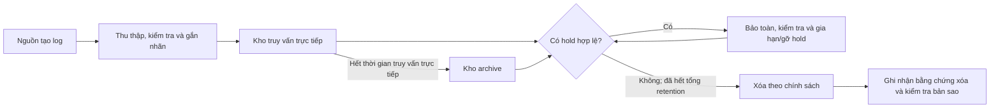

# Log retention: lưu giữ nhật ký bảo mật có kiểm chứng

## 1. Log retention là gì và vì sao cần thiết?

Trong nhóm kiến thức **Logging và monitoring** của học phần **SECURITY_SECURITY_ASSURANCE**, *log retention* là việc xác định và thực thi chính sách **giữ nhật ký (log) trong bao lâu, ở đâu, với mức bảo vệ nào, khi nào được truy xuất và khi nào phải xóa**. Phạm vi này bao gồm log của ứng dụng, hệ điều hành, hạ tầng, dịch vụ đám mây, hệ thống định danh, mạng và công cụ bảo mật.

Log giúp trả lời các câu hỏi của security assurance: một biện pháp kiểm soát có được thực thi không, ai đã thay đổi cấu hình, truy cập bất thường diễn ra khi nào, cảnh báo có được xử lý và biện pháp khắc phục có thực sự hiệu quả không? Câu trả lời phải dựa trên **bằng chứng còn tồn tại, toàn vẹn và truy xuất được** tại thời điểm kiểm tra. Một hệ thống có thu thập log đầy đủ nhưng tự xóa trước khi sự cố bị phát hiện vẫn không đáp ứng được mục tiêu này.

Ở chiều ngược lại, giữ tất cả log vô thời hạn làm tăng chi phí, bề mặt tấn công và nguy cơ lộ thông tin cá nhân hoặc bí mật. Vì vậy, retention cần cân bằng giữa khả năng điều tra, giám sát, kiểm toán, nghĩa vụ pháp lý và nguyên tắc giảm thiểu dữ liệu.

Sau bài học, người học có thể:

- Phân biệt thu thập log, log rotation, retention, archival, backup và xóa log.
- Thiết kế chính sách retention dựa trên loại log, rủi ro, mục đích sử dụng và yêu cầu có thể kiểm chứng.
- Kiểm soát vòng đời log từ khi tạo đến khi hết hạn, bao gồm bản sao, chỉ mục và ngoại lệ bảo toàn chứng cứ.
- Xây dựng phép kiểm tra và bộ bằng chứng chứng minh chính sách retention đang thực sự vận hành.

## 2. Những khái niệm dễ nhầm lẫn

| Khái niệm | Ý nghĩa | Câu hỏi cần trả lời |
|---|---|---|
| **Log collection / ingestion** | Nhận sự kiện từ nguồn vào pipeline và kho log | Sự kiện nào được nhận, có bị mất hay đến muộn không? |
| **Log rotation** | Đổi tệp log đang ghi, thường theo dung lượng hoặc thời gian | Khi tệp đầy thì chuyển sang tệp mới thế nào? |
| **Retention** | Thời gian tối thiểu/cụ thể log phải được giữ, kèm quy tắc hết hạn và xóa | Log phải tồn tại và truy xuất được bao lâu? |
| **Archival** | Chuyển log ít dùng sang tầng lưu trữ có chi phí thấp hơn | Bao lâu có thể khôi phục để điều tra hoặc kiểm toán? |
| **Backup** | Tạo bản sao nhằm phục hồi trước mất mát hoặc hỏng dữ liệu | Nếu kho log hỏng thì khôi phục thế nào? |
| **Legal / investigation hold** | Tạm ngăn xóa một tập log liên quan đến nghĩa vụ hoặc vụ việc cụ thể | Ai được đặt/gỡ hold, dựa trên căn cứ nào và có kiểm tra lại không? |
| **Secure deletion / disposal** | Loại bỏ dữ liệu hết hạn khỏi các vị trí thuộc phạm vi chính sách | Chứng minh được dữ liệu đã hết hạn và được xử lý như thế nào? |

**Rotation không thay thế retention.** Ví dụ, cấu hình xoay tệp mỗi ngày và giữ 7 tệp chỉ kiểm soát vòng đời tệp cục bộ; log đã chuyển sang hệ thống tập trung có thể chịu chính sách 180 ngày khác. **Backup cũng không tự chứng minh retention:** một bản backup khôi phục được có thể chứa log đáng lẽ đã hết hạn nếu quy tắc lưu giữ của backup chưa được xét đến.

Hai khoảng thời gian cần phân biệt:

1. **Thời gian truy vấn trực tiếp (searchable window):** log sẵn sàng trong SIEM hoặc kho phân tích, thường có độ trễ truy vấn thấp.
2. **Thời gian lưu giữ tổng cộng (total retention):** khoảng thời gian log vẫn được bảo tồn, kể cả trong kho archive phải khôi phục trước khi tìm kiếm.

Nếu log được tìm kiếm trực tiếp trong 30 ngày và lưu archive thêm 335 ngày thì **tổng thời gian lưu giữ là 365 ngày**, không phải 30 ngày. Khi đánh giá khả năng điều tra, phải kiểm tra cả SLA khôi phục log archive: “còn dữ liệu” nhưng không lấy ra kịp thời có thể làm mất giá trị nghiệp vụ.

## 3. Đặt yêu cầu retention từ rủi ro và bằng chứng

Không có một thời hạn phù hợp với mọi hệ thống. Khi xây dựng chính sách, người phụ trách phải xác định trước:

1. **Mục tiêu:** phát hiện xâm nhập, điều tra sự cố, kiểm tra quyền truy cập, kiểm toán thay đổi, xử lý tranh chấp, phân tích lỗi hay đáp ứng nghĩa vụ theo quy định/hợp đồng.
2. **Độ nhạy:** log có chứa định danh người dùng, địa chỉ IP, thông tin nhân viên, token, payload yêu cầu, dữ liệu khách hàng hoặc bí mật hay không. Không ghi mật khẩu, access token, khóa bí mật hoặc dữ liệu không cần thiết vào log ngay từ đầu.
3. **Rủi ro mất bằng chứng:** sự cố có thể bị phát hiện muộn đến mức nào, điều tra thường kéo dài bao lâu, bằng chứng có cần đối chiếu với log hệ thống khác không.
4. **Nghĩa vụ áp dụng:** luật, quy định chuyên ngành, hợp đồng, chính sách tổ chức và yêu cầu xóa dữ liệu; cần xác định văn bản, phạm vi áp dụng, người diễn giải và phiên bản. Không suy ra con số bắt buộc chỉ từ tên một tiêu chuẩn chung.
5. **Năng lực vận hành:** dung lượng, chi phí, khả năng truy xuất, thời gian khôi phục, quyền truy cập và cách chứng minh xóa đúng hạn.

Ví dụ bảng phân loại dưới đây dành cho **một hệ thống giả định**, nhằm minh họa cách thiết kế. Các số ngày là *giá trị thử nghiệm*, không phải thời hạn pháp lý hoặc khuyến nghị cố định:

| Nhóm log | Mục đích và đặc điểm | Truy vấn trực tiếp | Tổng retention | Kiểm soát bổ sung |
|---|---|---:|---:|---|
| Đăng nhập, xác thực, khóa tài khoản, thay đổi MFA | Điều tra chiếm quyền tài khoản | 30 ngày | 365 ngày | Hạn chế quyền xóa, phát hiện truy cập trái phép |
| Thay đổi quyền IAM, cấu hình, hành động quản trị | Kiểm toán đặc quyền, dựng lại chuỗi sự kiện | 90 ngày | 365 ngày | Bảo vệ chống sửa/xóa, liên kết danh tính người thao tác |
| Cảnh báo IDS/EDR/WAF và hành động phản ứng | Theo dõi phát hiện, xác minh xử lý | 90 ngày | 365 ngày | Giữ trạng thái xử lý và mã vụ việc |
| Access log API ở mức tối thiểu dữ liệu | Phát hiện tấn công, phân tích lưu lượng | 14 ngày | 90 ngày | Che dữ liệu nhạy cảm, chỉ giữ trường cần thiết |
| Debug log chi tiết từ ứng dụng | Khắc phục lỗi ngắn hạn | 7 ngày | 30 ngày | Tắt log nhạy cảm ở production, phân quyền truy cập |

Một log có thể thuộc nhiều mục đích. Quy tắc hợp nhất cần được lập thành văn bản để không xóa trước khi hoàn tất nghĩa vụ đang áp dụng, đồng thời tránh lưu quá mức không có căn cứ. Đối với hồ sơ đang trong diện bảo toàn chứng cứ, thực hiện cơ chế hold được phê duyệt và theo dõi riêng.

Một chính sách tốt trả lời rõ **nguồn nào thuộc phạm vi, ai sở hữu, thời hạn tính từ thời điểm nào, tầng lưu trữ nào, yêu cầu bảo vệ nào, điều kiện xóa và quy trình ngoại lệ**. Tên gọi “giữ log 1 năm” chưa đủ để biến thành cấu hình có thể kiểm tra.

## 4. Vòng đời log từ nguồn phát sinh đến lúc xóa



Sơ đồ thể hiện luồng khái niệm. Trên thực tế, một sự kiện có thể tồn tại đồng thời trong tệp cục bộ, hàng đợi, SIEM, object storage, kho dữ liệu, chỉ mục tìm kiếm, bản sao đa vùng, snapshot và backup. Retention phải mô tả **từng bản sao**: vị trí, mục đích, người sở hữu, thời hạn và giới hạn xóa. Nếu không, xóa khỏi giao diện SIEM chỉ làm log biến mất khỏi tìm kiếm chứ chưa chứng minh dữ liệu đã được xử lý khỏi các kho khác.

### 4.1. Xác định mốc bắt đầu đếm thời hạn

Cần tách ít nhất hai dấu thời gian:

- `event_time`: thời điểm hành động thực sự xảy ra theo nguồn phát sinh.
- `ingested_at`: thời điểm kho log nhận và ghi nhận sự kiện.

Nếu dựa hoàn toàn vào `event_time` để xóa, một sự kiện đến muộn 60 ngày có thể biến mất ngay khi nhập vào kho với cửa sổ giữ 30 ngày. Nếu dựa hoàn toàn vào `ingested_at`, log có thời gian nguồn sai có thể nằm ngoài khoảng điều tra mong đợi. Chính sách phải chọn mốc tính và mô tả cách xử lý **đến muộn, lệch đồng hồ, timestamp không hợp lệ, phát lại và điều chỉnh dữ liệu**.

Một thiết kế phổ biến là chuẩn hóa thời gian về UTC, lưu cả hai trường, kiểm tra sai lệch cho phép, rồi áp dụng mốc retention đã thống nhất theo loại dữ liệu. Ví dụ, với hệ thống cần bảo đảm log có tối thiểu 30 ngày để nhà điều tra tra cứu **kể từ lúc nhận**, có thể dùng `ingested_at` làm mốc và vẫn sử dụng `event_time` để dựng trình tự sự cố. Lựa chọn này phải được ghi trong tài liệu và kiểm thử, vì ý nghĩa thời hạn theo luật hoặc hợp đồng có thể khác.

### 4.2. Tầng lưu trữ và khả năng phục hồi

- **Hot/searchable:** hỗ trợ tương quan và phát hiện hằng ngày, truy vấn nhanh, chi phí cao.
- **Warm (nếu có):** truy vấn chậm hơn, phù hợp điều tra ít thường xuyên.
- **Cold/archive:** lưu lâu với giá thấp hơn, cần quy trình phục hồi và giới hạn thời gian chờ rõ ràng.

Quy tắc lifecycle cần xác định khi nào chuyển tầng, định dạng archive, cách tra cứu định danh và ai có thể thực hiện phục hồi. Thử khôi phục từ archive theo định kỳ để xác minh **log đọc được, còn đầy đủ ngữ cảnh, timestamp đúng và định danh sự kiện không bị mất**.

### 4.3. Xóa hết hạn và xử lý ngoại lệ

Điều kiện xóa không đơn giản là “log đã đủ số ngày”. Trước khi xóa, cơ chế phải xác định đối tượng đã hết hạn, không có hold hợp lệ, không bị ràng buộc bởi nghĩa vụ lưu giữ khác và nằm trong quy tắc xử lý của từng kho. Chính sách cần quy định độ trễ xóa cho phép vì xóa ở hệ thống phân tán thường diễn ra bất đồng bộ.

**Hold** là ngoại lệ có phạm vi và thời hạn rà soát: gắn với mã vụ việc/căn cứ, người phê duyệt, tập dữ liệu, ngày áp dụng, lịch rà soát và điều kiện gỡ. Không dùng hold không thời hạn hoặc quy tắc “giữ tất cả để phòng khi cần”. Khi gỡ hold, hệ thống đánh giá lại thời hạn theo chính sách: bản ghi đã hết hạn và không còn nghĩa vụ khác phải được đưa vào quy trình xóa.

Với backup hoặc snapshot không hỗ trợ xóa từng bản ghi, phải thiết kế vòng đời backup phù hợp, kiểm soát việc khôi phục dữ liệu đã hết hạn và ghi nhận giới hạn kỹ thuật. Không được khẳng định “đã xóa vĩnh viễn” chỉ vì bản ghi không còn trong chỉ mục tìm kiếm. Nếu sử dụng xóa bằng khóa mã hóa, phải xác minh các bản sao dữ liệu, phạm vi khóa, vòng đời khóa và khả năng giải mã còn tồn tại; đây là biện pháp cần được đánh giá riêng.

## 5. Bảo vệ tính toàn vẹn và khả năng làm chứng cứ

Retention giải quyết *giữ bao lâu*, còn security assurance phải chứng minh log được lưu giữ **đáng tin cậy** trong toàn bộ khoảng thời gian đó.

| Thuộc tính | Cơ chế có thể dùng | Bằng chứng cần xem |
|---|---|---|
| Đầy đủ (*completeness*) | Theo dõi agent, hàng đợi, lỗi gửi, khoảng trống theo nguồn và số sự kiện | Danh mục nguồn, heartbeat, báo cáo mất/đến muộn |
| Toàn vẹn (*integrity*) | Giới hạn sửa/xóa, lưu kiểu append-only, hash/chữ ký hoặc kho immutable khi phù hợp | Cấu hình quyền, kiểm tra hash/chữ ký, lịch sử thay đổi |
| Truy xuất được (*availability*) | Sao lưu/phục hồi, archive có chỉ mục, diễn tập restore | Kết quả truy vấn và phục hồi trong thời hạn yêu cầu |
| Bảo mật (*confidentiality*) | TLS khi truyền, mã hóa khi lưu, least privilege, lọc/redact trường nhạy cảm | Chính sách truy cập, log truy cập kho log, kiểm tra mẫu dữ liệu |
| Trách nhiệm giải trình (*accountability*) | Theo dõi ai xem, xuất, thay chính sách, đặt/gỡ hold và thực thi xóa | Audit trail của quản trị kho log và phê duyệt ngoại lệ |

Quyền của ứng dụng hoặc máy chủ phát sinh log không nên đồng thời cho phép xóa bản sao log đã được gửi tới kho bảo mật tập trung. Tài khoản vận hành thông thường cũng không nên có quyền tắt cơ chế chống sửa/xóa hoặc tự ý rút ngắn retention. Các thay đổi chính sách nhạy cảm cần quy trình phê duyệt, ghi nhận phiên bản và cảnh báo khi cấu hình thực tế lệch chuẩn.

Khi trích xuất log phục vụ điều tra, ghi rõ **nguồn, khoảng thời gian UTC, bộ lọc truy vấn, thời điểm xuất, người thực hiện, định dạng, checksum/hash (nếu áp dụng), nơi lưu chứng cứ và những lần chuyển giao**. Chuỗi quản lý chứng cứ (*chain of custody*) giúp giải thích dữ liệu đã được thu thập, lưu giữ và sử dụng ra sao; một file CSV tải xuống không kèm ngữ cảnh thường chưa đủ.

## 6. Chuyển chính sách thành cấu hình có thể kiểm chứng

Ví dụ sau là **mẫu mô tả chính sách**, không phải cú pháp sẵn dùng của SIEM hay dịch vụ cloud cụ thể:

```yaml
policy_id: SEC-LOG-RET-001
owner: Security Operations
version: "1.0"
timezone: UTC
retention_clock: ingested_at

log_classes:
  authentication:
    sources: [idp, vpn, application_auth]
    searchable_days: 30
    total_retention_days: 365
    archive_restore_target_hours: 4
    integrity_protection: immutable_archive

  application_debug:
    sources: [app_debug]
    searchable_days: 7
    total_retention_days: 30
    sensitive_fields: [authorization, cookie, password]
    sensitive_field_action: do_not_collect

exceptions:
  investigation_hold:
    requires_case_id: true
    requires_approval: true
    review_frequency_days: 30
    blocks_expiration: true

deletion:
  include_indexes_and_replicas: true
  backup_lifecycle_review_required: true
  evidence_record_required: true
```

Khi triển khai, ánh xạ mỗi trường chính sách sang **tài nguyên và cấu hình thực**: index lifecycle, object-storage lifecycle, bucket lock/object lock (nếu được hỗ trợ và phê duyệt), snapshot policy, quyền IAM, khóa mã hóa, lịch tác vụ xóa và hệ thống quản lý hold. Phải kiểm tra xung đột giữa các lớp chính sách: ví dụ, một bucket đặt mặc định giữ 30 ngày không thể đảm bảo lưu log xác thực 365 ngày nếu không có lớp kiểm soát bổ sung.

Không coi `sensitive_fields` trong mẫu là một bộ lọc tự động. Các giá trị như token, mật khẩu hoặc cookie phải được **loại bỏ hoặc che trước khi ghi** bằng cấu hình, thư viện hoặc middleware thực tế, sau đó thử nghiệm với dữ liệu giả. Retention không bù được lỗi ghi dữ liệu nhạy cảm vào log.

### Bản đồ từ yêu cầu đến bằng chứng

| Yêu cầu kiểm soát | Cách triển khai | Cách xác minh |
|---|---|---|
Log đăng nhập phải có sẵn để điều tra trong 30 ngày đầu | Index searchable và lifecycle theo nhóm `authentication` | Truy vấn sự kiện thử ở các mốc gần ngày 0, 29 và 30 |
Log xác thực tồn tại đến hết ngày lưu giữ tổng cộng | Archive 365 ngày, bảo vệ toàn vẹn | Khôi phục mẫu log cũ hơn 30 ngày; kiểm tra checksum và metadata |
Log hết hạn được xử lý, trừ khi có hold | Job lifecycle và dịch vụ quản lý hold | Test boundary hết hạn; kiểm tra danh sách đối tượng còn/tắt hold |
Không ai tự rút ngắn retention trái quy trình | IAM tối thiểu, phê duyệt thay đổi, cảnh báo drift | Kiểm tra quyền, lịch sử thay đổi và cảnh báo cấu hình |
Truy xuất chứng cứ đáp ứng thời gian yêu cầu | Quy trình phục hồi archive có người chịu trách nhiệm | Diễn tập restore, ghi nhận thời gian thực hiện và kết quả |

## 7. Kiểm thử retention bằng kịch bản thực tế

Giả sử một đội vận hành API đặt yêu cầu: log xác thực được truy vấn trực tiếp 30 ngày, bảo tồn tổng cộng 365 ngày; debug log có thời hạn 30 ngày. Đội security assurance có thể kiểm thử trên môi trường thử nghiệm và bộ sự kiện giả lập như sau:

1. **Kiểm tra nguồn và phân loại.** Phát sinh sự kiện đăng nhập thành công, thất bại và thay đổi MFA, xác minh các trường `source`, `event_time`, `ingested_at`, `event_id`, `actor` và nhãn phân loại được giữ chính xác. Kiểm tra log mẫu không chứa token hoặc mật khẩu.
2. **Kiểm tra ranh giới thời hạn.** Gắn dữ liệu thử vào các tuổi log sát mốc 30 và 365 ngày bằng cơ chế fixture/mô phỏng thời gian được hỗ trợ. Kiểm tra dữ liệu trong khoảng 30 ngày còn truy vấn được; dữ liệu đã chuyển sang archive còn khôi phục được; dữ liệu hết hạn đủ điều kiện sẽ được xóa trong cửa sổ thực thi đã cam kết.
3. **Kiểm tra sự kiện đến muộn.** Đưa sự kiện có `event_time` cũ nhưng `ingested_at` mới; đối chiếu xử lý với `retention_clock` và quy tắc chống sai lệch đồng hồ. Thử thêm timestamp thiếu, tương lai và không đúng định dạng.
4. **Kiểm tra hold.** Đặt hold hợp lệ cho một nhóm sự kiện sắp hết hạn, xác minh tác vụ xóa bỏ qua chúng và vẫn xử lý các sự kiện không thuộc hold. Sau khi gỡ hold, xác minh dữ liệu được đánh giá lại và xóa nếu đã hết hạn.
5. **Kiểm tra xóa ở mọi vị trí.** Đối chiếu index, kho dữ liệu gốc, archive, replica và chính sách snapshot/backup. Ghi rõ kho nào đã xóa trực tiếp, kho nào chờ vòng đời backup và thời điểm dự kiến kết thúc.
6. **Kiểm tra khôi phục và quyền.** Dùng vai trò điều tra viên được cấp quyền để phục hồi archive, đo thời gian khôi phục, đọc và kiểm tra toàn vẹn. Vai trò ứng dụng phải bị từ chối khi thử xóa archive hoặc sửa retention.
7. **Kiểm tra giám sát cấu hình.** Cố ý thay đổi thời hạn ở môi trường thử nghiệm, xác minh công cụ phát hiện drift, tạo cảnh báo, ghi nhận chủ sở hữu và đưa cấu hình về trạng thái được phê duyệt.

Mỗi phép thử nên có **đầu vào, cấu hình/phiên bản, điều kiện dự kiến, kết quả thực tế, thời gian UTC và bằng chứng đầu ra**. Thực hiện thử nghiệm xóa trên dữ liệu tổng hợp hoặc môi trường được cấp phép; không thay đồng hồ production hoặc xóa chứng cứ sự cố thật để kiểm tra.

### Trường hợp sai thường bị bỏ sót

- Đếm ngày theo giờ địa phương hoặc theo thời điểm tạo index khiến ranh giới bị sai khi đổi múi giờ.
- Một nguồn log ngừng gửi trong nhiều giờ, nhưng dung lượng kho vẫn đủ nên không ai nhận ra mất dữ liệu.
- Query không tìm được log cũ vì index đã bị xóa, dù object archive vẫn tồn tại.
- Quy tắc xóa không áp dụng với replica hoặc bản sao xuất thủ công.
- Bật hold nhưng không có người chịu trách nhiệm rà soát, khiến dữ liệu được giữ vô thời hạn.
- Một bản khôi phục từ backup đưa log hết hạn trở lại hệ thống mà không tái áp dụng lifecycle.
- Rút ngắn retention qua thay đổi cấu hình mà không có đánh giá tác động đến khả năng điều tra và nghĩa vụ hiện hành.

## 8. Dung lượng, chi phí và độ trễ truy xuất

Retention dài hơn làm tăng chi phí lưu, chỉ mục, sao chép và khôi phục. Có thể ước lượng sơ bộ:

\[
V_{raw} = N_{events/day} \times S_{avg/event} \times D_{days}
\]

Trong đó `N` là số sự kiện mỗi ngày, `S` là kích thước trung bình và `D` là số ngày lưu. Ví dụ, **10 triệu sự kiện/ngày**, trung bình **800 byte/sự kiện**, lưu **90 ngày** tạo khoảng **720 GB dữ liệu thô** (theo đơn vị thập phân). Nếu giữ hai bản sao đầy đủ thì riêng dung lượng dữ liệu thô tương đương khoảng **1,44 TB**, chưa tính index, metadata và overhead.

Dung lượng phải đo thực tế theo từng tầng vì nén, tỷ lệ nhân bản, chỉ mục, bản ghi tăng đột biến và bản sao bảo vệ có thể thay đổi đáng kể kết quả. Đưa cả **chi phí khôi phục archive**, độ trễ đọc và nhân lực vận hành vào quyết định. Có thể giảm chi phí bằng cách chỉ giữ trường cần thiết, dùng sampling **có đánh giá rủi ro** cho log không phục vụ chứng cứ, tối ưu định dạng và phân tầng lưu trữ; không tùy tiện sampling các sự kiện bảo mật trọng yếu cần đầy đủ.

## 9. Vận hành liên tục và đo mức tuân thủ

Chính sách không nên chỉ tồn tại trong tài liệu. Đội vận hành cần giám sát:

| Chỉ số/cảnh báo | Điều cần phát hiện |
|---|---|
**Độ phủ nguồn log**: nguồn gửi được / nguồn dự kiến | Mất hẳn nguồn dữ liệu cần phục vụ assurance |
| **Độ trễ ingestion** và tỷ lệ sự kiện đến muộn | Điều tra thiếu log mới hoặc log bị hết hạn sai |
| **Khoảng trống sự kiện** và lỗi pipeline | Rớt log trước khi lưu giữ |
| **Retention drift** | Cấu hình thực khác thời hạn hoặc yêu cầu bảo vệ đã phê duyệt |
| **Expired-object backlog / deletion lag** | Log đã đủ điều kiện xóa nhưng còn tồn đọng quá thời gian cho phép |
| **Hold quá hạn rà soát** | Ngoại lệ không còn căn cứ nhưng vẫn ngăn xóa |
| **Archive restore success và restore time** | Log lưu lâu nhưng không thể sử dụng khi cần |
| **Thất bại kiểm tra toàn vẹn** | Dữ liệu bị hỏng hoặc có khả năng bị sửa đổi |

Đặt ngưỡng cảnh báo bằng dữ liệu thực tế và yêu cầu rủi ro, tránh đặt số ngẫu nhiên rồi coi là tiêu chuẩn. Mỗi cảnh báo phải có người nhận, cách phân loại, thời hạn xử lý, lưu lại bằng chứng và bước khắc phục. Khi thay đổi kiến trúc, thêm nguồn log hoặc thay nghĩa vụ pháp lý, chủ sở hữu phải cập nhật bảng phân loại và kiểm tra lại lifecycle.

Với hoạt động kiểm toán hoặc đánh giá security assurance, một **gói bằng chứng retention** tối thiểu nên bao gồm: chính sách được phê duyệt và phiên bản đang hiệu lực; danh mục nguồn log và phân loại; sơ đồ các kho/bản sao; cấu hình thực tế và lịch sử thay đổi; kết quả test ranh giới, hold, restore, xóa; thống kê giám sát; nhật ký phê duyệt ngoại lệ; các phát hiện còn tồn tại và bằng chứng khắc phục. Gói chứng cứ phải thể hiện **cả thiết kế kiểm soát và việc kiểm soát đang hoạt động**.

## 10. Tình huống áp dụng: phát hiện lạm dụng đặc quyền muộn

Một tổ chức phát hiện tài khoản quản trị đã thay đổi quyền IAM trái phép **72 ngày trước**. SIEM chỉ giữ 30 ngày searchable; nếu tổ chức chỉ đặt retention 30 ngày thì chuỗi thao tác có thể đã mất. Nếu họ lưu log quản trị 365 ngày và archive có thể khôi phục, nhóm điều tra vẫn có cơ hội đối chiếu log IAM, xác thực, ticket thay đổi và hoạt động trên tài nguyên.

Tuy nhiên, điều tra thành công vẫn phụ thuộc vào các điều kiện khác: nguồn IAM phải phát sinh đủ sự kiện, pipeline không bị rớt dữ liệu, archive giữ nguyên timestamp và định danh, bản ghi không bị sửa, quyền truy xuất được cấp đúng, và việc xuất dữ liệu có hồ sơ chứng cứ. Nếu có yêu cầu bảo toàn phục vụ điều tra, đặt hold cho đúng phạm vi sự kiện, ghi phê duyệt và kiểm tra định kỳ.

**Bài tập thiết kế:** với ba nhóm log `admin_audit`, `api_access`, `app_debug`, hãy lập một bảng ghi mục đích, độ nhạy, mốc retention, searchable window, total retention, vị trí các bản sao, quyền truy cập, cơ chế hold và cách chứng minh xóa. Sau đó mô tả hai phép thử: một kiểm tra log quản trị 72 ngày tuổi có thể khôi phục, một kiểm tra debug log hết hạn và không có hold được xử lý theo thời hạn. Thời hạn cụ thể phải dựa trên dữ kiện tổ chức giả định mà bạn công bố, không suy từ các con số minh họa của bài.

## 11. Điểm cần ghi nhớ

Log retention là một **kiểm soát vòng đời dữ liệu và bảo toàn chứng cứ**, không đơn thuần là thiết lập số ngày lưu trữ. Một chương trình triển khai được phải liên kết rõ:

**Mục tiêu/rủi ro → loại log và nguồn → thời hạn và mốc tính → tầng lưu trữ và bản sao → bảo vệ truy cập/toàn vẹn → hold và xóa → kiểm thử, giám sát, bằng chứng.**

Nếu không truy xuất được log đúng lúc, không xác nhận được tính toàn vẹn hoặc không chứng minh được việc xóa hết hạn, chính sách retention chưa đủ cơ sở để khẳng định mục tiêu security assurance đã được đáp ứng.
