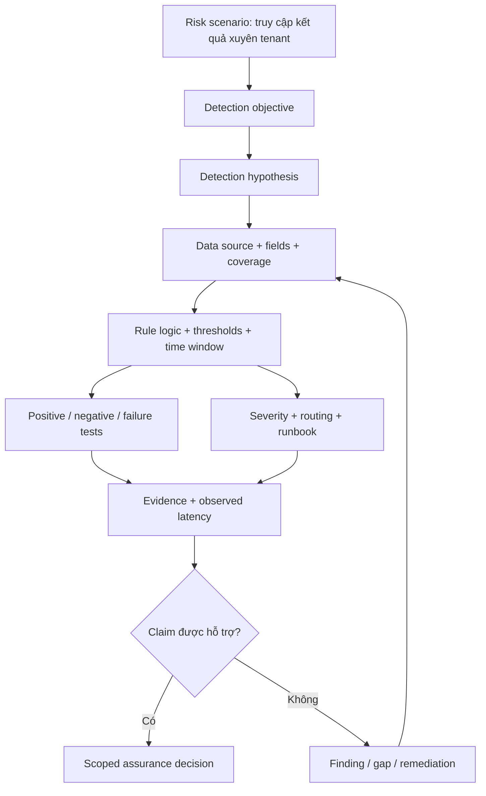
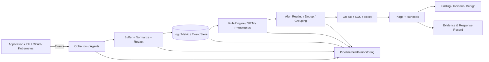
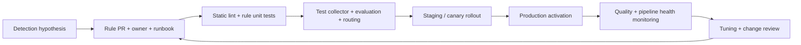
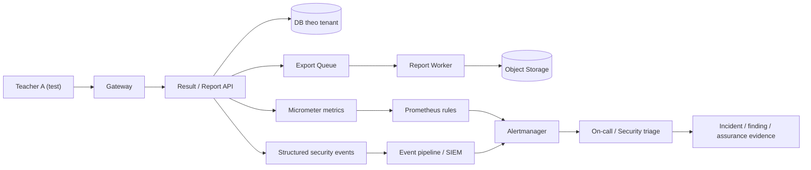

# Alert rule: thiết kế quy tắc cảnh báo bảo mật có thể kiểm chứng

## 1. Vì sao có log chưa chắc đã phát hiện được sự cố?

Một nền tảng học tập Java/Spring Boot có chức năng đọc kết quả thi, xuất bảng điểm và quản trị tài khoản theo nhiều tenant. Hệ thống đã bật access log, audit log và cloud monitoring. Một lần kiểm thử cho thấy tài khoản thuộc tenant A đã liên tiếp gửi yêu cầu đọc tài nguyên thuộc tenant B; backend từ chối đúng bằng HTTP `403`. Mọi request đều có log, nhưng không ai nhận cảnh báo vì dashboard chỉ hiển thị tổng số lỗi HTTP theo ngày.

Ở tình huống khác, một quản trị viên được cấp quyền IAM rộng hơn mức bình thường vào lúc nửa đêm. Cloud audit trail đã ghi sự kiện, nhưng quy tắc cảnh báo chỉ giám sát mức sử dụng CPU. Sự kiện quan trọng bị bỏ qua cho tới kỳ audit tiếp theo.

Hai tình huống minh họa một sự thật: **thu thập log không đồng nghĩa phát hiện được hành vi đáng ngờ**. Cần một cơ chế diễn giải tín hiệu thành quyết định có thể vận hành.

**Alert rule (quy tắc cảnh báo)** là tập điều kiện, phạm vi và hướng xử lý được định nghĩa để chuyển các quan sát từ log, metric, event hoặc trace thành **alert** khi xảy ra hành vi, trạng thái hoặc xu hướng cần quan tâm. Trong bảo mật, alert rule phải gắn với **risk scenario, security requirement, detection objective, tín hiệu có thể quan sát, mức độ tin cậy và hành động phản hồi**.

Trong chương **Logging và monitoring** của module **SECURITY_SECURITY_ASSURANCE**, alert rule là một **detective security control** quan trọng. Mục đích không chỉ gửi thông báo, mà là có bằng chứng rằng tổ chức **có thể phát hiện, chuyển thông tin và xử lý các tình huống liên quan đến rủi ro**, đồng thời kiểm soát sai sót, bảo vệ dữ liệu quan sát và cải thiện liên tục.

### Mục tiêu học tập

Sau bài học, bạn có thể:

1. Phân biệt event, signal, detection, alert, finding và incident.
2. Chuyển threat scenario và security invariant thành detection hypothesis và acceptance criteria.
3. Xác định nguồn log/metric/audit/trace, schema dữ liệu và trust boundaries của pipeline.
4. Thiết kế alert rule có điều kiện, cửa sổ thời gian, threshold, grouping, severity và routing hợp lý.
5. Áp dụng aggregation, deduplication, suppression, maintenance window và correlation mà không che mất rủi ro.
6. Viết ví dụ alert rule cho Prometheus/Alertmanager và SIEM ở mức mô tả đúng ngữ cảnh.
7. Thiết kế cảnh báo cho authentication, authorization đa tenant, IAM, audit logging và Kubernetes.
8. Đánh giá precision, recall, false positives, false negatives, detection delay và alert fatigue.
9. Kiểm thử alert end-to-end từ **event → ingestion → evaluation → notification → triage**, thu evidence để phục vụ assurance.
10. Gắn alerts với runbook, incident response, remediation, audit và continuous monitoring.

## 2. Những khái niệm phải phân biệt

| Khái niệm | Ý nghĩa | Ví dụ |
|---|---|---|
| **Event** | Một sự kiện được quan sát hoặc ghi nhận | Người dùng gửi request tải báo cáo |
| **Log record** | Bản ghi mô tả event/diagnostic | JSON chứa `actorId`, `action`, `decision` |
| **Metric** | Phép đo số học được tổng hợp theo thời gian | Số lượt `authorization deny` trong năm phút |
| **Trace/span** | Quan sát đường đi của một request hoặc workflow | API → queue → worker → object storage |
| **Signal** | Thông tin có thể liên quan tới trạng thái/rủi ro | Tần suất denied requests tăng bất thường |
| **Detection hypothesis** | Giả thuyết có thể kiểm tra về tín hiệu của hành vi đáng ngờ | Thử truy cập nhiều object trái quyền có thể là dấu hiệu dò quyền |
| **Alert rule** | Logic chuyển tín hiệu thành điều kiện cảnh báo | `count(denied_cross_tenant) > threshold` trong cửa sổ |
| **Alert instance** | Một lần quy tắc được kích hoạt cho scope/group cụ thể | Alert “CrossTenantAuthorizationDenials” trên service A |
| **Finding** | Vấn đề được xác minh, có evidence và tác động | Authorization bị bypass qua API cũ |
| **Security incident** | Sự kiện/chuỗi sự kiện được phân loại cần ứng phó theo policy | Nghi ngờ lộ dữ liệu người học |
| **Notification** | Việc chuyển thông tin alert tới người/hệ thống tiếp nhận | Pager, ticket, chat channel hoặc webhook |
| **Runbook/playbook** | Các bước phân tích và xử lý đã định | Kiểm tra log, xác nhận phạm vi, escalation |
| **Assurance evidence** | Dữ liệu hỗ trợ claim về control | Synthetic event tạo alert, delivery receipt, triage record |

**Không phải mọi alert là incident**: một alert có thể do thay đổi hợp lệ, test, deployment hoặc lỗi dữ liệu. Ngược lại, **không có alert không chứng minh không có tấn công**; có thể rule chưa bao phủ, telemetry bị mất hoặc điều kiện phát hiện chưa đủ.

### Một ví dụ về chuỗi quyết định

```text
HTTP request / admin action
    -> application/cloud event
    -> log hoặc metric đã được chuẩn hóa
    -> alert rule evaluate
    -> alert instance và notification
    -> người/automation triage
    -> confirmed finding / incident / benign event / unknown
    -> remediation + detection improvement
```

Mỗi giai đoạn có thể thất bại độc lập. Một rule đúng về cú pháp chưa chắc chứng minh thông báo tới người trực; một notification đã gửi chưa chắc được nhận hoặc xử lý.

## 3. Vai trò của alert rule trong security assurance

**Security assurance** tìm bằng chứng rằng một hệ thống đáp ứng mục tiêu bảo mật. Alert rule thường giúp hỗ trợ ba nhóm claim:

1. **Detectability:** hệ thống có khả năng phát hiện một lớp hành vi hoặc vi phạm control.
2. **Timeliness:** tín hiệu quan trọng được phát hiện và chuyển đi trong độ trễ chấp nhận được.
3. **Operability:** có owner, routing, runbook và quy trình xử lý alert thực tế.

### Ví dụ một assurance claim có giới hạn

> **CLM-DET-01:** Trên release R của `result-service` thuộc staging cluster C, các chuỗi yêu cầu bị từ chối do truy cập đối tượng ngoài tenant được ghi nhận, đưa vào hệ thống quan sát, đánh giá theo rule DET-01 và gửi tới kênh trực trong thời hạn thử nghiệm đã định.

Để hỗ trợ claim này cần:

- Security requirement về việc phát hiện hành vi dò quyền.
- Log/metric schema với các thuộc tính cần thiết.
- Rule DET-01 đúng version và environment.
- Test events hợp lệ, invalid và boundary cases.
- Kết quả thực tế của rule evaluation.
- Routing/delivery evidence, owner và runbook.
- Thời điểm phát sinh, ingestion, firing và nhận thông báo.
- Phạm vi tài sản, những nguồn chưa được bao phủ và limitations.

**Không đủ:** “Trong repository có file alert YAML” hoặc “Alertmanager đang chạy”.

### Từ rủi ro đến bằng chứng



Một alert rule có thể phát hiện hoạt động bất thường dù các preventive controls đã chặn thành công. Điều này quan trọng: **“bị từ chối” không nhất thiết là sự cố; chuỗi bị từ chối vẫn có thể là tín hiệu thăm dò hoặc cấu hình client sai cần phân tích**.

## 4. Đầu vào của rule: risk scenario và detection hypothesis

Không nên bắt đầu bằng câu “Có log nào thì viết alert cho log đó”. Cách hiệu quả hơn là hỏi:

**Điều gì có thể gây hại? Nếu xảy ra, hệ thống có thể quan sát dấu hiệu nào?**

### 4.1. Ma trận rủi ro và tín hiệu

| Risk scenario | Security property | Detection hypothesis | Tín hiệu quan sát được |
|---|---|---|---|
| Credential stuffing | Chỉ principal hợp lệ đăng nhập được | Nhiều xác thực thất bại theo tài khoản/nguồn trong cửa sổ | Auth failure events, source context |
| Dò đối tượng xuyên tenant | Không truy cập object ngoài quyền | Chuỗi object authorization denies bất thường | `reason=cross_tenant`, service, actor class |
| Thay quyền quản trị ngoài quy trình | Privileged access có approval | Privilege grant ngoài cửa sổ/nguồn được duyệt | Cloud IAM admin change audit events |
| Tắt audit logging | Security events vẫn được thu nhận | Configuration change hoặc log gap được quan sát | Audit config events, collector health |
| Tải dữ liệu bất thường | Data access theo policy | Gia tăng đột biến export/download thành công của dữ liệu nhạy cảm | Export job count, object access logs |
| Service account bị lạm dụng | Workload identity quyền tối thiểu | Workload gọi action/resource không thuộc profile | IAM denied/allowed cloud API events |
| Kubernetes privilege drift | Workloads không chạy đặc quyền ngoài policy | Pod mới có config bị cấm hoặc admission violation | Admission/audit/cluster posture events |
| Lỗi availability do abuse | API duy trì SLO và resource budget | Quota/resource exhaustion bất thường | Rate-limit events, queue depth, latency |
| Key/secret thay đổi bất thường | Key được quản lý theo policy | Secret/key policy update không có change ticket | KMS/secret/audit changes |

### 4.2. Một detection hypothesis tốt phải có

1. **Threat actor hoặc điều kiện sai:** ai/cái gì có thể gây ra.
2. **Affected asset:** user, dữ liệu, service, tenant, cloud account.
3. **Observable behavior:** sự kiện cụ thể có thể xuất hiện.
4. **Data availability assumptions:** event source có tồn tại, được log và truyền đủ.
5. **Selection logic:** quy tắc phân biệt tín hiệu đáng điều tra với hoạt động bình thường.
6. **Response expectation:** ai tiếp nhận, kiểm gì và khi nào escalation.
7. **Validation method:** cách tạo kịch bản thử an toàn và xác minh end-to-end.
8. **Known blind spots:** hành vi nào có thể không được phát hiện.

### 4.3. Mapping với MITRE ATT&CK

Các nhóm có thể dùng kỹ thuật và chiến thuật của MITRE ATT&CK để đặt detection objectives và kiểm soát coverage. Tuy nhiên mapping chỉ là **phương tiện phân loại**, không tự xác nhận rule phát hiện được mọi biến thể của kỹ thuật. Cần mô tả dấu hiệu quan sát thực tế, source và assumptions.

**Không dùng số lượng ATT&CK techniques được gắn nhãn như thước đo duy nhất cho chất lượng detection.** Một rule rất quan trọng về dữ liệu tenant có thể không có mapping trực tiếp hoàn hảo nhưng vẫn có giá trị cao.

## 5. Nguồn dữ liệu: logs, metrics, traces và audit events

### 5.1. Chọn nguồn theo đặc tính

| Nguồn | Dùng tốt để phát hiện | Rủi ro nếu dùng riêng |
|---|---|---|
| **Application security events** | Authentication, authorization, export, privilege changes | Developer có thể quên emit ở một code path |
| **HTTP access logs** | Request volume, status, endpoint, latency | `403` không cho biết vì sao deny hoặc actor có quyền gì |
| **Prometheus-style metrics** | Rates, counts, resource saturation, error ratios | High-cardinality labels và thiếu event context |
| **Distributed tracing** | Request chain, span errors, queue-worker path | Sampling có thể bỏ qua giao dịch quan trọng |
| **Cloud audit logs** | IAM, resource policy, control-plane actions | Event coverage/latency/regions khác nhau theo service |
| **Identity provider logs** | Login, MFA, sessions, token issuance | Không thấy application object authorization |
| **Kubernetes audit/admission** | API server changes, privileged resources | Không thay runtime syscall/network observations |
| **Network/flow logs** | Accepted/denied flows, unusual egress | Có thể thiếu identity/user và nội dung ứng dụng |
| **Database audit logs** | Privileged DB operations, access violations | Có thể không biết tenant của request nghiệp vụ |
| **Storage access logs** | Object downloads, permission denies | Không luôn có request context hoặc application actor |
| **CI/CD change events** | Deployments, policy changes, build identity | Một change hợp lệ không tự chứng minh runtime an toàn |

### 5.2. Tính đầy đủ của tín hiệu

Với mỗi rule, cần trả lời:

- Event có được phát trên **mọi entry point** thuộc scope không?
- Có đi qua gateway, service, queue và worker như thiết kế không?
- Identity actor có được propagation chính xác qua async processing không?
- Log pipeline có lọc bỏ hoặc sampling mất security events quan trọng không?
- Có thể liên kết request bằng correlation ID không?
- Thời gian event và thời gian collector nhận có đáng tin không?
- Các môi trường, versions, namespaces/regions có cùng schema không?

**Một rule hoàn hảo trên dữ liệu không đầy đủ vẫn là một detective control yếu.** Nên xem coverage của nguồn dữ liệu là phần độc lập trong assurance.

## 6. Thiết kế schema sự kiện bảo mật

Alert rule bền vững cần sự kiện **có cấu trúc, nhất quán và đủ ngữ cảnh**, không dựa hoàn toàn vào regex trên thông điệp tự do.

### 6.1. Các trường được đề xuất

| Field | Ý nghĩa | Lưu ý |
|---|---|---|
| `event_time` | Thời điểm event xảy ra | UTC, đồng bộ thời gian, precision |
| `received_time` | Thời điểm pipeline nhận | Đo ingestion lag |
| `event_type` | Loại sự kiện ổn định | Ví dụ `authorization_decision` |
| `schema_version` | Phiên bản cấu trúc | Tránh phá rule khi đổi ứng dụng |
| `service` / `environment` | Nguồn phát và phạm vi | Bounded dimensions |
| `resource_type` | Loại tài nguyên | `result`, `report`, `class` |
| `action` | Hành động nghiệp vụ | `read`, `export`, `grant_role` |
| `decision` | `allow`, `deny` hoặc error | Phân biệt fail-safe và exception |
| `reason_code` | Mã lý do có cấu trúc | `cross_tenant`, `missing_permission` |
| `actor_ref` | Định danh actor đã kiểm soát | Cân nhắc pseudonymization, hạn chế PII |
| `actor_kind` | User, workload, admin, anonymous | Enum bounded |
| `tenant_ref` | Phạm vi tenant khi cần | Có thể nhạy cảm, không đưa vào metric labels tùy ý |
| `target_ref` | Đối tượng bị thao tác | Cần minimization, không log nội dung dữ liệu |
| `request_id` / `trace_id` | Liên kết yêu cầu và spans | Kiểm tra không lộ thông tin nhạy cảm |
| `source_context` | Network/identity context đã chuẩn hóa | Không tin header do client tự khai |
| `outcome` | Kết quả thực tế | Cần phân biệt deny và side effect xảy ra |
| `policy_version` | Phiên bản policy được áp dụng | Tốt cho audit, tương thích schema |

### 6.2. JSON event minh họa

```json
{
  "schema_version": "1.0",
  "event_type": "authorization_decision",
  "event_time": "2026-11-28T04:00:00Z",
  "service": "result-service",
  "environment": "staging",
  "actor_kind": "user",
  "actor_ref": "pseudonym-test-teacher-A",
  "tenant_ref": "tenant-A",
  "resource_type": "result",
  "target_ref": "synthetic-result-B",
  "action": "read",
  "decision": "deny",
  "reason_code": "cross_tenant",
  "request_id": "test-request-001",
  "trace_id": "test-trace-001",
  "policy_version": "authz-v5",
  "outcome": "request_blocked"
}
```

Đây là event **giả lập**. Tên, identity và thời gian chỉ minh họa; một pipeline thật phải định nghĩa các trường theo chính sách log/data privacy riêng.

### 6.3. Những gì không nên đưa vào log

- Raw bearer token, refresh token, session cookie, API key, private key.
- Mật khẩu, OTP, mã phục hồi tài khoản.
- Nội dung bảng điểm, bài thi, tệp cá nhân hoặc JSON body không cần thiết.
- Dữ liệu nhạy cảm trong query string hoặc signed URL nguyên vẹn.
- Thông tin định danh cá nhân dư thừa nếu không phục vụ detection và không có quyền xử lý.

Một event đủ để biết “đã có quyết định từ chối quyền trên object type X ở tenant boundary” thường không cần lưu nguyên record dữ liệu hoặc token của người gọi.

### 6.4. Ngữ cảnh phải có nguồn tin cậy

Không tự tin `X-Forwarded-For` hoặc `X-Tenant-ID` từ client trực tiếp làm dữ liệu chắc chắn. Nếu cần nguồn IP/tenant, hãy xác định trusted proxy chain, verified principal và phép ánh xạ phía server. Rule bị poisoning hoặc gây false attribution nếu các trường phân loại do caller tự khai không được xác minh.

## 7. Kiến trúc alerting và các ranh giới tin cậy



### 7.1. Các trust boundaries

1. **Producer → Collector:** event phải đến từ nguồn định danh đáng tin, có hạn chế ai được gửi.
2. **Collector → Pipeline:** dữ liệu được chuẩn hóa, redacted, chống injection/poisoning và không mất ngầm.
3. **Pipeline → Storage:** retention, access control, encryption, integrity và timestamp.
4. **Storage → Rule engine:** quyền query, phiên bản schema, độ trễ và kết quả đầy đủ.
5. **Rule → Notification:** nhóm, mức độ, route, retries, dedup, suppression.
6. **Notification → Responder:** người nhận thực, lịch trực, acknowledgement/escalation.
7. **Responder → Evidence store:** triage outcome, action, approval, audit trail.

### 7.2. Một alert có thể mất ở đâu?

- Ứng dụng không phát security event trên một code path.
- Agent bị dừng hoặc quota/throttling làm drop event.
- Parser đổi schema, rule filter không còn match.
- Event time sai, window evaluation bỏ qua hoặc xử lý muộn.
- Query giới hạn cardinality/rate, bị timeout.
- Rule bị tắt hoặc chỉ chạy ở staging.
- Notification bị mute, routing sai hoặc webhook không khả dụng.
- Pager được gửi tới lịch trực không còn người phụ trách.
- Ticket được tạo nhưng không có owner hay follow-up.

Mọi nơi trong chuỗi đều có thể trở thành **điểm yếu của detective control** cần kiểm chứng.

## 8. Cấu trúc đầy đủ của một alert rule

Một rule chuyên nghiệp thường có hai phần: **detection logic** và **operational contract**.

| Thành phần | Câu hỏi |
|---|---|
| **Rule ID/name** | Định danh ổn định, không trùng lặp? |
| **Owner** | Ai chịu trách nhiệm chất lượng và cập nhật rule? |
| **Security objective** | Risk/control/requirement nào rule phục vụ? |
| **Data source** | Log/metric/audit stream cụ thể và phạm vi nào? |
| **Required fields** | Những trường nào phải tồn tại và được xác minh? |
| **Filter** | Sự kiện nào được chọn? |
| **Aggregation** | Đếm/tính tỷ lệ/correlate theo actor, service, action hay tenant? |
| **Time window** | Quan sát trong bao lâu và event/processing time thế nào? |
| **Threshold/model** | Điều kiện nào tạo tín hiệu? |
| **Persistence/debounce** | Điều kiện phải tồn tại bao lâu để giảm nhiễu? |
| **Severity/priority** | Tác động, độ tin cậy và độ khẩn cấp theo policy? |
| **Grouping/dedup key** | Những alerts nào là một trường hợp? |
| **Routing** | Nhóm/ca trực/kênh nào phải nhận? |
| **Runbook link** | Cách xác minh, điều tra, escalation, dừng nhầm? |
| **Silence/exception rules** | Có giới hạn scope, approval, expiry không? |
| **Test plan** | Positive, negative, boundary và delivery tests? |
| **Evidence lifecycle** | Lưu cấu hình, test results, alert/ack logs ở đâu? |
| **Review trigger** | Khi nào phải chỉnh rule theo behavior hoặc change? |

### 8.1. Rule-as-code minh họa (không thuộc engine cụ thể)

```yaml
rule_id: "DET-AUTHZ-001"
name: "CrossTenantAuthorizationDenialBurst"
owner: "application-security"
objective: "Phát hiện chuỗi truy cập đối tượng ngoài tenant"
requirement_id: "REQ-DETECTION-TENANT-01"
source:
  kind: "application-security-events"
  event_type: "authorization_decision"
  required_fields:
    - "event_time"
    - "service"
    - "decision"
    - "reason_code"
logic:
  filter:
    decision: "deny"
    reason_code: "cross_tenant"
  aggregation: "count"
  group_by: ["service", "environment"]
  window: "5m"
  threshold: "greater_than_10"
  persistence: "2m"
response:
  severity: "medium"
  route: "application-security-triage"
  runbook: "internal://<approved-runbook-reference>"
quality:
  known_benign_sources: "approved synthetic tests, with controlled tagging"
  missing_data: "INCONCLUSIVE"
  review_frequency: "<risk-defined-cadence>"
status: "DRAFT_NOT_EVALUATED"
```

Đây là **mô tả logic**, không phải YAML chạy được nguyên văn trong Prometheus hay SIEM. Ngưỡng `10` và cửa sổ năm phút chỉ là giá trị minh họa, phải được hiệu chỉnh bằng traffic bình thường và yêu cầu phát hiện của hệ thống.

### 8.2. Một điều kiện không đủ nếu không có đường xử lý

Một rule chỉ có `expression` không cho biết ai xử lý, mất bao lâu được coi là chấp nhận, sự kiện nào là benign hoặc cách tạo bằng chứng retest. Với security assurance, **owner, runbook, routing, tests và review history là một phần thiết yếu**.

## 9. Các dạng logic phát hiện

| Loại rule | Ý tưởng | Ví dụ | Điểm cần cẩn trọng |
|---|---|---|---|
| **Single-event match** | Một event đủ quan trọng để alert | Disable audit logging hoặc privileged grant bất thường | Context/approval để tránh báo giả |
| **Count/threshold** | Số event vượt giới hạn | Nhiều lần authz deny trong năm phút | Ngưỡng và traffic baseline |
| **Rate/ratio** | Tỷ lệ thay vì số đếm tuyệt đối | Tỷ lệ login failures / attempts | Denominator nhỏ, missing series |
| **Anomaly/baseline** | Sai khác khỏi hành vi bình thường | Export đột biến ngoài giờ | Seasonality, drift, model training |
| **Sequence/correlation** | Nhiều event có quan hệ | Privilege grant → sensitive download | Event ordering, clock skew, identity linkage |
| **Absence/heartbeat** | Không có tín hiệu phải tồn tại | Audit collector ngừng gửi heartbeat | Missing data khác không có sự kiện |
| **State change** | Thay đổi cấu hình hoặc quyền quan trọng | Bucket chuyển từ private sang public | Approved changes và provider event semantics |
| **Risk scoring** | Kết hợp nhiều tín hiệu mức thấp | Multiple deny + unusual role + data export | Score transparency, explainability |
| **SLO/availability** | Hành vi vận hành ảnh hưởng mục tiêu | Queue backlog hoặc error burst | Không phải mọi lỗi availability là attack |

### 9.1. Không dùng một điều kiện cho mọi bài toán

Một thay đổi IAM nhạy cảm có thể cần cảnh báo theo **từng event** mà không chờ 10 lần. Ngược lại, một lần đăng nhập sai thường không đủ để báo sự cố. Một mất heartbeat cần logic **absence detection**, không thể viết bằng một biểu thức `count > threshold` thông thường.

### 9.2. Kết hợp tín hiệu để tăng chất lượng

Khi một user vừa có nhiều denied cross-tenant requests vừa tạo hàng loạt export jobs, tình huống có thể đáng ưu tiên hơn chỉ một trong hai. Tuy nhiên phải xác minh sự kiện liên quan **cùng verified actor/context**; không gộp chỉ vì IP chung của trường học hoặc NAT.

### 9.3. Detection dựa trên anomaly không tự đúng

Một mô hình thống kê có thể coi tăng traffic trong kỳ thi là bất thường nhưng hợp lệ. Cần hiểu lịch học, ngày kiểm tra, triển khai tính năng mới, mùa cao điểm và cả tín hiệu an ninh. Rule phải có owner điều chỉnh và đánh giá false positives, không để model score quyết định mọi hành động tự động.

## 10. Cửa sổ thời gian, threshold và điều kiện kéo dài

Alert rules thường lấy dữ liệu theo cửa sổ trượt `[5m]`, `[15m]` hoặc một khoảng thời gian định nghĩa. Chọn sai cửa sổ có thể khiến alert quá chậm hoặc quá nhiễu.

### 10.1. Những câu hỏi thiết kế

- Một lần xảy ra đã cần escalation chưa?
- Số lần/rate nào bất thường so với traffic thường ngày?
- Đơn vị aggregation là service, tenant, actor hay toàn hệ thống?
- Event time khác ingestion time đến mức nào?
- Điều kiện phải liên tục hay chỉ cần tổng số vượt ngưỡng?
- Có cần điều kiện phục hồi hoặc hysteresis để tránh alert nhấp nháy?
- Có thay đổi baseline theo giờ/ngày/kỳ thi không?
- Tối đa bao lâu từ event đến notification là chấp nhận được?

### 10.2. So sánh ba rule

| Rule | Logic minh họa | Lợi ích | Rủi ro |
|---|---|---|---|
| A | Một lần `401` → alert | Độ nhạy cao | Quá nhiều benign failures |
| B | 10 lần auth failures / 5 phút theo actor | Giảm thông báo đơn lẻ | Dễ bỏ qua thử nghiệm chậm hoặc phân tán |
| C | 10 lần auth failures / 5 phút + hành vi khác + asset context | Có thể tăng precision | Phụ thuộc nhiều nguồn; có thể miss khi nguồn thiếu |

Không có rule nào “luôn tốt nhất”. Quyết định dựa trên detection objective, risk appetite, baseline, downstream triage capacity và chi phí bỏ sót.

### 10.3. Threshold không phải phép đo rủi ro tuyệt đối

Một ngưỡng `count > 10` không có nghĩa sự kiện thứ 11 chắc chắn là tấn công. Nó chỉ tạo **ứng viên cần điều tra**. Ngược lại kẻ tấn công có thể hành động dưới ngưỡng hoặc phân phối hành vi; vì vậy threshold detection nên được bổ sung bằng controls khác, event correlation hoặc review định kỳ theo risk.

### 10.4. Cửa sổ ngắn và dài

- Cửa sổ ngắn phát hiện bursts nhanh nhưng dễ nhiễu.
- Cửa sổ dài ổn định hơn nhưng trễ và dễ hòa lẫn các nguồn.
- Một rule theo actor có thể bỏ qua low-and-slow across actors.
- Một rule tổng hợp toàn service có thể bị traffic lớn che một tenant nhỏ.

Nên dùng risk-based segmentation khi hữu ích, nhưng phải cân bằng **cost, privacy, cardinality và alert volume**.

### 10.5. Event time, processing time và late arrivals

SIEM xử lý các events bị gửi trễ cần xác định semantics: lấy `event_time` hay `ingested_at` để đặt window? Nếu đồng hồ lệch hoặc queue delay quá lâu, thứ tự sự kiện và correlation có thể sai. Evidence của detection nên lưu cả thời điểm event, ingestion, evaluation và notification để đánh giá độ trễ thực.

## 11. Thiết kế cảnh báo cho authentication

### 11.1. Các risk scenarios

- Credential guessing hoặc credential stuffing.
- MFA challenge bất thường hoặc nhiều lần thất bại.
- Đăng nhập thành công sau chuỗi thất bại đáng chú ý.
- Thay đổi recovery factor, MFA policy hoặc privileged session.
- Một identity không thường dùng xuất hiện ở môi trường nhạy cảm.
- Revoked credential vẫn được sử dụng trong thời gian không phù hợp policy.

### 11.2. Ma trận rule gợi ý

| Detection objective | Tín hiệu | Hành động ban đầu |
|---|---|---|
| Phát hiện chuỗi login failures | Auth failure count theo identity/source context | Triage nguyên nhân, không mặc định compromise |
| Phát hiện đăng nhập bất thường | Event success gắn với device/location/context mới | Xác minh rủi ro theo IdP và privacy policy |
| Phát hiện thay đổi MFA quan trọng | MFA method/policy change | Xác nhận approval và actor |
| Phát hiện sử dụng credential bị thu hồi | Revoked key/token access attempts | Kiểm tra revocation lifecycle và misuse |
| Phát hiện IdP audit gap | Collector heartbeat/log feed absence | Kiểm tra telemetry, không coi “0 failures” là an toàn |

### 11.3. Tránh attribution sai

Một trường học có hàng nghìn người dùng dùng cùng proxy/NAT. Vì vậy IP không phải identity đáng tin để suy ra một actor. Một rule gom chỉ theo IP có thể gộp nhiều user hợp lệ, gây false positive. Tùy mục đích có thể kết hợp verified principal pseudonym, source context, device/session và tenant boundaries với privacy safeguards.

### 11.4. Khóa tài khoản tự động không phải hành động mặc định

Tự động khóa tất cả tài khoản bị nhiều login failures có thể bị lạm dụng để gây denial of service, đặc biệt trong kỳ thi. Response automation phải đánh giá khả năng gây hại, scope, các phương án như step-up authentication/rate limit và thẩm quyền phê duyệt. Alert rule nên tách **phát hiện** khỏi **hành động phá vỡ phiên hoặc vô hiệu hóa tài khoản**, trừ khi playbook đã được phê duyệt và kiểm thử.

### 11.5. Hạn chế logs chứa thông tin cá nhân

Authentication logs có thể bao gồm địa chỉ IP, device identifiers và định danh user. Cần giảm chi tiết không cần thiết, kiểm soát retention, quyền truy cập và dữ liệu truyền qua kênh alert. Thông báo paging thường chỉ cần rule ID, severity, service, window và link tới hồ sơ nội bộ hạn chế quyền; không cần gửi nguyên token hoặc hồ sơ người học.

## 12. Alert rule cho authorization và tenant isolation trong Spring Boot

### 12.1. Phân biệt hai điều cần chứng minh

**Preventive objective:** backend chặn request truy cập dữ liệu tenant khác hoặc thao tác ngoài quyền.

**Detective objective:** khi xuất hiện mẫu truy cập trái quyền đáng quan tâm, tổ chức nhận được tín hiệu đủ sớm để điều tra.

Hai mục tiêu độc lập nhưng bổ sung nhau. Backend có thể từ chối thành công mọi request trái quyền mà rule không gửi cảnh báo. Ngược lại rule có thể gửi hàng trăm alert nhưng API vẫn lộ dữ liệu nếu authorization bị bypass.

### 12.2. Tín hiệu cho một quyết định từ chối quyền

Ví dụ event `authorization_decision`:

```json
{
  "schema_version": "1.0",
  "event_type": "authorization_decision",
  "service": "report-service",
  "environment": "staging",
  "action": "export",
  "resource_type": "class_report",
  "actor_kind": "user",
  "actor_ref": "synthetic-teacher-A",
  "decision": "deny",
  "reason_code": "cross_tenant",
  "request_id": "synthetic-request-002",
  "outcome": "no_export_job_created"
}
```

`outcome` trong event do ứng dụng phát chỉ có giá trị nếu logic thật sự xác nhận trạng thái. Khi một API trả `403` sau khi đã publish message, ghi `no_export_job_created` là **log sai thực tế**. Có thể cần đo độc lập job/event/storage state khi test control.

### 12.3. Instrument metric có labels giới hạn

Với Java/Spring Boot và Micrometer, có thể đo số quyết định authorization:

```java
// Ví dụ instrumentation sau khi backend đã đưa ra quyết định thực tế.
// Counter tên và tag trong mã là quy ước do dự án tự định nghĩa.
public void recordAuthorizationDecision(
        MeterRegistry registry,
        String service,
        String decision,
        String reason) {

    Counter.builder("security.authorization.decisions")
        .description("Security authorization decisions")
        .tag("service", service)
        .tag("decision", decision) // Enum: allow / deny / error
        .tag("reason", reason)     // Mã nguyên nhân có tập giá trị giới hạn
        .register(registry)
        .increment();
}
```

**Đây là fragment minh họa**, chưa có đầy đủ import, validation và nơi gọi. `reason` và `service` phải được chuẩn hóa theo danh sách cho phép; không nhận chuỗi tùy ý từ request.

Quan trọng:

- Không đưa `userId`, `email`, token, `requestId` hoặc object ID vào metric labels vì **high cardinality, privacy risk và chi phí lưu trữ**.
- Chỉ tăng counter khi biết quyết định thuộc loại nào; phân biệt `deny` với `error`.
- Không giả định chỉ có denial là dấu hiệu tấn công; nhiều denial có thể là policy mismatch hoặc client bug.
- Cần ghi event chi tiết, có kiểm soát truy cập, để triage khi metric aggregation kích hoạt.
- Nếu cần theo tenant, xem số lượng tenant có ổn định/được phép đưa vào labels không; thường nên giữ ID nhạy cảm ở event store thay vì metrics.

### 12.4. Từ ứng dụng đến Prometheus

Micrometer/Prometheus exposition có thể biến tên `security.authorization.decisions` thành series dạng `security_authorization_decisions_total` cho counter, tùy naming convention, registry và phiên bản đang dùng. **Không nên coi tên minh họa là tên chắc chắn có sẵn**; hãy quan sát output metrics trong môi trường thực rồi viết rule theo tên chính xác.

Các thiết bị/trình thu thập phải bảo vệ metrics endpoint theo policy. Metadata trên metrics có thể tiết lộ topology hoặc trạng thái hệ thống dù không chứa mật khẩu.

### 12.5. Positive và negative detection tests

| Case | API/security behavior | Alert behavior |
|---|---|---|
| Teacher A đọc kết quả của mình | Allow | Không tạo denied signal |
| Teacher A đọc một kết quả tenant B | Deny | Ghi event, chưa nhất thiết paging |
| Nhiều requests trái tenant trong test window | Deny toàn bộ | Rule có thể kích hoạt theo threshold |
| Một request hợp lệ sau một denial | Allow | Không tạo thêm denial |
| Event không có `reason_code` hợp lệ | Reject/quarantine/log parser error theo policy | Không được âm thầm coi là zero risk |
| Telemetry collector không hoạt động | API vẫn enforce permission | Cảnh báo pipeline health, không giả kết luận sạch |
| API v1 bỏ qua authz | Một failure ở preventive control | Phải có coverage cho success anomaly và pentest/regression, không chỉ denied count |

**Điểm mù quan trọng:** nếu BOLA làm server **cho phép** truy cập trái tenant, rule chỉ đếm `decision=deny` có thể không phát hiện. Cần kết hợp detection khác như bất thường export/download, kiểm thử access control và assurance ở các tầng liên quan.

## 13. Ví dụ Prometheus alert rule: đo chuỗi từ chối quyền

Đối với ứng dụng expose counter phù hợp, Prometheus rule có thể đánh giá số lần từ chối trong cửa sổ.

### 13.1. Ví dụ PrometheusRule theo Prometheus Operator

```yaml
# Ví dụ dạng PrometheusRule CRD; tên metric phải được instrument
# và kiểm tra trên môi trường thực trước khi deploy.
apiVersion: monitoring.coreos.com/v1
kind: PrometheusRule
metadata:
  name: learning-security-alerts
  namespace: monitoring
  labels:
    role: security-alert-rules
spec:
  groups:
    - name: learning.security.authorization
      rules:
        - alert: CrossTenantAuthorizationDenialBurst
          expr: |
            sum by (service, environment) (
              increase(
                security_authorization_decisions_total{
                  decision="deny",
                  reason="cross_tenant"
                }[5m]
              )
            ) > 10
          for: 2m
          labels:
            severity: warning
            team: application-security
            control_id: DET-AUTHZ-001
          annotations:
            summary: "Tăng bất thường các quyết định từ chối xuyên tenant"
            description: >-
              Service {{ $labels.service }} tại {{ $labels.environment }}
              có hơn 10 quyết định deny/cross_tenant trong cửa sổ 5 phút.
            runbook_url: "https://runbooks.example.org/security/cross-tenant-denials"
```

Đây là **ví dụ có điều kiện**, không phải cấu hình triển khai đã được kiểm chứng. Manifest yêu cầu Prometheus Operator/CRD và rule selectors phù hợp để Prometheus nạp được. URL `example.org` là địa chỉ minh họa, không phải runbook có thật.

### 13.2. Diễn giải đúng biểu thức

- `security_authorization_decisions_total` là counter do ứng dụng phát.
- `increase(...[5m])` ước tính số lần tăng trong cửa sổ 5 phút, có xử lý counter reset, nhưng phụ thuộc tính liên tục của samples và có thể tạo kết quả số thực do extrapolation.
- `sum by (service, environment)` cộng theo hai chiều labels, không phân tách user/tenant.
- `> 10` là threshold minh họa; không khẳng định từ lần thứ 11 là tấn công.
- `for: 2m` yêu cầu điều kiện được giữ trong khoảng quy định theo chu kỳ đánh giá để chuyển từ pending sang firing; không phải “đếm chính xác 2 phút tiếp theo”.
- `severity: warning` là nhãn phục vụ routing và policy; không tự phản ánh business impact của mọi trường hợp.

### 13.3. Đừng quên rule loading và notification

Một YAML hợp lệ chưa đủ. Cần xác nhận:

1. CRD/manifest được apply trong đúng cluster/namespace.
2. Prometheus instance chọn đúng `PrometheusRule` và scrape được target.
3. Metric có labels `service`, `environment`, `decision`, `reason` như rule kỳ vọng.
4. Expression trả đúng vector trên test data.
5. Rule chuyển `pending → firing` theo window/interval thiết kế.
6. Alertmanager nhận alert và áp dụng routing/grouping/dedup như mong muốn.
7. Đúng người trực nhận notification/acknowledgement.
8. Khi điều kiện được giải quyết, alert trở về trạng thái phù hợp.

### 13.4. Giới hạn của rule

Rule này tổng hợp theo service/environment, có thể phát hiện sự gia tăng chung nhưng không cho biết actor nào hay tập request nào. Điều tra chi tiết cần query log events có quyền. Một actor có thể thử dưới threshold, hoạt động phân tán có thể bị che; những đường bypass cho kết quả `allow` trái quyền sẽ không được thấy bằng counter này.

**Một security assurance claim cho rule phải mô tả đúng “phát hiện burst của các quyết định deny”**, không được nâng thành “phát hiện mọi hành vi xâm nhập xuyên tenant”.

## 14. Những bẫy trong PromQL và giám sát metrics

### 14.1. Counter, rate, increase và reset

Một counter không nên được so sánh trực tiếp với một số tuyệt đối như `security_authorization_decisions_total > 100` để phát hiện burst, vì counter thường tăng trong suốt vòng đời process. Sử dụng `rate` hoặc `increase` trong window thích hợp, xét scrape interval và reset.

```promql
# Các biểu thức minh họa; metric do ứng dụng tự cung cấp.

# Tổng số denied events được ước tính trong 5 phút.
sum by (service) (
  increase(
    security_authorization_decisions_total{decision="deny"}[5m]
  )
)

# Tốc độ denied events mỗi giây, trung bình 5 phút.
sum by (service) (
  rate(
    security_authorization_decisions_total{decision="deny"}[5m]
  )
)
```

Hai biểu thức không cùng đơn vị: `increase` có đơn vị **số sự kiện ước tính trong window**, `rate` là **số sự kiện/giây**. Ngưỡng phải tương ứng đơn vị.

### 14.2. Ratio cần denominator đáng tin

Ví dụ tỷ lệ từ chối quyền:

```promql
sum by (service) (
  rate(
    security_authorization_decisions_total{decision="deny"}[5m]
  )
)
/
clamp_min(
  sum by (service) (
    rate(security_authorization_decisions_total[5m])
  ),
  0.001
)
```

Đoạn trên **chỉ minh họa toán học**; cần hiểu semantics của metric tổng và mẫu số. Khi denominator gần 0, tỷ lệ dễ gây báo động không có ý nghĩa; `clamp_min` tránh chia cho zero nhưng không thay thế **kiểm tra traffic tối thiểu**. Với security alert, có thể kết hợp count tối thiểu và ratio để giảm nhiễu khi lượng request rất thấp.

### 14.3. Label matching và vector rỗng

Khi chia hai vectors, PromQL matching theo labels có thể khiến series không khớp biến mất, dù không hề có sai phạm. Nếu không có sự kiện `deny`, một counter chỉ được tạo khi deny lần đầu có thể **không tồn tại series**; điều đó khác với một series hiện hữu có giá trị 0. Cần bảo đảm instrumentation tạo series, hoặc xử lý absence theo policy, đặc biệt với test.

### 14.4. Missing data không phải healthy data

Nếu exporter/collector down, kết quả query có thể rỗng. Rule `sum(increase(...)) > 10` sẽ không firing, nhưng điều đó không chứng minh không có denied events. Nên có **monitoring riêng cho telemetry health**: target availability, scrape error, ingestion lag, missing log feeds và last successful collection.

### 14.5. `up` có giới hạn

Metric `up` trong Prometheus cho biết trạng thái scrape của một target, không trực tiếp chứng minh application audit events vẫn được phát hoặc log pipeline end-to-end hoạt động. Một collector có thể trả `up=1` trong khi filter bỏ mất security events; do đó nên bổ sung synthetic heartbeat/event tests.

### 14.6. High cardinality và nhãn nhạy cảm

Không tạo time series theo từng email, JWT, request ID, object ID hoặc URL có query params. Điều đó có thể làm tăng chi phí/storage pressure, gây vấn đề hiệu năng và tiết lộ thông tin. Dùng labels với cardinality có giới hạn như `service`, `environment`, `decision`, `reason_code` và các nhóm tài nguyên được kiểm soát.

## 15. Ví dụ SIEM: cảnh báo thay đổi đặc quyền và control plane

Một alert từ cloud audit logs có thể phát hiện **thay đổi quyền hoặc cấu hình bảo mật quan trọng**. Khác với Prometheus metric, SIEM thường cần hiểu thuộc tính của event, identity, context và correlation.

### 15.1. Detection hypothesis

> Một thay đổi IAM grant quyền quản trị rộng trên production ngoài workflow được phê duyệt cần tạo security alert để xác minh tính hợp lệ và tác động.

Nguồn evidence có thể gồm cloud control-plane audit logs, identity provider, change/approval system và resource inventory.

### 15.2. Pseudocode query độc lập SIEM

```sql
-- Pseudocode mô tả detection; không phải truy vấn chạy được
-- nguyên văn trên mọi SIEM hoặc mọi cloud provider.
SELECT event_time, cloud_account, actor_ref, action, resource_ref,
       request_id, change_reference
FROM normalized_cloud_audit_events
WHERE environment = 'production'
  AND event_category = 'iam_permission_change'
  AND action IN (
      'privilege_granted',
      'role_trust_policy_changed',
      'permission_boundary_removed'
  )
  AND event_outcome = 'success'
  AND NOT approved_change_matches(
      actor_ref, resource_ref, event_time, change_reference
  );
```

Hàm `approved_change_matches` là **logic giả định** cần được hiện thực và kiểm soát. Một SIEM cụ thể có query language, event fields, provider action names và cách join khác nhau. Đừng lấy action names minh họa để tuyên bố đã bao phủ toàn bộ API của AWS/Azure/GCP.

### 15.3. Tín hiệu và bối cảnh cần giữ

| Thuộc tính | Vì sao quan trọng |
|---|---|
| Cloud account/project | Tránh nhầm staging với production |
| Actor principal và session | Biết ai yêu cầu hành động |
| Action và resource | Phân biệt grant hẹp với rộng |
| Outcome success/failure | Một lần bị từ chối khác với quyền đã thực sự được cấp |
| Change reference | Đối chiếu approval, thời điểm, scope |
| Source context đáng tin | Hỗ trợ triage, không dựa duy nhất IP |
| Old/new policy diff nếu có | Hiểu mức thay đổi quyền |
| Time và ingestion lag | Đánh giá độ mới và response |

### 15.4. Test và exception

Tạo **một thay đổi quyền có kiểm soát trên tài nguyên giả ở account staging**, theo workflow được duyệt, để kiểm tra rule nhận event và định tuyến. Cũng cần test một change đã được phê duyệt xem rule có gắn ngữ cảnh đúng; không nên suppress toàn bộ IAM alerts chỉ vì hệ thống đang triển khai hạ tầng.

Một rule có thể đánh dấu mức độ cao cho **successful unauthorized privileged grant** trong production, nhưng không tự xác nhận đã có compromise. Người trực cần đối chiếu change records, actor/session và effective permissions.

### 15.5. Đừng biến allowlist thành blind spot

Nếu rule bỏ qua tất cả thao tác của service principal `ci-deployer`, credential bị lạm dụng của principal đó có thể thực hiện hành động ngoài dự kiến mà không có alert. Ngoại lệ nên ràng buộc **identity, resource/action, change window, approval và expiry**, không chỉ tên tài khoản.

## 16. Cảnh báo cho Kubernetes, cloud storage và pipeline

### 16.1. Kubernetes

| Risk scenario | Observable event | Điều kiện alert ví dụ |
|---|---|---|
| Privileged pod bất thường | Admission/audit event có security context nhạy cảm | Pod ngoài exception có config bị cấm |
| ClusterRoleBinding quyền cao mới | Kubernetes API audit change | Binding privileged được tạo ngoài workflow |
| Security policy bị gỡ | Admission/policy config event | Required policy disabled/deleted |
| Service account token sử dụng bất thường | Workload identity/cloud audit, nếu có | Action/resource ngoài profile |
| Namespace network isolation drift | Network policy inventory/change event | Policy quan trọng bị xóa/sửa hoặc connectivity test fail |
| Image không thuộc release được duyệt | Runtime image digest vs deployment inventory | Unexpected digest/revision trong scope |

Không nên áp dụng một rule cho mọi pod. Platform controllers, maintenance và approved system namespaces có thể có khác biệt hợp lệ, nhưng cần exception có owner và review.

### 16.2. Object storage

Các cảnh báo có thể tập trung vào:

- Public access hoặc resource policy bị mở rộng ngoài phê duyệt.
- Một principal bắt đầu đọc/xóa bất thường số lượng object nhạy cảm.
- Signed URL/download bất thường theo tenant/data classification.
- Deletion/retention settings hoặc encryption/key reference thay đổi.
- Cloud audit/object access feed bị ngừng.

**Một lượng download cao chưa mặc nhiên là exfiltration**: thời điểm công bố điểm thi có thể tăng traffic hợp lệ. Cần kết hợp business calendar, principal, object scope, approval và detection confidence.

### 16.3. Pipeline security controls

| Control failure | Alert objective |
|---|---|
| SAST/SCA hoặc security test bị skip trên release nhạy cảm | Cảnh báo release không có expected evidence |
| Branch protection bị chỉnh | Thông báo thay đổi quy trình phê duyệt |
| Artifact digest khác bản được kiểm thử | Phát hiện deployment drift |
| Secret xuất hiện trong CI logs | Alert hạn chế quyền, xử lý secret exposure |
| Collector/CI telemetry ngừng | Phát hiện mất coverage của assurance |
| Exception hết hạn vẫn được áp dụng | Escalate residual risk không còn approval |

Các rule này phát hiện **sai lệch vận hành và quy trình**, không chỉ tấn công trực tiếp. Chúng hữu ích vì có thể cảnh báo khi một preventive control hoặc assurance process bị vô hiệu.

## 17. Alert routing, severity, grouping và deduplication

### 17.1. Một alert đúng nhưng gửi sai nơi có thể vô dụng

Rule firing tại Prometheus không có nghĩa người có trách nhiệm đã biết. Routing cần xác định:

- Đội trực có khả năng nhận và xử lý.
- Mức độ ưu tiên và giờ trực phù hợp.
- Kênh chính/phụ khi delivery failure.
- Dedup/grouping để tránh hàng nghìn thông báo giống nhau.
- Escalation khi không acknowledgement trong thời gian yêu cầu.
- Kênh dành cho thông tin nhạy cảm, không nhúng token/PII vào notification.

### 17.2. Severity khác confidence và priority

| Thuộc tính | Ý nghĩa |
|---|---|
| **Technical severity** | Mức tác động có thể xảy ra nếu tình huống đúng |
| **Detection confidence** | Độ tin cậy tín hiệu phản ánh tình huống |
| **Operational priority** | Tốc độ và nguồn lực cần phản hồi |
| **Business criticality** | Tài sản, dữ liệu, giai đoạn kỳ thi/điểm số |
| **Alert status** | Pending, firing, resolved, acknowledged, investigating |

Một rule confidence thấp có thể cần review bất đồng bộ; một thay đổi IAM đặc quyền production không được phê duyệt có thể cần paging. Nhưng mức ưu tiên phải dựa trên policy, không chỉ nhãn `critical` do người viết rule tự đặt.

### 17.3. Grouping

Nếu 500 pod của một service cùng ghi lỗi vì IdP down, gửi 500 pages là không hợp lý. Có thể group theo `alertname`, `service`, `environment` hoặc incident correlation key. Tuy nhiên grouping quá rộng có thể che nhiều sự cố riêng biệt, đặc biệt ở nhiều tenant hoặc data classification khác nhau.

### 17.4. Deduplication

Dedup giúp cùng alert instance đang firing không tạo ticket mới mỗi evaluation cycle. Cần xác định **fingerprint/group key** ổn định và cách phân biệt event mới sau khi resolved.

### 17.5. Suppression và maintenance windows

- **Silence** là cơ chế tạm ngưng notification, không nhất thiết ngăn rule evaluate.
- **Inhibition** là ngăn thông báo cho alert phụ khi alert chính thể hiện root cause đã được xác định.
- **Maintenance window** có thể giảm false positives khi change đã phê duyệt.
- **Exception** phải có scope, owner, reason, approval và expiry.

Không silence toàn bộ security alerts nhiều ngày chỉ vì đang có deployment. Một sự cố thật có thể xảy ra trong chính maintenance window; nên phân biệt nhóm có thể giảm noise với cảnh báo rủi ro cao vẫn phải tới người trực.

### 17.6. Alertmanager minh họa

```yaml
# Fragment cấu hình Alertmanager minh họa.
# Không triển khai nguyên văn nếu chưa xác nhận receivers,
# root route, secrets, chính sách routing và version.
route:
  receiver: "general-triage"
  group_by: ["alertname", "service", "environment"]
  group_wait: 30s
  group_interval: 5m
  repeat_interval: 4h
  routes:
    - matchers:
        - 'team="application-security"'
      receiver: "appsec-triage"
receivers:
  - name: "general-triage"
  - name: "appsec-triage"
```

Trong ví dụ, receivers chưa có `email_configs`/`webhook_configs` nên **chưa chứng minh thông báo ra bên ngoài được gửi**. File chỉ minh họa cấu trúc routing; cần cấu hình kênh thực, credentials trong secret manager, kiểm thử delivery và hạn chế rò rỉ nội dung.

## 18. Runbook, triage và incident response

### 18.1. Vì sao runbook cần đi cùng rule?

Một cảnh báo “CrossTenantAuthorizationDenialBurst” không cho người trực biết nên làm gì nếu không có:

- Mục tiêu và điều kiện firing.
- Những nguyên nhân hợp lệ có thể xảy ra.
- Nguồn dữ liệu và ví dụ event.
- Scope, affected service, tenant context đã giảm nhạy cảm.
- Truy vấn/biểu đồ đối chiếu an toàn.
- Dấu hiệu cần escalation.
- Những hành động được phép, hành động cần approval.
- Quy trình tạo finding/incident, handover và evidence retention.
- Owner và vòng review.

### 18.2. Runbook dành cho burst cross-tenant denials

1. **Xác nhận rule:** alert ID, label scope, expression version, firing window, observed value.
2. **Kiểm tra pipeline:** các sources có đang hoạt động, metrics/logs có bị lỗi ingestion không?
3. **Xem audit context:** actor type, dịch vụ, API action, resource type, release version, change events gần đây.
4. **Kiểm tra false positives có căn cứ:** test automation được duyệt, migration, client bug, role mapping change.
5. **Đánh giá phạm vi và xu hướng:** số identity/tenant bị ảnh hưởng, denied vs allowed, time series, các tín hiệu liên quan.
6. **Xác minh preventive control:** request trái quyền có thật bị từ chối trước side effects không; phối hợp service owner.
7. **Escalate khi cần:** nếu có dấu hiệu dữ liệu lộ, successful unauthorized access, credential compromise hoặc exploitation.
8. **Thực hiện response theo thẩm quyền:** containment, rotate credentials, rate limit hoặc incident response; không tự động khóa người dùng không có phê duyệt.
9. **Lưu outcome:** benign, confirmed finding, incident, telemetry defect hoặc inconclusive; evidence đã redacted.
10. **Feedback:** cập nhật rule/runbook, regression tests và monitoring nếu cần.

### 18.3. Cảnh báo không tự động xác nhận tấn công

Ví dụ một giảng viên bị chuyển lớp nhưng client cache vẫn gọi API cũ. Backend trả denied nhiều lần theo chính sách; rule firing đúng với điều kiện nhưng nguyên nhân là **client configuration drift**, không nhất thiết malicious. Detection vẫn hữu ích vì chỉ ra sai lệch cần sửa.

### 18.4. Khi nào là incident?

Tiêu chí incident phải theo policy tổ chức. Những dấu hiệu như dữ liệu thật bị đọc trái quyền, role admin bị lạm dụng hoặc credential bị compromise có thể yêu cầu escalation ngay, bảo toàn evidence và containment. **Đừng tự phân loại mọi denied request là security breach**, nhưng cũng không bỏ qua confirmed unauthorized success.

### 18.5. Tự động hóa phản ứng cần giới hạn

Tự khóa tài khoản, thu hồi role hoặc chặn toàn bộ nguồn traffic có thể làm gián đoạn lớp học, kỳ thi hoặc các dịch vụ trọng yếu. Phải đánh giá false positives, blast radius, recovery, authorization và approval; nên thử trong môi trường cô lập và có audit. Có thể bắt đầu bằng ticket/notification có người duyệt trước các actions phá vỡ.

## 19. Bảo đảm pipeline quan sát đáng tin cậy

### 19.1. Monitoring chính hệ thống monitoring

Một hệ thống detection có thể thất bại mà không có alert nếu không có nguồn độc lập giám sát. Cần theo dõi:

| Health signal | Câu hỏi |
|---|---|
| **Source coverage** | Mỗi service/account/region trong scope có gửi event? |
| **Collector availability** | Agents/forwarders còn hoạt động? |
| **Ingestion lag** | Event đến trễ bao lâu so với event time? |
| **Drop/rejection count** | Parser, quota hoặc buffer có làm mất event? |
| **Rule evaluation health** | Rules có được nạp, query/evaluation có lỗi? |
| **Notification delivery** | Alert có đến receiver, retry hoặc timeout? |
| **Routing ownership** | Receivers và on-call schedule còn hiệu lực? |
| **Synthetic heartbeat** | End-to-end event test có tạo expected alert? |
| **Storage retention** | Log evidence còn trong kỳ cần thiết? |
| **Integrity/access changes** | Có ai tắt logging/rule hoặc xóa evidence trái quyền? |

### 19.2. Heartbeat và absence alert

Với một nguồn audit cần gửi periodic heartbeat, có thể viết alert khi không thấy heartbeat trong thời gian đã định. Nhưng phải xem:

- Nguồn có thực sự được thiết kế gửi heartbeat với tần suất ổn định không?
- Nếu không có event nghiệp vụ, có cách xác minh collector vẫn sống không?
- Nếu heartbeat bị delayed do network, có tạo alert hợp lý không?
- Có dùng nguồn độc lập để phát hiện mất chính rule engine không?

Nếu nguồn event chỉ phát khi có vi phạm, **không có event** có thể là bình thường, không thể dùng absence của event này để chứng minh collector khỏe.

### 19.3. Event delivery semantics

Pipeline có thể là at-most-once, at-least-once hoặc có cơ chế dedup khác. **Duplicated events** có thể tạo false alert khi rule đếm; **dropped events** có thể khiến missed detection. Cần xác định event IDs, duplicate handling, retry behavior và lag; không tự mặc định một event được ghi đúng một lần trên toàn hệ thống.

### 19.4. Thời gian và đồng bộ đồng hồ

Nếu cloud audit logs, Java services và SIEM có clock skew, correlation “quyền được cấp → file được tải” có thể sai thứ tự. Nên ghi event/ingest times, cấu hình NTP/trusted time và tolerance; với late events phải có chính sách tái đánh giá hoặc backfill khi có ý nghĩa.

### 19.5. Fail-safe của control phát hiện

Một rule đang bị vô hiệu hóa không có nghĩa hệ thống phải dừng mọi request nghiệp vụ; điều đó tùy risk/control. Tuy nhiên nên tạo **monitoring gap finding** và escalations phù hợp, nhất là khi detection là một compensating control cho rủi ro đã chấp nhận.

## 20. Kiểm thử alert rule end-to-end

**Kiểm thử alert** không dừng ở việc expression trả kết quả đúng với test vector. Cần chứng minh chuỗi từ nguồn phát đến nơi tiếp nhận và phản hồi, trong một môi trường/đường đã được cấp phép.

### 20.1. Những cấp kiểm thử

| Cấp | Đối tượng | Bằng chứng |
|---|---|---|
| **Syntax/static** | YAML, query, schema, rule labels | Lint/parse test |
| **Unit evaluation** | Threshold/window/grouping trên dữ liệu mẫu | Expected vs actual firing test |
| **Source instrumentation** | App/cloud phát đúng event | Test log/metric audit sample |
| **Pipeline ingestion** | Collector/parser lưu đúng event | Source → normalized record trace |
| **Evaluation integration** | Engine nhận data và firing đúng | Rule status, evaluation logs |
| **Notification** | Routing/dedup/receiver | Delivery receipt, test channel |
| **Triage operational** | On-call nhận và dùng runbook | Acknowledgement, triage record |
| **Failure-mode** | Event drop, collector down, schema drift | Missing-data alert/finding |
| **Regression** | Rule còn hoạt động khi release/config đổi | Versioned tests + evidence |

### 20.2. Positive tests

Positive test tạo **tín hiệu đáng cảnh báo** một cách an toàn:

- Gửi một tập denied requests với test identities và test data đủ vượt threshold minh họa.
- Trigger privileged configuration change **trên tài nguyên giả theo sự cho phép**, không dùng production admin grant.
- Tạo synthetic event có schema xác định và dấu test để theo dấu.
- Xác minh đúng rule firing, đúng group/labels, đúng receiver và runbook.

### 20.3. Negative tests

Kiểm tra không tạo cảnh báo ngoài dự kiến:

- Một denial đơn lẻ dưới threshold.
- Một authorized user request thành công.
- Nhiều requests hợp lệ trong kỳ thi.
- Event sai loại hoặc thuộc environment ngoài scope.
- Một test fixture được đánh dấu đúng vào vùng suppression đã phê duyệt.
- Events bị trùng ID có semantics dedup rõ.
- Rule evaluation dưới threshold không gửi pager.

### 20.4. Boundary tests

| Tình huống | Điều cần kiểm chứng |
|---|---|
| Đúng bằng threshold | `>` và `>=` được hiểu chính xác |
| Vừa vượt threshold | Trigger theo logic mong đợi |
| Event nằm trước/đúng boundary của window | Rule xử lý thời gian chính xác |
| Metric counter reset | Rule không tạo tín hiệu giả do reset |
| Một label thiếu | Rule không bỏ silently toàn bộ coverage |
| Event ingestion trễ | Có xử lý theo time policy, biết giới hạn |
| Rule engine restart | Pending/firing semantics theo công cụ và phiên bản |
| Maintenance silence | Chỉ đúng scope và hết hạn |
| Duplicate event | Không nâng count ngoài chính sách |
| Receiver unreachable | Retry/escalation hoặc delivery failure được phát hiện |

### 20.5. Không gây tác động không cần thiết

Đừng tạo hàng nghìn login failures trên production chỉ để thử alert. Nên có **test tenant/test identity**, threshold thấp riêng staging, event fixtures hoặc replay dữ liệu giả, với quyền truy cập phù hợp. Nếu thử trực tiếp trên production được ủy quyền, phải có kế hoạch ảnh hưởng và giới hạn chặt chẽ, không gây khóa người dùng thật hoặc làm mất chức năng.

### 20.6. Test chính Alertmanager/notification path

Một rule test trong engine có thể PASS nhưng route không có receiver. Do đó cần end-to-end test bằng synthetic alert hoặc controlled event, xác minh timestamp:

`event emitted → collected → rule firing → receiver accepted → human acknowledgement`.

Nếu một chặng không có evidence, claim về **end-to-end detection delivery** chưa đủ.

## 21. Alert rule as code: versioning, CI/CD và rollout

### 21.1. Vì sao cần quản trị thay đổi rule?

Một thay đổi nhỏ từ `> 10` thành `> 1000` có thể làm mất coverage; đổi label `team` có thể chuyển cảnh báo sang receiver không có người trực; sửa parser có thể khiến filter không match. Alert rule do đó cần review như một phần của security controls.

### 21.2. Một vòng đời có kiểm soát



### 21.3. Pipeline minh họa

```yaml
# Pseudocode, không phải cấu hình của một CI provider cụ thể.
pipeline: security-alert-rule-validation
inputs:
  rule_id: "DET-AUTHZ-001"
  source_commit: "<reviewed-commit>"
steps:
  - validate_rule_schema_and_owner
  - lint_query_and_static_security_labels
  - verify_required_metrics_and_event_fields
  - evaluate_unit_fixtures_for_threshold_windows
  - test_grouping_dedup_suppression
  - simulate_collector_missing_data_and_schema_change
  - deploy_rule_to_isolated_staging
  - emit_authorized_synthetic_events
  - assert_firing_resolved_and_notification_delivery
  - confirm_runbook_and_oncall_receiver
  - store_redacted_evidence_and_limitations
  - approve_change_and_rollout_with_monitoring
gate:
  syntax_or_logic_failure: "BLOCK"
  required_detection_test_missing: "REVIEW_OR_BLOCK_PER_POLICY"
  notification_route_missing: "BLOCK_CRITICAL_RULE"
  collector_gap: "INCONCLUSIVE_NOT_PASS"
outputs:
  - "rule-version-and-approvals"
  - "unit-and-integration-test-results"
  - "end-to-end-delivery-evidence"
  - "risk-and-exception-decisions"
```

### 21.4. Thử rule bằng test vectors

Với Prometheus, có thể dùng `promtool check rules` và `promtool test rules` khi công cụ và môi trường phù hợp; unit tests cần định nghĩa input series và expected alert outcomes ở các thời điểm cụ thể. Tuy nhiên **việc unit test rule pass không chứng minh application emit đúng metric hoặc notification hoạt động**. Những phần này cần integration/end-to-end tests.

### 21.5. Canary và shadow mode

Với rule mới dễ gây nhiễu, có thể:

1. Chạy query và ghi evaluation results nhưng chưa page người trực.
2. So sánh kết quả với labeled test events và traffic bình thường.
3. Điều chỉnh threshold/window/grouping.
4. Bật routing giới hạn cho đội triển khai, xác minh runbook.
5. Kích hoạt theo production policy và theo dõi noise/delivery.

**Shadow mode không phải control prevention hoặc fully operational alerting**. Nếu risk yêu cầu detection ngay, việc để rule ở shadow lâu cần được quản lý như gap hoặc ngoại lệ.

### 21.6. Quản lý rollback

Nếu rule mới tạo quá nhiều pages, có thể cần rollback/tune để bảo vệ vận hành. Nhưng rollback về rule cũ có thể tái mở blind spot; cần ghi risk, owner, tạm thời giảm tần suất hay chuyển kênh phù hợp thay vì tắt vô điều kiện. Những change này phải có audit trail và điều kiện review lại.

## 22. Đánh giá chất lượng detection: precision, recall và false negatives

Một rule gửi ít thông báo chưa chắc tốt; có thể nó bỏ sót mọi hành vi quan trọng. Một rule gửi nhiều thông báo chưa chắc kém; có thể có sự gia tăng rủi ro thực. Cần phân biệt **chất lượng tín hiệu** với **số lượng alerts**.

### 22.1. Bảng phân loại outcome

Giả sử trong một tập tình huống được gắn nhãn đúng:

| | Thực sự là tình huống cần cảnh báo | Thực sự không cần cảnh báo |
|---|---:|---:|
| **Rule cảnh báo** | True positive (TP) | False positive (FP) |
| **Rule không cảnh báo** | False negative (FN) | True negative (TN) |

Với các tập test có ground truth đáng tin:

\[
\text{Precision} = \frac{TP}{TP + FP}
\]

\[
\text{Recall} = \frac{TP}{TP + FN}
\]

\[
\text{False Positive Rate} = \frac{FP}{FP + TN}
\]

**Precision** trả lời: trong những alerts được tạo, có bao nhiêu alert thực sự cần quan tâm theo định nghĩa của bộ test?

**Recall** trả lời: trong các tình huống cần phát hiện của bộ test, có bao nhiêu tình huống được rule bắt được?

Những đại lượng này **phụ thuộc cách định nghĩa ground truth và scope của bộ đánh giá**. Trong vận hành thực tế, số false negatives thường không thể biết đầy đủ; precision/recall đo trên labeled data chỉ là ước lượng trong phạm vi và không thay thế threat modeling.

### 22.2. Ví dụ đánh giá trên dữ liệu thử

Giả sử có 100 kịch bản đã gắn nhãn: 20 tình huống cần cảnh báo và 80 tình huống bình thường. Rule tạo alerts cho 16 tình huống thật và 8 tình huống bình thường:

- TP = 16, FP = 8.
- FN = 4, TN = 72.
- Precision = 16 / (16 + 8) ≈ 66,7%.
- Recall = 16 / (16 + 4) = 80%.
- False positive rate = 8 / 80 = 10%.

Những con số này giúp **so sánh cấu hình trong cùng bộ test**; không có nghĩa production chắc chắn đạt recall 80%, vì traffic, actor behavior và attack patterns có thể khác.

### 22.3. Base-rate problem

Khi tình huống tấn công thực rất hiếm so với hàng triệu requests hợp lệ, chỉ cần false positive rate nhỏ cũng có thể tạo nhiều cảnh báo sai. Vì thế security alert quality cần kết hợp:

- Tín hiệu có ngữ cảnh asset/identity/approval phù hợp.
- Grouping và dedup để giảm số notification trùng.
- Threshold và window được kiểm định theo baseline.
- Tương quan nhiều tín hiệu độc lập khi thích hợp.
- Phân loại confidence và operational priority.
- Đánh giá chuyên gia dựa trên labeled incidents/synthetic tests.

**Không cố đạt precision cao bằng cách nâng threshold đến mức bỏ sót mọi attack.** Cần điều chỉnh theo cost của false negatives, risk severity và năng lực response.

### 22.4. Đo thời gian phản hồi theo các mốc

| Mốc | Ký hiệu | Ý nghĩa |
|---|---|---|
| Event xảy ra | `t0` | Từ producer hoặc test fixture |
| Collector nhận | `t1` | Ingestion delay |
| Rule firing | `t2` | Evaluation/window latency |
| Notification tới receiver | `t3` | Delivery delay |
| Người trực acknowledge | `t4` | Acknowledgement latency |
| Bắt đầu xử lý thực tế | `t5` | Response latency |

Có thể đo:

- **Time to detect** = `t2 - t0`.
- **Time to notify** = `t3 - t0`.
- **Time to acknowledge** = `t4 - t3`.
- **Time to respond** = `t5 - t0` theo định nghĩa chương trình.

Độ trễ phải được đo cùng bộ timestamp đáng tin và lưu assumptions; clocks lệch hoặc event bị replay có thể làm số liệu sai.

### 22.5. Alert fatigue và năng lực xử lý

Đội trực liên tục nhận alerts không có runbook có thể bỏ qua cảnh báo quan trọng. Cần theo dõi **alerts per shift, duplicate ratio, unacknowledged alerts, false positive themes, time-to-triage** và chất lượng runbooks.

Mục tiêu không phải “zero alerts”, mà là **phát hiện đúng rủi ro và chuyển tín hiệu tới người có thể hành động**, không làm quá tải hệ thống ứng phó.

## 23. Ma trận assurance: detection claim – rule – test – evidence

### 23.1. Những claims có thể kiểm chứng

| Claim ID | Security/detection claim | Rule/controls | Evidence |
|---|---|---|---|
| **CLM-ALERT-01** | Denied cross-tenant request được ghi nhận đầy đủ trong scope | App security event instrumentation | Synthetic request → event, source coverage |
| **CLM-ALERT-02** | Bursts của cross-tenant deny được phát hiện theo tiêu chí | Rule DET-AUTHZ-001 | Rule unit tests, firing trace |
| **CLM-ALERT-03** | IAM privilege changes quan trọng được giám sát | Cloud IAM change rule | Cloud audit event + change approval correlation |
| **CLM-ALERT-04** | Control-plane audit gap không bị coi là healthy | Collector/heartbeat rule | Missing-feed simulation và health alert |
| **CLM-ALERT-05** | Detection đến đúng người chịu trách nhiệm | Routing/receiver/on-call config | Synthetic notification + acknowledgement |
| **CLM-ALERT-06** | Alert có cách phản hồi và escalation | Runbook, triage workflow | Triage/test outcome, escalation evidence |
| **CLM-ALERT-07** | Rule không tạo noise quá mức trong luồng bình thường đã test | Negative/baseline tests | Labeled test set, FP measurements |
| **CLM-ALERT-08** | Events và evidence được bảo vệ | Log access, redaction, retention | Redaction tests, access controls, audit |
| **CLM-ALERT-09** | Rule vẫn hoạt động sau deploy/thay schema | Rule-as-code, regression, drift detection | PR, CI, live rule evaluation, version |
| **CLM-ALERT-10** | Những phần không quan sát được được quản trị | Inventory + collector health | Coverage report và gap/finding records |

### 23.2. Bằng chứng cho ba claim khác nhau

**Claim A: “Rule tồn tại trong source”**

Evidence có thể là reviewed Git commit và YAML parser pass.

**Claim B: “Rule đã được nạp vào monitoring engine”**

Evidence cần active rule inventory, evaluation state và deployment/config version.

**Claim C: “Rule phát hiện đúng và gửi thông báo trong thời gian yêu cầu”**

Evidence cần test event, collector logs, evaluation/firing, routing, delivery receipt, acknowledgement và measured latency.

**Không được dùng evidence của Claim A để kết luận Claim C.**

### 23.3. Ma trận trạng thái khi đánh giá

| Tình huống | Kết luận chính xác hơn |
|---|---|
| Rule có trong Git nhưng chưa deploy | `DESIGNED/NOT_DEPLOYED`, không phải operational PASS |
| Rule đã nạp, chưa có test event | `IMPLEMENTED_NOT_VERIFIED` |
| Test event phát sinh nhưng bị parser drop | `CONTROL_FAILED` hoặc telemetry finding |
| Rule firing đúng nhưng receiver không tồn tại | Notification control failure |
| Receiver nhận nhưng chưa có acknowledgement | Detection delivery đã quan sát, response claim chưa đủ |
| Không có log vì collector lỗi | `INCONCLUSIVE/NOT_ASSESSED` cho activity, pipeline gap |
| Rule pass với fixture nhưng chưa test production topology | PASS trong test scope, ghi limitation |
| Alert bị suppress theo exception hợp lệ | Không mặc nhiên fail/pass; kiểm scope và risk decision |
| Rule thất bại tại API cũ ngoài test inventory | Mở coverage gap và review claim phạm vi rộng |

Một **assurance decision** cần thể hiện sự khác biệt giữa *không tồn tại hành vi đáng ngờ* và *không có dữ liệu để đánh giá*.

## 24. Mẫu hồ sơ bằng chứng alert rule

Một record liên kết threat scenario, rule config, version, kết quả đánh giá và người tiếp nhận.

```yaml
evidence_id: "EV-ALERT-DEMO-007"
control_id: "DET-AUTHZ-001"
claim_id: "CLM-ALERT-02"
requirement_id: "REQ-DETECTION-TENANT-01"
rule:
  name: "CrossTenantAuthorizationDenialBurst"
  source_commit: "<reviewed-rule-commit>"
  active_rule_version: "<observed-rule-revision>"
  engine: "prometheus"
  environment: "staging-isolated"
scope:
  service: "report-service"
  cluster: "<cluster-id>"
  namespace: "learning"
  application_image_digest: "sha256:<observed-image-digest>"
  tenant_fixtures: ["tenant-A", "tenant-B"]
test:
  id: "DET-T-05"
  objective: "Synthetic denied requests generate alert"
  authorized_source: "test-tenant-fixtures"
  expected:
    unauthorized_requests: "denied, no export side effects"
    alert_firing: true
    routed_receiver: "appsec-triage"
    notification: "delivered within approved limit"
  actual:
    authorization_decisions: "DENY"
    alert_firing: true
    routed_receiver: "appsec-triage"
    notification: "delivered in synthetic test"
  outcome: "PASS_WITH_LIMITATIONS"
timing:
  event_time: "<UTC-t0>"
  ingestion_time: "<UTC-t1>"
  firing_time: "<UTC-t2>"
  delivery_time: "<UTC-t3>"
evidence:
  - "restricted://<redacted-app-event>"
  - "restricted://<metric-and-rule-evaluation>"
  - "restricted://<notification-delivery>"
  - "restricted://<authorized-test-approval>"
quality:
  required_event_fields_present: true
  ingestion_healthy_for_test: true
  collector_scope_verified: "staging-only"
  limitations:
    - "Chưa kiểm tra account/region production"
    - "Không chứng minh detection mọi biến thể BOLA"
owner: "application-security"
reviewer: "<authorized-assurance-reviewer>"
reviewed_at: "<UTC-timestamp>"
```

Mẫu trên là **tình huống minh họa, không phải một lần kiểm thử thực**. Mọi giá trị `PASS_WITH_LIMITATIONS` phải được thay bằng kết quả thực tế khi áp dụng. Evidence store có thể hạn chế quyền và chỉ lưu các links phù hợp thay vì nhúng request/log đầy đủ vào ticket.

### 24.1. Những trường cần phục vụ audit

- Ai tạo/cấu hình rule, ai review và khi nào.
- Rule ID, query, engine/tool version, labels và active config.
- Data source cùng resource/environment coverage.
- Test fixture, expected/observed behavior, timing.
- Notification delivery và acknowledgement nếu claim yêu cầu.
- Mọi suppression/exception và approval.
- Outcome, limitations và next-action owner.
- Artifact identities: source commit, deployment revision và runtime image khi liên quan.

### 24.2. Integrity không đồng nghĩa correctness

Hash một log file cho biết nội dung chưa bị thay đổi so với digest, nhưng không xác nhận log được phát bởi ứng dụng đúng hoặc nhận đủ events. Cần provenance và validation của producer/pipeline. Một log có chữ ký vẫn có thể ghi sai `decision` do application instrumentation lỗi.

### 24.3. Bảo vệ dữ liệu triage

Alert evidence có thể tiết lộ định danh người dùng, hành vi đăng nhập hoặc cấu trúc mạng. Cần phân tách notification payload tối thiểu với hồ sơ điều tra trong hệ thống hạn chế quyền. Kiểm soát access, retention, export, redaction, deletion và audit của evidence theo chính sách dữ liệu tổ chức.

## 25. Case study xuyên suốt: phát hiện chuỗi truy cập kết quả thi xuyên tenant

### 25.1. Kiến trúc và yêu cầu

Nền tảng học tập nhiều tenant có:

- `result-service`: đọc kết quả và kiểm tra object ownership.
- `report-service`: tạo export job.
- `report-worker`: đọc queue và tạo file PDF trên object storage.
- `identity-provider`: cấp token cho learner/teacher/admin.
- `PostgreSQL`: lưu kết quả, lớp và tenant relationships.
- `Prometheus`: thu metrics từ các ứng dụng.
- `Central log/SIEM`: thu security events và cloud audit.
- `Alertmanager/on-call`: định tuyến và xử lý alerts.



**Requirement REQ-AUTHZ-01:** user thuộc tenant A không được đọc/sửa/xuất kết quả tenant B.

**Requirement REQ-DET-01:** chuỗi denied cross-tenant attempts bất thường phải được phát hiện và chuyển tới đội có trách nhiệm trong giới hạn vận hành được phê duyệt.

**Requirement REQ-AUDIT-01:** event quan trọng phải được ghi đầy đủ, bảo vệ bí mật và có khả năng truy vết.

**Requirement REQ-OPS-01:** khi collector hoặc routing mất khả năng hoạt động, security operations phải biết đang có monitoring gap.

### 25.2. Risk scenarios

| Risk ID | Risk scenario | Detection goal |
|---|---|---|
| R-01 | Teacher A liên tục truy cập object tenant B | Phát hiện burst denied authz |
| R-02 | API cũ cho phép đọc trái tenant | Phát hiện bất thường successful access khi có nguồn dữ liệu, đồng thời kiểm thử preventive control |
| R-03 | Worker xuất file dù API trả deny | Phát hiện side-effect inconsistency và kiểm tra job/file |
| R-04 | Cloud IAM role của worker bị tăng quyền | Alert thay đổi IAM có rủi ro và không có approval |
| R-05 | Rule/collector bị vô hiệu | Alert mất coverage, không coi “0 alerts” là an toàn |
| R-06 | Teacher hợp lệ xuất báo cáo lớp mình rất nhiều trong kỳ thi | Phân biệt expected surge với abuse |
| R-07 | Người dùng bị khóa do automation quá nhạy | Ngăn response gây denial of service ngoài ý muốn |

### 25.3. Chọn hai alert rules chính

**DET-AUTHZ-001:** Denial burst theo `service/environment` trong cửa sổ ngắn; điều kiện minh họa `>10 denials/5m` và persistence. Alert là ứng viên investigation, không kết luận compromise.

**DET-IAM-002:** Successful privileged IAM changes ngoài workflow phê duyệt; gắn account, actor, resource, action và change record. Alert theo mức độ rủi ro của tài sản.

**Companion controls:** collector heartbeat, rule evaluation health, route delivery checks, periodic access control regression tests và audit coverage inventory.

### 25.4. Ma trận kiểm thử

| Test | Tình huống | API/control expected | Alert expected |
|---|---|---|---|
| T-01 | Teacher A đọc object A hợp lệ | `ALLOW` | Không có deny burst |
| T-02 | Teacher A đọc một object B giả | `DENY`, không lộ dữ liệu | Ghi event, chưa cần alert |
| T-03 | Synthetic sequence vượt threshold | Mọi request bị từ chối | DET-AUTHZ-001 firing, delivery đúng |
| T-04 | Teacher A xuất class A hợp lệ nhiều lần trong mức duyệt | Allow theo policy | Không tự coi là cross-tenant attack |
| T-05 | API trả deny nhưng worker vẫn tạo job B | Finding preventive control | Side-effect inconsistency test fail, alert riêng nếu có |
| T-06 | Thay IAM thử có phê duyệt ở staging | Theo change policy | Rule đánh dấu/loại trừ hợp lệ chính xác |
| T-07 | Privileged change giả định không có approval trong fixture | Theo test setup | DET-IAM-002 candidate alert |
| T-08 | Collector dừng trong lab có kiểm soát | API vẫn bảo vệ quyền | Gap alert/monitoring evidence |
| T-09 | SIEM parser không nhận schema mới | Event không được đếm chính xác | Pipeline/test phải báo ERROR |
| T-10 | Alert rule firing, receiver tạm không có kết nối | Detection fired | Delivery failure/retry có evidence |
| T-11 | Service restart reset counter | Không ảnh hưởng authz | Không tạo false alert do reset |
| T-12 | Maintenance window hết hạn | Rule vẫn quan sát | Notifications quay về routing policy |

### 25.5. Một hành trình evidence hoàn chỉnh

```text
1. Synthetic teacher-A requests synthetic result-B.
2. Application verifies actor/tenant/object and returns DENY.
3. Security event is emitted with verified reason_code.
4. Metric counter increments; no userId or resultId is metric label.
5. Collector receives event and scrape succeeds.
6. Rule evaluates within configured window; alert becomes FIRING.
7. Alertmanager groups and delivers message to AppSec receiver.
8. On-call acknowledges test alert and follows runbook.
9. Test artifacts record expected/actual, timestamps and limitations.
10. Assurance reviewer accepts claim only for tested scope.
```

**Giới hạn:** đường này không chứng minh API không có BOLA — nó chứng minh denied attempts được phát hiện khi điều kiện rule thỏa mãn. Để chứng minh access control, phải có security tests và side-effect assertions riêng.

### 25.6. Một thất bại kỹ thuật thực sự

Giả sử event log cho T-03 vẫn có đủ requests, nhưng metric `reason` thay từ `cross_tenant` sang `tenant_mismatch` trong release mới. Rule filter tên cũ không còn match; dashboard hiển thị 0 alert.

Đây là một **schema/metric contract regression**. Biện pháp xử lý:

1. Xác minh thay đổi schema đến từ build nào.
2. Xác định vì sao rule-as-code tests không phát hiện.
3. Sửa instrumentation/rule theo contract được phê duyệt, có versioning.
4. Bổ sung test negative/positive và collector contract test.
5. Deploy theo rollout có kiểm soát, test end-to-end alert delivery.
6. Đánh giá khoảng thời gian bị blind spot và có cần review historical events.
7. Ghi finding/evidence về detection gap và closure sau retest.

### 25.7. Một trường hợp kết luận sai

Nếu rule không phát cảnh báo vì không có denied requests nhưng API v1 cho phép đọc dữ liệu sai quyền, “alert không firing” **không chứng minh API an toàn**. Cần test business authorization, review success events bất thường nếu có tín hiệu và điều tra các đường API khác.

### 25.8. Kết luận assurance có giới hạn

> “Trên staging release R, với test identities của tenant A/B, rule DET-AUTHZ-001 đã phát hiện synthetic burst của các authorization denies, Alertmanager giao đến receiver được chỉ định và có acknowledgement trong thời gian kiểm thử. Chưa đánh giá cloud account DR, API v1 và traffic sản xuất; kết luận này không chứng minh mọi hành vi truy cập trái tenant đều bị phát hiện.”

Đây là kết luận tốt hơn “Monitoring đã an toàn” vì có **đối tượng, evidence, thời điểm, control outcome và giới hạn**.

## 26. Triage finding và remediation đối với alert rule

### 26.1. Phân loại vấn đề

| Kết quả quan sát | Nhóm vấn đề |
|---|---|
| Event không được emit | Producer instrumentation defect |
| Event được emit nhưng không được ingest | Pipeline/collector defect |
| Event được ingest nhưng filter không match | Rule logic/schema defect |
| Rule firing quá thường xuyên với hành vi hợp lệ | Tuning/false-positive issue |
| Rule không firing với kịch bản đã định | Detection coverage/false-negative issue |
| Rule firing nhưng không có receiver | Routing/delivery defect |
| Receiver nhận nhưng không có owner/triage | Operational response defect |
| Rule bị silence vượt thời hạn | Exception/governance defect |
| Cloud region không có logs/collector | Evidence/coverage gap |
| API cho phép hành vi trái quyền dù rule vẫn hoạt động | Preventive control failure riêng |

### 26.2. Quy trình xử lý

1. **Validate:** test harness, event source, observation và expected condition.
2. **Scope:** service, environment, rules, versions và resources nào bị ảnh hưởng?
3. **Risk:** detection gap có che control nào trọng yếu hoặc một exception có điều kiện?
4. **Containment:** nếu cần, bật rule thay thế, tăng monitoring, giới hạn exposure theo thẩm quyền.
5. **Root cause:** instrumentation, schema, query, data delay, route hay response workflow?
6. **Remediation:** sửa ở nguồn chuẩn, review và triển khai đúng release.
7. **Retest:** synthetic end-to-end event, negative cases và delivery evidence.
8. **Closure:** risk owner/assurance reviewer xác minh đúng phạm vi, lưu gaps còn lại.
9. **Prevention:** contract tests, drift monitoring và rule quality review định kỳ.

### 26.3. Một rule có thể cần rollback

Nếu cập nhật threshold khiến hệ thống paging không ngừng khi kỳ thi diễn ra, cần đánh giá nhanh ảnh hưởng tới SOC/on-call. Có thể tạm giảm noise bằng cách điều chỉnh grouping/routing, nhưng phải ghi reason, scope, duration và monitoring thay thế. Không tắt toàn bộ alerting mà không phân tích residual risk.

### 26.4. Phân biệt nhận được alert và xác nhận incident

Một alert có thể được đóng sau triage với outcome:

- `CONFIRMED_INCIDENT`.
- `CONFIRMED_SECURITY_FINDING`.
- `BENIGN_APPROVED_ACTIVITY`.
- `EXPECTED_TEST`.
- `CLIENT_OR_CONFIGURATION_DEFECT`.
- `FALSE_POSITIVE_RULE_LOGIC`.
- `INCONCLUSIVE_MISSING_DATA`.

Mỗi outcome cần có rationale và link evidence khi phù hợp. “Dismissed” không có lý do tạo blind spot về sau.

### 26.5. Ngoại lệ đối với detection controls

Nếu một alert rule buộc phải tắt trong thời gian sửa pipeline, cần **risk owner, scope, expiry, rationale, compensating controls và plan retest**. Đặc biệt khi rule được dùng làm control bù đắp cho finding chưa sửa, tắt rule có thể làm exception trước đó mất hiệu lực; phải escalated risk review.

## 27. Governance, trách nhiệm và lịch rà soát rule

| Vai trò | Trách nhiệm |
|---|---|
| **Security architect/AppSec** | Risk scenarios, detection objectives, mapping requirement và control |
| **Application team** | Emit security events chuẩn, instrumentation và regression tests |
| **Platform/SRE** | Telemetry collectors, Prometheus/Alertmanager, pipeline reliability |
| **SOC/Security operations** | Rule triage, runbook, escalation và incident classification |
| **Cloud/IAM team** | Cloud audit sources, identity change semantics, resource ownership |
| **Data/privacy owner** | Data minimization, legal/contractual retention và sharing |
| **Detection engineering owner** | Rule logic, thresholds, tests, tuning và versions |
| **Risk owner** | Exceptions và residual risk theo thẩm quyền |
| **Release/change approver** | Quyết định activate/rollback dựa trên risk và tests |
| **Assurance/audit reviewer** | Đánh giá claim, evidence coverage, freshness và limitations |

### 27.1. Những trigger bắt buộc rà soát

- API thay status/reason code hoặc security event schema.
- Thay đổi authentication provider, token validation hoặc authorization architecture.
- Thêm tenant, region, account, cluster hoặc môi trường mới.
- Dịch vụ chuyển từ synchronous sang queue/worker path.
- Thay logging agent, SIEM query engine, scrape interval hoặc metrics naming.
- Có alert noise cao, false positives, missed detection hoặc finding mới.
- Một IAM/security control được sửa, tắt, rollback hoặc chuyển ownership.
- Thay điều kiện release, threat intelligence hoặc mức nhạy cảm dữ liệu.
- Exception/silence hết hạn hoặc on-call receiver đổi.
- Một cuộc diễn tập/incident cho thấy runbook hoặc delivery path lỗi.

### 27.2. Không có “ngưỡng chuẩn” cho mọi hệ thống

Rule cho một hệ thống học tập có burst traffic vào giờ thi có đặc tính khác một internal admin API với vài request mỗi ngày. Threshold, windows và page policy nên có **baseline + review history + test evidence**, thay vì copy rule từ repository cộng đồng rồi coi là đúng.

### 27.3. Quản trị source of truth

Nên quản lý rule definition, labels, routing và runbook references ở nguồn có review/rollback, với khả năng đối chiếu active runtime rule. Một người chỉnh rule trực tiếp trên UI production có thể làm code và thực tế lệch nhau; cần audit và reconciliation qua change process.

### 27.4. Mức độc lập và kiểm toán

Với detection controls quan trọng, có thể cần test do đội khác hoặc security reviewer xác nhận, ít nhất tại thay đổi lớn. Tuy nhiên **independent approval không thay thế end-to-end evidence**; một reviewer vẫn phải biết pipeline đã chạy và thông báo đã đến đúng nơi.

## 28. Chỉ số vận hành và những sai lầm thường gặp

### 28.1. Bộ chỉ số nên theo dõi

| Metric | Công dụng | Bẫy diễn giải |
|---|---|---|
| **Detection rule coverage** | Những risk scenarios quan trọng có rule/test? | Có rule không nghĩa có effective detection |
| **Signal/source coverage** | Bao nhiêu service/account/region có logs đúng schema? | Resource thiếu data không được tính compliant |
| **Rule test pass rate** | Logic và end-to-end tests đạt bao nhiêu? | Skip/error phải tách riêng |
| **False positive review rate** | Nhóm nguồn nhiễu cần điều chỉnh | Không giảm noise bằng cách tắt mọi rule |
| **Estimated recall trên labeled test set** | Phát hiện được bao nhiêu kịch bản đã gắn nhãn? | Không suy thành recall production tuyệt đối |
| **Alert volume per on-call shift** | Sức tải của người phản hồi | Nhiều alerts có thể do sự cố thật |
| **Duplicate/grouping ratio** | Cảnh báo trùng được quản lý hiệu quả? | Group quá rộng có thể che nhiều sự cố |
| **Time to detect/notify/acknowledge** | Độ trễ toàn chuỗi | Phải đồng bộ định nghĩa timestamps |
| **Rule evaluation failures** | Query/timeouts/đánh giá lỗi | Alert không firing khi engine lỗi |
| **Collector lag/drop rate** | Độ tin cậy tín hiệu | 0 drop từ collector mất hoạt động là vô nghĩa |
| **Notification delivery success** | Receiver có thực nhận thông tin? | Delivery receipt chưa phải human acknowledgement |
| **Alert-to-finding/incident quality** | Chất lượng triage và feedback | Labels phụ thuộc cách review |
| **Suppression/exception age** | Blind spots tạm có được review? | Silence không có hạn là rủi ro |
| **Schema/version drift** | Rule có còn match events sau release? | Cần contract tests và live observation |
| **Evidence completeness** | Claim có scope/test/response evidence? | Số link nhiều không bảo đảm relevance |

### 28.2. Sai lầm và cách khắc phục

| Sai lầm | Hậu quả | Cách tiếp cận tốt |
|---|---|---|
| Chỉ bật log rồi coi đã giám sát | Không có điều kiện phát hiện | Detection hypotheses + alerts + tests |
| Copy threshold từ dịch vụ khác | Nhiễu hoặc bỏ sót theo traffic thực | Baseline và risk-based tuning |
| Alert cho mỗi `401` | Alert fatigue, có thể gây lockout sai | Windows, correlation, priority |
| Chỉ đếm `deny` để phát hiện mọi BOLA | Unauthorized successes có thể không phát deny | Access tests và signals bổ sung |
| Không có actor/tenant context | Không thể triage đúng phạm vi | Structured events và trusted fields |
| Ghi raw token/user PII vào metrics | Lộ dữ liệu, high cardinality | Redaction, bounded labels |
| Coi `up=1` là audit pipeline khỏe | Event source/parser có thể lỗi | Synthetic events và source coverage |
| Test chỉ query expression | Không chứng minh delivery/response | End-to-end synthetic tests |
| Route alert tới channel không ai trực | Firing nhưng không được xử lý | On-call owner, ack/escalation tests |
| Silence toàn bộ alerts lúc deploy | Che sự cố thật | Scoped/expiring maintenance silences |
| Tự động khóa account khi rule fire | DoS/ảnh hưởng học viên hợp lệ | Human-approved response, safeguards |
| Không phân biệt lack of event và missing data | Đánh giá “healthy” giả | Collector errors/heartbeats |
| Dùng high-cardinality labels | Chi phí, query chậm, có thể lộ thông tin | Bounded dimensions và event-store lookup |
| Không đánh giá events trễ/duplicate | Sai window, false alerts hoặc missed detection | Time/ID handling và pipeline tests |
| Gắn nhãn ATT&CK rồi cho rằng coverage đủ | Che lỗ hổng trong telemetry | Test observable behavior |
| Đóng alert “false positive” không lý do | Không cải thiện rule hoặc học từ sự cố | Triage outcome có rationale |
| Chỉ kiểm tra staging rồi tuyên bố production | Sai scope/version/route | Runtime verification và limitations |
| Không lưu rule version trong evidence | Khó tái diễn và audit | Git commit, active rule revision |
| Chỉnh rule trực tiếp ở UI không reconcile | Drift và thiếu review | Rule-as-code + change management |

## 29. Checklist thực hành và bài tập

### 29.1. Checklist thiết kế

- [ ] Có security objective, risk scenario và detection hypothesis?
- [ ] Xác định rõ sự kiện nào được coi là đáng quan tâm và vì sao?
- [ ] Có owner, rule ID, risk/control/requirement ID?
- [ ] Đã xác định log/metric/audit/traces, scope và fields bắt buộc?
- [ ] Có ghi nguồn tin cậy cho identity, tenant và source context?
- [ ] Đã tránh secret/PII trong notification và high-cardinality labels?
- [ ] Logic filter/aggregation/window/threshold/grouping rõ ràng?
- [ ] Có phân biệt event time, ingest time và evaluation time?
- [ ] Có tính đến traffic baseline, seasonality và legitimate burst?
- [ ] Missing-data handling có được định nghĩa riêng?
- [ ] Severity/confidence/priority và routing theo policy?
- [ ] Có runbook, escalation, stop conditions và owner trực?

### 29.2. Checklist kiểm thử

- [ ] Rule syntax/query được lint và unit test?
- [ ] Test đúng bằng, dưới và trên threshold?
- [ ] Test window, counter reset, missing labels và delayed events?
- [ ] Test case bình thường không tạo paging ngoài ý muốn?
- [ ] Synthetic event từ producer thật đi qua collector/parser?
- [ ] Rule thực sự nạp, evaluate và firing đúng?
- [ ] Group/dedup/silence/inhibition áp dụng theo scope?
- [ ] Alert tới receiver và có delivery receipt?
- [ ] Có kiểm tra acknowledgement/runbook nếu claim cần?
- [ ] Collector down, metric missing hoặc schema drift được phát hiện?
- [ ] Automation không gây tác động phá hoại cho người học/dịch vụ?
- [ ] Test dùng tài khoản/dữ liệu giả và được phép?

### 29.3. Checklist evidence và vận hành

- [ ] Lưu rule source commit, active version, scope và engine version?
- [ ] Lưu expected/observed, timestamps, alert status và delivery evidence?
- [ ] Ghi limitations cho services, tenants, accounts, regions chưa test?
- [ ] Tách PASS/FAIL/ERROR/INCONCLUSIVE/SKIPPED?
- [ ] Detection gap có owner/priority/remediation plan?
- [ ] Evidence có redaction, retention, access control và integrity?
- [ ] Exceptions/silences có approval, reason, expiry?
- [ ] Review lại khi application schema, policy hoặc telemetry thay đổi?
- [ ] Alert quality được đo và phản hồi từ triage/incident?
- [ ] Những findings quan trọng được chuyển thành regression tests?

### 29.4. Bài tập tình huống

Nền tảng `learning-platform` có hai tenant, A và B. Khi kỳ thi kết thúc, số lượng yêu cầu xem điểm tăng gấp nhiều lần. Một số lớp có hơn 1.000 học viên sử dụng chung mạng trường học. Hệ thống phát `authorization_decision` events với `service`, `decision`, `reason_code`, `actor_ref` đã giảm nhạy cảm, `tenant_ref` và `event_time`. Metrics chỉ có `service`, `environment`, `decision` và `reason`.

Nhóm Security đặt mục tiêu phát hiện **chuỗi truy cập trái tenant** và **thay đổi IAM privilege ngoài workflow**, đồng thời giảm alerts sai trong thời điểm nhiều học viên đăng nhập. Dự án có Prometheus/Alertmanager, cloud audit pipeline và SIEM. Hiện tại:

1. `result-service` có counter denies, nhưng một số pods chỉ tạo time series sau lần deny đầu tiên.
2. Một rule tính `sum(counter_total) > 10`, không dùng rate/increase.
3. Receiver `appsec-triage` chỉ tồn tại trên một file staging, production chưa cấu hình channel.
4. Mọi admin IAM change đều bị silence trong khung bảo trì chung.
5. Collector của region dự phòng thỉnh thoảng mất log 15 phút.
6. Test suite chỉ assert HTTP `403`; chưa kiểm DB/queue/file side effects.
7. Application `reason_code` vừa đổi từ `cross_tenant` sang `tenant_mismatch` trong bản release mới.
8. Dashboard vẫn báo “100% security alerts healthy” vì không có firing alerts.

**Nhiệm vụ:**

1. Viết detection hypothesis rõ ràng cho hai nhóm rủi ro.
2. Xác định security requirements và claims cần chứng minh ở lớp prevention và detection.
3. Sửa ý tưởng rule đếm counter để phát hiện burst trong time window; giải thích semantics.
4. Thiết kế test boundary và missing-series behavior cho Prometheus.
5. Đề xuất schema contract/versioning và test để phát hiện việc đổi `reason_code`.
6. Phân biệt “không có alert” với “collector không có dữ liệu” ở region dự phòng.
7. Thiết kế routing, grouping, dedup, acknowledgement và fallback receiver cho production.
8. Đưa ra chính sách maintenance silence hẹp thay cho bỏ qua mọi IAM changes.
9. Thiết kế ít nhất năm positive/negative tests, một delivery test và một failure-mode test.
10. Nêu cách kiểm soát false positives khi hàng nghìn học viên cùng dùng NAT/IP.
11. Viết runbook tối thiểu cho alert cross-tenant denials, gồm điều kiện escalation.
12. Xác định evidence cần lưu để claim “đã phát hiện và thông báo đúng” có thể audit.
13. Nêu vì sao test trả `403` không đủ chứng minh tenant isolation khi có worker bất đồng bộ.
14. Lập bảng `finding → root cause → owner → remediation → retest → residual risk`.
15. Viết kết luận assurance đúng phạm vi cho release candidate sau khi các tests hoàn tất.

**Gợi ý tự đánh giá:** Cần sửa counter query, đánh giá missing data, bổ sung event schema contract tests, cấu hình receiver thực và kiểm tra end-to-end. Đừng dùng `up=1` hay “0 firing alerts” thay cho bằng chứng nguồn sự kiện đầy đủ. Đừng gửi raw PII hoặc token tới channel công khai. Rule detection không thay thế backend authorization.

## 30. Câu hỏi tự ôn tập, ghi nhớ và tài liệu tham khảo

### 30.1. Câu hỏi tự ôn tập

1. Alert rule là gì? Khác event, log record và incident thế nào?
2. Vì sao “đã bật logging” chưa chứng minh detection control có hiệu lực?
3. Detection hypothesis phải mô tả những yếu tố nào?
4. Alert rule nên được chọn từ log có sẵn hay từ risk scenarios? Vì sao?
5. Structured security event nên có những trường nào để triage?
6. Vì sao không đưa user ID, request ID hoặc bearer token vào metric labels?
7. Một trường `X-Tenant-ID` do client gửi có đáng tin để xác định tenant không?
8. Rule single-event match phù hợp trường hợp nào hơn threshold burst?
9. Cửa sổ thời gian và `for` có vai trò gì?
10. `rate` khác `increase` trong PromQL như thế nào về đơn vị?
11. Nếu metric series không tồn tại, rule không firing có nghĩa security event không xảy ra không?
12. Vì sao `up=1` không chứng minh toàn bộ audit pipeline khỏe?
13. Vì sao rule chỉ đếm authorization denies có thể bỏ sót BOLA?
14. Một lần tăng traffic trong kỳ thi có thể gây false positive thế nào?
15. Grouping/dedup quá rộng có thể che mất thông tin gì?
16. Silence và inhibition khác nhau ra sao với việc sửa logic rule?
17. Những thông tin nào cần có trong runbook?
18. Auto-disable account dựa trên alert có những rủi ro nào?
19. Precision, recall và false positive rate được tính thế nào trên labeled test set?
20. Vì sao precision/recall đo trên fixtures không thể coi là production coverage tuyệt đối?
21. Các mốc event, ingestion, firing, delivery, acknowledgement hỗ trợ đánh giá độ trễ thế nào?
22. Một rule unit test PASS còn thiếu evidence nào để chứng minh notification đến đúng người?
23. Collector lỗi khác confirmed security control failure thế nào?
24. Một privileged cloud IAM change nên dùng những nguồn dữ liệu và approval context nào?
25. Tại sao rule-as-code phải versioning và review như security policy?
26. Khi application đổi `reason_code`, cần trigger test nào?
27. Một exception tắt alert cần owner, thẩm quyền và thời hạn gì?
28. Những điều nào khiến một assurance claim về alert trở nên stale?
29. Nếu test chỉ kiểm tra `403`, những side effects nào có thể bị bỏ sót?
30. Làm sao biến một alert finding thành cải tiến liên tục cho security assurance?

### 30.2. Ghi nhớ

- **Alert rule là một detective security control** chuyển dữ liệu quan sát được thành tín hiệu để điều tra và phản hồi, không mặc nhiên là bằng chứng đã xảy ra incident.
- Rule hiệu quả bắt đầu từ **risk → detection hypothesis → data source → logic → routing → test → evidence**, không chỉ từ một biểu thức query.
- **Event coverage, schema, trusted context và pipeline health** quyết định chất lượng input; không có event không đồng nghĩa không có rủi ro.
- **Threshold, windows, aggregation và correlation** cần được thử theo traffic thực và các kịch bản đã biết; không có ngưỡng chung cho mọi ứng dụng.
- **False positives và false negatives** đều quan trọng. Giảm noise bằng cách tắt rule quá mức có thể làm mất critical detection coverage.
- **Prometheus/SIEM rule có trong source chưa đủ**: phải kiểm tra rule được nạp, evaluation, notification, acknowledgement và runbook trong phạm vi.
- **Authentication, object authorization và detection là các controls khác nhau**. Alert về denied cross-tenant requests không chứng minh API chặn mọi unauthorized success hoặc side effects.
- **Evidence cần có provenance, scope, freshness, integrity, test result, timing và limitations**; collector failure không thể tính PASS.
- **Silence, exception và automated response** phải giới hạn quyền, có owner, approval và thời hạn để không che sự cố hoặc gây hại nghiệp vụ.
- Rule-as-code, CI tests, event schema contracts, operational feedback và monitoring gap detection giúp **security assurance liên tục** qua các lần phát hành.

### 30.3. Tài liệu tham khảo định hướng

- **NIST SP 800-53 — Security and Privacy Controls for Information Systems and Organizations:** controls về audit, logging, monitoring, incident response, access và change management.
- **NIST SP 800-53A — Assessing Security and Privacy Controls:** đánh giá bằng chứng qua examine, interview và test.
- **NIST SP 800-137 — Information Security Continuous Monitoring:** tổ chức giám sát liên tục theo rủi ro.
- **NIST SP 800-61 — Computer Security Incident Handling Guide và tài liệu cập nhật liên quan:** tổ chức xử lý incident và escalation theo chuẩn/phiên bản đang áp dụng.
- **MITRE ATT&CK:** hệ thống hóa hành vi của đối thủ để xây detection hypotheses; mapping không tự bảo đảm coverage.
- **Prometheus Documentation — Alerting Rules, PromQL Functions và Recording Rules:** semantics của expressions, range vectors, rates/counters và alert evaluation.
- **Prometheus Operator Documentation — PrometheusRule CRD:** quản lý rule definitions trên Kubernetes.
- **Alertmanager Documentation — Routing, Grouping, Inhibition, Silences:** quản lý thông báo và hạn chế noise.
- **Grafana/Micrometer/Spring Boot Documentation:** metrics naming, instrumentation và observability của ứng dụng Java.
- **OWASP Logging Cheat Sheet:** thiết kế application security events, data minimization, log protection và verification.
- **Cloud provider Audit Logging/IAM/Monitoring Documentation:** coverage và semantics của management/data-plane events trên AWS, Azure, Google Cloud hoặc provider thực tế.
- **Kubernetes Documentation — Audit, RBAC, Admission và NetworkPolicy:** nguồn evidence cho hoạt động cluster và ranh giới bảo mật.

Khi triển khai thực tế, phải đối chiếu phiên bản công cụ, data schema, cloud service, privacy policy và runbook của tổ chức. **Một alert rule chỉ tạo giá trị assurance khi có bằng chứng rằng nó quan sát đúng tín hiệu, đánh giá đúng điều kiện, chuyển thông tin tới người chịu trách nhiệm và vẫn giữ hiệu lực khi ứng dụng hoặc môi trường thay đổi.**
