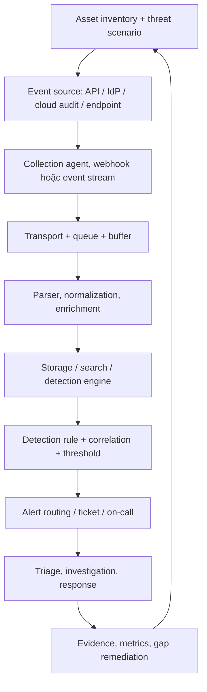

# Detection Coverage: đo lường và chứng minh khả năng phát hiện trong Logging & Monitoring

## 1. Detection coverage là gì?

**Detection coverage** (độ bao phủ phát hiện) là mức độ mà một hệ thống giám sát an ninh có thể **quan sát, nhận diện và tạo tín hiệu có thể xử lý** đối với những hành vi đe dọa và tình huống rủi ro đã được xác định, trong **phạm vi tài sản, danh tính, môi trường và điều kiện kiểm thử rõ ràng**.

Trong chương **Logging và monitoring** thuộc module **SECURITY_SECURITY_ASSURANCE**, điều quan trọng không chỉ là bật log hoặc tạo nhiều cảnh báo. Chương trình **Security Assurance** cần bằng chứng rằng các mục tiêu bảo mật và security controls đã được đánh giá: hành vi nào cần phát hiện, dữ liệu có đến đúng nơi không, quy tắc có hoạt động không, cảnh báo có đến người xử lý không, phản ứng và việc khắc phục có được xác minh lại không.

Một dashboard hiển thị “1.000 sự kiện/giây”, “300 detection rules đang bật” hoặc “100% agent online” **không tự chứng minh** khả năng phát hiện một cuộc tấn công cụ thể. Ví dụ: agent có thể đang gửi log hệ điều hành nhưng không gửi audit event của thao tác thay đổi quyền; rule có thể được triển khai nhưng không khớp định dạng sự kiện thật; alert được tạo nhưng routing sai khiến không ai nhận.

**Một tuyên bố coverage có giá trị phải trả lời được:**

1. **Phát hiện điều gì?** Threat scenario, attack behavior, risk và mục tiêu kiểm soát.
2. **Ở đâu?** Tài sản, hệ thống, tài khoản cloud, tenant, dịch vụ, vùng và môi trường.
3. **Dựa trên dữ liệu nào?** Event source, schema, trường bắt buộc, độ trễ và trạng thái thu thập.
4. **Bằng logic nào?** Detection rule, điều kiện, tham số, phiên bản, ngoại lệ và giả định.
5. **Có chứng minh được bằng hành vi không?** Positive/negative tests, tín hiệu và alert thật qua pipeline.
6. **Ai xử lý khi phát hiện?** Owner, mức ưu tiên, routing, runbook, escalation và điều kiện đóng.
7. **Giới hạn nào còn tồn tại?** Tài sản thiếu telemetry, kiểu tấn công chưa mô hình hóa, test chưa chạy và những kịch bản chưa thể xác minh.

### Mục tiêu học tập

Sau bài học, người học có thể xây **coverage matrix** dựa trên rủi ro và threat model; xác định telemetry cần thiết; kiểm tra quy tắc ở môi trường an toàn; phân biệt log coverage với detection coverage; đo lường độ bao phủ bằng mẫu số rõ ràng; quản lý detection gaps và lưu bằng chứng phục vụ audit, kiểm thử, vận hành và cải tiến liên tục.

## 2. Phân biệt logging coverage, detection coverage và response coverage

Các phạm vi này có liên hệ nhưng không đồng nhất:

| Lớp | Câu hỏi chính | Ví dụ bằng chứng | Giới hạn |
|---|---|---|---|
| **Asset inventory coverage** | Có biết tài sản/danh tính nào thuộc phạm vi phải giám sát? | Inventory, owner, environment, danh sách loại trừ | Tài sản biết đến chưa chắc có dữ liệu |
| **Logging coverage** | Các nguồn thuộc phạm vi có tạo và gửi đúng loại sự kiện không? | Agent/source health, mẫu event, pipeline status | Có log chưa chắc có use case |
| **Telemetry quality coverage** | Event có đúng schema, timestamp, principal, resource, kết quả và đủ độ tin cậy không? | Schema validation, completeness, delay, loss tests | Có trường dữ liệu chưa chắc logic phát hiện đúng |
| **Detection logic coverage** | Có quy tắc/hành vi phân tích phù hợp với các threat scenario ưu tiên không? | Rule ID, logic, mapping, phiên bản, deployment | Rule tồn tại chưa chứng minh hoạt động |
| **Validated detection coverage** | Khi hành vi kiểm thử xuất hiện, pipeline có phát hiện và tạo tín hiệu đúng không? | Test execution, event ID, alert, latency, assertion | Một test pass không chứng minh mọi biến thể hành vi |
| **Alert/response coverage** | Cảnh báo đến đúng người/quy trình và có thể điều tra, xử lý? | Alert routing, ticket, runbook, acknowledgement | Phát hiện và phản ứng là hai kết quả khác nhau |

Ví dụ, một hệ thống có log đăng nhập trên **mọi máy chủ** vẫn có thể thiếu detection cho hành vi đăng nhập thất bại liên tiếp; có rule cho tình huống đó nhưng parser đổi tên trường `user.id` khiến alert không kích hoạt; có alert nhưng đẩy tới kênh không có người trực. Mỗi khoảng trống xuất hiện tại **một lớp khác nhau** và cần owner khác nhau.

**Nhận định cốt lõi:** coverage không chỉ là “có bao nhiêu rule” mà là mức độ **chuỗi quan sát → phân tích → phát hiện → chuyển giao xử lý** hoạt động như kỳ vọng đối với các rủi ro đã chọn.

## 3. Xác định phạm vi: tài sản, sự kiện và hành vi tấn công

Muốn đo coverage, trước hết phải xác định **tổng thể cần được bao phủ**. Nếu không có mẫu số, một tỷ lệ phần trăm dễ tạo ấn tượng sai.

### 3.1. Inventory và security requirements

Ví dụ dịch vụ quản lý đơn hàng có:

- API giao tiếp với người dùng và cổng quản trị.
- Identity provider (IdP) cấp danh tính người dùng, nhân viên và service identity.
- Cloud account có IAM, object storage, container runtime và database.
- CI/CD có quyền triển khai.
- Một pipeline tập trung log, correlation ID và bộ công cụ phát hiện.

Mỗi tài sản có owner, mức nhạy cảm và trust boundary khác nhau. Một số rủi ro ưu tiên:

| Risk ID minh họa | Hành vi cần phát hiện | Security requirement | Tài sản trong scope |
|---|---|---|---|
| `R-AUTH-01` | Nhiều đăng nhập thất bại rồi thành công bất thường | `DET-AUTH-01`: phát hiện chuỗi xác thực rủi ro | IdP và auth service |
| `R-IAM-02` | Cấp quyền quản trị đặc biệt ngoài change được duyệt | `DET-IAM-02`: cảnh báo thay đổi đặc quyền | Cloud IAM / directory |
| `R-DATA-03` | Đọc/xuất dữ liệu nhạy cảm với số lượng bất thường | `DET-DATA-03`: phát hiện bất thường truy cập dữ liệu | Storage, DB, export API |
| `R-PLAT-04` | Tắt hoặc làm gián đoạn security telemetry | `DET-PLAT-04`: phát hiện hành vi tắt logging/sensor | Agent, audit service, cloud policy |
| `R-CICD-05` | Chỉnh sửa deployment từ identity không được phép | `DET-CICD-05`: cảnh báo hành vi triển khai sai quyền | Source control, CI, cluster |

Các ID và control trong bảng là **ví dụ học tập**, không phải mã kiểm soát của một tiêu chuẩn bắt buộc. Trong dự án thật, risk priority phải xuất phát từ threat model, kiến trúc, dữ liệu và khả năng gây thiệt hại.

### 3.2. Actor × behavior × asset × condition

Coverage có nhiều chiều. Một rule phát hiện “thêm vai trò admin” trong tài khoản cloud A chưa chắc đã bao phủ tài khoản cloud B, môi trường staging hoặc đường gán quyền qua API khác. Một test phát hiện hoạt động từ user thường không nhất thiết chứng minh phát hiện được thao tác tương tự của service identity.

Ví dụ yêu cầu `DET-IAM-02` có thể cụ thể hóa:

> “Trong các cloud accounts production thuộc scope, khi principal bất kỳ thêm quyền quản trị đặc biệt cho một identity ngoài ticket thay đổi được phê duyệt, hệ thống phải phát hiện sự kiện và chuyển cảnh báo đúng nhóm chịu trách nhiệm trong khoảng thời gian mục tiêu.”

Câu này đã xác định hành vi, môi trường, điều kiện, tuyến xử lý và tiêu chí thời gian. Nó kiểm tra được hơn câu “phải giám sát IAM”.

### 3.3. Coverage không có nghĩa ngăn chặn

Một hành vi bị control phòng ngừa từ chối ngay tại nguồn (ví dụ IAM deny) **vẫn có thể cần được giám sát** nếu threat model yêu cầu phát hiện các lần thử trái phép. Ngược lại, nếu rule chỉ phát hiện sau khi quyền đã bị cấp, không được mô tả nó như một control **prevention**. Bản đồ assurance nên tách *prevent*, *detect* và *respond*, đồng thời chỉ rõ mỗi cơ chế tạo ra bằng chứng nào.

## 4. Liên kết threat model và ATT&CK với detection coverage

Một chương trình có thể dùng **MITRE ATT&CK** để đặt tên hành vi và lập bản đồ tactic/technique. ATT&CK hữu ích để trao đổi ngôn ngữ giữa threat intelligence, red/purple team và SOC, nhưng **không tự cung cấp mẫu số coverage đúng cho tổ chức**.

Các nguyên tắc:

1. Bắt đầu từ **threat scenario có liên quan** tới kiến trúc và rủi ro, không cố đạt “100% kỹ thuật ATT&CK”.
2. Gắn technique/sub-technique vào use case cụ thể, actor, data source và control.
3. Lưu phiên bản mapping, bởi tên gọi/phân loại kỹ thuật và nguồn telemetry có thể thay đổi theo phiên bản ATT&CK.
4. Một rule được gắn 10 technique không đồng nghĩa đã phát hiện thành công cả 10; cần test phù hợp cho **từng hành vi/biến thể**.
5. Một technique có thể thể hiện qua nhiều đường thực thi; một test trên Windows endpoint không chứng minh cùng khả năng trên Linux hoặc cloud API.

**Ví dụ:** hành vi “thay đổi quyền đặc biệt” cần được tách theo đường IAM policy update, group membership, role assumption hoặc service-account grant nếu các đường đó tồn tại trong hệ thống. Mapping ATT&CK hỗ trợ phân loại và phát hiện khoảng trống; **bằng chứng test** mới chứng minh rule phát hiện được biến thể trong phạm vi.

### Hai bản đồ nên cùng tồn tại

| Bản đồ | Mục đích | Câu trả lời |
|---|---|---|
| **Threat-to-detection map** | Gắn risk/technique → use case → detection rule | “Kịch bản nào đã có kế hoạch phát hiện?” |
| **Detection-to-telemetry map** | Gắn rule → source events → field/schema → pipeline → tài sản | “Rule dựa vào đâu và data có thật sự tới?” |

Kết hợp hai bản đồ giúp xác định **thiếu rule**, **thiếu nguồn log**, **schema không đủ**, **thiếu triển khai** và **thiếu kiểm thử**, thay vì gom mọi vấn đề vào nhãn “coverage gap” chung chung.

## 5. Kiến trúc telemetry: đường đi của một sự kiện đến cảnh báo

Để có validated coverage, cần theo dõi toàn bộ đường đi:



### 5.1. Kiểm tra ở mỗi bước

| Chặng | Câu hỏi kiểm chứng | Dấu hiệu lỗi |
|---|---|---|
| **Event generation** | Hành vi test tạo đúng loại audit event không? | Log level/filter không bật hoặc control plane không phát event |
| **Collection** | Agent/integration có lấy event đúng source và scope? | Agent offline, account/region chưa đăng ký, permission thiếu |
| **Transport** | Có buffering, retry, kiểm soát loss, bảo vệ TLS? | Queue đầy, mất sự kiện, duplicate, timeout |
| **Normalization** | Parser có bảo toàn principal, resource, action, outcome và timestamp? | Sai type, field rename, timezone lệch, null |
| **Enrichment** | Owner, criticality, tenant, geo/device context có đúng và còn cập nhật? | Join sai identity hoặc asset mapping lỗi |
| **Detection** | Rule có enabled, chạy đúng window và query scope? | Query không match, rule disabled, threshold chưa đạt |
| **Alerting** | Alert có đúng severity, dedup, destination, escalation? | Alert bị suppress quá rộng hoặc routing sai |
| **Response** | Người trực có nhận, điều tra và lưu disposition? | Alert không có owner/runbook hoặc backlog không xử lý |

Sự cố có thể xảy ra dù một phần pipeline vẫn “xanh”. Ví dụ hệ thống log nhận đủ bytes nhưng parser không giữ `user.id`; rule dùng `user.id` sẽ im lặng. Bởi vậy cần **kiểm tra ở cấp trường dữ liệu** và test detection đầu-cuối, không chỉ kiểm tra heartbeat của collector.

### 5.2. Trường dữ liệu cốt lõi

Với hành vi liên quan xác thực và quyền, nên xác định:

- `event.time` (thời điểm xảy ra) và `ingest.time` (thời điểm nhận).
- `event.type` hoặc action và outcome: cho phép, bị từ chối, thay đổi quyền.
- Principal ID, principal type, tenant và **đối tượng chịu tác động**.
- Source IP/device/region khi khả dụng và có mục đích hợp lệ.
- Resource ID, service, environment, account và correlation/request ID.
- Event source và độ tin cậy/giới hạn của nó.

Đây là **tập trường gợi ý**, không phải schema tiêu chuẩn áp dụng nguyên trạng. Nhiều nguồn không có tất cả trường và tên field khác nhau; nên định nghĩa **canonical schema** và bảng mapping đã kiểm tra. Không tự điền principal ID từ nguồn không đáng tin rồi coi nó là danh tính đã xác thực.

## 6. Chất lượng telemetry: đầy đủ, đúng, kịp thời và có thể điều tra

Coverage cần các phép kiểm về **chất lượng** dữ liệu, không chỉ sự hiện diện.

| Đặc tính | Phương pháp kiểm tra | Nguy cơ nếu bỏ qua |
|---|---|---|
| **Completeness** | Gửi số event test đã biết, đối chiếu số được nhận; phân tích sampling/filtering | Rule bỏ lỡ chuỗi hành vi vì thiếu event |
| **Schema correctness** | Contract test và mẫu event qua parser với các field bắt buộc | Rule so sánh nhầm string/số hoặc field null |
| **Freshness/latency** | Đo event time → ingest time → alert time với mốc chuẩn | Alert quá muộn cho phản ứng cần thiết |
| **Timestamp integrity** | Đồng bộ thời gian, timezone, xử lý out-of-order | Correlation window nhận sai sự kiện |
| **Identity & resource fidelity** | So sánh actor/resource với nguồn authoritative trong test | Điều tra nhầm tài khoản hoặc tenant |
| **Deduplication** | Kiểm tra retry, idempotency, count thật so với duplicate | False positive hoặc sai threshold |
| **Reliability** | Kiểm tra queue backlog, collector error, dead-letter, rate limit | Loss không được báo động |
| **Privacy & protection** | Không đưa password/token/PII vượt policy; phân quyền log | Telemetry trở thành nguồn rò dữ liệu |

Để kiểm tra độ đầy đủ bằng dữ liệu thử, có thể tạo **N sự kiện đã được phê duyệt** với ID riêng, sau đó tìm đúng event IDs trong hệ thống downstream. Tỷ lệ nhận chỉ có ý nghĩa khi biết event nào **đáng lẽ phải xuất hiện**; nếu nguồn log chủ động sampling theo thiết kế, cần ghi giới hạn và dùng phương pháp khác để suy luận.

### Trễ phát hiện so với trễ ingestion

Ba mốc thời gian khác nhau:

```text
t0 = hành vi xảy ra tại nguồn
t1 = sự kiện xuất hiện ở hệ thống phân tích
t2 = rule tạo signal/alert
t3 = on-call hoặc ticket nhận được
```

Các khoảng:

- **Ingest delay:** `t1 - t0`.
- **Detection delay:** `t2 - t0`; gồm trễ thu thập và thời gian rule hoạt động.
- **Routing delay:** `t3 - t2`.

Đừng báo “alert dưới 30 giây” nếu chỉ đo `t2 - t1` và bỏ qua việc ingestion mất 10 phút. Với rule chạy theo lịch, cần xét chu kỳ thực thi và khoảng chờ/cửa sổ để xử lý event đến muộn.

## 7. Detection use case và coverage matrix

Một detection use case phải đủ cụ thể để có **đầu vào, expected output và tiêu chí kiểm thử**.

### 7.1. Mẫu use case

| Trường | Nội dung |
|---|---|
| **Use case ID** | Mã định danh ổn định, ví dụ `DET-IAM-02` |
| **Threat/risk** | Risk ID, hành vi đe dọa và tài sản bị ảnh hưởng |
| **Scope** | Cloud accounts, regions, environment, role, target resources |
| **Behavior** | Action, chuỗi sự kiện, điều kiện kết hợp/thời gian |
| **Prerequisites** | Event sources, parser, enrichment, asset identity |
| **Rule/analytic** | Detection rule ID, repo, version, owner |
| **Expected signal** | Alert type, severity, fields, routing, SLO |
| **Negative control** | Hành vi hợp lệ không được tạo cảnh báo sai |
| **Test plan** | Data fixtures, người phê duyệt, môi trường và cách rollback |
| **Evidence** | Run, event IDs, rule evaluation, alert/ticket và reviewer |
| **Limitations** | Tình huống không phát hiện, data gaps, ngoại lệ hợp lệ |

### 7.2. Ví dụ ma trận coverage theo risk/use case

| Threat scenario | Nguồn log cần thiết | Rule/analytic | Trạng thái kiểm chứng | Khoảng trống cần xử lý |
|---|---|---|---|---|
| Đăng nhập thất bại liên tiếp và thành công | IdP/auth outcome, principal, IP, time | `DET-AUTH-01` | Validated trong staging | Chưa test ứng dụng legacy |
| Thêm quyền admin ngoài change hợp lệ | IAM change log, principal, target, action | `DET-IAM-02` | Có rule, chưa test end-to-end | Thiếu event ở một account |
| Tắt audit logging | Cloud management event, actor, resource | `DET-LOG-03` | Chưa triển khai | Cần bổ sung parser và routing |
| Tải dữ liệu quy mô lớn | Object data events, asset class, baseline | `DET-DATA-04` | Tested partial | Chưa có baseline/scope cho archive |
| Thay đổi deployment sai quyền | CI + cluster audit, identity, commit | `DET-CICD-05` | Validated với workload thử | CronJob không thuộc inventory |

Trạng thái nên thể hiện **khả năng đã kiểm chứng** chứ không chỉ dấu “có rule”. Một thang quản trị hữu ích:

1. **UNMAPPED:** rủi ro ưu tiên chưa có use case.
2. **DESIGNED:** có logic và source cần thiết nhưng chưa triển khai.
3. **DEPLOYED_UNTESTED:** rule đã bật, chưa có bằng chứng test.
4. **PARTIALLY_VALIDATED:** chỉ một số tài sản/actor/biến thể được test.
5. **VALIDATED:** các phép thử đã định nghĩa đạt trong scope và kỳ đo.
6. **DEGRADED / EXPIRED:** evidence mất hiệu lực vì telemetry, rule, asset hoặc threat condition thay đổi.

Các trạng thái này là **gợi ý cho chương trình nội bộ**, không phải thang điểm được ATT&CK hoặc một chuẩn assurance tự động chứng nhận. Nên lưu cả **last validation time** và **policy/rule version**.

## 8. Ví dụ xuyên suốt: phát hiện hành vi cấp quyền quản trị ngoài quy trình

### 8.1. Yêu cầu bảo mật và giả thuyết

Giả sử tổ chức có hai cloud accounts thử nghiệm và một account production. Một trong các rủi ro trọng yếu là **một principal cấp thêm quyền quản trị cho identity không nằm trong change được phê duyệt**, tạo điều kiện truy cập tài sản nhạy cảm.

Một yêu cầu phát hiện có thể kiểm chứng:

> **`DET-IAM-02`:** Trong các accounts thuộc phạm vi, khi có thao tác thêm quyền quản trị đặc biệt, hệ thống phải tạo tín hiệu chứa principal, đối tượng được cấp quyền, account và thời điểm; sự kiện phải được chuyển tới hàng đợi xử lý bảo mật. Những thay đổi được phê duyệt theo workflow phải được phân biệt bằng dữ liệu thay đổi tin cậy, không chỉ bởi tên tài khoản thực hiện.

Yêu cầu này **không ngụ ý** mọi thao tác thêm role đều độc hại. Đội bảo mật cần phân biệt tình huống rủi ro với thay đổi hợp lệ, biết đường gán quyền, và lập chính sách ưu tiên xử lý.

**Điều kiện thử nghiệm:** dùng sandbox hoặc cloud account chuyên dụng do chủ hệ thống cho phép; tài khoản test không có quyền truy cập dữ liệu production; thao tác có thể hoàn tác; người vận hành nắm lịch chạy. Không dùng quyền quản trị thực tế cho bài test chỉ nhằm tạo log.

### 8.2. Sơ đồ tín hiệu mong đợi

```text
Hành vi giả lập đã duyệt
  → Audit event IAM có actor, action, target, account, event_time
  → Collector nhận event và parser ánh xạ đúng schema
  → Detection query phát hiện thao tác thêm quyền đặc biệt
  → Correlation với approved change context (nếu có)
  → Alert chứa event ID và link điều tra
  → Routing tới on-call/ticket
  → Analyst xác nhận và khôi phục dữ liệu thử
```

Một sự kiện minh họa đã **giả danh danh tính và resource**, không phải trích xuất từ cloud thực:

```json
{
  "event_id": "evt-demo-iam-2001",
  "event_time": "2026-11-28T04:10:00Z",
  "ingest_time": "2026-11-28T04:10:09Z",
  "source": "demo-cloud-audit",
  "environment": "lab",
  "account_id": "LAB_ACCOUNT_01",
  "event_type": "iam.privilege.granted",
  "outcome": "success",
  "actor": {
    "id": "LAB_OPERATOR_A",
    "type": "test_principal"
  },
  "target": {
    "principal_id": "LAB_SERVICE_B",
    "role": "LAB_ADMIN_ROLE"
  },
  "change_id": null,
  "correlation_id": "det-iam02-lab-run-07"
}
```

Các tên trường là **canonical schema được ví dụ hóa**. Không được suy đoán tên action thực của AWS, Azure, Google Cloud hay IdP từ mẫu này; trong dự án thật, phải mapping và kiểm chứng theo event schema của từng nguồn.

### 8.3. Logic detection

Quy tắc mô tả bằng **pseudocode** để tập trung vào mục tiêu kiểm thử, không phải một truy vấn có thể chạy nguyên trạng trong bất kỳ SIEM nào:

```text
FOR each normalized IAM audit event
  IF environment is in monitored_scope
     AND outcome == "success"
     AND action in approved_privilege_grant_action_set
     AND target_role in high_privilege_role_set
  THEN
     ENRICH with asset owner and approved change context
     CREATE detection signal containing:
       event_id, actor, target, account_id,
       event_time, rule_id, rule_version, correlation_id
     CLASSIFY as high_priority IF no valid approved change found
     ROUTE to security operations
```

**Điểm kỹ thuật cần kiểm chứng:** các tập `approved_privilege_grant_action_set` và `high_privilege_role_set` phải được cấu hình có chủ đích; enrichment phải lấy từ nguồn change-management tin cậy và không được biến `change_id` do actor tự khai thành bằng chứng được phê duyệt. Việc tra ticket lỗi hoặc chậm cần có trạng thái riêng, không nên âm thầm coi mọi thay đổi là hợp lệ.

### 8.4. Positive và negative controls

| Test ID | Dữ liệu/điều kiện thử | Expected result |
|---|---|---|
| `IAM02-P1` | Event thực trong sandbox: cấp quyền `LAB_ADMIN_ROLE` không kèm approval hợp lệ | Rule tạo tín hiệu, alert đúng actor/target/account, tới kênh thử |
| `IAM02-P2` | Cùng loại hành vi qua đường audit source thứ hai thuộc scope | Tín hiệu được tạo nếu đường đó đã nằm trong coverage requirement |
| `IAM02-N1` | Cấp quyền thông thường không thuộc tập quyền đặc biệt | Không tạo high-priority alert `DET-IAM-02` |
| `IAM02-N2` | Cấp quyền đặc biệt có approval hợp lệ từ nguồn tin cậy | Ghi nhận sự kiện; xử lý theo rule policy (không phải alert “ngoài quy trình”) |
| `IAM02-N3` | Event có `outcome=denied`, không có quyền thực sự được cấp | Không bị nhầm thành thay đổi thành công; có thể có rule khác theo dõi attempt |
| `IAM02-E1` | Parser thiếu `target.role` hoặc collector mất quyền | Tạo cảnh báo chất lượng telemetry hoặc trạng thái INCOMPLETE, không báo detection PASS |
| `IAM02-E2` | Alert engine tạo tín hiệu nhưng routing đích bị sai | Detection logic có thể pass, **response coverage fail** |

**Test P1 cần có positive control của event source:** xác nhận hành vi thử đã tạo ra **audit event thật** và tập trường đúng. Nếu thao tác giả lập chỉ tạo một JSON trong index phân tích, ta mới kiểm tra được parser/detection phía sau, chưa kiểm chứng **đường sinh log từ cloud**.

### 8.5. Bằng chứng trước khi kết luận

Một run hợp lệ nên ghi:

- Account và resource trong scope, môi trường test, role thử và ủy quyền.
- Thời điểm bắt đầu và kết thúc; event ID, correlation ID, parser/collector phiên bản.
- Raw event đã khử nhạy cảm, normalized event và field mapping.
- Detection rule ID/commit/version, trạng thái enable và evaluation timestamp.
- Alert/signal ID, nội dung, mức độ, routing destination và ticket/acknowledgement nếu được test.
- Kết quả positive/negative assertions; độ trễ nguồn → ingestion → alert → routing.
- Các giới hạn như môi trường lab, một loại API hành động, một account hoặc một role.

**Kết luận đúng:** “Detection `DET-IAM-02` phát hiện thao tác cấp quyền `LAB_ADMIN_ROLE` ngoài quy trình trên `LAB_ACCOUNT_01` tại rule revision X; event và alert đã được đối chiếu, routing tới kênh test thành công.” Không suy rộng rằng mọi thay đổi IAM ở production đã có coverage nếu chưa test đầy đủ các account, identity và hành vi thuộc phạm vi đó.

## 9. Các mức kiểm thử detection: unit đến end-to-end

Một bài test có thể xác minh **logic ở một chặng** hoặc **cả chuỗi**. Cả hai đều hữu ích nếu ghi đúng phạm vi.

| Loại test | Chạy ở đâu | Xác minh điều gì | Không chứng minh |
|---|---|---|---|
| **Rule unit test** | Fixture normalized events vào logic rule | Điều kiện match, threshold, correlation, suppression | Event source và collector thực hoạt động |
| **Parser/schema contract test** | Raw event mẫu qua parser | Mapping field, data type, timestamp, normalization | Rule và alert routing đúng |
| **Pipeline integration test** | Synthetic event qua ingestion pipeline | Transport, parser, storage, detect | Source thật có tạo đầy đủ sự kiện hay không |
| **End-to-end detection test** | Hành vi test thực trên tài sản được phép | Source → ingest → rule → alert, có thể gồm routing | Mọi biến thể attacker hoặc môi trường khác |
| **Purple-team/emulation test** | Kịch bản threat đã được duyệt, có giám sát | Chuỗi hành vi thực tế hơn, khả năng phát hiện và điều tra | Coverage của tất cả kịch bản chưa test |
| **Continuous canary test** | Hành vi nhỏ, định kỳ, an toàn | Phát hiện suy giảm/đứt đường ở các điểm đã chọn | Tự động thay thế toàn bộ kiểm thử định kỳ |

### 9.1. Giá trị của unit test

Unit test giúp bắt lỗi logic trước khi triển khai:

- **Positive case:** input thỏa điều kiện → output đúng.
- **Negative case:** thao tác hợp lệ hoặc khác loại → không sinh alert sai.
- **Boundary case:** cửa sổ thời gian, threshold, trùng lặp, missing field, out-of-order event.
- **Suppression case:** chỉ áp dụng allowlist/exception cho phạm vi hợp lệ và hết hiệu lực đúng lúc.

Không nên viết unit tests chỉ để rule “luôn PASS” trên một fixture duy nhất. Hệ thống thay đổi schema, role hoặc đường sự kiện có thể khiến rule không còn phát hiện được ngoài thực tế; cần bổ sung integration và end-to-end tests.

### 9.2. Test giả lập so với test hành vi thật

**Synthetic event injection** hữu ích để kiểm tra parser/detection mà không tạo ra hành động rủi ro. Tuy nhiên, nếu đưa event trực tiếp vào normalized index thì đã **bỏ qua các lớp trước đó** (event generation, collection và transport). Báo cáo cần nêu rõ injection point.

**Authorized behavior simulation** kiểm tra được nguồn phát sự kiện thật, nhưng phải có RoE, môi trường cô lập, actor/dữ liệu thử và khả năng hoàn tác. Không cần thực hiện hành vi phá hoại, chiếm quyền hoặc trích xuất dữ liệu thật để đánh giá một detector; có thể dùng audit canary và các tương đương vô hại theo kịch bản.

### 9.3. Thử resilience của detection pipeline

Một detection chỉ hoạt động khi mọi thành phần khỏe mạnh có thể mất hiệu lực khi log bị trễ hoặc một collector tắt. Với môi trường lab hoặc staging đã phê duyệt, thử:

1. Một lượng event nhỏ có **thời gian nguồn lệch nhẹ**.
2. Event đến không đúng thứ tự, bị gửi lại hoặc có correlation ID trùng.
3. Sự kiện thiếu trường không bắt buộc.
4. Collector tạm không có kết nối, sau đó hồi phục và replay theo semantics hệ thống.
5. Enrichment service tạm lỗi; rule phải có hành vi xác định khi không tra được asset/change context.

Đối với mỗi trường hợp, tiêu chí có thể là **phát hiện đúng**, **degraded có cảnh báo**, hoặc **incomplete có dấu vết**. Không được yêu cầu mọi lỗi pipeline đều được xử lý thành công; quan trọng là hệ thống không âm thầm cho kết quả an toàn sai.

## 10. Đánh giá rule: positive, negative, false positive và false negative

**Detection quality** và **coverage** liên quan nhưng khác nhau. Một rule có thể bao phủ nhiều hành vi nhưng tạo quá nhiều alert sai khiến đội vận hành không xử lý kịp; một rule rất chính xác có thể chỉ bao phủ một biến thể nhỏ của threat scenario.

Khi có bộ dữ liệu thử được gán nhãn đáng tin:

| | Hành vi thật thuộc diện cần phát hiện | Hành vi không thuộc diện đó |
|---|---|---|
| **Detector tạo alert** | True Positive (TP) | False Positive (FP) |
| **Detector không tạo alert** | False Negative (FN) | True Negative (TN) |

Các chỉ số thông dụng:

\[
\text{Recall}=\frac{TP}{TP+FN}
\]

\[
\text{Precision}=\frac{TP}{TP+FP}
\]

\[
\text{False Positive Rate}=\frac{FP}{FP+TN}
\]

**Recall** đo khả năng phát hiện trong các tình huống dương tính được thử; **precision** đo tỷ lệ tín hiệu dương tính thực trong số alert; **false positive rate** đo tỷ lệ tình huống âm tính bị báo sai. Chúng **không phải một chỉ số** và chỉ có ý nghĩa khi test set đủ đại diện, có cách gán nhãn thống nhất.

### 10.1. Ví dụ tính toán

Một bộ thử nghiệm trong lab chứa:

- 20 trường hợp hành vi cần phát hiện; 17 tạo alert → `TP=17`, `FN=3`.
- 80 trường hợp hành vi hợp lệ; 4 tạo alert sai → `FP=4`, `TN=76`.

Khi đó:

\[
\text{Recall}=\frac{17}{20}=85\%
\]

\[
\text{Precision}=\frac{17}{17+4}\approx80.95\%
\]

\[
\text{False Positive Rate}=\frac{4}{80}=5\%
\]

Đây là **chất lượng trên test set đó**, không thể suy luận thành “đã bao phủ 85% mọi cuộc tấn công ngoài thực tế”. Các tình huống chưa được chọn vào test set, mức phổ biến của hành vi hợp lệ, tỷ lệ tấn công thực và thay đổi môi trường đều ảnh hưởng kết quả vận hành.

### 10.2. Những bẫy về chỉ số

- **Base rate:** trong vận hành, sự kiện tấn công có thể rất hiếm; một false positive rate nhỏ vẫn tạo nhiều alert sai nếu lưu lượng event hợp lệ khổng lồ.
- **Ground truth:** analyst có thể chưa đủ dữ liệu kết luận một alert là TP/FP. Đừng ép trạng thái `inconclusive` thành FP.
- **Alert deduplication:** một chuỗi 50 raw events có thể tạo một alert; cần thống nhất đơn vị đo là event, incident hay detection scenario.
- **Suppression:** giảm alert bằng cách tắt rule có thể tăng precision nhìn thấy nhưng làm coverage giảm.
- **Biến thể chưa thử:** recall trên test set cố định có thể cao dù attacker thay technique hoặc nguồn event đã đổi schema.

Do đó, báo cáo chất lượng nên đi kèm **coverage matrix, sample size, test definitions, revision và dữ liệu chưa được gán nhãn**, thay vì một con số “accuracy” tổng hợp.

## 11. Xây mô hình đo coverage có mẫu số minh bạch

Không có một tỷ lệ “detection coverage toàn cầu” phản ánh chính xác mọi rủi ro. Mỗi metric cần nêu rõ **đơn vị**, **phạm vi**, **trạng thái nào được tính đạt** và **thời gian**.

### 11.1. Scenario-level validated coverage

Gọi `S` là tập các tình huống threat/use case **được chọn và phê duyệt cho kỳ đánh giá**. Mỗi tình huống có test case, tiêu chí pass và scope. Khi đó:

\[
C_{\text{scenario}}=
\frac{\left|\{s\in S:\ s\ \text{được xác minh đạt trong kỳ}\}\right|}
{|S|}\times100\%
\]

Metric này **không đo tất cả threat có thể tồn tại** mà chỉ đo tập `S`. Trường hợp `S` rỗng không có tỷ lệ có ý nghĩa; cần báo “chưa xác định scope/test universe” thay vì 100%.

### 11.2. Asset × scenario coverage

Nếu yêu cầu cùng một hành vi trên nhiều tài sản, có thể dùng **cặp (asset, scenario)** làm đơn vị:

\[
C_{\text{asset-scenario}}=
\frac{\text{số cặp áp dụng có evidence PASS còn hiệu lực}}
{\text{tổng số cặp phải kiểm theo scope}}\times100\%
\]

Ví dụ có 5 cloud accounts và 4 detection scenarios áp dụng cho tất cả → 20 cặp. Nếu 12 cặp có bằng chứng đầu-cuối PASS, 3 cặp fail, 2 cặp inconclusive và 3 cặp chưa test, validated coverage = `12/20 = 60%`.

Việc 4 rule đều bật không làm 20 cặp trở thành PASS. Mẫu số cũng cần loại bỏ **not applicable** có lý do và quyền phê duyệt, không tùy tiện loại những cặp khó kiểm để tăng tỷ lệ.

### 11.3. Risk-weighted coverage

Khi ưu tiên rủi ro, có thể gán trọng số `w_i` cho từng use case/đơn vị trước khi đo. Một công thức minh họa:

\[
C_{\text{weighted}}=
\frac{\sum_i w_i\,p_i}{\sum_i w_i}\times100\%
\]

Trong đó `p_i=1` nếu đã xác minh đạt theo tiêu chí, ngược lại `p_i=0`. Trọng số phải do risk owner/chương trình quy định, có giải thích và được quản lý phiên bản. Không dùng cách tính trọng số để che giấu một rủi ro cực kỳ quan trọng đang chưa có detection; phải báo **critical gaps** riêng.

### 11.4. Bảng kết quả minh họa

| Detection scenario | Units phải kiểm | Validated | Failed | Inconclusive | Untested |
|---|---:|---:|---:|---:|---:|
| Đăng nhập rủi ro | 5 IdP/app integrations | 4 | 0 | 1 | 0 |
| Thay đổi đặc quyền | 5 cloud accounts | 3 | 1 | 0 | 1 |
| Tắt logging | 5 cloud accounts | 2 | 1 | 1 | 1 |
| Tải dữ liệu bất thường | 5 storage groups | 3 | 1 | 0 | 1 |
| **Tổng** | **20** | **12** | **3** | **2** | **3** |

Tỷ lệ validated là **60% trên 20 đơn vị phải kiểm**. Đây là số liệu **giả định** nhằm dạy phương pháp, không phải kết quả của một hệ thống có thật. Để vận hành, mỗi ô cần dẫn tới test run và evidence riêng.

### 11.5. Các chỉ số bổ sung cần theo dõi

| Chỉ số | Cách dùng | Cần tránh |
|---|---|---|
| **Telemetry source coverage** | Nguồn log/asset được thu đúng event theo scope | Coi “agent online” là event đầy đủ |
| **Schema completeness** | Tỷ lệ event có trường bắt buộc đúng kiểu | Bỏ qua nguồn bị thiếu hoàn toàn vì chỉ đo event đã nhận |
| **Validated scenario coverage** | Test pass trên tập scenario định nghĩa | Gọi là tỷ lệ phát hiện tất cả attack |
| **Mean/percentile detection delay** | Đo `t2 - t0` theo loại event | Chỉ tính alert nhanh, bỏ ca timeout |
| **Alert delivery success** | Alert vào đúng kênh/runbook theo test | Lẫn với rule match |
| **Detection failure / telemetry outage** | Số use case degraded và thời gian không có dữ liệu | Ẩn incident vì không có alert |
| **False positive burden** | Alert bị đóng là FP theo loại use case, giờ công analyst | Chỉ tối ưu giảm alert bằng suppress |
| **Coverage debt age** | Tuổi của gap chưa được xử lý theo rủi ro | Đo số ticket thay vì tác động thực tế |
| **Validation freshness** | Số ngày từ test cuối đến hiện tại, rule/pipeline revision | Giữ PASS khi dữ liệu đổi nhưng chưa retest |

**Lưu ý:** “đã bật rule” là inventory metric, “test logic pass” là rule-quality evidence, còn “phát hiện đầu-cuối trên tài sản thật trong scope” là validated coverage evidence. Không cộng các tỷ lệ khác đơn vị vào một con số trung bình mà không giải thích.

## 12. Xác định và ưu tiên detection gaps

**Detection gap** là khoảng thiếu giữa yêu cầu phát hiện đã xác định và khả năng hiện được kiểm chứng. Gap có thể xuất hiện ở bất kỳ lớp nào của pipeline hoặc ở chính việc xác định threat scenario.

### 12.1. Phân loại nguyên nhân

| Gap type | Dấu hiệu | Cách khắc phục dự kiến |
|---|---|---|
| **Threat modeling gap** | Tài sản rủi ro cao chưa có use case phát hiện | Xây scenario, requirement, owner và test |
| **Inventory gap** | Tài khoản/tenant/workload mới chưa đưa vào scope | Onboarding inventory, mapping owner, cập nhật test universe |
| **Collection gap** | Nguồn không gửi đủ sự kiện hoặc không được bật | Cấu hình audit, cấp quyền collector, kiểm tra event source |
| **Transport/retention gap** | Event bị rơi, trễ, lưu quá ngắn hoặc nằm sai index | Sửa pipeline, queue, storage, retention |
| **Schema/enrichment gap** | Field quan trọng null, sai kiểu, bị map sai hoặc owner không đúng | Contract test, parser versioning, mapping và data quality alert |
| **Detection design gap** | Thiếu logic cho hành vi rủi ro hoặc threshold chưa phù hợp | Thiết kế rule và test mới dựa trên threat scenario |
| **Rule deployment gap** | Rule tồn tại ở repo nhưng disabled hoặc không chạy ở account cần giám sát | Fix deployment, environment binding, policy enforcement |
| **Test evidence gap** | Rule có vẻ hoạt động nhưng chưa thử trong kỳ hoặc sau thay đổi | Test lại; không ghi validated trước khi có bằng chứng |
| **Alert routing gap** | Signal tạo đúng nhưng ticket/on-call không nhận | Sửa routing/escalation, test giao nhận |
| **Response gap** | Alert có nhưng thiếu runbook, owner hoặc quyền điều tra | Phân công, bổ sung runbook và kiểm tra phản ứng |

Việc phân loại giúp giao đúng nhiệm vụ: team cloud có thể xử lý quyền audit source; data engineering xử lý parser; detection engineering viết rule; SOC owner xử lý runbook và triage. Không nên yêu cầu analyst “tăng coverage” chung chung mà không chỉ rõ lớp đang hỏng.

### 12.2. Ưu tiên risk-based

Một gap đáng ưu tiên hơn khi:

1. Liên quan **tài sản trọng yếu hoặc dữ liệu nhạy cảm**.
2. Bao phủ hành vi có **khả năng gây tác động lớn** và có đường tiếp cận khả thi.
3. Không có control phòng ngừa hoặc bù trừ mạnh, trong khi khả năng điều tra sau sự cố phụ thuộc vào log.
4. Ảnh hưởng nhiều account, region, tenant hoặc service.
5. Đã xuất hiện sự cố, audit finding hoặc threat intelligence liên quan.
6. Độ tuổi gap dài hơn chính sách và có khả năng bị bỏ quên.

Ví dụ, mất khả năng phát hiện **tắt audit logging của các account production** có thể cần khắc phục trước một detection ít ưu tiên ở môi trường sandbox. Nhưng “có control phòng ngừa” không tự động cho phép bỏ detection; yêu cầu phát hiện hoặc giám sát control còn tùy risk policy.

### 12.3. Mẫu hồ sơ detection gap

```yaml
gap_id: DET-GAP-EXAMPLE-021
control_id: DET-IAM-02
risk_id: R-IAM-02
scope:
  environment: production
  account: PROD_ACCOUNT_02
  behavior: privileged_role_grant
classification: collection_gap
observation: "Required IAM audit events unavailable in SIEM"
evidence:
  - "collection-health-2026-11-28.json"
  - "test-run-iam02-lab-07.json"
impact: "Unable to validate detection on this account"
owner: cloud-platform-team
priority: high
target_condition: "IAM event collected and end-to-end detector tested"
compensating_control: "Change approval and provider audit review"
retest_required: true
status: open
```

Mọi giá trị là **ví dụ**, không phải phát hiện thực. Khi không có telemetry hoặc test, hồ sơ phải nói “không xác minh được” thay vì đưa ra kết luận về sự hiện diện hay vắng mặt của hành vi xâm nhập.

### 12.4. Trạng thái ngoại lệ và giảm phạm vi

Có những trường hợp một detector chưa thể triển khai: nguồn cloud không hỗ trợ event cần thiết, chi phí data events quá cao, hoặc bộ dữ liệu bị giới hạn theo quy định riêng tư. Khi đó chương trình có thể:

- Chọn signal thay thế có ích nhưng ghi rõ **khả năng phát hiện yếu hơn**.
- Áp dụng biện pháp phòng ngừa/bù trừ và tăng review thủ công.
- Đặt owner, thời hạn, điều kiện xem lại và ghi rủi ro tồn dư.
- Giới hạn kết luận assurance vào những hành vi có thể quan sát.

**Một ngoại lệ được phê duyệt không biến detection gap thành PASS.** Nên báo số gap còn tồn tại và accepted risk riêng. Nếu tài sản thực sự ngoài phạm vi, trạng thái *not applicable/out of scope* cần có cơ sở và người duyệt, không chỉ bỏ khỏi mẫu số để tăng tỷ lệ.

## 13. Detection-as-code và quản lý vòng đời quy tắc

**Detection-as-code** quản lý quy tắc phát hiện như một artifact có version control, test và quá trình triển khai có thể truy vết. Nó hỗ trợ việc biết **rule nào đang chạy ở đâu, đã được ai review và dựa trên điều kiện nào**.

### 13.1. Mẫu khai báo rule

Đây là **pseudoconfiguration**, không phải schema chạy trực tiếp của SIEM:

```yaml
id: DET-IAM-02
title: "Unexpected privileged role grant"
version: 3
owner: detection-engineering
risk_id: R-IAM-02
scope:
  environments: [production, staging]
  accounts: inventory_group_privileged_cloud_accounts
required_sources:
  - cloud_iam_audit_events
required_fields:
  - event_id
  - event_time
  - actor.id
  - target.principal_id
  - target.role
  - outcome
  - account_id
logic:
  type: privileged_role_grant_without_approved_change
  actions_reference: approved_privilege_grant_action_set
output:
  category: iam_privilege_change
  queue: security_operations
tests:
  positive: [IAM02-P1, IAM02-P2]
  negative: [IAM02-N1, IAM02-N2, IAM02-N3]
  failure: [IAM02-E1, IAM02-E2]
validation:
  required: end_to_end
  environment: authorized_lab
```

Các trường như `type` và `logic` chỉ mô tả mục tiêu. Từng nền tảng có query language, API cấu hình, nguồn telemetry và cơ chế scheduler/alert riêng; muốn dùng thật phải viết logic tương ứng và kiểm chứng mapping theo tài liệu của sản phẩm đang dùng.

### 13.2. Pull request và quality gate

Một thay đổi rule nên có:

1. **Lý do:** threat scenario/risk nào mới hoặc thay đổi; kỳ vọng tăng coverage ra sao?
2. **Nguồn dữ liệu:** nguồn nào, field nào, schema version và pipeline cần cập nhật không?
3. **Query/logic:** threshold, time window, grouping, suppression, exemptions.
4. **Test fixtures:** positive, negative, boundary và failure cases.
5. **Kết quả kiểm thử:** pass/fail, công cụ, commit, test run, log và alert.
6. **Performance/cost:** truy vấn có mở rộng tải không, tần suất, retention và query scope.
7. **Triển khai:** ai phê duyệt, rule revision, environment bindings và rollback plan.
8. **Chủ sở hữu:** SOC, detection engineer và on-call contact.

**Quality gate không nên chỉ dựa vào việc query biên dịch thành công.** Một query đúng cú pháp nhưng tham chiếu field không tồn tại hoặc dashboard index sai vẫn có thể không phát hiện được gì.

### 13.3. Ngăn thay đổi phá hỏng coverage

Những thay đổi cần trigger retest:

- Parser/field mapping, normalization và event transport.
- Nâng phiên bản IdP, cloud API, agent, runtime hoặc log source.
- Thay rule threshold, correlation logic, suppression hoặc time window.
- Thay asset inventory, role taxonomy, môi trường hoặc access policy.
- Thay routing, ownership, alert deduplication hoặc runbook.
- Thêm/dừng một chức năng nghiệp vụ có threat scenario mới.
- Điều chỉnh data retention hoặc sampling.

Một quy tắc từng được validated có thể chuyển sang **DEGRADED hoặc EXPIRED** khi các yếu tố trên thay đổi mà chưa được test lại. Cần lưu **last-tested revision** để không nhầm “rule đã được kiểm tra năm trước” với “rule hiện nay vẫn được bảo đảm”.

### 13.4. Synthetic canary liên tục

Có thể đặt **canary** chạy định kỳ: hành vi an toàn tạo ra loại sự kiện đại diện, ghi test ID và kỳ vọng rule/routing tương ứng. Nếu không có alert trong thời gian cho phép, phát tín hiệu về **độ khỏe của detection**, không chỉ bỏ qua lần chạy.

Canary cần được đánh dấu rõ là **hoạt động kiểm thử có phép**, tránh analyst hiểu nhầm thành incident. Tuy vậy, nếu dùng allowlist để suppress toàn bộ canary, có thể khiến ta không biết rule thật đã hỏng. Một thiết kế hợp lý tạo alert tới kênh kiểm thử hoặc đo signal trước bước routing/suppression, có tiêu chí thời gian và quan sát độc lập.

Canary không thay thế bài test threat scenario đầy đủ: một event nhỏ không chứng minh detector xử lý được chuỗi tấn công thực có nhiều bước, tài sản hay biến thể.

## 14. Bằng chứng Detection Coverage cho audit và assurance

Bằng chứng phải giúp reviewer độc lập trả lời: **đã kiểm tra điều kiện gì, trên tài sản nào, khi nào, kết quả thực là gì và kết luận có giới hạn ra sao**.

### 14.1. Evidence package tối thiểu

| Nhóm | Thông tin cần giữ |
|---|---|
| **Context** | Service, risk/control ID, threat scenario, asset, scope, owner |
| **Environment/version** | Account, region, asset inventory snapshot, rule commit, parser/source version, thời điểm |
| **Prerequisites** | Event sources, required fields, logging config, pipeline health, retention |
| **Test design** | Positive/negative cases, preconditions, lab authorization, expected behavior |
| **Execution** | Run ID, hành động thử được phép, timestamp, input/fixture, rollback |
| **Raw & normalized events** | Event ID, bản đã khử nhạy cảm, field mapping và correlation |
| **Detection output** | Rule evaluation, signal/alert ID, severity, data fields, timing |
| **Routing & response** | Destination, ticket/on-call, acknowledgement, runbook khi thuộc phạm vi |
| **Assessment** | PASS/FAIL/INCOMPLETE, rationale, confidence, limitations, reviewer |
| **Follow-up** | Gap/ticket, sửa đổi, revalidation, exception và expiry |

### 14.2. Ví dụ manifest cho một lần kiểm tra

```yaml
evidence_id: DET-EV-LAB-008
service: SECURITY_SECURITY_ASSURANCE
control_id: DET-IAM-02
risk_id: R-IAM-02
collected_at: "2026-11-28T04:45:00Z"
scope:
  environment: authorized_lab
  account: LAB_ACCOUNT_01
  source: demo-cloud-audit
  scenario: privileged_role_grant
detection:
  rule_id: DET-IAM-02
  rule_revision: example-rule-commit-abc123
  parser_revision: example-parser-v4
  source_configuration: example-audit-policy-v2
tests:
  - id: IAM02-P1
    mode: authorized_behavior_simulation
    event_id: evt-demo-iam-2001
    expected: alert_created_and_routed
    observed: alert_created_and_routed
    alert_id: alert-lab-471
    outcome: pass
  - id: IAM02-N1
    mode: benign_negative_control
    expected: no_high_priority_alert
    observed: no_high_priority_alert
    outcome: pass
metrics:
  ingestion_delay_seconds: 9
  detection_delay_seconds: 34
  routing_delay_seconds: 3
artifacts:
  - "events/iam02-raw-redacted.json"
  - "events/iam02-normalized-redacted.json"
  - "rules/iam02-config-snapshot.json"
  - "alerts/iam02-alert-redacted.json"
  - "routing/iam02-test-ticket.json"
assessment:
  status: validated_for_tested_scope
  reviewer: security-assurance-reviewer
limitations:
  - "Production accounts were not exercised"
  - "Only a subset of privileged grant actions tested"
```

Đây là **manifest giả lập** để hướng dẫn cách tổ chức hồ sơ. Không được đưa ra con số độ trễ, alert ID, test PASS hoặc đánh giá rủi ro như thể đã quan sát được khi chưa thực hiện kiểm thử.

### 14.3. Chuỗi truy vết control → finding → xử lý

```text
Risk R-IAM-02
  → Detection requirement DET-IAM-02
  → Threat scenario / behavior / scope
  → Telemetry prerequisites
  → Rule revision + deployment
  → Test case IAM02-P1 / IAM02-N1
  → Raw event → normalized event → alert → ticket
  → Evidence review / validated coverage decision
  → Gap or remediation ticket (if any)
  → Retest run on new rule/parser/asset revision
```

Một yêu cầu được xem là “đã có bằng chứng coverage” khi hồ sơ cho phép lần theo **từ yêu cầu đến kết quả quan sát thực**. Log screenshot một trang SIEM không có ID rule, event, môi trường, thời gian và diễn giải thường chưa đủ để reviewer xác nhận.

### 14.4. Bảo vệ evidence và tính toàn vẹn

Log có thể chứa IP, user IDs, email, payload, URL, token hoặc dữ liệu cá nhân. Evidence package phải tuân thủ **phân loại, tối thiểu hóa dữ liệu, kiểm soát truy cập và retention**:

- Dùng **principal/asset giả lập** khi thực hành; che credential và dữ liệu cá nhân.
- Giữ bản gốc giới hạn quyền nếu chính sách cho phép; tạo bản đã khử nhạy cảm cho reviewer.
- Ghi rõ bản nào được hash và thời điểm khử dữ liệu; kiểm soát sửa đổi và audit quyền đọc.
- Tránh để attacker có quyền thay log hoặc report cũng có thể sửa luôn checksum đối chiếu.
- Bảo vệ các rule, allowlist, detection thresholds và sự kiện điều tra nhạy cảm khỏi chia sẻ quá rộng; không coi việc “minh bạch với auditor” là lý do công khai mọi chi tiết.

Một hash của evidence **chỉ hỗ trợ kiểm tra tính nhất quán** với giá trị tham chiếu; không tự chứng minh nguồn sinh event, tính đúng của parser hay độ tin cậy của phép thử. Các yếu tố đó phải được xác minh qua source, run metadata và quá trình review.

### 14.5. Assurance conclusion không được suy rộng

Một cách viết phù hợp:

> “Trong lab account `LAB_ACCOUNT_01`, rule `DET-IAM-02` revision X đã phát hiện hành vi cấp quyền đặc biệt theo testcase `IAM02-P1`, tạo alert và định tuyến thành công. Kết quả không xác nhận coverage cho các accounts production, các kiểu cấp quyền khác và trường hợp source audit mất kết nối.”

Một cách viết không phù hợp: “Tất cả hành vi leo thang đặc quyền đã được phát hiện.” Từ một testcase đơn lẻ không thể kết luận điều đó.

## 15. Giám sát sức khỏe của chính hệ thống phát hiện

Detection system cũng là một **tài sản cần giám sát**. Một điểm mù nguy hiểm là khi **không có alert vì telemetry đã hỏng**, chứ không phải vì hệ thống không có hoạt động đáng ngờ.

### 15.1. Các điều kiện cần giám sát độc lập

| Thành phần | Dấu hiệu cần phát hiện | Biện pháp giám sát |
|---|---|---|
| Collector / agent | Offline, không gửi dữ liệu, CPU/memory/queue bất thường | Heartbeat, freshness, inventory reconciliation |
| Cloud audit integration | Thiếu quyền, logging disabled, account mới chưa onboard | Config compliance, event health, API error metrics |
| Transport | Backlog kéo dài, retry tăng, data loss | Queue lag, dead-letter monitoring, transport errors |
| Parser | Tỷ lệ lỗi parse, field null bất thường, schema shift | Contract check, null/type metrics, sample comparison |
| Detection scheduler | Query không chạy, rule disabled, job timeout | Job health, run-history, expected execution windows |
| Alert pipeline | Alert được tạo nhưng không gửi, ticket API lỗi | Delivery receipts, synthetic routing test |
| Data retention | Dữ liệu bị xóa sớm hoặc index không thể tìm | Retention audit, query probe |
| Time sync | Đồng hồ lệch, event time không hợp lý | Skew metric, source clock health |

**Nguyên tắc:** một lỗi ở detection engine chính không nên chỉ dựa vào rule của chính engine đó để được phát hiện. Có thể dùng monitor độc lập, watchdog, control plane audit, kiểm tra health từ hệ thống khác hoặc kênh dự phòng tùy kiến trúc và mức độ quan trọng.

### 15.2. Tín hiệu “không có event” phải có ngữ cảnh

Zero events có thể là bình thường trong một hệ thống ít hoạt động. Muốn phát hiện **sự im lặng bất thường**, cần biết:

- Nguồn nào có volume dự kiến và khoảng dao động hợp lệ?
- Hệ thống có lịch bảo trì hoặc nguồn theo lô không?
- Có sự kiện heartbeat/canary đáng lẽ phải xuất hiện không?
- Có thay đổi trong inventory, agent, sampling hay log level?
- Event source hoạt động nhưng collector lỗi, hay source thực sự không phát?

Với hệ thống rủi ro cao, **positive evidence of telemetry health** (sự kiện test hoặc heartbeat đáng tin) hữu ích hơn việc chỉ không thấy lỗi trong dashboard.

### 15.3. Chống làm sai lệch log

Actor có quyền quản trị hoặc workload bị xâm nhập có thể tìm cách tắt log, đổi rule, giảm retention hoặc làm sai thời gian. Security assurance nên kiểm tra:

1. Quyền thay đổi log configuration, detection rules và suppression có được hạn chế, audit không?
2. Log có được gửi tới nơi lưu được bảo vệ khỏi chính actor bị theo dõi không?
3. Có event hoặc cơ chế giám sát độc lập khi rule, collector hoặc pipeline bị tắt không?
4. Có khả năng điều tra lịch sử thay đổi và khôi phục config được duyệt không?

Không cần giả định hệ thống có thể phát hiện mọi kiểu log tampering. Quan trọng là mô tả **rủi ro tồn dư** nếu cùng một người có quyền sửa nguồn log, rule và bằng chứng kiểm tra.

## 16. Vận hành detection coverage như một chương trình liên tục

Coverage thay đổi theo rủi ro, kiến trúc, hệ thống thu thập và hành vi của đối tượng tấn công. Chỉ kiểm tra một lần lúc phát hành là không đủ để bảo đảm sau nhiều tháng.

### 16.1. Chu kỳ vận hành đề xuất

```text
1. Inventory tài sản và phân loại rủi ro.
2. Cập nhật threat scenario và security requirement.
3. Thiết kế use case, điều kiện phát hiện và telemetry contract.
4. Triển khai source/collector/parser/rule theo change control.
5. Test unit, integration và end-to-end có phép.
6. Ghi evidence, coverage status, owner và validation time.
7. Đo vận hành: data quality, detection delay, FP burden, routing.
8. Tạo gap ticket cho FAIL / INCONCLUSIVE / UNTESTED.
9. Sửa, kiểm tra lại và cập nhật runbook/exception.
10. Rà soát định kỳ hoặc khi threat/asset/rule/schema thay đổi.
```

### 16.2. Gợi ý phân công trách nhiệm

| Vai trò | Trách nhiệm |
|---|---|
| **Asset/service owner** | Cung cấp inventory, threat context, phạm vi và event semantics của ứng dụng |
| **Platform/cloud team** | Audit source, agent/collector, quyền truy cập, logging configuration và pipeline |
| **Detection engineering** | Logic rule, parser contract, test fixtures, versioning, quality gate |
| **SOC / SecOps** | Alert triage, routing, runbook, phản hồi và feedback về noise/missed events |
| **Threat intelligence / threat modeling** | Ưu tiên scenario, hành vi quan sát được và cập nhật giả định rủi ro |
| **Security Assurance** | Định nghĩa tiêu chí coverage, xác minh evidence, gap status, quality review |
| **Risk owner** | Phê duyệt ngoại lệ và rủi ro chưa xử lý trong thẩm quyền |
| **Audit / compliance** | Kiểm tra traceability, phạm vi, bằng chứng, quyết định và follow-up |

Một use case không có **detection owner** và **response owner** sẽ dễ bị bỏ quên sau khi nhân sự hoặc hạ tầng thay đổi. Nên có cơ chế chuyển giao khi rule thay đổi nhóm phụ trách.

### 16.3. Mức dịch vụ cho detection

Không phải mọi threat scenario đều cần cùng một thời gian phát hiện. Tổ chức có thể đặt **SLO** theo mức rủi ro, ví dụ:

- Với một control rất quan trọng, mục tiêu theo dõi có thể là alert được tạo trong vài phút sau event, và routing thành công theo thời gian quy định của on-call.
- Với hành vi điều tra định kỳ, cửa sổ hàng giờ có thể phù hợp hơn nếu rủi ro và khả năng phản ứng cho phép.
- Với một batch source có độ trễ cố hữu, tiêu chí cần phản ánh giới hạn kỹ thuật thực tế, chứ không ghi SLO vài giây mà không có đường đo.

SLO phải mô tả **điểm bắt đầu/kết thúc đo, percentile, scope, cách xử lý test timeout và trường hợp hệ thống xuống cấp**. Ví dụ một alert sinh sau 45 phút không được tính như “đạt dưới 5 phút” chỉ vì detection engine xử lý trong 2 giây sau khi ingest.

### 16.4. Bằng chứng bị hết hiệu lực khi nào?

Một kết quả `VALIDATED` cần được xem xét lại khi:

- Thêm tài sản mới, account, region, tenant hoặc nguồn event mới.
- Parser/schema đổi, log level và retention thay đổi.
- Rule threshold/suppression hoặc correlation logic được điều chỉnh.
- Chuyển nền tảng SIEM hoặc thay alert routing.
- Threat model cho thấy đường tấn công mới chưa test.
- Test evidence quá cũ theo lịch chính sách.
- Incident hoặc purple-team exercise cho thấy detector bỏ lỡ trường hợp thuộc scope.

Không nhất thiết phải chạy lại toàn bộ bài test ngay sau mọi thay đổi nhỏ; có thể dùng **impact analysis** để chọn test phù hợp. Tuy vậy, hồ sơ phải ghi phần nào của coverage tiếp tục có hiệu lực và phần nào đã chuyển sang pending revalidation.

## 17. Bài thực hành: thiết kế và xác minh detection coverage

**Bối cảnh:** nhóm Security Assurance đang đánh giá khả năng phát hiện cho một dịch vụ quản lý đơn hàng dùng cloud IAM, IdP, API và object storage. Có một SIEM/lab được phép thử; đội vận hành cung cấp source inventory, event schema, một detector thử và kênh alert sandbox.

### 17.1. Phần A — Thiết kế coverage

1. Chọn **ba threat scenarios** ưu tiên từ IAM privilege change, authentication anomaly, data export, disabling audit logs hoặc unauthorized deployment.
2. Với mỗi scenario, xác định security requirement, owner, asset và môi trường trong scope.
3. Tạo ma trận **scenario × asset/role/source**, nêu rõ tổ hợp áp dụng và không áp dụng.
4. Xác định **required event fields** và nguồn đáng tin để lấy principal, target, outcome, timestamp.
5. Chọn cách đo: scenario-level coverage hoặc asset-scenario coverage; công bố mẫu số trước khi thực hiện.

### 17.2. Phần B — Viết test

1. Soạn một **positive case** tạo tín hiệu cần phát hiện bằng synthetic event hoặc hành vi vô hại trong lab.
2. Soạn ít nhất hai **negative cases**: hoạt động hợp lệ và sự kiện không thỏa điều kiện.
3. Thêm một **failure case** như missing field, collector lỗi hoặc alert routing sai.
4. Mô tả injection point: raw source, collector, normalized index hoặc rule engine. Ghi rõ lớp nào được kiểm và lớp nào bị bỏ qua.
5. Xác định expected output của **detector** và của **alert delivery** riêng.
6. Xác định thời hạn SLO, cách đo `t0`, `t1`, `t2` và `t3`, và điều kiện timeout.

### 17.3. Phần C — Thu bằng chứng

1. Chạy test trong môi trường đã được ủy quyền, ghi source ID, actor test và thời gian.
2. Tìm raw event, normalized event, rule evaluation, alert và ticket/đích routing.
3. Gắn evidence vào một run ID, rule revision, parser revision và account/resource ID.
4. Ghi kết quả `PASS`, `FAIL` hoặc `INCOMPLETE` cho từng phép thử, kèm lý do.
5. Nếu detector không alert, phân tích theo từng chặng để xác định nguyên nhân, **không mặc định** là false negative của rule.
6. Tạo ít nhất một detection gap ticket có owner, priority, target condition và retest criteria.

### 17.4. Phần D — Tính và diễn giải coverage

Giả sử nhóm định nghĩa 12 đơn vị (scenario × asset) có yêu cầu được kiểm:

- 7 đơn vị có evidence PASS còn hiệu lực.
- 2 đơn vị FAIL.
- 1 đơn vị INCOMPLETE vì thiếu log.
- 2 đơn vị chưa được test.

Tỷ lệ validated coverage trong scope là:

\[
\frac{7}{12}\times100\%\approx58.33\%
\]

Báo cáo cần nêu **7 PASS / 2 FAIL / 1 INCOMPLETE / 2 UNTESTED**, không chỉ làm tròn thành “58% phát hiện tấn công”. Sau khi sửa nguồn log và retest, đánh giá lại bằng cùng mẫu số hoặc ghi rõ nếu scope thay đổi.

### 17.5. Worksheet nộp bài

```markdown
# Detection Coverage Assessment

Scope / period / asset inventory revision:
Threat scenarios / risk IDs:
Control IDs and expected behavior:
Applicable scenario-asset units (denominator):

Required event sources and field contract:
Collector/parser/index/rule revisions:
Rule owner and response owner:
Test environment / authorization:
Positive / negative / failure test IDs:

Raw event and normalized event references:
Detection signal and alert references:
Routing result and acknowledgement:
Event / ingest / detection / delivery timestamps:
Observed versus expected:

PASS / FAIL / INCOMPLETE / UNTESTED:
Validated count and metric formula:
False-positive and false-negative test results:
Coverage limitations and evidence freshness:
Gap ticket / priority / owner / SLA:
Remediation and revalidation criteria:
Reviewers and risk acceptance (if applicable):
```

**Tiêu chí đạt:** học viên trình bày được threat-to-detection map và detection-to-telemetry map, xác định mẫu số chính xác, kiểm tra đối chứng và failure cases, lưu được chuỗi event → rule → alert → routing, phân loại khoảng trống theo đúng nguyên nhân và giới hạn kết luận.

## 18. Những sai lầm phổ biến và cách tránh

| Sai lầm | Vì sao sai | Cách cải thiện |
|---|---|---|
| Đếm số rule đang bật làm detection coverage | Rule có thể trùng nhau, sai scope hoặc không phát hiện thật | Đo theo scenario/asset và bằng chứng validation |
| Có log nghĩa là có detection | Có thể thiếu parser, field hoặc use case | Kiểm tra pipeline và logic alert |
| Mapping ATT&CK bằng tag rồi gọi là đã bao phủ | Một technique có nhiều biến thể và đường thực thi | Có test case và scope cho từng mapping quan trọng |
| Chỉ test trên synthetic event được đưa thẳng vào SIEM | Bỏ qua event generation và collector thực | Bổ sung end-to-end test trên tài sản được phép |
| Chỉ test positive case | Rule có thể bắn alert cho mọi thứ | Negative/boundary tests, đo FP burden |
| Chỉ test negative case | Không chứng minh rule bắt đúng rủi ro | Có positive control tạo event/signal hợp lệ |
| Gán lỗi event thiếu cho false negative của rule | Nguyên nhân có thể ở collection/parser | Chẩn đoán theo từng chặng |
| Chỉ đo latency sau ingestion | Bỏ qua thời gian log được chuyển đến SIEM | Đo từ source event đến alert và routing |
| Coi thiếu alert là không có tấn công | Telemetry có thể hỏng hoặc chưa bao phủ | Health monitoring và báo coverage gap |
| Rule mới deploy chưa test nhưng đánh PASS | Không có bằng chứng hành vi | Giữ DEPLOYED_UNTESTED đến khi validation |
| Dùng suppression rộng để giảm false positive | Tăng nguy cơ bỏ sót tấn công | Suppress theo scope hẹp, có expiry và test |
| Một test PASS suy rộng ra toàn bộ region/tenant | Biến thể và asset chưa được kiểm | Kết luận đúng actor, action, asset, môi trường |
| Không ghi policy/rule/parser revision | Không biết test thuộc phiên bản nào | Gắn evidence với revision và trigger retest |
| Một tỷ lệ phần trăm không có mẫu số | Che mất tài sản và threat chưa test | Công bố test universe, PASS/FAIL/INCOMPLETE/UNTESTED |
| Điều chỉnh coverage bằng loại tài sản khó test | Báo cáo đẹp nhưng rủi ro còn tồn tại | Quản lý ngoại lệ và phê duyệt scope rõ |
| Log chứa token/password được đưa vào báo cáo | Sinh rủi ro lộ dữ liệu | Redact, data minimization, access control |
| Coi alert delivery là tương đương incident response | SOC có thể chưa nhận/trả lời/điều tra | Kiểm tra routing, runbook và acknowledgement riêng |
| Không giám sát hệ thống phát hiện | Khi pipeline hỏng sẽ không có tín hiệu | Canary, independent health và gap alert |

## 19. Tổng kết

**Detection coverage** không phải số lượng log hay rule, mà là mức độ có **bằng chứng đáng tin** rằng hệ thống có thể quan sát và phát hiện các hành vi đe dọa đã được xác định trong một phạm vi tài sản và điều kiện cụ thể. Chuỗi này bao gồm **threat scenario → security requirement → telemetry source → collection/schema → detection logic → signal/alert → routing/response → evidence → remediation/retest**.

Đối với **SECURITY_SECURITY_ASSURANCE**, một kết luận có giá trị cần công bố **mẫu số coverage, phương pháp thử, rule và source revision, thời điểm, kết quả kiểm chứng và những phần chưa đánh giá**. Chương trình bảo đảm liên tục phải theo dõi sức khỏe telemetry, tình trạng detection gaps, false positives/false negatives trong bộ test, độ trễ và chất lượng phản ứng; khi hệ thống hoặc rủi ro đổi, phải cập nhật logic và kiểm chứng lại. **Bằng chứng về giới hạn của detection cũng quan trọng như bằng chứng về một rule đã phát hiện thành công**, vì nó giúp quyết định an ninh trung thực và có thể kiểm tra.
