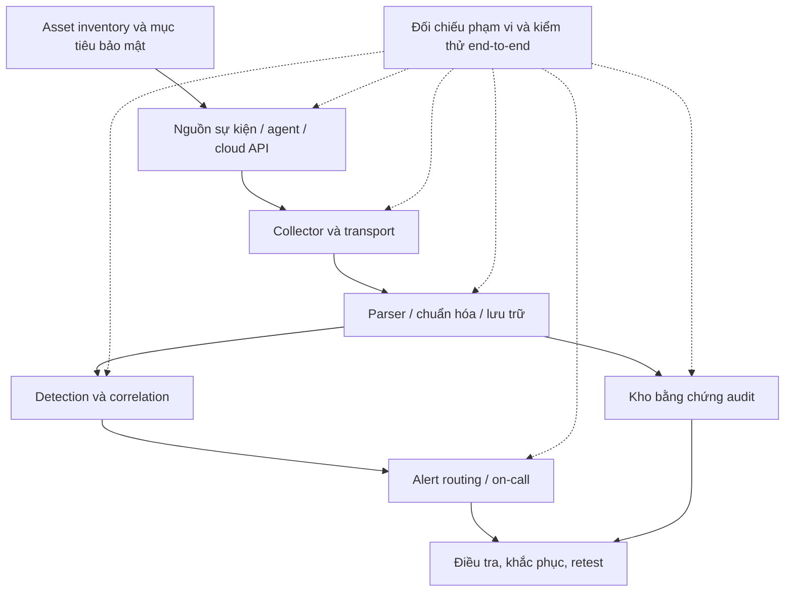
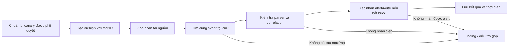

# Monitoring gap: Nhận diện và khắc phục khoảng trống giám sát bảo mật

## 1. Monitoring gap là gì và vì sao nguy hiểm?

**Monitoring gap** (khoảng trống giám sát) là phần tài sản, hành vi, sự kiện, khoảng thời gian hoặc chuỗi xử lý mà tổ chức **cần quan sát để đáp ứng một mục tiêu bảo mật, nhưng chưa thể quan sát hoặc chưa thể chứng minh được bằng bằng chứng đủ tin cậy**. Gap có thể phát sinh ở nơi tạo tín hiệu, trên đường truyền log, tại hệ thống xử lý, trong luật phát hiện, khi chuyển cảnh báo hoặc khi lưu bằng chứng phục vụ kiểm toán.

Một hệ thống có rất nhiều dashboard và hàng triệu dòng log mỗi ngày vẫn có thể có monitoring gap nghiêm trọng. Chẳng hạn, 99 máy chủ đang gửi log nhưng một máy chủ production chứa dữ liệu nhạy cảm chưa được cấu hình audit; tổng lượng log lớn không bù được việc mất khả năng quan sát đối với tài sản đó.

Trong chương **Logging và monitoring** của module **SECURITY_SECURITY_ASSURANCE**, nhiệm vụ không dừng ở việc phát hiện sự cố. Ta cần **đánh giá có bằng chứng rằng các security controls được quan sát đúng phạm vi, các kết luận đủ cơ sở và những điểm mù được xử lý có trách nhiệm**. Monitoring gap ảnh hưởng trực tiếp đến độ tin cậy của kết quả security assurance:

- Không thể xác định một control hoạt động liên tục nếu có khoảng thời gian không kiểm chứng được.
- Không thấy cảnh báo **không đồng nghĩa** không có hành vi bất thường khi nguồn dữ liệu hoặc detection rule đã ngừng hoạt động.
- Một kết quả scan đạt PASS ở các tài sản nhìn thấy **không chứng minh** những tài sản bị bỏ sót cũng an toàn.
- Gap tồn tại lâu làm giảm khả năng điều tra sự cố, xác định phạm vi ảnh hưởng, chứng minh tuân thủ và xác minh đã khắc phục.

### Tình huống mở đầu

Một hệ thống thanh toán có 12 cluster Kubernetes. Dashboard cho biết tất cả 11 cluster được kết nối đều có mức audit log bình thường; cluster thứ 12 vừa được tạo nhưng chưa có trong danh mục thu thập. Đội an ninh kết luận “100% cluster đạt yêu cầu monitoring” vì **11/11** nguồn đã đăng ký đều xanh.

Kết luận đúng phải bắt đầu từ **12/12 cluster trong phạm vi**: chỉ 11 cluster có nguồn quan sát, một cluster thiếu dữ liệu; tỷ lệ bao phủ nguồn là **11/12 ≈ 91,7%**. Việc 11 nguồn hiện tại khỏe mạnh không giải quyết monitoring gap của cluster còn lại. Nếu cluster thứ 12 chứa workload quan trọng hoặc có quyền quản trị nhạy cảm, gap cần được ưu tiên theo rủi ro của tài sản đó.

## 2. Phân biệt monitoring gap với vi phạm bảo mật và sự kiện yên lặng

| Tình huống | Diễn giải đúng | Ví dụ |
| --- | --- | --- |
| **Monitoring gap** | Thiếu khả năng quan sát cần thiết hoặc dữ liệu không đủ tin cậy | Cluster không bật API audit; log bị rơi tại collector |
| **Security-control failure** | Có bằng chứng rằng một yêu cầu kiểm soát thực tế không đạt | Quy tắc yêu cầu audit luôn chuyển tới kho tập trung; event thử đã phát sinh nhưng không đến đích sau ngưỡng cho phép |
| **Security event / incident** | Có dấu hiệu hoặc bằng chứng liên quan đến hành vi đe dọa | Principal chưa được duyệt thay đổi quyền IAM |
| **No matching event** | Chưa có sự kiện khớp rule trong dữ liệu đã quan sát | Không có thao tác cấp quyền trong khoảng đã kiểm tra |
| **Unknown** | Chưa đủ dữ liệu hoặc không đủ quyền để xác định trạng thái | Query log thất bại; collector không có quyền đọc tài nguyên |
| **Not applicable** | Đã xác nhận rule không áp dụng theo baseline và phạm vi | Yêu cầu giám sát Pod không áp dụng cho máy ảo không dùng container |

Không có bản ghi về một thao tác IAM có thể là do thao tác chưa xảy ra, log chưa được bật, cấu hình lọc loại bỏ sự kiện, kết nối bị đứt, dữ liệu đến muộn, thời hạn lưu đã hết, người kiểm tra thiếu quyền hoặc truy vấn không đúng schema. Cần xác định khả năng nào xảy ra **trước khi kết luận**.

Khi audit logging là một security control bắt buộc, việc nguồn audit bị tắt có thể vừa là **monitoring gap**, vừa là **control failure**. Hai khái niệm mô tả hai khía cạnh: khoảng trống bằng chứng và tình trạng không đáp ứng yêu cầu kiểm soát. Khi chưa biết nguyên nhân do mất quyền truy vấn hay do audit bị tắt, kết quả đánh giá nên là **UNKNOWN** cho đến khi thu thập được dữ liệu bổ sung.

## 3. Monitoring gap có thể xuất hiện ở những lớp nào?

Monitoring là một chuỗi nhiều mắt xích. Quan sát được một mắt xích không chứng minh các mắt xích phía sau còn hoạt động.



| Lớp | Loại khoảng trống | Dấu hiệu phát hiện | Cách xác minh |
| --- | --- | --- | --- |
| **Inventory/scope** | Tài sản mới, identity hoặc account chưa được đưa vào monitoring | Số tài sản trên cloud API khác số nguồn trong monitoring | Đối chiếu từ nguồn inventory độc lập |
| **Instrumentation** | Event/metric không được sinh ra, audit policy bỏ qua hoạt động quan trọng | Không thấy loại event bắt buộc dù có sự kiện kiểm thử | Đọc cấu hình hiệu lực, tạo sự kiện thử có kiểm soát |
| **Collection** | Agent bị gỡ, crash, thiếu quyền, exporter ngừng hoạt động | Heartbeat mất, log nguồn có nhưng collector không đọc được | Agent health và kiểm tra quyền/collector logs |
| **Transport** | Queue nghẽn, retry thất bại, log bị drop hoặc đến muộn | Ingestion lag, queue backlog, delivery error | Đối chiếu ID sự kiện nguồn và đích |
| **Parsing/normalization** | Thay schema khiến event bị bỏ hoặc gán sai asset | Tỷ lệ parse errors tăng, thiếu trường principal | Schema test, raw event so với bản chuẩn hóa |
| **Storage/retention** | Log bị xóa sớm, mất khóa giải mã hoặc không truy xuất được | Truy vấn dữ liệu cũ thất bại, retention thực tế ngắn hơn quy định | Kiểm thử đọc lại và kiểm tra cấu hình lưu trữ |
| **Detection** | Luật sai, không chạy, query lỗi, whitelist quá rộng | Event đã có trong kho nhưng không tạo finding | Replay/synthetic positive & negative tests |
| **Alert routing** | Alert tạo thành công nhưng không đến người chịu trách nhiệm | Có alert trong engine, không có receipt/escalation | Test định tuyến, on-call acknowledgement |
| **Evidence/governance** | Có log nhưng thiếu nguồn gốc, thời gian hoặc baseline version | Auditor không tái dựng được kết luận | Kiểm tra hồ sơ bằng chứng và lịch sử thay đổi |

Một hệ thống có thể có **nhiều gap đồng thời**. Ví dụ agent không hoạt động trên node mới; sau khi sửa agent, parser vẫn không nhận event từ phiên bản runtime mới. Vì vậy, cần kiểm tra xuyên suốt đường đi của dữ liệu và ghi rõ mỗi lỗi ở lớp nào.

## 4. Định nghĩa phạm vi: biết điều gì đáng lẽ phải được giám sát

Điểm khởi đầu của gap analysis là **danh mục kỳ vọng**, không phải danh sách thiết bị đã gửi log. Các nguồn tạo danh mục có thể gồm cloud resource inventory, CMDB/service catalog, Kubernetes API, hệ thống IAM, dữ liệu triển khai, danh sách account và repository hạ tầng.

Đối với mỗi tài sản, nên biết:

- **Asset ID ổn định:** cloud account/project, cluster UID, node ID, namespace, workload, identity hoặc hệ thống lưu dữ liệu.
- **Môi trường và mức rủi ro:** production, staging, dữ liệu nhạy cảm, tier quan trọng, quyền đặc biệt và bề mặt exposed.
- **Control áp dụng:** audit IAM, Kubernetes API auditing, workload runtime, network flow, backup, thay đổi cấu hình hoặc log truy cập dữ liệu.
- **Nguồn tín hiệu bắt buộc:** API log, host agent, cloud audit service, metric exporter, synthetic probe hoặc inventory snapshot.
- **Độ mới và thời hạn:** tối đa bao lâu có thể không thấy heartbeat, độ trễ ingest nào chấp nhận được, retention bao lâu.
- **Người chịu trách nhiệm:** owner của tài sản, owner của telemetry và risk owner khi có ngoại lệ.

### Ma trận asset–control–source

Giả sử có ba nhóm tài sản:

| Nhóm tài sản | Control cần chứng minh | Nguồn tối thiểu | Thiếu nguồn thì sao? |
| --- | --- | --- | --- |
| Cluster production | Thay đổi quyền RBAC có audit | Kubernetes API audit, log sink, event test | Không được kết luận audit coverage đạt |
| Node production | Có khả năng quan sát trạng thái và biến đổi runtime cần thiết | Inventory node, collector health, runtime events | Ghi gap theo node, kiểm tra agent và quyền |
| Cloud IAM | Thay đổi chính sách và trust được truy vết | Cloud audit configuration, management events, alert rule | Ghi gap theo account/project và loại sự kiện |

Nếu một node được miễn runtime monitoring vì lý do kỹ thuật, sự miễn trừ phải được **phê duyệt cụ thể**, kèm biện pháp bù trừ và thời hạn. Không được xóa node khỏi danh sách kỳ vọng để làm đẹp tỷ lệ coverage.

Các hệ thống tự động thay đổi quy mô như autoscaling, serverless và workload ngắn hạn cần cơ chế theo dõi theo **vòng đời**, không chỉ quét định kỳ. Một container chạy hai phút rồi biến mất giữa hai lần scan vẫn có thể thực hiện hành động quan trọng. Khi đó, nguồn audit/event streaming và inventory theo sự kiện có thể cần bổ sung cho snapshot định kỳ.

## 5. Các chiều đo của monitoring coverage

**Coverage không phải một con số duy nhất.** Tổ chức nên công bố nhiều chiều cùng định nghĩa mẫu số.

| Chiều | Câu hỏi | Ví dụ |
| --- | --- | --- |
| **Asset coverage** | Bao nhiêu tài sản trong phạm vi có đủ nguồn giám sát yêu cầu? | 95/100 node có agent hoạt động |
| **Control coverage** | Bao nhiêu cặp tài sản–control bắt buộc có phép đánh giá hợp lệ? | Audit RBAC trên 8/10 cluster đã được kiểm thử |
| **Event-type coverage** | Các loại sự kiện cần thiết có được tạo và chuyển đúng? | Role grant được ghi nhưng role deletion bị bỏ qua |
| **Time coverage** | Có khoảng thời gian nào thiếu dữ liệu trong assessment window? | Log mất từ 02:00 đến 03:30 UTC |
| **Pipeline coverage** | Dữ liệu có đi qua collector, parser, detection và storage không? | Log đến SIEM nhưng không được parser nhận diện |
| **Alert coverage** | Rule có tạo và chuyển cảnh báo cho người xử lý không? | Alert có trong engine nhưng routing bị tắt |
| **Evidence coverage** | Có dữ liệu để tái dựng đánh giá, điều tra và audit không? | Không tìm lại được log theo retention đã cam kết |

Ví dụ công thức ở mức tài sản:

\[
\text{Asset coverage} = \frac{\text{Số tài sản thuộc phạm vi có đầy đủ nguồn bắt buộc và dữ liệu hợp lệ}}{\text{Tổng tài sản thuộc phạm vi}} \times 100\%.
\]

Giả sử 50 workload production phải có cả Kubernetes audit và thông tin runtime. Có 42 workload đủ cả hai nguồn, 5 chỉ có audit, 3 không thấy nguồn nào. **Coverage đầy đủ = 42/50 = 84%**, dù tổng số workload có ít nhất một nguồn là 47/50. Cần công bố cả hai nếu chúng có ý nghĩa, với tên chỉ số và công thức rõ ràng.

Ở mức control, có thể đặt tập `R` gồm **các cặp (asset, rule) bắt buộc** và `V` là các cặp có bằng chứng hợp lệ trong khoảng đánh giá:

\[
\text{Control evidence coverage} = \frac{|V|}{|R|} \times 100\%.
\]

**Được kiểm tra không có nghĩa đạt PASS.** Một cặp có thể được đánh giá hợp lệ và cho kết quả FAIL. Tỷ lệ đạt kiểm soát là chỉ số riêng, cần trình bày số lượng PASS/FAIL/UNKNOWN/EXCEPTION. Khi báo cáo có rủi ro không đồng đều, nên bổ sung coverage theo tier dữ liệu và mức quan trọng, thay vì chỉ lấy trung bình toàn hệ thống.

## 6. Phát hiện gap bằng đối chiếu inventory độc lập

Một lỗi kinh điển là chỉ kiểm tra những nguồn đã biết. Ví dụ, hệ thống monitoring có 100 target và tất cả đều khỏe; nhưng hệ thống quản lý tài sản có 115 server. Nếu lấy mẫu số là 100, 15 server bị bỏ sót biến mất khỏi báo cáo.

### Quy trình đối chiếu

1. Trích xuất inventory tài sản từ nguồn đủ độc lập và có quyền đọc phù hợp.
2. Chuẩn hóa định danh (cloud resource ID, cluster UID, node ID) và xác định phạm vi theo baseline.
3. Lấy danh sách nguồn giám sát thực tế, thời điểm heartbeat và trạng thái pipeline.
4. Ghép hai tập dữ liệu bằng **ID ổn định**, không chỉ dựa vào tên hiển thị hoặc địa chỉ IP có thể thay đổi.
5. Xếp loại: `COVERED`, `MISSING_SOURCE`, `STALE_SOURCE`, `UNKNOWN`, `NOT_APPLICABLE` có căn cứ.
6. Mở finding và gắn owner cho các nguồn thiếu; đối soát lại sau khắc phục.

### Ví dụ SQL cho báo cáo nguồn bị thiếu

Đây là **SQL minh họa cho kho dữ liệu inventory và telemetry đã chuẩn hóa**. Tên bảng và cột do hệ thống giả định định nghĩa; không phải câu lệnh trực tiếp trên Kubernetes hay cloud API.

```sql
WITH expected AS (
    SELECT asset_id, owner_team, criticality
    FROM asset_inventory
    WHERE environment = 'production'
      AND requires_runtime_monitoring = TRUE
),
latest AS (
    SELECT asset_id, MAX(observed_at) AS last_seen_at
    FROM collector_heartbeats
    GROUP BY asset_id
)
SELECT
    e.asset_id,
    e.owner_team,
    e.criticality,
    l.last_seen_at,
    CASE
        WHEN l.last_seen_at IS NULL THEN 'MISSING_SOURCE'
        WHEN l.last_seen_at < CURRENT_TIMESTAMP - INTERVAL '10 minutes'
          THEN 'STALE_SOURCE'
        ELSE 'HEARTBEAT_RECENT'
    END AS monitoring_state
FROM expected AS e
LEFT JOIN latest AS l ON l.asset_id = e.asset_id;
```

Ngưỡng **10 phút** chỉ là ví dụ cho hệ thống có heartbeat thường xuyên. Cần chọn theo chu kỳ phát tín hiệu, jitter, độ trễ ingest và thời hạn phát hiện được phê duyệt. `HEARTBEAT_RECENT` chỉ xác nhận heartbeat đủ mới; vẫn phải kiểm tra các nguồn audit, runtime events và chất lượng log nếu baseline yêu cầu.

## 7. Phát hiện gap trong metrics và sự biến mất của target

Với Prometheus, biểu thức `up == 0` chỉ cho biết các target **còn tồn tại trong tập scrape đang quan sát** nhưng scrape thất bại. Nó không bảo đảm phát hiện asset bị loại khỏi service discovery; khi một series biến mất, không phải lúc nào cũng có vector để so sánh.

### Hai kiểm tra có phạm vi khác nhau

```promql
# Những target còn được scrape nhưng lần scrape gần nhất thất bại.
up{job="node-exporter"} == 0

# Không có mẫu cho toàn bộ job trong 10 phút: không cho biết từng node bị thiếu.
absent_over_time(up{job="node-exporter"}[10m])
```

Để phát hiện một node **đáng lẽ tồn tại** nhưng không còn heartbeat, phải có danh mục kỳ vọng độc lập, chẳng hạn `platform_expected_node` với nhãn `cluster`, `node` và `environment`. Biểu thức minh họa:

```promql
platform_expected_node{environment="production"} == 1
unless on (cluster, node)
(
  max_over_time(platform_agent_heartbeat{environment="production"}[10m]) > 0
)
```

Ở đây `platform_expected_node` và `platform_agent_heartbeat` là **metrics giả định do tổ chức triển khai**. Biểu thức chỉ hoạt động nếu inventory metric tiếp tục tồn tại độc lập với agent, các nhãn `cluster` và `node` khớp ổn định, và heartbeat biểu thị đúng trạng thái hoạt động. Cần kiểm thử tình huống node bị xóa khỏi service discovery, đổi tên, autoscaling và exporter bị lỗi. Nó vẫn **không kiểm tra** pipeline log/audit; một agent khỏe mạnh chưa chắc tất cả loại sự kiện đều được thu thập.

Với workload ngắn hạn, không nên chỉ dựa vào heartbeat theo node. Cần kết hợp sự kiện tạo/xóa workload, nguồn audit control plane và các quy tắc áp dụng theo vòng đời của tài sản.

## 8. Phân biệt "không có sự kiện" với "không có khả năng thu thập"

Audit logs không phải lúc nào cũng xuất hiện định kỳ: một hệ thống không thay quyền IAM trong nhiều giờ có thể không phát sinh sự kiện cấp quyền nào. Vì vậy, **độ mới của sự kiện nghiệp vụ không phải lúc nào cũng là health check hợp lệ**.

Các phương pháp xác minh đúng hơn:

1. **Control-plane/API readback:** kiểm tra nguồn audit đang bật, phạm vi event types, bộ lọc và nơi gửi.
2. **Collector health:** quan sát lỗi đọc/ghi, trạng thái xác thực, queue backlog, dropped records và lệnh gửi cuối cùng.
3. **Synthetic/canary event:** thực hiện một thao tác an toàn, được phê duyệt, có ID duy nhất để truy vết từ nguồn tới kho log.
4. **End-to-end detection test:** xác nhận sự kiện đã được parser nhận diện, rule kích hoạt và alert đến owner nếu đó là mục tiêu.
5. **Retention/retrieval test:** tìm lại sự kiện đã biết trong kho bằng chứng theo thời gian lưu đã phê duyệt.

Trong production, không nên tạo sự kiện thay đổi quyền nguy hiểm chỉ để kiểm tra. Có thể dùng tài nguyên thử với quyền tối thiểu, môi trường staging hoặc một loại event an toàn nhưng đi qua cùng pipeline. Nếu bài thử chỉ xác minh một phân hệ, phải nêu rõ phần chưa được kiểm chứng tại production.

### Phân biệt hai đồng hồ thời gian

- **Event time:** thời điểm nguồn cho rằng sự kiện đã xảy ra.
- **Ingest time:** thời điểm kho lưu trữ nhận bản ghi.

Độ trễ ingest có thể do queue, mạng, batch hoặc retry. Chênh lệch timestamp còn chịu ảnh hưởng clock skew; vì vậy cần đồng bộ thời gian và kiểm tra độ tin cậy timestamp. Một sự kiện đến muộn không nhất thiết đã mất vĩnh viễn, nhưng có thể tạo **detection gap tạm thời** nếu hệ thống không phát hiện trong thời hạn cần thiết.

## 9. Các khoảng trống do pipeline, schema và detection rule

### 9.1. Gap ở collection và transport

Các nguyên nhân thường gặp gồm agent bị crash, log path thay đổi khi nâng cấp, cloud API hết quota, token collector hết hạn, quyền ghi sink bị thu hồi, queue đầy hoặc mạng phân vùng. Cần quan sát cả **failed reads**, **failed writes**, **retries**, **dropped events** và **dead-letter records** nếu hệ thống hỗ trợ. Một lần gửi báo thành công không bảo đảm mọi record đã đến đích khi có cơ chế sampling hoặc drop có chủ đích.

Khi triển khai buffering, cần xác định dung lượng, thời gian lưu trước khi mất dữ liệu, chính sách backpressure và cách khôi phục sau sự cố. Vận hành phải biết khác biệt giữa “log có thể được gửi lại” và “log đã mất vĩnh viễn”.

### 9.2. Gap do parsing và schema

Sau khi một provider đổi schema event hoặc công cụ upgrade, bản ghi gốc có thể vẫn vào kho nhưng parser không trích xuất được `principal`, `action`, `resource`, hoặc gắn sai account. Rule dựa vào trường cũ sẽ không nhận diện vi phạm.

Kiểm thử cần gồm bản ghi **được kỳ vọng khớp**, **không được kỳ vọng khớp**, và bản ghi thiếu trường. Thu thập tỷ lệ parse failures, schema version, danh sách event chưa được map và kiểm tra correlation IDs. Nếu mất các trường quan trọng, đánh giá tính đầy đủ của detection phải là UNKNOWN hoặc FAIL theo điều kiện được định nghĩa, dù ingest volume không đổi.

### 9.3. Gap tại detection và alert routing

Rule có thể bị vô hiệu hóa, query timeout, lịch chạy sai, exception/allowlist quá rộng hoặc severity bị thay đổi khiến sự kiện không chuyển cho người trực. Một rule hoạt động trên staging không bảo đảm hoạt động trên production nếu nguồn dữ liệu, schema hoặc quyền truy vấn khác nhau.

Để đánh giá end-to-end, cần xác nhận ba điều kiện độc lập:

1. Sự kiện phù hợp **tồn tại** trong nguồn dữ liệu yêu cầu.
2. Phiên bản rule hiện hành **phát hiện đúng** sự kiện và tạo finding/alert.
3. Hệ thống điều phối **gửi tới đúng owner**, có escalation hoặc acknowledgement theo chính sách.

Tạo alert chỉ là một khâu. Nếu đội on-call không còn người sở hữu service, ticket không được tạo hoặc channel bị mute vô thời hạn, gap vẫn tồn tại ở lớp phản ứng.

## 10. Monitoring baseline: định nghĩa thế nào là đủ bằng chứng

Một baseline tốt cần có **phạm vi, phiên bản, chủ sở hữu, điều kiện kiểm tra và hành động khi thiếu dữ liệu**. Bảng sau là ví dụ cho một tổ chức vận hành cluster và cloud account production.

| Rule | Yêu cầu | Phương pháp xác minh | Loại gap khi không đạt |
| --- | --- | --- | --- |
| GAP-01 | Mọi cluster trong inventory có API audit theo policy | Đối chiếu inventory + audit settings + event tại sink | Missing asset/source hoặc source gap |
| GAP-02 | Node production có runtime signals đủ mới | Node inventory + heartbeat + runtime sample | Missing/stale collector |
| GAP-03 | Security events quan trọng đến đích trước ngưỡng xử lý | Source/sink correlation + ingest delay | Transport/timing gap |
| GAP-04 | Event schema hiện hành được parser và rule nhận diện | Parser tests + detection rule tests | Parsing/detection gap |
| GAP-05 | Alert quan trọng đến người được phân công | Alert creation + delivery + route test | Routing/response gap |
| GAP-06 | Bằng chứng được truy xuất theo retention | Storage/readback + integrity check | Evidence/retention gap |
| GAP-07 | Mất khả năng quan sát được phát hiện riêng | Independent watchdog/health alert | Self-monitoring gap |

Ví dụ một hồ sơ YAML **để mô tả yêu cầu**, không phải cấu hình sẵn chạy được với Kubernetes, Prometheus hoặc SIEM:

```yaml
baseline:
  id: MON-GAP-PROD
  version: "1.0.0"
  state: approved
  scope:
    environment: production
    assets: [kubernetes-cluster, worker-node, cloud-account]
  owner: Security Monitoring
  approvedBy: Security and Platform Operations
  sourceRevision: "<approved-revision>"

checks:
  - id: GAP-01
    requirement: "Every in-scope cluster has verifiable API audit"
    expectedEvidence:
      - authoritative-cluster-inventory
      - audit-policy-effective-state
      - source-to-sink-canary
    missingDataResult: UNKNOWN
    severity: critical

  - id: GAP-03
    requirement: "Critical audit events arrive within approved delay"
    threshold:
      maxIngestDelaySeconds: 300  # Giá trị ví dụ, phải được phê duyệt
    expectedEvidence:
      - controlled-event-source-time
      - controlled-event-ingest-time
      - clock-quality-check
    missingDataResult: UNKNOWN
    severity: high

  - id: GAP-05
    requirement: "Critical alerts reach assigned responders"
    expectedEvidence:
      - active-alert-rule
      - successful-delivery-test
      - oncall-owner-mapping
    missingDataResult: UNKNOWN
    severity: high
```

Các trường như `expectedEvidence` và `missingDataResult` là quy ước của hệ thống assurance **minh họa**. Cần định nghĩa rõ evaluator, tiêu chí PASS/FAIL, cách nhận diện data gap, ngoại lệ và phiên bản baseline áp dụng cho từng asset. Ngưỡng 300 giây là ví dụ; hệ thống có rủi ro cao có thể cần mức thấp hơn, hệ thống batch có thể phải có điều kiện khác.

## 11. Kiểm thử end-to-end: từ event nguồn tới bằng chứng

Kiểm thử từng thành phần riêng lẻ có thể bỏ sót lỗi giữa các thành phần. Một phép thử end-to-end cho sự kiện audit cần được thiết kế như sau:



Một test case cần ghi:

| Thuộc tính | Nội dung |
| --- | --- |
| Test ID | Mã duy nhất và thời điểm thực hiện có timezone |
| Asset & scope | Account/cluster, loại event, source và destination |
| Điều kiện đầu vào | Control và baseline version, quyền được phép, điều kiện kỳ vọng |
| Xác nhận tại nguồn | Event ID, source timestamp, nguồn dữ liệu gốc |
| Xác nhận tại đích | Event ID tương ứng, ingest timestamp, parser fields |
| Kết quả rule | Detection rule/version, finding và severity |
| Kết quả routing | Alert ID, người nhận, thời điểm, acknowledgment nếu áp dụng |
| Kết luận | PASS/FAIL/UNKNOWN, giới hạn test và hành động tiếp theo |

### Bộ kịch bản kiểm thử tối thiểu

- **Positive test:** event vi phạm giả lập trong môi trường được phép phải đến detection và tạo alert.
- **Negative test:** event hợp lệ không vi phạm rule phải được phân loại đúng, tránh cảnh báo giả kéo dài.
- **Missing-source test:** vô hiệu hóa nguồn trong môi trường kiểm thử hoặc mô phỏng mất heartbeat phải tạo health/gap alert.
- **Pipeline-delay test:** queue hoặc event trễ giả lập phải được giám sát và báo đúng giới hạn thời gian.
- **Schema-change test:** event chứa trường mới/thiếu trường phải được xử lý hoặc tạo lỗi có thể quan sát.
- **Routing test:** người nhận/escalation phải được xác nhận, bao gồm thay đổi on-call roster.
- **Retrieval test:** bản ghi đã lưu phải truy xuất được theo retention và quyền được duyệt.

Không chạy các hành động gây gián đoạn hoặc thao tác cấp quyền nguy hiểm trên production chỉ để sinh sự kiện kiểm thử. Nếu test chạy trên staging hoặc dùng synthetic logs, cần ghi rõ mức suy rộng và các control production vẫn chưa được kiểm chứng trực tiếp.

## 12. Ví dụ thực tế với Kubernetes: cluster mới không có audit log

Giả sử nhóm nền tảng tạo cluster `prod-eu-c` cho dịch vụ thanh toán. Theo baseline, cluster production phải có Kubernetes API audit, log được chuyển tới kho tập trung và rule phát hiện thay đổi `ClusterRoleBinding`. Một tuần sau, inventory cho thấy cluster có workload hoạt động nhưng không có event audit nào trong kho.

### Phân tích theo từng lớp

1. **Inventory:** xác nhận `prod-eu-c` thực sự thuộc production và có trong danh sách các cluster cần monitoring. Kiểm tra asset owner và thời điểm tạo.
2. **Nguồn:** kiểm tra nhà cung cấp/cluster đã bật audit phù hợp với loại sự kiện yêu cầu chưa; với managed cluster, xem cơ chế cấu hình và quyền truy cập do provider cung cấp.
3. **Collector/transport:** kiểm tra log sink, policy ghi log, log delivery errors, queue, quyền service principal và trạng thái routing.
4. **Parser:** tìm raw events, kiểm tra các trường `verb`, `user`, `objectRef`, resource và response status; xác định có bị lọc hoặc parser lỗi không.
5. **Detection:** xác nhận rule có scope bao gồm `prod-eu-c`, không chỉ cluster cũ; kiểm tra version và lịch sử kích hoạt.
6. **Alert routing:** xác nhận owner của cluster có trong on-call mapping và nhận được test alert.
7. **Bằng chứng:** ghi thời gian bắt đầu thiếu log có thể xác định, nguồn dữ liệu đối chiếu, kết quả test và giới hạn điều tra.

Lệnh **chỉ đọc** dưới đây giúp quan sát một phần trạng thái cluster, nhưng **không tự kiểm tra được API audit delivery**:

```bash
# Kiểm tra context trước khi đọc thông tin cluster.
kubectl config current-context

# Liệt kê namespaces và node, đối chiếu với inventory mong đợi.
kubectl get namespaces
kubectl get nodes -o wide

# Kiểm tra các RoleBinding ở namespace mẫu.
kubectl get rolebindings -n payments -o yaml

# Kiểm tra sự kiện vận hành hiện còn được API cung cấp.
kubectl get events -n payments --sort-by=.lastTimestamp
```

**Kubernetes Events không phải Kubernetes API audit logs.** Việc nhìn thấy kết quả `kubectl get events` không chứng minh thao tác quản trị đã được ghi lại. Để kết luận về audit, cần nguồn audit của cluster/provider và phép đối chiếu sự kiện tại sink theo chính sách được duyệt.

### Giải thích kết quả

| Quan sát | Đánh giá |
| --- | --- |
| Không tìm thấy log do service account kiểm tra thiếu quyền truy vấn | **UNKNOWN** đối với quy tắc; cần bổ sung quyền hoặc nguồn bằng chứng |
| Audit được xác nhận tắt trong khi baseline yêu cầu bật | **FAIL** của control, đồng thời có monitoring gap |
| Event thử có ở nguồn, không đến sink quá thời gian cho phép | **FAIL** của pipeline delivery control; mở gap finding |
| Event có tại sink nhưng rule không nhận diện vì thiếu mapping cluster | **FAIL** của detection control; nguồn log vẫn có |
| Event và alert test đạt sau khi sửa | Có bằng chứng kiểm soát hiện tại hoạt động; **không khôi phục các log lịch sử đã mất** |

## 13. Tình huống thứ hai: một giờ mất log IAM trên cloud

Lúc 09:00 UTC, đội vận hành thay quyền của log collector theo yêu cầu triển khai mới. Từ 09:05 đến 10:05, nguồn quản trị cloud vẫn tạo audit events nhưng sink trung tâm không nhận được. Sau khi quyền được sửa, log lại xuất hiện bình thường.

Một báo cáo chính xác cần phân biệt:

- **Khoảng mất quan sát:** chỉ rõ mốc bắt đầu/kết thúc được xác nhận, nguồn thông tin và độ bất định của timestamp.
- **Dữ liệu gốc có còn không:** có log phía provider/queue có thể gửi lại không, hay dữ liệu đã mất vĩnh viễn?
- **Tài nguyên và control bị ảnh hưởng:** IAM policy changes, trust changes, cloud account nào, log type nào và các detection rules liên quan.
- **Hành động trong khoảng gap:** đối chiếu audit nguồn khác, snapshot cấu hình và lịch sử IaC/deploy; nêu giới hạn nếu không thể tái dựng đầy đủ.
- **Khắc phục:** sửa quyền collector theo tối thiểu cần thiết, kiểm thử canary từ nguồn tới sink, kiểm tra detection và alert routing.
- **Ngăn tái diễn:** monitor delivery failures, heartbeat, log ingest lag; tạo cảnh báo độc lập khi không nhận được dữ liệu kỳ vọng.

Không thể nói “không có thay đổi trái phép trong một giờ đó” chỉ vì SIEM không có bản ghi. Nếu nguồn provider còn log gốc, có thể phục hồi một phần phạm vi điều tra; nếu không còn, khoảng trống phải được ghi nhận như một **giới hạn assurance** và đánh giá theo mức rủi ro của dữ liệu, quyền và tài sản liên quan.

## 14. Từ phát hiện gap tới hồ sơ bằng chứng

Một finding về monitoring gap nên là một đối tượng có thể truy vết, thay vì ghi chú mơ hồ “thiếu log”. Tối thiểu cần:

- **Asset và control:** asset ID, môi trường, rule ID và baseline version tại thời điểm gap.
- **Phạm vi gap:** nguồn/event type bị thiếu, mắt xích bị lỗi và các asset chịu ảnh hưởng.
- **Thời gian:** `firstKnownGood`, `firstKnownBad`, `detectedAt`, `recoveredAt` (nếu có); không suy đoán thời điểm chính xác khi chỉ biết khoảng giữa hai lần kiểm tra.
- **Dữ liệu quan sát:** expected source, actual state, kiểm tra đã thực hiện, tool/query version và mức chắc chắn.
- **Ảnh hưởng:** control/detection nào không thể đánh giá, khả năng điều tra còn lại, mức quan trọng của tài sản.
- **Trách nhiệm và xử lý:** owner, finding/ticket, quyết định risk acceptance, hành động, retest và tài liệu lưu trữ.

Ví dụ JSON **giả định**:

```json
{
  "findingId": "MON-GAP-014",
  "assetId": "production/k8s/prod-eu-c",
  "baselineId": "MON-GAP-PROD",
  "baselineVersion": "1.0.0",
  "ruleId": "GAP-01",
  "gapType": "audit-delivery",
  "affectedEventType": "kubernetes-rbac-change",
  "observedAt": "2026-11-28T04:30:00Z",
  "firstKnownGood": "2026-11-28T02:00:00Z",
  "firstKnownBad": "2026-11-28T04:00:00Z",
  "result": "FAIL",
  "expected": "Audit event at protected sink within approved delay",
  "observed": "Controlled event present at source; absent at sink",
  "evidence": [
    "evidence://monitoring/014/source-event",
    "evidence://monitoring/014/sink-query"
  ],
  "owner": "Platform Monitoring",
  "ticket": "SEC-MON-014",
  "retestStatus": "PENDING"
}
```

Trường `firstKnownGood` và `firstKnownBad` trong ví dụ mô tả **hai quan sát**; khoảng bắt đầu chính xác của gap có thể nằm giữa chúng. Không tính toàn bộ khoảng đó là thời gian mất dữ liệu đã được chứng minh. Khi biết giới hạn thời gian, báo cáo cần mô tả độ bất định để người điều tra không nhận kết luận chính xác giả tạo.

Đảm bảo bằng chứng gốc có nguồn, thời điểm có múi giờ, quyền thu thập và cơ chế kiểm tra tính toàn vẹn phù hợp; bảo vệ quyền truy xuất, retention và thông tin nhạy cảm. Không đưa token, private key, credential, dữ liệu khách hàng hoặc raw log không cần thiết vào ticket chỉ để chứng minh có gap.

## 15. Xếp mức độ ưu tiên và quyết định xử lý gap

Mức ưu tiên không nên chỉ dựa vào số bản ghi bị thiếu. Cần xem xét đồng thời:

| Yếu tố | Câu hỏi ưu tiên |
| --- | --- |
| **Asset criticality** | Đó có phải production, dữ liệu nhạy cảm, control plane hoặc hệ thống thanh toán? |
| **Attack surface** | Gap có che API public, privileged identity hay workload đa thuê không? |
| **Control importance** | Có mất khả năng audit truy cập nhạy cảm hoặc hành động quản trị đặc quyền không? |
| **Breadth** | Một node, toàn cluster, nhiều account hay toàn bộ log pipeline? |
| **Duration** | Gap xảy ra bao lâu và độ bất định thời gian là bao nhiêu? |
| **Detectability elsewhere** | Có nguồn độc lập nào vẫn cung cấp bằng chứng để điều tra không? |
| **Recovery potential** | Log có thể replay từ nguồn/queue không, hay đã mất vĩnh viễn? |
| **Compensating controls** | Có policy ngăn hành động nguy hiểm, access review hoặc snapshot đủ mới không? |

Ví dụ, một dashboard metric cho workload thử nghiệm bị trễ vài phút thường có mức ảnh hưởng khác với mất audit cho các thao tác quản trị trên cloud production. Nếu các điều kiện rủi ro chưa được biết vì thiếu dữ liệu, phải ghi **uncertainty** và nâng mức ưu tiên điều tra tương ứng, không giả định mức rủi ro bằng không.

### Runbook xử lý gap

1. **Xác nhận scope và owner:** tài sản nào đáng lẽ có telemetry, nguồn nào có quyền chịu trách nhiệm?
2. **Xác định gap type:** thiếu inventory, source, pipeline, parser, detection, route hay evidence.
3. **Khoanh vùng khoảng thời gian:** tìm last known good, first known bad, độ trễ và nguồn thời gian.
4. **Đánh giá tác động:** control nào không thể chứng minh, tình huống nào có thể đã bị bỏ sót.
5. **Giảm rủi ro:** hạn chế thay đổi nhạy cảm nếu cần, tăng quan sát từ nguồn độc lập và phối hợp incident response theo chính sách.
6. **Sửa nguyên nhân:** khôi phục audit/collector, quyền tối thiểu, queue, parser, rule, alert route hoặc cập nhật inventory.
7. **Retest end-to-end:** xác nhận sự kiện thử qua đúng các mắt xích và cảnh báo tới người xử lý.
8. **Đóng hoặc chấp nhận rủi ro:** lưu bằng chứng, khoảng không thể phục hồi, residual risk, phê duyệt ngoại lệ nếu còn cần.
9. **Phòng ngừa tái diễn:** kiểm tra onboarding, health monitoring, alert, automation và hướng dẫn vận hành.

**Khắc phục hiện tại không xóa được lịch sử gap.** Khi nguồn dữ liệu quá khứ không thể phục hồi, cần giữ khoảng thiếu trong hồ sơ audit và xác định mức độ tin cậy của các kết luận trong giai đoạn đó.

## 16. Giám sát chính hệ thống monitoring

Một hệ thống giám sát tốt phải phát hiện được việc **nó ngừng nhìn thấy** những đối tượng đã cam kết quan sát. Đây là nguyên tắc *monitor the monitor* hoặc *watchdog*.

Các kiểm soát đề xuất:

- **Heartbeat có nguồn kỳ vọng:** đối chiếu inventory và last-seen theo từng asset, tránh chỉ kiểm tra tổng số message.
- **Canary event định kỳ:** tạo event an toàn có test ID và xác minh nó đến đích trong ngưỡng.
- **Independent health path:** đặt kiểm tra bên ngoài pipeline chính khi rủi ro mất toàn bộ pipeline là đáng kể.
- **Queue/delivery monitoring:** theo dõi backlog, retry, dropped count và ingest delay theo nguồn.
- **Parser/detection health:** kiểm thử schema, query failure, rule disabled/suppression, kết quả synthetic tests.
- **Alert-route health:** test thông báo tới on-call, xác nhận escalation và theo dõi mute/silence hết hạn.
- **Evidence retrievability:** kiểm tra định kỳ rằng dữ liệu đã lưu theo retention có thể tìm lại với quyền hợp lệ.

Không có một watchdog nào là hoàn hảo. Nếu watchdog dùng cùng mạng, cùng credential và cùng log store với đường chính, lỗi chung có thể làm cả hai mất tín hiệu. Khi yêu cầu assurance cao, cần phân tích **common-mode failures** và cân nhắc một đường quan sát độc lập thực sự.

## 17. Chỉ số theo dõi monitoring gap

| Chỉ số | Cách tính hoặc ý nghĩa | Cảnh báo diễn giải |
| --- | --- | --- |
| **Asset coverage** | Tài sản có đủ nguồn bắt buộc / tất cả tài sản trong phạm vi | Bỏ sót asset từ inventory làm mẫu số thấp giả tạo |
| **Control evidence coverage** | Cặp asset–control có evidence hợp lệ / cặp bắt buộc | Coverage không phải tỷ lệ PASS |
| **Number of open gaps** | Số finding chưa xử lý, phân theo severity và lớp lỗi | Một gap toàn hệ thống có thể nguy hiểm hơn nhiều gap nhỏ |
| **Gap duration** | Khoảng mất quan sát có cơ sở xác định, kèm bất định | Không suy ra thời gian bắt đầu chính xác từ hai lần sample |
| **Time to detect gap** | Thời gian từ khi gap bắt đầu đến lúc được xác định nếu có timestamp tin cậy | Không nên ghi số liệu chính xác khi thiếu mốc gốc |
| **Time to restore visibility** | Thời gian từ finding đến khi retest chứng minh đường quan sát phục hồi | Đóng ticket không đồng nghĩa phục hồi |
| **Pipeline delivery rate** | Số event xác nhận đến đích / số event có thể đếm đáng tin tại nguồn | Cần định nghĩa xử lý duplicate, sampling, batch và late arrival |
| **Ingestion delay** | Khoảng cách giữa event time và ingest time | Chịu ảnh hưởng clock skew và độ trễ chuyển tiếp |
| **Detection test pass rate** | Số positive/negative/missing-source tests đạt / số tests bắt buộc | Test không tương đương bảo đảm mọi event đều được phát hiện |
| **Unrecoverable evidence windows** | Khoảng thời gian mất bằng chứng không thể phục hồi | Phải giữ lại trong đánh giá rủi ro và audit |

Tổ chức có thể thống kê **risk-weighted gap exposure** bằng cách kết hợp số tài sản, mức quan trọng và thời gian thiếu quan sát. Tuy nhiên, trọng số phải được định nghĩa, phê duyệt và công bố; tránh biến một điểm tổng hợp thành lời khẳng định bảo mật tuyệt đối.

Khi trình bày dashboard, nên thể hiện các khoảng trống theo timeline và tài sản, phân biệt `PASS`, `FAIL`, `UNKNOWN`, `EXCEPTION`, `NOT_APPLICABLE`. Ví dụ, một account mới chưa thể truy vấn audit do thiếu quyền phải được hiển thị **UNKNOWN và ảnh hưởng coverage**, thay vì bị loại khỏi báo cáo.

## 18. Tích hợp gap analysis vào SDLC và vận hành

| Giai đoạn | Việc cần làm | Bằng chứng cần lưu |
| --- | --- | --- |
| Thiết kế | Định nghĩa log/monitoring requirements, threat model, ownership và baseline | Control mapping, nguồn kỳ vọng, acceptance criteria |
| Tạo tài nguyên | Bắt buộc onboarding monitoring cho account/cluster/node mới | Provisioning workflow, inventory reconciliation |
| Pull request | Review log policy, parser, detection rules, alert routing và quyền collector | Diff, approval, automated checks |
| Trước deploy | Test nguồn telemetry, schema, positive/negative và missing-source scenarios | Test results, release decision, rollback plan |
| Sau deploy | Kiểm tra source-to-sink, freshness, coverage và owner | Canary ID, API state, snapshot evidence |
| Vận hành liên tục | Đối chiếu inventory, phát hiện data gap, route finding và xử lý | Coverage dashboard, gap register, incident ticket |
| Định kỳ | Truy xuất log theo retention, review ngoại lệ và test khôi phục pipeline | Retrieval report, approved exceptions, retest |
| Sau sự cố | Xác định blind spots và giới hạn điều tra, bổ sung detection gaps | Incident timeline, root cause, cải tiến có kiểm chứng |

**RACI** cần xác định rõ: đội tạo tài nguyên chịu trách nhiệm onboarding, đội observability/logging duy trì pipeline, đội detection/security duy trì luật, chủ dịch vụ xử lý các ảnh hưởng nghiệp vụ và risk owner chấp thuận ngoại lệ. Cơ cấu có thể khác nhau nhưng không nên để một gap tồn tại vì “không rõ đội nào sở hữu”.

## 19. Các sai lầm thường gặp

1. **Đếm nguồn đã đăng ký thay vì tài sản kỳ vọng:** mất tài sản mới khỏi mẫu số.
2. **Coi không có alert là không có sự cố:** bỏ qua khả năng rule, collector hoặc tuyến cảnh báo bị hỏng.
3. **Dùng một heartbeat để chứng minh mọi loại log:** health của exporter không chứng minh Kubernetes audit hoặc IAM events có đủ.
4. **Nhầm Kubernetes Events với audit logs:** bỏ sót những API calls quan trọng.
5. **Tin tổng lượng ingest cao nghĩa là coverage tốt:** một nguồn quan trọng có thể mất dữ liệu khi những nguồn khác vẫn tạo lượng log lớn.
6. **Dựa vào `up == 0` cho tài sản đã mất khỏi service discovery:** không đối chiếu inventory độc lập.
7. **Không thử parser sau nâng cấp:** raw event vẫn có nhưng detection không còn nhận diện.
8. **Tạo alert nhưng không thử người nhận:** rule đúng nhưng không ai xử lý được.
9. **Bỏ qua khoảng thời gian và nguồn timestamp:** suy luận sai detection latency và phạm vi ảnh hưởng.
10. **Không ghi nhận dữ liệu không thể phục hồi:** đóng finding khiến hồ sơ audit đánh mất lịch sử điểm mù.
11. **Đánh dấu UNKNOWN thành PASS:** làm sai lệch tỷ lệ tuân thủ và cảm giác an toàn.
12. **Mở rộng retention mà không kiểm soát dữ liệu nhạy cảm:** tăng chi phí, rủi ro privacy và nguy cơ lộ secret.
13. **Dùng allowlist/suppression không thời hạn:** che mất hành vi thật sau đợt tuning.
14. **Chỉ kiểm thử thành phần riêng lẻ:** không phát hiện được lỗi source–sink–parser–alert.
15. **Dựa vào test staging để tuyên bố production an toàn:** bỏ qua khác biệt về policy, identity và event types.

## 20. Bài tập tự đánh giá

1. Inventory có 24 cloud accounts production, trong đó 20 accounts đã bật audit và có canary đến sink, 2 accounts không có cấu hình audit, 2 accounts API collector thiếu quyền. Hãy tính asset coverage, xác định trạng thái của 4 accounts còn lại và đề xuất cách khắc phục.
2. Một dashboard cho thấy không có thay đổi `ClusterRoleBinding` trong tuần. Hãy thiết kế một phép thử chứng minh rule phát hiện loại thay đổi này còn hoạt động và một phép thử mất nguồn.
3. Sau nâng cấp runtime, số log được ingest không đổi nhưng tỷ lệ phát hiện container đặc quyền giảm. Có thể xuất hiện những gap nào tại parser, rule, nguồn event hoặc phạm vi asset?
4. Prometheus trả về không có kết quả cho `up{job="node-exporter"} == 0`, trong khi có node mới trên cloud. Vì sao điều này không có nghĩa mọi node khỏe mạnh? Thiết kế cơ chế đối chiếu kỳ vọng.
5. Sự kiện audit được sinh lúc 10:00, đến SIEM lúc 10:15 nhưng alert phát lúc 10:17. Hãy phân biệt ingestion delay với detection/alerting delay; cần biết thêm gì để tin vào các timestamp đó?
6. Một cluster không có log hai giờ, log provider vẫn còn một phần nhưng SIEM bị mất vĩnh viễn phần khác. Hãy viết kết luận assurance thể hiện đúng giới hạn quan sát và cách xử lý dữ liệu không thể phục hồi.
7. Một rule monitoring bị mute có thời hạn vì bảo trì nhưng không tự bật lại. Hãy phân loại gap, xác định chủ sở hữu, kiểm soát bù trừ và phép retest cần thiết.
8. Xây dựng bảng asset–control–evidence cho một hệ thống có API, Kubernetes, database, IAM và CI/CD; chỉ rõ tài sản nào phải phát sinh loại log gì và người nào xác minh.

**Tiêu chí đánh giá câu trả lời:** phải trình bày được **tài sản trong phạm vi → yêu cầu bảo mật → nguồn tín hiệu kỳ vọng → quan sát thực tế và độ tin cậy → loại gap/khoảng thời gian → quyết định xử lý → bằng chứng retest**. Nêu rõ trường hợp nào còn UNKNOWN, trường hợp nào thực sự FAIL và tại sao.

## 21. Tài liệu tham khảo

- **NIST SP 800-137 – Information Security Continuous Monitoring (ISCM) for Federal Information Systems and Organizations:** tư duy giám sát liên tục gắn với rủi ro, lựa chọn chỉ số, đánh giá và hành động.
- **NIST SP 800-53**, các nhóm **AU** (Audit and Accountability), **SI** (System and Information Integrity), **CA** (Assessment, Authorization, and Monitoring), **CM** (Configuration Management), **IR** (Incident Response): tham khảo quy tắc logging, monitoring, assessment và xử lý.
- **Kubernetes Documentation – Auditing, Events, RBAC, API Access Control:** phân biệt loại tín hiệu, nguồn ghi và giới hạn khi quan sát control plane.
- **Prometheus Documentation – Querying, Alerting, Service Discovery:** ngữ nghĩa `up`, `absent_over_time`, vector matching và những trường hợp target biến mất.
- **OpenTelemetry Documentation – Collector, Logs, Metrics, Traces:** hiểu pipeline thu thập, xử lý, chuyển tiếp và cơ chế xác định nguồn telemetry.
- **OWASP Logging Cheat Sheet:** cân bằng yêu cầu ghi nhận sự kiện bảo mật với bảo vệ dữ liệu nhạy cảm.
- **Tài liệu auditing và monitoring của nhà cung cấp cloud** theo dịch vụ cụ thể: xác minh loại sự kiện, cơ chế lưu trữ, giới hạn API, điều kiện bật log và trách nhiệm giữa nhà cung cấp với khách hàng.

**Monitoring gap** là một rủi ro cần được đo và xử lý như các phát hiện bảo mật khác. Chương trình security assurance có cơ sở khi xác định được **mọi tài sản cần giám sát, những nguồn bằng chứng bắt buộc, khoảng thời gian không thể quan sát và kết quả kiểm thử sau khắc phục**. Khả năng nhìn thấy chính các điểm mù của mình là điều kiện thiết yếu để đưa ra kết luận an toàn có trách nhiệm.
