# Bằng chứng monitoring trong Security Assurance

## 1. Bằng chứng monitoring chứng minh điều gì?

Một hệ thống có dashboard, agent thu log và cảnh báo không đồng nghĩa hệ thống **phát hiện được** những hành vi đe dọa mục tiêu bảo mật. Dashboard có thể chỉ phản ánh một phần tài sản; agent có thể ngừng gửi sự kiện; quy tắc có thể chạy ở chế độ không kích hoạt; cảnh báo có thể không đến người trực; hoặc phát hiện đã xuất hiện nhưng không ai xử lý.

Trong chương **Logging và monitoring** của module **SECURITY_SECURITY_ASSURANCE**, **bằng chứng monitoring (monitoring evidence)** là dữ liệu có nguồn gốc, phạm vi, thời điểm và phương pháp kiểm tra rõ ràng, cho phép người đánh giá kết luận mức độ đáp ứng **các yêu cầu giám sát và phát hiện bảo mật**. Nó kết nối chuỗi **phân tích rủi ro → yêu cầu → security control → triển khai giám sát → kiểm thử → audit → phát hiện/khắc phục → kiểm chứng lại**.

Ví dụ, yêu cầu bảo mật:

> Các thay đổi quyền quản trị đặc biệt trong môi trường production phải được ghi nhận, phát hiện và chuyển tới nhóm trực theo thời gian do tổ chức quy định.

Để chứng minh, cần kiểm tra được **tối thiểu**:

1. Những hệ thống và loại thay đổi nào thuộc phạm vi, ai chịu trách nhiệm.
2. Nguồn có thực sự phát sinh sự kiện quản trị, collector và pipeline có nhận đủ sự kiện đó không.
3. Rule phân tích nhận diện đúng loại thay đổi trên dữ liệu đã chuẩn hóa hay không.
4. Cảnh báo có được tạo, chuyển đến tuyến nhận phù hợp và có dấu vết tiếp nhận/triage không.
5. Các bước này có xảy ra trong giới hạn thời gian được phê duyệt; log và kết quả test có thể truy vết, kiểm tra lại không.

Một sự kiện xuất hiện trong SIEM chứng minh **SIEM nhận được sự kiện đã quan sát**, chưa đủ chứng minh mọi nguồn đang được bao phủ. Một cảnh báo chạy thành công trong chế độ test chứng minh **trường hợp test đó** hoạt động, chưa đủ để khẳng định không còn hành vi tấn công không được phát hiện.

### Mục tiêu học tập

Sau bài này, người học có thể:

- Phân biệt **telemetry**, **bằng chứng thô**, **bằng chứng thực thi control** và **kết luận assurance**.
- Xác định nguồn log, metric, trace, audit event và alert cần thiết theo rủi ro và loại tài sản.
- Đo độ phủ, chất lượng, tính kịp thời và tính toàn vẹn của chuỗi thu thập → phân tích → thông báo → xử lý.
- Tổ chức kiểm thử có kiểm soát để kiểm chứng khả năng phát hiện và phản ứng của monitoring.
- Thiết kế evidence package phục vụ audit, xử lý finding, kiểm tra lại sau thay đổi và bảo đảm liên tục.

## 2. Phân biệt dữ liệu giám sát với bằng chứng assurance

Không phải mọi dữ liệu vận hành đều chứng minh được security control đã hoạt động.

| Khái niệm | Ví dụ | Có thể kết luận | Chưa thể kết luận |
|---|---|---|---|
| **Telemetry** | Log đăng nhập, metric agent heartbeat, trace API, thay đổi IAM | Hệ thống đã phát ra hoặc ghi nhận tín hiệu | Tín hiệu có được thu thập đầy đủ hay cảnh báo đúng |
| **Raw event** | JSON từ identity provider có event ID và thời gian | Một sự kiện với thuộc tính được quan sát | Mọi sự kiện tương tự đều đã được nhận |
| **Pipeline evidence** | Lượt ingest, delivery status, parse errors, event delay | Pipeline xử lý được lượng dữ liệu quan sát, hoặc có lỗi | Rule phân tích và thông báo chắc chắn hoạt động |
| **Detection evidence** | Rule ID/version, matched event, kết quả kiểm thử | Rule đã nhận ra điều kiện tương ứng trong mẫu đã kiểm | Tất cả biến thể tấn công đều được phát hiện |
| **Response evidence** | Alert, notification, case/ticket, acknowledgement, triage notes | Đường thông báo/tiếp nhận đã được thực thi | Sự cố được xử lý hiệu quả nếu thiếu bằng chứng hành động |
| **Assurance assessment** | `PASS`, `FAIL`, `INCONCLUSIVE` cùng tiêu chí, thời gian, phạm vi | Mức đáp ứng của control tại thời điểm đo | Mọi rủi ro đã bị loại bỏ |

Cần tách rõ **claim** (mệnh đề cần chứng minh), **expectation** (tiêu chí định lượng/định tính), **observation** (dữ liệu thu được) và **assessment** (kết luận dựa trên quy tắc).

Ví dụ: “mọi thay đổi thành viên nhóm quản trị production phải tạo alert trong tối đa năm phút” là tiêu chí minh họa. Một test phát sinh event vào 10:00 UTC và alert tới tuyến trực lúc 10:08 UTC có thể là **FAIL** cho tiêu chí năm phút, dù cuối cùng alert vẫn được tạo. Năm phút là giá trị ví dụ; mỗi hệ thống phải có SLO và mức rủi ro được phê duyệt riêng.

## 3. Xây dựng chuỗi chứng minh từ nguồn tới hành động

```mermaid
flowchart LR
  A["Rủi ro / yêu cầu bảo mật"] --> B["Monitoring control<br/>scope + acceptance criteria"]
  B --> C["Nguồn sự kiện<br/>host / identity / app / cloud"]
  C --> D["Collector / transport<br/>lọc + ingest"]
  D --> E["Parse / enrich<br/>lưu trữ"]
  E --> F["Detection rule<br/>match + alert"]
  F --> G["Routing<br/>on-call / case"]
  G --> H["Triage / phản ứng<br/>và đóng finding"]
  H --> I["Evidence + retest<br/>assurance liên tục"]
```



Có thể mất dữ liệu hoặc hiểu sai ở **bất kỳ điểm** nào:

- Nguồn không bật audit, agent ngừng chạy hoặc cấu hình loại trừ loại event cần thiết.
- Collector có kết nối nhưng bị throttle, mất buffer, tràn hàng đợi, thiếu quyền, parser từ chối record.
- Dữ liệu được ingest nhưng thiếu các trường định danh cần để correlation; clock lệch làm sự kiện bị xếp sai thời gian.
- Rule bị disable, selector sai environment, logic chỉ kiểm tra một loại sự kiện hoặc cấu hình im lặng.
- Alert được tạo nhưng route sai team, bị suppression/dedup quá rộng hoặc kênh thông báo lỗi.
- Người trực nhận được alert nhưng không có ticket/acknowledgement hay thao tác triage có thể truy vết.

**Quy tắc quan trọng:** chứng minh ở từng bước không chỉ bằng cấu hình đã khai báo mà còn bằng **trạng thái có hiệu lực và kết quả hành vi**. Một YAML bật log forwarder chỉ cho thấy ý định; phải xác minh sự kiện từ nguồn đó tới đích. Tương tự, một detection rule được lưu trong repository chưa có nghĩa rule đang chạy đúng phiên bản.

## 4. Chọn nguồn telemetry theo tài sản và rủi ro

Bộ nguồn phải xuất phát từ mục tiêu monitoring, phân loại tài sản và threat model. Không có một danh sách log mặc định phù hợp mọi hệ thống.

| Phạm vi | Tín hiệu thường dùng | Ví dụ mục tiêu assurance |
|---|---|---|
| **Identity & authentication** | Đăng nhập thành công/thất bại, MFA, phiên đặc quyền, thay đổi nhóm/role | Nhận biết thay đổi truy cập và hành vi xác thực đáng ngờ |
| **Operating system** | Audit đăng nhập, thay đổi user, quyền sudo/admin, service, tiến trình và file khi được cấu hình | Phát hiện sử dụng đặc quyền và sửa đổi hệ thống nhạy cảm |
| **Application/API** | Xác thực, ủy quyền, thao tác dữ liệu nhạy cảm, lỗi an ninh, hành động quản trị | Kiểm tra hành vi truy cập và các quyết định deny |
| **Database** | Audit truy cập, cấu hình, quyền và hoạt động quản trị theo mức rủi ro | Phát hiện thay đổi quyền và truy vấn đặc biệt trong phạm vi cho phép |
| **Cloud control plane** | Thay đổi IAM, network policy, KMS, audit settings, tạo/xóa resource | Theo dõi các thay đổi cấu hình có ảnh hưởng bảo mật |
| **Container/orchestrator** | Kubernetes audit events, admission decisions, workload changes, node agent status | Theo dõi quyền API, deployment và policy enforcement |
| **Network/security controls** | Firewall/WAF/VPN/proxy events, flow metadata, rule changes | Nhận biết luồng không hợp lệ và thay đổi ranh giới mạng |
| **Pipeline/CI/CD** | Artifact provenance, triển khai, thay policy, kết quả kiểm tra | Nối thay đổi mã/cấu hình với sự kiện môi trường |
| **Endpoint protection** | Agent health, detections, quarantine, tamper events | Kiểm chứng việc thu phát hiện và tình trạng agent |
| **Hệ thống monitoring** | Collector health, drops, ingestion lag, query errors, rule evaluation failures | Phát hiện khi chính hệ thống giám sát bị suy giảm |

**Metrics** thường phù hợp để đo sức khỏe collector, queue, tốc độ ingest và độ trễ. **Logs/audit events** phù hợp để tái hiện thao tác chi tiết. **Traces** có thể hỗ trợ correlation theo giao dịch nhưng không tự thay audit log. **Alert/case records** phản ánh quá trình phát hiện và phản ứng. Phải phối hợp các nguồn này theo control và hiểu rõ sampling, retention, trường bị ẩn hoặc quyền truy cập của mỗi nguồn.

Mỗi nguồn nên có ít nhất: `source_id`, owner, asset scope, loại event bắt buộc, format/schema, tần suất mong đợi, tuyến thu thập, vùng lưu, yêu cầu retention, giới hạn độ trễ và cơ chế cảnh báo mất dữ liệu.

## 5. Đặc tính của bằng chứng monitoring tốt

| Đặc tính | Kiểm tra cần thực hiện | Nguy cơ nếu thiếu |
|---|---|---|
| **Relevance – phù hợp** | Event và phép đo đúng mục tiêu/control | Dashboard hiển thị CPU nhưng control cần phát hiện lạm dụng quyền |
| **Coverage – độ phủ** | Inventory tài sản/luồng nằm trong phạm vi và lượng nguồn đang báo | Báo cáo chỉ có những host còn online |
| **Completeness – đầy đủ** | Event fields, chuỗi ingest và các điểm mất dữ liệu được đo | Mất event mà không có cảnh báo |
| **Accuracy – chính xác** | Parser, mapping, rule, timestamp, source ID đúng định nghĩa | Rule không match do thay schema |
| **Timeliness – kịp thời** | Phân biệt thời điểm phát sinh, nhận, xử lý, cảnh báo và tiếp nhận | Alert quá muộn so với tiêu chí |
| **Integrity – toàn vẹn** | Bản gốc, checksum/manifest hoặc kho có audit trail | Dữ liệu bị sửa mà không phát hiện |
| **Provenance – nguồn gốc** | Collector identity, API/host, config và tool version | Không tái hiện được cách thu dữ liệu |
| **Reproducibility – tái lập** | Input/test run ID, điều kiện, query, rule revision | Không thể kiểm tra lại hoặc phản biện kết luận |
| **Confidentiality – bí mật** | Quyền đọc, loại bỏ token/PII, mã hóa và retention | Bộ evidence trở thành nguồn rò rỉ |
| **Freshness – tính mới** | Giới hạn tuổi theo rủi ro và trạng thái giám sát hiện tại | PASS trước thay đổi được dùng như trạng thái hôm nay |

Bằng chứng có thể là tập log, kết quả kiểm thử, ảnh màn hình, dashboard export hoặc report tự động. **Ảnh chụp màn hình là bằng chứng yếu nếu không biết nguồn, timestamp và phạm vi**; ưu tiên raw/API export có định danh và query tái lập.

Không thể chứng minh “không có sự cố bảo mật” chỉ từ việc “không có alert”. **Không có alert** có thể do chưa xuất hiện hành vi, do chưa được quan sát, hoặc do cơ chế phát hiện không hoạt động. Kết luận phải gắn với phạm vi và chất lượng các phép đo có thể thực hiện.

## 6. Thiết kế monitoring control có điều kiện đạt rõ ràng

Một monitoring control nên mô tả **tài sản**, **loại tín hiệu cần thu**, **tiêu chí phát hiện**, **tuyến nhận** và **cửa sổ thời gian**. Ví dụ baseline minh họa:

| Control ID | Mệnh đề cần chứng minh | Bằng chứng phù hợp |
|---|---|---|
| `MON-01 Source coverage` | Mọi identity provider production trong danh mục đều có luồng audit theo danh sách event bắt buộc | Inventory, cấu hình audit, nguồn thực nhận, collector heartbeat và phép thử mẫu |
| `MON-02 Critical changes` | Thay đổi role quản trị thuộc phạm vi tạo sự kiện và detection đúng | Raw event, parser fields, rule version, alert/case có liên kết event |
| `MON-03 Pipeline health` | Mất collector hoặc tăng lag vượt ngưỡng có alert gửi tới vận hành | Heartbeat/ingest metric, threshold policy, kết quả thử ngắt kết nối có kiểm soát |
| `MON-04 Delivery` | Alert mức critical được chuyển đúng tuyến trong thời gian đã duyệt | Event/alert/delivery timestamps, notification ID, acknowledgement |
| `MON-05 Case handling` | Cảnh báo critical được tiếp nhận, phân loại và xử lý theo runbook và hạn | Ticket, owner, escalation log, triage notes và quyết định |
| `MON-06 Retention/integrity` | Log/evidence nhạy cảm được giữ đủ thời gian, có kiểm soát truy cập và lịch sử | Storage policy, audit truy xuất, thử retrieve bản ghi cũ, checksum khi áp dụng |
| `MON-07 Detection testing` | Detection quan trọng được thử định kỳ và sau thay đổi rule/source | Test plan, test event, expected result, actual alert, retest evidence |
| `MON-08 Drift & gaps` | Thay nguồn, schema, rule hoặc routing được nhận biết và đánh giá lại | Change history, config diff, scanner result, finding và ngoại lệ |

Tiêu chí nên đủ cụ thể. “Mọi log phải đầy đủ và kịp thời” không thể đánh giá trực tiếp. Với hệ thống đã phê duyệt, có thể đặt ví dụ: “Từ tất cả 25 máy bastion production, mọi sự kiện thay đổi cấu hình SSH thuộc schema bắt buộc phải được ingest vào kho trong tối đa hai phút trong thử nghiệm chuẩn”. Đây là **tiêu chí minh họa**, không phải mức thời gian/độ phủ phổ quát.

### Mẫu control specification

```yaml
control_id: MON-02
baseline_version: monitoring-prod-v3
objective: "Detect authorized-scope production admin role changes"
scope:
  environment: production
  sources:
    - identity-provider-main
    - cloud-control-plane-main
required_event_types:
  - iam.role_assignment_changed
expected:
  rule_id: det-admin-role-change
  alert_severity: high
  delivery_target: security-oncall
  max_event_to_delivery_seconds: 300
verification:
  methods:
    - read_effective_source_and_rule_config
    - collect_sample_event_with_test_run_id
    - verify_alert_and_delivery
    - inspect_triage_case
owner: security-monitoring
```

Bản ghi này mô tả yêu cầu, **chưa phải chứng cứ đạt**. Giá trị event schema và tên rule là quy ước ví dụ, cần thống nhất với hệ thống quan sát thực tế; ngưỡng 300 giây do tổ chức giả định phê duyệt.

## 7. Tính độ phủ monitoring đúng cách

Một chương trình monitoring tốt bắt đầu từ **inventory đối tượng phải được giám sát**, không bắt đầu từ tổng số agent có mặt trên dashboard.

### Những câu hỏi xác định phạm vi

- Cluster, máy ảo, tài khoản cloud, identity tenant, ứng dụng và database nào trong phạm vi?
- Sự kiện nào bắt buộc đối với từng loại nguồn? Có khác nhau giữa production, staging và hệ thống nhạy cảm không?
- Nguồn có đang bật audit tương ứng không? Lệnh/agent có đủ quyền đọc và khả năng gửi sự kiện không?
- Tài sản tạm thời (autoscaling/ephemeral workload) được phát hiện và ngừng theo dõi như thế nào?
- Có nguồn nào bị bỏ qua vì lỗi tích hợp, hết quota, thiếu entitlement hoặc chưa được onboard?
- Những ngoại lệ nào đã được phê duyệt, thời hạn ra sao, kiểm soát bù trừ là gì?

### Công thức nên công bố cùng mẫu số

\[
\text{Coverage}_{asset} = \frac{\text{Số tài sản trong phạm vi đã xác minh thu nhận telemetry}}{\text{Tổng tài sản trong phạm vi}} \times 100\%
\]

Một host có agent trạng thái “installed” nhưng chưa có event test hoặc heartbeat mới có thể **chưa đủ tiêu chí phủ nguồn**. Độ phủ phải được tính trên **điều kiện thu nhận đã xác minh**, không chỉ trạng thái cấu hình.

Ví dụ: 100 tài sản production cần ghi nhận sự kiện, chỉ 85 tài sản đã được xác minh gửi dữ liệu trong cửa sổ đã định. Coverage = **85%**; 15 tài sản còn lại phải được mô tả theo nguyên nhân, mức rủi ro và owner. Không thể công bố toàn bộ production có monitoring đầy đủ.

Với nhiều control trên mỗi tài sản, nên có thêm độ phủ theo **cặp tài sản–loại event**. Một máy gửi system metrics không đồng nghĩa nó cũng gửi được audit log cho thay đổi quyền.

## 8. Chất lượng pipeline: mất dữ liệu, sai schema và độ trễ

Bảo đảm monitoring cần xem đường dữ liệu từ nguồn đến nơi phân tích/giám sát. Dù agent đang chạy, một pipeline có thể mất event vì overflow, lỗi parse, chuyển tiếp không thành công, bộ lọc sai, sampling không phù hợp hoặc thay đổi schema.

### 8.1. Điểm đo cần có

| Điểm đo | Dấu hiệu cần quan sát | Bằng chứng |
|---|---|---|
| Nguồn | Audit được bật, phát sinh event thử hoặc event kỳ vọng | Raw source event, nguồn/thời gian và trạng thái audit |
| Agent/collector | Heartbeat, queue depth, retry, drop counters, lỗi quyền | Agent status và metric/log collector |
| Hệ thống nhận | Số bản ghi nhận, lỗi auth/throttle, reject count | Ingestion metrics/logs và API response |
| Parser/normalization | Parse failure, missing required fields, schema version | Validation report, sampled normalized events |
| Lưu trữ/search | Có thể truy xuất event bằng ID, retention đúng | Query result, index/partition và storage policy |
| Detection engine | Rule đã enable, kết quả eval, match count, rule errors | Rule metadata, evaluation log, test output |
| Alert & delivery | Alert ID, route, channel, ack, suppression reason | Alert history, delivery receipts, on-call/case record |

Nếu cần chứng minh **không mất event** trong một thử nghiệm, dùng tập mẫu có số lượng và ID đã biết, đối chiếu số event tại nguồn và đích, phân loại duplicate/retry theo semantics của pipeline. Số event ở đích có thể khác số event nguồn khi có deduplication, aggregation hoặc sampling hợp lệ, nên phải định nghĩa *đơn vị sự kiện hợp lệ* trước khi tính tỷ lệ. Một số nguồn không cung cấp bộ đếm sự kiện gốc đáng tin; khi đó không được khẳng định mất mát bằng 0 nếu chỉ quan sát được ingest count.

### 8.2. Các mốc thời gian khác nhau

Đối với một sự kiện được phát hiện, ghi tối thiểu:

- `occurred_at_utc`: thời điểm hành vi xảy ra theo đồng hồ nguồn, có thể lệch.
- `collected_at_utc`: collector nhận/đọc sự kiện.
- `ingested_at_utc`: nền tảng phân tích xác nhận nhận event.
- `alert_created_at_utc`: detection tạo cảnh báo.
- `delivered_at_utc`: hệ thống nhận thông báo xác nhận chuyển.
- `acknowledged_at_utc`: người trực tiếp nhận/ack cảnh báo theo quy trình.
- `triaged_at_utc`: bắt đầu hoặc hoàn thành triage tùy định nghĩa control.

Độ trễ event-to-delivery (nếu đồng hồ nguồn được đồng bộ đủ tin cậy) có thể tính:

\[
T_{\text{delivery}} = t_{\text{delivered}} - t_{\text{occurred}}
\]

Nếu nguồn và hệ thống giám sát lệch thời gian, cần đo và ghi **clock skew** hoặc dùng mốc ở hệ thống có đồng hồ đồng bộ để tránh tạo độ trễ âm/đánh giá sai. Không đo SLA phản ứng của con người bằng timestamp do dịch vụ alert tự tạo rồi gọi đó là thời gian triage.

**Monitoring pipeline chính nó phải được monitor**: collector heartbeat, queue age, parser errors, disk space, receiver availability, rule failures, alert delivery failures và sự thay đổi đột ngột của event volume. Ngưỡng phù hợp phải dựa trên baseline thực tế và lưu ý tính mùa vụ, workload thay đổi, các khoảng bảo trì đã thông báo.

## 9. Xây dựng event record có thể liên kết và truy vết

Một event phục vụ assurance nên chứa đủ thông tin để người khác liên kết ngược tới nguồn và đường xử lý. Ví dụ **JSON giả định**, không phải log thật:

```json
{
  "event_id": "evt-90314",
  "event_type": "iam.role_assignment_changed",
  "source_id": "identity-provider-main",
  "asset_id": "prod-identity-tenant",
  "environment": "production",
  "occurred_at_utc": "2026-11-28T03:00:00Z",
  "ingested_at_utc": "2026-11-28T03:00:24Z",
  "actor_ref": "principal-redacted-018",
  "target_ref": "role-admin-redacted",
  "action": "role.assignment.added",
  "outcome": "success",
  "correlation_id": "corr-52d1",
  "test_run_id": "mon-test-20261128-01",
  "schema_version": "security-event-v2",
  "synthetic_test": true
}
```

**Quy tắc xử lý dữ liệu:** không tự đưa mật khẩu, access token, authorization header, session cookie, khóa mật mã hoặc dữ liệu cá nhân không cần thiết vào log. Trường `actor_ref` có thể là mã định danh có thể liên kết qua hệ thống có phân quyền thay vì sao chép toàn bộ thông tin người dùng. Trường `synthetic_test` giúp phân biệt bài thử và sự cố thực, nhưng nếu detection rule lọc bỏ toàn bộ sự kiện test, không thể dùng cùng rule ấy để tuyên bố test end-to-end đã chứng minh đường phát hiện thật.

Một **trace ID** giúp nối các hop của yêu cầu ứng dụng, nhưng audit event cần lưu danh tính và quyết định ủy quyền trong phạm vi an toàn. Không được suy ra một giao dịch đã an toàn chỉ vì trace không có error.

### Quy tắc tương quan

Nếu nguồn cấp `event_id` duy nhất, dùng nó cho đối chiếu event qua pipeline. Nếu nguồn không có ID duy nhất, cần định nghĩa khóa tương quan từ nguồn, thời gian, actor, target và loại event, rồi xử lý collision/dedup một cách có kiểm soát. Khác biệt format timestamp, timezone và độ chính xác có thể gây miss khi query.

## 10. Kiểm chứng đường phát hiện và cảnh báo end-to-end

Kiểm thử detection là một phần then chốt của monitoring assurance. Mục tiêu là chứng minh một **hành vi thử nghiệm được phê duyệt** tạo tín hiệu, đi qua pipeline, kích hoạt đúng rule và tới người xử lý.

### 10.1. Thiết kế kịch bản kiểm thử

Một kịch bản nên có:

1. **Test run ID** và ticket/phê duyệt, scope, thời điểm, môi trường.
2. **Control ID + rule ID/version** và điều kiện kích hoạt được định nghĩa trước.
3. **Input được kiểm soát**: thao tác quản trị giả lập trong môi trường thử hoặc sự kiện test hợp lệ của hệ thống hỗ trợ.
4. **Expected chain**: event có ID → ingestion → rule match → alert severity → route → acknowledgement/case.
5. **Timeout và giới hạn thời gian** cho từng điểm theo policy.
6. **Cách dừng/rollback** và người chịu trách nhiệm xử lý cảnh báo test.
7. **Raw evidence** ở các điểm, gồm event không tới, lỗi, suppressions và dấu vết triage.
8. **Kết luận** và các giới hạn của phép thử.

Nếu thử bằng cách **đẩy thẳng synthetic event vào SIEM**, phép thử chỉ chứng minh các bước từ nơi tiêm sự kiện trở đi. Nó **không chứng minh** nguồn thực, collector và pipeline phía trước hoạt động. Muốn kết luận end-to-end, cần tạo một sự kiện từ hệ thống nguồn theo cách an toàn, được phê duyệt, rồi theo dõi đến nơi xử lý.

Cần kiểm thử cả đường **positive** (trường hợp phải cảnh báo) và các trường hợp **negative** (sự kiện bình thường không được cảnh báo hoặc sự kiện khác không match) để đánh giá tín hiệu và độ nhiễu. Negative test chỉ cung cấp bằng chứng trong phạm vi kịch bản đã thử, không thể chứng minh tỷ lệ false positive tuyệt đối bằng 0.

### 10.2. Một kịch bản cụ thể

**Control MON-02:** trong môi trường kiểm thử đã ủy quyền, việc gán quyền quản trị đặc biệt cho tài khoản thử phải sinh event và alert đến đội giám sát trong tối đa năm phút.

| Mốc kiểm thử | Dữ liệu minh họa | Kết quả trung gian |
|---|---|---|
| Thực hiện thao tác test | 03:00:00 UTC, `test_run_id=mon-test-01` | Thao tác tạo event thành công |
| Event xuất hiện tại nguồn | 03:00:02 UTC, `event_id=evt-90314` | PASS bước nguồn |
| SIEM ingest | 03:00:24 UTC | PASS bước truyền và parse |
| Rule match, tạo alert | 03:01:10 UTC, `alert_id=al-602` | PASS bước detection |
| Route và delivery | 03:06:20 UTC | Quá giới hạn năm phút |
| Acknowledge | 03:07:05 UTC, `case_id=inc-251` | Có bằng chứng tiếp nhận, muộn |
| Đánh giá | `FAIL` cho `MON-02` | End-to-end delivery vượt tiêu chí |

Từ thời điểm thao tác đến lúc delivery là 6 phút 20 giây, nên **FAIL** dù event đã xuất hiện và rule đã kích hoạt. Để tìm nguyên nhân, cần kiểm tra thời gian queue/routing/notification, các chính sách suppression và tình trạng kênh nhận; không thể kết luận ngay do SIEM chậm vì chưa phân tách thời gian ở từng hop.

Một kiểm thử thành công trong staging không tự chứng minh production có cùng cấu hình, quyền, volume sự kiện hoặc độ trễ. Phải ghi rõ môi trường, thời điểm và giới hạn ngoại suy.

## 11. Thu thập bằng chứng theo công nghệ

Các lệnh bên dưới là **ví dụ quan sát, chỉ đọc**; thực hiện trên hệ thống được ủy quyền với quyền phù hợp và kiểm tra dịch vụ/tên log thực tế trước khi áp dụng. Chúng chỉ chứng minh trạng thái cục bộ của nguồn, chưa chứng minh chuỗi SIEM → alert → response hoàn chỉnh.

### 11.1. Linux: sự kiện xác thực và trạng thái collector

```bash
# Đồng hồ và thông tin host để liên kết evidence
hostnamectl
timedatectl status

# Ví dụ đọc các sự kiện gần đây từ systemd journal
sudo journalctl --since "1 hour ago" --no-pager

# Trạng thái collector (thay tên service theo công cụ triển khai)
systemctl is-active example-log-collector

# Với host dùng auditd và có tiện ích auditctl:
sudo auditctl -s
```

Lưu ý:

- Sự kiện xác thực có thể nằm trong journal, file log riêng, audit subsystem hoặc nguồn identity từ xa, tùy distribution và cấu hình. Không thấy event trong `journalctl` không tự chứng minh event không xảy ra.
- `systemctl is-active` xác nhận unit được đánh giá có đang hoạt động, không chứng minh nó gửi đúng loại event đến SIEM. Kiểm tra thêm log/metric collector, destination, event ID tại đầu nhận.
- `auditctl -s` chỉ phù hợp khi có audit subsystem và quyền đọc cần thiết; trạng thái audit không thay thế kiểm tra rule và event đầu ra.
- Đầu ra có thể chứa username, địa chỉ mạng và nội dung nhạy cảm. Cần lọc/che theo chính sách, tránh copy trực tiếp vào tài liệu công khai.

### 11.2. Windows: log Security và dịch vụ thu thập

```powershell
# Đồng hồ và host
Get-Date -Format o
$env:COMPUTERNAME

# Ví dụ: event ID 4625 (failed logon) nếu audit được bật và có quyền đọc
Get-WinEvent -FilterHashtable @{
  LogName = "Security"
  Id = 4625
  StartTime = (Get-Date).AddHours(-1)
} -MaxEvents 10 |
  Select-Object TimeCreated, Id, MachineName, RecordId

# Xem cấu hình hiện tại của Windows Event Log
wevtutil gl Security
```

Event ID `4625` chỉ liên quan **một loại sự kiện đăng nhập thất bại trên Windows** và cần được diễn giải theo cấu hình audit, logon type và nguồn định danh. Không phải mọi thay đổi quyền cloud/AD đều có thể được chứng minh chỉ từ log `Security` cục bộ. Cần thêm nguồn domain controller, identity provider, forwarding service và SIEM khi control yêu cầu.

### 11.3. Cloud và Kubernetes

Cloud control-plane audit có thể có điều kiện bật khác nhau giữa nhà cung cấp, loại sự kiện và account/project/subscription. Với event truy cập dữ liệu, phải kiểm tra cấu hình audit của **data plane**, không giả định mọi API được log như nhau. Thu metadata source/account/region, cấu hình audit được áp dụng, một event thử có ID, sự kiện tương ứng ở hệ thống thu thập và kết quả delivery.

Trong Kubernetes, `kubectl get events` trả về các event trạng thái của cluster, **không tương đương với Kubernetes API audit log**. Đánh giá thay đổi RoleBinding, Secret hay admission decision cần nguồn audit/telemetry phù hợp và cấu hình của control plane. Managed Kubernetes có cơ chế truy cập log khác cluster tự quản lý; cần kiểm tra quyền và retention thực tế.

Ví dụ truy vấn quan sát metadata Kubernetes:

```bash
kubectl config current-context
kubectl get namespaces
kubectl get events --all-namespaces --sort-by=.lastTimestamp
```

Các lệnh trên giúp nhận diện phạm vi và event trạng thái nhưng không chứng minh đầy đủ API audit. Cần đối chiếu với log backend, SIEM và detection rule đang chạy.

## 12. Evidence package: gắn kết control, event, alert và response

Một bộ bằng chứng được tổ chức tốt nên gồm **raw artifacts** và **assessment record** tách biệt. Raw artifacts có thể là log nguồn, log ingestion, kết quả query SIEM, rule metadata, alert history, notification receipt, ticket/case và biên bản kiểm thử. Assessment record chuẩn hóa các trường, so sánh điều kiện và đưa ra kết luận có thể tái tính.

### Mẫu YAML minh họa

```yaml
assessment_id: monitor-assurance-20261128-010
control_id: MON-02
baseline_version: monitoring-prod-v3
scope:
  environment: production-test-scope
  source_id: identity-provider-main
  owner: security-monitoring
test:
  test_run_id: mon-test-01
  scenario: "Approved admin role assignment change"
  expected_event_type: iam.role_assignment_changed
  expected_rule_id: det-admin-role-change
  expected_delivery_target: security-oncall
  max_event_to_delivery_seconds: 300
observed:
  event_id: evt-90314
  event_occurred_at_utc: "2026-11-28T03:00:00Z"
  event_ingested_at_utc: "2026-11-28T03:00:24Z"
  alert_id: al-602
  alert_created_at_utc: "2026-11-28T03:01:10Z"
  notification_delivered_at_utc: "2026-11-28T03:06:20Z"
  case_id: inc-251
  delivered_after_seconds: 380
assessment:
  result: FAIL
  rule_version: monitor-check-v2
  reason: "Delivery exceeded approved 300-second limit"
collection:
  collector_identity: assurance-readonly
  collected_at_utc: "2026-11-28T03:10:00Z"
  outcome: success
evidence_refs:
  source_event: "secure-evidence/MON-02/evt-90314.json"
  normalized_event: "secure-evidence/MON-02/ingest-evt-90314.json"
  detection: "secure-evidence/MON-02/al-602.json"
  notification: "secure-evidence/MON-02/delivery-al-602.json"
  case: "secure-evidence/MON-02/inc-251.json"
  integrity_manifest: "secure-evidence/MON-02/checksums.sha256"
follow_up:
  finding_id: MON-FIND-014
  owner: secops-platform
```

**Đây là bản ghi mô phỏng**, sử dụng cùng kịch bản test của mục trước, không đại diện một hệ thống đã được đánh giá. Giá trị `FAIL` phản ánh ngưỡng mô phỏng 300 giây; trong hệ thống thực, cần đối chiếu mốc nguồn, đồng bộ thời gian, rule version và receipt của kênh thông báo.

### Các trường bắt buộc khi kiểm tra

| Trường | Lý do |
|---|---|
| `control_id` và `baseline_version` | Xác định tiêu chí áp dụng tại thời điểm đánh giá |
| `asset_id`/`source_id`, environment, tenant/cluster | Chứng minh đúng nguồn và đúng phạm vi |
| `event_id`, `correlation_id`, `test_run_id` | Nối event qua pipeline, rule, alert và case |
| `occurred_at`, `ingested_at`, `alert_at`, `delivered_at` | Phân tích độ trễ và sai lệch |
| `rule_id`/`rule_version`, mode enabled/disabled | Biết detection logic thực tế |
| `collector_identity`/tool/version/query | Tái lập phương pháp thu thập |
| Raw evidence references, checksum, retention | Truy cập lại đúng dữ liệu và phát hiện thay đổi |
| `result`, `reason`, `limitations` | Không diễn giải quá phạm vi phép thử |
| `finding_id`/owner/retest reference | Theo dõi đến khi khắc phục và xác minh |

**Checksum** có thể phát hiện thay đổi dữ liệu nếu manifest hash được lưu độc lập ở nơi đáng tin; nó không chứng minh nguồn log là chân thực khi nguồn hoặc collector đã bị chiếm quyền. Cần quyền tối thiểu, kiểm soát thời gian, audit access và thiết kế bảo vệ chuỗi thu thập.

## 13. Đánh giá PASS, FAIL và trạng thái thiếu bằng chứng

Quy tắc kết luận cần được phiên bản hóa, nhất quán cho từng control và không che tình trạng thiếu dữ liệu.

| Kết quả | Điều kiện áp dụng | Hướng xử lý |
|---|---|---|
| `PASS` | Nguồn thuộc phạm vi, evidence tin cậy/đủ mới và đạt đúng tiêu chí | Lưu evidence, duy trì giám sát và kiểm tra định kỳ |
| `FAIL` | Thu thập thành công và có quan sát không đạt tiêu chí | Finding, mức rủi ro, owner, deadline và retest |
| `INCONCLUSIVE` | Thiếu event, thiếu quyền, pipeline lỗi, clock skew lớn hoặc dữ liệu không đủ để kết luận đúng control | Ghi khoảng trống, điều tra và thu bổ sung |
| `NOT_APPLICABLE` | Control không áp dụng theo quy tắc scope đã được duyệt | Ghi rõ điều kiện loại trừ và approval khi cần |
| **Accepted exception** | Ngoại lệ rủi ro được phê duyệt với phạm vi, owner và thời hạn | Theo dõi riêng exception; không đổi kết quả `FAIL` thành `PASS` |

Lưu ý sự khác biệt: **nếu kiểm tra control “collector phải hoạt động” và thấy collector ngừng**, khi có bằng chứng tin cậy, đó là **FAIL**. Nhưng nếu đang đánh giá control “một sự kiện quản trị phải tạo alert” và collector bị ngừng nên **không thể quan sát sự kiện/alert**, kết luận cho kịch bản phát hiện đó có thể là **INCONCLUSIVE**; đồng thời control giám sát trạng thái collector là **FAIL**. Cách phân loại phải dựa trên **claim đang kiểm tra**, không chỉ nhìn kết quả trống.

Ví dụ pseudocode:

```text
if source not in approved_scope:
    return NOT_APPLICABLE with reason

if evidence_error or missing_required_fields:
    return INCONCLUSIVE with collection_error

if event_and_delivery_timestamps_not_trustworthy:
    return INCONCLUSIVE with clock_sync_finding

if observed_event_type != expected_event_type:
    return INCONCLUSIVE or FAIL per the defined test result criteria

if alert_route != expected_route:
    return FAIL with observed_route

if delivery_seconds > approved_limit:
    return FAIL with observed_latency

return PASS
```

Định nghĩa logic xử lý **không tìm thấy event** rất quan trọng: nếu một test đã phát sinh sự kiện hợp lệ có xác nhận tại nguồn, đợi đủ cửa sổ quan sát, đầu nhận hoạt động và rule được đo, không có alert là **FAIL** của detection control. Nếu không biết sự kiện có từng được phát sinh/thu nhận hay không, kết luận dựa trên khoảng trống là **INCONCLUSIVE**, sau đó kiểm tra lại pipeline.

## 14. Đo hiệu quả bằng chỉ số có mẫu số đúng

Monitoring assurance không nên chỉ công bố số alert hoặc tỷ lệ rule enabled. Các chỉ số hữu ích gồm:

| Chỉ số | Cách xác định | Giới hạn diễn giải |
|---|---|---|
| **Coverage theo tài sản** | Tài sản xác minh gửi telemetry / tài sản thuộc phạm vi | Agent “installed” không đồng nghĩa gửi đủ event |
| **Coverage theo control/source** | Cặp control–source được kiểm thử/ cặp trong baseline | Không chứng minh chất lượng detection khi chưa test |
| **End-to-end test success** | Số kịch bản test đạt toàn bộ acceptance criteria / số test có kết luận hợp lệ | Chỉ đo các kịch bản đã thử, không đại diện mọi kỹ thuật tấn công |
| **Event ingestion lag** | Phân bố `ingested_at - occurred_at`, có xét clock skew | Cần theo percentile/tail, không chỉ trung bình |
| **Alert delivery latency** | Phân bố `delivered_at - occurred_at` cho event trong phạm vi | Không thay thế thời gian con người triage |
| **Missing telemetry window** | Thời gian nguồn không được xác minh gửi dữ liệu theo expected cadence | Nguồn ít sự kiện cần heartbeat/synthetic để phân biệt im lặng hợp lệ |
| **Rule health** | Rule enable, successful evaluation, error rate, coverage của data dependencies | Rule chạy thành công không chứng minh logic phát hiện đúng |
| **Mean/percentile triage time** | Thời gian từ alert/case đến hành động được định nghĩa | Cần thống nhất mốc, loại severity và giờ trực |
| **Evidence freshness** | Tuổi bản kiểm tra mới nhất so với ngưỡng từng control | PASS cũ không chứng minh trạng thái hiện tại |

Ví dụ: 20 kịch bản detection được thực thi và có kết luận hợp lệ; 18 alert được chuyển đúng tuyến trong hạn, hai trường hợp trễ. Tỷ lệ đạt của **các kịch bản đã kiểm thử** là **18/20 = 90%**, không có nghĩa mọi hành vi tấn công của toàn nền tảng được phát hiện với xác suất 90%.

Nếu 100 tài sản nhưng chỉ 85 tài sản có telemetry được xác minh, độ phủ là **85%**. Trình bày riêng coverage, test success, khoảng trống và finding. Không trộn mẫu số tài sản, sự kiện, test case và alert.

## 15. Lưu trữ, truy vết và bảo vệ dữ liệu monitoring

Evidence có thể tiết lộ IP nội bộ, tên người dùng, hành vi truy cập, thông tin khách hàng, cấu trúc hệ thống và cả dữ liệu nhạy cảm do ứng dụng log nhầm. Quy trình assurance phải được bảo vệ tương tự các hệ thống chứa dữ liệu nhạy cảm.

### Các yêu cầu quản trị cơ bản

- **Data minimization:** chỉ thu trường cần chứng minh; tránh ghi token, mật khẩu, secret, session cookie, raw body nhạy cảm.
- **Access control:** phân quyền theo vai trò cho raw logs, normalized events, alert và case; ghi audit truy cập evidence quan trọng.
- **Transport/storage protection:** kênh được xác thực, mã hóa phù hợp, tách quyền quản trị hệ thống nguồn với khả năng xóa/chỉnh evidence khi rủi ro yêu cầu.
- **Retention và deletion:** quy định thời hạn theo loại dữ liệu, nhu cầu điều tra và yêu cầu pháp lý; bảo đảm có khả năng truy xuất trong khoảng cam kết.
- **Integrity/versioning:** lưu bản gốc hoặc bản có xuất xứ rõ ràng, dùng hệ thống có lịch sử, immutability khi cần và manifest hash được bảo vệ.
- **Chain of custody:** lưu ai/agent thu, nguồn, thời điểm, thao tác chuyển/chuẩn hóa/che dữ liệu, ai phê duyệt đánh giá và nơi lưu.
- **Time synchronization:** theo dõi đồng bộ giờ ở host, cloud service, collector và SIEM để liên kết sự kiện; ghi rõ giới hạn khi một nguồn thiếu timestamp tin cậy.

Nếu phải che dữ liệu cá nhân trước khi đưa vào hồ sơ review, cần ghi **phép biến đổi** và bảo toàn liên kết với raw artifact trong kho kiểm soát thích hợp khi chính sách cho phép. Nếu dữ liệu chứa secret không được phép lưu, thiết kế collector để không thu thập chúng ngay từ đầu thay vì dựa vào redaction sau khi lan truyền.

Đối với log cần lưu bất biến, phải chọn tính năng và scope thực tế có khả năng chống sửa đổi phù hợp. Một bucket được bật versioning không tự chứng minh mọi principal đều bị ngăn xóa/ghi đè; cần đánh giá quyền, retention lock và audit access.

## 16. Tình huống thực hành: không có alert sau thay đổi quyền quản trị

**Bối cảnh:** một SaaS production yêu cầu mọi thay đổi gán quyền admin của hệ thống identity tạo cảnh báo high severity và được chuyển tới security on-call trong vòng năm phút. Monitoring team báo rằng rule đang `enabled` và dashboard có log đăng nhập hàng ngày.

Trong một bài test được phê duyệt, nhóm kiểm soát tạo sự kiện thay đổi role cho tài khoản thử, nhưng không có alert. Các nguồn ghi nhận:

| Bằng chứng | Quan sát | Ý nghĩa |
|---|---|---|
| Cấu hình identity provider | Audit cho hoạt động đăng nhập có bật, chưa chứng minh admin change event được export | Thiếu xác minh source event loại bắt buộc |
| Source test log | Identity provider có sự kiện `iam.role_assignment_changed` với event ID | Test đã tạo event tại nguồn |
| Collector configuration | Bộ lọc chỉ lấy `auth.login.*` | Loại event admin change bị bỏ qua |
| SIEM query | Không tìm thấy event ID của bài test | Chứng minh chuỗi ingest chưa nhận sự kiện đó |
| Rule metadata | `det-admin-role-change` ở trạng thái enabled | Rule tồn tại nhưng thiếu input |
| Notification history | Không có alert/delivery/case cho test run | End-to-end detection không đạt |

**Đánh giá:** control về **đường phát hiện sự kiện admin change** không đạt cho test đã quan sát; tình trạng root cause có thể xác định là filter collector không chuyển event bắt buộc. `MON-02 = FAIL` theo tiêu chí đã xác nhận test source event và hết cửa sổ kỳ vọng. Rule enabled và log đăng nhập vẫn hoạt động không đủ để tuyên bố monitoring đạt.

**Khắc phục:** tạo finding với source, filter revision, event ID, rule ID, timestamp, owner và mức rủi ro. Sửa filter từ nguồn quản lý cấu hình, triển khai qua change control, xác minh ingest đủ loại event, không làm mất luồng đăng nhập đang hoạt động. Nếu có dữ liệu lịch sử chưa chuyển, đánh giá khả năng backfill theo retention và rủi ro điều tra.

**Kiểm chứng lại:** phát sinh bài test mới có `test_run_id` riêng ở nguồn được ủy quyền; xác nhận event source → collector → SIEM → rule match → alert → route → triage trong thời gian yêu cầu. Lưu raw evidence trước/sau, commit/config revision, kết quả test và quyết định đóng finding.

Bài học là một dashboard “đang nhận log” không đủ cho một **claim phát hiện cụ thể**. Muốn biết giám sát an ninh có ý nghĩa, phải kiểm tra đúng loại sự kiện, đối tượng, quy tắc và đường thông báo.

## 17. Những sai lầm khiến kết luận assurance không đáng tin

| Sai lầm | Hậu quả | Hướng xử lý |
|---|---|---|
| “Không thấy alert” được xem là “không có tấn công” | Hiểu sai khoảng trống giám sát | Chứng minh coverage, rule health và kịch bản kiểm thử |
| Chỉ xuất dashboard chụp màn hình | Không xác minh được nguồn, query, thời điểm, scope | Raw event/query, ID, timestamp và configuration revision |
| Agent hoạt động được coi là đủ | Che mất lỗi parse/filter/routing | Đối chiếu event từ nguồn đến SIEM và alert |
| Dùng test tiêm event trực tiếp vào SIEM rồi gọi end-to-end | Bỏ qua source/collector/transport | Tạo event thật từ nguồn test theo phạm vi được duyệt |
| Mất quyền đọc log được biến thành `PASS` | Tăng giả tạo tỷ lệ tuân thủ | `INCONCLUSIVE`, điều tra quyền và bổ sung evidence |
| Chỉ đếm số alert | Không biết accuracy, coverage hay độ trễ | Báo test success, precision/false positives trong phạm vi định nghĩa, lag và triage |
| Không đối chiếu timestamp | Sai kết luận về SLA và correlation | UTC, clock sync, phân biệt occurred/ingested/delivered/ack |
| Không theo dõi collector/rule health | Mất giám sát mà không biết | Health alerts, queue/drop, rule eval errors, heartbeat |
| Gộp accepted exception thành `PASS` | Che rủi ro chưa được xử lý | Trạng thái đo và `exception_id` tách biệt, hạn/owner |
| Lưu log chứa secret trong evidence | Bằng chứng tự tạo lỗ hổng | Giảm dữ liệu đầu vào, redaction có kiểm soát, phân quyền |
| Đóng finding khi rule bật lại | Không chứng minh cảnh báo đi hết chuỗi | Retest từ nguồn tới delivery/triage và lưu raw evidence |

## 18. Bài tập xây dựng evidence package cho monitoring

**Đề bài.** Doanh nghiệp vận hành 80 máy chủ production, hai identity provider và một cluster Kubernetes. Baseline yêu cầu: log xác thực trên máy chủ được thu về SIEM; thay đổi quyền quản trị trên identity provider tạo alert đến security on-call; thay đổi RoleBinding trên cluster được ghi audit và tạo finding khi trái chính sách; mất log collector quá ngưỡng phải có cảnh báo. Một đợt khảo sát cho thấy 68/80 máy chủ có telemetry xác minh mới, một identity provider thiếu audit data-plane theo control áp dụng, Kubernetes audit API chưa có quyền truy cập và dashboard hiển thị rule `enabled`.

### Yêu cầu

1. Lập inventory nguồn và ánh xạ control ID, owner, environment, event types, baseline version và thời hạn thu thập.
2. Xác định raw evidence và control-plane evidence cần lấy cho bốn yêu cầu trên; chỉ rõ điểm nào chưa thể đánh giá.
3. Thiết kế tối thiểu ba bài kiểm thử được phê duyệt: một nguồn authentication, một thay đổi quyền admin và một event RoleBinding; thêm health test cho trường hợp collector mất kết nối ở môi trường thử.
4. Xây dựng bảng timestamp `occurred → ingested → alert → delivered → acknowledged` và tính latency theo ngưỡng được duyệt.
5. Phân loại `PASS`, `FAIL`, `INCONCLUSIVE` cho từng control/source; không gộp tất cả thành một trạng thái chung.
6. Đề xuất finding, kế hoạch khắc phục, retest và evidence package để audit độc lập.

**Phân tích mẫu:** độ phủ telemetry được xác minh ở nhóm máy chủ là **68/80 = 85%**. Không đủ cơ sở suy ra 12 máy còn lại không có sự kiện bảo mật; vấn đề là **chưa có bằng chứng monitoring đạt yêu cầu**. Việc collector không có quyền đọc Kubernetes audit có thể khiến control detection tại cluster `INCONCLUSIVE` cho đến khi đo được, đồng thời tạo finding về độ phủ/khả năng quan sát theo control liên quan.

### Câu hỏi tự kiểm tra

1. Khi nào việc không có alert nên kết luận `FAIL`, khi nào `INCONCLUSIVE`?
2. Vì sao việc pipeline ingest thành công một event không chứng minh tất cả event cùng loại được thu đầy đủ?
3. Một cảnh báo tạo trong 30 giây nhưng đến người trực sau 10 phút thì control “delivered within 5 minutes” có đạt không?
4. Một test được tiêm trực tiếp vào SIEM chứng minh những đoạn nào của pipeline? Đoạn nào chưa?
5. Độ phủ 85% theo máy chủ khác gì độ phủ theo cặp tài sản–loại event?
6. Tại sao phải bảo vệ cả dữ liệu thô, rule version, timestamp và notification receipt?

## 19. Checklist hoàn thành một lượt đánh giá monitoring

Một lượt đánh giá có thể chuyển cho nhóm assurance hoặc auditor khi:

- Phạm vi nguồn/tài sản và control đã được xác định từ inventory và rủi ro.
- Mỗi control có tiêu chí đo, deadline/latency, owner và phiên bản baseline rõ ràng.
- Đã thu được cấu hình nguồn/collector/rule có hiệu lực, tình trạng pipeline và bằng chứng thử hành vi khi cần.
- Evidence có event ID, correlation/test run, đủ mốc timestamp, raw references, phương pháp/collector và giới hạn phép đo.
- Kết luận tách `PASS`, `FAIL`, `INCONCLUSIVE` và `NOT_APPLICABLE`; ngoại lệ có phê duyệt được theo dõi riêng.
- Báo cáo có coverage theo mẫu số đúng, thời gian kiểm tra gần nhất, drop/parse/lag/delivery failures và các finding đang mở.
- Việc sửa nguồn, collector, rule hoặc route đã được kiểm tra lại bằng event mới và lưu bằng chứng trước/sau.
- Dữ liệu giám sát được bảo vệ khỏi truy cập/sửa/xóa trái phép và tuân thủ retention phù hợp.

**Bằng chứng monitoring** có giá trị khi người đánh giá có thể lần theo *một mục tiêu bảo mật cụ thể* đến **nguồn sự kiện, dữ liệu được thu, quyết định phát hiện, thông báo, phản ứng và lần kiểm tra lại**, cùng các giới hạn rõ ràng. Đây là nền tảng để chương trình security assurance không ngừng ở việc bật công cụ, mà có thể chứng minh năng lực giám sát bảo mật trong phát triển và vận hành.
