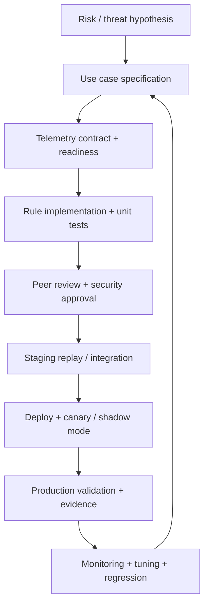

# Detection use case: Từ kịch bản đe dọa đến năng lực phát hiện có thể kiểm chứng

## 1. Mục tiêu học tập

Sau bài này, người học có thể:

- Giải thích **detection use case** là gì, phân biệt với detection rule, audit event, alert, incident, hunting hypothesis và security control.
- Chuyển một rủi ro và kịch bản tấn công thành **giả thuyết phát hiện**, xác định hành vi quan sát được, nguồn telemetry, logic, phạm vi và điều kiện thành công.
- Viết một bản đặc tả use case có thể triển khai và kiểm thử, bao gồm **data contract**, ngữ cảnh nghiệp vụ, điều kiện loại trừ, mức ưu tiên và runbook.
- Hiểu các bước từ thu thập event, chuẩn hóa, tương quan, sinh alert, triage đến kiểm chứng kết quả và quản lý finding.
- Thiết kế dữ liệu kiểm thử tích cực, tiêu cực, biên, trễ và mất nguồn; đánh giá false positive, false negative, coverage và độ trễ.
- Tổ chức **detection-as-code** cùng quản lý phiên bản, kiểm thử hồi quy, giám sát vận hành và bằng chứng **security assurance** liên tục.

Bài thuộc chương **Detection engineering** trong dịch vụ `SECURITY_SECURITY_ASSURANCE`. Mục tiêu của dịch vụ là đánh giá **có bằng chứng** rằng hệ thống đáp ứng mục tiêu bảo mật, từ phân tích rủi ro, yêu cầu và security controls đến kiểm thử, audit và khắc phục phát hiện. Detection use case đóng vai trò chuyển những rủi ro đó thành các hành vi cần quan sát, quy tắc có thể thực thi và bằng chứng rằng khả năng phát hiện tiếp tục hoạt động trong phát triển và vận hành.

## 2. Detection use case là gì?

**Detection use case** là mô tả có cấu trúc của **một hành vi, tình huống hoặc chuỗi sự kiện đáng quan tâm về bảo mật** mà tổ chức muốn phát hiện, điều tra và xử lý. Một use case đầy đủ phải nêu rõ:

1. **Vì sao cần phát hiện?** Liên hệ tài sản, security objective, threat model và tác động.
2. **Phát hiện cái gì?** Hành vi hoặc trạng thái có thể quan sát, kèm điều kiện và giới hạn.
3. **Nhờ tín hiệu nào?** Data source, sự kiện, định danh, trường dữ liệu, độ trễ và mức bao phủ.
4. **Phát hiện bằng cách nào?** Logic, phép ghép chuỗi, cửa sổ thời gian, enrichment, điều kiện loại trừ.
5. **Khi có kết quả thì làm gì?** Cách xác minh, mức ưu tiên, người nhận, runbook, điều kiện escalation và phản ứng.
6. **Làm sao biết use case có hoạt động?** Test cases, tiêu chí đạt, KPI, giám sát health và bằng chứng kiểm chứng.

Ví dụ, “cảnh báo khi có thay đổi quyền quản trị bất thường” là ý tưởng ban đầu; để thành một use case có thể triển khai, phải xác định **quyền nào được xem là đặc quyền**, **thay đổi thành công hay chỉ được yêu cầu**, **thế nào là phê duyệt hợp lệ**, **nguồn IAM nào nằm trong phạm vi**, **log đến chậm thì xử lý ra sao**, **ai xác minh** và **kết quả nào chứng minh control có hiệu lực**.

### 2.1. Phân biệt các khái niệm liên quan

| Khái niệm | Chức năng | Ví dụ |
|---|---|---|
| **Threat scenario** | Mô tả cách rủi ro có thể xảy ra | Tài khoản vận hành bị chiếm, cấp quyền quản trị cho danh tính không được phép |
| **Detection hypothesis** | Giả thuyết về tín hiệu có thể quan sát | Nếu quyền quản trị được cấp ngoài quy trình, IAM audit sẽ có event thay đổi |
| **Detection use case** | Toàn bộ đặc tả: mục tiêu, telemetry, logic, triage, kiểm thử và owner | Phát hiện role quản trị được gán không có phê duyệt còn hiệu lực |
| **Detection rule / analytic** | Một triển khai logic cụ thể trong hệ thống phát hiện | Truy vấn SQL hoặc rule trong SIEM |
| **Audit event / telemetry** | Dữ liệu đầu vào phản ánh hành động/trạng thái | `iam.role_binding.created`, source actor, target role |
| **Alert** | Tín hiệu cần được xem xét do rule kích hoạt | “Gán security-admin cho service account ngoài phê duyệt” |
| **Finding** | Một vi phạm hoặc điểm yếu đã được xác minh và cần xử lý | “Role đặc quyền tồn tại trái baseline” |
| **Incident** | Sự kiện an ninh được xác định, cần xử lý theo quy trình ứng phó | Tài khoản bị xâm nhập đã dùng quyền quản trị để thay đổi tài nguyên |
| **Hunting hypothesis** | Giả thuyết điều tra chủ động, có thể chưa tự động hóa | Tìm các chuỗi cấp quyền ngắn hạn rồi xuất dữ liệu |

Một use case có thể dùng **nhiều rules và data sources**. Ngược lại, một rule có thể hỗ trợ nhiều use cases nhưng mỗi use case vẫn cần mục tiêu, phạm vi, owner và tiêu chí nghiệm thu riêng.

### 2.2. Use case không đồng nghĩa với danh sách log

Việc nhận đủ log là điều kiện cần, chưa chứng minh hệ thống phát hiện có hiệu quả. Một chương trình có hàng nghìn event type nhưng không có logic đánh giá quyền hiệu lực, không đối soát phê duyệt, thiếu runbook hoặc không đo được pipeline health vẫn có khoảng trống assurance.

Một mục tiêu phát hiện tốt gắn với **rủi ro quan trọng và khả năng hành động**. Hàng triệu cảnh báo nhiễu không có chủ xử lý có thể kém hữu ích hơn một số ít use cases được định nghĩa rõ, kiểm thử được và phát hiện đúng hành vi trọng yếu.

## 3. Từ threat model đến giả thuyết phát hiện

### 3.1. Đọc kịch bản dưới góc nhìn người phòng thủ

Giả sử hệ thống thanh toán có các thành phần:

- `payment-api` cung cấp API giao dịch.
- Một hệ thống IAM quản lý vai trò cho người dùng và tài khoản dịch vụ.
- `report-service` xuất dữ liệu giao dịch khi được cấp quyền và phê duyệt.
- Cloud audit ghi thay đổi cấu hình IAM, network và dịch vụ dữ liệu.
- SIEM thu sự kiện từ các nguồn theo chính sách logging.

**Kịch bản:** kẻ tấn công chiếm một tài khoản có khả năng quản trị IAM và thêm quyền `security-admin` hoặc `data-exporter` cho một danh tính do mình kiểm soát. Hành động có thể là bước chuẩn bị để truy cập dữ liệu nhạy cảm hoặc vô hiệu hóa giám sát.

Để biến kịch bản này thành use case:

1. Xác định **điều kiện xấu** cần phòng ngừa hoặc phát hiện: cấp quyền đặc quyền không hợp lệ.
2. Phân tích **hành động có thể quan sát**: thêm IAM role binding, sửa policy, tạo access token hoặc cập nhật service principal.
3. Chọn **nguồn có thẩm quyền**: IAM audit events và snapshot effective permissions; có thể bổ sung change management.
4. Định nghĩa **hành vi đáng ngờ**: thay đổi quyền thành công, thuộc tập quyền nhạy cảm và thiếu phê duyệt phù hợp.
5. Xác định **khả năng nhiễu**: thay đổi hợp lệ trong maintenance window, migration được duyệt, break-glass có ticket.
6. Xác định **điều cần chứng minh**: rule phát alert, người trực nhận được, có đủ bằng chứng để xác minh quyền và xử lý.

Giả thuyết có thể viết:

> Nếu một danh tính được cấp quyền quản trị nhạy cảm trong production mà không có quyết định phê duyệt còn hiệu lực cho đúng actor, target, role và scope, hệ thống sẽ ghi nhận thay đổi ở nguồn IAM có thẩm quyền; bộ phát hiện có thể đối chiếu với sổ phê duyệt để mở alert cần điều tra.

**Giới hạn giả thuyết:** nếu kẻ tấn công thao tác qua nguồn không được audit, log bị vô hiệu, event bị thất lạc hoặc quyền được cấp gián tiếp qua nhóm khác không nằm trong logic, use case có thể bỏ sót. Phải ghi rõ những giới hạn đó thành detection gaps và kế hoạch bổ sung.

### 3.2. Gắn với kiến thức về hành vi tấn công

Có thể sử dụng **MITRE ATT&CK** để hỗ trợ phân loại hành vi và lập bản đồ coverage. Ví dụ:

- **T1098 – Account Manipulation:** hành vi thay đổi hoặc bổ sung quyền/tài khoản.
- **T1078 – Valid Accounts:** sử dụng danh tính hợp lệ để truy cập.
- **T1562 – Impair Defenses:** các hành động làm suy giảm cơ chế phòng vệ, ví dụ thay đổi logging phù hợp trường hợp cụ thể.

Mapping ATT&CK giúp người đọc hiểu **hành vi** và mối quan hệ giữa các use cases; bản thân tag ATT&CK **không phải bằng chứng** rằng rule đã kiểm soát mọi kỹ thuật hoặc mọi biến thể tấn công. Một kỹ thuật có thể có nhiều dạng triển khai theo sản phẩm, môi trường và quyền của attacker.

### 3.3. Phân biệt mục tiêu phát hiện với mục tiêu ngăn chặn

- **Preventive control:** RBAC, approval workflow và policy-as-code ngăn thay đổi ngoài thẩm quyền.
- **Detective control:** audit event, rule tương quan và monitor quyền hiệu lực phát hiện sai lệch đã xảy ra hoặc nỗ lực thất bại.
- **Corrective control:** thu hồi quyền bất thường, vô hiệu phiên bị lộ và kiểm tra lại.
- **Assurance activity:** thử tình huống, đánh giá coverage, đọc evidence và chứng minh cả quy trình hoạt động.

Không nên dùng detection để bù trừ vô thời hạn cho một lỗ hổng có thể phòng ngừa; đồng thời preventive control vẫn cần detection để nhận biết lỗi cấu hình, thay đổi ngoài quy trình và hành vi nằm ngoài phạm vi kiểm soát.

## 4. Cấu trúc của một detection use case hoàn chỉnh

Một đặc tả thực hành có thể chia thành các nhóm sau.

| Trường | Nội dung cần mô tả | Giá trị minh họa |
|---|---|---|
| `use_case_id` | ID duy nhất, ổn định | `DET-IAM-002` |
| `title` | Hành vi cần phát hiện, mô tả ngắn và rõ | Gán quyền đặc quyền ngoài phê duyệt |
| `threat_hypothesis` | Khi nào hành vi xấu xảy ra, quan sát được gì | IAM audit ghi role binding mới |
| `business_impact` | Điều gì bị ảnh hưởng nếu bỏ sót | Quyền đọc dữ liệu và điều khiển hệ thống |
| `scope` | Account/tenant/environment/assets được bảo vệ | Production IAM, service principals |
| `security_control_ref` | Yêu cầu/chính sách và rủi ro liên kết | `IAM-PRIV-01` |
| `data_sources` | Tín hiệu cần thu, điểm thu, thời gian trễ | IAM audit + approval registry + IAM state |
| `required_fields` | Danh tính, role, scope, event time, outcome | Actor, target, assigned role, change ID |
| `detection_logic` | Điều kiện, thời gian, correlation và exclusions | Thành công + quyền nhạy cảm + không có approval |
| `severity_policy` | Phân loại theo tác động và ngữ cảnh | High với quyền quản trị toàn tenant |
| `triage_runbook` | Xác minh và phối hợp xử lý | So audit, ticket, effective permissions |
| `tests` | Bộ ca đạt, không đạt, âm tính, biên và lỗi dữ liệu | Grant hợp lệ, grant trái phép, collector down |
| `operational_owner` | Nhóm vận hành rule và nhóm tiếp nhận alert | Detection engineering / SOC / IAM owner |
| `validation_status` | Trạng thái QA, thời điểm thử, phiên bản | Verified ở staging, chờ prod canary |
| `coverage_gaps` | Những nguồn/trường hợp chưa kiểm soát | Quyền kế thừa một số SaaS |
| `version` | Phiên bản use case, rule, parser và baseline | `1.2.0` |

Không biến `title` thành một điều kiện SQL cụ thể; giữ **mục tiêu use case** đủ ổn định để có thể đổi backend SIEM hoặc bổ sung rule mà không làm mất chuỗi traceability.

## 5. Xác định telemetry, data contract và độ bao phủ

Detection logic chỉ hoạt động trong giới hạn dữ liệu nhận được. Vì vậy, một use case cần **telemetry requirements** cụ thể trước khi viết query.

### 5.1. Nguồn dữ liệu theo loại hành vi

| Hành vi cần phát hiện | Nguồn dữ liệu điển hình | Bằng chứng bổ trợ |
|---|---|---|
| Đăng nhập nguy cơ cao | IdP, authentication logs, MFA events | Identity policy, session state, device context |
| Gán quyền quản trị | IAM/control-plane audit | Effective permissions, change approval |
| Thay đổi firewall/public exposure | Cloud audit, network config snapshot | Path analysis, reachability test |
| Tắt security logging | Audit pipeline events, config control plane | Sink health, independent heartbeat, logging config |
| Tải lượng lớn dữ liệu nhạy cảm | App/database/data access audit | Job ID, dataset classification, storage policy |
| Tạo workload đặc quyền | Kubernetes API audit, admission | PodSpec thực chạy, Pod Security, cluster RBAC |
| Tạo/chạy artifact bất thường | CI/CD, registry, admission, runtime inventory | Image digest, signer/provenance, deployment record |

Độ bao phủ phải xét **toàn bộ account/project/subscription/region/cluster/tenant** trong phạm vi, không chỉ các nguồn “đã kết nối sẵn”. Tài sản mới, dịch vụ serverless, môi trường DR hoặc kết nối qua đối tác có thể trở thành vùng mù.

### 5.2. Một event contract cho use case IAM

Ví dụ event chuẩn hóa giả lập:

```json
{
  "event_id": "evt-7051",
  "event_type": "iam.role_binding.created",
  "schema_version": "1.0",
  "occurred_at": "2026-11-28T03:30:00Z",
  "ingested_at": "2026-11-28T03:30:03Z",
  "source": "iam-control-plane",
  "environment": "production",
  "tenant_id": "tenant-a",
  "actor_principal_id": "admin-42",
  "target_principal_id": "svc-reports",
  "resource_scope": "tenant-a/reports",
  "assigned_role": "security-admin",
  "outcome": "success",
  "change_id": "CHG-1842",
  "request_id": "req-831"
}
```

Các trường quan trọng:

- **`event_id`:** deduplication và truy xuất event gốc.
- **`event_type`, `outcome`:** bảo đảm rule không coi request bị từ chối là quyền đã được cấp.
- **`occurred_at` / `ingested_at`:** phát hiện event đến muộn và tính detection latency.
- **`actor_principal_id`:** danh tính đã thực hiện thay đổi.
- **`target_principal_id`:** danh tính nhận quyền; khác actor trong nhiều tình huống.
- **`assigned_role`, `resource_scope`, `tenant_id`:** giúp đánh giá quyền thực và phạm vi ảnh hưởng.
- **`change_id`:** chỉ là tham chiếu phải đối chiếu với hệ thống phê duyệt tin cậy; **không tự khẳng định đã được phê duyệt**.

Các event còn có thể chứa session/device/network context cần thiết, nhưng tuyệt đối không sao chép token, cookie, private key hoặc toàn bộ payload chứa dữ liệu nhạy cảm vào alert.

### 5.3. Chất lượng dữ liệu ảnh hưởng trực tiếp đến detection

Cần đặt ra tiêu chí cho:

1. **Completeness:** nguồn có ghi toàn bộ hành động bắt buộc? Parser có làm mất field nào?
2. **Correctness:** event type và outcome phản ánh đúng hành động/commit?
3. **Timeliness:** event đến SIEM nhanh đến mức nào? Có queue backlog?
4. **Identity resolution:** account/service principal được map nhất quán dù đổi tên?
5. **Schema compatibility:** các bản nâng cấp producer không làm sai rule.
6. **Deduplication:** event phát lại do retry không bị đếm là nhiều hành vi.
7. **Ordering:** correlation xử lý sự kiện đến muộn/khác thứ tự.
8. **Source integrity:** chỉ nhận dữ liệu từ producer tin cậy; quyền sửa/xóa log hạn chế.

Ví dụ, nếu một service principal đổi display name nhưng vẫn giữ resource ID, correlation nên dùng **stable ID**, tránh ghép chỉ bằng tên hiển thị.

### 5.4. Data readiness gate

Không nên đưa use case lên production với kỳ vọng “rule sẽ hoạt động” khi telemetry cần thiết chưa sẵn sàng. Một kiểm tra tối thiểu trước khi bật alert:

- Data source đã kết nối với đúng phạm vi và có owner.
- Required fields có mặt, kiểu dữ liệu ổn định.
- Event success/denied/failed được phân biệt.
- Đã kiểm tra độ trễ và khả năng truy vấn.
- Có alert khi source hoặc parser bị ngắt, và có chính sách `UNKNOWN` cho vùng mất dữ liệu.
- Có test case xác minh một hành động thực tạo được bản ghi tại sink, không chỉ nằm ở producer.

## 6. Thiết kế logic phát hiện: Từ điều kiện đơn đến tương quan

### 6.1. Điều kiện đơn giản và điều kiện phức hợp

Một rule đơn có thể tìm **mọi lần gán quyền quản trị**. Rule này có thể phù hợp làm audit feed hoặc cảnh báo thông tin nhưng tạo nhiều nhiễu nếu đội vận hành thường xuyên có các thay đổi hợp lệ.

Một use case giàu ngữ cảnh hơn kết hợp:

```text
IAM role binding thay đổi thành công
              +
Quyền mới thuộc danh sách vai trò nhạy cảm
              +
Phạm vi là production hoặc tài sản trọng yếu
              +
Không có phê duyệt hợp lệ cho đúng actor/target/role/scope/time
              ↓
Alert "Privileged role assignment requires investigation"
              ↓
Triage: effective permissions + actor + approval + audit history
```

Tuy nhiên, **việc không tìm thấy approval trong dữ liệu truy vấn** có thể do connector lỗi hoặc hệ thống phê duyệt chưa cập nhật. Nếu nguồn approval không sẵn sàng, trạng thái cần là **cần xác minh/UNKNOWN**, không khẳng định đã vi phạm. Một bản thiết kế tốt phải phân biệt **approval thực sự không tồn tại** và **không thể kiểm tra approval**.

### 6.2. Các thành phần logic thường gặp

| Thành phần | Cách sử dụng | Rủi ro nếu thiếu |
|---|---|---|
| Filter / matching | Lọc theo event type, outcome, asset, environment | Alert không liên quan hoặc bỏ sai loại event |
| Aggregation / threshold | Nhiều lần thất bại trong một cửa sổ | False positive nếu không xét lưu lượng bình thường |
| Sequence / correlation | Role grant → truy cập dữ liệu → export | Không nối được hành vi khi sự kiện rải ở nhiều nguồn |
| Enrichment | Owner, criticality, baseline, business calendar, threat intel | Không phân biệt rủi ro cao/thấp |
| Suppression/dedup | Gộp sự kiện lặp cùng use case và đối tượng | Alert storm và báo cáo số lượng sai |
| Exception / allowlist | Thay đổi được phê duyệt, service đặc thù | Bỏ lọt khi allowlist quá rộng hoặc hết hạn |
| Time/window | Xác định thời gian liên quan giữa các hành vi | Miss event trễ hoặc correlation sai |
| Severity/risk scoring | Ưu tiên xử lý theo tài sản và mức tác động | Cấp độ nghiêm trọng cứng nhắc |
| Health/coverage check | Giám sát nguồn và rule execution | Im lặng vì mất dữ liệu bị hiểu là “không có sự cố” |

### 6.3. Cửa sổ thời gian và event đến trễ

Giả sử rule chạy mỗi năm phút. Một event xảy ra lúc 10:00 nhưng tới SIEM lúc 10:18. Nếu rule chỉ lọc `occurred_at >= NOW() - INTERVAL '5 minutes'`, event có thể **không bao giờ được đánh giá**.

Có thể cân nhắc:

- Dùng `ingested_at` để chọn **event mới nhận** ở mỗi vòng rồi dùng `occurred_at` cho thời điểm hành vi.
- Duy trì **lookback window** lớn hơn chu kỳ chạy và **deduplicate** theo event ID/correlation ID.
- Sử dụng watermark hoặc event-time window với allowed lateness trong hệ thống streaming.
- Định nghĩa xử lý khi event đến quá ngưỡng trễ: vẫn tạo finding, nhưng ghi rõ độ trễ hoặc sử dụng batch reconciliation.
- Giám sát clock skew của nguồn và tránh giả định mọi source event có cùng đồng hồ.

Tối ưu phải dựa trên SLO về độ trễ, quy mô dữ liệu, chi phí và mức rủi ro; không có một khoảng cửa sổ phù hợp cho mọi use case.

## 7. Ví dụ chính: Phát hiện cấp quyền IAM đặc quyền không có phê duyệt

### 7.1. Bản use case có thể kiểm chứng

| Thuộc tính | Mô tả |
|---|---|
| ID | `DET-IAM-002` |
| Tên | Privileged role assignment without valid approval |
| Giả thuyết | Role quản trị được cấp ngoài quy trình sẽ xuất hiện trong IAM audit thành công nhưng không khớp approval có hiệu lực |
| Phạm vi | Các tài khoản/danh tính trong production có IAM audit bắt buộc |
| Chỉ tiêu | Phát hiện trong ngưỡng SLO đã phê duyệt kể từ khi event có mặt ở nguồn |
| Nguồn chính | IAM audit events có `event_type` và `outcome` chính xác |
| Nguồn bổ trợ | Approved change registry, IAM effective permissions, asset classification |
| Điều kiện | Successful privileged role grant và không có approval hợp lệ cho đúng thay đổi |
| Loại trừ | Thay đổi break-glass có cơ chế phê duyệt riêng, có thời hạn, vẫn phải ghi audit và được review |
| Severity | Theo cấp quyền, tài sản, vùng production, độ lộ dữ liệu và khả năng chiếm quyền |
| Người xử lý | SOC phối hợp IAM owner và chủ tài sản |
| Điều kiện đóng | Đã xác minh hợp lệ hoặc thu hồi sai lệch và kiểm chứng quyền hiệu lực, có bằng chứng |
| Rủi ro còn lại | Không bao phủ nguồn IAM ngoài inventory, quyền kế thừa nhóm hoặc sự kiện bị mất |

### 7.2. Cấu trúc bản đặc tả dùng trong repository

Ví dụ YAML mang tính **use case specification**, không phải schema mặc định của SIEM cụ thể:

```yaml
id: DET-IAM-002
title: "Privileged role assignment without valid approval"
version: "1.0.0"
status: "ready_for_validation"
threat:
  scenario: "Danh tính được cấp quyền quản trị trái quy trình"
  techniques: ["T1098", "T1078"]
scope:
  environments: ["production"]
  asset_classes: ["iam-principal", "service-principal"]
requirements:
  security_control: "IAM-PRIV-01"
  expected: "Mọi lần cấp quyền quản trị phải có phê duyệt hợp lệ"
telemetry:
  primary: "iam.role_binding.created"
  required_fields:
    - event_id
    - occurred_at
    - ingested_at
    - actor_principal_id
    - target_principal_id
    - tenant_id
    - assigned_role
    - resource_scope
    - outcome
  enrichment:
    - "approved_changes"
    - "iam_effective_permissions"
logic:
  event_outcome: "success"
  privileged_roles: ["org-admin", "security-admin"]
  approval_match: "same change, actor, target, role, scope and time"
  dedup_key: "event_id"
response:
  owner: "soc"
  escalation: "iam-platform-owner"
  runbook: "RB-IAM-002"
tests:
  - "grant-without-approval"
  - "grant-with-valid-approval"
  - "failed-grant"
  - "delayed-event"
  - "approval-source-unavailable"
```

Trong triển khai thực tế, trường `privileged_roles` cần được sinh/duy trì từ **danh mục quyền có hiệu lực** của sản phẩm IAM và chính sách tổ chức. Không nên giả định chỉ những tên role có chữ “admin” mới mang quyền quan trọng; một custom role có quyền sửa IAM hoặc đọc dữ liệu nhạy cảm cũng có thể rất nguy hiểm.

### 7.3. Logic SQL minh họa

Giả sử SIEM sử dụng cơ sở dữ liệu hỗ trợ cú pháp PostgreSQL với:

- Bảng `audit_events` đã chuẩn hóa gồm các trường ghi trong ví dụ event.
- Bảng `approved_changes` do hệ thống quản trị thay đổi quản lý, có `change_id`, `tenant_id`, `actor_principal_id`, `target_principal_id`, `assigned_role`, `resource_scope`, `status`, `approved_at`, `valid_from` và `valid_until`.
- Cơ chế riêng giám sát **kết nối và độ mới của approved_changes**; chỉ chạy logic “không có approval” khi nguồn này đã được xác nhận đáng tin.

Một truy vấn phát hiện những event đặc quyền mới nhận mà không có phê duyệt khớp:

```sql
WITH privileged_grants AS (
    SELECT
        event_id, occurred_at, ingested_at,
        tenant_id, actor_principal_id, target_principal_id,
        assigned_role, resource_scope, change_id
    FROM audit_events
    WHERE event_type = 'iam.role_binding.created'
      AND outcome = 'success'
      AND environment = 'production'
      AND assigned_role IN ('org-admin', 'security-admin')
      AND ingested_at >= NOW() - INTERVAL '30 minutes'
)
SELECT
    g.event_id,
    g.occurred_at,
    g.actor_principal_id,
    g.target_principal_id,
    g.assigned_role,
    g.resource_scope,
    g.tenant_id
FROM privileged_grants AS g
WHERE NOT EXISTS (
    SELECT 1
    FROM approved_changes AS a
    WHERE a.change_id = g.change_id
      AND a.tenant_id = g.tenant_id
      AND a.actor_principal_id = g.actor_principal_id
      AND a.target_principal_id = g.target_principal_id
      AND a.assigned_role = g.assigned_role
      AND a.resource_scope = g.resource_scope
      AND a.status = 'approved'
      AND a.approved_at <= g.occurred_at
      AND a.valid_from <= g.occurred_at
      AND g.occurred_at < a.valid_until
);
```

**Giới hạn có chủ đích:**

- Đây là **ví dụ logic**, không phải rule production hoàn chỉnh. Bộ dữ liệu, schema và bảng phê duyệt được giả định; phải chỉnh cho đúng nền tảng SIEM.
- Nếu approval registry bị mất kết nối, chưa đồng bộ hoặc trả dữ liệu không đầy đủ, **không suy luận chắc chắn** là “không có phê duyệt”. Trạng thái use case nên báo `UNKNOWN / approval_source_unavailable` và alert riêng về data health.
- Cửa sổ 30 phút theo `ingested_at` chỉ phục vụ minh họa. Lịch chạy thực tế cần watermark hoặc chồng lấn cửa sổ, lưu checkpoint và dedup `event_id` để không bỏ sót hoặc tạo alert lặp.
- Một thay đổi role có thể xảy ra qua nhiều API/nhà cung cấp hoặc thông qua nhóm quyền. Cần bổ sung mapping event types và cách tính **effective permissions**.
- Event được coi `success` theo contract nguồn IAM; vẫn cần xác nhận role thực sự còn hiệu lực khi triage.
- Một approval hợp lệ theo trường dữ liệu chưa đủ nếu chủ sở hữu phê duyệt không có thẩm quyền hoặc phê duyệt bị thu hồi; cần các phép kiểm theo quy trình thực tế.
- Danh sách role và rule phải được cập nhật khi IAM provider thay đổi sản phẩm, schema hoặc semantics.

### 7.4. Tương quan nhiều sự kiện để tăng ngữ cảnh

Nếu cùng principal vừa được cấp quyền mới lại xuất dữ liệu nhạy cảm trong thời gian ngắn, mức ưu tiên có thể tăng. Ví dụ logic:

```text
A: iam.role_binding.created
  - outcome = success
  - target = principal X
  - role thuộc nhóm nhạy cảm
          ↓ trong 30 phút theo event time
B: data.export.completed
  - actor = principal X
  - dataset thuộc nhóm nhạy cảm
  - outcome = success
          ↓
Enrich: approval, resource criticality, job ID, actor history
          ↓
Alert: privilege grant followed by sensitive export
```

Cần **scope/tenant khớp**, timestamp phù hợp, event type đáng tin, xử lý late arrivals và phân biệt identity của service với người khởi tạo tác vụ. Chuỗi sự kiện là **tín hiệu điều tra**, chưa tự chứng minh ý định xấu hay hành vi tấn công.

### 7.5. Vì sao có thể bỏ sót?

Giả thuyết này không phát hiện được mọi trường hợp như:

- Kẻ tấn công đã có quyền quản trị trước khi use case triển khai.
- Quyền được mở rộng gián tiếp qua membership hoặc custom policy không nằm trong danh sách role.
- Control-plane log chỉ ghi request đã được nhận, chưa chứng minh trạng thái hiệu lực.
- Collector ngắt kết nối và không gửi bù, hoặc IAM account mới không nằm trong inventory.
- Attacker dùng quyền hợp lệ hiện có để truy cập dữ liệu, không thay role.
- Approval record bị chỉnh sửa trái phép bởi principal có quyền trong hệ thống quản trị thay đổi.

Những giới hạn này cần được ghi vào `coverage_gaps`, gắn use case bổ sung và biện pháp phòng ngừa tương ứng. Không được coi một rule phát hiện hoàn hảo trên test fixture là bao phủ toàn bộ tactic của attacker.

## 8. Phát hiện theo điều kiện, ngưỡng, hành vi và chuỗi

### 8.1. Phát hiện theo chữ ký/quy tắc cố định

Ví dụ: hành động tắt audit logging hoặc gán quyền cluster-wide. Ưu điểm là giải thích và kiểm chứng tương đối dễ, thường phù hợp những sự kiện rủi ro cao ít khi hợp lệ.

Hạn chế: log phải đúng schema, hành vi phải khớp pattern; attacker có thể sử dụng đường tương đương chưa được đưa vào danh mục.

### 8.2. Phát hiện theo ngưỡng

Ví dụ: số lần đăng nhập thất bại trên một principal vượt ngưỡng trong 10 phút. Ngưỡng phải dựa trên dữ liệu bình thường và rủi ro, xét traffic tự động, địa chỉ NAT dùng chung, múi giờ, tenancy, tài khoản kỹ thuật và chiến thuật phân tán.

Nếu rule chỉ đếm toàn bộ lỗi login trên một IP, proxy của doanh nghiệp có thể gây false positive. Nếu chỉ đếm trên từng actor, một chiến dịch password spraying trên hàng trăm tài khoản có thể bị bỏ lỡ. Đây là lý do use case có thể cần **nhiều analytics bổ sung**.

### 8.3. Phát hiện chuỗi/tương quan

Ví dụ: tạo access key → truy cập tài nguyên hiếm gặp → thay đổi log settings. Có thể tăng ngữ cảnh nhưng cần:

- Khóa correlation đáng tin (`principal_id`, `tenant_id`, `resource_id`).
- Quy tắc cửa sổ thời gian và allowed lateness.
- Xác định outcome thành công ở từng bước.
- Giải quyết event trùng và sự kiện đến sai thứ tự.
- Có phương án khi một nguồn trong chuỗi bị mất.

Tăng số nguồn trong điều kiện bắt buộc có thể làm **giảm recall** nếu một bước không được audit. Hãy cân nhắc biểu thức “A AND B” cho độ tin cậy cao, cùng một rule đơn “A trong tài sản trọng yếu” để tránh mù hoàn toàn khi B bị thiếu.

### 8.4. Phát hiện bất thường/thống kê

Có thể dùng behavioral baseline như login giờ hiếm, service principal dùng API ít gặp hoặc số lượng export tăng mạnh. Các điểm cần làm rõ:

- Tập dữ liệu học baseline, giai đoạn khởi động và phân vùng theo user/service/tenant.
- Khả năng thay đổi bình thường theo mùa hoặc sau release.
- Ngưỡng và khả năng giải thích vì sao alert được tạo.
- Điều kiện cần điều tra thay vì tự động khẳng định có tấn công.
- Cách xử lý thiếu dữ liệu, dữ liệu không đại diện và thay đổi môi trường.

Kết quả bất thường là **tín hiệu về khác biệt so với mô hình**, không phải bằng chứng tự thân về ác ý.

## 9. Severity, context và chính sách ưu tiên

Một alert phát sinh chưa chắc cần cùng cấp độ phản ứng trong mọi trường hợp.

| Yếu tố | Câu hỏi | Tác động đến ưu tiên |
|---|---|---|
| Mức đặc quyền | Quyền vừa cấp có thể đổi IAM, đọc Secrets hay vô hiệu logging? | Đặc quyền rộng làm tăng rủi ro |
| Tài sản | Liên quan production, dữ liệu nhạy cảm, hệ thống định danh? | Tài sản trọng yếu ưu tiên cao |
| Độ lộ diện | Actor/target có truy cập từ bên ngoài, có endpoint công khai? | Tăng khả năng khai thác |
| Độ tin cậy dữ liệu | Event có đầy đủ field, nguồn có xác thực, phê duyệt có được kiểm? | Thiếu dữ liệu làm giảm độ chắc của kết luận |
| Nghiệp vụ | Có change ticket được duyệt, release/maintenance window? | Giảm nhiễu, nhưng không xóa dấu vết |
| Hành vi tiếp nối | Có export, tạo token mới, thay firewall, tắt logging? | Có thể cần escalation nhanh |
| Biện pháp bù trừ | MFA mạnh, session restriction, policy deny, network isolation? | Ảnh hưởng đánh giá tác động còn lại |

**Rule severity** nên là mức ưu tiên ban đầu; analyst hoặc automation có kiểm soát có thể điều chỉnh theo ngữ cảnh. Không nên tự động đặt **Critical** cho mọi alert chứa từ “admin”, cũng không hạ severity chỉ vì event đến từ IP nội bộ.

### 9.1. Quản lý allowlist và ngoại lệ

Một exclusion hợp lệ phải chỉ rõ **asset/actor/role/scope**, lý do, owner phê duyệt, thời hạn và bằng chứng bù trừ. Ví dụ:

- Không bỏ qua **mọi** hoạt động từ tài khoản deploy chung.
- Có thể giảm mức ưu tiên cho **thay đổi cụ thể** đã được duyệt, trong đúng khoảng thời gian, trên đúng tài nguyên.
- Vẫn lưu audit và kết quả đánh giá để truy vết.
- Nếu record phê duyệt hết hạn hoặc thay đổi phạm vi, exclusion phải tự ngừng áp dụng.

Một danh sách allowlist quá rộng hoặc không hết hạn có thể tạo **blind spot** khó phát hiện hơn một rule nhiễu.

## 10. Từ alert đến triage và runbook

Detection use case chỉ tạo giá trị khi người vận hành biết **phải làm gì sau khi alert được tạo**.

### 10.1. Thông tin tối thiểu của alert

```yaml
alert_id: ALERT-2026-0142
use_case_id: DET-IAM-002
rule_version: "1.0.0"
status: OPEN
severity: HIGH
detected_at: "2026-11-28T03:31:05Z"
event_time: "2026-11-28T03:30:00Z"
actor_principal_id: admin-42
target_principal_id: svc-reports
tenant_id: tenant-a
assigned_role: security-admin
resource_scope: tenant-a/reports
reason: "Privileged role grant without matching approved change"
source_event_ids:
  - evt-7051
evidence_refs:
  - "evidence://iam/audit/evt-7051"
  - "evidence://iam/state/svc-reports"
owner: soc
runbook_ref: RB-IAM-002
```

Đây là **bản ghi minh họa**, không phải alert đã xảy ra. Thông tin `reason` phải khớp điều kiện đánh giá thực, kể cả khi approval registry đang hoạt động và có dữ liệu đầy đủ; nếu approval không kiểm tra được thì phải dùng lý do riêng.

### 10.2. Runbook xử lý alert cấp quyền

1. **Xác minh nguồn:** kiểm event gốc, outcome, event ID, tenant, schema, event time và data quality.
2. **Xác minh thay đổi:** lấy effective permissions và lịch sử binding từ IAM API; phân biệt quyền còn hiệu lực với role đã bị thu hồi.
3. **Đối chiếu phê duyệt:** xem ticket/approval từ nguồn độc lập, người duyệt, scope, thời hạn và actor.
4. **Đánh giá nguy cơ:** quyền cụ thể có thể thực hiện gì, tài sản và dữ liệu nào có thể bị ảnh hưởng?
5. **Tìm hoạt động liên quan:** session, token, truy cập dữ liệu, thay đổi policy/logging sau khi cấp quyền.
6. **Phối hợp:** liên hệ IAM owner, on-call vận hành và incident response theo ngưỡng đã định; tránh tự sửa khi chưa xác minh hậu quả nghiệp vụ.
7. **Khắc phục theo playbook:** nếu trái phép, thu hồi binding, giới hạn phiên/token và điều tra credential theo mức rủi ro.
8. **Recheck và đóng:** xác minh effective permissions, audit trail, nguyên nhân, hành động sửa, thời gian giải quyết và chủ sở hữu.

Trường hợp có dấu hiệu compromise cần chuyển **incident response**; đối với thay đổi hợp lệ nhưng rule vẫn báo, có thể cải thiện enrichment hoặc approval matching. Cả hai đều nên được ghi nhãn kết quả triage phục vụ đo chất lượng.

### 10.3. Quy tắc tự động phản ứng

Tự động tắt tài khoản hoặc thu hồi role có thể giảm thời gian tác động nhưng cũng có thể chặn tài khoản break-glass hoặc ngắt vận hành. Với auto-remediation, cần:

- Điều kiện kích hoạt đủ tin cậy, được phân loại theo mức rủi ro.
- Phạm vi thay đổi và quyền của automation thật hẹp.
- Quy tắc bảo vệ tài khoản hệ thống trọng yếu.
- Ghi nhật ký trước/sau, cơ chế rollback, kiểm soát tác động.
- Trình tự xác minh chính thay đổi của automation và thông báo owner.

Chỉ đề xuất phản ứng tự động khi tổ chức đã kiểm chứng hậu quả và có phương án phục hồi. Không nên coi mọi alert là đủ điều kiện để thực thi thao tác mạnh.

## 11. Thiết kế kiểm thử detection use case

Đặc tả có thể đúng về mặt ngôn ngữ nhưng rule vẫn bỏ sót do sai schema, clock, join, parsing hoặc hệ thống phê duyệt. Kiểm thử cần bao phủ **logic lẫn luồng dữ liệu**.

### 11.1. Ma trận kiểm thử cho DET-IAM-002

| Case | Dữ liệu đầu vào | Kỳ vọng |
|---|---|---|
| TC-01 | Grant `security-admin` thành công, không có approval, nguồn khỏe | Sinh alert |
| TC-02 | Grant thành công, approval hợp lệ đúng actor/target/role/scope/time | Không sinh alert “ngoài phê duyệt”; vẫn lưu audit |
| TC-03 | Yêu cầu grant bị từ chối, `outcome=denied` | Không báo “đã cấp quyền”; use case denied-attempt nếu có xử lý riêng |
| TC-04 | Grant role thường không nằm trong baseline đặc quyền | Không kích hoạt rule này |
| TC-05 | Có change ID nhưng approval hết hạn | Sinh alert |
| TC-06 | Approval cùng ticket nhưng khác target hoặc scope | Sinh alert |
| TC-07 | Approval được tạo sau khi role đã cấp | Sinh alert hoặc yêu cầu điều tra theo chính sách |
| TC-08 | Audit event gửi trùng cùng `event_id` | Chỉ một detection logic event/alert |
| TC-09 | Audit event đến muộn 18 phút | Vẫn được kiểm tra nhờ ingestion time/allowed lateness |
| TC-10 | Approval source mất kết nối | `UNKNOWN` về điều kiện approval và cảnh báo health; không khẳng định trái phép |
| TC-11 | IAM source mất log trong thời gian kiểm thử | Coverage FAIL/UNKNOWN; không suy ra “không có grant” |
| TC-12 | Role được cấp gián tiếp qua group membership | Test gap hoặc rule bổ sung phát hiện quyền kế thừa |

### 11.2. Phân cấp kiểm thử

- **Schema/unit tests:** parser và normalizer giữ trường cần thiết, xử lý enum, NULL, time zone và field đổi tên.
- **Rule unit tests:** fixture dương, âm, biên và sai định dạng có expected alert rõ ràng.
- **Replay/integration tests:** gửi các audit event giả lập vào môi trường test rồi kiểm đúng parser, enrichment và rule backend.
- **End-to-end tests:** thực hiện thay đổi kiểm soát trong môi trường được phép và xác minh alert tới nơi tiếp nhận cùng bằng chứng đủ.
- **Adversary emulation / purple-team exercise:** mô phỏng hành vi đe dọa đã được phê duyệt để đánh giá tín hiệu, thời gian phát hiện, triage và response.
- **Continuous validation:** kiểm định kỳ, nhất là sau đổi IAM provider, logger, schema, SIEM rule, baseline hoặc topology.

Không nên tạo hoạt động làm gián đoạn security control production chỉ để thử rule khi có thể dùng staging, canary hoặc test event có phạm vi và quyền rõ ràng.

### 11.3. Tránh test tự xác nhận chính code

Nếu unit test dựng dữ liệu bằng cùng hàm transform với rule thì test có thể lặp lại lỗi của implementation. Cần fixture độc lập theo contract và ít nhất một phép kiểm end-to-end dựa trên **hành động thực có kiểm soát**. Khi không thể chạy live test, ghi rõ mức độ chứng minh: “logic verified with fixtures” khác “runtime detection verified”.

## 12. Detection-as-code và quy trình phát triển rule

Detection engineering nên vận hành như phần mềm có kiểm soát phiên bản:



### 12.1. Thành phần thường được version control

- Use case YAML/Markdown với mục tiêu, scope và giả thuyết.
- Rule source: Sigma, SQL, KQL, SPL hoặc ngôn ngữ SIEM hỗ trợ.
- Parsers, field mappings, normalization schema và enrichment definitions.
- Positive/negative fixtures, test harness, expected outcomes.
- Dashboard health, runbook, alert routing và owner.
- Baseline/policy refs, phiên bản ATT&CK mapping khi dùng.
- Change history, approval, release version, rollback plan và kết quả kiểm thử.

**Sigma** là định dạng chung để mô tả nhiều loại quy tắc phát hiện log theo cấu trúc YAML; khả năng chuyển đổi sang SIEM cụ thể còn phụ thuộc backend, field mappings và semantics. Một rule “convert thành công” vẫn cần kiểm thử trên dữ liệu/engine thật, vì các phép so sánh chuỗi, list, Unicode, NULL và time window có thể khác nhau.

### 12.2. Quy trình release

1. Nhận yêu cầu và bảo đảm dữ liệu đầu vào đã có.
2. Viết logic, định nghĩa label và tạo test fixtures.
3. Kiểm tra code, query cost, dữ liệu nhạy cảm và hiệu năng.
4. Đưa vào **shadow/dry-run** hoặc canary trên tập tài sản kiểm soát để quan sát nhiễu.
5. Xác minh đường alert routing, thời gian kích hoạt, owner và runbook.
6. Đưa vào production theo phê duyệt, ghi version và thời điểm.
7. Theo dõi health, data quality, số alert, kết quả triage và coverage.
8. Tuning dựa trên bằng chứng; nếu thay đổi logic, chạy regression tests.

Khi thay đổi **schema hoặc scope**, cần cập nhật version và tiêu chí nghiệm thu. Khi sửa rule làm giảm false positive, phải kiểm bảo đảm **không tăng false negative** trong các hành vi rủi ro quan trọng.

## 13. Đo chất lượng detection: hiệu quả và giới hạn số liệu

### 13.1. Precision và recall

Trong tập dữ liệu có nhãn đáng tin:

- **True positive (TP):** alert hợp lệ ứng với hành vi cần phát hiện.
- **False positive (FP):** alert được tạo nhưng không thuộc hành vi mục tiêu.
- **False negative (FN):** hành vi mục tiêu đã xảy ra nhưng rule không phát alert.
- **True negative (TN):** không có hành vi mục tiêu và rule không phát alert.

Các công thức:

\[
\text{Precision} = \frac{TP}{TP + FP}
\]

\[
\text{Recall} = \frac{TP}{TP + FN}
\]

\[
\text{F1} = \frac{2 \cdot \text{Precision} \cdot \text{Recall}}{\text{Precision}+\text{Recall}}
\]

**Giới hạn:** trong SOC thực tế, rất khó biết chính xác FN vì các hành vi đã bỏ lọt không được quan sát đầy đủ. Precision đo trên **alert đã được gắn nhãn** cũng phụ thuộc chất lượng điều tra và mức thiên lệch chọn mẫu. Vì vậy, kết hợp test có ground truth, purple-team exercises, replays và coverage audits thay vì tuyên bố recall tuyệt đối.

### 13.2. Các chỉ số vận hành

| Chỉ số | Cách hiểu đúng | Điều dễ gây hiểu sai |
|---|---|---|
| **Use case coverage** | Số kịch bản trọng yếu có use case đã kiểm chứng / tổng kịch bản trọng yếu đã xác định | Coverage theo số rule không đồng nghĩa coverage theo rủi ro |
| **Telemetry coverage** | Tỷ lệ tài sản/nguồn cần thiết được thu thành công đúng hạn | Bỏ tài sản chưa onboard khỏi mẫu số |
| **Detection latency** | Từ thời điểm hành vi đến alert; báo riêng ingestion và rule processing | Dùng duy nhất thời gian SIEM đã ingest |
| **MTTD** | Thời gian trung bình từ khi hành vi xảy ra tới khi phát hiện theo định nghĩa | Không ghi event time hoặc có clock skew |
| **Alert-to-case rate** | Tỷ lệ alert cần xử lý được chuyển thành case/finding theo tiêu chí | Không đồng nhất tỷ lệ này với precision |
| **False positive rate** | Tỷ lệ báo giả trên tập có nhãn và định nghĩa rõ | Chưa có nhãn thì không thể tính tin cậy |
| **Triage time** | Thời gian từ alert đến quyết định điều tra | Che thời gian chờ dữ liệu/owner |
| **Rule health** | Tỷ lệ các lần chạy thành công, độ trễ, data source availability | Im lặng do rule lỗi bị hiểu là “an toàn” |
| **Regression success** | Bộ test bắt buộc đạt sau chỉnh sửa | Test chỉ có positive cases |
| **Exception aging** | Số ngoại lệ còn hiệu lực/quá hạn | Ngoại lệ bị tính như PASS vô thời hạn |

Giảm số alert không mặc nhiên có nghĩa rule tốt hơn: có thể do tuning hợp lý, nhưng cũng có thể do mất log hoặc rule bị tắt.

### 13.3. Ví dụ diễn giải có phạm vi

Giả sử nhóm thử nghiệm 100 tình huống có ground truth: 30 lần cấp quyền trái phê duyệt và 70 lần cấp quyền hợp lệ. Rule phát 25 alert đúng và 5 alert sai; 5 tình huống trái phép bị bỏ sót.

Khi đó trên **bộ thử nghiệm này**:

- `TP = 25`, `FP = 5`, `FN = 5` và `TN = 65`.
- `Precision = 25 / 30 ≈ 83,3%`.
- `Recall = 25 / 30 ≈ 83,3%`.

Không suy rộng hai tỷ lệ trên cho production nếu bộ thử không bao phủ cấu hình IAM, volume, đường khai thác và các trường hợp thiếu dữ liệu thực.

## 14. Quản lý data gaps và detection debt

Một use case có thể “triển khai” nhưng chưa “sẵn sàng assurance” vì còn thiếu:

- Một số tenant không ghi data access audit.
- Nhà cung cấp chuyển đổi event type sau nâng cấp và parser chưa hỗ trợ.
- Approval registry không đồng bộ với IAM, dẫn tới kết luận không chắc chắn.
- Quyền được cấp qua group hoặc custom policy nhưng analytic chỉ nhận role trực tiếp.
- Cloud audit chưa bao phủ toàn bộ region.
- Event ingestion chậm hơn SLO, gây correlation miss.
- Log sink không có cơ chế chống sửa/xóa phù hợp.
- Không có chủ vận hành hoặc runbook chưa được kiểm chứng.

Những hạn chế này là **detection gaps/debt** cần có chủ sở hữu và kế hoạch, không nên ẩn bằng trạng thái “rule enabled”.

### 14.1. Các trạng thái thực tế cho use case

| Trạng thái | Ý nghĩa |
|---|---|
| `PROPOSED` | Mới có nhu cầu/rủi ro, đang đánh giá tính khả thi |
| `DESIGNED` | Có giả thuyết, logic, telemetry, tests và owner trên tài liệu |
| `IMPLEMENTED` | Rule đã tồn tại, nhưng chưa chứng minh end-to-end |
| `VALIDATED` | Đã chạy test thích hợp và có bằng chứng trong phạm vi |
| `OPERATIONAL` | Rule được giám sát health, có triage và kiểm thử định kỳ |
| `DEGRADED` | Mất dữ liệu, parser lỗi, lag quá hạn hoặc rule có vấn đề |
| `RETIRED` | Được thay thế hoặc risk không còn; có quyết định và lịch sử |

Mỗi tổ chức có thể chọn tên khác, nhưng tránh gộp “đã viết rule” và “khả năng phát hiện đã được chứng minh”. Khi mất telemetry, **use case được triển khai không còn đủ điều kiện bảo đảm** cho phạm vi bị ảnh hưởng.

## 15. Bằng chứng assurance cho detection use case

Một kết luận assurance hữu ích dựa trên chuỗi:

**Threat/risk → Control objective → Detection use case → Telemetry/data contract → Rule version → Test evidence → Runtime evidence → Alert triage → Remediation & recheck.**

### 15.1. Mẫu bản ghi đánh giá

```yaml
assessment_id: DET-ASMT-2026-018
use_case_id: DET-IAM-002
use_case_version: "1.0.0"
rule_version: "1.0.0"
environment: staging
scope:
  tenant: tenant-a
  iam_provider: primary-iam
baseline_control: IAM-PRIV-01
test_id: TC-01
test_scenario: "Privileged role grant without valid approval"
expected:
  should_alert: true
observed:
  alerted: true
  alert_id: ALERT-TEST-018
  evidence_event_id: evt-test-018
  detection_latency_seconds: 12
data_health:
  iam_audit: healthy
  approvals: healthy
  missing_fields: []
result: PASS
checked_at: "2026-11-28T04:15:00Z"
evidence_ref: "evidence://detection/DET-ASMT-2026-018"
owner: detection-engineering
```

Đây là **dữ liệu minh họa**, chưa phải kết quả test thật. Bản ghi `PASS` ở **staging** chứng minh ca test cụ thể hoạt động trong phạm vi và phiên bản được ghi. Nó không đồng nghĩa use case đã được chứng minh ở production.

### 15.2. Chất lượng bằng chứng cần đánh giá

| Tiêu chí | Câu hỏi |
|---|---|
| **Đúng use case** | Có ID, version, giả thuyết và control/risk liên kết? |
| **Đúng phạm vi** | Có account/tenant/region/cluster/asset class, môi trường? |
| **Đúng logic** | Có source rule và bản phiên dịch/backend đang chạy? |
| **Đúng dữ liệu** | Có event contract, nguồn authoritative, schema, data health và độ trễ? |
| **Đúng phép kiểm** | Test scenario, điều kiện đầu vào, expected/observed và kết quả có tái lập? |
| **Có thể tin cậy** | Bằng chứng có giới hạn quyền sửa/xóa, checksum/audit khi cần? |
| **Đúng kết luận** | Đã kiểm điều kiện thiếu dữ liệu, false positive, false negative tiềm ẩn và limitation? |
| **Có owner và hành động** | Các gap và finding có người nhận, SLA, kế hoạch sửa và recheck? |

### 15.3. Phân biệt các mức bằng chứng

1. **Design evidence:** tài liệu threat hypothesis, use case, control mapping.
2. **Implementation evidence:** rule code, field mappings, config triển khai và review.
3. **Test evidence:** fixture/replay/live simulation cho các trường hợp cần phát hiện và không được báo.
4. **Operational evidence:** nguồn dữ liệu thực có mặt, rule chạy, alert routing hoạt động, analyst triage và giám sát health.
5. **Remediation evidence:** lỗi/gap đã được sửa, kiểm thử lại và ký kết luận phù hợp.

Nếu mới có design và unit tests, không nên viết kết luận “khả năng phát hiện đã hoạt động liên tục trong production”.

## 16. Ví dụ use case khác để so sánh

### 16.1. Phát hiện audit logging bị vô hiệu hóa

- **Rủi ro:** attacker hoặc automation lỗi tắt thu thập audit nhằm che giấu hoạt động.
- **Tín hiệu:** control-plane event thay đổi audit configuration, audit sink policy và heartbeat/health checks.
- **Logic:** thay đổi có tác động làm giảm khả năng ghi log; kèm baseline mismatch hoặc thiếu phê duyệt.
- **Bằng chứng:** event thay đổi, snapshot logging config, sink health, thời điểm gián đoạn và recheck.
- **Giới hạn:** nếu chính hệ thống phát event bị vô hiệu, có thể không có sự kiện “logging disabled”; vì thế cần **nguồn kiểm tra cấu hình độc lập** và monitoring “silence”.

### 16.2. Phát hiện workload Kubernetes có đặc quyền cao

- **Rủi ro:** workload bị khai thác có thể lạm dụng đặc quyền host.
- **Tín hiệu:** Kubernetes audit về tạo Pod/Deployment, admission logs, PodSpec thực chạy.
- **Logic:** Pod thuộc namespace nhạy cảm chạy privileged/hostPath hoặc tăng quyền trái baseline.
- **Bằng chứng:** admission decision, Pod UID, runtime PodSpec, namespace policy và image identity.
- **Giới hạn:** chỉ nhìn manifest không phát hiện Pod cũ; admission có thể từ chối nên phải phân biệt **attempt** và **runtime violation**.

### 16.3. Phát hiện tài khoản có hành vi đăng nhập bất thường

- **Rủi ro:** sử dụng credential bị chiếm đoạt.
- **Tín hiệu:** IdP login success/failure, MFA, device, session, identity risk.
- **Logic:** login từ thiết bị/lịch sử bất thường, kết hợp thay đổi MFA hoặc truy cập nhạy cảm.
- **Bằng chứng:** event, nguồn context và xác minh từ IAM owner.
- **Giới hạn:** IP/múi giờ thay đổi hợp lệ, NAT, proxy, du lịch và luồng tự động có thể gây nhiễu; không kết luận compromise chỉ từ “địa điểm lạ”.

Ba ví dụ minh họa một nguyên tắc chung: **cùng một mục tiêu phát hiện có thể cần kết hợp event về hành động, trạng thái hiệu lực và sức khỏe nguồn dữ liệu**.

## 17. Case study: Rule vẫn bật nhưng hệ thống đã mất khả năng phát hiện

**Bối cảnh:** tổ chức theo dõi việc cấp quyền quản trị bằng `DET-IAM-002`. Dashboard SIEM báo use case “Enabled”. Trong một tuần, số alert giảm về 0. Nhóm vận hành cho rằng tình trạng bảo mật đã cải thiện.

Điều tra sau đó phát hiện:

- Một tenant production mới được tạo nhưng chưa đăng ký vào audit collector.
- Producer IAM chuyển sang schema event mới, khiến `assigned_role` không còn được parser cũ điền.
- Approval enrichment service đôi lúc timeout.
- Rule vẫn chạy theo lịch và trả về “0 matches”.

### 17.1. Những kết luận đúng và sai

| Quan sát | Kết luận không hợp lệ | Kết luận đúng |
|---|---|---|
| Rule job chạy thành công | Mọi nguồn IAM đang được giám sát | Chỉ chứng minh scheduler/query không báo lỗi |
| Có 0 alert | Không có thay đổi quyền đáng ngờ | Không đủ bằng chứng khi telemetry và parser thiếu |
| Tenant mới không xuất hiện trong event | Tenant không có hoạt động nhạy cảm | Đây có thể là inventory/coverage gap |
| Field `assigned_role` bị NULL | Không có role đặc quyền được cấp | Parser/schema gap làm điều kiện lọc không hoạt động |
| Approval service timeout | Không có phê duyệt nào tồn tại | Trạng thái approval không thể xác minh |

### 17.2. Kế hoạch khôi phục assurance

1. Đánh dấu use case **DEGRADED** trên phạm vi và khoảng thời gian bị ảnh hưởng.
2. Xác định chính xác tenant, event type, thời điểm và field đã bị mất.
3. Khôi phục IAM collector, cập nhật parser, kiểm schema với fixture độc lập.
4. Xử lý backlog hoặc backfill từ nguồn có thẩm quyền nếu còn dữ liệu.
5. Đối soát IAM change history và effective permissions để tìm hành động bị bỏ lỡ.
6. Chạy lại ca test dương/âm, delayed events và approval source failure.
7. Xác minh alert routing và tình trạng query trong production.
8. Ghi finding cho khoảng trống telemetry, owner, nguyên nhân và kết quả recheck.

Nếu không có dữ liệu gốc để backfill, phải giữ trạng thái **UNKNOWN cho khoảng thời gian mất quan sát** và dùng các nguồn bổ trợ để giảm bất định. Không thể tạo lại chắc chắn mọi hành động từ dữ liệu đã mất.

## 18. Bài tập thực hành

**Tình huống:** một doanh nghiệp quản lý ứng dụng tài chính trên cloud và Kubernetes, có pipeline CI/CD, IAM, IdP, SIEM và kho phê duyệt thay đổi. Các tình huống sau đã được đội security đưa vào backlog:

| Mã | Tình huống |
|---|---|
| A | Service principal được cấp vai trò có quyền đọc dữ liệu nhạy cảm nhưng không có approval |
| B | Một Pod production mới được tạo với `privileged: true`; admission policy có thể đã cho phép ngoại lệ |
| C | 25 lần đăng nhập thất bại từ cùng một IP NAT trong 10 phút |
| D | Cloud audit logging bị tắt, sau đó collector không còn phát heartbeat |
| E | Một identity có quyền đọc database được cấp thêm quyền xuất dữ liệu và tạo export job ngay sau đó |
| F | Rule giám sát network change không phát alert vì một region chưa được onboarding |

**Yêu cầu:**

1. Chọn **hai use cases** ưu tiên nhất theo rủi ro hệ thống và giải thích vì sao; làm rõ thông tin còn thiếu trước khi quyết định.
2. Với mỗi use case, lập bản đặc tả gồm ID, threat hypothesis, security objective, scope, source, required fields, logic, exclusions, severity, owner và runbook.
3. Viết **ít nhất sáu test cases** gồm positive, negative, event đến muộn, duplicate, parser failure và missing source.
4. Nêu cách phân biệt event **attempted**, **denied** và **completed**; nếu cần, chỉ ra trạng thái runtime nào phải kiểm tra sau.
5. Với use case A, đề xuất cách đối chiếu approval theo target, role, scope, actor và thời gian; giải thích vì sao chỉ có `change_id` trong audit event chưa đủ.
6. Với use case B, giải thích vì sao cần kiểm cả **Pod đã chạy** và **admission decision**, không chỉ YAML trong Git.
7. Với use case C, làm rõ ảnh hưởng của IP NAT dùng chung và các hành vi password spraying; đề xuất bổ sung identity/tenant context.
8. Với use case D và F, thiết kế monitoring health để hệ thống báo **DEGRADED/UNKNOWN** khi không đủ dữ liệu.
9. Xác định điều kiện đóng finding và bản ghi bằng chứng trước/sau khi sửa control.
10. Xây dựng ba KPI giúp chứng minh **độ bao phủ, độ trễ phát hiện và chất lượng triage**.

### Gợi ý tự đánh giá

- **A:** một role grant thành công không có phê duyệt là use case có độ ưu tiên cao nếu role tạo quyền nhạy cảm; cần snapshot effective permissions.
- **B:** nếu admission chặn Pod, đó là attempt bị ngăn; nếu Pod privileged đã chạy trái baseline thì là runtime violation. Ngoại lệ phải được kiểm tra tính hợp lệ và thời hạn.
- **C:** 25 lỗi đăng nhập trên một NAT không đủ để kết luận brute force; cần actor, tenant, thời gian, MFA, loại request và baseline hoạt động.
- **D:** nguồn sự kiện thay đổi audit có thể tự biến mất khi logging bị tắt; thêm monitor config độc lập và nguồn heartbeat.
- **E:** correlation grant → export có thể tăng rủi ro, nhưng không tự chứng minh ác ý; xác minh job, approval và dữ liệu đã truy cập.
- **F:** đây là **coverage gap** dù scheduler chạy thành công; tính KPI với region chưa onboard trong mẫu số.

Một lời giải đạt yêu cầu phải nối được **rủi ro → use case → dữ liệu → logic → test → alert → triage → bằng chứng kiểm chứng**, ghi rõ giới hạn và người chịu trách nhiệm khắc phục.

## 19. Những sai lầm thường gặp

1. **Nhầm use case với một truy vấn:** chỉ viết rule mà không xác định rủi ro, phạm vi, bằng chứng và runbook.
2. **Chọn rule vì có sẵn log:** bỏ qua hành vi rủi ro cao không được quan sát hoặc mất telemetry.
3. **Dùng event type không rõ ngữ nghĩa:** nhầm request bị từ chối với thay đổi thành công.
4. **Không kiểm dữ liệu nguồn:** parser thiếu field hoặc tenant mới khiến rule im lặng.
5. **Tin vào approval_ref tự khai:** không đối chiếu với approval store đáng tin và điều kiện phê duyệt.
6. **Chỉ kiểm các ca dương:** không phát hiện false positive, lỗi biên hoặc điều kiện loại trừ quá rộng.
7. **Không xử lý late arrival:** rule bỏ sót event do cửa sổ thời gian ngắn.
8. **Không deduplicate:** retry làm tăng số alert và đánh sai metrics.
9. **Allowlist quá rộng, không hết hạn:** tạo blind spots và làm suy giảm recall.
10. **Đặt severity chỉ theo tên role/event:** không xét tài sản, quyền hiệu lực và ngữ cảnh.
11. **Không có người trực/runbook:** alert đúng nhưng không được điều tra, kiểm soát không mang lại kết quả.
12. **Tự động khắc phục thiếu kiểm soát:** có thể làm gián đoạn hoạt động hợp lệ hoặc phá tài khoản ứng cứu.
13. **Cho rằng 0 alert là an toàn:** thiếu log, rule lỗi và mất pipeline cũng có thể cho kết quả 0.
14. **Lấy số rule làm coverage:** một use case có nhiều rules nhưng vẫn bỏ sót tình huống quan trọng.
15. **Báo PASS khi chỉ test staging:** chưa chứng minh production có dữ liệu, alert routing và response hoạt động.
16. **Không ghi phiên bản rule và parser:** mất khả năng tái lập kết luận sau khi tuning.
17. **Đóng finding khi chỉ sửa query:** phải kiểm lại dữ liệu thực, alert và rủi ro đã được xử lý.
18. **Bỏ qua privacy:** alert có thể chứa token, dữ liệu cá nhân hoặc thông tin nội bộ không cần thiết.

## 20. Ghi nhớ cốt lõi

Một **detection use case** là cam kết có thể kiểm chứng về khả năng phát hiện một hành vi rủi ro cụ thể. Nó phải có **giả thuyết rõ**, **telemetry đủ tin cậy**, **logic có thể giải thích**, **kiểm thử dương và âm**, **runbook có chủ sở hữu**, **giám sát health** và **bằng chứng cho thấy hệ thống thực sự phát hiện được trong phạm vi đã nêu**.

Trong chương trình `SECURITY_SECURITY_ASSURANCE`, detection engineering không chỉ là tạo alert. Giá trị assurance đến từ việc liên kết **rủi ro, security control, sự kiện thực tế, điều kiện phát hiện, bằng chứng kiểm thử, hoạt động triage và khắc phục**. Một kết luận có trách nhiệm phải nêu rõ use case nào, phiên bản nào, bảo vệ tài sản nào, dữ liệu nào đã được kiểm tra, điều kiện nào chưa đủ bằng chứng và ai chịu trách nhiệm thu hẹp khoảng trống đó.
