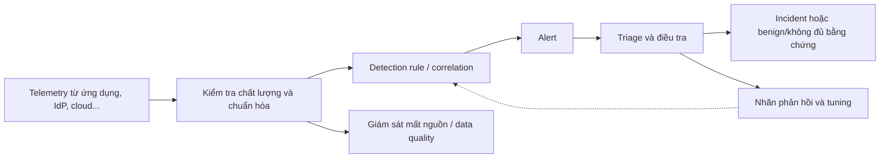
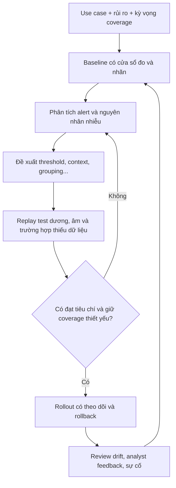

# Signal và noise trong detection engineering

## 1. Vì sao detection cần phân biệt signal và noise?

Một hệ thống giám sát có thể tạo hàng nghìn cảnh báo mỗi ngày mà vẫn bỏ qua một hành vi xâm nhập quan trọng. Ngược lại, một hệ thống chỉ tạo vài cảnh báo cũng chưa chắc tốt nếu nó đã lọc mất các hành vi cần phát hiện. Vấn đề trọng tâm của **detection engineering** là tạo ra cảnh báo **đúng, đủ, kịp thời và có thể hành động** từ dữ liệu quan sát có giới hạn.

Trong chương **Detection engineering** của module **SECURITY_SECURITY_ASSURANCE**, bài **Signal và noise** giải thích cách đánh giá chất lượng tín hiệu bảo mật dựa trên rủi ro, các security controls, kiểm thử, audit và bằng chứng vận hành. Mục tiêu của security assurance là có cơ sở kiểm chứng rằng khả năng phát hiện đang hoạt động trong phạm vi đã công bố, có người xử lý sai lệch và được cải tiến liên tục trong phát triển lẫn vận hành.

Hãy hình dung một quy tắc phát hiện “đăng nhập thất bại từ cùng IP vào nhiều tài khoản”:

- Máy chủ NAT của doanh nghiệp khiến nhiều người dùng hợp lệ có cùng IP. Khi hệ thống xác thực gặp lỗi, quy tắc tạo hàng trăm cảnh báo không cần thiết.
- Kẻ tấn công phân tán yêu cầu trên nhiều IP, mỗi IP chỉ thử vài tài khoản. Quy tắc cũ có thể không tạo cảnh báo nào.
- Nếu nhóm vận hành tắt hẳn quy tắc để “dọn dashboard”, lượng cảnh báo giảm nhưng rủi ro chưa được xử lý.

Một thay đổi tốt phải trả lời **cảnh báo nào được giảm, bằng điều kiện gì, tín hiệu xấu nào vẫn đi qua và điều đó được kiểm chứng ra sao**.

### Kết quả học tập

Sau bài này, người học có thể:

1. Phân biệt telemetry, event, signal, detection, alert, incident và noise theo mục đích điều tra.
2. Dùng precision, recall, false-positive rate và các chỉ số vận hành đúng mẫu số, hiểu giới hạn của ground truth.
3. Giải thích vì sao tỷ lệ tấn công nền thấp khiến quy tắc có vẻ “rất chính xác” vẫn tạo nhiều cảnh báo sai.
4. Áp dụng enrichment, correlation, baseline, threshold, aggregation, deduplication và suppression có kiểm soát.
5. Xây dựng test case có tín hiệu dương và âm, đo tác động của việc tuning và lưu được bằng chứng assurance.

## 2. Định nghĩa theo chuỗi xử lý



| Khái niệm | Ý nghĩa | Ví dụ |
| --- | --- | --- |
| **Telemetry** | Dữ liệu thu thập từ các thành phần của hệ thống | Authentication log, audit event, endpoint process event |
| **Event** | Bản ghi một hành động/trạng thái tại một thời điểm | `authn.login` có `outcome=deny` |
| **Signal** | Bằng chứng có giá trị cho một giả thuyết hoặc use case phát hiện | Nhiều tài khoản bị thử từ một nguồn trong cửa sổ ngắn |
| **Noise** | Dữ liệu/cảnh báo không giúp phân biệt hoặc hành động với use case đang xét | Các job kiểm thử hợp lệ liên tục phát sinh cảnh báo giống tấn công |
| **Detection** | Logic đánh giá event và ngữ cảnh để nhận diện điều kiện nghi vấn | Rule phát hiện cấp quyền quản trị ngoài quy trình |
| **Alert** | Thông báo/case ứng viên cần xác minh theo chính sách | “Cấp quyền đặc quyền không thấy phê duyệt liên quan” |
| **Incident** | Tình huống đã được đánh giá là sự cố theo tiêu chí của tổ chức | Tài khoản bị chiếm đoạt dẫn tới nâng quyền trái phép |

**Signal không đồng nghĩa “đã có tấn công”**. Một event có thể là tín hiệu nghi vấn tốt nhưng cuối cùng có nguyên nhân hợp lệ. **Noise cũng không phải tính chất cố định của một bản ghi**: 500 lỗi xác thực có thể là nhiễu khi IdP đang sự cố, nhưng trở thành tín hiệu quan trọng khi chúng nhắm vào tài khoản đặc quyền từ nguồn lạ.

Hai lớp nhiễu cần phân biệt:

- **Data noise:** event trùng, thiếu trường, sai giờ, sai schema, dữ liệu debug thừa, nguồn không đáng tin. Nó làm cho rule khó đánh giá và khó điều tra.
- **Alert noise:** rule kích hoạt quá thường xuyên trên hành vi hợp lệ, nhóm sự kiện không hiệu quả hoặc thiếu ngữ cảnh khiến analyst phải mở nhiều case không có giá trị.

Cũng cần phân biệt **missing signal**: không nhận được event quan trọng, quy tắc không chạy hoặc kết quả bị suppress. Dashboard ít alert có thể là kết quả của chất lượng tốt, nhưng cũng có thể là biểu hiện mất giám sát.

## 3. Signal có giá trị nhờ điều gì?

Một tín hiệu tốt trả lời rõ một **giả thuyết tấn công**, gắn với tài sản và có dữ liệu để xác minh. Đánh giá theo các chiều sau:

| Chiều chất lượng | Câu hỏi đánh giá | Cách kiểm chứng |
| --- | --- | --- |
| **Relevance** | Event có liên quan rủi ro, threat behavior hoặc control cụ thể? | Liên kết threat scenario → detection use case → trường dữ liệu |
| **Fidelity** | Event diễn tả đúng sự kiện và danh tính? | Đối chiếu audit event với hành động và kết quả thực tế |
| **Completeness** | Phạm vi nguồn quan trọng có đủ? | Đối soát source coverage, missing fields, event counts |
| **Freshness** | Tín hiệu đến đủ sớm để phản ứng? | Đo trễ giữa `event_time`, `ingested_at` và `alert_time` |
| **Context** | Có biết actor, target, quyền, tài sản, change ticket? | Kiểm tra trường bắt buộc và enrichment |
| **Trustworthiness** | Ai có thể giả, sửa hoặc ngắt nguồn? | Xác thực nguồn, audit cấu hình pipeline, đối chiếu độc lập |
| **Discriminative power** | Có phân biệt được hành vi độc hại với hoạt động thường gặp? | Replay dữ liệu đã gắn nhãn dương và âm |
| **Actionability** | Analyst có đủ thông tin để ra quyết định tiếp theo? | Diễn tập triage với runbook và đo kết quả |

**Nguồn dữ liệu là giới hạn trên của detection**. Không có event thay đổi IAM thì rule phát hiện cấp quyền bất thường dựa trên IAM audit không thể hoạt động, dù truy vấn SIEM viết rất tốt. Mất nguồn cũng cần có signal riêng: heartbeat, last-seen, số event kỳ vọng, ingest error, queue lag và schema rejection.

Ví dụ: một nguồn identity provider có `actor`, `target`, `outcome`, `event_time` đáng tin cậy tạo cơ sở tốt cho rule phân quyền. Nếu chỉ có HTTP status 200 từ gateway, ta chưa thể kết luận một quyền đã được cấp thành công.

### Từ rủi ro tới tín hiệu

```
Rủi ro: tài khoản đặc quyền bị lạm dụng
    ↓
Giả thuyết: có cấp role admin bất thường
    ↓
Control: xác thực mạnh, policy, phê duyệt
    ↓
Tín hiệu: role_grant + actor + subject + thời gian + approval/change
    ↓
Detection: phân biệt ca hợp lệ và bất thường
    ↓
Alert → triage → incident/benign → bằng chứng
```

“Có thêm dữ liệu” không tự động tăng chất lượng. Các trường không liên quan có thể tăng chi phí lưu trữ, lộ dữ liệu nhạy cảm và gây khó cho analyst. Chọn dữ liệu theo **câu hỏi điều tra**, quản lý truy cập và thời gian giữ theo chính sách.

## 4. False positive, false negative và ma trận nhầm lẫn

Để đánh giá rule, cần định nghĩa trước **đơn vị đánh giá**: một event, một phiên, một tài khoản trong 24 giờ, hay một tình huống tấn công? Các chỉ số không thể so sánh nếu thay đổi đơn vị và cửa sổ thời gian.

Giả sử mỗi đơn vị đã được gắn nhãn từ nguồn ground truth có thể kiểm chứng:

| | Thực tế có hành vi cần phát hiện | Thực tế không có hành vi đó |
| --- | --- | --- |
| **Rule tạo alert** | **TP (true positive):** phát hiện đúng | **FP (false positive):** báo động không đúng mục tiêu |
| **Rule không tạo alert** | **FN (false negative):** bỏ sót | **TN (true negative):** không báo động đúng |

Các chỉ số thường dùng:

\[
\text{Precision}=\frac{TP}{TP+FP}
\]

Tỷ lệ alert dương tính thật trong các alert được đánh giá. Precision thấp thường làm tăng công triage, nhưng cần xem thêm độ nghiêm trọng và khả năng hành động.

\[
\text{Recall}=\frac{TP}{TP+FN}
\]

Tỷ lệ tình huống cần phát hiện đã được rule nhận diện. Recall chỉ có ý nghĩa khi **biết được** tập tình huống dương tính, ví dụ qua bộ test gắn nhãn hoặc diễn tập có kiểm soát.

\[
\text{False positive rate}=\frac{FP}{FP+TN}, \quad
\text{False negative rate}=\frac{FN}{TP+FN}
\]

**False-positive rate (FPR) khác với tỷ lệ alert sai** \(FP/(TP+FP)\). Nhầm hai mẫu số này có thể tạo ra kết luận rất sai.

### 4.1. Ví dụ tỷ lệ nền thấp

Giả sử một bộ kiểm thử **có ground truth đầy đủ** chứa 10.000 tình huống độc lập, trong đó 20 tình huống là hành vi độc hại. Một rule cho kết quả:

| Kết quả | Số tình huống |
| --- | ---: |
| TP | 15 |
| FN | 5 |
| FP | 85 |
| TN | 9.895 |
| **Tổng** | **10.000** |

Khi đó:

- **Precision = 15 / 100 = 15%**: trong 100 cảnh báo, chỉ 15 trường hợp là dương tính thật.
- **Recall = 15 / 20 = 75%**: bỏ sót 5 trong 20 tình huống cần phát hiện.
- **FPR = 85 / 9.980 ≈ 0,85%**: tỷ lệ báo nhầm trên tập âm tính có vẻ thấp.
- **Accuracy = (15 + 9.895) / 10.000 = 99,1%**: nghe rất cao nhưng che khuất việc 85% alert là FP.

Đây là **base-rate effect**: khi hành vi độc hại rất hiếm, chỉ một tỷ lệ FP nhỏ trên lượng lớn hành vi hợp lệ cũng có thể tạo ra nhiều cảnh báo sai. Vì vậy, không dùng mỗi “accuracy cao” hay “FPR thấp” để đánh giá hiệu quả SOC.

Trong thực tế, tổ chức thường **không biết toàn bộ FN và TN của production** vì không thể xác nhận mọi hành vi không bị alert. Tỷ lệ “true positive trong alert đã triage” chỉ ước lượng precision trên **tập đã kiểm tra**. Những alert chưa phân loại, thiếu nhãn, lựa chọn mẫu thiên lệch hoặc nhiều alert gắn với cùng một incident cần được tách rõ trong báo cáo. Không biến “không tìm thấy tấn công” thành nhãn TN mặc định.

### 4.2. Nên ưu tiên precision hay recall?

Không có một ngưỡng chung cho mọi hệ thống:

| Bối cảnh | Cân nhắc |
| --- | --- |
| Phát hiện sử dụng trái phép tài khoản quản trị cao cấp | Chi phí FN có thể rất lớn; ưu tiên độ bao phủ và escalation kịp thời |
| Cảnh báo quét internet lặp lại bị WAF chặn | Khối lượng FP/alert trùng có thể lớn; aggregation và đánh giá tác động quan trọng |
| Hệ thống tự động khóa tài khoản sau alert | FP có thể gây ngừng dịch vụ; cần độ tin cậy cao, safety checks và con người duyệt khi phù hợp |
| Cảnh báo phục vụ hunt chủ động | Có thể chấp nhận tín hiệu yếu hơn nếu quy trình điều tra và nguồn lực phù hợp |
| Sự kiện thay đổi control bảo mật cốt lõi | Có thể cần ghi nhận mọi thay đổi, còn chỉ một phần tạo alert tùy rủi ro |

Một rule có thể có precision thấp nhưng vẫn hữu ích nếu bắt được hành vi tác động nghiêm trọng và được phân phối tới hàng đợi triage phù hợp. Ngược lại, precision cao không hữu ích nếu rule chỉ phát hiện các trường hợp hiển nhiên và bỏ qua phần lớn đường tấn công.

## 5. Vì sao noise xuất hiện?

Nguồn noise và cách giải quyết phải dựa trên **nguyên nhân**:

| Nguyên nhân | Biểu hiện | Biện pháp nên xem xét |
| --- | --- | --- |
| Tín hiệu quá rộng | Mọi lần đăng nhập thất bại đều báo nguy cơ account takeover | Kết hợp tần suất, số account, rủi ro actor, bối cảnh phiên |
| Quy tắc không hiểu hoạt động hợp lệ | Backup định kỳ bị coi là data exfiltration | Enrichment với job identity, lịch hoạt động, phạm vi dữ liệu |
| Dữ liệu trùng hoặc retry | Cùng một event tạo nhiều alert | Khử trùng event, gộp các occurrence theo khóa có thời hạn |
| Thiếu trường | Không có target/approval nên rule suy đoán “trái phép” | Cải thiện schema/source; xử lý nhãn “unknown” riêng |
| Sai timestamp | Event xuất hiện ngoài cửa sổ detection | Đồng bộ giờ, event-time window, late-arrival strategy |
| NAT, proxy, VPN, shared accounts | Nhiều user có cùng IP hoặc một actor bị gán sai | Kết hợp identity, device/workload, session, source confidence |
| Thay đổi ứng dụng hoặc mùa vụ | Quy tắc hoạt động tốt tháng trước nhưng nay ồn | Baseline theo phân khúc, phân tích drift, review định kỳ |
| Threat intelligence quá rộng/cũ | IOC hết hiệu lực gây nhiều hit không liên quan | TTL, độ tin cậy nguồn, nhiều điều kiện xác nhận |
| Quy tắc trùng nhau | Một hoạt động tạo hàng chục alert giống nhau | Correlation, phân mức rule, case grouping |

Không nên tự động đưa nguồn phát noisy vào allowlist vĩnh viễn. Máy chủ quản trị, tài khoản dịch vụ, IP VPN hay công cụ bảo trì cũng có thể bị xâm nhập. Nếu tạo ngoại lệ, phải ghi **lý do nghiệp vụ, chủ sở hữu, phạm vi, thời hạn và phép thử regression**.

### Noise gây thiệt hại ở đâu?

Noise không chỉ làm dashboard xấu. Nó tăng thời gian mở alert, khiến analyst thiếu ngữ cảnh, bỏ lỡ sự kiện quan trọng giữa hàng đợi dài, tạo động lực tắt rule và làm giảm độ tin cậy đối với chương trình detection. Tuy nhiên, **giảm số alert không đồng nghĩa giảm rủi ro**; chỉ số giảm alert cần đi cùng đo coverage và false negative có kiểm soát.

## 6. Các kỹ thuật nâng signal-to-noise ratio

Trước mỗi thay đổi, hãy lưu baseline, giả thuyết cải thiện và bộ test thể hiện cả **đường tấn công cần bắt** lẫn **hoạt động hợp lệ không nên tạo alert**.

### 6.1. Enrichment: bổ sung ngữ cảnh đáng tin

Thay vì cảnh báo “user đăng nhập ngoài giờ”, có thể bổ sung:

- Tài khoản có thuộc nhóm quản trị hoặc tài khoản dịch vụ không?
- Sự kiện đến từ thiết bị đã được quản lý, địa điểm quen thuộc, mạng doanh nghiệp hay workload được phê duyệt?
- Có change ticket hoặc maintenance window tương ứng không?
- Sau đăng nhập có tải bí mật, đổi quyền, vô hiệu logging hoặc export dữ liệu không?
- Tín hiệu danh tính và endpoint có đáng tin, đủ mới và liên kết đúng actor không?

Enrichment phải có **nguồn gốc và thời điểm hiệu lực**. Gắn trạng thái thiết bị hiện tại vào một event xảy ra tháng trước có thể tạo kết luận sai nếu thiết bị đã thay đổi. Khi không thể enrich, thể hiện “unknown” thay vì tự xem là an toàn hoặc độc hại.

### 6.2. Correlation: kết hợp bằng chứng theo một giả thuyết

Một lần `login_failure` yếu; chuỗi “nhiều tài khoản bị thử → một lần đăng nhập thành công từ nguồn liên quan → ngay sau đó có thay đổi vai trò” có thể mạnh hơn.

Khi correlation, phải chọn:

1. **Entity key**: user, service account, source fingerprint, device, tenant hoặc resource.
2. **Temporal window**: cửa sổ theo event time và độ trễ cho phép.
3. **Ordering**: có cần thứ tự sự kiện hay chỉ cần đồng xuất hiện?
4. **Minimum evidence**: trường nào bắt buộc, hành động nào đủ độc lập?
5. **Missing source behavior**: thiếu một nguồn sẽ làm rule suy giảm/không thể đánh giá hay cần alert data-quality riêng?

Không nên cộng nhiều tín hiệu phụ thuộc như thể chúng độc lập: ba bản sao của cùng log không phải ba bằng chứng khác nhau.

### 6.3. Threshold và baseline

**Threshold tĩnh** như “trên N lần thất bại trong 5 phút” đơn giản, dễ giải thích, nhưng có thể quá nhạy với nhóm hoạt động bình thường hoặc quá yếu trước tấn công phân tán. **Baseline** từ lịch sử có thể phù hợp hơn khi được phân theo nhóm tương đồng: tài khoản đặc quyền/nhân viên/service account; giờ làm việc; khu vực; dịch vụ; tenant.

Một baseline tốt cần đủ dữ liệu đại diện, kiểm soát mùa vụ và thay đổi hệ thống, tránh **học cả traffic độc hại thành bình thường**. Ghi rõ thời gian huấn luyện, biến đầu vào, phân khúc, điều kiện thiếu dữ liệu và lịch review. Mọi threshold là tham số tổ chức lựa chọn và hiệu chỉnh từ bằng chứng; không có con số ma thuật áp dụng cho mọi môi trường.

### 6.4. Aggregation, deduplication và rate limiting

| Kỹ thuật | Mục đích | Rủi ro khi dùng sai |
| --- | --- | --- |
| Deduplication | Một `event_id` hoặc duplicate kỹ thuật chỉ xử lý một lần | Nhầm các lần tấn công riêng thành một |
| Aggregation | Gộp nhiều event liên quan thành một cảnh báo giàu ngữ cảnh | Mất chi tiết thời gian, actor hoặc diễn biến |
| Grouping | Gom alert theo incident/entity/chiến dịch | Gộp hai incident khác nhau hoặc hai tenant không liên quan |
| Rate limiting | Giới hạn số thông báo tới on-call | Có thể che mất cường độ tăng đột biến |
| Suppression | Tạm không thông báo cho ngữ cảnh có căn cứ | Có thể che hành vi thực sự độc hại từ nguồn được miễn trừ |

Ví dụ, với 500 lần bị từ chối trên cùng tài khoản trong 5 phút, thay vì gửi 500 notification, tạo **một alert tổng hợp** với `count=500`, khoảng thời gian, danh sách nguồn và link tới event gốc. **Giữ nguyên dữ liệu gốc theo chính sách**, không biến aggregation thành xóa bằng chứng.

### 6.5. Suppression/allowlist có điều kiện

Suppression là quyết định rủi ro, cần có:

- Rule và phiên bản chịu tác động; đối tượng được miễn trừ cụ thể.
- Lý do, evidence hợp lệ (ví dụ job được phê duyệt), người phê duyệt và owner.
- Thời hạn hết hiệu lực, lịch xem lại và điều kiện thu hồi.
- Metric về số alert bị suppress và chỉ báo bất thường trong nhóm miễn trừ.
- Kiểm thử rằng các tình huống tấn công quan trọng vẫn được phát hiện.

Ví dụ hợp lý: bỏ **thông báo trùng** cho một job backup đã xác minh trong cửa sổ bảo trì, nhưng vẫn giữ event, đo khối lượng thay đổi và cảnh báo nếu phạm vi vượt cấu hình được duyệt. Ví dụ nguy hiểm: `ignore all events from admin subnet`; subnet này là mục tiêu có giá trị cao.

### 6.6. Severity, confidence và actionability

**Severity** biểu thị tác động tiềm tàng nếu giả thuyết đúng; **confidence** thể hiện độ tin cậy của bằng chứng. Một trường hợp có thể severity cao nhưng confidence thấp. Đừng dùng mức độ “high” như lời khẳng định sự cố đã được xác minh.

Alert có thể hành động nên có: giả thuyết/rule, actor và target, thời điểm, dữ liệu gốc/đường dẫn truy vấn, vì sao kích hoạt, yếu tố tăng/giảm độ tin cậy, hành động triage đề xuất, owner và quy trình escalation.

## 7. Ví dụ kỹ thuật: password spraying

### 7.1. Mô hình tấn công và nhiễu

**Giả thuyết:** một nguồn hoặc nhóm nguồn cố đăng nhập vào nhiều tài khoản trong thời gian ngắn với số lần thử thấp trên từng tài khoản để tránh khóa mật khẩu.

**Nguồn:** sự kiện xác thực của IdP/gateway, có `event_time`, `source`, `claimed_identifier`, `outcome`, `auth_method`, `tenant`, `request_id` và `event_id`. `claimed_identifier` khi đăng nhập thất bại có thể chưa phải danh tính được xác thực; cần giảm dữ liệu hoặc pseudonymization theo chính sách.

**Nguồn nhiễu:**

- NAT của văn phòng với nhiều user bị lỗi xác thực đồng loạt.
- Bài kiểm thử auth được phê duyệt hoặc chiến dịch migration.
- Lỗi cấu hình client liên tục thử credentials cũ.
- Proxy che giấu IP gốc; cùng nguồn không nhất thiết cùng đối tượng điều khiển.

**Nguồn false negative:**

- Attacker dùng botnet, phân tán IP và thử chậm.
- Chỉ thu được một phần log hoặc trường `claimed_identifier` bị thiếu.
- Threshold quá cao, cửa sổ ngắn hoặc suppression phạm vi quá rộng.

### 7.2. Rule minh họa

Cú pháp dưới đây là **giả mã truy vấn**, không phải câu lệnh chạy nguyên vẹn trên một SIEM cụ thể. Các biến `ACCOUNT_THRESHOLD`, `ATTEMPT_THRESHOLD`, `WINDOW` phải được tuning bằng dữ liệu và test của môi trường:

```text
FROM idp_auth_events
WHERE event_type = "authn.login"
  AND outcome = "failure"
  AND source_confidence >= MIN_SOURCE_CONFIDENCE
WINDOW event_time OVER WINDOW
GROUP BY tenant_id, normalized_source_key
CALCULATE
    failures = count_unique(event_id),
    accounts = count_distinct(claimed_identifier),
    earliest = min(event_time),
    latest = max(event_time)
WHEN accounts >= ACCOUNT_THRESHOLD
 AND failures >= ATTEMPT_THRESHOLD
EMIT alert(
    use_case = "possible_password_spraying",
    entity = normalized_source_key,
    account_count = accounts,
    event_count = failures,
    source_event_ids = related_event_ids,
    evidence_window = [earliest, latest]
)
```

`normalized_source_key` không nhất thiết là IP thô: có thể cần tính toán có kiểm soát từ proxy chain đáng tin, device/session hoặc lớp thông tin mạng. Trong môi trường NAT, phải bổ sung bối cảnh để phân biệt nguồn hợp lệ. Với tấn công phân tán, cần một **rule khác** tương quan qua tenant/tài khoản, thiết bị lạ và outcome; cố nhét mọi kiểu tấn công vào cùng threshold IP có thể làm cả precision và recall tệ hơn.

### 7.3. Bộ tình huống kiểm chứng

| Mã | Dữ liệu đầu vào | Kỳ vọng |
| --- | --- | --- |
| PS-01 | Một nguồn thử nhiều tài khoản vượt ngưỡng đã duyệt | Một alert có đủ account count, cửa sổ và event gốc |
| PS-02 | Một người nhập sai mật khẩu vài lần, dưới ngưỡng | Không tạo alert spraying theo rule này |
| PS-03 | Nhiều user từ NAT doanh nghiệp khi IdP lỗi | Cần triage/baseline phù hợp, không xem tất cả là attack |
| PS-04 | Nhiều nguồn phối hợp thử mỗi nguồn dưới ngưỡng | Test chỉ ra blind spot của rule theo IP; rule bổ sung phải xử lý |
| PS-05 | Collector trễ vượt cửa sổ nhưng event-time còn hợp lệ | Áp dụng chính sách late arrival, không âm thầm mất detection |
| PS-06 | Hai bản copy của cùng `event_id` | Không đếm thành hai lần thử riêng biệt |
| PS-07 | Suppression maintenance hợp lệ nhưng lưu lượng đổi bất thường | Vẫn giữ event và có cơ chế nhìn thấy biến động nằm ngoài phạm vi miễn trừ |
| PS-08 | Nguồn IdP dừng phát log | Có cảnh báo sức khỏe dữ liệu, không kết luận “hết tấn công” |

Điều chỉnh rule dựa trên cùng một bộ trường hợp dương/âm và kiểm tra **sai khác trước/sau**, tránh báo thành công chỉ nhờ alert volume giảm.

## 8. Ví dụ assurance: cấp quyền quản trị bất thường

Với module SECURITY_SECURITY_ASSURANCE, giả sử control quy định một thay đổi role `admin` phải có actor hợp lệ, xác thực đủ mạnh và approval còn hiệu lực.

**Mục tiêu detection:** phát hiện những thay đổi đặc quyền không phù hợp chính sách để xác minh và phản ứng. Một sự kiện `role_grant=success` tự nó chưa đủ là tấn công; nếu có phê duyệt hợp lệ và change window đúng, alert có thể không cần thiết.

| Trường/nguồn | Dùng để làm gì | Trường hợp không tin cậy |
| --- | --- | --- |
| IAM control-plane audit | Xác nhận role và actor thực hiện thay đổi | Nguồn không bao phủ toàn bộ tenant/account |
| Approval system | Xác minh chính sách phê duyệt | Approval ID thiếu, hết hạn hoặc không cùng resource |
| Authentication assurance | Xác minh MFA, loại phiên và mức tin cậy | Không có dữ liệu MFA tại thời điểm hành động |
| Change management | Lịch thay đổi được phép và phạm vi công việc | Ticket không bao gồm role/target hoặc đã hết hiệu lực |
| Logging health | Tình trạng ingest và schema | Nguồn ngừng hoặc mất một phần event |

Thiết kế rule theo các tầng:

1. **Tầng dữ liệu:** xác định role đã đổi thực sự và actor/target không bị giả mạo.
2. **Tầng ngữ cảnh:** join approval theo `tenant`, `target`, role, actor và hiệu lực thời gian; không chỉ kiểm tra “có ticket”.
3. **Tầng quyết định:** thay đổi đặc quyền không có approval hợp lệ → alert mức ưu tiên phù hợp; thiếu dữ liệu approval → trạng thái `unknown`, yêu cầu xác minh và kiểm tra nguồn.
4. **Tầng ứng phó:** truy vấn quyền hiện tại, xác nhận yêu cầu nghiệp vụ, xác minh tài khoản và thực hiện runbook theo mức độ.
5. **Tầng assurance:** phát lại ca có/không approval, ca approval sai target, ca lỗi nguồn; lưu dấu rule version, event IDs và kết quả.

Dưới đây là **đặc tả minh họa**, không phải chuẩn cấu hình của một sản phẩm:

```yaml
id: DET-IAM-003
name: Privileged role grant without valid approval
risk: Unauthorized privilege escalation
data_sources:
  - iam_control_plane_audit
  - approved_change_records
match:
  event_type: iam.role_grant
  outcome: success
  privileged_role: true
decision:
  alert_if: no_valid_approval_for_actor_target_role_and_time
  unknown_data: investigation_required
response:
  owner: security_operations
  runbook: validate_grant_and_contain_if_confirmed
tests:
  - approved_grant_no_high_priority_alert
  - unauthorized_grant_alert
  - wrong_target_approval_alert
  - unavailable_approval_source_visible
evidence:
  - rule_version
  - sample_event_ids
  - test_results
  - triage_decisions
```

**Một false positive có thể chấp nhận được khi có bảo trì hợp lệ**; sau khi analyst kết luận, cập nhật bối cảnh rule hoặc cách xác minh approval. Nhưng nếu allowlist toàn bộ tài khoản quản trị, rule sẽ không còn bảo vệ chính đối tượng nhạy cảm nhất. Khi giảm alert, cần phát lại cả trường hợp **hợp lệ có approval** và **độc hại không approval**.

## 9. Tuning theo vòng lặp có kiểm soát

Một vòng tuning đáng tin cậy nên được thực hiện như một thay đổi có thể review:



### Bước 1 — Định nghĩa mục tiêu có thể kiểm chứng

Ví dụ:

> Với những thay đổi quyền quản trị không có phê duyệt hợp lệ trong tenant production, rule phải tạo alert có liên kết tới actor, target, thời gian, event và runbook trong giới hạn trễ đã phê duyệt.

Cần mô tả phạm vi, threat scenario, yêu cầu dữ liệu, giới hạn hệ thống và mức độ phản ứng. Tránh mục tiêu mơ hồ như “giảm 70% alert”.

### Bước 2 — Đo baseline theo rule và nhóm nguồn

Thu thập trong khoảng đại diện:

- Alert count, unique entities, số incident/case và phân bố theo giờ/ngày.
- Tỷ lệ alert đã triage, nhãn TP/FP/unknown và lý do FP; không loại nhãn unknown khỏi báo cáo một cách vô hình.
- Thời gian từ event → ingest → alert → mở case → quyết định; phân vị p50/p95 nếu hữu ích.
- Độ đầy đủ và freshness của nguồn; tỷ lệ thiếu trường và reject schema.
- Các điểm mù đã biết và bộ tình huống tấn công mà rule dự kiến bao phủ.

Một đợt tăng FP ngắn do thay đổi hạ tầng không nên mặc định thành baseline lâu dài.

### Bước 3 — Xác định root cause

Phân loại FP có tính tái lập: authorized admin task, scheduled automation, NAT, duplicate, incomplete enrichment, badly scoped threshold, late data, misclassified outcome. Không dùng nhãn “false positive” để thay thế điều tra; nếu chỉ chưa đủ bằng chứng, ghi `inconclusive`.

Đối với FN, dùng threat emulation, replay, purple-team exercise, sự cố đã xác minh và post-incident review. Nếu chưa thử được tình huống, ghi **coverage chưa được kiểm chứng**.

### Bước 4 — Thay đổi nhỏ và so sánh

Một thay đổi ví dụ:

- Trước: alert với mọi `iam.role_grant`.
- Sau: enrich approval theo đúng actor/target/role/time, chuyển các ca có phê duyệt hợp lệ sang bản ghi theo dõi; tạo alert ưu tiên cao cho ca không có phê duyệt; trạng thái thiếu nguồn được chuyển tới luồng kiểm tra riêng.

Sau thay đổi, so sánh **cùng tập dữ liệu và cùng đơn vị đánh giá**. Nếu thay đồng thời threshold, identity parsing và suppression thì khó xác định điều gì gây cải thiện hoặc suy giảm. Ghi phiên bản rule và tập dữ liệu replay.

### Bước 5 — Triển khai và quan sát

Dùng dry-run/shadow mode hoặc canary khi phù hợp, so sánh rule cũ/mới trước khi chuyển hoàn toàn. Ghi rõ tiêu chí rollback: mất trường trọng yếu, số cảnh báo tăng bất thường, missed-positive trong test, hoặc độ trễ vượt ngưỡng. Khi dữ liệu hoặc sản phẩm thay đổi, diễn tập lại các tình huống đã từng bị bỏ sót.

## 10. Bộ chỉ số chất lượng detection và những bẫy đo lường

Một dashboard hữu ích kết hợp chất lượng detection, khả năng triage và sức khỏe dữ liệu:

| Nhóm | Chỉ số | Diễn giải và giới hạn |
| --- | --- | --- |
| Chất lượng cảnh báo | TP/FP/unknown trên tập đã triage | Phải ghi tỷ lệ được review và cách xác minh nhãn |
| Chất lượng cảnh báo | Precision trên tập đã gắn nhãn | Không đại diện toàn bộ production nếu nhãn thiên lệch |
| Bao phủ | Recall trên bộ threat emulation/replay có nhãn | Chỉ áp dụng cho tập kịch bản đã thử |
| Hoạt động | Alert volume theo rule, nguồn, entity, severity | Volume giảm không tự chứng minh chất lượng tăng |
| Hoạt động | Alert-to-case và số alert/case | Phụ thuộc chính sách grouping và triage |
| Tốc độ | Detection latency, time-to-triage, time-to-decision | Tính từ các mốc rõ ràng; tránh trộn event-time với ingest-time |
| Hàng đợi | Backlog, tuổi alert chưa triage, phân bố ưu tiên | Phản ánh tải công việc và nguy cơ chậm xử lý |
| Dữ liệu | Coverage, last-seen, freshness, missing fields | Giảm alert có thể là kết quả của đứt nguồn |
| Vận hành rule | Số rule không có owner, không được test/review, quá hạn suppression | Đo khả năng bảo trì và giám sát governance |
| Tính hữu ích | Tỷ lệ alert có đầy đủ runbook/context và kết luận | Đánh giá khả năng hành động chứ không chỉ số lượng |

**Ví dụ cách ghi metric chính xác:**

> Trong 14 ngày, rule tạo 240 alert; analyst đã phân loại 180, gồm 30 confirmed TP, 120 confirmed FP và 30 inconclusive. Tỷ lệ TP trên nhóm có nhãn kết luận là 30/(30+120)=20%; còn 60 alert chưa phân loại. Chưa có đủ dữ liệu để kết luận recall production.

Điểm quan trọng là nói rõ **phạm vi, thời kỳ, đơn vị, số chưa phân loại và cách lấy nhãn**. Có thể dùng sampling để đánh giá khối lượng lớn, nhưng phải ghi phương pháp chọn mẫu và độ bất định; đừng chỉ chọn case nghiêm trọng rồi gọi đó là precision toàn bộ.

### Metric nào dễ bị “làm đẹp”?

- **Ít alert hơn:** có thể do suppress tràn lan, mất nguồn hoặc rule bị tắt.
- **Nhiều confirmed incident hơn:** có thể do chiến dịch tấn công tăng, không hẳn do rule tốt hơn.
- **Mean time to detect thấp:** có thể chỉ đo alert đến sớm, bỏ qua những cuộc tấn công không bị phát hiện.
- **Tỷ lệ đóng case nhanh:** có thể do đóng tự động mà chưa đủ điều tra.
- **Accuracy cao:** có thể chỉ phản ánh số lượng âm tính áp đảo.

Dùng nhiều chiều đo và đọc cả ca **đã bắt được** lẫn ca **còn bỏ sót trong thử nghiệm**.

## 11. Xác minh qua test, audit và bằng chứng

Detection quality phải liên kết với chương trình security assurance. Một claim như “rule giảm nhiễu nhưng vẫn phát hiện lạm dụng đặc quyền” cần bằng chứng trước/sau, tập dương tính và âm tính, quan sát runtime và hồ sơ thay đổi.

### 11.1. Ma trận kiểm chứng

| Kiểm tra | Mục đích | Bằng chứng |
| --- | --- | --- |
| Source/data-quality test | Event bắt buộc đến đủ, đúng schema, đúng thời gian | Sample ID, ingest metrics, kiểm tra trường |
| Known-positive replay | Rule phát hiện các chuỗi tấn công nằm trong phạm vi | Tập event gắn nhãn, rule version, alert tương ứng |
| Known-negative replay | Rule không ồn với hoạt động hợp lệ phổ biến | Dữ liệu âm tính, kết quả trước/sau tuning |
| Evasion/edge-case test | Tìm điểm mù theo nguồn phân tán, chậm, spoofed/late data | Kịch bản, kết quả, limitation đã ghi |
| Suppression regression | Ngoại lệ không che tình huống xấu trong cùng phạm vi | Test dương đi qua ngoại lệ và audit cấu hình |
| Queue/collector fault test | Không lặng lẽ đánh mất alert do log thiếu/trễ | Metric backlog, data-health alert, recovery record |
| Triage drill | Analyst có đủ ngữ cảnh và thực hiện được runbook | Case mẫu, timeline và quyết định triage |
| Production health check | Rule được bật, còn nhận nguồn và tạo output đúng | Config snapshot, last-seen, test canary an toàn |

Chọn điều kiện test dựa trên độ nghiêm trọng của threat scenario. Không cần test mọi tích hợp bằng cùng độ sâu, nhưng các use case trọng yếu phải có đủ dữ liệu để xác nhận **coverage tối thiểu**.

### 11.2. Ground truth và giới hạn kết luận

Khi label TP/FP/FN, cần ghi nguồn gốc: kết quả investigation, threat emulation, đánh giá của chuyên gia, ticket thay đổi, hoặc tín hiệu đối chứng độc lập. Một nhãn “benign” do analyst đóng nhanh không mặc nhiên chắc chắn là âm tính thật. Một tình huống chỉ được xác minh một phần cần trạng thái `inconclusive`.

Không khẳng định “recall 100%” chỉ vì tất cả năm test đều pass. Kết luận đúng là **100% trong năm trường hợp đã kiểm thử** theo môi trường, phiên bản và dữ liệu tương ứng; vẫn còn tình huống khác, dữ liệu chưa có hoặc kỹ thuật né tránh chưa được đánh giá.

### 11.3. Hồ sơ evidence tối thiểu

Một lần tuning có thể lưu theo cấu trúc:

```yaml
change_id: DET-TUNE-2026-014
use_case: possible_password_spraying
rule_before: version_7
rule_after: version_8
reason: "Excessive alerts during an approved IdP migration"
hypothesis: "Adding migration context reduces confirmed benign alerts"
data_window: "Representative labeled replay window"
positive_cases:
  - PS-01
  - PS-04
negative_cases:
  - PS-02
  - PS-03
regressions:
  - PS-05
  - PS-06
  - PS-08
evaluation:
  positive_cases_detected: "Record actual test result"
  negative_cases_alerted: "Record actual test result"
  data_health_checks: "Record actual test result"
approval:
  rule_owner: security_detection_team
  reviewer: security_operations
  decision: pending
rollback:
  trigger: "Loss of required coverage or unexpected alert behavior"
```

Đây là **mẫu cấu trúc ghi bằng chứng**: các giá trị chưa kiểm thử được giữ dưới dạng yêu cầu ghi nhận, tuyệt đối không coi là kết quả PASS. Tùy tổ chức, liên kết thêm test-run ID, commit hash, cấu hình SIEM, sample đã làm sạch, ngày giờ và người xác nhận.

## 12. Quy trình triage tạo phản hồi hữu ích

Detection engineering cần vòng phản hồi từ SOC và đội vận hành. Khi một alert đến, analyst nên có luồng tối thiểu:

1. **Xác nhận nguồn và độ tin cậy:** event còn đầy đủ, đúng thời gian, enrichment còn hiệu lực?
2. **Đọc giả thuyết và bằng chứng:** rule phát hiện điều gì, actor/target là ai, scope ra sao?
3. **Đối chiếu hoạt động hợp lệ:** change ticket, automation, business workflow, lịch bảo trì và người chịu trách nhiệm.
4. **Điều tra tương quan:** có thêm hành vi xác thực, phân quyền, thay đổi dữ liệu hoặc endpoint liên quan?
5. **Kết luận có trạng thái rõ:** confirmed malicious, confirmed benign, inconclusive hoặc duplicate, với lý do và evidence link.
6. **Tạo feedback:** lỗi schema, thiếu ngữ cảnh, trùng alert, threshold kém, hoặc threat scenario chưa được coverage.

Từng loại feedback dẫn đến hành động khác nhau. Duplicate đòi hỏi grouping; authorized maintenance cần enrichment; lỗ hổng telemetry cần sửa nguồn; chưa phát hiện hành vi xấu cần detection bổ sung. Việc phân loại chính xác quan trọng hơn việc đơn thuần chọn “false positive” cho mọi alert không mở incident.

Định kỳ kiểm tra sự thay đổi của môi trường: ứng dụng mới, proxy mới, role mới, đặc tính traffic mới, adversary behavior mới và sự cố gần đây. Cập nhật rule, baseline, suppression expiry và test set. Mỗi rule nên có owner, version, documented scope, query, data dependency, runbook, lịch review và kênh báo lỗi.

## 13. Những sai lầm cần tránh

| Sai lầm | Hệ quả | Cách khắc phục |
| --- | --- | --- |
| Chỉ tối ưu số lượng alert | Mất tín hiệu rủi ro cao | Đo coverage, replay test dương/âm |
| Coi mọi alert không thành incident là FP | Ground truth sai, precision sai | Ghi nhãn kèm lý do và trạng thái inconclusive |
| Nhầm FPR với tỷ lệ alert sai | Hiểu sai hiệu quả khi base rate thấp | Công bố công thức và mẫu số |
| Tính recall trên tất cả production khi không biết FN | Kết luận quá mức | Ghi rõ recall chỉ trên tập gắn nhãn |
| Suppress toàn bộ tài khoản/subnet tin cậy | Che hành vi attacker đã chiếm account | Ngoại lệ giới hạn scope và có expiry/test |
| Enrich bằng dữ liệu hiện tại cho sự kiện cũ | Suy diễn sai context lịch sử | Dùng snapshot hoặc as-of join |
| Dùng một threshold cho mọi nhóm | Báo nhầm nhóm đông và bỏ sót nhóm khác | Phân khúc và quản lý baseline |
| Chỉ test positive, không test benign | Rule có recall test tốt nhưng ồn | Negative replay và review FP reason |
| Gộp alert nhưng làm mất event gốc | Khó tái dựng incident | Giữ evidence links và count |
| Không theo dõi data freshness | Không biết rule bị mù | Health detection riêng cho nguồn/pipeline |
| Đổi rule không lưu version/approval | Không truy nguyên kết quả | Evidence, review, rollback criteria |
| Dùng score/confidence làm kết luận cuối | Analyst bỏ qua điều tra cần thiết | Tách signal, risk prioritization và kết luận sự cố |

## 14. Bài tập thực hành

Bạn là detection engineer của một nền tảng nhiều tenant. Trong một tuần, rule phát hiện **thay đổi quyền đặc quyền** tạo 300 alert. Trong số 200 alert đã được phân loại, có 40 ca được xác minh là hành vi cần phát hiện, 130 ca là hoạt động hợp lệ và 30 ca chưa đủ bằng chứng; 100 alert còn chưa review. Đội SOC muốn giảm alert vì quá tải. Một số ca hợp lệ đến từ job tự động định kỳ; một số ca không có approval ID vì nguồn approval bị lỗi.

**Yêu cầu:**

1. Tính precision **trên các alert có nhãn kết luận**; ghi rõ mẫu số và vì sao chưa thể suy ra precision cho toàn bộ 300 alert.
2. Đề xuất hai cách giảm noise có giới hạn rõ ràng mà vẫn quan sát được thay đổi đặc quyền từ job tự động.
3. Xác định telemetry bắt buộc để phân biệt ca có approval, ca không approval và ca không xác định vì nguồn lỗi.
4. Thiết kế ít nhất ba **positive test**: cấp quyền không phê duyệt, phê duyệt sai target, và lạm dụng tài khoản automation; cùng ba **negative test** cho hoạt động hợp lệ.
5. Đề xuất metric và rollback trigger sau khi rollout rule mới; chỉ ra cách phát hiện “ít alert vì mất nguồn”.
6. Viết một assurance claim ngắn và liệt kê evidence đủ để reviewer khác lặp lại phép kiểm chứng.

**Gợi ý tính toán:** Trong 200 alert đã phân loại, chỉ 170 có nhãn TP hoặc FP kết luận. Precision trên tập này là \(40/(40+130)\approx23,5\%\). Ba mươi ca inconclusive và 100 ca chưa review không được tự gán thành FP; cũng chưa có dữ liệu về FN nên không thể tính recall production.

**Tiêu chí hoàn thành:** người review nhìn vào rule specification, tập test, dashboard và hồ sơ tuning có thể giải thích loại nhiễu nào đã giảm, tín hiệu quan trọng nào vẫn được phát hiện, phần nào chưa được kiểm chứng và ai chịu trách nhiệm xử lý sai lệch.

## 15. Ghi nhớ

**Signal-to-noise ratio cao chỉ có ý nghĩa khi phạm vi phát hiện quan trọng vẫn được bảo vệ.** Một chương trình detection engineering có trách nhiệm luôn gắn rule với rủi ro và giả thuyết, đo lường trên mẫu số rõ ràng, bổ sung ngữ cảnh đáng tin, quản lý ngoại lệ, kiểm thử cả positive lẫn negative và giám sát sức khỏe dữ liệu. Trong **security assurance liên tục**, mỗi quyết định tuning phải để lại bằng chứng có thể xem lại về lợi ích, điểm mù, phiên bản quy tắc và kết quả xác minh.
