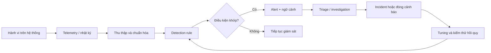
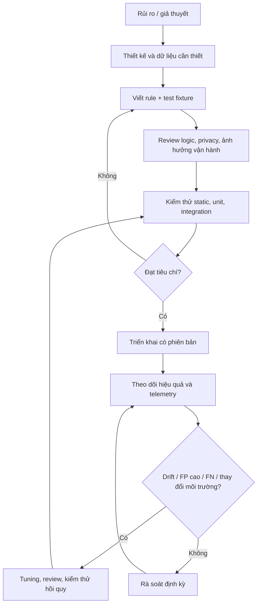

# Detection rule: thiết kế quy tắc phát hiện có thể kiểm chứng

## 1. Detection rule là gì?

Trong **Detection engineering**, *detection rule* (quy tắc phát hiện) là một đặc tả có thể thực thi, mô tả **dấu hiệu cần tìm trong dữ liệu quan sát được**, cách kết hợp các dấu hiệu, điều kiện kích hoạt và ngữ cảnh cần đưa vào cảnh báo. Rule có thể chạy trong SIEM, EDR, NDR, hệ thống giám sát cloud, công cụ phân tích sự kiện hoặc một bộ xử lý luồng dữ liệu.

Trong học phần **SECURITY_SECURITY_ASSURANCE**, detection rule còn đóng vai trò **kiểm soát có bằng chứng**: tổ chức cần chứng minh đã chọn đúng hành vi cần phát hiện, nguồn log có khả năng quan sát hành vi đó, logic xử lý đúng, cảnh báo được chuyển tới người chịu trách nhiệm và khả năng phát hiện vẫn hoạt động sau khi hệ thống thay đổi. Đó là một phần của việc đánh giá hệ thống đáp ứng mục tiêu bảo mật liên tục, bên cạnh quản trị rủi ro, security controls, kiểm thử, audit và khắc phục phát hiện.

Ví dụ, mục tiêu “phát hiện hành vi xóa nhật ký bảo mật trên Windows” có thể được triển khai thành rule tìm **Windows Security event ID 1102**. Nhưng chỉ có cú pháp tìm kiếm là chưa đủ: nếu nguồn sự kiện không được bật hoặc việc chuyển log bị lỗi, rule sẽ không nhìn thấy sự kiện; nếu rule không có người tiếp nhận cảnh báo, dấu hiệu phát hiện cũng không dẫn tới hành động.

Sau bài này, người học có thể:

- Phân biệt detection rule, giả thuyết phát hiện, tín hiệu, alert, incident và các kiểm soát ngăn chặn.
- Chuyển một rủi ro hoặc kỹ thuật tấn công thành điều kiện phát hiện có dữ liệu đầu vào, logic và tiêu chí chấp nhận rõ ràng.
- Viết, kiểm thử, điều chỉnh, triển khai và giám sát rule mà vẫn kiểm soát false positive và false negative.
- Thu thập bằng chứng về độ phủ, chất lượng logic, luồng xử lý và hiệu quả hoạt động phục vụ security assurance.

## 2. Rule nằm ở đâu trong chuỗi phát hiện?

Một chuỗi tối giản gồm:



Các thuật ngữ khác nhau:

| Thành phần | Chức năng | Ví dụ |
|---|---|---|
| **Detection hypothesis** | Phát biểu hành vi nguy hiểm và bằng chứng kỳ vọng | “Người có quyền quản trị có thể xóa Security log để che dấu vết” |
| **Telemetry** | Sự kiện, trường dữ liệu, thời gian, nguồn gốc | Windows Security event 1102, tài khoản thực hiện, máy phát sinh |
| **Detection rule** | Logic lựa chọn, tương quan và làm giàu tín hiệu | Khi nhận event 1102, tạo một phát hiện cần điều tra |
| **Signal / detection result** | Kết quả khớp logic ở một lần đánh giá | Sự kiện từ máy `HOST-01` khớp rule |
| **Alert** | Đối tượng để con người hoặc hệ thống xử lý | Cảnh báo với mức ưu tiên, bằng chứng, liên kết tới log gốc |
| **Incident** | Vụ việc đã được đánh giá và quản lý theo quy trình | Phát hiện xóa log kết hợp đăng nhập trái phép và thay đổi đặc quyền |
| **Prevention control** | Biện pháp ngăn hoặc giảm khả năng hành vi xảy ra | Phân quyền, bảo vệ cấu hình ghi log, chống sửa/xóa |

**Một rule chạy thành công không có nghĩa đã phát hiện toàn bộ một kỹ thuật tấn công.** Nó chỉ phát hiện một tập hành vi quan sát được theo các điều kiện đã đặt. Tương tự, một alert không tự động chứng minh có xâm nhập; phải được phân tích với ngữ cảnh thích hợp.

## 3. Các loại detection rule phổ biến

| Loại | Điều kiện đặc trưng | Điểm mạnh | Giới hạn thường gặp |
|---|---|---|---|
| **Indicator matching (IOC)** | IP, domain, file hash hoặc dấu hiệu đã biết | Dễ diễn giải, hữu ích khi IOC còn hiệu lực | IOC biến đổi nhanh; trùng khớp có thể thiếu ngữ cảnh |
| **Event/behavior matching** | Hành động cụ thể như xóa audit log hoặc gán quyền cao | Sát hành vi, thường giải thích được | Cần nguồn log đủ chi tiết và trường dữ liệu chuẩn |
| **Threshold / aggregation** | Số sự kiện vượt ngưỡng trong một cửa sổ thời gian | Phát hiện tần suất bất thường, giảm nhiễu đơn lẻ | Ngưỡng phụ thuộc baseline; sự kiện phân tán có thể lọt |
| **Sequence / correlation** | Nhiều hành động theo trình tự và điều kiện liên kết | Tăng ngữ cảnh, hỗ trợ phát hiện chuỗi hành vi | Join sai hoặc thiếu sự kiện gây false negative |
| **Statistical / anomaly** | Lệch khỏi baseline hoặc mô hình xác suất | Tìm hành vi hiếm, chưa có mẫu cứng | Phụ thuộc chất lượng dữ liệu và khả năng giải thích |
| **State / configuration change** | Chuyển trạng thái kiểm soát như tắt audit hoặc thay policy | Hữu ích để kiểm chứng thay đổi bảo mật | Cần biết trạng thái trước/sau và ngữ cảnh phê duyệt |

Ví dụ, phát hiện một sự kiện xóa log có thể dùng event matching; phát hiện nhiều lần đăng nhập thất bại trong 10 phút dùng threshold; phát hiện **nhiều lần đăng nhập thất bại rồi đăng nhập thành công cùng tài khoản** dùng sequence/correlation.

Đừng nhầm việc gán tên kỹ thuật trong một khung như **MITRE ATT&CK** với chứng minh độ phủ. Một rule có thể liên quan tới một hành vi trong khung nhưng vẫn chỉ bao phủ một nguồn telemetry, một nền tảng, một biến thể hoặc một điều kiện rất hẹp. Khi ánh xạ kỹ thuật, ghi rõ **lý do, phạm vi hệ thống và bằng chứng kiểm thử**.

## 4. Từ rủi ro đến giả thuyết phát hiện

Bắt đầu từ một hành vi cần quan sát thay vì bắt đầu từ câu lệnh truy vấn. Mỗi đề xuất rule nên trả lời những câu hỏi sau:

1. **Đối tượng cần bảo vệ là gì?** Tài khoản đặc quyền, dữ liệu nhạy cảm, máy chủ ứng dụng, khóa mã hóa hay dịch vụ xác thực?
2. **Mối đe dọa diễn ra như thế nào?** Hành vi hoặc chuỗi thao tác nào có thể chứng tỏ một rủi ro đang xảy ra?
3. **Nguồn nào nhìn thấy hành vi đó?** Security log, audit API, IAM event, process event, DNS, network flow hay ứng dụng?
4. **Dấu hiệu quan sát được gồm trường nào?** `event.action`, `event.code`, `user.id`, `source.ip`, `host.id`, `process.command_line`, thời gian, kết quả...
5. **Điều gì phân biệt với hoạt động hợp lệ?** Thay đổi đã duyệt, tác vụ bảo trì, tài khoản dịch vụ, kiểm thử an ninh được phép.
6. **Cần đáp ứng mức thời gian và độ tin cậy nào?** Phát hiện gần thời gian thực hay theo lô, được phép trễ bao lâu, ai sẽ xử lý?
7. **Kết quả nào được coi là đạt?** Dữ liệu thử phải kích hoạt alert; trường hợp hợp lệ không tạo alert; có thể truy vấn ngược về log gốc.

Mẫu phát biểu giả thuyết:

> Nếu có hành vi **X** trên tài sản thuộc phạm vi **Y**, hệ thống sẽ phát sinh các sự kiện **Z**. Khi các điều kiện **C** khớp trong khoảng thời gian **W**, rule phải tạo cảnh báo kèm bằng chứng **E** để đội **R** xử lý trong thời gian **T**.

Mẫu này tạo ra một hợp đồng giữa chủ rủi ro, người triển khai telemetry, kỹ sư detection và người vận hành SOC. Khi không có dữ liệu đủ để xác minh giả thuyết, trạng thái đúng là **telemetry gap / coverage gap** cần xử lý, chứ không mặc nhiên coi việc tạo một rule rỗng là hoàn thành kiểm soát.

## 5. Phần cấu thành của một detection rule hoàn chỉnh

Một rule phục vụ vận hành và audit thường có nhiều hơn điều kiện tìm kiếm:

| Thành phần | Câu hỏi phải trả lời |
|---|---|
| **ID, tên, phiên bản** | Xác định và truy vết rule nào đã chạy tại thời điểm nào? |
| **Mục tiêu / giả thuyết** | Hành vi rủi ro nào cần phát hiện? |
| **Phạm vi và tài sản** | Rule áp dụng ở môi trường, nhóm máy, tenant, hệ thống nào? |
| **Nguồn telemetry và schema** | Log bắt buộc từ đâu, chuẩn hóa ra sao, có kiểm tra độ phủ không? |
| **Logic** | Điều kiện lọc, phép so sánh, tương quan, tập khóa nhóm và cửa sổ thời gian là gì? |
| **Ngưỡng và ngoại lệ** | Mức kích hoạt, allowlist, suppression, lý do giảm nhiễu? |
| **Mức ưu tiên** | Severity, confidence và bối cảnh tài sản có tính riêng biệt không? |
| **Kết quả** | Alert cần những trường nào để điều tra? |
| **Owner và runbook** | Ai tiếp nhận, phản hồi và cập nhật rule? |
| **Test và bằng chứng** | Những dữ liệu nào phải match hoặc không match, lần thử cuối có đạt? |
| **Vòng đời** | Phê duyệt, ngày kích hoạt, rollback, lịch rà soát và tiêu chí ngừng sử dụng? |

Một rule được giao rõ **owner** giúp tránh tình trạng cảnh báo tồn tại nhưng không ai có quyền sửa, không ai chịu trách nhiệm khi dữ liệu nguồn thay đổi và không ai xem lại ngưỡng sau khi hành vi của hệ thống đổi.

### 5.1. Tiền điều kiện về dữ liệu

Trước khi viết điều kiện, cần kiểm tra hợp đồng dữ liệu:

- **Nguồn và độ phủ:** log có mặt trên tất cả tài sản thuộc phạm vi không, tài sản mới có được tự động đăng ký nguồn log không?
- **Thời gian:** lưu `event_time` và `ingested_at` riêng, chuẩn hóa UTC, theo dõi sai lệch đồng hồ và sự kiện đến muộn.
- **Định danh:** các hệ thống dùng cùng `user.id`, `principal.id`, `host.id` hoặc quy tắc liên kết danh tính được xác định rõ.
- **Chuẩn hóa:** mapping trường `EventID` sang `event.code`, trạng thái thành công/thất bại và kiểu dữ liệu phải nhất quán.
- **Đầy đủ và chống trùng:** dữ liệu thiếu trường bắt buộc, ingest lặp, mất bản ghi do hàng đợi đầy và sampling có thể ảnh hưởng đến logic.
- **Bảo vệ dữ liệu:** log đủ thông tin phân tích nhưng không chứa mật khẩu, token, khóa bí mật hoặc payload nhạy cảm không cần thiết.

Ví dụ, điều kiện “5 lần đăng nhập thất bại” sẽ sai nếu một nguồn gắn `outcome: failure`, nguồn khác dùng `result: DENIED`, nhưng pipeline chỉ chuẩn hóa nguồn thứ nhất. Đây là lỗi **data contract** gây false negative dù câu lệnh rule đúng về cú pháp.

### 5.2. Thời gian và phạm vi tính toán

Một rule threshold hoặc sequence phải nêu rõ:

- Cửa sổ thời gian theo **event time** hay **ingestion time**? Cửa sổ trượt (*sliding*) hay cửa sổ cố định (*tumbling*)?
- Khóa nhóm là `user.id`, `source.ip`, `device.id` hay bộ giá trị kết hợp?
- Sự kiện đến muộn có được tính lại hay có thời gian chấp nhận muộn (*allowed lateness*)?
- Sau khi khớp, rule được phát lại trên các lần chạy sau hay có suppression/deduplication?
- Thời gian lưu dữ liệu có đủ cho cửa sổ tương quan và điều tra không?

Khi threshold hoạt động trên một cặp `(user, source.ip)`, các lần thử đăng nhập được phân tán qua nhiều IP có thể không đạt ngưỡng. Nếu thay bằng chỉ `source.ip`, các máy dùng chung NAT có thể bị gộp sai. Đây là **quyết định nghiệp vụ quan trọng** cần phản ánh trong đặc tả và bài kiểm thử.

## 6. Ví dụ 1: event matching với Sigma

**Giả thuyết:** việc xóa nhật ký *Windows Security* là một hoạt động nhạy cảm cần điều tra, đặc biệt nếu diễn ra ngoài lịch bảo trì hoặc bởi tài khoản không được kỳ vọng.

Sự kiện **Windows Security Event ID 1102** biểu thị việc Security audit log bị xóa. Một rule mẫu ở dạng **Sigma** có thể diễn đạt điều kiện đơn giản:

```yaml
title: Windows Security Audit Log Cleared
status: experimental
description: >
  Phat hien su kien Windows Security event ID 1102,
  can doi chieu voi hoat dong quan tri duoc phe duyet.
logsource:
  product: windows
  service: security
detection:
  selection:
    EventID: 1102
  condition: selection
fields:
  - SubjectUserName
  - SubjectDomainName
  - SubjectLogonId
falsepositives:
  - Hoat dong bao tri hoac xu ly su co duoc phe duyet
level: high
```

Đây là **ví dụ minh họa một tín hiệu đầu vào**. Trong môi trường thực tế, đội triển khai cần xác nhận tên trường, phiên bản Sigma/backend chuyển đổi, cấu hình thu thập, định dạng event và cách sinh alert sau khi dịch rule. Không mặc định mọi SIEM hiểu trực tiếp YAML này. Cần kiểm tra cả việc log được chuyển đến kho độc lập đủ nhanh và được bảo vệ để người thao tác trên máy nguồn khó xóa luôn bản sao đã thu thập.

Rule còn có thể cần:

- Thêm tài sản, chủ sở hữu, mức độ quan trọng, người dùng thực hiện và log gốc vào alert.
- Đối chiếu ticket bảo trì và hoạt động có phê duyệt, nhưng **không bỏ qua mọi sự kiện từ tài khoản admin** vì tài khoản đặc quyền cũng có thể bị chiếm đoạt.
- Theo dõi số lượng event 1102, tình trạng agent forward log và các khoảng trống thu thập.
- Xác định runbook xác minh: ai xóa log, trên host nào, cùng thời điểm có đăng nhập bất thường hoặc thay đổi quyền không?

**Giới hạn phạm vi:** event 1102 nói về **Windows Security log**, không đại diện cho mọi loại event log, mọi hệ điều hành hoặc mọi hành vi phá hoại chứng cứ. Rule là một mắt xích trong chiến lược phát hiện, không chứng minh đầy đủ rủi ro “xóa mọi log”.

## 7. Ví dụ 2: threshold và correlation trong xác thực

**Giả thuyết:** nhiều lần xác thực thất bại rồi thành công đối với cùng tài khoản và một nguồn truy cập có thể là dấu hiệu dò mật khẩu hoặc tài khoản đang bị tấn công.

Một thiết kế thử nghiệm đặt các điều kiện:

- Cửa sổ trượt **10 phút**, theo `event_time` UTC.
- Nhóm theo `tenant_id`, `user.id` và `source.ip`.
- Có **ít nhất 5** lần thất bại, tiếp theo là **1** lần thành công trong cùng cửa sổ.
- Bỏ qua bản ghi thiếu `user.id` hoặc `source.ip` khỏi phép tương quan, đồng thời ghi nhận riêng tỷ lệ thiếu dữ liệu.
- Tạo **một alert trên nhóm và khoảng suppression đã định**, giữ danh sách sự kiện gốc để kiểm tra.

Đây là **ngưỡng minh họa**, phải điều chỉnh theo môi trường và kiểm thử. Không có lý do coi 5 lần/10 phút là hằng số bảo mật cho mọi hệ thống.

Một cách diễn tả bằng mã giả độc lập nhà cung cấp:

```text
FOR EACH successful_login s:
    key = (s.tenant_id, s.user_id, s.source_ip)
    failures = events WHERE
        (tenant_id, user_id, source_ip) == key
        AND action == "login"
        AND outcome == "failure"
        AND event_time >= s.event_time - 10 minutes
        AND event_time <  s.event_time
        AND event_id is not duplicated

    IF count(failures) >= 5:
        EMIT alert(
            rule_id="AUTH-FAIL-THEN-SUCCESS",
            actor=s.user_id,
            source_ip=s.source_ip,
            success_event_id=s.event_id,
            failure_event_ids=ids(failures),
            first_seen=min(failures.event_time),
            last_seen=s.event_time
        )
```

**Lưu ý:** đây là mô tả logic, không phải cú pháp SPL, KQL, SQL hay EQL chạy trực tiếp. Triển khai thực tế cần giải quyết hành vi khi event đến muộn, trạng thái lưu cho mỗi khóa nhóm, dedup alert và giới hạn bộ nhớ.

Dữ liệu giả lập:

| Thời gian UTC | User | IP | Kết quả |
|---|---|---|---|
| 10:00:00 | `alice` | `198.51.100.24` | failure |
| 10:01:00 | `alice` | `198.51.100.24` | failure |
| 10:02:00 | `alice` | `198.51.100.24` | failure |
| 10:03:00 | `alice` | `198.51.100.24` | failure |
| 10:04:00 | `alice` | `198.51.100.24` | failure |
| 10:04:30 | `alice` | `198.51.100.24` | success |

Với sáu sự kiện trên, kỳ vọng là một alert liên kết đúng các event ID. Nếu 5 thất bại của `alice` xuất phát từ một IP còn lần thành công từ IP khác, rule này **không kích hoạt** theo đặc tả. Đó có thể là hành vi thực sự nguy hiểm; cần một rule khác hoặc chiến lược tương quan khác nếu rủi ro đó thuộc mục tiêu phát hiện.

**False positive có thể gặp:** người dùng quên mật khẩu, ứng dụng retry lỗi, shared egress/NAT, kiểm thử xâm nhập được cấp phép. **False negative có thể gặp:** tấn công phân tán qua IP, nằm dưới ngưỡng, thành công sau thời gian quy định, thiếu log hoặc trường định danh không nhất quán. Tuning cần làm rõ những trường hợp này, không tự động loại bỏ hết cảnh báo “phiền”.

## 8. Làm giàu tín hiệu và xử lý ngoại lệ

Thông tin đúng ở thời điểm phát hiện giúp người phân tích quyết định nhanh và chính xác hơn. Ví dụ:

| Ngữ cảnh bổ sung | Giá trị trong triage |
|---|---|
| Mức quan trọng của tài sản | Ưu tiên máy quản trị hệ thống nhận dạng hoặc máy xử lý dữ liệu nhạy cảm |
| Loại và vai trò tài khoản | Phân biệt tài khoản dịch vụ, người dùng thường và quản trị viên |
| Lịch thay đổi / maintenance window | Xem xét hoạt động có được phê duyệt đúng phạm vi và thời điểm không |
| Lịch sử hoạt động | So sánh với baseline của cùng user, host, IP hoặc ứng dụng |
| Kết quả MFA và tình trạng thiết bị | Bổ sung ngữ cảnh nhưng không coi MFA thành công là bằng chứng an toàn tuyệt đối |
| Khoảng trống telemetry | Cảnh báo người xử lý rằng độ tin cậy suy luận có thể thấp |

Enrichment phải có khả năng truy vết về **nguồn, thời điểm và chất lượng**. Ví dụ, danh sách “tài khoản quản trị” lấy từ dữ liệu cập nhật tuần trước có thể không phản ánh quyền hiện tại; đánh giá một alert lịch sử cần xác định ngữ cảnh tại thời điểm sự kiện thay vì dùng dữ liệu hiện tại một cách thiếu kiểm soát.

**Allowlist và suppression** là các thay đổi logic có rủi ro, cần:

1. Có lý do rõ ràng, phạm vi hẹp theo định danh/tài sản/hành vi và người phê duyệt.
2. Có thời điểm hết hạn hoặc kỳ rà soát; không sử dụng wildcard mở rộng thiếu kiểm soát.
3. Có bài test xác minh trường hợp thực sự nguy hiểm vẫn phát hiện được.
4. Có số liệu số alert bị giảm và tác động đối với độ phủ.
5. Có lịch sử thay đổi để rollback nếu xuất hiện lỗ hổng.

Không nên “tối ưu” bằng cách loại bỏ tất cả event từ tài khoản đặc quyền, IP nội bộ hoặc dịch vụ quan trọng. Những đối tượng này có thể vừa phát sinh hoạt động hợp lệ thường xuyên, vừa là mục tiêu tấn công có giá trị cao.

## 9. Severity, confidence và mức ưu tiên điều tra

**Severity** là mức độ tác động tiềm tàng nếu phát hiện đúng; **confidence** là mức tin cậy rằng tín hiệu phản ánh điều đang tìm; **priority** có thể là kết quả kết hợp severity, confidence, giá trị tài sản và bối cảnh vận hành.

Ví dụ:

- Rule phát hiện xóa Security log trên máy kiểm thử trong đợt bảo trì được phê duyệt: hành vi được xác thực, nhưng mức ưu tiên điều tra có thể được điều chỉnh bằng ngữ cảnh.
- Cùng hành vi trên hệ thống định danh quan trọng, từ tài khoản bất thường, ngoài lịch thay đổi: mức ưu tiên có thể cao hơn.
- Một IOC trùng IP nằm trên danh sách đe dọa chung: có thể cần bổ sung ngữ cảnh, vì IP có thể được chia sẻ hoặc danh sách đã lỗi thời.

Không gán `high` cho mọi alert rồi để đội vận hành tự phân biệt. Cũng không dùng confidence như xác suất chính xác nếu chưa có dữ liệu và phương pháp hiệu chỉnh chứng minh cho ý nghĩa xác suất đó.

Một alert hữu ích cần gồm ít nhất: `rule_id`, `rule_version`, `event_time`/thời điểm đánh giá, tài sản, chủ thể, điều kiện khớp, ID các log liên quan, severity, ngữ cảnh làm giàu, liên kết truy vấn bằng chứng, người/nhóm nhận và liên kết runbook.

## 10. Kiểm thử detection rule

Mỗi rule cần kế hoạch kiểm thử dựa trên **tiêu chí chấp nhận** cụ thể. Nên phân biệt nhiều lớp kiểm thử:

| Lớp kiểm thử | Câu hỏi | Ví dụ bằng chứng |
|---|---|---|
| **Schema / static validation** | Metadata, cú pháp, field, điều kiện, ID có hợp lệ và nhất quán? | Linter/validation result, phiên bản parser/backend |
| **Unit / fixture tests** | Rule match event đúng và loại event sai theo bảng dữ liệu định trước? | Bộ fixture, đầu ra kỳ vọng/thực tế |
| **Integration tests** | Dữ liệu từ agent tới pipeline, normalizer và detector có tới đủ? | Event ID chạy xuyên suốt, dashboard health |
| **Adversary / purple-team validation** | Một hoạt động kiểm thử có kiểm soát có tạo đúng telemetry, alert và ngữ cảnh? | Kịch bản đã phê duyệt, timeline, kết quả |
| **End-to-end response** | Alert được chuyển, tiếp nhận và xử lý theo SLA? | Ticket/case, người nhận, thời gian phản hồi |
| **Regression tests** | Sau tuning, thay schema hoặc backend, những trường hợp từng phát hiện còn đúng? | Kết quả so sánh trước/sau và lịch sử triển khai |

Với rule tương quan trong phần 7, bộ fixture tối thiểu nên có:

| Test case | Đầu vào | Kết quả kỳ vọng |
|---|---|---|
| **Positive** | 5 failure + 1 success, cùng khóa nhóm trong 10 phút | Tạo 1 alert, giữ đúng 6 event ID |
| **Below threshold** | 4 failure + 1 success | Không tạo alert |
| **Wrong identity** | 5 failure của `alice`, success của `bob` | Không tạo alert |
| **Wrong source** | 5 failure IP A, success IP B | Không tạo alert theo rule này |
| **Outside window** | 5 failure quá 10 phút trước success | Không tạo alert |
| **Duplicate event** | 4 failure hợp lệ và 1 bản ghi trùng ID | Không được tính thành 5 |
| **Late arrival** | Một failure đến sau success ở pipeline | Hành vi theo chính sách event-time/allowed-lateness đã định |
| **Missing user ID** | Thiếu trường `user.id` ở các failure | Không ghép sai tài khoản, có metric dữ liệu thiếu |
| **Repeated matching** | Hai lượt đánh giá cùng tập sự kiện | Không tạo alert trùng ngoài chính sách |
| **Approved activity** | Bộ sự kiện hợp lệ thuộc ngoại lệ đã phê duyệt | Giảm nhiễu theo đúng phạm vi, vẫn giữ audit trail |

Nên kiểm thử bằng **sự kiện tổng hợp, replay hoặc thao tác được cấp phép trong môi trường kiểm soát**. Ghi dữ liệu đầu vào và kết quả mà không đưa mật khẩu thật, token thật hoặc nội dung nhạy cảm vào bộ test.

### 10.1. Đo chất lượng phát hiện

Hai khái niệm thường dùng:

\[
\mathrm{Precision} = \frac{TP}{TP+FP}
\qquad
\mathrm{Recall} = \frac{TP}{TP+FN}
\]

Trong đó:

- `TP` (*true positive*): rule cảnh báo đúng trường hợp thực sự thuộc phạm vi phát hiện.
- `FP` (*false positive*): rule cảnh báo nhưng trường hợp không thuộc mục tiêu đã xác định.
- `FN` (*false negative*): trường hợp thuộc mục tiêu nhưng rule bỏ sót.

Ví dụ, nếu một **tập kiểm thử đã gán nhãn** có 18 TP, 42 FP và 12 FN thì precision = 18 / 60 = **30%**, recall = 18 / 30 = **60%** trong tập đó. Các chỉ số này **không tự động phản ánh tỷ lệ ngoài thực tế** khi dữ liệu thử khác môi trường production. Không thể kết luận recall thật chỉ từ số alert đã điều tra, vì những sự cố không kích hoạt alert chưa chắc được biết đến.

Ngoài ra cần theo dõi:

- **Time to detect:** từ mốc hành vi (hoặc mốc có thể quan sát) đến khi alert được tạo, có định nghĩa thống nhất.
- **Alert volume/rate:** số alert theo ngày, theo nguồn, theo tài sản và theo rule.
- **Duplicate rate:** số alert lặp không bổ sung thông tin hành động.
- **Telemetry health:** độ trễ ingest, tỷ lệ nguồn gửi log, tỷ lệ trường bắt buộc bị thiếu.
- **Investigation effort:** thời gian triage và tỷ lệ alert có đủ ngữ cảnh.
- **Validation coverage:** bao nhiêu giả thuyết/biến thể đã được kiểm tra trong môi trường nào.

Một rule im lặng không nhất thiết là một rule tốt: có thể đơn giản là telemetry mất, mapping schema đổi hoặc logic quá hẹp. Mỗi rule quan trọng nên có **cách kiểm tra sức khỏe độc lập** với lưu lượng cảnh báo.

## 11. Triển khai và vòng đời vận hành

Detection rule nên được quản lý như một thay đổi có kiểm soát:



Quy trình có thể tổ chức bằng Git và CI/CD:

1. **Đề xuất và review:** lưu giả thuyết, yêu cầu log, logic, mức ưu tiên, chủ sở hữu, impact và bằng chứng trong mô tả thay đổi. Người phụ trách security/detection review những ngoại lệ làm giảm độ phủ.
2. **Kiểm thử trước triển khai:** kiểm tra cấu trúc, cú pháp trên backend đích, fixture positive/negative, tích hợp pipeline và kịch bản phát hiện có kiểm soát.
3. **Triển khai theo giai đoạn:** có thể sử dụng chế độ quan sát/shadow hoặc rollout nhóm nhỏ nếu nền tảng hỗ trợ, đo alert volume và độ trễ. Lưu phiên bản rule đang chạy.
4. **Giám sát liên tục:** phát hiện rule bị tắt, lỗi chạy truy vấn, sai quyền truy cập, nguồn thiếu dữ liệu, cảnh báo không có nơi nhận, quota/chi phí tăng và thay đổi mapping trường.
5. **Tuning có kiểm soát:** so sánh kết quả trước/sau, cập nhật test, phê duyệt allowlist, ghi rõ những hành vi có thể không còn được phát hiện.
6. **Rollback / retirement:** có kế hoạch đưa phiên bản ổn định trở lại; khi xóa rule, phải xác định rủi ro được chấp nhận, kiểm soát thay thế hoặc lý do mục tiêu không còn áp dụng.

Cần kiểm soát riêng việc **bật/tắt rule**, **đổi mức severity**, **sửa điều kiện lọc**, **thêm ngoại lệ** và **thay người nhận alert**, vì đều có thể làm một kiểm soát mất hiệu lực mà không thay đổi nội dung SQL/Sigma cốt lõi.

### 11.1. Rule khác nền tảng và tính tương thích

Một rule được mô tả theo Sigma, pseudocode hoặc ngôn ngữ vendor không tự đảm bảo cùng hành vi sau khi dịch sang backend khác. Các vấn đề phải thử lại gồm:

- Khác biệt phép toán null, chữ hoa/chữ thường, wildcard, regex, so sánh chuỗi.
- Trường thời gian được chọn và cửa sổ tính toán.
- Kiểu dữ liệu IP/username/event code; normalization và field alias.
- Khả năng thực thi join, aggregation, sequence và thao tác trên event đến muộn.
- Giới hạn truy vấn, quota, lịch chạy, độ trễ đánh chỉ mục và giới hạn bộ nhớ.
- Cách backend suppression, dedup và tạo alert.

Vì vậy, **kiểm thử trên backend đích** là điều kiện bắt buộc trước khi tuyên bố rule đã sẵn sàng. Khả năng chuyển đổi cú pháp chỉ là một phần của kiểm chứng.

## 12. Detection rule dưới góc nhìn security assurance

Trong security assurance, chỉ số “đã viết 100 rule” không trực tiếp chứng minh khả năng phát hiện. Cần truy vết mối liên hệ từ mục tiêu bảo mật đến bằng chứng thực thi:

| Lớp bằng chứng | Cần chứng minh gì? | Ví dụ |
|---|---|---|
| **Risk → objective** | Vì sao cần phát hiện hành vi này? | Kịch bản lạm dụng tài khoản đặc quyền và nguy cơ che dấu log |
| **Objective → rule** | Rule giải quyết phần nào của rủi ro? | Điều kiện Security event 1102 và phạm vi máy Windows |
| **Rule → telemetry** | Nguồn đủ dữ liệu, có độ phủ và bảo vệ? | Danh sách host, collector health, schema contract |
| **Logic → expected result** | Điều kiện hoạt động đúng trong các tình huống đã mô tả? | Fixture positive/negative và kết quả kiểm thử |
| **Deployment → actual operation** | Rule đang bật, đúng phiên bản, không bị lỗi hoặc tắt ngoài quy trình? | Export cấu hình, health/status, change history |
| **Alert → response** | Đội chịu trách nhiệm tiếp nhận và xử lý? | Case/ticket, thời gian triage, runbook |
| **Finding → remediation** | Điểm yếu hoặc false negative có được sửa và kiểm thử lại? | Finding, commit, test hồi quy, phê duyệt đóng |

**Bằng chứng thiết kế** cho thấy rule nên hoạt động; **bằng chứng vận hành** cho thấy rule thật sự hoạt động trong hệ thống và thời điểm cần đánh giá. Cả hai cần hiện diện trong báo cáo assurance.

Một hồ sơ rule có thể chứa những mục sau:

```yaml
# MẪU THIẾT KẾ MINH HỌA, không phải cấu hình SIEM chạy trực tiếp
id: DET-WIN-LOG-CLEAR-001
name: Windows Security audit log cleared
owner: Detection Engineering
risk_reference: RISK-AUDIT-TAMPERING
hypothesis: >
  Viec xoa Windows Security log tren tai san duoc giam sat
  can duoc phat hien de dieu tra.
scope:
  platform: Windows
  required_logsource: Windows Security
required_event:
  event_code: 1102
  fields: [event_time, host_id, actor_id, event_id]
logic:
  type: event_match
  condition: "event_code == 1102"
  evaluation_mode: near_real_time
alert:
  severity: high
  route_to: Security Operations
  runbook_ref: RUNBOOK-LOG-TAMPERING
tests:
  positive: event_1102_from_monitored_host
  negative: event_4624_from_monitored_host
  integration: forwarded_1102_creates_alert
change_control:
  review_required: true
  regression_required: true
  rollback_version_tracked: true
```

Mã nhận dạng như `RISK-AUDIT-TAMPERING` và `RUNBOOK-LOG-TAMPERING` trong ví dụ là giá trị giả định; khi áp dụng phải gắn với hồ sơ thật của tổ chức. Mẫu không thay thế nội dung test hoặc cấu hình triển khai của nhà cung cấp.

### 12.1. Audit kiểm soát detection rule như thế nào?

Người đánh giá có thể lấy một mẫu rule rủi ro cao và thực hiện chuỗi xác minh:

1. Đọc mục tiêu và phạm vi từ hồ sơ rủi ro; xác định kịch bản nào được bao phủ và kịch bản nào chưa.
2. Chọn một máy/tài khoản thuộc phạm vi; xác minh nguồn log đang phát sự kiện và được thu thập đầy đủ.
3. Kiểm tra điều kiện logic đang triển khai trùng với phiên bản đã phê duyệt, bao gồm ngưỡng và ngoại lệ.
4. Xem kết quả thử nghiệm có kiểm soát ở cả trường hợp match và non-match; kiểm tra thời gian sinh cảnh báo.
5. Theo dấu alert đến runbook và một kết quả triage hoặc diễn tập xử lý.
6. Xem thay đổi, cảnh báo lỗi telemetry và các phát hiện chưa xử lý trong kỳ đánh giá.

Nếu thiếu bằng chứng cho một mắt xích, báo cáo nên mô tả chính xác **khoảng trống bảo đảm**: ví dụ rule có logic hợp lệ nhưng độ phủ nguồn chỉ được xác minh trên một phần tài sản. Không nên ghi “đã kiểm soát đầy đủ” chỉ vì rule được bật trên dashboard.

## 13. Các lỗi thiết kế thường gặp và cách xử lý

| Lỗi | Hệ quả | Cách xử lý |
|---|---|---|
| Bắt đầu từ truy vấn có sẵn mà không có giả thuyết | Có nhiều rule nhưng không biết đo rủi ro nào | Ghi giả thuyết, scope và yêu cầu trước khi viết |
| Tin rằng “log có trong SIEM” nghĩa là đủ quan sát | Thiếu trường hoặc mất một phần nguồn | Kiểm thử data contract, giám sát health theo nguồn |
| Đặt threshold theo cảm tính và không có fixture | Nhiễu cao hoặc bỏ sót hành vi sát ngưỡng | Xây dựng baseline, test ranh giới và điều chỉnh có phê duyệt |
| Group theo IP hoặc user mà bỏ qua NAT/định danh | Trộn hoặc tách sai chuỗi hành vi | Lựa chọn khóa theo mục tiêu và kiểm tra dữ liệu thực |
| Suppression vô hạn | Hành vi nguy hiểm bị loại bỏ âm thầm | Phạm vi hẹp, người phê duyệt, hết hạn và regression |
| Chỉ test câu truy vấn, không test pipeline | Rule pass trên CSV nhưng không có alert thật | Integration test qua telemetry, scheduler và routing |
| Đo hiệu quả bằng số alert tăng/giảm | Không biết giảm là bớt nhiễu hay mất khả năng quan sát | Kết hợp precision có nhãn, validation và health |
| Không kiểm tra rule sau khi ứng dụng đổi schema | Rule không match hoặc match sai | Theo dõi schema drift, CI và định kỳ replay fixture |
| Thiếu owner/runbook | Alert không được xử lý hoặc rule không được bảo trì | Gắn người chịu trách nhiệm và quy trình trực |
| Không lưu phiên bản, input, output của kiểm thử | Không tái lập được kết luận assurance | Version hóa rule, fixture, backend và kết quả |

## 14. Bài thực hành: thiết kế rule cho thay đổi quyền quản trị

Bối cảnh giả định: một tổ chức dùng dịch vụ quản lý danh tính có audit event `role.grant` mỗi khi có người cấp vai trò quản trị. Đội bảo mật muốn cảnh báo khi vai trò đặc quyền được cấp **ngoài một yêu cầu thay đổi được phê duyệt**.

**Yêu cầu triển khai:**

1. Mô tả giả thuyết, tài sản và phạm vi tenant, vai trò nào được coi là đặc quyền.
2. Liệt kê trường phải có trong audit event: `event.id`, `event.time`, `tenant.id`, `actor.id`, `target.user.id`, `target.role`, `outcome`, `request.id`.
3. Thiết kế một rule match sự kiện cấp quyền thành công; kiểm tra tham chiếu thay đổi hợp lệ bằng nguồn có thời điểm hiệu lực và dữ liệu phê duyệt.
4. Chỉ định mức ưu tiên và runbook khi có/không có phê duyệt. Không tự loại bỏ mọi thay đổi do quản trị viên thực hiện.
5. Tạo tối thiểu 5 test: cấp quyền trái phép; cấp quyền có phê duyệt đúng hạn; cấp quyền có ticket hết hạn; event thất bại; event thiếu trường `target.role`. Nêu kỳ vọng alert và metric dữ liệu lỗi.
6. Mô tả cách kiểm chứng end-to-end: sinh sự kiện giả lập được phép, thu log, chạy rule, mở alert, tra lại log gốc, lưu case thử.
7. Đề xuất báo cáo giám sát định kỳ: bao phủ nguồn, rule health, alert latency, số ngoại lệ đang hiệu lực, kết quả regression.

**Tiêu chí hoàn thành:** người đọc có thể chỉ ra logic rule, nguồn dữ liệu và tiền điều kiện, kết quả kỳ vọng cho từng fixture, owner xử lý, cũng như bằng chứng để một người độc lập tái kiểm tra kết luận. Nếu nền tảng không cung cấp đủ thông tin phê duyệt, cần ghi thành **gap** và thiết kế kiểm soát bù trước khi diễn giải rule như công cụ phân biệt cấp quyền hợp lệ và trái phép.

## 15. Ghi nhớ

Detection rule là **đặc tả phát hiện có khả năng kiểm thử**, không chỉ là một biểu thức tìm kiếm. Giá trị bảo mật của rule đến từ chuỗi liên kết:

**Rủi ro → giả thuyết → telemetry → điều kiện phát hiện → alert → triage → phản hồi → kiểm thử và giám sát liên tục.**

Trong security assurance, chỉ có thể nói rule góp phần đáp ứng mục tiêu khi có **bằng chứng đủ về thiết kế, dữ liệu nguồn, độ đúng của logic, trạng thái triển khai và khả năng xử lý cảnh báo**. Rule cần được điều chỉnh khi hệ thống, threat landscape, hành vi người dùng hoặc điều kiện quan sát thay đổi; mọi điều chỉnh có thể làm giảm độ phủ đều phải được kiểm chứng và có lịch sử phê duyệt.

