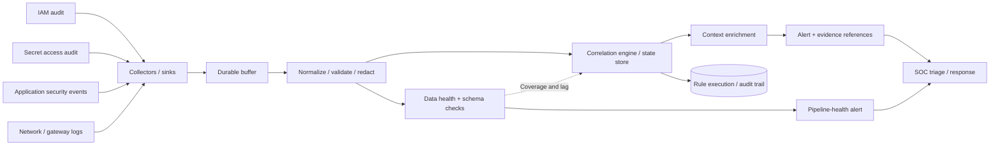
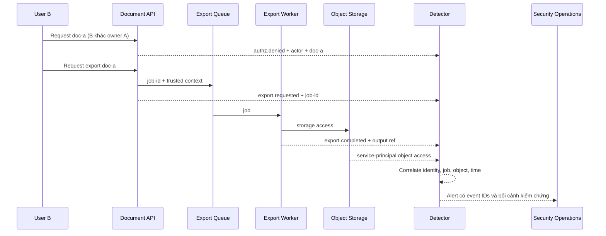
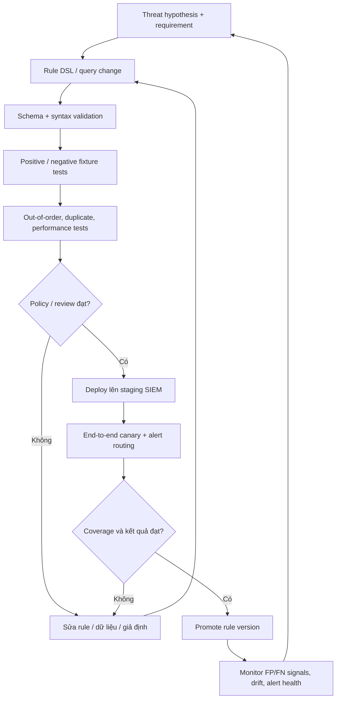

# Correlation rule

Một hệ thống SaaS xử lý tài liệu trên cloud có audit logs cho thay đổi IAM, truy cập secrets, API authorization và job export. Vào lúc 10:02, một identity được cấp vai trò quản trị tạm thời. Đến 10:08, identity đó đọc một secret nhạy cảm. Mỗi sự kiện riêng lẻ có thể hợp lệ: bộ phận vận hành đôi khi cấp quyền khẩn, còn service có thể đọc secret để hoạt động. Nhưng **hai sự kiện xuất hiện theo đúng thứ tự, gần nhau và gắn với cùng identity** lại là tín hiệu đáng xem xét, nhất là nếu không có change ticket hoặc thuộc ngoài lịch bảo trì.

Công cụ chỉ tìm chuỗi chữ `admin` trong log sẽ không lý giải được tình huống này. Đội SOC cần một quy tắc kết hợp các sự kiện, xác minh cùng một chủ thể, đúng thời gian, đúng tài nguyên, kiểm tra ngữ cảnh và phát cảnh báo có thể điều tra. Đó là vai trò của **correlation rule**.

**Correlation rule (quy tắc tương quan)** trong **Detection engineering** là một logic phát hiện **kết hợp từ hai hoặc nhiều sự kiện hoặc nhiều quan sát trong một khoảng thời gian, một phạm vi danh tính/tài nguyên và một điều kiện được xác định**, để nhận diện hành vi có ý nghĩa bảo mật mà từng sự kiện riêng lẻ không đủ để kết luận.

Không phải correlation rule nào cũng cần hai loại log: quy tắc “10 lần đăng nhập thất bại trong 5 phút theo account” cũng tương quan nhiều bản ghi của cùng một loại sự kiện. Có quy tắc xét **chuỗi theo thứ tự**, quy tắc **đếm/tổng hợp**, quy tắc **nhiều nguồn**, hoặc phát hiện **một sự kiện đáng lẽ phải xảy ra nhưng không có** — loại cuối cần đặc biệt thận trọng với sự thiếu log.

Trong module **SECURITY_SECURITY_ASSURANCE**, một correlation rule không chỉ nhằm tạo alert. Rule là một **security control có thể kiểm chứng** trong chuỗi **threat/risk → detection objective → data requirements → correlation logic → test → evidence → finding/response → assurance decision**. Câu hỏi cuối cùng không phải “SIEM đã chạy query chưa?”, mà là “có bằng chứng rule phát hiện được tình huống nó cam kết phát hiện, trong phạm vi dữ liệu đang có, với độ trễ và giới hạn đã biết không?”.

## 1. Correlation rule khác điều kiện lọc log thông thường

Một quy tắc lọc đơn giản kiểm tra **một sự kiện** thỏa điều kiện, chẳng hạn:

- Một request tới admin API bị từ chối.
- Có cloud audit event đổi chính sách IAM.
- Một workload tạo truy cập object storage.
- Một đăng nhập thành công từ vị trí mới.
- Một policy logging bị tắt.

Các sự kiện này có thể đáng chú ý, nhưng để giảm nhiễu và nâng ngữ cảnh, ta thường cần biết **chúng có liên quan tới nhau không**.

### 1.1. Ví dụ hai cấp độ phát hiện

**Single-event detection:** `iam.role_granted` có `role=admin`.

**Correlation detection:** sau `iam.role_granted` cho principal P ở account A, trong 15 phút có `secret.read` thành công do chính P thực hiện trong A, và secret thuộc nhóm nhạy cảm được quản trị.

Rule thứ hai đòi hỏi:
- Hai loại sự kiện được tạo và thu thập đúng.
- Principal **được cấp quyền** trong sự kiện grant trùng với **actor** trong sự kiện đọc; không nhầm với administrator đã cấp quyền.
- Account/tenant/resource scope được xác minh tương thích.
- Thứ tự và khoảng thời gian được tính từ timestamp phù hợp.
- Các bộ lọc quyền/trường dữ liệu không làm mất sự kiện.
- Kết quả đủ rõ để analyst xem xét mà không lộ secret.

**Correlation không tự chứng minh hành vi là tấn công.** Một hoạt động bảo trì hợp lệ cũng có thể khớp. Rule phát tín hiệu để phân tích, kết hợp phê duyệt thay đổi, identity posture, tài nguyên và hành vi trước/sau.

### 1.2. Những khái niệm phải phân biệt

| Khái niệm | Ý nghĩa | Ví dụ |
| --- | --- | --- |
| **Event** | Bản ghi về một hành động/quan sát | `secret.read allowed` |
| **Signal** | Dấu hiệu có thể liên quan rủi ro | Có quyền admin mới được cấp |
| **Detection hypothesis** | Giả thuyết có thể kiểm tra | Identity được nâng quyền rồi đọc secret nhạy cảm cần xem xét |
| **Correlation rule** | Logic kết hợp sự kiện theo quan hệ/thời gian | Grant → read trong 15 phút cùng principal/account |
| **Finding / alert** | Kết quả rule phát ra, chờ triage | Alert có 2 event IDs |
| **Incident** | Sự việc được xác minh/điều tra theo quy trình | SOC xác định truy cập trái phép |
| **Assurance evidence** | Bằng chứng rule hoạt động trong phạm vi | Test fixtures, run ID, alert và version |

Một **alert** không tự là **incident đã xác nhận**; việc một rule không phát alert cũng không tự chứng minh không có hành vi bất thường.

## 2. Vì sao correlation rule cần thiết?

Hành vi tấn công hoặc sai phạm thường gồm nhiều bước. Một sự kiện đơn có thể có tỷ lệ false positive cao, trong khi một chuỗi có ràng buộc rõ giúp phân biệt bối cảnh tốt hơn.

Các mục tiêu điển hình:

1. **Nối nhiều bước:** role grant → privilege use; login thất bại nhiều lần → login thành công; export created → download link used.
2. **Đánh giá tần suất:** nhiều deny, nhiều API requests, nhiều thay đổi rule trong một cửa sổ.
3. **Tìm mối liên hệ xuyên hệ thống:** identity logs + cloud audit + application logs + network telemetry.
4. **Đánh giá hành vi trên baseline:** nguồn mới, điểm đến mới hoặc volume vượt mức bình thường.
5. **Phát hiện mâu thuẫn:** policy yêu cầu deny nhưng audit của thao tác thực tế cho thấy allow.
6. **Giảm cảnh báo rời rạc:** nhiều event được gom thành một alert có timeline và lý do.
7. **Tăng khả năng điều tra:** analyst thấy actor, resource, session, job ID và bằng chứng tương quan.
8. **Liên kết assurance:** test có thể chủ động tạo các event giả lập và xác minh rule nhận diện được.

Tuy nhiên, rule phức tạp không mặc định tốt hơn rule đơn giản. Khi thêm nhiều điều kiện bắt buộc, rule có thể **giảm false positives nhưng tăng false negatives** nếu log thiếu, đến muộn hoặc schema thay đổi. Cần có luận cứ từ threat model và test, không chỉ tối ưu dashboard.

## 3. Phân loại các kiểu tương quan

| Kiểu | Logic tổng quát | Ví dụ | Rủi ro thiết kế |
| --- | --- | --- | --- |
| **Threshold/count** | N sự kiện thỏa điều kiện trong window | 8 login failures cùng account trong 5 phút | NAT/shared users, retries hợp lệ |
| **Distinct count/cardinality** | Có ít nhất K tài nguyên/chủ thể khác nhau | Một principal đọc nhiều secrets khác nhau | Duplicate IDs, automation hợp lệ |
| **Sequence/order** | A xảy ra trước B trong T | Grant quyền → đọc secret | Event đến sai thứ tự |
| **Multi-source join** | A từ nguồn X kết hợp B từ nguồn Y | CI deploy → IAM change | Identity mapping sai |
| **State transition** | Chuyển trạng thái bất thường | Account disabled → privileged action | State snapshot stale |
| **Baseline/deviation** | Độ lệch so với profile đáng tin | Egress destination mới | Cold start, seasonality |
| **Absence/missing event** | Có A nhưng thiếu B trong deadline | Job export xong nhưng không có audit record | Pipeline delay/loss làm sai kết luận |
| **Graph/entity relation** | Liên kết nhiều identity/device/resource | User → role → instance → object access | Join key và ownership sai |

### 3.1. Threshold không chỉ là “nhiều hơn một số”

Rule “5 lần đăng nhập thất bại trong 5 phút” phải định nghĩa:
- Theo **user ID**, IP, device, source network hay tổ hợp?
- 5 là tổng events hay 5 giá trị distinct?
- Cửa sổ sliding hay tumbling?
- Event đến muộn có được tính lại?
- Tài khoản test/monitoring được xử lý ra sao?
- Alert khi vượt ngưỡng lần đầu hay mỗi event tiếp theo?
- Nếu 5 thất bại ở 5 ứng dụng khác nhau thì có cùng scope?

Không rõ các chi tiết này dễ khiến rule chạy khác mong đợi và khó giải thích với SOC.

### 3.2. Sequence cần định nghĩa “trước” bằng thời gian nào

Trong hệ phân tán, event `A` có thể **xảy ra trước** nhưng **đến SIEM sau** event `B`. Engine cần nêu dùng event-time, ingest-time hay processing-time; phương án xử lý out-of-order và độ trễ phải được thử.

### 3.3. Absence detection là trường hợp khó

Ví dụ “có secret read nhưng không có authorization audit tương ứng trong 2 phút”. Nếu audit bị trễ 3 phút, quy tắc có thể báo sai. Để diễn giải đúng cần đảm bảo nguồn bắt buộc, deadline, watermark, pipeline health và có thể nêu kết quả **missing evidence** thay vì kết luận **unauthorized access**.

## 4. Bắt đầu từ detection hypothesis và threat model

Một correlation rule tốt xuất phát từ **tình huống cần phát hiện**, không bắt đầu bằng query có vẻ hấp dẫn.

### 4.1. Detection hypothesis minh họa

> Sau khi principal được cấp quyền quản trị cao, việc principal đó truy cập secret nhạy cảm trong khoảng thời gian ngắn là tín hiệu sử dụng quyền mới cần kiểm tra, trừ khi có bằng chứng hợp lệ về thao tác quản trị đã được phê duyệt.

**Mục tiêu phát hiện:** xác định nhanh chuỗi hành vi có thể biểu thị sử dụng quyền nhạy cảm bất thường.

**Rủi ro liên quan:** cấp quyền quá mức, credential compromise, privilege misuse hoặc sai quy trình break-glass.

**Giả định:** cloud audit ghi được cả role-grant và secret-read với định danh cùng kiểu, timestamp đáng tin và phạm vi account rõ.

**Phản chứng:** hoạt động cấp quyền theo change ticket, bảo trì đã duyệt, service identity được sử dụng đúng quy trình.

**Giới hạn:** rule không biết mọi hình thức privilege misuse, không phát hiện hành vi trước grant, hoặc truy cập secret qua đường không phát ra event cần thiết.

### 4.2. Cấu trúc yêu cầu phát hiện

Một record nên có:
- `DETECT-ID` và owner;
- threat scenario/risk ID và tài sản được bảo vệ;
- mô tả hành vi cần phát hiện;
- nguồn log bắt buộc và event contract;
- correlation keys, điều kiện, cửa sổ thời gian;
- scope (accounts, regions, clusters, tenants);
- severity/confidence dự kiến và enrichment;
- tiêu chí alert, suppression/dedup;
- phương án kiểm thử positive/negative;
- các điều kiện dữ liệu đến muộn, thiếu hoặc không tin cậy;
- nơi lưu rule/version và review approvals;
- runbook, escalation path và bằng chứng.

### 4.3. Tách detection khỏi điều tra và phản ứng

Rule đưa ra **tín hiệu điều tra**, không thay người đánh giá kết luận chủ thể ác ý. Runbook có thể yêu cầu đối chiếu change ticket, owner, lịch bảo trì, vị trí đăng nhập, quyền và ảnh hưởng. Nếu có automation response như khóa account, cần **ủy quyền, điều kiện tin cậy, rollback và giới hạn tác động** riêng.

## 5. Data contract: điều kiện cần để tương quan đúng

Một rule dù logic chính xác vẫn có thể sai nếu các sự kiện nguồn thiếu trường hoặc sai ngữ nghĩa.

### 5.1. Event schema tối thiểu

| Field | Mục đích | Ví dụ và lưu ý |
| --- | --- | --- |
| `event_id` | Định danh bản ghi/dedup | ID cần đủ ổn định, nguồn tin cậy |
| `event_type` | Phân loại sự kiện | `iam.role_granted` hoặc `secret.read` |
| `event_time` | Thời điểm hành động tại nguồn | UTC và nguồn thời gian rõ |
| `ingested_at` | Thời điểm SIEM/collector nhận | Dùng đo lag và out-of-order |
| `cloud_account_ref` | Phạm vi account/project | Không dùng tên account hiển thị tùy ý |
| `environment` | Prod/staging/DR | Tránh trộn false correlation |
| `actor_ref` | Chủ thể thực thi hành động | Principal đã xác thực ở trust boundary |
| `target_principal_ref` | Người được cấp quyền | Khác actor của sự kiện grant |
| `resource_ref` | Tài nguyên bị tác động | Secret/object/service được định danh |
| `action` | Hành động có ngữ nghĩa rõ | Grant, read, export, revoke |
| `outcome` | Thành công/từ chối/lỗi | Không dùng HTTP 200 thay authz decision |
| `request_id / trace_id` | Liên kết các request/spans | Không phải proof of principal |
| `source_system` | Nguồn event | IdP/cloud/API/worker/collector |
| `schema_version` | Quản lý parser | Phát hiện breaking change |
| `trust_level` | Nguồn được xác minh hay user-supplied | Không join trên dữ liệu không đáng tin |

**Không bắt buộc mỗi loại event đều có mọi field**. Nhưng các field rule sử dụng phải có tính hiện diện, loại dữ liệu và semantics được kiểm chứng.

### 5.2. Hai event JSON giả lập

```json
{
  "event_id": "evt-grant-001",
  "event_type": "iam.role_granted",
  "event_time": "2026-01-15T10:02:00Z",
  "ingested_at": "2026-01-15T10:02:09Z",
  "cloud_account_ref": "acct-prod-01",
  "environment": "production",
  "actor_ref": "admin-test-1",
  "target_principal_ref": "svc-export-7",
  "role_ref": "privileged-secret-reader",
  "outcome": "success",
  "source_system": "cloud-identity-audit",
  "schema_version": "1.0"
}
```

```json
{
  "event_id": "evt-secret-002",
  "event_type": "secret.read",
  "event_time": "2026-01-15T10:08:00Z",
  "ingested_at": "2026-01-15T10:08:14Z",
  "cloud_account_ref": "acct-prod-01",
  "environment": "production",
  "actor_ref": "svc-export-7",
  "resource_ref": "secret-ref-sensitive-01",
  "resource_sensitivity": "high",
  "outcome": "allowed",
  "source_system": "secret-manager-data-audit",
  "schema_version": "1.0"
}
```

Hai event này là **dữ liệu mẫu phục vụ học tập**, không phải log có thật. Không chứa secret value, access token hay dữ liệu khách hàng.

**Điểm quan trọng:** trong event cấp quyền, `actor_ref=admin-test-1` là người cấp quyền, còn `target_principal_ref=svc-export-7` mới là người được cấp. Trong event đọc secret, `actor_ref=svc-export-7` là người dùng quyền. Nếu join nhầm grant.actor với read.actor, rule sẽ bỏ qua tình huống đúng hoặc phát alert cho hành vi khác.

### 5.3. Chuẩn hóa danh tính cần tránh nhập nhằng

Một người dùng có thể có các biểu diễn:
- email hiển thị;
- user ID nội bộ;
- cloud principal ID/ARN;
- federated session;
- role assumed bởi workload;
- service account hoặc managed identity.

Không nên nối hai event chỉ vì email hay tên service giống nhau. Identity normalization cần quy tắc đáng tin, xét account/tenant, phiên và thời gian. Một role assumption có thể tạo **session principal** khác identity gốc; muốn correlate cần quan hệ được audit xác thực, không suy đoán bằng chuỗi.

### 5.4. Entity resolution theo scope

**Join key** có thể là `(cloud_account_ref, target_principal_ref)` ở grant và `(cloud_account_ref, actor_ref)` ở read. Với ứng dụng multi-tenant có thể cần thêm `tenant_ref` hoặc `resource_owner_ref`. Không cho phép hai account khác nhau cùng principal name bị gộp thành một.

Nếu principal đổi tên hoặc được migrate, cần bảng ánh xạ có thời điểm hiệu lực. Dùng mapping hiện tại cho log lịch sử có thể gây liên kết sai.

## 6. Cửa sổ thời gian: event-time, processing-time và late events

### 6.1. Window types

| Cửa sổ | Cách hoạt động | Phù hợp với |
| --- | --- | --- |
| **Tumbling window** | Chia thời gian thành khối không chồng lấn | Thống kê hoạt động theo mỗi 5 phút |
| **Sliding/hopping window** | Cửa sổ chồng lấn hoặc trượt theo bước | Burst trong bất kỳ 5 phút |
| **Session window** | Nhóm các event có khoảng cách không vượt idle gap | Một phiên thao tác bất thường |
| **Sequence window** | B tìm thấy trong T sau A và đúng thứ tự | Role grant → secret read |
| **Calendar window** | Theo giờ/ngày hoặc lịch nghiệp vụ | Thay IAM ngoài maintenance window |

Một tumbling window 10:00–10:05 và 10:05–10:10 có thể bỏ sót 5 lỗi xảy ra từ 10:04 đến 10:06 nếu quy tắc đếm theo từng khối. Sliding window có thể phát hiện nhưng tốn state và dễ tạo nhiều alerts trùng.

### 6.2. Event-time khác ingestion-time

- **Event-time:** lúc hành động thực sự xảy ra theo nguồn phát event.
- **Ingestion-time:** lúc collector/SIEM nhận event.
- **Processing-time:** lúc rule engine xử lý event.

Với hai event A xảy ra lúc 10:02 và B lúc 10:08, event B có thể đến trước nếu pipeline của A bị trễ. Một engine chỉ xét thứ tự nhận event có thể không phát hiện chuỗi **A trước B**, dù thứ tự thực tế đúng.

### 6.3. Watermark và allowed lateness

Hệ thống streaming có thể chờ một **allowed lateness** (ví dụ 2 phút) trước khi kết luận cửa sổ đã đủ ổn định. Watermark là cách thể hiện tiến độ event-time mà engine tin rằng phần lớn dữ liệu trước mốc đó đã đến, không phải lời bảo đảm tuyệt đối.

Ví dụ:
- A xảy ra 10:02 nhưng được ingest 10:09.
- B xảy ra 10:08 và được ingest 10:08:14.
- Event-time sequence đúng nhưng arrival order đảo.
- Engine phải hỗ trợ xử lý lại state hoặc chờ watermark phù hợp; nếu không rule có false negative.

Lựa chọn allowed lateness là đánh đổi **độ trễ alert** với **độ bao phủ dữ liệu trễ**. Với control-plane event có SLA đến muộn, có thể cần khoảng đệm dài hơn; với cảnh báo phản ứng khẩn, có thể có early alert và late reconciliation.

### 6.4. Cửa sổ không thay thế clock accuracy

Nguồn event có thể lệch đồng hồ, ghi timestamp client-controlled hoặc dùng local timezone. Phải chuẩn hóa UTC, phân biệt thời gian đáng tin và client-supplied, theo dõi clock skew, và nêu giới hạn nếu không thể bảo đảm thứ tự.

### 6.5. TTL và state cleanup

Correlation engine phải giữ state cho những sự kiện có thể ghép, thường ít nhất bằng window cộng tolerance cho late events theo ngữ nghĩa engine. Giữ state quá ngắn gây missed detections; giữ quá lâu làm tăng memory, chi phí và nguy cơ ghép sai. Sau khi alert, việc xóa hoặc giữ state phải theo quy tắc dedup/suppression được thiết kế.

## 7. Các thành phần cấu thành một rule có thể review

Một correlation rule nên có cấu trúc đủ rõ để người khác kiểm tra:

1. **Rule identity/version:** ID, tên, owner, version và trạng thái.
2. **Hypothesis/requirements:** mối đe dọa và điều muốn nhận diện.
3. **Required sources:** event types, schema versions và data-health requirements.
4. **Filters:** chỉ các events có outcome/role/resource liên quan.
5. **Join/group keys:** identity, account, tenant, resource hoặc session.
6. **Temporal semantics:** window, order, event-time và late arrivals.
7. **Aggregation:** count, distinct count, sum hoặc state transition.
8. **Enrichment:** asset criticality, approved change, user risk, ownership.
9. **Exclusions/suppressions:** điều kiện giới hạn, owner và expiry.
10. **Alert strategy:** lúc nào emit, dedup và alert grouping.
11. **Severity/confidence:** dựa trên điều kiện và ngữ cảnh, không cố định tùy tiện.
12. **Evidence payload:** event IDs, timestamps, source, keys, rule version, explanation.
13. **Tests:** positive, negative, boundary, missing/late/duplicate và performance.
14. **Response/runbook:** ai triage, bước xác minh, escalation và automation có quyền.
15. **Coverage/limitations:** nơi chưa triển khai hoặc chưa có log.

### 7.1. Minh họa rule dạng YAML theo DSL giả định

```yaml
# DSL minh họa học thuật: không phải cú pháp của Sigma, Splunk, KQL,
# Elastic hoặc một SIEM cụ thể. Cần chuyển dịch và kiểm thử theo engine.
correlation_rule:
  id: "DET-IAM-SECRET-001"
  title: "Privileged role granted then sensitive secret read"
  version: "1.0"
  owner: "detection-engineering"
  hypothesis: "Newly granted privileged identity reads sensitive secret"
  scope:
    environments: ["production"]
    cloud_accounts: ["<approved-account-inventory>"]
  inputs:
    grant:
      event_type: "iam.role_granted"
      outcome: "success"
      role_group: "sensitive-privileged-roles"
    read:
      event_type: "secret.read"
      outcome: "allowed"
      resource_sensitivity: "high"
  correlation:
    type: "ordered_sequence"
    steps: ["grant", "read"]
    within: "15m"
    time_field: "event_time"
    allowed_lateness: "2m"
    join:
      - grant.cloud_account_ref: read.cloud_account_ref
      - grant.target_principal_ref: read.actor_ref
    require_same_environment: true
    deduplicate_by: ["grant.event_id", "read.event_id"]
  enrichment:
    - "approved_change_reference"
    - "principal_owner_and_role"
    - "resource_classification"
  alert:
    severity: "high-if-unapproved-and-sensitive"
    state: "candidate_pending_triage"
    grouping_key: ["cloud_account_ref", "principal_ref"]
    suppression: "<reviewed-time-bound-policy>"
    evidence_fields:
      - "grant_event_id"
      - "read_event_id"
      - "event_times"
      - "rule_version"
  on_required_source_unhealthy: "DEGRADED_AND_ALERT_OPERATIONS"
  tests:
    positive: ["DET-IAM-SECRET-001-P01"]
    negative: ["DET-IAM-SECRET-001-N01", "DET-IAM-SECRET-001-N02"]
    temporal: ["DET-IAM-SECRET-001-T01"]
```

Đây là **mẫu mô hình logic**, không được nạp trực tiếp vào một công cụ như thể là schema chuẩn. Các engine có khả năng và semantics khác nhau, đặc biệt về sequence, late events, stream processing, YAML schema và custom enrichment. Rule trên chủ động biểu diễn điều kiện an toàn về **source health** để thiếu log không bị gọi nhầm là “không có hành vi”.

### 7.2. Phân biệt scope, condition và enrichment

- **Scope:** ở account/cluster/tenant nào rule phải hoạt động.
- **Condition:** sự kiện và quan hệ nào bắt buộc để phát alert.
- **Enrichment:** thông tin giúp triage và phân loại ưu tiên.

Không phải mọi enrichment nên là điều kiện bắt buộc. Ví dụ change ticket API tạm lỗi: nếu rule bắt buộc `ticket=unapproved` mới phát alert, nó có thể im lặng vì không lấy được ticket. Có thể phát một alert có trạng thái **approval unknown** và yêu cầu review, thay vì bỏ qua tín hiệu.

## 8. Kiến trúc triển khai một correlation pipeline



Các điểm cần review:
- Nguồn log có thật sự bật ở mọi account/project/region cần thiết?
- Bộ lọc collection có loại nhầm event `iam.role_granted` hoặc `secret.read`?
- Schema version và parser có đồng bộ không?
- State store có đủ TTL, khả năng khôi phục và giám sát lag?
- Nếu một nguồn bị thiếu, rule đánh dấu **DEGRADED** hay im lặng?
- SIEM có ghi phiên bản rule và các event IDs khi phát alert?
- Quyền sửa rule, tắt detector hoặc xóa alert được audit không?
- Có thể replay test dataset để xác minh lại kết quả khi nâng engine không?

### 8.1. Kiến trúc nhiều môi trường

Staging, production và disaster recovery có thể dùng pipelines hoặc destinations khác nhau. Cần ngăn **event test của staging tương quan nhầm với production**. Khóa group nên bao gồm context được xác minh, và data access policy phải giới hạn người xem theo môi trường, tenant và mục đích.

### 8.2. Điều gì xảy ra khi engine bị gián đoạn?

Đánh giá:
1. Buffer có giữ event và giới hạn dung lượng không?
2. Engine có checkpoint state/replay không?
3. Replayed events có làm phát lại alerts?
4. State đã mất có thể được reconstruct từ event log gốc không?
5. Rule versions khi replay có được ghi rõ?
6. Có phát hiện khoảng thời gian không được kiểm tra không?
7. Khi khôi phục, ai xác nhận backlog được xử lý đủ?
8. Có dashboard health và alert tới SOC/Platform?

**Không có alert trong giai đoạn engine down không phải bằng chứng hệ thống không bị tấn công.**

## 9. Logic tương quan dạng SQL minh họa

Một số hệ thống SIEM hỗ trợ truy vấn bảng sự kiện hoặc cách diễn đạt tương tự SQL. Query sau là **SQL-style pseudocode**: tên bảng, JSON extraction, so sánh timestamp và cú pháp có thể phải đổi tùy engine. Nó minh họa rõ **khóa join và khoảng thời gian**.

```sql
-- Minh họa, KHÔNG phải câu lệnh được bảo đảm chạy trên mọi SIEM.
WITH grants AS (
    SELECT
        event_id AS grant_event_id,
        event_time AS granted_at,
        cloud_account_ref,
        environment,
        target_principal_ref AS principal_ref
    FROM normalized_security_events
    WHERE event_type = 'iam.role_granted'
      AND outcome = 'success'
      AND role_ref IN ('privileged-secret-reader', 'platform-admin')
),
reads AS (
    SELECT
        event_id AS read_event_id,
        event_time AS read_at,
        cloud_account_ref,
        environment,
        actor_ref AS principal_ref,
        resource_ref
    FROM normalized_security_events
    WHERE event_type = 'secret.read'
      AND outcome = 'allowed'
      AND resource_sensitivity = 'high'
)
SELECT
    g.grant_event_id,
    r.read_event_id,
    g.cloud_account_ref,
    g.environment,
    g.principal_ref,
    r.resource_ref,
    g.granted_at,
    r.read_at
FROM grants g
JOIN reads r
  ON g.cloud_account_ref = r.cloud_account_ref
 AND g.environment = r.environment
 AND g.principal_ref = r.principal_ref
WHERE r.read_at >= g.granted_at
  AND r.read_at <= g.granted_at + INTERVAL '15' MINUTE;
```

**Ý nghĩa:** một grant thành công cho P được nối với một read do P thực hiện, cùng account/environment, trong 15 phút sau grant. Query chưa xử lý late events, duplicate source records, runtime watermarks, approved change context, severity hoặc suppression; các yêu cầu này thuộc phần thực thi và policy vận hành.

### 9.1. Nếu có nhiều grant trùng nhau

Một read có thể match nhiều grants cho cùng principal. Nếu mỗi match tạo một alert, analyst có thể nhận nhiều cảnh báo cho một hành vi. Cần xác định grouping/dedup strategy, ví dụ một alert theo `(account, principal, secret, risk episode)`, kèm danh sách grants hỗ trợ. Dedupe không được xóa bằng chứng chuỗi thực sự khác nhau.

### 9.2. Nếu role bị thu hồi trước read

Rule ở trên **không kiểm tra hiệu lực quyền tại thời điểm read**. Một role grant rồi revoke trước read có thể vẫn được match theo cửa sổ, dù read thành công qua một quyền khác. Để phát hiện chính xác “sử dụng quyền vừa cấp” cần model trạng thái role, revoke events, trusted effective-permission evidence và cách engine xử lý các thay đổi đan xen. Nếu không có nguồn này, diễn giải alert phải là **temporal association**, không phải quan hệ nhân quả đã được chứng minh.

## 10. Ví dụ thuật toán offline bằng Python để hiểu sequence

Ví dụ dưới đây cố tình đơn giản và **chỉ xử lý một tập sự kiện test đã được chuẩn hóa**. Nó chạy theo event-time sau khi sắp xếp, không có streaming watermark, clock-skew correction, runtime state checkpoint hay production alert routing. Không dùng để thay thế SIEM production.

```python
from datetime import datetime, timedelta, timezone
from collections import defaultdict


def parse_utc(timestamp: str) -> datetime:
    dt = datetime.fromisoformat(timestamp.replace("Z", "+00:00"))
    if dt.tzinfo is None:
        raise ValueError("event_time must include timezone")
    return dt.astimezone(timezone.utc)


def correlate_grant_then_read(events: list[dict]) -> list[dict]:
    window = timedelta(minutes=15)
    grants = defaultdict(list)
    alerts = []

    # Offline replay: sort by trusted event_time, not arrival order.
    ordered = sorted(
        events,
        key=lambda ev: (parse_utc(ev["event_time"]), ev["event_id"])
    )

    seen = set()
    for ev in ordered:
        event_id = ev["event_id"]
        if event_id in seen:
            continue  # Basic duplicate delivery protection.
        seen.add(event_id)

        typ = ev["event_type"]
        t = parse_utc(ev["event_time"])
        account = ev["cloud_account_ref"]
        env = ev["environment"]

        if typ == "iam.role_granted":
            if ev.get("outcome") != "success":
                continue
            if ev.get("role_ref") not in {
                "privileged-secret-reader",
                "platform-admin",
            }:
                continue

            principal = ev["target_principal_ref"]
            grants[(account, env, principal)].append((t, event_id))

        elif typ == "secret.read":
            if ev.get("outcome") != "allowed":
                continue
            if ev.get("resource_sensitivity") != "high":
                continue

            principal = ev["actor_ref"]
            key = (account, env, principal)

            for granted_at, grant_event_id in grants.get(key, []):
                if granted_at <= t <= granted_at + window:
                    alerts.append({
                        "rule_id": "DET-IAM-SECRET-001",
                        "grant_event_id": grant_event_id,
                        "read_event_id": event_id,
                        "account": account,
                        "environment": env,
                        "principal": principal,
                        "resource_ref": ev["resource_ref"],
                    })

    return alerts
```

**Giới hạn có chủ đích:** cách lưu `grants` trên đây không có TTL/state eviction, không có dedup ở cấp alert, không xử lý revoke, không xác minh nguồn/schema và có thể phát nhiều match cho cùng read. Nó phù hợp làm **mô hình tham chiếu để test logic**, không được triển khai trực tiếp trên dòng log production có độ lớn không giới hạn.

### 10.1. Test fixture nhỏ

```python
sample = [
    {
        "event_id": "r1",
        "event_type": "secret.read",
        "event_time": "2026-01-15T10:08:00Z",
        "cloud_account_ref": "acct-prod-01",
        "environment": "production",
        "actor_ref": "svc-export-7",
        "resource_ref": "sensitive-test-secret",
        "resource_sensitivity": "high",
        "outcome": "allowed",
    },
    {
        "event_id": "g1",
        "event_type": "iam.role_granted",
        "event_time": "2026-01-15T10:02:00Z",
        "cloud_account_ref": "acct-prod-01",
        "environment": "production",
        "target_principal_ref": "svc-export-7",
        "role_ref": "privileged-secret-reader",
        "outcome": "success",
    },
]

alerts = correlate_grant_then_read(sample)
assert len(alerts) == 1
assert alerts[0]["grant_event_id"] == "g1"
assert alerts[0]["read_event_id"] == "r1"
```

Ở fixture này, phần tử `r1` được đặt **trước** `g1` trong list để minh họa thứ tự nhận không trùng event-time. Hàm offline sắp xếp đúng thứ tự thời gian và tạo một alert. Trong streaming thực, phải có policy về late arrival thay vì mặc định mọi event đã sẵn sàng để sort.

### 10.2. Test phủ định cần bổ sung

- Read xảy ra **trước** grant → không match.
- Read cách grant **hơn 15 phút** → không match.
- Account hoặc environment khác → không match.
- Principal tên giống nhưng ID thực khác → không match.
- Grant không thành công hoặc không thuộc privileged roles → không match.
- Read bị từ chối hoặc resource không thuộc nhóm nhạy cảm → không match.
- Duplicate event ID → không tạo alert nhân đôi.
- Event thiếu field bắt buộc → validation error/degraded, không âm thầm suy default.
- Event nguồn chưa đến → trạng thái nguồn chưa đủ coverage, không gọi là negative proof.
- Revoke xuất hiện giữa hai event → cần model trạng thái nếu detection claim đòi hỏi quyền đang hiệu lực.

## 11. Use case khác: thất bại đăng nhập rồi thành công

Một correlation rule phổ biến nhận diện nhiều lần login thất bại và sau đó login thành công. Đây có thể là dấu hiệu credential guessing hoặc người dùng nhập sai mật khẩu nhiều lần rồi đăng nhập đúng.

### 11.1. Định nghĩa minh họa

> Với cùng account identity, nếu có ít nhất 8 lần xác thực thất bại trong cửa sổ trượt 5 phút, sau đó có login thành công trong 3 phút tiếp theo, tạo alert có bối cảnh IP/device, mức rủi ro identity và các bằng chứng liên quan.

Phải làm rõ:
- Cửa sổ “8 thất bại” tính theo user hay username string?
- Thành công phải cùng source IP hay cùng identity là đủ?
- MFA/step-up challenge có được coi là login success hoàn chỉnh không?
- User đã disable hoặc bị lockout có thể phát event nào?
- Retries do client/IdP có tạo nhiều bản ghi cho một attempt không?
- IP NAT dùng chung có làm sai correlation không?
- Có dịch vụ health check hoặc test identity được duyệt không?
- Source event có được gửi tới SIEM trong mọi region/tenant không?

### 11.2. Không chỉ dùng source IP làm identity

Một công ty có hàng trăm người dùng sau cùng NAT; attacker cũng có thể thay IP. Correlate chỉ theo IP có thể ghép hành vi của nhiều user, gây false positives. Theo username thuần cũng có vấn đề rename/case normalization. Nên dùng identity ID được hệ thống xác nhận, kết hợp source context khi giúp phân tích.

### 11.3. Threshold có thể bị “tối ưu” sai

Tăng ngưỡng đến mức gần như không còn alert có thể giúp dashboard sạch nhưng tăng false negatives. Giảm ngưỡng quá thấp có thể gây alert fatigue. Ngưỡng nên được chọn từ threat model, test data, hoạt động bình thường và mức độ rủi ro; được review theo phiên bản và thời gian.

## 12. Use case SaaS multi-tenant: denied access, export và data flow

Giả sử hệ thống SaaS có:
- `tenant-a` và `tenant-b`;
- user B đăng nhập hợp lệ thuộc B;
- `doc-a` có owner tenant A;
- API đọc/tải tài liệu;
- queue, export worker và object storage;
- application authorization logs, export events, gateway logs và cloud storage audit.

### 12.1. Detection hypothesis

> User B liên tục thử truy cập tài liệu ngoài quyền, sau đó có export job hoặc download output liên quan cùng object ngoài tenant. Đây là tín hiệu cần kiểm tra nguy cơ object-level authorization bị bypass hoặc luồng xử lý bất đồng bộ thiếu kiểm soát.

Một điều kiện **“download allowed”** không tự chứng minh vi phạm. Để khẳng định cross-tenant, phải có **trusted ownership mapping** hoặc audit record về quyết định quyền ở tầng nghiệp vụ. Tài nguyên có thể được chia sẻ hợp lệ qua chính sách; cần đối chiếu share grants và hiệu lực của chúng tại thời điểm truy cập.

### 12.2. Một event flow cần tương quan



Sơ đồ minh họa **một chuỗi sự kiện có thể quan sát**, không khẳng định hệ thống đang có lỗi. Một detector không nên gửi cảnh báo tới người dùng B trong vai trò phản ứng tự động nếu chính sách không yêu cầu; đầu ra của rule là evidence/alert cho đội có thẩm quyền. Trong thực tế, `export.completed` có thể là hợp lệ vì job đã lọc tài liệu không được phép; phải xem output và decision trong ngữ cảnh an toàn.

### 12.3. Những khóa tương quan

| Nguồn | Join key đề xuất | Cảnh báo |
| --- | --- | --- |
| User session/API | Trusted principal ID, tenant, request ID | Không tin client-supplied tenant header |
| Document access | Object ID, object owner tenant, policy version | Owner mapping phải có thời điểm hiệu lực |
| Export job | Job ID, requester, approved object scope | Không tin job payload do client tự tạo |
| Worker | Job ID, workload identity, processing outcome | Worker identity không phải end-user identity |
| Object storage | Cloud principal, object reference, request context | Storage log không luôn có user cuối |
| Detection engine | Normalized actor/tenant/job/resource relationships | Chỉ join khi mapping đáng tin |

### 12.4. Giới hạn claim

Một correlation rule có thể giúp SOC phát hiện chuỗi bất thường nhanh hơn; nó **không thay thế authorization controls và regression tests**. Nếu API trả data sai quyền, phải sửa root cause. Không dùng việc “SIEM sẽ cảnh báo” để bù cho đường truy cập trái quyền được xem là chấp nhận mặc định.

## 13. Enrichment: biến sự kiện rời thành bối cảnh

Correlation đúng keys vẫn có thể ồn. **Context enrichment** đưa thêm thông tin liên quan để phân tích.

### 13.1. Các nguồn enrichments hữu ích

- Asset criticality và data classification.
- Human/workload owner, team và environment.
- Privileged role sensitivity.
- Change ticket, maintenance window hoặc approved deployment.
- Known automation/expected service behavior có owner.
- Account posture, MFA/context từ IdP theo phạm vi.
- Resource ownership, allowed sharing và policy effective date.
- Prior detections/incident history, nếu hợp pháp và có quyền.
- Source pipeline health, lag và data quality.
- Network destination classification khi có ý nghĩa.

### 13.2. Enrichment có thể sai hoặc lỗi thời

Nếu CMDB nói service account thuộc team cũ, rule có thể gửi alert sai người. Nếu change API không hoạt động, rule có thể coi mọi hoạt động là “unapproved” hoặc bỏ qua. Phải quy định **fallback**, ghi version/time của context, và tách **missing enrichment** khỏi **evidence of maliciousness**.

### 13.3. Không để tín hiệu sơ bộ thành kết luận chắc chắn

Ví dụ event từ địa chỉ IP “lạ” chỉ là yếu tố tăng mức ưu tiên; geo-IP có thể sai, VPN/NAT ảnh hưởng kết quả. Risk scoring cần giải thích được đóng góp của từng yếu tố, tránh dùng một nhãn có tính suy diễn như “attacker=true” khi không có evidence.

## 14. Suppression, dedup và alert grouping

Một rule đúng nhưng phát 1.000 alert tương đương có thể làm SOC bỏ lỡ trường hợp nghiêm trọng.

### 14.1. Phân biệt ba cơ chế

| Cơ chế | Mục đích | Rủi ro |
| --- | --- | --- |
| **Deduplication** | Loại event/alert trùng do delivery hoặc replay | Gộp nhầm các hành vi độc lập |
| **Alert grouping** | Gom các match liên quan vào một incident/case | Mất sequence details nếu không giữ IDs |
| **Suppression/exclusion** | Giảm alert với hành vi đã được phê duyệt | Che hành vi thật nếu rộng hoặc hết hạn |

### 14.2. Suppression cần quản trị

Một suppression record nên có:
- Rule ID/version và scope;
- principal/resource/role chính xác;
- lý do, người đề nghị và risk owner;
- bắt đầu/kết thúc;
- evidence của hoạt động hợp lệ;
- cơ chế theo dõi khi suppression hoạt động;
- ngày review và điều kiện thu hồi.

**Không đặt suppression toàn cục vô thời hạn chỉ để giảm số alert.** Nếu một workload thường xuyên cấp và sử dụng quyền nhạy cảm, tốt hơn cân nhắc sửa thiết kế quyền hoặc tối ưu detection theo yêu cầu nghiệp vụ.

### 14.3. Giữ raw evidence để điều tra

Sau khi grouping, alert vẫn nên có:
- Event IDs từ các nguồn;
- timestamps và thứ tự;
- correlation keys;
- matched conditions và window;
- rule version;
- enrichment/suppression decisions;
- links tới events được quản trị quyền.

Không cần đưa secret values, request bodies hay toàn bộ dữ liệu khách hàng vào alert chỉ để làm đẹp kết quả.

## 15. False positive, false negative và detection quality

### 15.1. Ma trận kết quả

| Thực tế / Rule | Có alert | Không alert |
| --- | --- | --- |
| Hành vi cần phát hiện xảy ra | True positive (TP) | False negative (FN) |
| Hành vi cần phát hiện không xảy ra | False positive (FP) | True negative (TN) |

Cần phân biệt **khớp điều kiện rule** với **hành vi độc hại được xác nhận**. Một match có thể đúng logic và phản ánh một hoạt động hợp lệ. Có thể theo dõi:
- **Precision** = TP / (TP + FP): tỷ lệ cảnh báo đúng theo ground truth đánh giá.
- **Recall** = TP / (TP + FN): tỷ lệ tình huống thật được phát hiện, nếu có ground truth đủ.
- **False positive rate** = FP / (FP + TN): cần tập negative cases.
- **Time to detect**: từ lúc hành vi xảy ra đến lúc alert sẵn sàng.
- **Alert volume**, distinct entities affected và analyst workload.

### 15.2. Không tự tính recall production từ số alert

Một SIEM không biết số hành vi chưa phát hiện trong thực tế, nên khó xác định FN thực tế. Có thể đo **recall trên bộ kiểm thử có gắn nhãn / attack simulation được phê duyệt**, nhưng phải nói rõ đó là **controlled test recall**, không phải tỷ lệ phát hiện mọi tấn công ngoài đời.

### 15.3. Ví dụ diễn giải số liệu

Giả sử trong một đợt đánh giá có 40 alert đã triage, 12 được đánh giá đúng theo detection objective và 28 là false positives. Precision trên **tập đã triage đó** là 12/40 = 30%. Nếu 5 trong số 40 alert chưa được review, không được lấy nhãn mặc định cho 5 alert để tính như đã xác nhận.

Ngược lại, rule chỉ có 2 alert một tháng và cả hai đúng không chứng minh recall cao: rất có thể một nguồn log chưa được thu thập hoặc threshold quá chặt.

### 15.4. False negatives do data quality

Nguồn mất log, parser gãy schema, timestamp lệch hoặc identity mapping sai có thể làm rule bỏ sót dù điều kiện logic đúng. Cần quản lý **detection coverage** cùng **data source health**, không chỉ chỉnh query.

## 16. Thiết kế bộ kiểm thử cho correlation rule

Một rule nên có **test suite theo event fixtures** và khi có thể **end-to-end verification** trong môi trường được phép.

### 16.1. Test matrix cho `DET-IAM-SECRET-001`

| Test ID | Dữ liệu/điều kiện | Kết quả mong đợi |
| --- | --- | --- |
| `P01` | Privileged grant rồi sensitive read 6 phút sau cùng account/principal | Có alert |
| `P02` | Read đến SIEM trước grant nhưng event-time đúng, trong allowed lateness | Có alert nếu engine hỗ trợ như thiết kế |
| `N01` | Read xảy ra trước grant | Không match sequence |
| `N02` | Read cách grant 16 phút | Không match cửa sổ 15 phút |
| `N03` | Principal khác hoặc account khác | Không match |
| `N04` | Grant failed hoặc role không nhạy cảm | Không match |
| `N05` | Secret read denied | Không match rule “allowed read” |
| `N06` | Resource không nhạy cảm | Không match rule |
| `D01` | Duplicate delivery cùng event IDs | Không tạo duplicate alerts |
| `D02` | Một read match nhiều grants | Group/dedup theo policy, giữ toàn evidence |
| `T01` | Ở chính ranh giới 15 phút | Match hoặc không match theo so sánh định nghĩa trước |
| `T02` | Event đến sau allowed lateness | Theo late-event policy, ghi gap/reconciliation |
| `S01` | Thiếu required field `target_principal_ref` | Reject/degraded, không ghép bừa |
| `S02` | Event schema version mới | Parser/test contract báo đúng hoặc fail rõ |
| `H01` | Mất nguồn data-access log | Source health alert, rule coverage degraded |
| `E01` | Change-ticket enrichment unavailable | Alert có `approval_unknown`, không tự suppress |
| `R01` | Replay cùng dataset qua hai lần chạy | Kết quả ổn định và không tạo alert trùng trái policy |

### 16.2. Positive test và negative test cần cả preconditions

Test positive phải chứng minh hai events thực sự có field/actor/role/resource như yêu cầu. Negative test phải đủ dữ liệu để **chỉ một điều kiện bị thay**, giúp người review biết vì sao rule không match.

Ví dụ nếu `N03` vừa đổi account, vừa đổi principal, vừa đổi role thì không biết điều kiện nào đã ngăn match. Nên có riêng các ca:
- khác account, principal giống;
- cùng account, principal khác;
- khác environment;
- actor được cấp quyền không phải actor đọc.

### 16.3. Test riêng boundary và timestamp

Với window tối đa 15 phút và phép so sánh `<=`, read tại đúng 15 phút sẽ match; sau 15 phút một phần nhỏ sẽ không match. Khi chuyển rule giữa engines, làm rõ độ chính xác timestamp (milliseconds, seconds) và timezone để tránh behavior thay đổi.

### 16.4. Replay test không thay end-to-end test

Replay vào function hoặc query kiểm logic rule. End-to-end test tạo event được phép ở nguồn cloud/IdP và xác minh collector, parser, correlation, alert routing tới SOC. Cả hai cần thiết khi claim bao gồm đường phát hiện vận hành, nhưng phải cân bằng với tác động và tính sẵn có của test environment.

### 16.5. Test không dùng tài khoản thật hoặc secret thật

Có thể phát các **synthetic events được gắn nhãn test** hoặc dùng test identity/sandbox được cấp. Không tự tạo privilege grant trong production chỉ để xem alert có chạy, trừ khi có kế hoạch/ủy quyền phù hợp. Khi cần test read secret, dùng **test secret giá trị giả**, tránh tiết lộ dữ liệu bảo mật.

## 17. Rule-as-code và CI/CD

Correlation rules nên được quản lý như code: có version, review, tests, promotion và rollback.



### 17.1. Gate nên kiểm tra gì?

- Rule có ID, owner, hypothesis, source requirements và version.
- Event schema/field names hợp lệ với parser hiện tại.
- Positive/negative/boundary tests đạt.
- Late/out-of-order behavior được mô tả và test.
- Duplicate/suppression không che findings rủi ro cao.
- Nguồn bắt buộc có coverage và pipeline health.
- Engine query không vượt giới hạn chi phí/capacity theo budget.
- Severity/runbook/alert routing được review.
- Test deployment không đọc hoặc làm lộ raw sensitive data.
- Query/rule đã được kiểm thử trên engine và data model thực tế.
- Nếu test/collector lỗi, trạng thái `INCOMPLETE` hoặc `BLOCK` theo policy, không thành PASS.

### 17.2. Phân biệt các mức kiểm thử rule

| Mức | Kiểm chứng | Không tự chứng minh |
| --- | --- | --- |
| **Static lint** | Syntax/schema/required metadata | Logic phát hiện đúng |
| **Fixture replay** | Rule match những trường hợp có nhãn | Nguồn cloud đang gửi log |
| **Staging SIEM run** | Query chạy trên engine và data model | Production scope cũng giống staging |
| **End-to-end canary** | Event nguồn đến alert | Bắt được mọi tình huống thực tế |
| **Production health monitoring** | Rule đang chạy, nguồn có dữ liệu | Không còn false negatives |
| **Adversary emulation có phép** | Một kịch bản threat được nhận diện | Bao phủ mọi biến thể tấn công |

### 17.3. Chống sửa rule trái phép

Nếu contributor có thể xóa correlation rule hoặc tăng threshold để bypass detection mà không có review, chương trình mất tính tin cậy. Nên dùng branch protection, least privilege đối với SIEM, peer review, audit thay đổi, cấu hình rollback và alert khi detector bị tắt.

## 18. Hiệu năng, scale và chi phí tương quan

Correlation có thể cần giữ nhiều state theo account, principal, tenant, resource và thời gian.

### 18.1. High-cardinality joins

Một rule giữ state theo mỗi `(tenant, principal, document)` trong hệ thống nhiều triệu đối tượng có thể tốn memory lớn. Cần:
- Chọn khóa phù hợp với detection objective.
- Giới hạn scope và thời gian.
- TTL/state eviction theo window/late policy.
- Phân vùng dữ liệu, kiểm tra skew giữa keys.
- Tránh join cross-product không có khóa tin cậy.
- Dùng pre-aggregation khi giữ được ý nghĩa.
- Có giới hạn memory/latency và cảnh báo degraded.
- Test workload cao nhưng có phép, không tác động production tùy tiện.

### 18.2. Rule đếm event cần chống duplicate

Khi collector retry, cùng event có thể xuất hiện hai lần. Nếu rule đếm 8 login failures, 4 requests được gửi hai lần có thể bị đếm thành 8 và gây false alert. Cần event IDs/normalization đáng tin hoặc phương án dedup theo semantics; đừng loại nhầm các attempts thật khác nhau chỉ vì cùng message text.

### 18.3. Hot keys và skew

Một shared service principal hoặc gateway có thể có rất nhiều events, khiến một partition chậm và late events tăng. Cần giám sát cardinality, lag, state size và throughput theo rule; lựa chọn partitioning không được phá nguyên tắc join keys.

### 18.4. Tối ưu chi phí không đồng nghĩa bỏ event bắt buộc

Sampling/aggregation có thể thích hợp cho telemetry khối lượng lớn, nhưng nếu một detection objective dựa vào mọi lần đổi quyền, bỏ ngẫu nhiên sự kiện có thể làm hỏng sequence. Chính sách sampling phải nêu rõ giới hạn và data source requirements.

## 19. Vận hành rule: từ alert đến triage

Một alert hữu ích cần đủ thông tin để analyst kiểm tra mà không phải tìm hiểu toàn bộ pipeline.

### 19.1. Alert payload tối thiểu

- Rule ID/version, detection hypothesis và severity/confidence.
- Correlation key: principal/account/environment/resource.
- Timeline: events A và B với event-time và ingest-time khi cần.
- Source names và event IDs/raw references được bảo vệ.
- Window/conditions đã match.
- Enrichment: resource criticality, change approval context.
- Data health: liệu nguồn có đủ coverage/lag không.
- Các exceptions/suppressions đã áp dụng.
- Hướng dẫn triage, owner và escalation.
- Bằng chứng cần giữ và những thông tin chưa biết.

### 19.2. Các bước triage mẫu

1. Kiểm tra event IDs/timestamps và cùng account/principal.
2. Xác nhận grant thực sự cấp quyền có hiệu lực hay chỉ là yêu cầu thất bại.
3. Xem secret read có thành công và tài nguyên nhạy cảm không.
4. Đối chiếu change ticket và approved admin session.
5. Xem identity posture, ownership, network context và hành vi tiếp theo.
6. Kiểm tra data gaps hoặc mapping sai gây false positive.
7. Đánh giá impact, containment và escalation theo runbook.
8. Ghi disposition: confirmed, benign authorized, false positive, inconclusive.
9. Nếu có hành vi nguy hiểm, giao owner và xử lý theo incident/vulnerability process.
10. Đưa pattern cần bổ sung vào rule regression suite.

### 19.3. Không tự động khóa principal vì một correlation chưa xác minh

Auto-response có thể phù hợp với một số trường hợp có confidence cao, nhưng cần risk owner, phê duyệt, khả năng rollback, các điều kiện loại trừ account critical và việc ghi audit. Một rule có false positives ở service account có thể gây gián đoạn toàn hệ thống nếu tự khóa quyền.

## 20. Assurance: Claim – Argument – Evidence

Trong **SECURITY_SECURITY_ASSURANCE**, detection engineering cung cấp bằng chứng **khả năng quan sát và phản ứng với một lớp hành vi**, không phải bằng chứng rằng chính hành vi ấy không bao giờ xảy ra.

### 20.1. Claim có giới hạn

> **CLM-DET-CORR-01:** Đối với các cloud accounts, event sources và môi trường được xác định, correlation rule `DET-IAM-SECRET-001` phát hiện được kịch bản cấp privileged role rồi truy cập secret nhạy cảm trong cửa sổ được định nghĩa ở những điều kiện đã kiểm thử; rule có giám sát sức khỏe nguồn dữ liệu, routing alert và quản lý thay đổi.

Claim này **không** khẳng định mọi hành vi lạm dụng IAM đều bị phát hiện hoặc tổ chức không có nguy cơ compromise.

### 20.2. Argument cần hỗ trợ claim

1. Rủi ro/hypothesis có mô tả rõ và mapping requirement.
2. Data source inventory có owner, account/region scope và schema.
3. Actor/target mapping và correlation keys là đáng tin.
4. Event-time/window/late event semantics được xác định.
5. Positive/negative/boundary/duplicate tests được thực hiện.
6. Rule chạy trên SIEM được deploy, không chỉ trên mô phỏng code.
7. Có end-to-end canary hoặc evidence nguồn → alert trong phạm vi.
8. Source/data health được giám sát; missing logs không thành clean finding.
9. Enrichment, suppression và exception có review và hạn.
10. Alerts có runbook, routing, triage và audit trail.
11. Findings, limitations và residual risk được ghi minh bạch.
12. Rule thay đổi có CI/review/regression và kiểm chứng theo release.

### 20.3. Evidence matrix

| Evidence ID | Hiện vật | Hỗ trợ | Giới hạn |
| --- | --- | --- | --- |
| `EV-CORR-01` | Threat scenario và detection hypothesis | Vì sao cần rule | Không chứng minh hiệu quả |
| `EV-CORR-02` | Source inventory và data contract | Nguồn/field dự kiến | Có thể khác runtime |
| `EV-CORR-03` | Rule-as-code commit/version/review | Logic được quản trị | Không chứng minh engine chạy đúng |
| `EV-CORR-04` | Schema + normalized event samples | Các field join tồn tại | Chưa chứng minh mọi source |
| `EV-CORR-05` | Positive/negative/boundary test run | Match các kịch bản cụ thể | Không đại diện mọi hành vi thực |
| `EV-CORR-06` | Late/duplicate/replay tests | Engine xử lý tình huống dữ liệu đặc biệt | Phụ thuộc vận hành/lag thực tế |
| `EV-CORR-07` | SIEM deployment và runtime config | Rule version có hiệu lực | Snapshot chỉ tại thời điểm |
| `EV-CORR-08` | End-to-end synthetic/canary event + alert | Đường nguồn đến SOC vận hành | Một canary không chứng minh mọi event |
| `EV-CORR-09` | Source-health/lag/drop monitoring | Có cơ chế nhận biết mất coverage | Blind spots có thể còn |
| `EV-CORR-10` | Alert triage/runbook và response history | Alert có quy trình xử lý | Triage quality phụ thuộc người/nguồn |
| `EV-CORR-11` | Exceptions/suppressions, expiry, approvals | Giảm nhiễu có quản trị | Có thể che tín hiệu thực |
| `EV-CORR-12` | Findings/remediation/retest | Vòng cải thiện được thực hiện | Không bảo đảm mọi finding đã đóng |

### 20.4. Hồ sơ assurance bằng YAML

```yaml
detection_correlation_assurance:
  claim_id: "CLM-DET-CORR-01"
  service: "SECURITY_SECURITY_ASSURANCE"
  detection_rule:
    id: "DET-IAM-SECRET-001"
    version: "<git-tag-or-commit>"
    owner: "<detection-owner>"
    hypothesis_ref: "<risk-and-threat-id>"
  scope:
    environment: "production"
    cloud_accounts: ["<account-inventory>"]
    regions: ["<evaluated-regions>"]
    exclusions: ["<not-evaluated-scope-and-reason>"]
  event_requirements:
    source_inventory_ref: "<sources-and-owners>"
    schemas_ref: "<normalized-data-contract>"
    identity_mapping_ref: "<trusted-identity-correlation>"
    pipeline_health_ref: "<lag-and-drop-metrics>"
  correlation:
    join_keys_ref: "<reviewed-logic>"
    window: "15m"
    time_basis: "event_time"
    lateness_policy_ref: "<lateness-and-replay-policy>"
    suppression_policy_ref: "<versioned-exceptions>"
  tests:
    fixtures_version: "<fixture-version>"
    positive_results_ref: "<test-run>"
    negative_results_ref: "<test-run>"
    boundary_and_late_results_ref: "<test-run>"
    replay_and_dedup_results_ref: "<test-run>"
    end_to_end_alert_ref: "<redacted-canary-evidence>"
  deployment:
    siem_environment_ref: "<engine-instance>"
    deployed_rule_version: "<verified-version>"
    routing_test_ref: "<case-and-runbook-check>"
    effective_at: "<UTC-timestamp>"
  operations:
    runbook_ref: "<approved-runbook>"
    monitoring_ref: "<rule-health-dashboard>"
    analyst_review_ref: "<triage-evidence>"
  findings:
    open: ["<finding-id>"]
    verified_fixed: ["<finding-id>"]
    approved_exceptions: ["<exception-id>"]
  assurance_decision:
    status: "<pass|block|needs-review|conditional>"
    reviewer: "<authorized-reviewer>"
    decided_at: "<UTC-timestamp>"
    limitations: ["<remaining-unknowns>"]
    residual_risk: "<risk-description>"
```

Đây là **mẫu hồ sơ học thuật**, không phải định dạng tiêu chuẩn của SIEM và không phải chứng cứ đã được tạo. Các references phải dẫn tới hiện vật thật, có thời điểm, quyền truy cập và cơ chế bảo vệ tính toàn vẹn phù hợp.

## 21. Traceability từ rủi ro đến detector

```mermaid
flowchart LR
    R["Risk / threat scenario"] --> D["Detection objective"]
    D --> S["Required event sources"]
    S --> C["Schema + identity contract"]
    C --> RULE["Correlation rule + window"]
    RULE --> TEST["Positive / negative / late tests"]
    TEST --> E["Runtime alerts + evidence"]
    E --> F["Triage / finding / response"]
    F --> A["Assurance claim + residual risk"]
    A --> M["Drift / change-triggered revalidation"]
    M --> S
```



Không nên gắn link rule query vào security requirement rồi kết luận “requirement đạt”. Reviewer phải biết **rule phát hiện chuyện gì**, các events có thật, test nào đã chạy, những paths/regions nào chưa được bao phủ và SOC có thể tiếp nhận alert hay không.

## 22. Continuous detection engineering: thay đổi và drift

### 22.1. Những thay đổi cần revalidate rule

- Cloud account, region, tenant hoặc service mới.
- Thay tên event/field hoặc schema version.
- Thay Identity Provider hoặc cách chuẩn hóa principal.
- Bật/tắt data-access audit hoặc thay event selectors.
- Thay pipeline, sink, SIEM parser, route hoặc retention.
- Migration cloud/Kubernetes/workload identity.
- Thay role definitions, IAM policies, resource sensitivity.
- Thay thời gian ingest do network/collector.
- Thay thresholds, windows, suppressions hoặc enrichments.
- Cập nhật detection engine và query semantics.
- Phát hiện false positive/false negative mới.
- Incident có pattern chưa được rule phát hiện.
- Thay change approval workflow hoặc chủ sở hữu tài nguyên.

### 22.2. Detector coverage phải theo phạm vi

Tổ chức có thể đã triển khai rule ở SIEM nhưng thiếu nguồn `secret.read` tại một account hoặc region. Cần ghi **degraded coverage**, không báo “rule healthy” chỉ vì job scheduler chạy mỗi phút.

### 22.3. Chủ sở hữu và trách nhiệm

| Vai trò | Trách nhiệm chính |
| --- | --- |
| **Detection engineer** | Hypothesis, logic, tests, version, tuning |
| **Source owner / cloud team** | Audit categories, event selectors, source health |
| **Data engineering / SIEM owner** | Ingestion, parser, state, scale, access, deployment |
| **IAM / asset owner** | Identity mapping, role semantics, sensitive resources |
| **SOC analyst** | Triage, feedback, runbook, disposition |
| **Threat intelligence / security architect** | Threat scenario và expected behavior |
| **Privacy/data owner** | Data minimization, access, retention, tenant separation |
| **Risk owner** | Approval ngoại lệ và residual risk |
| **Assurance reviewer** | Evidence và giới hạn của claim |

Một người có thể kiêm nhiều vai trò, nhưng không nên mặc định tác giả rule có thể tự bỏ rule critical khỏi production và tự chấp nhận rủi ro không cần review.

## 23. Metrics để quản trị correlation rules

| Metric | Câu hỏi | Cảnh báo diễn giải |
| --- | --- | --- |
| **Required-source coverage** | Account/tenant/region nào có đủ event types? | Có pipeline nhưng chưa chắc có events |
| **Data freshness / ingestion lag** | Event đến trễ bao lâu? | Event-time khác processing-time |
| **Schema validation failures** | Field nào thiếu/đổi version? | Parser lỗi có thể tạo FN |
| **Rule evaluation success** | Engine có xử lý mà không lỗi? | Job running không chứng minh match đúng |
| **Canary detection rate** | Test scenarios bắt buộc có tạo alert? | Chỉ đại diện tình huống thử |
| **Alert precision on triaged set** | Cảnh báo đúng trong tập đã xác nhận? | Mẫu đánh giá có thể thiên lệch |
| **Controlled scenario recall** | Bộ tình huống gắn nhãn có được phát hiện? | Không suy rộng production recall |
| **Time to detect (P50/P95)** | Độ trễ từ hành vi đến alert? | Phải kiểm soát clock skew |
| **Duplicate alert ratio** | Một hành vi có nhiều alerts trùng? | Dedupe quá mạnh có thể che events |
| **Suppression debt** | Exception nào rộng, hết hạn hoặc không còn owner? | Tắt rule không phải fix |
| **State/compute cost** | Rule có chiếm tài nguyên quá mức? | Tối ưu không được bỏ mandatory events |
| **Missed-detection findings** | Incident nào đáng lẽ rule phải thấy? | Cần source-level root cause |
| **Rule change lead time** | Từ hypothesis/fix đến deploy test được? | Nhanh không thay review |
| **Detection coverage gaps** | Threat paths nào chưa có kiểm tra hoặc dữ liệu? | Zero alerts không có nghĩa zero threats |

Một dashboard với “0 alerts” có thể là dấu hiệu tốt hoặc là **một detector đã bị tắt**, mất source hoặc bị suppression. Luôn đọc cùng coverage, health, canary và test freshness.

## 24. Sai lầm thường gặp

| Anti-pattern | Hậu quả | Cách cải thiện |
| --- | --- | --- |
| Join theo email hiển thị hoặc tên workload | Nhầm actor, gộp identity khác nhau | Trusted stable IDs và scope |
| Join grant.actor với read.actor | Nhầm người cấp với người nhận quyền | Phân biệt actor và target principal |
| Quên account/environment trong key | Ghép chéo account/tenant | Composite keys |
| Chỉ dùng ingestion order | Miss sequence do late events | Event-time, watermark/replay policy |
| Tumbling window cho burst qua ranh giới | Bỏ sót tín hiệu | Chọn sliding window khi cần |
| Đếm duplicate events như attempts mới | False positive và alert fatigue | Stable event ID/dedup |
| Suppress toàn bộ admin account | Che privilege misuse thật | Scoped/time-bound exceptions |
| Thiếu một nguồn mà vẫn coi clean | False negative không quan sát được | Source-health and DEGRADED state |
| Coi HTTP 200 là authorization allowed | Diễn giải nhầm outcome | Trusted business security event |
| Lấy trace sampling làm audit đầy đủ | Bỏ lỡ các hành động bắt buộc | Event source phù hợp |
| Dùng CMDB stale để xác nhận approved | False triage | Versioned contextual enrichment |
| Query phức tạp nhưng không có test | Logic lỗi hoặc performance regression | Fixtures và replay tests |
| Chỉ test case positive | Bỏ qua false matches | Negative, boundary, duplicate tests |
| Không test đúng engine | DSL chạy khác semantics dự kiến | Staging SIEM validation |
| Bỏ điều kiện timezone/clock skew | Ghép sai thứ tự/thời gian | Timestamp contract và sync |
| Giữ state không có TTL | Memory/cost tăng, ghép sai | Bounded state + monitoring |
| TTL quá ngắn | Bỏ late events | Window + lateness policy |
| Đưa token/raw data vào alert | Tạo lộ dữ liệu mới | Redaction, protected event refs |
| Tự động block account từ alert chưa xác minh | Outage và tài khoản quan trọng bị khóa | Risk-based response controls |
| Rule CI xanh nên kết luận production được bảo vệ | Source/route/deploy có thể khác | E2E canary + runtime readback |
| Rule được ký/version nhưng không có runbook | Analyst không biết hành động | Triage path, owner, escalation |
| Đóng missed-detection finding bằng tăng threshold | Tăng false negatives | Phân tích root cause và retest |
| Không kiểm change ticket service | Noise lớn lúc maintenance | Enrichment có fallback |
| Mọi thứ là “Critical” | SOC mất ưu tiên | Risk-based severity/confidence |

## 25. Checklist thiết kế và kiểm chứng correlation rule

- [ ] Có threat scenario, detection hypothesis và security requirement rõ.
- [ ] Rule ID/version/owner và scope theo environment/account/tenant được xác định.
- [ ] Có required event types và data source owners.
- [ ] Đã xác minh source audit thực sự phát sự kiện cần thiết.
- [ ] Có schema contract, trường bắt buộc và quy tắc xử lý thiếu field.
- [ ] Actor/target principal/resource mapping có nguồn tin cậy.
- [ ] Join/group keys gồm các chiều cần chống ghép chéo account/tenant.
- [ ] Có định nghĩa event-time vs ingest-time và timezone rõ.
- [ ] Window, thứ tự, điều kiện biên và late arrival policy được ghi.
- [ ] Dedup, grouping và state TTL được thiết kế.
- [ ] Có mô tả enrichment, fallback khi mất nguồn và version context.
- [ ] Suppression/exclusion có owner, lý do, phạm vi và expiry.
- [ ] Severity/confidence gắn risk và không thay confirmation.
- [ ] Alert payload có event IDs, rule version, timeline và lý do match.
- [ ] Alert không chứa token, secret hoặc dữ liệu khách hàng không cần thiết.
- [ ] Có positive tests với preconditions hợp lệ.
- [ ] Có negative tests cho principal/account/resource/order/window khác.
- [ ] Có test boundary 0 phút, 15 phút và quá hạn.
- [ ] Có test duplicate delivery/replay/out-of-order events.
- [ ] Có test parser/schema version changes.
- [ ] Có test khi một source bắt buộc mất hoặc trễ.
- [ ] Rule được kiểm tra trên SIEM/engine target, không chỉ DSL giả định.
- [ ] End-to-end canary hoặc phương pháp tương đương đã kiểm chứng routing alert.
- [ ] Query/state throughput và latency đáp ứng scope.
- [ ] Detection rule-as-code có review, protected deployment và rollback.
- [ ] Có runbook SOC, escalation và response safeguards.
- [ ] Các trường hợp FALSE_POSITIVE, INCONCLUSIVE và MISSING_SOURCE được phân biệt.
- [ ] Đã đánh giá recall trên bộ test có nhãn, không phóng đại thành production recall.
- [ ] Source-health, canary và suppression debt được theo dõi liên tục.
- [ ] Findings có owner, remediation và retest evidence.
- [ ] Assurance claim gắn đúng rule version, dữ liệu, thời điểm và phạm vi.
- [ ] Có trigger revalidate khi cloud, IAM, parser hoặc engine thay đổi.

## 26. Tình huống vận dụng

### Tình huống A — Join nhầm người cấp và người được cấp quyền

Grant event có `actor_ref=admin-1`, `target_principal_ref=service-7`; secret read có `actor_ref=service-7`. Rule join theo `grant.actor_ref = read.actor_ref`. Tại sao không có alert?

**Vì join key sai.** Rule cần đối chiếu principal **được cấp quyền** với principal **sử dụng quyền**, cùng account/environment. Nên có test fixture phân biệt hai vai trò.

### Tình huống B — Event đến sai thứ tự

Grant xảy ra 10:02 nhưng ingest 10:09; read xảy ra 10:08 và ingest 10:08:15. Rule xử lý theo arrival order và bỏ qua. Có thể kết luận chuỗi không xảy ra?

**Không.** Cần event-time semantics, chiến lược late/out-of-order và test với dữ liệu trễ. Có thể tạo alert muộn hoặc reconciliation theo risk policy.

### Tình huống C — Một principal name trên hai cloud accounts

Hai accounts đều có service identity hiển thị `export-worker`; account A được grant, account B đọc secret. Rule join chỉ theo tên identity nên báo cùng một chuỗi. Có vấn đề gì?

**Có.** Đây là false correlation. Nên join theo stable principal ID cùng cloud-account scope, và có test cho identical display names trên các account khác nhau.

### Tình huống D — 5 lỗi đăng nhập qua ranh giới thời gian

Có ba login failures 10:04–10:05 và ba failures 10:05–10:06. Rule tumbling mỗi 5 phút không báo dù tổng sáu trong hai phút. Có phải lỗi platform?

**Không nhất thiết.** Đây là hậu quả của định nghĩa cửa sổ. Nếu detection objective yêu cầu mọi khoảng trượt 5 phút, phải dùng sliding window hoặc logic tương đương.

### Tình huống E — Collector gửi event hai lần

Bốn login attempts được forward hai lần, tạo tám bản ghi và vượt threshold. Có phải tám attempts thật?

**Chưa.** Cần kiểm tra stable event IDs/attempt IDs, retries và dedup. Không xóa mọi dòng cùng message text vì nhiều attempts thật có thể giống nhau.

### Tình huống F — Change ticket API không hoạt động

Rule chỉ alert nếu enrichment trả `change_approved=false`. Khi change API timeout, rule không phát cảnh báo. Có nên coi đó là không có hành vi đáng nghi?

**Không.** Thiếu enrichment khác với có phê duyệt. Nên có fallback/degraded state hoặc phát alert với approval unknown theo rủi ro.

### Tình huống G — Rule không có alert trong một account mới

Cloud account mới chưa bật data-access audit, nhưng SIEM rule scheduler chạy bình thường. Dashboard hiển thị `0 alerts`. Có thể coi detector hoạt động đầy đủ không?

**Không.** Nguồn bắt buộc thiếu nên coverage degraded. Cần asset inventory, source canary và kiểm chứng theo account/region.

### Tình huống H — Alert có hai event IDs nhưng không có timestamp nguồn

Analyst không biết hai event có đúng thứ tự và trong 15 phút hay không. Alert có đủ evidence?

**Chưa đủ.** Cần event-time, ingestion context, join keys, matched conditions và rule version để có thể review. Nếu timestamp không đáng tin, phải nêu giới hạn.

### Tình huống I — Rule alert khi grant rồi revoke rồi read

Identity được cấp quyền, sau đó quyền bị thu hồi, rồi read thành công qua một identity khác được ủy quyền. Rule chỉ nối grant và read theo thời gian, gây hiểu nhầm là đã dùng quyền mới. Làm sao sửa?

Cần mô hình **trạng thái quyền**, revoke/assume-role mappings và effective permissions hoặc đổi claim của rule thành **temporal association** thay vì chứng minh quan hệ nhân quả. Test phải bao gồm grant→revoke→read.

### Tình huống J — 100% unit fixtures pass nhưng production im lặng

Rule logic test đều xanh, nhưng parser production đổi tên field `target_principal_ref`. Có thể kết luận detection readiness đạt?

**Không.** Unit fixtures chưa chứng minh pipeline/engine. Cần schema contract test, runtime readback và canary end-to-end.

### Tình huống K — Suppression kéo dài vô thời hạn

Đội vận hành suppress mọi action của service account vì quá nhiều alert; sau đó tài khoản đó bị dùng để đọc secret trái quy định. Vì sao detector bỏ lỡ?

Suppression quá rộng đã che tín hiệu. Cần suppression theo resource, window, owner, expiry và có alert đối với hoạt động vượt baseline ngay cả ở privileged service accounts.

### Tình huống L — Query quá tốn tài nguyên

Một rule join hàng trăm triệu events theo principal name không có account scope, làm SIEM chậm và mất evaluation. Có nên tăng quota vô hạn?

**Không.** Cần tối ưu join keys, filtering, bounded windows/state, partitioning, pre-aggregation và theo dõi query health. Query failure là coverage gap.

### Tình huống M — “Không có audit event” được coi là truy cập trái phép

Rule báo secret read không có authorization audit trong 1 phút. Nhưng audit stream đôi khi đến sau 3 phút. Có thể xác nhận unauthorized access không?

**Không.** Chỉ xác nhận thiếu event trong ngưỡng đã đặt, có thể vì delay. Cần source health, watermark/allowed lateness và thêm evidence về authorization.

### Tình huống N — Detection cần tự động vô hiệu hóa tài khoản

Một rule correlation có false positive đáng kể, nhưng team đề xuất tự khóa mọi privileged principal match. Có an toàn không?

**Không tự động.** Cần risk review, confidence, blast radius, owner/approval, exception cho tài khoản vận hành trọng yếu và rollback. Triage có thể phù hợp hơn ở giai đoạn đầu.

### Tình huống O — Có read secret nhưng output không chứa secret

Một read audit event có `outcome=allowed`. SOC kết luận exfiltration đã xảy ra. Kết luận có đủ căn cứ?

**Chưa.** Event cho thấy quyền truy cập hoặc thao tác thành công theo semantics của nguồn, không chứng minh dữ liệu đã rời khỏi tổ chức. Cần telemetry/dataflow bổ sung và không thu thập secret thật ngoài quyền để chứng minh.

### Tình huống P — Chuyển rule từ engine A sang B

Cùng một YAML rule được chuyển sang engine khác, nhưng window boundaries và late-arrival behavior khác nhau. Có thể coi hai phiên bản tương đương vì tên giống nhau?

**Không.** Cần translation verification, fixture replay, boundary/late tests, performance và end-to-end validation trên engine B. Rule ID/version phải phản ánh thay đổi semantics.

## 27. Kết luận

**Correlation rule** là cơ chế liên kết sự kiện, danh tính, tài nguyên và thời gian để phát hiện những hành vi có ý nghĩa mà từng log riêng lẻ không đủ bộc lộ. Correlation có thể dựa trên threshold, distinct count, sequence, multi-source join, state transition hoặc absence; mỗi loại đòi hỏi **khóa liên kết đáng tin, dữ liệu nguồn đầy đủ, time semantics rõ, xử lý duplicate/late events và ngữ cảnh rủi ro phù hợp**.

Một rule hiệu quả cần được quản trị như một control có thể kiểm chứng: detection hypothesis cụ thể; event schema và source inventory có owner; rule-as-code; positive, negative, boundary và replay tests; SIEM end-to-end canary; alert payload có evidence; suppression có hạn; runbook SOC; giám sát hiệu năng và data health. Khi nguồn không đủ hoặc rule lỗi, cần công khai **DEGRADED/INCONCLUSIVE**, không coi sự im lặng là an toàn.

Trong **SECURITY_SECURITY_ASSURANCE**, correlation rule hỗ trợ **khả năng phát hiện và điều tra**, chứ không thay thế controls phòng ngừa như least privilege, authorization, network isolation hoặc secret protection. Kết luận assurance phải gắn với đúng rule version, data sources, environments, thời gian, tập kiểm thử và residual risks.

**Một correlation rule đáng tin không phải rule tạo nhiều cảnh báo nhất, mà là rule liên kết đúng những bằng chứng cần thiết, phát hiện được tình huống đã cam kết trong phạm vi xác định, và giải thích được cả kết quả lẫn giới hạn khi hệ thống thay đổi.**
