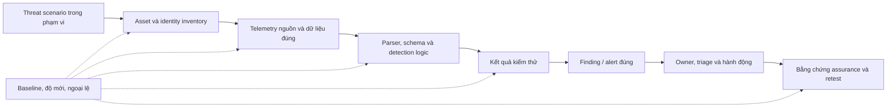

# Độ phủ detection: Chứng minh năng lực phát hiện theo kịch bản đe dọa

## 1. Độ phủ detection là gì?

**Detection coverage** (độ phủ phát hiện) mô tả **mức độ mà tổ chức có khả năng phát hiện những hành vi và kịch bản đe dọa quan trọng trong một phạm vi tài sản, môi trường và thời gian xác định**, với bằng chứng kiểm thử và vận hành tương ứng.

Một tổ chức có 500 luật SIEM vẫn có thể bỏ sót hành vi cấp quyền quản trị trong cloud production; ngược lại, một tổ chức có 30 luật được thiết kế theo rủi ro, đủ dữ liệu, đã kiểm thử và có người xử lý có thể bảo vệ các kịch bản trọng yếu hiệu quả hơn. Vì vậy, **số lượng luật không phải thước đo trực tiếp của độ phủ**.

Trong module **SECURITY_SECURITY_ASSURANCE**, mục tiêu là đánh giá dựa trên bằng chứng rằng security controls đáp ứng yêu cầu, từ phân tích rủi ro đến kiểm thử, audit, xử lý phát hiện và xác minh khắc phục. Với detection engineering, câu hỏi không dừng ở việc “rule đã được bật chưa?” mà bao gồm:

1. Những kịch bản đe dọa nào tổ chức **cần phát hiện**, trên tài sản và môi trường nào?
2. Dữ liệu nào bắt buộc phải có, và nguồn đó có thực sự bao phủ các tài sản cần bảo vệ?
3. Logic phát hiện có đủ điều kiện, ngữ cảnh và khả năng phân biệt sự kiện hợp lệ không?
4. Detection được kiểm thử bằng tình huống tích cực, tiêu cực và thiếu dữ liệu ra sao?
5. Alert có được chuyển đến người xử lý đủ nhanh, có hồ sơ bằng chứng và được theo dõi đến khi đóng không?

**Phát biểu đúng về độ phủ luôn có phạm vi**. Ví dụ: “Trong nhóm 6 kịch bản cloud/Kubernetes production đã xác định, 3 kịch bản có detection được kiểm thử thành công trong 30 ngày qua; 2 kịch bản chỉ có một phần chuỗi bằng chứng; 1 kịch bản chưa có dữ liệu”. Không thể từ đó suy ra “phát hiện được 50% mọi cuộc tấn công trên cloud”.

## 2. Phân biệt detection coverage với các khái niệm liên quan

| Khái niệm | Nó trả lời điều gì? | Ví dụ | Giới hạn |
| --- | --- | --- | --- |
| **Telemetry coverage** | Dữ liệu cần thiết có được thu thập từ tài sản thuộc phạm vi không? | 20/24 cloud accounts có management audit logs | Có log chưa chứng minh phát hiện được hành vi cụ thể |
| **Detection logic coverage** | Đã có logic phù hợp với kịch bản không? | Rule nhận diện thay đổi IAM trust ngoài allowlist | Rule tồn tại chưa chứng minh nó chạy đúng |
| **Validated detection coverage** | Kịch bản đã có đủ dữ liệu, rule, test và đầu ra hoạt động chưa? | Canary event được phát hiện, tạo alert đúng | Test có phạm vi; không bảo đảm phát hiện mọi biến thể |
| **Response coverage** | Alert có owner, playbook và đường xử lý hiệu lực không? | Alert đến SOC, được phân loại và lập finding | Có phản ứng chưa chứng minh mọi tình huống đều được phát hiện |
| **Security-control coverage** | Các biện pháp phòng ngừa/kiểm soát đã được đánh giá đến đâu? | Admission policy chặn Pod privileged | Chặn thành công là biện pháp phòng ngừa, không tự chứng minh detection hoạt động |
| **ATT&CK mapping coverage** | Luật hoặc kịch bản được ánh xạ vào kỹ thuật nào? | Một rule gắn với technique thuộc privilege escalation | Đánh dấu một technique không có nghĩa bao phủ mọi biến thể |

**Monitoring gap** và **detection gap** có liên quan nhưng khác nhau. Monitoring gap có thể là thiếu nguồn hoặc thiếu khả năng quan sát ở một giai đoạn pipeline. Detection gap là không thể nhận diện một kịch bản đe dọa quan trọng ở mức yêu cầu, nguyên nhân có thể do monitoring gap, logic thiếu, test thất bại hoặc alert không đến người xử lý.

Ví dụ: cloud audit log đã đến SIEM nhưng rule chỉ phát hiện thao tác tạo IAM role, bỏ qua cập nhật trust policy. Khi đó telemetry có thể đủ cho event cập nhật, nhưng detection vẫn có khoảng trống logic.

## 3. Mô hình độ phủ theo chuỗi điều kiện

Một kịch bản chỉ được công nhận **đã được kiểm chứng độ phủ** khi những điều kiện thiết yếu đều có bằng chứng hợp lệ.



Các điều kiện nên được xem riêng:

- **Threat-scenario applicability:** kịch bản có liên quan tới tài sản và quyền truy cập thực tế không?
- **Asset scope:** mọi tài sản/identity liên quan có được xác định từ inventory đáng tin cậy không?
- **Telemetry readiness:** nguồn tạo, collector, parser và kho dữ liệu có cung cấp các trường bắt buộc trong thời gian yêu cầu không?
- **Analytic readiness:** logic có hoạt động trên schema và giá trị dữ liệu hiện hành, với xử lý ngoại lệ được phê duyệt không?
- **Test validation:** có positive, negative và kiểm thử nguồn thiếu hoặc dữ liệu sai để xác nhận phạm vi đúng không?
- **Operational readiness:** kết quả phát hiện đến người xử lý, kèm ngữ cảnh đủ để đánh giá và escalations phù hợp không?
- **Evidence readiness:** có thể truy xuất trạng thái rule, nguồn dữ liệu, input test, output và thời gian đánh giá không?

Nếu chỉ một phần điều kiện được đáp ứng, hãy ghi **PARTIAL** ở bảng quản trị độ phủ cùng lý do cụ thể. Khi đánh giá một control theo baseline, cần sử dụng trạng thái **PASS / FAIL / UNKNOWN / EXCEPTION / NOT_APPLICABLE** với quy tắc rõ ràng; *PARTIAL* là nhãn tiến độ hoặc mức bao phủ của một kịch bản, không nên tự động gộp thành PASS.

## 4. Xác định mẫu số: không bắt đầu bằng danh sách luật SIEM

Độ phủ chỉ có ý nghĩa khi **mẫu số là tập kịch bản quan trọng cần phát hiện**, được xác định độc lập với các luật hiện có. Nếu dùng danh sách rule hiện hành làm mẫu số, kịch bản chưa từng được nghĩ đến sẽ không xuất hiện như một khoảng trống.

Cách hình thành danh sách kịch bản:

1. **Bắt đầu từ tài sản và mục tiêu bảo mật:** data stores, IAM, CI/CD, control plane, secret manager, workload, network và backup.
2. **Nhận diện threat paths:** credential bị lộ, trust federation quá rộng, privilege escalation, lateral movement, xóa log, thay đổi image, truy cập dữ liệu trái phép.
3. **Tham khảo threat intelligence và kiến thức về hành vi:** incident history, abuse cases, threat modeling và MITRE ATT&CK khi phù hợp.
4. **Viết scenario bằng ngôn ngữ kiểm chứng được:** chủ thể, hành động, tài nguyên, điều kiện rủi ro và kết quả cần phát hiện.
5. **Chọn mức ưu tiên và scope:** môi trường, phiên bản nền tảng, nhóm ứng dụng, mức độ thiệt hại và khả năng xảy ra.
6. **Chỉ định owner và kỳ review:** thay đổi kiến trúc, lỗ hổng mới hoặc nguồn threat intelligence có thể yêu cầu thêm kịch bản.

Ví dụ: câu “bao phủ kỹ thuật privilege escalation” quá rộng để làm acceptance criterion. Một kịch bản cụ thể hơn là:

> Trong account cloud production, phát hiện khi một principal ngoài danh sách quản trị được phê duyệt tạo hoặc thay đổi policy làm xuất hiện quyền quản lý IAM rộng hơn baseline, và tạo finding đến người chịu trách nhiệm theo ngưỡng đã thống nhất.

Để kiểm thử scenario này cần xác định những API actions nào tạo thay đổi, resource policy/binding nào có thể ảnh hưởng quyền hiệu lực và cách liên kết với phê duyệt. Không nên chỉ nhận diện dựa trên tên vai trò “admin”.

### Sử dụng MITRE ATT&CK đúng mục đích

MITRE ATT&CK giúp tổ chức mô tả **tactic, technique và hành vi** theo ngôn ngữ chung. Có thể gắn một scenario với một hay nhiều kỹ thuật phù hợp để thấy những nhóm hành vi đang được quan tâm. Nhưng:

- Một technique có thể được thực hiện theo nhiều biến thể; một rule chỉ bắt được một biến thể **không bao phủ toàn bộ technique**.
- Một rule có thể gắn với nhiều techniques nhưng vẫn phụ thuộc vào cùng một nguồn log; mất nguồn có thể vô hiệu hóa cả nhóm.
- Tên/ID technique có thể được cập nhật theo phiên bản framework; lưu **phiên bản mapping** và thời điểm review.
- Không có mapping ATT&CK không chứng minh không có rủi ro; một số yêu cầu assurance về logging, cấu hình và gian lận nghiệp vụ cần scenario riêng.

Nên xây **ma trận scenario–technique–asset–telemetry–detection–test**; ATT&CK chỉ là một trục tham chiếu để kiểm tra các vùng hành vi có thể bỏ sót.

## 5. Từ threat scenario đến detection objective

Một **detection objective** đủ rõ phải mô tả *sự kiện/hành vi cần nhận biết, phạm vi, độ trễ, mức ngữ cảnh và trách nhiệm xử lý*.

| Thành phần | Câu hỏi thiết kế | Ví dụ IAM |
| --- | --- | --- |
| Scenario ID | Đối tượng kiểm tra có định danh ổn định không? | DET-IAM-01 |
| Threat behavior | Hành vi nào cần nhận biết? | Policy/trust bị mở rộng quyền ngoài phê duyệt |
| Scope | Ở đâu và đối tượng nào? | Accounts production; privileged roles |
| Preconditions | Bối cảnh nào khiến hành vi trở nên nguy hiểm? | Principal không thuộc kênh thay đổi được duyệt |
| Required data | Trường nào bắt buộc? | Account ID, principal, operation, target, timestamp, policy diff |
| Logic | Điều kiện phát hiện và ngoại lệ? | So baseline + change approval + actual policy |
| Detection SLO | Khi nào cảnh báo phải sẵn sàng xử lý? | Ví dụ trong 5 phút sau ingest; do tổ chức duyệt |
| Expected output | Cảnh báo cần có gì? | Asset, actor, old/new policy, severity, ticket |
| Owner/runbook | Ai điều tra, làm gì trước? | Cloud Security/SOC và Cloud Platform |
| Validation | Cần thử kịch bản gì? | Positive/negative và missing-source tests |

Trong nhiều trường hợp chỉ có event “policy updated” **chưa đủ** để kết luận tăng quyền. Cần đọc chính sách trước/sau, quyền hiệu lực và phạm vi tài nguyên. Một detection có thể phát tín hiệu sớm về thay đổi IAM, còn bước phân loại và kiểm chứng sau đó quyết định mức độ nghiêm trọng.

## 6. Ma trận độ phủ mẫu theo rủi ro

Giả sử một tổ chức chạy dịch vụ thanh toán trên cloud và Kubernetes, đã phê duyệt 6 kịch bản sau. Bảng là **tình huống minh họa**, không đại diện dữ liệu đo thực tế.

| Scenario | Tình huống | Mức trọng số rủi ro | Nguồn dữ liệu tối thiểu | Trạng thái độ phủ |
| --- | --- | ---: | --- | --- |
| DET-01 | IAM principal được cấp thêm quyền nhạy cảm | 5 | Cloud management audit + actual IAM policies | **VALIDATED**: có test và alert |
| DET-02 | OIDC trust của pipeline được mở cho branch/repo ngoài dự kiến | 5 | IAM trust diff + IdP/CI context + audit | **PARTIAL**: có event, thiếu kiểm tra điều kiện |
| DET-03 | ClusterRoleBinding cấp quyền quản trị ngoài thay đổi được duyệt | 4 | Kubernetes API audit + RBAC state + approval | **VALIDATED**: test source-to-alert |
| DET-04 | Pod privileged xuất hiện ngoài phạm vi ngoại lệ | 3 | PodSpec/runtime + admission/audit events | **VALIDATED**: test đủ phạm vi mẫu |
| DET-05 | Storage nhạy cảm được công khai ngoài chủ đích | 2 | Resource policy/state + change events | **UNKNOWN**: collector thiếu quyền |
| DET-06 | Audit logging của account bị tắt hoặc điều hướng | 1 | Control-plane audit + cấu hình nguồn/sink | **GAP**: chưa có logic |

**Trọng số 5, 4, 3, 2, 1 chỉ là dữ liệu minh họa của tổ chức giả định**, không phải thang chuẩn bắt buộc. Ba scenario được xác minh là DET-01, DET-03 và DET-04. DET-02 chưa thể công nhận đã phủ vì thiếu bước kiểm tra trust; DET-05 không có đủ dữ liệu; DET-06 chưa có logic phát hiện.

Khi một kịch bản có mức quan trọng cao nhưng coverage thấp, ưu tiên của detection backlog phải phản ánh **mức rủi ro còn lại**, không chỉ tổng số gap.

## 7. Đo lường coverage và tránh tỷ lệ gây hiểu nhầm

Có thể chọn những chỉ số đơn giản, nhưng **mỗi chỉ số phải công bố mẫu số và quy tắc tính**.

### 7.1. Tỷ lệ scenario được kiểm chứng

Với tập scenario áp dụng `S` và tập `V` gồm scenario đã đáp ứng đầy đủ tiêu chí kiểm chứng:

\[
\text{Validated scenario coverage} = \frac{|V|}{|S|}\times 100\%.
\]

Trong ví dụ: `|S|=6`, `|V|=3` nên **coverage kiểm chứng = 3/6 = 50%**. Đây là tỷ lệ trong danh mục **6 scenario đã xác định**, không phải phần trăm cuộc tấn công có thể bị phát hiện.

### 7.2. Coverage có trọng số theo rủi ro

Nếu mỗi scenario `i` có trọng số `w_i` đã được phê duyệt:

\[
\text{Risk-weighted validated coverage} =
\frac{\sum_{i\in V} w_i}{\sum_{i\in S}w_i}\times 100\%.
\]

Ví dụ: tổng trọng số `5+5+4+3+2+1 = 20`; nhóm đã kiểm chứng có `5+4+3=12`, vậy **coverage có trọng số = 12/20 = 60%**. Kết quả 60% chỉ có ý nghĩa trong **thang trọng số và tập scenario này**. Không nên gán điểm một phần tùy tiện cho PARTIAL rồi cộng vào PASS nếu tổ chức chưa định nghĩa và phê duyệt phương pháp.

### 7.3. Asset–scenario coverage

Một detection kiểm thử thành công ở một cluster chưa chắc bao phủ mọi cluster. Với tập các **cặp (asset, scenario) áp dụng**, đo tỷ lệ cặp đã có đủ dữ liệu và kiểm thử phù hợp:

\[
\text{Asset-scenario coverage} =
\frac{\#\text{ cặp asset--scenario đã kiểm chứng}}{\#\text{ cặp asset--scenario bắt buộc}}\times100\%.
\]

Ví dụ một rule chạy trên 4/5 cluster production nhưng cluster thứ năm không chuyển audit log thì **rule có độ phủ theo cluster chưa đầy đủ**. Nếu chỉ tính rule “enabled = true”, điểm mù đó sẽ bị che khuất.

### 7.4. Các chỉ số không nên trộn lẫn

| Chỉ số | Đo gì? | Không chứng minh điều gì? |
| --- | --- | --- |
| Rule count | Số analytic rules có trong kho | Chúng đúng, đầy đủ, còn chạy hay có giá trị |
| ATT&CK-tag count | Số kỹ thuật được gắn nhãn | Mọi biến thể hành vi đều được phát hiện |
| Telemetry availability | Tỷ lệ nguồn có dữ liệu | Logic có dùng đúng dữ liệu |
| Positive test pass rate | Tỷ lệ bài thử phải phát hiện đã đạt | Tỷ lệ false positive trong môi trường thật |
| Alert delivery success | Cảnh báo thử đến đúng nơi | Người nhận đã điều tra và khắc phục |
| Mean time to detect | Thời gian phát hiện trong các sự kiện đo được | Hành vi không có log hoặc không bị phát hiện |
| Confirmed false positive rate | Tỷ lệ cảnh báo được xác nhận là báo sai trong tập được review | False negatives chưa quan sát được |

**Không có dữ liệu** là một thông tin cần hiển thị trong báo cáo, không phải lý do loại scenario/asset khỏi mẫu số để làm tăng điểm số.

## 8. Chọn dữ liệu và đánh giá telemetry readiness

Một detection có thể yêu cầu nhiều loại dữ liệu đồng thời:

| Threat behavior | Nguồn chính | Nguồn ngữ cảnh | Điểm mù điển hình |
| --- | --- | --- | --- |
| IAM policy/trust thay đổi | Cloud management audit | IAM actual state, Git diff, approval | Provider/account chưa bật log, audit chưa bao phủ |
| Truy cập secret nhạy cảm | Secret manager audit | Identity, secret classification, workload catalog | Chỉ log quyền quản trị, thiếu data-access events |
| Kubernetes quyền quản trị mở rộng | API server audit | RBAC state, user/group, ticket | Audit policy bỏ qua verb/resource, cluster mới không onboard |
| Workload privileged xuất hiện | Admission events + runtime PodSpec | Namespace labels, exception register | Admission cho phép Pod cũ; thiếu dữ liệu init/ephemeral container |
| Thay image ngoài release | Deployment events + runtime digest | Release manifest, registry provenance | Chỉ xem tag trong Git, bỏ qua digest thực tế |
| Lưu lượng egress bất thường | Network flow/proxy/DNS | Service identity, allowlist, dữ liệu nhạy cảm | Không có flow logs ở một segment hoặc thiếu request context |

**Data requirements** phải cụ thể tới trường và ngữ nghĩa. Ví dụ, để so chính sách IAM với approval cần `actor`, `target`, loại thay đổi, thời gian, policy revision và cách đọc quyền mới. Nếu parser đổi tên trường `target_resource` mà rule vẫn đọc tên cũ, ingest không lỗi nhưng analytic có thể âm thầm mất khả năng phát hiện.

Nguồn log có thể có sampling, filtering, lưu trữ ngắn hoặc trễ. Vì vậy cần xác minh cấu hình tạo event, collector, transport, parser, retention và query permissions. Một thiết lập “logging enabled” không đủ chứng minh event của scenario thực sự đến bộ phát hiện.

### Mất target khỏi inventory

Giám sát chỉ những nguồn đã đăng ký có thể bỏ sót tài sản mới. Khi thiết kế độ phủ, phải đối chiếu **inventory từ nguồn độc lập** với danh sách tài sản mà SIEM/detection pipeline nhìn thấy. Tài sản không có nguồn thích hợp nên được ghi `MISSING_SOURCE` hoặc `UNKNOWN`; không thể coi chúng đã có coverage bằng kết quả từ tài sản khác.

## 9. Thiết kế detection rule có thể kiểm chứng

Một rule hoàn chỉnh cần phân biệt **tín hiệu sơ bộ** với **kết luận nguy hiểm thực tế**. Ví dụ, cập nhật IAM policy không phải lúc nào cũng đáng ngờ; ngữ cảnh thay đổi được duyệt, phạm vi quyền và người thực hiện mới quyết định mức ưu tiên.

Đây là cấu trúc *đặc tả nghiệp vụ giả định*, **không phải cấu hình sẵn có của một SIEM**:

```yaml
detection:
  id: DET-IAM-01
  title: "Cảnh báo thay đổi IAM làm mở rộng quyền nhạy cảm"
  version: "1.2.0"
  state: approved
  scope:
    environment: production
    assetKinds: [cloud-account]
  scenario:
    threat: "Privilege escalation through policy change"
    criticalAssetsOnly: true
  requiredSources:
    - cloud-management-audit
    - effective-iam-policy-snapshot
    - approved-change-registry
  requiredFields:
    - event_id
    - event_time
    - account_id
    - actor_id
    - operation
    - target_resource
    - change_revision
  decision:
    requirePolicyDiff: true
    detectNewSensitivePermission: true
    compareWithApproval: true
  onMissingData:
    assessment: UNKNOWN
    notify: Telemetry Operations
  output:
    severity: high
    owner: Cloud Security
    attachEvidence: true
  validation:
    positiveTest: "approved-lab-iam-escalation-event"
    negativeTest: "authorized-non-sensitive-policy-change"
    missingSourceTest: "missing-policy-state"
```

Một số trường như `criticalAssetsOnly`, `detectNewSensitivePermission` và `change_revision` là **quy ước do tổ chức tự định nghĩa**. Khi triển khai thật cần xác định API provider, schema, logic quyền hiệu lực, nguồn approval và quyền truy vấn; trường hợp thiếu policy snapshot có thể phải ghi UNKNOWN hoặc tạo cảnh báo riêng theo baseline.

### Ví dụ SQL giả lập trên dữ liệu đã chuẩn hóa

Giả sử SIEM có bảng `normalized_cloud_events`, `policy_analysis` và `change_approvals`. Mã sau thể hiện ý tưởng đối chiếu, **không khẳng định các bảng hoặc cột tồn tại trong bất kỳ cloud/SIEM cụ thể nào**:

```sql
SELECT
    e.event_id,
    e.event_time,
    e.account_id,
    e.actor_id,
    e.target_resource,
    p.new_sensitive_permissions
FROM normalized_cloud_events AS e
JOIN policy_analysis AS p
    ON p.event_id = e.event_id
LEFT JOIN change_approvals AS a
    ON a.change_revision = e.change_revision
   AND a.account_id = e.account_id
   AND a.approval_status = 'APPROVED'
WHERE e.environment = 'production'
  AND e.event_family = 'iam.policy.change'
  AND p.new_sensitive_permissions = TRUE
  AND a.change_revision IS NULL;
```

Trong thực tế, cần xử lý sai lệch thời gian, idempotency, thay đổi được gửi lại, phân quyền gián tiếp, approval hết hạn, false positive và cách hệ thống nhận diện “sensitive permission”. **Thiếu bản ghi approval không tự động chứng minh thay đổi trái phép** nếu kho approval lỗi hoặc dữ liệu không đồng bộ; lúc đó cần tạo finding điều tra với lý do dữ liệu chưa đầy đủ.

## 10. Đánh giá chất lượng detection logic

Một rule có thể có dữ liệu và vẫn bỏ sót hành vi bởi nhiều nguyên nhân:

- **Logic quá hẹp:** chỉ nhận diện hành động cấp quyền trực tiếp, không nhận ra role assumption, impersonation hoặc resource policy.
- **Logic quá rộng:** cảnh báo mọi thao tác quản trị hợp lệ, gây alert fatigue và giảm khả năng xử lý.
- **Sai schema/normalization:** trường `actor` hoặc `resource` đã đổi sau khi nâng cấp collector.
- **Sai correlation:** chỉ nối theo hostname, bỏ qua cloud resource ID và thay đổi tên tài sản.
- **Whitelist không giới hạn:** bỏ qua toàn bộ hoạt động của một service account dù nó có thể bị chiếm quyền.
- **Kết luận quá sớm:** event tạo Pod privileged bị từ chối tại admission vẫn bị báo như “Pod đã chạy đặc quyền”.
- **Sai thời điểm:** log đến muộn bị loại khỏi cửa sổ correlation, hoặc retry khiến một sự kiện tạo nhiều finding.
- **Không kiểm tra drift của rule:** policy, môi trường và dữ liệu thay đổi nhưng analytic không được cập nhật.

Nên lưu **phiên bản rule và parser** cùng bằng chứng test. Khi thay detection, cần đối chiếu điều kiện trước/sau để xem liệu những hành vi được phát hiện trước đây có còn được bao phủ không.

## 11. Thiết kế kiểm thử cho detection coverage

Để ghi một scenario là VALIDATED, cần bằng chứng rằng detection **thực sự nhận diện hành vi đã định nghĩa** trong điều kiện đủ đại diện. Những bài thử nên tách rõ:

| Loại test | Mục tiêu | Kỳ vọng |
| --- | --- | --- |
| **Positive test** | Sự kiện khớp scenario được phát hiện | Có finding và dữ liệu ngữ cảnh cần thiết |
| **Negative test** | Hành vi hợp lệ hoặc gần giống không gây báo sai | Không tạo cảnh báo sai, hoặc phân loại mức thấp hợp lý |
| **Boundary test** | Điều kiện sát ngưỡng/đối tượng ngoài scope được xử lý đúng | Rule không bỏ sót hoặc lạm dụng wildcard |
| **Missing-source test** | Mất API/log, parser lỗi, quyền truy vấn thiếu | Hệ thống báo gap/UNKNOWN, không kết luận PASS |
| **Late/duplicate test** | Event đến trễ hoặc bị gửi lại | Đúng window, có cơ chế trùng lặp phù hợp |
| **Cross-asset test** | Rule áp dụng cho các asset class/cluster liên quan | Không chỉ hoạt động tại một account thử nghiệm |
| **Delivery test** | Alert thực sự đến đúng người | Có alert ID, route và bằng chứng nhận |
| **Regression test** | Nâng version parser/rule/platform | Những kịch bản quan trọng vẫn được phát hiện |

Dùng **synthetic events có schema hợp lệ**, replay dữ liệu đã làm sạch hoặc các thao tác thử được phê duyệt trên sandbox/staging. Khi test phải phát sinh một thay đổi thực, sử dụng tài nguyên thử có quyền tối thiểu và rollback rõ ràng; không tạo đặc quyền production hoặc hành vi gây hại chỉ để kiểm tra alert.

Test từ một JSON giả lập chỉ chứng minh logic parser/rule trên input đó; **không chứng minh API nguồn thật có tạo event** hoặc collector vận chuyển thành công. Test end-to-end phải kiểm tra từ nguồn phát sinh tới log store, analytic, alert và ticket.

### Acceptance criteria minh họa

Với DET-03 (thay đổi ClusterRoleBinding), tiêu chí có thể gồm:

1. Cả Kubernetes API audit và trạng thái RBAC thực tế đều được đọc trên cluster thuộc phạm vi.
2. Sự kiện thử được phê duyệt có `event_id` và mô tả rõ principal, action, target.
3. Event xuất hiện tại sink trong thời hạn được quy định cho môi trường.
4. Rule version hiện hành phát hiện đúng kịch bản vi phạm và bỏ qua thử nghiệm hợp lệ.
5. Alert kèm cluster/namespace khi phù hợp, chủ thể, tài nguyên, bằng chứng và owner.
6. Test mất nguồn tạo kết quả UNKNOWN/gap alert thay vì trạng thái xanh giả tạo.
7. Evidence còn truy xuất được theo retention và lịch kiểm thử.

Một lần test đạt trong staging **không đủ tuyên bố production đã được kiểm chứng** nếu policy, quyền, log route hoặc schema production khác. Có thể dùng staging để chứng minh logic và ghi bổ sung kết quả nguồn–đích trên production theo cách an toàn.

## 12. Phân tích độ phủ theo thời gian và vòng đời tài sản

Độ phủ thay đổi liên tục:

- Account/cloud region mới có thể chưa bật log hoặc chưa được SIEM onboarding.
- Workload autoscale trong thời gian ngắn có thể xuất hiện rồi biến mất giữa hai lần kiểm tra snapshot.
- Runtime/Kubernetes/cloud API nâng cấp khiến schema hoặc event names thay đổi.
- Rule bị tắt để giảm noise, suppression hết hạn hoặc route không còn người trực.
- Credential của collector hết hạn khiến data ingestion dừng mà dashboard vẫn có dữ liệu cũ.
- Threat intelligence mới hoặc sự cố thực tế làm lộ một kịch bản trước đây chưa có trong catalog.

Do đó, một bản báo cáo phải gắn **assessment window**, `lastValidatedAt`, `ruleVersion`, `dataSourceVersion`, danh sách asset áp dụng và các **khoảng mất telemetry** đã biết.

Phân biệt:

- **Event time:** thời điểm sự kiện được ghi ở nguồn.
- **Ingest time:** thời điểm pipeline tiếp nhận.
- **Detection time:** thời điểm rule tạo finding.
- **Notification time:** thời điểm alert đến hệ thống/người xử lý.

Detection latency cần nêu mốc đo. Chẳng hạn từ event time đến alert time bao gồm cả ingest delay và analytic/routing delay; timestamp không đồng bộ hoặc event replay có thể gây hiểu sai.

Một detection đã test thành công cách đây 3 tháng không tự động còn VALIDATED nếu cluster, IAM model hoặc schema đã đổi. Cần đặt điều kiện **hết hạn bằng chứng** và trigger kiểm thử lại sau những thay đổi liên quan.

## 13. Hồ sơ bằng chứng cho một scenario được kiểm chứng

Bằng chứng hữu ích cần cho phép một người đánh giá độc lập trả lời: *Kịch bản nào? Ở đâu? Phiên bản nào? Test như thế nào? Kết quả và giới hạn là gì?*

```json
{
  "assessmentId": "DET-COV-2026-11-28-01",
  "scenarioId": "DET-03",
  "assetScope": ["production/cluster-a", "production/cluster-b"],
  "baselineId": "DETECTION-COVERAGE-PROD",
  "baselineVersion": "1.0.0",
  "detectionId": "K8S-PRIVILEGED-RBAC-CHANGE",
  "detectionVersion": "2.3.0",
  "testedAt": "2026-11-28T05:00:00Z",
  "testEnvironment": "controlled-production-canary",
  "requiredSources": ["kubernetes-api-audit", "rbac-state"],
  "observed": {
    "positiveTest": "PASS",
    "negativeTest": "PASS",
    "sourceToSink": "PASS",
    "alertDelivery": "PASS",
    "missingSourceTest": "PASS"
  },
  "coverageStatus": "VALIDATED",
  "evidenceRefs": [
    "evidence://detection/DET-03/test-event",
    "evidence://detection/DET-03/alert-receipt"
  ],
  "owner": "Platform Detection Engineering",
  "nextReviewTrigger": "rule-or-telemetry-schema-change"
}
```

**Đây là bản ghi giả định**, không phải kết quả thực thi trên hệ thống thật. Giá trị `VALIDATED` chỉ áp dụng cho **hai cluster và các bài thử đã mô tả**, không bao gồm các cluster production khác chưa kiểm tra.

Hồ sơ thực tế nên lưu thêm:

- Nguồn inventory và revision của catalog scenario/threat model.
- Phiên bản detection query, parser, môi trường chạy rule và cấu hình suppression.
- Raw event reference hoặc checksum, schema và quyền thu thập; không chép secret/token vào finding.
- Thời điểm test, phạm vi, sự kiện tích cực/tiêu cực, nhận diện alert và đầu ra ticket.
- Giới hạn đã biết: sự kiện không mô phỏng được, asset chưa có quyền đọc, dữ liệu thiếu hoặc test chỉ ở staging.
- Người phê duyệt kết quả và người chịu trách nhiệm tái kiểm tra.

Bằng chứng phải được bảo vệ bằng kiểm soát truy cập, retention và cơ chế kiểm tra integrity phù hợp. Không nên đưa nguyên payload chứa thông tin cá nhân, credential hoặc dữ liệu khách hàng vào các báo cáo phổ biến rộng.

## 14. Phân loại detection gaps và xử lý ngoại lệ

| Trạng thái quản trị | Khi nào áp dụng? | Việc tiếp theo |
| --- | --- | --- |
| **VALIDATED** | Có bằng chứng test và vận hành đủ theo tiêu chí đã duyệt | Theo dõi freshness, drift và regression |
| **PARTIAL** | Một số mắt xích đã có nhưng chưa đủ để chứng minh kịch bản | Xác định điều kiện/test còn thiếu |
| **GAP** | Thiếu rõ ràng logic, dữ liệu hoặc capability bắt buộc | Ghi finding và kế hoạch bổ sung |
| **UNKNOWN** | Chưa biết thực trạng do thiếu quyền, inventory hoặc dữ liệu đánh giá | Thu thập thêm, không coi PASS |
| **EXCEPTION** | Gap đã được chấp nhận rủi ro có phê duyệt và hạn | Theo dõi biện pháp bù trừ, ngày hết hạn |
| **NOT_APPLICABLE** | Kịch bản được loại trừ đúng theo điều kiện scope đã phê duyệt | Giữ lý do, chứng cứ và lịch review |

Đây là các **trạng thái quản trị độ phủ scenario**. Khi ánh xạ sang kết quả đánh giá control, tổ chức cần quy định rõ các trạng thái PASS/FAIL/UNKNOWN và EXCEPTION; tránh ghép tất cả PARTIAL và EXCEPTION thành PASS.

Mỗi gap cần có:

1. **Scenario ID, asset scope, mức độ rủi ro và chủ sở hữu.**
2. **Nguyên nhân cụ thể:** thiếu event type, thiếu data source, rule lỗi, thiếu ngữ cảnh, test không đạt hoặc alert routing không hoạt động.
3. **Bằng chứng hiện có và điều chưa thể kết luận.**
4. **Rủi ro còn lại:** hành vi nào kẻ tấn công có thể thực hiện mà không bị phát hiện đúng hạn.
5. **Biện pháp bù trừ:** preventive policy, access review, giám sát nguồn thay thế hoặc hạn chế quyền tạm thời.
6. **Thời hạn khắc phục, quyết định chấp nhận rủi ro nếu có và retest.**

Gap trên control plane hoặc secrets của production thường cần ưu tiên cao hơn cùng loại gap ở workload thử nghiệm. Nhưng mức ưu tiên phải dựa trên **mức rủi ro được phân tích**, không chỉ tên kỹ thuật hay độ phổ biến của ATT&CK.

## 15. Case study: khoảng trống phát hiện OIDC trust trong pipeline

Một nhóm sử dụng OIDC để pipeline triển khai ứng dụng lên cloud production. Baseline chỉ cho phép workflow đã phê duyệt từ repository và branch cụ thể nhận role phát hành. SIEM có rule nhận diện **tạo mới role**, nhưng chưa có điều kiện cảnh báo khi **trust policy của role hiện hữu bị mở rộng**.

### Điều gì đã xảy ra?

Một thay đổi vận hành cập nhật trust policy, cho phép thêm subject ngoài danh sách dự kiến. Cloud audit event đã đi đến kho log; không có cảnh báo vì rule không xem các thao tác cập nhật policy hoặc không phân tích các điều kiện issuer/audience/subject. Nhóm phát hiện qua đợt review IAM định kỳ.

**Phân tích coverage:** nguồn telemetry có thể đã hiện diện, nhưng DET-02 mới chỉ **PARTIAL**. Nếu có điều kiện trust nguy hiểm nhưng không có rule tương ứng, đây là **logic gap**. Nếu rule tồn tại nhưng không đọc được policy hiện hành, đó là **data/context gap**. Cần đối chiếu bằng chứng để phân loại chính xác.

### Cách khắc phục có kiểm chứng

| Bước | Hành động | Bằng chứng cần lưu |
| --- | --- | --- |
| 1. Inventory | Liệt kê production roles dùng federation, issuer và owner | Danh sách roles/approved subjects |
| 2. Đối chiếu | Xác định trust hiện tại với baseline, change request và chủ sở hữu | Policy diff, approval, effective trust review |
| 3. Xây logic | Bổ sung phân tích trust policy thay đổi, kiểm tra subject/audience và asset scope | Rule version, parser fields, decision logic |
| 4. Kiểm thử | Dùng synthetic/replay hoặc sandbox thay đổi trust có kiểm soát | Positive/negative test IDs và kết quả |
| 5. End-to-end | Xác nhận event đến SIEM, analytic tạo finding và alert đến owner | Event/correlation ID, alert receipt |
| 6. Phòng ngừa | Kiểm tra IAM policy qua IaC/CI, giới hạn quyền sửa trust ngoài pipeline | Policy gate, owner, change-control evidence |
| 7. Retest | Đánh giá lại toàn bộ roles trong phạm vi và lịch sử dữ liệu thiếu | Coverage matrix, residual risks, review date |

Khi đánh giá sự cố thực tế, cần kiểm tra xem trong khoảng phơi lộ có phiên federation nào được cấp hay không, quyền đích cho phép làm gì và audit log bao phủ đến đâu. **Không thấy hoạt động assume role không chứng minh không có khả năng khai thác** nếu log thiếu hoặc retention đã hết.

Khi rule được sửa, chỉ tuyên bố DET-02 VALIDATED cho những asset và dạng trust đã được kiểm thử đủ theo tiêu chí; các dạng khác tiếp tục nằm trong backlog hoặc UNKNOWN.

## 16. Detection coverage trong SDLC và vận hành liên tục

| Thời điểm | Hoạt động | Bằng chứng |
| --- | --- | --- |
| Threat modeling | Bổ sung threat scenarios vào catalog dựa trên architecture và risk | Scenario IDs, scope, ưu tiên, owner |
| Thiết kế logging | Chỉ định trường dữ liệu, event sources, retention, pipeline | Data contract, kiểm tra quyền và coverage |
| Pull request | Review detection-as-code, logic, suppression, parser và schema | Diff, unit tests, review/approval |
| Trước deploy | Test positive, negative và missing-source trong môi trường đại diện | Test report và expected outputs |
| Sau deploy | Kiểm tra rule active, source-to-sink và alert routing | Runtime readback, canary/event ID |
| Vận hành | Theo dõi rule failures, data gaps, false positives, bypass và drift | Health metrics, alert/finding history |
| Sau incident | Đối chiếu hành vi đã xảy ra với scenario catalog và các detection có/không kích hoạt | Incident timeline, detection gap analysis |
| Định kỳ | Đánh giá lại risk-weighted coverage, evidence freshness và exceptions | Matrix phiên bản mới, backlog và quyết định |

Một hoạt động quan trọng là **regression khi thay nguồn dữ liệu**: cloud provider đổi event schema, collector nâng version hoặc tổ chức chuyển SIEM có thể làm logic cũ không còn hoạt động. Các scenario trọng yếu cần được kiểm thử lại sau thay đổi, dù số lượng rules không đổi.

Đội platform/observability chịu trách nhiệm về ingestion và health; detection engineering về logic, test và rule lifecycle; threat/risk owners về phạm vi và mức ưu tiên; SOC/incident response về xử lý alert; nhóm assurance về độ tin cậy của bằng chứng. Tên tổ chức có thể khác nhưng phải có **owner cụ thể trên từng scenario và từng gap**.

## 17. Dashboard và báo cáo phù hợp với security assurance

Một dashboard detection coverage nên trình bày rõ:

- **Số scenario trong phạm vi** theo môi trường, nhóm tài sản, rủi ro, threat family và phiên bản catalog.
- **VALIDATED / PARTIAL / GAP / UNKNOWN / EXCEPTION / N/A**, kèm số lượng và trọng số.
- **Asset–scenario coverage:** cùng một detection có áp dụng cho tất cả account, cluster, tenant và data sources cần bảo vệ không?
- **Data health:** tài sản chưa onboard, event types bị thiếu, ingestion lag, parse errors, last validated.
- **Chất lượng và độ mới:** test mới nhất, số kịch bản regression thất bại, rule disabled, suppression hết hạn.
- **Khả năng phản ứng:** alert routing test, số finding chưa đóng, thời gian xử lý và owner.
- **Giới hạn kết luận:** các kịch bản chưa định nghĩa, thiếu dữ liệu lịch sử, nguồn provider không hỗ trợ và ngoại lệ được duyệt.

Ví dụ hiển thị “validated 50% (3/6), weighted 60% (12/20)” phải đi kèm số PARTIAL, UNKNOWN, GAP, danh sách scenario và điều kiện kiểm chứng. Nếu cần biểu đồ heatmap, hàng nên là **scenario/technique có phạm vi**, cột là **asset group/environment hoặc detection stage**; màu sắc chỉ có nghĩa khi người xem biết rõ cách đánh giá.

Việc nâng điểm coverage bằng cách loại bỏ scenario khó khỏi danh mục mà không có phân tích rủi ro là sai lệch phương pháp đo. Thay đổi mẫu số phải được quản lý phiên bản, ghi lý do và so sánh các kỳ trên một cơ sở thống nhất.

## 18. Các sai lầm thường gặp

1. **Dùng số lượng rules làm chỉ số chính:** không phản ánh hành vi quan trọng được phát hiện.
2. **Chỉ đếm ATT&CK techniques có tag:** một detection trên một biến thể không phủ mọi cách thực hiện technique.
3. **Bắt đầu từ nguồn log đang có:** bỏ qua scenario cần dữ liệu chưa thu thập.
4. **Không đối soát inventory:** tài sản mới không có trong SIEM tự biến mất khỏi mẫu số.
5. **Chỉ chạy unit test với JSON giả lập:** chưa kiểm chứng event source, collector, alert và response.
6. **Đồng nhất cảnh báo với phát hiện đúng:** rule tạo alert nhưng thiếu context, không tới owner hoặc bị suppression.
7. **Bỏ qua hiệu lực quyền:** chỉ xem tên role trong log và suy luận sai về privilege escalation.
8. **Coi test staging là đủ cho production:** policy, nguồn dữ liệu và pipeline thực tế có thể khác.
9. **Không phân biệt FAIL với UNKNOWN:** lỗi quyền truy vấn bị biến thành kết luận rủi ro hoặc PASS tùy tiện.
10. **Không theo dõi biến thể bypass:** một attacker thay đường đi, identity, API hoặc thời điểm làm rule bỏ sót.
11. **Chỉ báo tỷ lệ tổng:** che giấu những scenario critical chưa phủ.
12. **Không giữ bằng chứng gốc:** chỉ còn ảnh dashboard không thể tái dựng test và quyết định.
13. **Không retest sau khi sửa:** PR đã merge nhưng rule vẫn sai do parser hoặc cấu hình runtime.
14. **Ghi secrets/raw sensitive data vào evidence:** tạo thêm rủi ro bảo mật trong chính hệ thống assurance.
15. **Không cập nhật scenario catalog theo threat model:** số liệu coverage đứng yên dù kiến trúc và rủi ro đã thay đổi.

## 19. Bài tập tự đánh giá

1. Đội có 350 rules nhưng chỉ 10/15 kịch bản production quan trọng được kiểm thử thành công. Hãy giải thích vì sao báo cáo “350 detection đã triển khai” không đủ để chứng minh độ phủ.
2. Một rule phát hiện quyền IAM cấp trực tiếp, nhưng không phát hiện role trust cho phép assume từ account bên ngoài. Hãy xác định scenario gap, required telemetry và điều kiện kiểm thử.
3. Có 4 cluster production, trong đó 3 cluster đã kiểm thử detection thay đổi ClusterRoleBinding và 1 cluster không có audit. Nên tính asset–scenario coverage và trạng thái của cluster còn lại ra sao?
4. Ma trận gồm 6 scenario có trọng số 5, 5, 4, 3, 2, 1 và trạng thái như bảng trong bài. Tính tỷ lệ validated thông thường, tỷ lệ có trọng số và nêu giới hạn của hai con số.
5. Sau khi nâng cấp parser, log volume không giảm nhưng rule phát hiện Pod privileged ngừng tạo alert. Hãy mô tả positive, negative, missing-source và schema tests cần chạy.
6. Phát hiện một alert được tạo đúng nhưng route tới nhóm đã giải thể. Đây là gap ở lớp nào? Cần evidence gì để công nhận khắc phục?
7. Một sự cố thực tế có event ở log store nhưng không tạo finding. Làm sao xác định nguyên nhân ở logic, schema, suppression, time window hay scope?
8. Một workload chạy ngắn hạn không có log agent vì bị xóa trước khi quét. Hãy đề xuất nguồn tín hiệu bổ sung và cách đo độ phủ theo vòng đời.
9. Tại sao không thể kết luận “100% ATT&CK coverage” chỉ từ một heatmap? Hãy mô tả một cách báo cáo có scope và test evidence.
10. Thiết kế hồ sơ assurance tối thiểu để công nhận detection kịch bản “thay đổi OIDC trust ngoài phê duyệt” trong cloud production.

**Tiêu chí của một câu trả lời tốt:** phải nối được **tài sản và rủi ro → threat scenario cụ thể → dữ liệu bắt buộc → detection logic → kiểm thử và phạm vi → bằng chứng → kết luận có giới hạn → remediation/retest**.

## 20. Tài liệu tham khảo

- **MITRE ATT&CK** – hệ thống mô tả tactic, technique và hành vi tấn công; nên tham khảo đúng domain và phiên bản đang áp dụng, không dùng mapping như một chứng nhận coverage.
- **NIST SP 800-137 – Information Security Continuous Monitoring (ISCM)** – phương pháp giám sát an ninh dựa trên yêu cầu và rủi ro.
- **NIST SP 800-53** – các họ kiểm soát `AU` (Audit and Accountability), `SI` (System and Information Integrity), `CA` (Assessment, Authorization, and Monitoring), `IR` (Incident Response), `AC` (Access Control).
- **NIST SP 800-61** và hướng dẫn xử lý sự cố của tổ chức – kết nối detection, triage, điều tra, phản ứng và cải tiến sau sự cố.
- **Sigma detection rule specification** và tài liệu của nền tảng SIEM đang sử dụng – quản lý rule-as-code, trường dữ liệu, phiên bản và kiểm thử.
- **Kubernetes Documentation – Auditing, RBAC, Pod Security Admission** – nguồn audit và ngữ nghĩa hành động/quyền; cần phân biệt Kubernetes Events với API audit logs.
- **Tài liệu logging/IAM của AWS, Microsoft Azure và Google Cloud** – kiểm tra chính xác loại event, quyền truy vấn, retention, nghĩa của policy/trust và giới hạn dịch vụ.

**Độ phủ detection** là một **khẳng định có phạm vi và bằng chứng**, không phải phép đếm rules hoặc bản đồ kỹ thuật được tô màu. Năng lực security assurance mạnh khi tổ chức biết rõ những hành vi quan trọng đã được kiểm chứng khả năng phát hiện, những kịch bản còn điểm mù, mức rủi ro của chúng và kết quả kiểm thử sau mỗi lần khắc phục.
