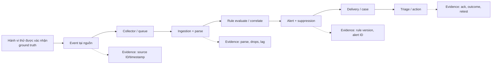

# Đo hiệu quả detection trong Security Assurance

## 1. Vì sao “có detection rule” không đồng nghĩa “phát hiện hiệu quả”?

Một hệ thống SIEM có thể chứa hàng trăm detection rule, hàng triệu sự kiện và hàng nghìn cảnh báo mỗi ngày nhưng vẫn bỏ sót hành vi nguy hiểm. Ngược lại, một rule hiếm khi phát cảnh báo không nhất thiết là vô dụng: nó có thể nhắm vào hành vi có xác suất thấp nhưng hậu quả nghiêm trọng. Vì vậy, **số rule, số log và số alert không tự chứng minh năng lực phát hiện**.

Trong chương **Detection engineering** của module **SECURITY_SECURITY_ASSURANCE**, đo hiệu quả detection là quá trình thu thập và phân tích **bằng chứng có thể kiểm tra lại** để trả lời: *nền tảng có quan sát đúng hành vi cần bảo vệ, phát hiện chúng trong điều kiện phù hợp, cảnh báo đủ nhanh, ít nhiễu và duy trì hiệu quả sau thay đổi hay không?*

Điều này phục vụ mục tiêu xuyên suốt của security assurance: liên kết **rủi ro → mục tiêu bảo mật → yêu cầu → security control → kiểm thử/đo lường → audit → khắc phục phát hiện → kiểm chứng lại**. Detection là một control hỗ trợ nhận biết và phản ứng, không phải bằng chứng hệ thống không thể bị xâm nhập.

Ví dụ, yêu cầu được phê duyệt là:

> Trong môi trường production, những thay đổi cấp quyền quản trị đặc biệt phải tạo được sự kiện audit, kích hoạt cảnh báo phù hợp và đến tuyến trực trong giới hạn thời gian đã xác định.

Muốn tuyên bố control đạt, cần biết ít nhất: nguồn log có tạo đúng sự kiện không, pipeline có chuyển được không, rule có nhận diện không, alert có bị suppress không, thời gian từ sự kiện đến lúc delivery là bao lâu, và người trực có tiếp nhận theo quy trình hay không. Chỉ xem trạng thái `rule: enabled` không trả lời các câu hỏi này.

### Kết quả học tập

Sau bài này, người học có thể:

1. Xác định **đơn vị đo, phạm vi, ground truth** và điều kiện đạt cho một detection use case.
2. Tính và diễn giải **precision, recall, false-positive rate, F1** từ một tập kiểm thử được gán nhãn.
3. Phân biệt **coverage**, **khả năng quan sát nguồn**, **độ tin cậy pipeline**, **độ trễ phát hiện** và **chất lượng xử lý alert**.
4. Thiết kế phép thử có kiểm soát, từ sự kiện nguồn đến cảnh báo và case, để phát hiện blind spot.
5. Xây dựng evidence package và quy trình cải tiến detection có owner, phiên bản rule, finding, retest và theo dõi drift.

## 2. Xác định đúng đối tượng đo

Trước khi tính bất kỳ tỷ lệ nào, hãy thống nhất “một kết quả detection” là gì.

| Đơn vị | Ví dụ | Phù hợp để đo |
|---|---|---|
| **Source event** | Một event đổi IAM role có `event_id` riêng | Telemetry coverage, parse success, ingestion lag |
| **Rule match** | Một điều kiện correlation đúng trên dữ liệu | Chất lượng logic và rule evaluation |
| **Alert** | Một hoặc nhiều match được gom thành một cảnh báo | Alert precision, noise, delivery latency |
| **Case/incident** | Nhiều alert thuộc cùng một vụ việc được triage | Năng lực điều tra, tình huống xử lý và kết quả |
| **Test scenario** | Một lần mô phỏng hành vi với `test_run_id` | Scenario detection rate, end-to-end test success |
| **Attack step/technique** | Một hành vi trong kịch bản threat emulation | Phạm vi kỹ thuật được kiểm chứng |
| **Asset/source** | Một endpoint, workload, cloud account, identity tenant | Độ phủ giám sát theo tài sản |

Không thể so sánh trực tiếp **50 alert** với **40 incident** nếu không có quy tắc gom nhóm. Một hành vi có thể phát ra 12 event, khớp ba rule nhưng chỉ cần tạo một alert/case hữu ích; đo ở mức event hoặc alert sẽ có kết quả khác nhau.

**Mẫu số phải có nghĩa:** “đã phát hiện 9/10 lần mô phỏng hành vi X” khác hẳn “đã phát hiện 9/10 kỹ thuật trong toàn bộ threat model”. Chỉ số thứ nhất phản ánh thử nghiệm đã thực hiện; chỉ số thứ hai còn đòi hỏi tập kỹ thuật được xác định, mức đại diện của kịch bản và điều kiện vận hành.

### Từ claim đến metric

Ví dụ control `DET-ADMIN-01`:

- **Claim:** phát hiện việc cấp quyền admin không theo quy trình trong các identity tenant production.
- **Scope:** tenant/role/event type, nguồn audit, hệ thống nhận log, rule và tuyến xử lý.
- **Expected behavior:** event phù hợp tạo alert severity cao và được giao đúng tuyến trong thời gian phê duyệt.
- **Test unit:** một kịch bản thay đổi quyền quản trị có `test_run_id`; gom alert theo test run, không đếm từng duplicate.
- **Success:** xác minh sự kiện ở nguồn, ingest, rule match, alert, delivery và outcome tương ứng.
- **Limitations:** chỉ bảo đảm các đường thao tác, phiên bản API và môi trường đã thử; các đường khác phải kiểm tra riêng.

## 3. Ground truth: “đúng” và “sai” dựa vào đâu?

**Ground truth** là tập nhãn đáng tin cậy chỉ ra trường hợp nào thực sự thuộc nhóm hành vi mục tiêu và trường hợp nào không. Với dữ liệu kiểm thử được điều khiển, có thể biết trước kịch bản nào là “positive” và kịch bản nào là “negative”. Với sự cố production, nhãn thường phải qua điều tra, có thể không hoàn chỉnh hoặc thay đổi khi xuất hiện bằng chứng mới.

| Nguồn nhãn | Điểm mạnh | Giới hạn |
|---|---|---|
| Kịch bản thử có phê duyệt, kết quả xác minh ở nguồn | Biết hành vi được tạo, thời điểm và expected outcome | Có thể ít đa dạng hơn hoạt động thực |
| Purple-team/adversary emulation có kiểm soát | Kiểm chứng chuỗi hành vi gần cách vận hành thực | Phải giới hạn phạm vi, không đại diện mọi biến thể |
| Incident đã điều tra và kết luận | Liên hệ tới bối cảnh production và tác động thực | Có thiên lệch về các vụ việc đã được phát hiện |
| Analyst-labeled alert | Hữu ích để ước lượng precision trong tập đã xử lý | Nhãn “benign”, “false positive” hoặc “unknown” có thể bị dùng không nhất quán |
| Synthetic/replayed events | Dễ lặp lại và so sánh sau cập nhật rule | Nếu tiêm vào giữa pipeline thì bỏ qua những bước phía trước |
| Audit/sample review độc lập | Có thể phát hiện sai lệch trong cách đội SOC gán nhãn | Chi phí cao, mẫu nhỏ và vẫn có bất định |

**Không xem alert chưa triage là false positive.** Trạng thái “unknown/pending” phải được tách riêng; chỉ những mẫu có nhãn đáng tin mới được đưa vào bảng nhầm lẫn. Không mặc định những sự kiện không có alert là true negative, vì có thể có hành vi đáng ngờ chưa được quan sát.

Nên lưu `label_source`, `label_version`, `reviewer`, `reviewed_at_utc`, `confidence`, cách giải quyết tranh chấp và tham chiếu đến evidence. Nếu nhãn đổi sau điều tra, cần tái tính chỉ số cho cùng tập dữ liệu, giữ lịch sử đánh giá.

## 4. Confusion matrix và bốn loại kết quả

Với một **tập kiểm thử đã gán nhãn đầy đủ** ở cùng một đơn vị đo và cùng một cửa sổ quan sát, có thể lập confusion matrix:

| Ground truth \ Detection result | Có detection đúng hạn | Không có detection đúng hạn |
|---|---:|---:|
| **Hành vi thuộc nhóm cần phát hiện** | **TP – True Positive** | **FN – False Negative** |
| **Hành vi không thuộc nhóm cần phát hiện** | **FP – False Positive** | **TN – True Negative** |

Cần định nghĩa cách gán một alert cho một kịch bản. Ví dụ một rule phát 4 alert trùng cho một test positive thì có thể xem là **1 TP theo test scenario**, đồng thời ghi **3 duplicate alerts** để đo noise. Không được mặc định 4 TP và thổi phồng recall.

**Trường hợp trễ hạn:** nếu acceptance criteria yêu cầu alert trong năm phút, một alert đến sau bảy phút không được tính là TP **đúng hạn**. Có thể báo riêng rằng detection cuối cùng đã xảy ra nhưng **end-to-end SLO FAIL**. Tiêu chí đếm cần được thống nhất trước khi thử, để không đổi định nghĩa sau khi nhìn kết quả.

### Ví dụ số liệu nhất quán

Giả sử một đợt thử có 40 kịch bản positive và 200 kịch bản negative, cùng một rule và điều kiện thử; từng kịch bản đều có nhãn xác nhận. Kết quả:

| Kết quả | Số lượng | Ý nghĩa |
|---|---:|---|
| TP | 32 | 32 kịch bản cần phát hiện đã được alert đúng hạn |
| FN | 8 | 8 kịch bản cần phát hiện nhưng không được alert đúng hạn |
| FP | 10 | 10 kịch bản bình thường lại tạo alert |
| TN | 190 | 190 kịch bản bình thường không tạo alert |
| **Tổng** | **240** | 40 positive + 200 negative |

Đây là **dữ liệu giả định của một tập kiểm thử**, không phải kết quả đánh giá production. Trong thực tế, xác định TN cho tất cả hành vi bình thường rất khó; vì vậy nhiều báo cáo vận hành tập trung vào precision của những alert đã triage và detection success của các test positive, thay vì tự tính confusion matrix cho toàn hệ thống.

## 5. Precision, recall, FPR, F1 và ý nghĩa thực tế

### 5.1. Precision – trong các cảnh báo, bao nhiêu cảnh báo thực sự liên quan?

\[
\mathrm{Precision} = \frac{TP}{TP+FP}
\]

Với ví dụ: `32 / (32 + 10) = 76,19%`.

Precision thấp nghĩa là trong tập được gán nhãn đang xét, nhiều cảnh báo không thực sự thuộc nhóm mục tiêu. Điều này gây chi phí triage, dễ dẫn đến **alert fatigue**. Tuy nhiên, precision phụ thuộc **tỷ lệ hành vi positive trong mẫu**; không được chuyển nguyên kết quả từ tập test cân bằng sang production nếu base rate khác xa.

### 5.2. Recall – trong các hành vi cần phát hiện, đã phát hiện được bao nhiêu?

\[
\mathrm{Recall} = \frac{TP}{TP+FN}
\]

Ví dụ: `32 / (32 + 8) = 80%`.

Recall đo mức **ít bỏ sót** đối với tập positive đã biết. Recall cao trong bộ synthetic test không chứng minh phát hiện được những biến thể chưa thử. Một rule có thể recall cao khi test dùng cùng một mẫu lặp lại nhưng thất bại ở hành vi khác hoặc môi trường khác.

### 5.3. False-positive rate và true-negative rate

\[
\mathrm{FPR} = \frac{FP}{FP+TN},\qquad
\mathrm{TNR} = \frac{TN}{FP+TN}
\]

Ví dụ: FPR = `10 / (10 + 190) = 5%`; TNR = `95%`.

FPR cần tập negative có nhãn. Nó **khác** “tỷ lệ alert là false positive” (`FP/(TP+FP)`), thường gọi là *false discovery rate*. Nhầm lẫn hai mẫu số dễ khiến báo cáo trở nên vô nghĩa.

### 5.4. F1 và độ chính xác tổng thể

\[
F_1 = \frac{2PR}{P+R}
    = \frac{2TP}{2TP+FP+FN}
\]

Ví dụ: `64 / (64+10+8) = 78,05%`.

Accuracy:

\[
\mathrm{Accuracy} = \frac{TP+TN}{TP+TN+FP+FN}
\]

Ví dụ: `(32+190)/240 = 92,5%`. Con số trông cao nhưng **không phản ánh riêng khả năng phát hiện kịch bản nguy hiểm**. Trong hệ thống có cực ít hành vi thực sự nguy hiểm, một bộ phân loại gần như luôn báo “bình thường” cũng có thể đạt accuracy rất cao dù bỏ sót nhiều mối đe dọa.

**Kết luận:** không có một metric duy nhất là “tốt nhất”. Với hành vi có hậu quả cao, tổ chức có thể ưu tiên recall và độ trễ; với rule có volume lớn và chi phí triage cao, precision và alert load cũng rất quan trọng. Nên quyết định ưu tiên từ threat model và khả năng đội SOC, không tối ưu F1 một cách máy móc.

## 6. Nghịch lý base rate và giới hạn của bộ test

Trong sản xuất, hành vi cần phát hiện thường hiếm hơn hoạt động bình thường. Một rule có recall cao và false-positive rate nhỏ vẫn có thể tạo ra rất nhiều false positive nếu nguồn negative cực lớn.

Giả sử một phép đo minh họa có:

- 100 trường hợp positive;
- 100.000 trường hợp negative;
- Recall 90%;
- FPR 1%.

Khi đó TP = 90, FN = 10, FP = 1.000, TN = 99.000. Precision chỉ khoảng **90/1.090 = 8,26%**. Các tỷ lệ này là giả định minh họa, nhưng cho thấy vì sao **mẫu kiểm thử và tần suất hành vi thực tế** phải đi cùng các chỉ số.

Không suy ra production precision từ recall/FPR đo trên một phòng lab khác môi trường. Cần đánh giá đại diện theo:

- Loại tài sản, identity, ứng dụng, môi trường và giờ hoạt động.
- Ngôn ngữ và schema sự kiện, quy trình nghiệp vụ bình thường, lưu lượng đỉnh.
- Phân phối phiên bản hệ điều hành và cloud API.
- Hành vi đã xuất hiện trong dữ liệu triage thực và những trường hợp chưa có nhãn.
- Phương pháp sampling, cách loại duplicate và thay đổi rule trong cửa sổ đo.

Khi mẫu ít, metric có thể biến động mạnh. Ví dụ 1/1 test positive đạt là “100%” nhưng gần như không đủ căn cứ để kết luận detection chắc chắn. Báo cáo nên đưa ra **số lượng mẫu, điều kiện thử, cửa sổ đo và bất định**; có thể dùng khoảng tin cậy thống kê khi quy mô và phương pháp lấy mẫu phù hợp.

## 7. Coverage: “có rule” khác “có khả năng nhìn thấy và phát hiện”

Detection coverage là khái niệm nhiều lớp; không thể gói gọn bằng “% kỹ thuật ATT&CK đã gắn rule”.

| Lớp coverage | Câu hỏi | Bằng chứng |
|---|---|---|
| **Risk/use-case coverage** | Mối đe dọa quan trọng nào có use case và owner? | Threat model, risk register, control mapping |
| **Asset/source coverage** | Tất cả tài sản cần nguồn telemetry đã có nguồn khả dụng? | Inventory đối chiếu heartbeat/event nhận thực tế |
| **Telemetry/field coverage** | Có đúng loại event và trường bắt buộc để triển khai detection? | Source audit config, schema validation, sample event |
| **Rule coverage** | Có logic detection cho hành vi mong muốn trong phạm vi? | Rule repository, mapping, version, scope |
| **Enforcement/evaluation coverage** | Rule có được enable, load và chạy trên đúng dữ liệu không? | Engine state, rule eval log, selector, query/schedule |
| **Tested behavioral coverage** | Kịch bản nào thực sự kích hoạt được alert đúng hạn? | Test catalog, ground truth, test run/result |
| **Response-chain coverage** | Alert có đến đúng tuyến và được tiếp nhận? | Delivery receipt, case, acknowledgment, on-call schedule |

**MITRE ATT&CK mapping** có thể dùng để tổ chức kỹ thuật và giả thuyết phát hiện. Tuy nhiên, một rule được gắn ID technique không chứng minh đã phát hiện mọi cách thực hiện technique đó. Cần gắn mapping với **đường dữ liệu cụ thể, điều kiện phát hiện, thử nghiệm đã chạy và giới hạn**.

Ví dụ: 20 kỹ thuật ưu tiên, 15 kỹ thuật có rule, 10 kỹ thuật đã kiểm thử, 8 kỹ thuật đạt trong bộ test. Có thể báo:

- Rule-mapped coverage: **15/20** kỹ thuật ưu tiên.
- Tested coverage: **10/20** kỹ thuật ưu tiên.
- Passed tested coverage: **8/20** kỹ thuật ưu tiên.

Không được viết “80% kỹ thuật được phát hiện” khi chỉ có 8/10 kỹ thuật đã thử đạt và 10 kỹ thuật còn lại chưa thử; mẫu số và ý nghĩa phải rõ. Có thể tính tỷ lệ pass riêng **8/10** trong tập đã kiểm thử và công bố cả hai góc nhìn.

## 8. Độ tin cậy của dữ liệu và tình trạng detection pipeline

Để một rule hoạt động, **nguồn và pipeline** phải hoạt động. Khi phát hiện thất bại, cần xác định lỗi nằm ở đâu trước khi sửa logic rule.



### Những kiểu thất bại thường bị bỏ qua

- **Blindness tại nguồn:** audit chưa bật, event type không được ghi, agent offline, endpoint chưa onboard.
- **Transport loss:** collector mất quyền, queue đầy, bị rate-limit, retry lỗi, network partition.
- **Parser drift:** field đổi tên/kiểu dữ liệu, timestamp lệch hoặc event type mapping không còn đúng.
- **Rule execution:** rule disabled, lịch chạy sai, sai tenant/index, query quá chậm, join key thiếu, threshold không phù hợp.
- **Suppression/dedup:** cảnh báo bị im lặng ngoài thời gian dự kiến, gộp nhầm vào case không liên quan.
- **Routing/response:** alert tồn tại nhưng kênh gửi lỗi hoặc tới sai người trực.

**Một phép thử tiêm event trực tiếp vào SIEM chỉ kiểm tra các bước từ điểm tiêm trở về sau.** Để chứng minh end-to-end, nên tạo tín hiệu ở hệ thống nguồn bằng thao tác **được phép và không gây hại**, dùng test identity, rồi lần theo event ID qua các chặng.

Nếu scanner không đủ quyền đọc nguồn hoặc không có đường truy xuất dữ liệu, không mặc định rằng “không có lỗi” là PASS. Với control phát hiện, cần ghi **INCONCLUSIVE** khi không đủ căn cứ; đồng thời đánh giá riêng control về pipeline health/telemetry coverage.

### Đo độ phủ nguồn

\[
\mathrm{VerifiedSourceCoverage}
=\frac{\text{Nguồn thuộc phạm vi có telemetry được xác minh}}
{\text{Tổng nguồn thuộc phạm vi}}\times100\%
\]

“Agent installed” không tương đương “nguồn đang cung cấp đầy đủ event bắt buộc”. Với nguồn ít sự kiện, cần heartbeat, health metric hoặc sự kiện synthetic được phê duyệt để phân biệt im lặng hợp lệ với mất dữ liệu.

## 9. Đo thời gian phát hiện và thời gian phản ứng

**Mean Time To Detect (MTTD)** thường được nhắc đến, nhưng mỗi hệ thống có thể dùng mốc bắt đầu/kết thúc khác nhau. Một báo cáo tốt phải định nghĩa công thức và nguồn timestamp.

| Mốc | Ý nghĩa | Ghi chú |
|---|---|---|
| `t_action` | Bắt đầu hành vi trong kịch bản có ground truth | Mốc thường rõ trong bài test, không luôn biết ở sự cố thực |
| `t_event` | Sự kiện phát sinh tại nguồn | Phụ thuộc đồng bộ clock |
| `t_ingest` | Pipeline tiếp nhận và lưu event | Dùng đánh giá transport/ingestion |
| `t_match` | Rule khớp hoặc detection engine đưa ra quyết định | Có thể không được hệ thống ghi riêng |
| `t_alert` | Cảnh báo được tạo | Mốc thường đo được trong SIEM |
| `t_delivered` | Hệ thống nhận xác nhận chuyển cảnh báo | Không đồng nghĩa người trực đã đọc |
| `t_ack` | Người trực xác nhận tiếp nhận | Có thể theo lịch, paging hoặc case |
| `t_triage` | Bắt đầu/hoàn tất đánh giá ban đầu tùy định nghĩa | Không đồng nghĩa đã containment/remediation |

Ví dụ các công thức:

\[
T_{\mathrm{event\to alert}}=t_{\mathrm{alert}}-t_{\mathrm{event}}
\]

\[
T_{\mathrm{event\to delivery}}=t_{\mathrm{delivered}}-t_{\mathrm{event}}
\]

\[
T_{\mathrm{alert\to ack}}=t_{\mathrm{ack}}-t_{\mathrm{alert}}
\]

Các đại lượng trên không thể thay thế nhau. Một rule tạo alert sau 10 giây nhưng paging trễ 15 phút **không đạt** control yêu cầu delivery trong hai phút. Ngược lại, alert kịp thời cũng không chứng minh analyst đã triage chính xác.

**Báo cáo latency theo phân phối:** median/p50 và p95/p99 trong tập mẫu đủ lớn thường có ích hơn một giá trị trung bình, vì có thể tồn tại đuôi độ trễ cao. Ghi rõ số mẫu, khoảng thời gian, các kịch bản không có alert và cách xử lý timeout (không đơn giản loại bỏ những mẫu thất bại rồi làm latency đẹp hơn).

**Clock skew:** phải biết nguồn có đồng bộ thời gian không, độ chính xác timestamp, timezone và event delay. Khi timestamp không tin cậy, kết quả độ trễ có thể là INCONCLUSIVE; cần sửa đồng bộ thời gian hoặc chọn mốc đối chiếu tin cậy hơn.

## 10. Đo noise, alert fatigue và chi phí xử lý

Precision chỉ đo tỷ lệ đúng trong **tập có nhãn**. Với vận hành SOC, cần đo cả gánh nặng thực tế:

| Metric | Mục đích | Cảnh báo diễn giải |
|---|---|---|
| Alerts/day theo rule và nhóm tài sản | Đánh giá sức chứa hàng đợi | Volume cao có thể do nhiều hành vi thật hoặc do rule quá rộng |
| Distinct cases/alerts | Tách duplicate và số vụ việc | Dedupe mạnh có thể che nhiều event độc lập |
| False-positive alerts/day | Lượng việc nhiễu được xác nhận | Chỉ tính trên những alert đã được điều tra/nhãn tin cậy |
| Tỷ lệ duplicate/reopened | Đánh giá grouping và suppression | Đếm theo event/alert/case phải nhất quán |
| Median/p95 triage time | Công sức và độ trễ phản ứng | Phải tách các mức severity và lịch trực |
| Benign-pattern distribution | Nhận diện hoạt động hợp lệ gây nhiễu | Không tuning để loại quá rộng làm tăng FN |
| Alert-to-case conversion | Đo kết quả phân loại theo workflow | “Không tạo case” không đồng nghĩa alert sai |
| Analyst feedback / label quality | Tìm điểm mù và cải thiện rule | Feedback chủ quan, phải có hướng dẫn gán nhãn |

Ví dụ: một rule tạo 300 alert/ngày, 60 alert được kiểm tra xác nhận benign, mỗi alert mất trung bình 4 phút. Trong tập 60 alert này, tổng thời gian ước tính là **240 phút**. Không được suy ra toàn bộ 300 alert đều false positive hoặc chi phí tổng của SOC là 20 giờ khi chưa phân loại hết. Báo cáo nên nêu rõ **mẫu được phân tích**, sai lệch chọn mẫu và các trường hợp chưa kết luận.

Khi tuning threshold, có thể dựng **precision–recall trade-off** trên cùng bộ dữ liệu có nhãn, kiểm tra riêng kịch bản rủi ro cao và khối lượng cảnh báo. Một thay đổi giảm 50% alert nhưng làm bỏ sót hành vi quan trọng là thay đổi có rủi ro, không tự động là cải tiến.

## 11. Thiết kế chương trình thử nghiệm detection có thể tái lập

Một detection engineering program nên có **test catalog** gắn với risk/use case và data requirements, chứ không chỉ có bộ query.

### 11.1. Cấu trúc mỗi test

1. **Test ID, control ID và mục tiêu:** xác định hành vi nào phải phát hiện, ở phiên bản nào.
2. **Phê duyệt và safety boundaries:** môi trường, đối tượng test, thời gian, người chịu trách nhiệm, rollback, cách báo trước cho on-call.
3. **Ground truth:** hành vi sẽ tạo, timestamp, danh tính thử, dấu hiệu định danh để đối chiếu.
4. **Đường đưa tín hiệu vào:** ở nguồn thực, qua replay có kiểm soát, hoặc synthetic event tiêm vào điểm xác định; phải nêu lớp được chứng minh.
5. **Expected result:** rule ID, severity, correlation, một hay nhiều alert, giới hạn độ trễ, route/case.
6. **Negative/control tests:** hoạt động hợp lệ tương tự, tình huống không khớp, kiểm tra logic loại trừ.
7. **Raw evidence:** source event, ingest status, rule evaluation, alert, delivery/triage và các lỗi.
8. **Decision và retest:** PASS/FAIL/INCONCLUSIVE, nguyên nhân, finding ID, phiên bản sửa và test lại.

### 11.2. Mức độ kiểm thử

| Loại kiểm thử | Chứng minh tốt nhất | Giới hạn |
|---|---|---|
| Unit test query/parser trên fixture | Logic và schema với input đã biết | Không kiểm tra nguồn, transport, routing |
| Replay bộ log có nhãn vào môi trường test | Tính ổn định khi thay rule, so sánh phiên bản | Thiên lệch do dữ liệu lịch sử/sampling |
| Integration test SIEM + alert routing | Rule match, notification và case workflow | Bỏ qua các chặng trước điểm inject |
| End-to-end benign simulation có phê duyệt | Nguồn → ingest → detection → delivery | Chỉ áp dụng cho trường hợp và môi trường đã test |
| Purple-team exercise trong phạm vi kiểm soát | Phạm vi hành vi, sequence và blind spot | Rủi ro vận hành và không đại diện mọi biến thể |
| Production shadow/dry-run (nếu hỗ trợ) | Ước lượng volume và ảnh hưởng trên dữ liệu thực | Shadow mode chưa chứng minh enforcement/notification thật |

Không cần thực hiện hành động phá hoại, trích xuất dữ liệu thật hoặc chiếm quyền để đo detection. Có thể dùng test identity, môi trường mô phỏng, audit action được phép, nguồn dữ liệu synthetic và phương pháp xác minh với người phụ trách hệ thống. Những hành vi có thể gây gián đoạn cần quy trình phê duyệt riêng.

### 11.3. Ma trận test cho thay đổi quyền admin

| Case | Tình huống test | Kỳ vọng |
|---|---|---|
| T01 | Gán role admin cao trong môi trường test được phê duyệt | Alert đúng rule, đúng tuyến, đúng hạn |
| T02 | Đọc metadata IAM không đổi quyền | Không tạo alert admin-role-change |
| T03 | Thay đổi role khác không thuộc control | Hành vi xử lý theo phạm vi control, không áp nhầm |
| T04 | Bài test từ tenant/region khác nhưng thuộc phạm vi | Vẫn được phát hiện nếu control bao phủ |
| T05 | Event source có field/timestamp khác phiên bản trước | Parser/rule không âm thầm bỏ qua |
| T06 | Collector mất kết nối trong môi trường thử | Health alert; detection control đánh giá theo nguyên tắc thiếu dữ liệu |
| T07 | Rule suppression có hiệu lực | Không làm im lặng test positive trái chính sách |
| T08 | Rule vừa deploy phiên bản mới | Test mới và kết quả baseline so sánh được với phiên bản trước |

## 12. Ví dụ logic detection và minh họa rule test

Đo rule cần lưu **trạng thái hiện hành, truy vấn, phiên bản, dữ liệu đầu vào và cách phát alert**. Dưới đây là pseudocode minh họa, không gắn với cú pháp một SIEM cụ thể:

```text
rule_id: det-admin-role-change
rule_version: v3
scope: production identity audit
required_fields:
  - event_type
  - actor_id
  - target_id
  - resource_id
  - event_time

when event_type == "iam.role_assignment_changed"
  and target_role in APPROVED_HIGH_PRIVILEGE_ROLE_SET
  and environment == "production":
    create alert(severity="high", correlation_key=event_id)
    route to security_oncall

exceptions:
  - approved change window is metadata for triage
  - do not silently suppress every admin-role event
```

Ví dụ này minh họa **sự khác biệt giữa điều kiện phát hiện** và **cách đánh giá alert**. Cần xác định liệu rule được mong muốn cảnh báo tất cả thay đổi quyền admin hay chỉ thay đổi **không được phê duyệt**. Nếu phân biệt “được phép/không được phép” đòi so với change ticket, test phải có bước enrichment và bằng chứng ticket; không thể suy luận authorization chỉ từ event type.

Mẫu test fixture gồm hai event giả định, không chứa thông tin thật:

```json
{
  "test_run_id": "det-test-20261128-01",
  "events": [
    {
      "id": "evt-positive-01",
      "event_type": "iam.role_assignment_changed",
      "target_role": "high-privilege-role",
      "environment": "production",
      "expected_alert": true
    },
    {
      "id": "evt-negative-01",
      "event_type": "iam.role_assignment_viewed",
      "target_role": "high-privilege-role",
      "environment": "production",
      "expected_alert": false
    }
  ]
}
```

**Lưu ý về test data:** nếu rule đang xử lý riêng các sự kiện được đánh dấu `synthetic_test` theo cách khác dữ liệu thật, cần chỉ rõ giới hạn; kết quả tốt trên fixture không đủ chứng minh đường production. Nên tách test coverage của parser, rule và end-to-end để không phóng đại mức đảm bảo.

## 13. Từ test event đến một bản ghi evidence chuẩn

Ví dụ bản ghi YAML **mô phỏng**, có đủ các liên kết để một auditor kiểm tra lại:

```yaml
assessment_id: det-assurance-20261128-010
control_id: DET-ADMIN-01
baseline_version: security-detection-v4
scope:
  environment: production-test-scope
  source_id: identity-audit-main
  rule_id: det-admin-role-change
  rule_version: v3
  assessment_unit: test_scenario
expected:
  event_type: iam.role_assignment_changed
  alert_route: security_oncall
  max_event_to_delivery_seconds: 300
test:
  test_run_id: det-test-20261128-01
  authorization_ref: TEST-APPROVAL-143
  label: positive
  label_source: controlled_test
observed:
  source_event_id: evt-positive-01
  occurred_at_utc: "2026-11-28T03:00:00Z"
  ingested_at_utc: "2026-11-28T03:00:15Z"
  rule_matched_at_utc: "2026-11-28T03:00:25Z"
  alert_id: alert-301
  alert_created_at_utc: "2026-11-28T03:00:27Z"
  delivered_at_utc: "2026-11-28T03:01:09Z"
  delivery_seconds: 69
  route: security_oncall
assessment:
  result: PASS
  evaluator_version: det-eval-v2
  limitations:
    - "One approved scenario; does not measure unseen variants"
collection:
  collector_id: assurance-reader
  collected_at_utc: "2026-11-28T03:05:00Z"
  outcome: success
raw_evidence:
  source_ref: "secure-evidence/DET-ADMIN-01/source-event.json"
  ingestion_ref: "secure-evidence/DET-ADMIN-01/ingestion.json"
  rule_ref: "secure-evidence/DET-ADMIN-01/rule-revision.json"
  alert_ref: "secure-evidence/DET-ADMIN-01/alert-301.json"
  delivery_ref: "secure-evidence/DET-ADMIN-01/delivery.json"
  checksum_manifest_ref: "secure-evidence/DET-ADMIN-01/checksums.sha256"
owner: detection-engineering
```

Kết quả `PASS` trên là **dữ liệu mô phỏng**, chỉ chứng minh tiêu chí trong một kịch bản khi các nguồn và timestamp được xác minh. Nó không chứng minh rule có precision/recall như ví dụ thống kê ở phần 4; các tỷ lệ cần **tập kiểm thử nhiều mẫu** với nhãn và đơn vị nhất quán.

### Tiêu chí một evidence record cần đáp ứng

| Nhóm | Metadata cần có | Câu hỏi |
|---|---|---|
| Claim và phạm vi | `control_id`, `rule_id`/version, asset/source, baseline version | Đo control nào, ở đâu? |
| Ground truth | Scenario, label, label origin, timestamp | Vì sao biết kịch bản cần hoặc không cần cảnh báo? |
| Dữ liệu thô | Event ID, input schema, raw artifacts, ingest outcome | Có chứng minh được tín hiệu đã đến hệ thống? |
| Rule/evaluation | Rule revision, mode, match/suppress result, reason | Logic nào đã được thực thi? |
| Alert/response | Alert ID, route, delivery receipt, case/ack nếu control yêu cầu | Cảnh báo có đến đúng tuyến? |
| Thời gian | UTC theo từng hop, giới hạn clock skew | Đúng hạn không? |
| Kết luận | Evaluator version, PASS/FAIL/INCONCLUSIVE, limitations | Có thể tái dựng lý do kết luận? |
| Toàn vẹn | Raw refs, checksum/manifest, access log, retention | Có lấy lại đúng dữ liệu lúc đánh giá? |

Hash tệp thô có thể phát hiện việc sửa nội dung **nếu manifest gốc được bảo vệ tin cậy**; hash tự nó không chứng minh collector lấy đúng nguồn hoặc sự kiện có thực. Cần xác thực danh tính collector, bảo vệ quyền ghi, lịch sử thao tác, đồng bộ thời gian và kiểm soát truy cập bằng chứng.

## 14. Quy tắc kết luận PASS, FAIL và INCONCLUSIVE

Mỗi control cần có phép đo và điều kiện quyết định được phê duyệt trước.

| Kết quả | Khi nào áp dụng | Việc tiếp theo |
|---|---|---|
| `PASS` | Phạm vi và nguồn hợp lệ, test có ground truth, evidence đủ mới và đáp ứng tiêu chí | Lưu evidence, theo dõi rule/telemetry drift |
| `FAIL` | Test đã có nguồn và điều kiện đúng nhưng rule bỏ sót, phát hiện sai, alert trễ hoặc routing sai so với yêu cầu | Tạo finding, ưu tiên, owner, sửa và test lại |
| `INCONCLUSIVE` | Thiếu quyền thu, không chứng minh event gốc, thời gian không tin cậy, lỗi lab hoặc chưa đủ dữ liệu đánh giá | Ghi nguyên nhân, bổ sung phép đo; không tự ghi PASS |
| `NOT_APPLICABLE` | Use case không áp dụng theo điều kiện scope/baseline đã duyệt | Ghi lý do và người duyệt khi cần |
| Ngoại lệ chấp nhận rủi ro | Có quyết định hữu hạn về việc chưa đáp ứng và biện pháp bù trừ | Giữ trạng thái thực tế, quản lý riêng `exception_id` |

Ví dụ rule đánh giá detection timeliness:

```text
if not applicable_to_scope(test, control):
    return NOT_APPLICABLE

if not verified_ground_truth(test):
    return INCONCLUSIVE with reason

if source_event_unavailable_and_source_health_unknown:
    return INCONCLUSIVE with source_gap

if evidence_clock_quality_insufficient:
    return INCONCLUSIVE with clock_skew_reason

if test_is_positive and verified_source_event and
   no_valid_alert_by_deadline:
    return FAIL with missed_detection

if test_is_positive and valid_alert_delivered_after_deadline:
    return FAIL with excessive_latency

if test_is_negative and matching_alert_created:
    return FAIL with false_positive_for_test

return PASS if all acceptance criteria are verified
```

**Phân biệt control:** khi một nguồn audit được xác minh đã tắt, control về **telemetry enabled** có thể là FAIL; control về **độ chính xác detection** có thể INCONCLUSIVE nếu không có dữ liệu đánh giá rule. Cần báo cả hai finding/giới hạn, không đánh đồng “không alert” với “không có hành vi”.

### Khi nào không có alert là FAIL?

- **FAIL:** thao tác thử được phép đã được xác minh tạo event ở nguồn, nguồn và pipeline có đủ dữ liệu, rule trong phạm vi và cửa sổ chờ đã hết nhưng alert không xuất hiện đúng điều kiện.
- **INCONCLUSIVE:** không chứng minh được thao tác thử đã sinh event; thiếu quyền tra nguồn; dữ liệu bị mất không rõ đoạn; đồng hồ sai khiến không thể xác nhận cửa sổ đánh giá.

Nếu test xác định nguyên nhân ở collector, có thể ghi **FAIL end-to-end detection** khi tiêu chí bao phủ toàn chuỗi và kèm finding riêng cho pipeline; đồng thời **rule-level metric** có thể vẫn INCONCLUSIVE vì rule không nhận được input. Phạm vi của claim luôn quyết định cách phân loại.

## 15. Đánh giá hiệu quả theo thời gian và phát hiện regression

Một lần đo PASS chỉ phản ánh điều kiện tại thời điểm chạy. Detection dễ suy giảm khi:

- Log source thay schema, field name hoặc retention.
- Endpoint agent upgrade/thay policy, nguồn cloud audit thay cấu hình.
- SIEM index/tenant/query schedule đổi, parser loại event.
- Rule threshold, aggregation window, exclusion, suppressions hoặc route thay đổi.
- Hành vi nghiệp vụ hợp lệ thay đổi làm tăng false positive.
- Quy trình tấn công biến đổi và use case không được cập nhật.
- Nguồn dữ liệu mới được thêm nhưng chưa thuộc rule scope.

### Quy trình assurance liên tục

1. **Baseline:** version rule, test catalog, nguồn bắt buộc, target SLA và metric definitions.
2. **Pre-merge tests:** unit/fixture, replay trên dữ liệu đã gán nhãn, negative tests và risk review.
3. **Staging/integration:** kiểm chứng parser, pipeline, alert routing trong môi trường cô lập.
4. **Controlled rollout:** canary/shadow mode theo khả năng của nền tảng; giám sát alert volume, precision triage và latency.
5. **Production validation:** kiểm tra test có phê duyệt trong phạm vi thực tế, không gây ảnh hưởng hệ thống.
6. **Continuous monitoring:** rule health, coverage, ingestion errors, dropped events, latency, analyst feedback và drift.
7. **Finding & retest:** xác định nguyên nhân, sửa rule/pipeline/route, chạy lại cùng fixture và kịch bản bổ sung, lưu bằng chứng trước/sau.

**So sánh A/B rule phải trên tập test tương thích.** Nếu rule v2 có precision 90% trên 20 alert được triage và v3 có precision 80% trên 500 alert từ môi trường khác, không thể kết luận v3 kém hơn chỉ bằng hai tỷ lệ. Phải lưu sample strategy, labels, class mix, threshold, window và logic suppressions.

Khi thay rule, dùng test regression cho những tình huống từng là TP và FN. Một rule sửa được false positive của nhóm vận hành có thể vô tình làm giảm recall cho nhóm quản trị nhạy cảm; cần giữ cả hai mặt trong test catalog.

## 16. KPI/SLO và scorecard phục vụ quản trị

Chỉ số nên được xem theo **risk tier** của detection use case, với owner và nhịp review phù hợp. Không có “ngưỡng precision 95%” hay “MTTD 5 phút” chung cho mọi hệ thống.

| Trục | Chỉ số | Đơn vị/bằng chứng | Quyết định hỗ trợ |
|---|---|---|---|
| **Khả năng quan sát** | Verified source coverage, missing required fields | Source/control pair, coverage report | Có cần onboard nguồn hay sửa parser? |
| **Khả năng phát hiện** | Positive scenario success, recall trên bộ test có nhãn | TP/FN, test catalog, rule revision | Rule bỏ sót trường hợp nào? |
| **Chất lượng alert** | Precision, false-positive volume và unresolved labels | Alert/case có nhãn, sampling report | Có cần tuning rule và triage? |
| **Tính kịp thời** | p50/p95 event-to-alert/delivery và SLO attainment | Timestamp, delivery receipt | Có vi phạm thời gian xử lý không? |
| **Độ tin cậy** | Rule eval success, source heartbeat, ingest/drop/parse error | Health metrics, error logs | Có nguy cơ bị mù monitoring không? |
| **Phạm vi use case** | Risk/technique scenarios mapped, tested, passed | Threat model và test inventory | Rủi ro ưu tiên nào còn blind spot? |
| **Khả năng phản ứng** | Alert acknowledgement/triage SLO, correct routing | Case history, runbook evidence | Đội trực có nhận và xử lý không? |
| **Vòng đời** | Test age, rule age, findings overdue, exception expiry | Git, ticket, CI/test logs | Cần retest hoặc thu hồi ngoại lệ nào? |

### Scorecard mẫu (dữ liệu giả định)

| Control | Phạm vi | Kết quả | Evidence gap / finding |
|---|---|---|---|
| DET-ADMIN-01 | Identity production | Positive test 8/10 đúng hạn | 2 FN; mở finding, điều tra đường thay đổi role |
| DET-ENDPOINT-02 | Bastion fleet | 44/50 host có event bắt buộc | 6 host thiếu dữ liệu; source coverage 88% |
| DET-NET-03 | Egress monitoring | Tập 40 alert triage: 30 TP, 10 FP | Precision của mẫu triage = 75%; cần kiểm tra bias |
| DET-CLOUD-04 | Cloud IAM | Chưa thể truy log ở 1 project | INCONCLUSIVE; chưa đủ quyền read audit |

Không gộp các dòng thành “detection effectiveness = 82%” nếu chưa có công thức phê duyệt và cách gán trọng số theo rủi ro. Một tỷ lệ tổng hợp thiếu mô hình dễ che lấp **control rủi ro cao bị bỏ sót**.

## 17. Tình huống thực hành: rule có precision cao nhưng bỏ sót nhánh tấn công

**Bối cảnh:** detection use case có mục tiêu phát hiện thay đổi role quản trị nhạy cảm trên nhiều identity provider và tài khoản cloud production. Rule được tối ưu sau thời gian có nhiều alert bình thường. Báo cáo SOC ghi nhận “precision 96%” dựa trên 50 cảnh báo đã triage trong tháng.

**Vấn đề:** một đợt purple-team có phê duyệt chạy 12 kịch bản positive ở ba nguồn. Chỉ 7 kịch bản có alert đúng hạn; 3 kịch bản không có event được chuyển vào SIEM vì filter loại sai event type, 2 kịch bản có event nhưng rule bỏ qua vì field schema ở một cloud provider khác.

**Phân tích đúng:**

- Precision 96% trên **50 alert đã triage** không đo recall đối với các hành vi không tạo alert.
- Trên bộ test có nhãn, **scenario success 7/12 = 58,33%**; nếu thời hạn được đáp ứng ở cả 7 trường hợp thì vẫn có 5 FN của đường end-to-end.
- Với 3 kịch bản bị thiếu ingest, nguồn/collector là vấn đề; với 2 kịch bản còn lại, logic/parser/rule scope là vấn đề. Không thể sửa tất cả bằng cách tăng rule sensitivity.
- Tỷ lệ precision 96% có thể tiếp tục cao vì những hành vi bị bỏ sót **không hề xuất hiện trong mẫu alert đã triage**.

**Khắc phục:** lập finding riêng cho event filter và schema mapping; cập nhật test catalog để bao phủ ba nguồn, gán owner cho từng dữ liệu nguồn. Điều chỉnh pipeline/rule theo change control, kiểm tra lại 12 positive scenarios và thêm negative cases đại diện cho hoạt động quản trị hợp lệ. Giám sát cả alert load/triage cost để tránh tăng nhiễu quá mức.

**Bằng chứng đóng finding:** log sự kiện tại nguồn, trạng thái ingest, rule revision, kết quả test mới, alert đúng route và timestamp trong hạn, báo cáo trước/sau cùng định nghĩa metric và giới hạn. Không đóng finding chỉ vì rule enabled hoặc tăng số alert.

Tình huống nhấn mạnh: **precision cao không bảo đảm recall cao**; muốn bảo vệ kết luận assurance, phải biết *những hành vi nào lẽ ra cần phát hiện nhưng đã không tạo alert*.

## 18. Sai lầm phổ biến khi đo detection

| Sai lầm | Tại sao nguy hiểm | Cách khắc phục |
|---|---|---|
| Đếm rule và alert rồi gọi là coverage | Không chứng minh rule chạy trên dữ liệu đúng hoặc phát hiện thật | Mapping control–source–scenario, kiểm thử hành vi |
| Chỉ đo precision trên alert đã triage | Không thấy những trường hợp FN không sinh alert | Kết hợp positive tests và ground truth độc lập |
| Gọi unknown là false positive | Làm méo precision và che khối lượng chưa xử lý | Tách pending/unknown và chất lượng nhãn |
| Đếm nhiều duplicate alerts là nhiều TP | Thổi phồng kết quả | Quy định đơn vị test/event/case và dedup |
| Dùng accuracy trong bài toán class-imbalanced | Che khả năng bỏ sót positive hiếm | Báo recall, precision, FP workload và ngữ cảnh base rate |
| So sánh metric từ hai tập dữ liệu khác nhau | Không nhận biết thay đổi sample mix | Cùng test catalog, cửa sổ, version và cách lấy mẫu |
| Báo MTTD nhưng không định nghĩa mốc | Không so sánh hay audit được | Ghi rõ action/event/alert/delivery/ack timestamps |
| Loại các test timeout khỏi tính latency | Làm đẹp phân phối khi test fail | Tách deadline miss, timeout và số mẫu bị loại |
| Tiêm synthetic log vào SIEM rồi gọi E2E | Bỏ qua source/collector/transport | Nêu rõ điểm inject; test từ nguồn khi cần |
| Coi không có alert là “hệ thống an toàn” | Có thể do thiếu quan sát hoặc rule lỗi | Kiểm tra telemetry, rule health và negative/positive tests |
| Tối ưu FP bằng cách chặn mọi nguồn nhiễu | Làm tăng FN, nhất là với use case rủi ro cao | Review theo threat model và regression tests |
| Chấp nhận ngoại lệ rồi sửa kết quả thành PASS | Che rủi ro tồn đọng | Giữ measured result; quản lý exception có hạn riêng |
| Không lưu raw evidence/rule version | Không thể tái kiểm tra đánh giá | Evidence package, checksum và lịch sử thay đổi |
| Test bằng hành vi nguy hiểm trong production | Gây rủi ro vận hành không cần thiết | Mô phỏng có phép, dữ liệu giả, staging, rollback |

## 19. Bài tập: tính chỉ số và lập kế hoạch nâng chất lượng

**Đề bài.** Nhóm Security Operations đánh giá rule phát hiện thay đổi quyền quản trị production. Bộ kiểm thử có nhãn gồm **40 positive** và **200 negative**:

- 32 positive tạo alert đúng hạn, 8 positive bỏ sót/trễ hạn.
- 10 negative tạo alert sai, 190 negative không tạo alert.
- Có 50 nguồn thuộc phạm vi, chỉ 44 nguồn được xác nhận gửi đủ loại event cần thiết.
- Trong 8 FN, 3 do collector không gửi event, 3 do parser không giữ trường role, 2 do rule threshold quá chặt.

### Nhiệm vụ

1. Tính TP, FP, FN, TN, precision, recall, FPR, TNR và F1. Ghi rõ mẫu số và đơn vị test scenario.
2. Tính verified source coverage và giải thích vì sao nó **không bằng** recall.
3. Chia finding theo **source/collector**, **parser/schema** và **rule logic**, gán owner, bằng chứng và bước retest.
4. Thiết kế ma trận positive và negative test đại diện cho tenant/region, actor, loại role, nguồn log và thời gian triển khai.
5. Đề xuất SLO đo event-to-alert và event-to-delivery theo rủi ro; định nghĩa rõ mốc thời gian, độ lệch đồng hồ và xử lý timeout.
6. Lập evidence package liên kết test run, event ID, rule ID/version, raw logs, alert/case, evaluation result và lịch sử phê duyệt.
7. Dự kiến tác động nếu tăng sensitivity để khôi phục 2 FN do threshold; bạn cần đo **chỉ số nào** để tránh alert fatigue?

**Đáp án định hướng:**

- `TP=32, FN=8, FP=10, TN=190`.
- `Precision=32/42≈76,19%`; `Recall=32/40=80%`.
- `FPR=10/200=5%`; `TNR=190/200=95%`.
- `F1=64/82≈78,05%`.
- `Verified source coverage=44/50=88%`.
- Các tỷ lệ thống kê này chỉ mô tả **bộ test đã gán nhãn**; không thể suy ra xác suất phát hiện mọi cuộc tấn công ngoài thực tế.

### Câu hỏi tự đánh giá

- Vì sao không thể tính recall đáng tin từ những alert đã được analyst đánh dấu true positive/false positive mà không có ground truth cho hành vi bỏ sót?
- FPR 1% và tỷ lệ false positive trong alert là một hay hai đại lượng?
- Điều gì xảy ra với precision nếu hành vi độc hại rất hiếm và số lượng hoạt động bình thường cực lớn?
- ATT&CK technique có một rule mapped nhưng chưa từng thử thì báo cáo coverage nên ghi như thế nào?
- Vì sao kết quả test trực tiếp trên SIEM không đủ chứng minh telemetry từ máy nguồn?
- Nếu rule tạo alert nhưng thông báo đến on-call sau hạn, detection-level và end-to-end control nên được kết luận ra sao?
- Metric nào phù hợp để bảo đảm cải tiến của v3 không làm regression các hành vi v2 từng phát hiện?

## 20. Checklist bàn giao bằng chứng hiệu quả detection

Trước khi kết luận một detection control đạt, người đánh giá cần có:

- **Threat/use-case statement** và tiêu chí có thể kiểm tra, được phê duyệt theo mức rủi ro.
- **Inventory scope** của asset, nguồn telemetry, trường dữ liệu, rule và tuyến xử lý.
- **Ground truth** từ test được phép hoặc vụ việc đã xác minh; nhãn unknown được giữ riêng.
- **Rule ID/version**, các cấu hình filter/threshold/suppression, chế độ enable/evaluate và nguồn log thực tế.
- **Đơn vị đo và mẫu số** khi công bố precision/recall/FPR, coverage và test success.
- **Raw evidence** từ nguồn, pipeline, match, alert, delivery/ack và timestamps có chất lượng phù hợp.
- **Đánh giá có giới hạn rõ ràng:** PASS, FAIL, INCONCLUSIVE, NOT_APPLICABLE; ngoại lệ được theo dõi riêng.
- **Finding và retest:** nguyên nhân, owner, deadline, thay đổi đã phê duyệt và phép đo mới sau khắc phục.
- **Chứng cứ nguyên vẹn và được bảo vệ:** artifact ID, người/agent thu, thời điểm UTC, hash/manifest tin cậy, phân quyền và retention.
- **Theo dõi định kỳ:** rule health, data drift, schema changes, tuổi test, FP workload và uncovered high-risk scenarios.

**Đo hiệu quả detection** không phải làm đẹp bảng KPI. Đó là cách chứng minh, trong một phạm vi xác định và với bằng chứng đủ tin cậy, rằng hệ thống **thấy được hành vi quan trọng, phát hiện đúng lúc, kiểm soát được độ nhiễu và tiếp tục hoạt động sau thay đổi**. Khi còn blind spot hay dữ liệu chưa kiểm chứng, báo cáo phải nêu rõ điều chưa biết và biến nó thành việc khắc phục có thể theo dõi: đúng tinh thần security assurance liên tục trong phát triển và vận hành.
