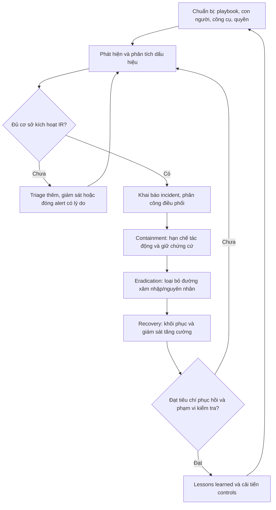
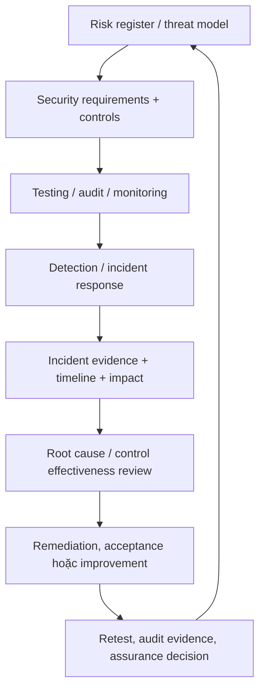

# Incident Response là gì? Từ phát hiện đến phục hồi và cải tiến Security Assurance

## 1. Tổng quan: Incident Response giải quyết vấn đề gì?

**Incident Response (IR) — ứng phó sự cố an ninh mạng** là quá trình có tổ chức nhằm **phát hiện, phân tích, điều phối, giới hạn tác động, loại bỏ nguyên nhân, khôi phục hoạt động và rút kinh nghiệm** khi một sự kiện đe dọa hoặc vi phạm an ninh ảnh hưởng tới hệ thống, dữ liệu hay hoạt động kinh doanh.

Khi bảo mật vận hành đúng, nhiều hành vi trái phép có thể bị ngăn chặn. Nhưng không hệ thống nào có thể mặc định mọi biện pháp phòng ngừa sẽ luôn hiệu quả. Tài khoản có thể bị lộ, dependency có thể tồn tại lỗ hổng chưa được vá, quyền cloud có thể bị cấu hình sai hoặc nhân sự có thể gửi nhầm dữ liệu. IR nhằm giảm thiểu **thời gian kẻ tấn công duy trì khả năng tác động, quy mô thiệt hại, gián đoạn kinh doanh và nguy cơ tái diễn**, đồng thời bảo vệ chứng cứ để xác định điều thực sự đã xảy ra.

Trong chương **Incident response** của module **SECURITY_SECURITY_ASSURANCE**, IR không đơn thuần là dập một cảnh báo. Đây là **nguồn bằng chứng thực tế về hiệu quả của các security controls**. Quá trình xử lý sự cố phải trả lời:

- Rủi ro hoặc security objective nào bị đe dọa?
- Control nào đã ngăn chặn, phát hiện, hạn chế hoặc không hoạt động như mong đợi?
- Bằng chứng nào chứng minh phạm vi, nguyên nhân, tác động và trạng thái khôi phục?
- Những phát hiện nào phải chuyển thành remediation, test, audit finding hoặc cập nhật risk register?
- Sau khi sửa, hệ thống đã được **kiểm tra lại** ra sao để tăng mức assurance trong phát triển và vận hành?

### Kết quả học tập

Sau bài học, người học có thể:

1. Phân biệt security event, alert, security incident, vulnerability và problem.
2. Mô tả vòng đời IR và mối quan hệ giữa chuẩn bị, phát hiện, phân tích, containment, eradication, recovery và lessons learned.
3. Thiết kế một quy trình triage có mức độ ưu tiên, điều kiện escalation và quyền ra quyết định.
4. Hiểu trách nhiệm của Incident Commander, SOC, SRE, AppSec, người sở hữu dữ liệu, pháp chế và truyền thông.
5. Lưu giữ log, timeline, artifact và **chain of custody** để quyết định có thể kiểm chứng.
6. Vận dụng quy trình vào tình huống nghi lộ credential của workload cloud.
7. Xác định tiêu chí đóng sự cố, chỉ số đo hiệu quả và cải tiến assurance sau sự cố.

## 2. Những khái niệm dễ nhầm

### 2.1. Event, alert, incident, vulnerability và finding

| Thuật ngữ | Ý nghĩa | Ví dụ | Hành động thường gặp |
|---|---|---|---|
| **Security event** | Một quan sát liên quan bảo mật, chưa tự nó chứng minh điều bất thường | Đăng nhập thành công; thay đổi quyền IAM; lỗi xác thực | Thu thập, ghi nhận, phân tích theo ngữ cảnh |
| **Alert** | Tín hiệu do rule, hệ thống giám sát hoặc con người tạo ra khi có điều kiện đáng chú ý | 15 lần đăng nhập thất bại trong 3 phút | Triage, xác minh, bổ sung ngữ cảnh |
| **Security incident** | Sự kiện hoặc chuỗi sự kiện đáp ứng tiêu chí của tổ chức về vi phạm, ảnh hưởng hoặc đe dọa đáng kể cần kích hoạt ứng phó | Workload identity bị dùng trái phép để xuất dữ liệu | Kích hoạt IR, điều phối, giảm tác động, phục hồi |
| **Vulnerability** | Điểm yếu có thể bị khai thác, dù chưa có dấu hiệu bị khai thác | API thiếu kiểm tra quyền theo đối tượng | Đánh giá rủi ro, sửa lỗi, retest |
| **Security finding** | Kết quả kiểm tra/đánh giá về control hoặc rủi ro, có thể là vấn đề cần xử lý | Audit phát hiện log admin bị thiếu | Triage, remediation, quản lý ngoại lệ |
| **Operational problem** | Nguyên nhân sâu xa của một hoặc nhiều sự cố vận hành | Quy trình rollout liên tục làm mất rule logging | Root cause analysis và sửa hệ thống |

**Không phải mọi alert đều là incident**; một alert có thể là false positive hoặc hành vi vận hành hợp lệ. Ngược lại, **một incident có thể xảy ra khi không có alert**: đối tác báo dữ liệu lộ, người dùng nhận thấy tài khoản bất thường hoặc nhóm vận hành phát hiện dấu vết từ kiểm tra thủ công.

Một vulnerability nghiêm trọng chưa có bằng chứng khai thác thường đi vào quản lý lỗ hổng; nếu có dấu hiệu khai thác và hậu quả, tổ chức có thể đồng thời mở incident. Việc phân biệt giúp tránh “mở IR cho mọi CVE” hoặc bỏ qua dấu hiệu xâm nhập chỉ vì scanner không báo lỗi.

### 2.2. An ninh, an toàn và tính liên tục

Security incident có thể tác động tới ba mục tiêu bảo mật cốt lõi:

- **Confidentiality:** dữ liệu bị xem, xuất hoặc tiết lộ ngoài quyền.
- **Integrity:** dữ liệu, code, log, cấu hình hoặc giao dịch bị sửa trái phép.
- **Availability:** dịch vụ bị gián đoạn, bị mã hóa phá hoại hoặc không thể phục hồi.

Ngoài ra cần xem khả năng truy vết (accountability), quyền riêng tư, yêu cầu pháp lý/hợp đồng và độ tin cậy của quyết định quản trị. Một sự cố mất availability do lỗi phần cứng có thể thuộc quy trình incident vận hành; nếu có dấu hiệu tấn công hoặc control bị vi phạm, quy trình IR bảo mật có thể được kích hoạt đồng thời. Tổ chức cần định nghĩa rõ cách phối hợp để tránh tranh chấp quyền chỉ huy.

### 2.3. IR, Digital Forensics và Disaster Recovery

- **Incident Response:** điều phối xử lý rủi ro và tác động của sự cố từ đầu đến kết thúc.
- **Digital Forensics:** thu thập, bảo quản, phân tích artifact để tái dựng sự kiện, nguồn và phạm vi với tính toàn vẹn phù hợp; có thể là một nhánh chuyên môn trong IR.
- **Disaster Recovery (DR):** phục hồi nền tảng, dữ liệu hoặc dịch vụ theo kịch bản gián đoạn và mục tiêu RPO/RTO.
- **Business Continuity (BC):** duy trì hoạt động kinh doanh quan trọng trong thời gian có gián đoạn.

Chúng có thể diễn ra song song. Một vụ xâm nhập phá dữ liệu vừa cần giới hạn attacker, điều tra phạm vi, vừa cần DR để đưa dịch vụ trở lại. Khôi phục backup mà không xử lý credential đã bị đánh cắp có thể khiến kẻ tấn công tiếp tục phá hệ thống sau khi khôi phục.

## 3. Mục tiêu và nguyên tắc của ứng phó sự cố

IR cân bằng nhiều mục tiêu thường xung đột:

1. **An toàn con người và hoạt động trọng yếu:** tránh hành động khiến hệ thống điều khiển, y tế hoặc dịch vụ trọng yếu gặp rủi ro không chấp nhận được.
2. **Giảm thiểu tác động:** cô lập đường tấn công, ngăn phát tán hoặc thay đổi dữ liệu thêm.
3. **Giữ khả năng điều tra:** bảo tồn chứng cứ trước khi chúng bị mất do reboot, log rotation hoặc thay đổi hạ tầng.
4. **Khôi phục hoạt động an toàn:** đưa dịch vụ trở lại khi có căn cứ đã kiểm soát đường xâm nhập, không chỉ “server đã lên”.
5. **Đáp ứng nghĩa vụ thông báo:** phối hợp pháp chế, privacy, khách hàng, đối tác hoặc cơ quan có thẩm quyền theo nghĩa vụ thực sự áp dụng.
6. **Cải tiến kiểm soát:** tìm nguyên nhân có thể hành động và xác minh việc sửa để giảm tái diễn.

IR phải **dựa trên bằng chứng nhưng vẫn kịp thời**. Không phải lúc nào cũng chờ xác minh hoàn hảo mới được containment: với rủi ro lớn và bằng chứng đủ tin cậy, có thể cần hành động giảm thiệt hại trước khi biết đầy đủ nguyên nhân. Quyết định cần được ghi rõ *điều đã biết, điều còn nghi ngờ, tác động dự kiến, người phê duyệt và cách hoàn tác*.

**Nguyên tắc cần nhớ:** bảo vệ chứng cứ không có nghĩa để attacker tự do tiếp tục hoạt động; hạn chế tác động không có nghĩa xóa sạch artifact trước khi điều tra. Kế hoạch phải đánh đổi có ý thức theo mức nghiêm trọng và điều kiện môi trường.

## 4. Vòng đời Incident Response

Nhiều tài liệu đào tạo mô tả các bước **Preparation → Detection & Analysis → Containment → Eradication → Recovery → Lessons Learned**. Đây là một mô hình giải thích thuận tiện, không phải chuỗi cứng và cũng không phải khẳng định rằng tất cả framework hiện đại đều trình bày đúng sáu giai đoạn này. Trong vận hành, các bước **lặp lại và chồng lấn**: đang phục hồi vẫn có thể phát hiện tài khoản khác bị ảnh hưởng và quay lại containment.



### 4.1. Preparation — chuẩn bị trước sự cố

Chuẩn bị gồm **con người, tài liệu, công cụ và quyền thực thi**:

- Incident response policy: thế nào là incident, khi nào kích hoạt, cấp độ, thẩm quyền và nghĩa vụ báo cáo.
- Playbook theo tình huống: account compromise, cloud key leak, ransomware, data exposure, CI/CD compromise, service abuse.
- Danh bạ khẩn cấp, cơ chế trực/on-call, người thay thế, kênh giao tiếp ngoài hạ tầng có thể bị xâm nhập.
- Asset inventory, service ownership, data classification, dependency map và business impact.
- Logging, monitoring, SIEM/EDR, cloud audit, thời gian đồng bộ, quyền truy cập bằng chứng.
- Công cụ truy vấn read-only, bộ cách ly có giới hạn và kịch bản rollback; quyền break-glass được bảo vệ và audit.
- Bản sao lưu, phương án DR, diễn tập restore và kiểm tra account/key cần để khôi phục.
- Tabletop/purple-team exercises, training và thỏa thuận với pháp chế/đối tác liên quan.

**Bằng chứng assurance:** playbook có owner và phiên bản; diễn tập có mục tiêu, kết quả và hành động; log quan trọng có event mẫu thực sự đi qua pipeline; quyền kích hoạt containment đã được xác minh trong môi trường thử.

### 4.2. Detection & Analysis — phát hiện và hiểu sự cố

Các tín hiệu có thể đến từ SIEM, EDR, cloud alert, khách hàng, nhân viên, bug bounty, audit, nhà cung cấp hoặc threat intelligence. Triage phải làm rõ:

1. Tín hiệu có thật, đúng tài sản và thời gian không?
2. Actor/principal nào có liên quan? Có bị nhầm tài khoản máy, dịch vụ hoặc người dùng?
3. Hành vi được phê duyệt hay không? Có change ticket, test đã được lên lịch hoặc thao tác vận hành?
4. Có chỉ dấu ảnh hưởng tới confidentiality, integrity, availability hay không?
5. Tài sản và dữ liệu nào có thể bị ảnh hưởng; phạm vi hiện chắc chắn và giả định nào chưa kiểm?
6. Có cần containment ngay không; hành động nào gây gián đoạn tối thiểu?

**Không suy luận quá mức:** một IP lạ chưa chứng minh credential bị đánh cắp; một lần đọc object không chứng minh exfiltration toàn bộ dataset; không có alert không chứng minh không có compromise.

### 4.3. Containment — giới hạn tác động

Containment nhằm **ngăn sự cố phát triển thêm** trong khi duy trì khả năng điều tra và phục vụ hoạt động trọng yếu. Các hành động tùy tình huống:

- Vô hiệu hóa hoặc hạn chế credential/token đang bị nghi lạm dụng và theo dõi phiên hiện có.
- Thu hẹp quyền IAM, tạm dừng một API, chặn nguồn truy cập đã được đánh giá đủ căn cứ.
- Cách ly workload/host hoặc workload identity theo quy trình được duyệt.
- Hạn chế outbound network, tách vùng dữ liệu/backup để giảm phát tán.
- Đóng băng thay đổi không cấp thiết và bảo vệ audit log khỏi xóa sửa.

**Không áp dụng máy móc:** cách ly host ngay lập tức có thể làm mất dữ liệu volatile trong RAM; thu hồi một service identity dùng chung có thể khiến nhiều dịch vụ không chạy; chặn egress có thể ảnh hưởng backup/health check. Incident Commander cân nhắc **lợi ích, tác động và khả năng rollback**, có thể thu thập chứng cứ volatile trước nếu an toàn và kịp thời.

### 4.4. Eradication — loại bỏ khả năng tiếp tục xâm nhập

Sau containment, cần xử lý **cơ chế gây sự cố**, không chỉ biểu hiện:

- Thu hồi và thay thế credential đã lộ; sửa trust policy và cách cấp quyền.
- Vá lỗ hổng bị khai thác; áp dụng authorization/server-side checks.
- Loại bỏ persistence hoặc artifact độc hại sau khi xác minh, xây dựng lại từ image/artifact đáng tin khi phù hợp.
- Sửa cấu hình cloud, CI/CD secrets, quyền registry hoặc IAM quá rộng.
- Kiểm tra các tài nguyên cùng mẫu rủi ro; xem kẻ tấn công đã mở đường truy cập thay thế chưa.

Nếu chưa xác định đủ nguyên nhân, cần ghi **giả thuyết** và áp dụng control giảm thiểu; không ghi “eradicated” chỉ vì một máy đã được restart hoặc một IP bị chặn.

### 4.5. Recovery — khôi phục an toàn

Recovery cần xác định **điều kiện đưa dịch vụ trở lại**, ví dụ:

- Workload được xây từ image/backup đáng tin, hash/digest và build revision rõ ràng.
- Credential/key/permission đã được thay và xác minh với những tài khoản trong scope.
- Security tests cần thiết (authorization, config, malware indicators, smoke/regression) đã đạt.
- Telemetry và alerting hoạt động, có giám sát tăng cường cho dấu hiệu tái xâm nhập.
- Dữ liệu được đối chiếu tính toàn vẹn; mục tiêu RPO/RTO được đo và chấp thuận theo kịch bản.
- Service owner và Incident Commander hoặc cấp có thẩm quyền phê duyệt chuyển trạng thái.

“HTTP 200 trở lại” chỉ chứng minh ứng dụng có phản hồi, không chứng minh kiểm soát đã được khôi phục hoặc attacker mất quyền.

### 4.6. Lessons Learned — học từ sự cố và cải tiến

Một cuộc review không nhằm tìm người đổ lỗi mà nhằm xác định **cơ chế lỗi và quyết định cải thiện có thể kiểm chứng**:

- Vì sao phòng ngừa không chặn được? Có thiếu yêu cầu, lỗi triển khai hoặc ngoại lệ kéo dài?
- Vì sao detection đến sớm/muộn hoặc không đến? Data source, parser, rule, coverage, routing hay con người?
- Quyết định containment nào hữu hiệu, hành động nào tạo tác động ngoài ý muốn?
- Runbook, quyền truy cập, backup và liên lạc có phù hợp?
- Control và test nào sẽ thay đổi, ai phụ trách và bao giờ retest?

**Đóng ticket lessons learned không phải đóng vòng assurance** nếu thay đổi chưa được triển khai và chưa được xác minh. Cần liên kết action item với evidence khắc phục và tiêu chí chấp nhận cụ thể.

## 5. Quy trình quyết định: từ tín hiệu đến incident được quản lý

Một quy trình IR cần giải thích **khi nào chuyển từ quan sát sang điều phối sự cố**, không để mỗi người tự suy luận.

### 5.1. Triage có cấu trúc

| Bước | Câu hỏi | Kết quả phải ghi |
|---|---|---|
| **Xác thực tín hiệu** | Event/alert có nguồn đáng tin, đúng thời gian/resource? | Alert ID, source, observed behavior, giả thuyết ban đầu |
| **Kiểm tra hợp lệ** | Có change hoặc bài test được ủy quyền? | Approval reference hoặc lý do chưa xác định |
| **Đánh giá tác động** | Hệ thống/dữ liệu nào có thể bị ảnh hưởng? | Asset, data class, business service, phạm vi chắc chắn/nghi vấn |
| **Đánh giá tính khẩn** | Attacker có còn active, dữ liệu còn có nguy cơ không? | Containment urgency, dependency, thẩm quyền |
| **Quyết định kích hoạt** | Có đáp ứng incident declaration criteria không? | Decision, người quyết định, thời điểm, rationale |
| **Chọn playbook** | Thuộc account compromise, data leak, malware hay outage? | Incident type, playbook version, owner |
| **Cập nhật liên tục** | Bằng chứng mới làm thay đổi phạm vi/severity? | Timeline, severity revision, lý do và phê duyệt |

Triage có thể xảy ra lặp lại. Nếu chỉ có một alert thiếu bằng chứng, trạng thái “đang điều tra” hợp lý hơn việc khẳng định compromise. Với dấu hiệu rõ ràng về tác động đang diễn ra, tổ chức có thể khai báo incident trước khi biết nguyên nhân đầy đủ.

### 5.2. Severity và Priority khác nhau

**Severity** phản ánh mức tác động và phạm vi sự cố theo khung nội bộ; **priority** phản ánh độ khẩn của hành động cụ thể, gồm mức đe dọa đang diễn ra và khả năng xử lý. Một vấn đề chưa gây thiệt hại lớn nhưng có thể nhanh chóng lan rộng có thể cần xử lý khẩn.

Ví dụ minh họa, **không phải chuẩn bắt buộc**:

| Mức | Dấu hiệu gợi ý | Ví dụ cách điều phối |
|---|---|---|
| **SEV1 — Critical** | Dữ liệu nhạy cảm bị lộ quy mô lớn, quyền quản trị bị chiếm, hoạt động trọng yếu bị tấn công và lan rộng | Kích hoạt nhóm liên chức năng và lãnh đạo khẩn cấp; cập nhật thường xuyên |
| **SEV2 — High** | Compromise đã xác nhận nhưng phạm vi giới hạn, hệ thống quan trọng có rủi ro đáng kể | Incident Commander và chủ hệ thống ưu tiên containment |
| **SEV3 — Moderate** | Hành vi vi phạm có tác động giới hạn hoặc đã được ngăn chặn nhưng cần điều tra | Xử lý theo playbook và SLA |
| **SEV4 — Low / Observation** | Chưa có bằng chứng đủ để xác định incident, mức tác động thấp | Triage, theo dõi, đóng hoặc mở finding có lý do |

Mức phân loại thực phải do tổ chức phê duyệt, có tiêu chí rõ về dữ liệu, tác động kinh doanh, tính liên tục, nghĩa vụ pháp lý và phạm vi hệ thống. **SEV4 không nhất thiết là security incident** trong mọi quy trình; có thể chỉ là trạng thái quan sát.

### 5.3. Escalation và thời hạn

Escalation xảy ra khi sự cố vượt thẩm quyền/kiến thức người đang xử lý, có dấu hiệu lan rộng, liên quan dữ liệu nhạy cảm hoặc thời gian phản ứng không đáp ứng mục tiêu. Quy trình cần biết:

- Kênh nội bộ khẩn cấp và người dự phòng.
- Khi nào cần pháp chế, privacy, compliance, lãnh đạo hoặc bên thứ ba.
- Tiêu chí thay đổi mức nghiêm trọng và lịch cập nhật tình hình.
- Trường hợp phải sử dụng kênh liên lạc **ngoài hệ thống có khả năng bị xâm nhập**.

Hạn thông báo pháp lý/hợp đồng khác nhau theo địa bàn, loại dữ liệu và quan hệ giữa các bên. Không đặt con số giờ chung cho mọi incident; phải tham khảo yêu cầu thực sự áp dụng và lời khuyên của bộ phận chuyên trách.

## 6. Con người, trách nhiệm và cơ chế chỉ huy

Một sự cố phức tạp không thể chỉ do một analyst xử lý. Cần **Incident Commander (IC)** hoặc người điều phối được phân quyền để giữ một cái nhìn chung và ra quyết định trong giới hạn trách nhiệm.

| Vai trò | Trách nhiệm khi sự cố diễn ra | Bằng chứng/kết quả |
|---|---|---|
| **Incident Commander** | Phân công, đặt ưu tiên, phê duyệt hoặc trình containment, giữ nhịp cập nhật, quản lý quyết định | Incident log, decision records, status, điều kiện chuyển giai đoạn |
| **SOC / SecOps** | Nhận cảnh báo, triage, hunting, cập nhật chỉ dấu và rule | Alert disposition, hunting queries, detection changes |
| **Forensics / DFIR** | Thu thập/bảo quản artifact, timeline, phân tích phạm vi và cơ chế xâm nhập | Evidence register, hashes, chain of custody, findings |
| **SRE / Platform / Cloud Ops** | Cách ly, giới hạn IAM/network, khôi phục dịch vụ, theo dõi telemetry | Change IDs, runtime states, rollback/recovery tests |
| **AppSec / Developers** | Phân tích code, nguyên nhân ứng dụng, xây bản sửa, regression tests | Fix commits, test reports, security control verification |
| **Data / Service Owner** | Xác định tài sản, phân loại dữ liệu, tác động nghiệp vụ, xác nhận chức năng | Asset impact scope, recovery acceptance |
| **Privacy / Legal / Compliance** | Đánh giá nghĩa vụ thông báo, bảo quản chứng cứ, yêu cầu quy định và hợp đồng | Decision records và thông báo được phê duyệt |
| **Communications / Leadership** | Thông điệp nhất quán tới nội bộ, khách hàng, đối tác khi cần | Approved updates, stakeholder plan |
| **Risk Owner** | Chấp thuận rủi ro tồn dư và ngoại lệ theo thẩm quyền | Risk acceptance, điều kiện và thời hạn rà soát |

Với tổ chức nhỏ, một người có thể kiêm nhiều vai trò, nhưng **quyền quyết định** vẫn cần được ghi rõ để không có tình huống hai nhóm cùng sửa firewall hoặc cùng thông báo khách hàng với nội dung mâu thuẫn.

### 6.1. “Single source of truth” cho sự cố

Nên có một hồ sơ incident có access control phù hợp, ghi:

- Incident ID, người điều phối, mức hiện tại, tình trạng và mục tiêu xử lý.
- Timeline các sự kiện **quan sát được**, giả thuyết, quyết định và hành động.
- Danh sách tài sản/identity/dữ liệu **confirmed** và **suspected** riêng.
- Link bằng chứng đã bảo vệ, ticket thay đổi, kết quả validation và người phụ trách.
- Lịch cập nhật tình hình, stakeholder updates và kết luận trạng thái.

Tránh phân tán thông tin chính thức trên nhiều group chat không được lưu trữ. Tuy nhiên, không đưa credential, dữ liệu cá nhân, forensic dump hoặc thông tin đặc biệt nhạy cảm vào một kênh rộng chỉ để mọi người cùng xem.

## 7. Bảo toàn bằng chứng và điều tra có thể kiểm chứng

Trong **Security Assurance**, chất lượng IR phụ thuộc lớn vào bằng chứng: có thể biết chuyện gì đã xảy ra, kiểm tra chéo, xác định giới hạn kết luận và đưa ra quyết định phù hợp không?

### 7.1. Nguồn chứng cứ thường gặp

| Nguồn | Giá trị điều tra | Giới hạn |
|---|---|---|
| **Identity/IdP logs** | Đăng nhập, MFA, refresh/revoke, grant permissions | Có thể thiếu session context hoặc log đã hết retention |
| **Cloud audit events** | Ai gọi API thay IAM, storage, network, key, log | Management events và data access events có thể cần bật riêng |
| **Application logs/traces** | Endpoint, correlation ID, business action, authz result | Logging level, data minimization và clock drift ảnh hưởng |
| **Host/EDR telemetry** | Process, network, persistence, file events | Không phải host nào cũng có agent; EDR có thể bị vô hiệu hóa |
| **Network/DNS/proxy logs** | Outbound activity, domain, session metadata | Không luôn cho thấy payload hoặc actor chính xác |
| **Registry/CI/CD audit** | Build, push/deploy, artifact digest, service credentials | Dễ nhầm tag mutable với digest đang chạy |
| **Storage/DB audit** | Đọc, ghi, xóa, export và permission changes | Có thể có sampling, không bật data events hoặc log bị thiếu |
| **Volatile memory/process state** | Session/process tạm thời, một số dấu vết xâm nhập | Thường mất khi reboot; thu thập phức tạp, cần thẩm quyền |
| **Screenshots/chat/ticket** | Timeline và quyết định của con người | Dễ thiếu ngữ cảnh và chưa chắc chứng minh runtime behavior |

**Không tìm được log ≠ không có hành vi.** Cần kiểm tra logging coverage, thời gian thu thập, quyền truy cập, trạng thái pipeline và retention trước khi kết luận.

### 7.2. Chain of custody là gì?

**Chain of custody (chuỗi quản lý chứng cứ)** ghi lại **ai thu thập, xử lý, chuyển giao, lưu và truy cập artifact khi nào, bằng phương pháp nào**. Nó hỗ trợ đánh giá tính toàn vẹn và sự phù hợp của bằng chứng với yêu cầu nội bộ hoặc pháp lý, nhưng không bảo đảm mọi artifact tự động đủ giá trị pháp lý.

Một evidence record có thể chứa:

```yaml
evidence_id: IR-EV-EXAMPLE-001
incident_id: IR-LAB-001
description: "Cloud audit event snapshot (redacted)"
source:
  system: "example-cloud-audit"
  account: "LAB-ACCOUNT"
  time_window_utc:
    from: "2026-11-28T01:00:00Z"
    to: "2026-11-28T02:00:00Z"
collection:
  actor: "authorized-dfir-analyst"
  collected_at: "2026-11-28T02:12:00Z"
  method: "provider read-only export API"
  query_reference: "IR-LAB-001-query-01"
artifact:
  path: "evidence/audit-events-redacted.json"
  sha256: "<actual-computed-sha256>"
  access_class: restricted
handling:
  - actor: "authorized-dfir-analyst"
    action: collected_and_sealed
    at: "2026-11-28T02:13:00Z"
  - actor: "security-reviewer"
    action: read_only_review
    at: "2026-11-28T03:00:00Z"
limitations:
  - "Only configured audit event types available"
```

Đây là **mẫu hư cấu**, với giá trị hash placeholder. Khi làm thật, hash phải tính trên **bytes của artifact cụ thể**, bản gốc và bản đã redact có hash riêng. Nên giữ dữ liệu gốc ở nơi hạn chế quyền, có audit hoặc cơ chế chống sửa; bản chia sẻ cho reviewer được tối thiểu hóa dữ liệu.

### 7.3. Tạo timeline không nhầm thời gian

Phân biệt:

- **Event time:** lúc hành vi xảy ra theo nguồn.
- **Ingest/collection time:** lúc log vào hệ thống hoặc được thu thập.
- **Detection/alert time:** lúc rule cảnh báo.
- **Decision/action time:** lúc đội IR quyết định và thực hiện.

Sử dụng timezone nhất quán (thường UTC) và ghi clock skew khi biết. Không nối log từ hai hệ thống có đồng hồ lệch thành quan hệ nguyên nhân-kết quả chắc chắn nếu chưa kiểm chứng.

### 7.4. Xử lý dữ liệu nhạy cảm trong bằng chứng

Ảnh chụp RAM, packet capture hoặc log thô có thể chứa **password, token, PII, khóa riêng và bí mật nghiệp vụ**. Chỉ nhân sự có quyền mới thu thập, truy cập hoặc chia sẻ. Với các yêu cầu pháp lý/forensic, phải phối hợp bộ phận chuyên trách để không làm mất bằng chứng hoặc vi phạm hạn chế quyền riêng tư.

Một checksum giúp phát hiện thay đổi so với giá trị đối chiếu đáng tin, **không** chứng minh sự kiện là thật hay người đã tạo dữ liệu. Chất lượng chứng cứ còn phụ thuộc nguồn, phương pháp, quyền, trạng thái hệ thống và những điều chưa quan sát.

## 8. Playbook và runbook: phân biệt để phối hợp đúng

**Playbook** mô tả cách ứng phó cho **loại sự cố** — mục tiêu, quyết định, dữ liệu cần thu, lựa chọn containment, vai trò, escalation và tiêu chí phục hồi. **Runbook** thường là thủ tục kỹ thuật cụ thể để thực hiện một thao tác, ví dụ khóa một service principal, lấy cloud audit snapshot hoặc rollback deployment.

| Playbook | Runbook |
|---|---|
| “Ứng phó nghi lộ cloud credential” | “Thu hồi token test theo provider A và xác minh API denies” |
| Có cây quyết định dựa trên impact và độ tin cậy | Có bước thao tác, precondition, expected result, rollback |
| Phân công IC, DFIR, SRE, legal và comms | Xác định quyền cần có, script/tool, người thực thi |
| Bao quát điều tra, containment, recovery, lessons learned | Tập trung một thủ tục có thể kiểm tra |

**Playbook không nên là danh sách lệnh thiếu điều kiện.** Ví dụ “disable account” có thể ngăn attacker nhưng cũng ngắt hàng trăm service; người thực hiện phải biết phụ thuộc, approval, đường thay thế và cách khôi phục. Những lệnh có tác động cao nên được diễn tập trước trong sandbox.

### 8.1. Mẫu cấu trúc một playbook

```text
Playbook: Suspicious workload credential use
Trigger: Alert hoặc báo cáo có bằng chứng nghi lạm dụng
Scope: Cloud accounts/workloads cụ thể
Incident owner: Incident Commander / Cloud owner

1. Triage: xác định actor, resource, timeframe, indicators, confidence
2. Evidence: snapshot audit logs, config, token metadata theo quyền
3. Containment options: hạn quyền, revoke session/key, chặn route
4. Decision: ai phê duyệt, impact, rollback, tiêu chí khẩn cấp
5. Eradication: sửa cơ chế lộ key, least privilege, redeploy
6. Recovery: verify service + unauthorized access denied + monitoring
7. Communication: stakeholders, legal/privacy triggers
8. Closure: criteria, residual risks, after-action review
```

Các bước có thể được thực hiện song song hoặc điều chỉnh dựa trên diễn biến; không coi playbook là lý do từ chối quyết định khẩn cấp có căn cứ.

## 9. Ví dụ xuyên suốt: nghi lộ credential của workload cloud

### 9.1. Bối cảnh bài toán

Một ứng dụng `order-api` chạy trên nền tảng cloud dùng **workload identity** để đọc một số object phục vụ đơn hàng. Nhóm phát hiện một token hoặc key có khả năng bị lộ trong một job CI/CD; sau đó hệ thống giám sát ghi nhận truy cập storage bất thường từ một vị trí ngoài quy trình triển khai.

Giả định trong **môi trường lab được cấp phép**:

- `SERVICE_ORDER` là danh tính ứng dụng; không phải tài khoản con người.
- `LAB_BUCKET_A` chứa các object canary không có dữ liệu khách hàng thật.
- Audit events có thời điểm UTC, actor, action, resource, kết quả và request ID.
- CI job có lịch sử thay đổi và credential metadata được phép kiểm tra.
- Có thể thu hồi/rotate identity thử nghiệm mà không gây gián đoạn production.

**Không mặc định credential chắc chắn đã bị đánh cắp** chỉ vì có dấu hiệu log bất thường; giả thuyết cần được xác minh. Ví dụ dưới đây là hư cấu nhằm dạy phương pháp IR và evidence, không mô tả một cuộc tấn công thực tế.

### 9.2. Giai đoạn phát hiện và triage

Hệ thống SIEM tạo alert `ALERT-LAB-771`: `SERVICE_ORDER` phát sinh chuỗi `GetObject` ngoài cửa sổ triển khai thông thường. Analyst cần:

1. Xác nhận log nguồn thật, đúng account/region, không phải replay hoặc dashboard mock.
2. Đối chiếu principal, phiên hoặc credential ID với metadata và cơ chế xác thực của provider.
3. Kiểm tra IP/đường truy cập, thay đổi CI, workload rollout và các tác vụ backup/export hợp lệ.
4. Xác minh resource nào đã bị truy cập và có phản hồi thành công hay chỉ bị từ chối.
5. Đánh giá nguy cơ hiện tại: credential còn hiệu lực, phạm vi quyền, dữ liệu nằm trong ranh giới đó.
6. Phân biệt **sự kiện đã xác nhận** với **giả thuyết** (ví dụ “key lộ ở CI”) đang điều tra.

### 9.3. Lập timeline từ chứng cứ

| UTC — giả lập | Quan sát / hành động | Loại thông tin | Evidence reference |
|---|---|---|---|
| 01:02 | CI job thay đổi cấu hình và chạy bước build | Quan sát | `CI-LOG-LAB-01` |
| 01:15 | Audit log ghi thao tác đọc canary bằng `SERVICE_ORDER` từ nguồn không thường gặp | Quan sát | `CLOUD-EVENT-801` |
| 01:18 | SIEM tạo alert về access pattern | Quan sát | `ALERT-LAB-771` |
| 01:22 | Analyst xác định resource, principal và alert không nằm trong test đã được khai báo | Kết quả triage | `TRIAGE-LAB-01` |
| 01:25 | IC được chỉ định; incident `IR-LAB-001` được khai báo | Quyết định | `INCIDENT-LOG-001` |
| 01:29 | Thu snapshot các audit events và cấu hình identity theo quyền read-only | Hành động bảo toàn | `IR-EV-01..03` |
| 01:34 | IC phê duyệt vô hiệu credential thử nghiệm và chuyển ứng dụng sang identity an toàn | Quyết định containment | `DECISION-004` |
| 01:37 | Credential cũ bị từ chối ở kiểm thử negative control | Kết quả containment | `TEST-REVOKE-01` |
| 02:05 | Tìm thấy một bước CI không phù hợp policy đã xuất credential ra log | Phát hiện về nguyên nhân | `CI-FINDING-02` |
| 02:40 | Sửa bước build, rotate secret và giới hạn role; deploy lại từ artifact tin cậy | Hành động eradication/recovery | `CHANGE-081` |
| 03:05 | Smoke test pass, credential cũ bị từ chối, monitoring hoạt động | Bằng chứng recovery | `RETEST-09` |
| Ngày tiếp theo | Review phạm vi, hoàn thiện risk và action items | Lessons learned | `AAR-IR-LAB-001` |

Timeline phải chỉ rõ **sự kiện xảy ra**, **thời điểm được phát hiện**, **quyết định** và **hành động**. Không gán `CI-LOG-LAB-01` là nguyên nhân chắc chắn ở phút 01:02 khi thời điểm đó chưa có bằng chứng kết nối với credential; thông tin kết luận từ điều tra sau được ghi như finding có thời gian phát hiện riêng.

### 9.4. Quyết định containment có đánh đổi

Ba phương án có thể được bàn:

| Phương án | Lợi ích | Rủi ro vận hành | Điều kiện áp dụng |
|---|---|---|---|
| Thu hồi credential/token đang nghi lộ | Giảm khả năng tiếp tục dùng quyền cũ | Nếu cùng credential được nhiều service dùng, có thể gây lỗi | Có phương án chuyển identity, rollback và giám sát |
| Thu hẹp policy IAM xuống resource cần thiết | Giảm blast radius | Có thể làm hỏng job hợp lệ chưa được inventory | Xác nhận quyền tối thiểu, test service workflow |
| Tạm hạn chế đường truy cập storage/egress | Giảm tiếp cận dữ liệu ngay | Có thể ngắt backup, ứng dụng hoặc logging | Đánh giá tác động, xác định scope và thời hạn |

Không nên chọn “xóa mọi log CI rồi đổi tên token” vì xóa bằng chứng và không giải quyết bản chất. Với hệ thống sản xuất, cần cân nhắc **thu thập volatile evidence trước hoặc song song** khi an toàn; nếu nghi có khai thác đang diễn ra, containment có thể được ưu tiên để chặn thiệt hại.

### 9.5. Eradication: sửa nguyên nhân chứ không chỉ biểu hiện

Giả sử điều tra xác nhận bước CI chạy lệnh có thể vô tình in credential vào log. Hành động khắc phục:

- Thay cơ chế cấp quyền cho CI bằng identity/token ngắn hạn khi có thể, hạn chế scope.
- Loại bỏ việc ghi secret từ job, kiểm tra pipeline steps và cách mask/redact.
- Thu hồi credential cũ và kiểm tra quyền còn hiệu lực qua session/token cơ chế provider.
- Kiểm tra lịch sử log/artifact, các bản copy liên quan, actor có quyền đọc log và nhu cầu xử lý exposure.
- Xác định những tài nguyên đã có access bằng credential đó trong khoảng thời gian liên quan; ghi **phạm vi chắc chắn** và những khoảng log chưa có.
- Bổ sung security tests cho CI và rule phát hiện sử dụng credential bất thường.

**Đổi secret không làm dữ liệu đã bị đọc tự động “chưa từng bị đọc”.** Nếu có khả năng dữ liệu đã bị truy cập, phần privacy/legal và impact assessment vẫn phải được thực hiện.

### 9.6. Recovery và negative control

Không chỉ xác nhận ứng dụng hoạt động. Thử lại:

| Test | Expected |
|---|---|
| Service mới đọc object được phép | Thành công với identity mới và phạm vi đúng |
| Credential cũ truy cập object canary | Bị từ chối theo đúng revocation semantics |
| Identity mới đọc object ngoài phạm vi | Bị từ chối |
| CI job mới chạy | Thành công, không đưa secret vào log/artifact |
| Audit event cho thử nghiệm mới | Tới log destination, đúng actor/action, không làm lộ token |
| Detection rule cho access pattern bất thường | Tạo tín hiệu trong thử nghiệm có phép |
| Bộ smoke/regression test chính | Không mất chức năng nghiệp vụ quan trọng |

Nếu credential cũ vẫn còn phiên hợp lệ theo cơ chế của provider, phải xử lý đúng cơ chế thu hồi session và ghi kết quả thực tế, **không mặc định rotate key luôn vô hiệu hóa mọi session ngay lập tức**.

### 9.7. Kết luận assurance có giới hạn

Một kết luận được bằng chứng hỗ trợ có thể là:

> “Trong lab, quyền sử dụng credential `SERVICE_ORDER` cũ đã bị từ chối ở các phép thử xác định; pipeline CI được sửa và kiểm tra không còn xuất secret qua đường đã phát hiện; quyền identity mới được giới hạn, ứng dụng hoạt động và logging đã được kiểm chứng. Việc credential có bị lạm dụng ở các hệ thống ngoài scope vẫn chưa được kết luận.”

**Không viết:** “Toàn bộ cloud đã an toàn và không có dữ liệu nào bị lộ” chỉ dựa trên việc credential cũ không dùng được nữa.

## 10. Hồ sơ incident và giao tiếp trong quá trình xử lý

Trong sự cố, thông tin thiếu, thay đổi nhanh và có thể chưa chắc chắn. Cần **một kênh ghi nhận quyết định** thống nhất để tránh người thực thi hành động trái nhau.

### 10.1. Mẫu incident record

```yaml
incident_id: IR-LAB-001
title: "Suspicious use of order-api workload credential"
service: SECURITY_SECURITY_ASSURANCE
declared_at: "2026-11-28T01:25:00Z"
environment: authorized-lab
status: containment_in_progress
severity: "LAB-SEV2 (illustrative)"
incident_commander: "authorized-incident-lead"
scope:
  confirmed_assets:
    - LAB_BUCKET_A
  suspected_assets:
    - LAB_CI_PIPELINE
  unknowns:
    - "Whether additional resources were accessed"
evidence:
  - IR-EV-01
  - IR-EV-02
  - IR-EV-03
decisions:
  - id: DECISION-004
    reason: "Limit additional credential use"
    action: "Revoke test credential and move to approved identity"
    approved_by: "authorized-incident-lead"
findings:
  - id: CI-FINDING-02
    type: credential_exposure
    confidence: confirmed_in_lab
recovery:
  validation: pending
  service_owner_approval: pending
communication:
  next_update: "per lab incident schedule"
  legal_or_privacy_review: "not applicable to synthetic lab data"
```

Mẫu hư cấu chỉ nhằm học cách ghi thông tin. Không sao chép giá trị severity hoặc “not applicable” cho incident thật; trong môi trường có dữ liệu cá nhân, nghĩa vụ pháp lý/hợp đồng cần được đánh giá bằng dữ kiện thực tế.

### 10.2. Mẫu cập nhật tình hình

Một status update tốt trả lời ngắn gọn:

- **Trạng thái:** đang điều tra, containment, recovery hay theo dõi hậu sự cố?
- **Điều đã xác nhận:** bằng chứng nào, hệ thống nào và tác động nào?
- **Điều chưa rõ:** phạm vi còn nghi ngờ và điều kiện cần xác minh?
- **Hành động đã thực hiện:** ai, lúc nào, thay đổi nào, kết quả?
- **Rủi ro còn lại và bước kế tiếp:** owner, tiêu chí hoàn thành, thời điểm cập nhật kế tiếp.

Ví dụ:

> “Đã xác nhận các request bất thường sử dụng workload identity trên tài nguyên thử nghiệm A. Nhóm đang bảo quản audit logs và xác minh liệu credential có bị lộ từ job CI. Đã giảm quyền theo quyết định của Incident Commander; ứng dụng vẫn hoạt động theo smoke test. Chưa đủ bằng chứng kết luận phạm vi bên ngoài tài sản đã kiểm.”

Không sử dụng ngôn ngữ khẳng định rò rỉ dữ liệu nếu chỉ có tín hiệu bất thường chưa được kiểm chứng. Đồng thời tránh giấu mức độ chưa rõ: người quyết định cần biết **điều không biết** để đánh giá rủi ro.

### 10.3. Phối hợp truyền thông và báo cáo

Đối tượng và chi tiết cần thông báo phụ thuộc severity, khách hàng bị ảnh hưởng, hợp đồng, quy định áp dụng và thông tin đã kiểm chứng. Nhóm pháp chế/privacy cùng bộ phận truyền thông phê duyệt thông điệp khi cần. Không đưa timeline forensic, kỹ thuật phòng vệ hoặc dữ liệu nhạy cảm vào kênh công khai nếu không có lý do và quyền phù hợp.

**Không đặt một hạn thông báo chung cho mọi sự cố.** Yêu cầu pháp lý có thể khác nhau theo quốc gia, ngành, loại dữ liệu và vai trò bên xử lý; IR playbook phải chỉ ra ai chịu trách nhiệm xác định hạn thật và kích hoạt quy trình kịp thời.

## 11. Khôi phục: điều kiện đóng sự cố và rủi ro tồn dư

### 11.1. Khi nào có thể chuyển sang monitoring?

Việc chuyển từ ứng phó khẩn cấp sang giám sát tăng cường hoặc hậu kiểm nên dựa trên **exit criteria**:

1. Hành vi tấn công đã được ngăn hoặc giảm xuống mức rủi ro được chấp thuận.
2. Các credential, tài khoản, đường truy cập hoặc persistence thuộc scope đã được xử lý và kiểm tra lại.
3. Dịch vụ phục hồi theo yêu cầu, các test chức năng và security regression cần thiết đã đạt.
4. Bằng chứng quan trọng đã được bảo quản, điểm mù logging và phạm vi không rõ được ghi nhận.
5. Chủ hệ thống, IC và các bên có thẩm quyền chấp thuận trạng thái mới.
6. Các remediation còn lại có owner, SLA, biện pháp bù trừ và cơ chế theo dõi.

**Một sự cố có thể đóng về mặt điều phối khẩn cấp trong khi risk remediation vẫn còn mở.** Khi đó phải nêu rõ nguy cơ tồn dư, ticket và điều kiện tái mở nếu xuất hiện bằng chứng mới.

### 11.2. Kiểm tra nguồn phục hồi có đáng tin không?

| Thành phần | Cần xác minh | Nếu bỏ qua |
|---|---|---|
| **Image / artifact** | Digest/build provenance từ nguồn được duyệt, không chứa artifact bị nghi compromise | Đưa lại mã hoặc cấu hình độc hại |
| **Backup / snapshot** | Thời điểm trước thay đổi độc hại, restore test, key/permission cần thiết | Khôi phục dữ liệu sai/hỏng hoặc không đọc được |
| **Identity / secrets** | Token đã rotate/revoke, role giới hạn theo policy, session cũ được kiểm tra | Kẻ tấn công dùng lại quyền |
| **Network / IAM** | Đường truy cập ngoài quyền bị chặn, luồng hợp lệ vẫn hoạt động | Chặn quá rộng hoặc để nguyên bề mặt tấn công |
| **Application controls** | Security regression và negative controls đạt | Lỗi nguyên nhân vẫn tồn tại |
| **Logging / monitoring** | Events, alerts và routing khôi phục, có test canary nếu phù hợp | Không biết sự cố tái diễn |
| **Data integrity** | Bản dữ liệu phục hồi khớp tiêu chí nghiệp vụ, ghi nhận phần không xác minh | Dữ liệu bị sửa trái phép vẫn tồn tại |

### 11.3. Đóng sự cố có phải đồng nghĩa không còn rủi ro?

Không. Một số câu hỏi có thể chưa giải đáp đầy đủ (ví dụ log thời gian trước đã hết hạn). Nhóm có thể kết thúc giai đoạn phản ứng sau khi đã kiểm soát hiện tại, ghi **giới hạn điều tra** và quản lý risk acceptance, remediation và monitoring. Không nên nói “không có exfiltration” khi chỉ có thể nói “chưa tìm thấy bằng chứng exfiltration trong log còn truy cập được”.

## 12. IR kết nối như thế nào với Security Assurance?

Security Assurance hướng tới **đánh giá có bằng chứng** hệ thống đáp ứng mục tiêu bảo mật. Incident là phép thử không được lên lịch trước của các giả định về nguy cơ, control và khả năng ứng phó.

### 12.1. Hai chiều phản hồi



Chương trình assurance cung cấp **baseline và security requirements** để xác định incident có nghĩa gì; ngược lại, điều tra sự cố cung cấp chứng cứ về **control thực sự có hoạt động** trong tình huống bất lợi không.

### 12.2. Ví dụ truy vết control

| Control | Quan sát từ incident | Hành động cải tiến | Bằng chứng đóng vòng |
|---|---|---|---|
| `AUTH-01`: service identity được cấp quyền tối thiểu | Credential có thể đọc nhiều bucket không cần thiết | Thu hẹp IAM policy, bổ sung role tests | Effective permissions và negative controls |
| `CI-SECRET-02`: secret không bị lộ trong build/log | CI step ghi credential ra log | Bảo vệ secret, thay đổi build workflow | CI test, secret scan, log kiểm tra đã redact |
| `LOG-03`: thao tác storage nhạy cảm có audit event | Một nhóm object không có data events | Bổ sung nguồn log phù hợp và retention | Event canary xuất hiện đúng nơi lưu |
| `DET-04`: phát hiện hành vi sử dụng identity bất thường | Alert đến sau khi nhiều request đã thực hiện | Sửa detector, data source và routing | Positive/negative detection tests, latency |
| `IR-05`: containment credential an toàn | Thu hồi gây gián đoạn service khác | Phân tách workload identities và runbook rollback | Diễn tập containment trên lab |
| `REC-06`: restore an toàn sau incident | Backup có nhưng chưa test khôi phục | Khởi động DR drill, kiểm tra integrity | Restore evidence, thời gian RPO/RTO |

Một finding chỉ thực sự khép vòng khi **bản sửa, cấu hình hoặc quy trình mới đã được kiểm tra** ở môi trường/bản build phù hợp. Đừng chỉ đóng ticket bằng lý do “đã cập nhật hướng dẫn” nếu control kỹ thuật còn thiếu.

### 12.3. Root cause và contributing factors

Root Cause Analysis (RCA) nên phân biệt:

- **Direct cause:** cơ chế trực tiếp cho phép truy cập ngoài quyền (ví dụ credential dùng lại).
- **Contributing factors:** role quá rộng, thiếu secret scanning, logging trễ, quyền xem CI log quá nhiều, thiếu review.
- **Detection/response gaps:** rule bỏ sót, routing sai, không có người trực, thiếu quyền revoke.
- **Systemic factors:** asset inventory thiếu, ownership không rõ, ngoại lệ kéo dài, quy trình thay đổi chưa có kiểm tra.

Nếu chỉ sửa direct cause, tổ chức có thể tái diễn cùng mẫu lỗi ở service khác. Nhưng cũng không nên gán mọi nguyên nhân suy đoán là đã xác nhận; mỗi claim phải gắn evidence hoặc ghi trạng thái *hypothesis*.

### 12.4. Assurance decision sau incident

Một báo cáo tổng kết hữu ích có thể diễn đạt:

> “Control `CI-SECRET-02` đã thất bại ở workflow X trong giai đoạn điều tra; credential dùng trong workflow được thay thế, bước log bị loại bỏ và đã có test bảo vệ secret trên build mới. Control `DET-04` phát hiện hành vi nhưng chưa đạt mục tiêu latency. Các tài sản ngoài scope và giai đoạn thiếu audit log vẫn là risk/gap cần theo dõi.”

Kết luận có giới hạn như vậy hỗ trợ lãnh đạo quyết định đầu tư, kiểm toán xác minh và developer ưu tiên xử lý hơn câu “incident đã đóng, hệ thống an toàn”.

## 13. Đo hiệu quả Incident Response

Một chương trình IR tốt không chỉ đo “đã đóng bao nhiêu incident”. Cần đánh giá **khả năng phát hiện, chất lượng quyết định, giới hạn tác động, mức phục hồi và tính hoàn chỉnh của vòng cải tiến**.

### 13.1. Thước đo thời gian và cách định nghĩa

Giả sử một incident có các mốc:

```text
t0: Sự kiện gây hại bắt đầu (khi xác định được)
t1: Hệ thống hoặc con người tạo tín hiệu phát hiện đầu tiên
t2: Alert được analyst nhận hoặc bắt đầu triage
t3: Incident được khai báo và phân công điều phối
t4: Containment có hiệu lực theo tiêu chí
t5: Khôi phục đáp ứng điều kiện vận hành
t6: Hậu kiểm và action items được hoàn tất
```

Một số tổ chức dùng:

- **MTTD (Mean Time to Detect):** trung bình từ `t0` đến `t1`, với các incident biết đủ mốc; có thể không đo được chính xác nếu không biết lúc compromise bắt đầu.
- **MTTA (Mean Time to Acknowledge):** trung bình từ mốc alert được gửi tới mốc analyst xác nhận nhận/đang xử lý; phải công bố hai mốc thực tế vì mỗi tổ chức đặt định nghĩa khác nhau.
- **Time to contain:** từ mốc đã xác định (ví dụ `t1` hoặc `t3`) đến `t4`; không tự đồng nhất với time to detect.
- **Time to recover / MTTR:** thời gian đến khi đạt điều kiện phục hồi theo định nghĩa; chữ *R* trong MTTR có thể được các tổ chức dùng cho **respond, remediate, resolve hoặc recover**, vì vậy phải luôn ghi rõ.
- **Time to close improvement:** từ hậu kiểm đến khi remediation được **xác minh**, khác thời điểm ticket được đóng hành chính.

### 13.2. Ví dụ minh họa

Trong một sự cố giả lập:

- `t0 = 01:15` — truy cập không hợp lệ đầu tiên được xác nhận.
- `t1 = 01:18` — alert tạo ra.
- `t3 = 01:25` — incident được khai báo.
- `t4 = 01:37` — credential cũ bị từ chối trong negative control.
- `t5 = 03:05` — dịch vụ mới được xác nhận phục hồi theo tiêu chí.

Khi đó:

\[
\text{Detection time} = 3\ \text{phút}
\]

\[
\text{Time from declaration to effective containment} = 12\ \text{phút}
\]

\[
\text{Time from detection to verified recovery} = 107\ \text{phút}
\]

Đây chỉ là **số liệu của một incident giả lập**, không phải các giá trị trung bình MTTD/MTTR của tổ chức. Việc chọn mốc khác nhau sẽ tạo kết quả khác nhau; báo cáo phải mô tả phương pháp, timezone, các incident thiếu timestamp và cách xử lý trường hợp dữ liệu không đủ.

### 13.3. Các chỉ số chất lượng bổ sung

| Chỉ số | Mục đích | Điều cần tránh |
|---|---|---|
| **Incident classification accuracy** | Đánh giá phân loại incident theo review sau xử lý | Coi mọi alert ban đầu bị bác bỏ là “thất bại” |
| **Evidence completeness** | Tỷ lệ incident có timeline, owner, artifacts, quyết định, recovery evidence | Đủ trường nhưng nội dung không được kiểm chứng vẫn chưa đạt |
| **Containment verification rate** | Tỷ lệ hành động containment có negative/positive controls phù hợp | Ghi “revoke done” chỉ vì API trả thành công |
| **Recovery validation coverage** | Tỷ lệ tài sản/dịch vụ phải phục hồi có test đạt | Chỉ kiểm tra một endpoint healthy |
| **Lessons learned completion** | Tỷ lệ action items có owner, trạng thái, evidence và retest | Đóng ticket khi chỉ cập nhật tài liệu |
| **Recurrence of root causes** | Theo dõi sự cố có chung cơ chế lỗi | Đếm cùng một incident thành nhiều sự cố |
| **Escalation effectiveness** | Người có thẩm quyền tham gia đúng lúc | Tối ưu tốc độ mà không tính chất lượng quyết định |
| **Detection gaps revealed** | Phát hiện thiếu log/rule/coverage sau incident | Che giấu gap để dashboard nhìn tốt |
| **Business impact** | Downtime, dữ liệu/khách hàng chịu ảnh hưởng, chi phí và rủi ro | Quy đổi mọi sự cố thành severity kỹ thuật mà bỏ tác động nghiệp vụ |

**Cẩn thận với gaming metrics:** rút ngắn thời gian đóng bằng cách bỏ qua điều tra hoặc gọi mọi alert là false positive sẽ cải thiện KPI bề mặt nhưng làm assurance yếu đi. Cần kết hợp số liệu với sample review về bằng chứng, mức tác động và chất lượng quyết định.

## 14. Diễn tập Incident Response: tabletop và kỹ thuật

Không nên đợi incident thật mới kiểm tra playbook, quyền truy cập và khả năng phối hợp. Diễn tập giúp phát hiện khoảng trống **trước khi hệ thống chịu tổn thất**.

### 14.1. Những dạng diễn tập

| Dạng | Mục tiêu | Bằng chứng | Giới hạn |
|---|---|---|---|
| **Tabletop** | Thảo luận tình huống, quyết định, vai trò, communication và escalation | Biên bản, decision log, gap và action items | Không chứng minh công cụ thực thi hoạt động |
| **Walkthrough runbook** | Kiểm tra từng thao tác, quyền, prereqs, rollback trên môi trường thử | Kết quả thử, log, người thực hiện | Có thể không phản ánh áp lực sự cố thật |
| **Technical simulation** | Tạo hành vi vô hại, kiểm tra detection–containment–recovery | Alerts, test IDs, change records, retest | Chỉ đạt những kịch bản đã thử |
| **Purple-team exercise** | Phối hợp mô phỏng kỹ thuật đe dọa có phê duyệt với detector và defender | Kịch bản, telemetry, kết quả, detection gaps | Không phải phép chứng minh hệ thống không còn tấn công nào |
| **Backup/DR drill** | Kiểm tra khôi phục trong kịch bản được định nghĩa | Restore outputs, RPO/RTO, phê duyệt | Không thay thế đánh giá attacker persistence |

### 14.2. Kịch bản tabletop ngắn

**Tình huống:** lúc 09:00 một nhân viên thông báo một URL đến object storage nội bộ xuất hiện trong kênh chia sẻ ngoài tổ chức. Không biết dữ liệu có thể bị truy cập công khai hay chỉ bởi người có tài khoản.

Người điều phối lần lượt đưa ra các thông tin:

1. **09:05:** nhóm dữ liệu xác nhận object thuộc nhóm **internal**; chưa biết đường chia sẻ.
2. **09:12:** một event audit cho thấy đã phát sinh signed URL; chưa rõ thời hạn còn hiệu lực.
3. **09:18:** ứng dụng vẫn đang cấp URL tương tự theo workflow hiện hành.
4. **09:25:** chủ hệ thống lo việc chặn endpoint sẽ làm gián đoạn khách hàng.
5. **09:40:** team audit xác nhận log data access chưa được bật trong một khoảng thời gian.

Các câu hỏi cho đội diễn tập:

- Khi nào đủ cơ sở **khai báo incident**? Ai có thẩm quyền?
- Có thể giảm rủi ro ngay theo cách nào: thu hẹp quyền, ngưng cấp URL, thay signing credential, giới hạn tài nguyên?
- Loại bằng chứng nào cần lấy trước khi thay đổi cấu hình?
- Làm sao phân biệt **URL có thể truy cập** với **đã có người đọc dữ liệu**?
- Không có data access log ảnh hưởng kết luận sự cố như thế nào?
- Trường hợp nào cần pháp chế/privacy và truyền thông?
- Negative test và evidence nào chứng minh lỗ hổng chia sẻ đã được khắc phục?

**Kết quả mong đợi:** decision log có thời điểm, giả thuyết, owner; runbook cần bổ sung; việc thiếu log được ghi như **coverage gap**, không tự động kết luận không có truy cập; phương án containment có kiểm soát tác động nghiệp vụ.

### 14.3. Một worksheet diễn tập

```markdown
# Incident Response Exercise Worksheet

Exercise ID / scenario / date:
Scope and authorized environment:
Security objective and threat scenario:
Participants and Incident Commander:
Existing playbook/version and owners:

Trigger and observed evidence:
Known facts:
Hypotheses and unknowns:
Declaration criteria / severity decision:
Containment options and business impact:
Selected action / approver / rollback:
Evidence sources and chain-of-custody plan:
Escalation and communication decisions:

Eradication hypotheses and controls:
Recovery criteria and negative/positive tests:
Expected detection, response and recovery signals:
Gaps observed during exercise:
Owner / remediation ticket / target date:
Retest plan and evidence references:
Reviewer:
```

### 14.4. Tiêu chí đạt cho bài tập

Nhóm học viên phải **đưa ra quyết định có căn cứ thay vì chỉ liệt kê lệnh**, giữ riêng thông tin xác nhận và giả thuyết, phân công người có quyền, xác định rủi ro vận hành của containment, có tiêu chí chứng minh phục hồi và không kết luận vượt quá phạm vi log/test. Action items phải có owner và cách kiểm tra hiệu quả sau sửa.

## 15. Những sai lầm phổ biến trong Incident Response

| Sai lầm | Hậu quả | Thực hành tốt hơn |
|---|---|---|
| Xem mọi alert là incident | Quá tải ứng phó và bỏ sót vụ quan trọng | Định nghĩa declaration criteria và triage có bằng chứng |
| Dismiss alert vì “không có CVE nghiêm trọng” | Bỏ qua credential abuse, business logic và insider risks | Phân tích hành vi, tài sản và tác động thực tế |
| Chờ có root cause hoàn hảo mới containment | Kẻ tấn công tiếp tục gây thiệt hại | Quyết định risk-based và ghi rõ độ tin cậy |
| Cách ly/reboot ngay mà không xét chứng cứ volatile | Mất dữ liệu điều tra quan trọng | Đánh đổi containment–preservation có quyết định và kế hoạch |
| Thu hồi credential dùng chung không xét phụ thuộc | Làm gián đoạn các dịch vụ khác | Inventory consumers, kế hoạch rotate/rollback, monitor |
| Khôi phục backup khi đường xâm nhập còn mở | Attacker tái xâm nhập hoặc phá dữ liệu lần nữa | Eradication, identity review và security validation |
| “Server online” đồng nghĩa recovery an toàn | Bỏ qua integrity, authz, monitoring | Recovery exit criteria và negative controls |
| Không lưu event ID, source, timestamp và actor | Không tái dựng diễn biến và điều tra độc lập được | Evidence register, timeline, provenance |
| Xóa log/artifact để “dọn sạch” trước review | Phá chứng cứ và làm mất khả năng học từ sự cố | Thu thập, bảo quản đúng quyền trước khi thay đổi |
| Kết luận “không có exfiltration” vì không thấy log | Có thể thiếu log hoặc mất telemetry | Công bố logging coverage và giới hạn điều tra |
| Gửi dump/credential vào group chat rộng | Sinh nguy cơ lộ mới | Phân quyền, redact, kho evidence bảo vệ |
| Không có Incident Commander | Các nhóm hành động chồng chéo | Phân rõ quyền điều phối, quyết định và cập nhật |
| Truyền thông khẳng định khi chưa xác minh | Gây hiểu lầm, rủi ro pháp lý và uy tín | Nêu facts, unknowns, người phê duyệt, thời gian cập nhật |
| Đặt một hạn thông báo cố định cho mọi incident | Có thể sai với nghĩa vụ pháp lý áp dụng | Legal/privacy xác định theo dữ liệu, địa bàn và hợp đồng |
| Chỉ sửa biểu hiện như IP hoặc một máy chủ | Persistence và nguyên nhân gốc còn tồn tại | Kiểm tra credentials, policies, code, fleet và trust boundary |
| Đóng incident đồng nghĩa đóng tất cả remediation | Rủi ro tồn dư bị bỏ quên | Incident closure tách với risk/finding follow-up |
| Postmortem chỉ tìm cá nhân gây lỗi | Hạn chế học hỏi và không sửa quy trình | Phân tích contributing factors, control effectiveness |
| Tối ưu KPI thời gian đóng ticket | Dễ che giấu phần chưa kiểm | Kết hợp time metrics với evidence và review chất lượng |
| Không retest sau thay đổi | Chưa biết control có thực sự cải thiện | Gắn finding với fix, validation và owner |

## 16. Tổng kết và ghi nhớ

**Incident Response** là năng lực phối hợp cả **con người, quy trình, công nghệ và bằng chứng** để kiểm soát sự cố an ninh từ dấu hiệu ban đầu tới phục hồi và cải tiến. Nó bao gồm chuẩn bị, phát hiện/phân tích, containment, eradication, recovery và lessons learned; các hoạt động có thể chồng lấn, lặp lại và được điều chỉnh theo rủi ro, thẩm quyền và ảnh hưởng kinh doanh.

Người làm IR cần liên tục phân biệt **sự kiện — cảnh báo — sự cố**, **điều đã xác nhận — giả thuyết — phần chưa biết**, **giảm tác động — bảo toàn bằng chứng**, và **dịch vụ chạy lại — dịch vụ đã được phục hồi an toàn**. Mọi quyết định quan trọng phải có owner, điều kiện thực hiện, dấu vết và cách kiểm tra.

Trong **SECURITY_SECURITY_ASSURANCE**, giá trị lâu dài của IR nằm ở chuỗi **rủi ro → yêu cầu/control → phát hiện → incident evidence → quyết định containment → nguyên nhân/khắc phục → kiểm tra phục hồi → retest → cập nhật threat model, audit và assurance decision**. Mục tiêu cuối cùng không phải “đóng incident nhanh nhất”, mà là **giảm thiệt hại, khôi phục có cơ sở và chứng minh được rằng hệ thống đã trở nên an toàn và có khả năng ứng phó tốt hơn trong phạm vi được kiểm chứng**.
