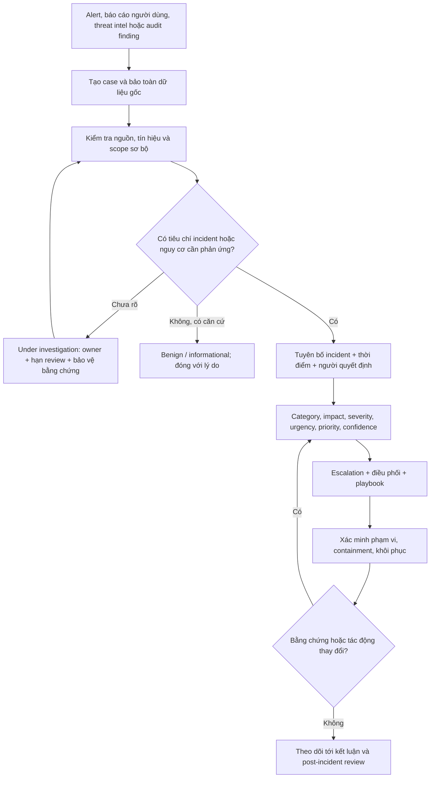

# Incident classification: phân loại sự cố bảo mật dựa trên rủi ro và bằng chứng

## 1. Incident classification là gì và vì sao quan trọng?

Trong **incident response**, *incident classification* là quá trình xác định một tình huống an ninh có thuộc loại sự cố cần xử lý hay không, thuộc nhóm hành vi/rủi ro nào, ảnh hưởng đến tài sản và mục tiêu bảo mật ra sao, có mức độ nghiêm trọng và ưu tiên xử lý thế nào. Kết quả phân loại định hướng **ai chịu trách nhiệm, ai phải được thông báo, playbook nào được kích hoạt, cách thu thập bằng chứng và khi nào phải nâng cấp phản ứng**.

Ví dụ, ba cảnh báo “đăng nhập thất bại” có thể dẫn đến ba kết quả khác nhau:

- Người dùng nhập sai mật khẩu vài lần, không có chỉ báo bổ sung: **security event** hoặc alert được đóng với kết luận có căn cứ.
- Hàng nghìn yêu cầu xác thực nhắm vào nhiều tài khoản: **hoạt động đáng ngờ**, cần điều tra credential attack; tính chất và tác động còn đang xác minh.
- Đăng nhập bất thường thành công, tiếp theo là cấp quyền quản trị trái phép và đọc dữ liệu nhạy cảm: có cơ sở **tuyên bố security incident**, phân loại nhóm compromise/privilege abuse và đánh giá tác động.

Trong chương **Incident response** của module **SECURITY_SECURITY_ASSURANCE**, kỹ năng phân loại là một mắt xích của *security assurance*: nối rủi ro, yêu cầu bảo mật và security controls với triage, quyết định phản ứng, bằng chứng điều tra, audit và khắc phục. Một quy trình bảo đảm tốt phải chứng minh được **vì sao tình huống được phân loại như vậy tại thời điểm quyết định**, chứ không chỉ lưu một nhãn “Critical” trong ticket.

### Kết quả học tập

Sau bài này, người học có thể:

1. Phân biệt event, alert, suspicious activity, security incident, major incident và data breach theo bằng chứng hiện có.
2. Phân loại **nhóm sự cố (category)**, **mức ảnh hưởng (impact)**, **mức nghiêm trọng (severity)**, **độ khẩn (urgency)**, **ưu tiên (priority)** và **độ tin cậy (confidence)** mà không đánh đồng các thuộc tính.
3. Đề xuất tiêu chí tuyên bố incident và ma trận mức nghiêm trọng theo rủi ro, tài sản, tác động và phạm vi.
4. Tổ chức triage, escalation và tái phân loại khi bằng chứng thay đổi, đặc biệt khi chưa chắc đã có xâm nhập.
5. Thiết lập hồ sơ quyết định, kiểm thử tình huống và chỉ số để đánh giá hiệu quả chương trình incident response.

## 2. Ngôn ngữ thống nhất: event, alert, incident và breach

| Thuật ngữ | Ý nghĩa thực hành | Điều chưa thể tự suy ra |
| --- | --- | --- |
| **Security event** | Hoạt động/trạng thái có liên quan tới an ninh được ghi nhận | Chưa chắc là hành vi xấu hoặc vi phạm |
| **Detection alert** | Tín hiệu thỏa điều kiện quy tắc cần xem xét | Chưa chứng minh có sự cố thật |
| **Suspicious activity** | Chuỗi hành vi có dấu hiệu đáng ngờ nhưng cần kiểm tra thêm | Chưa khẳng định tác nhân hay tác động |
| **Security incident** | Sự việc đã được xác định hoặc có căn cứ đủ mạnh theo tiêu chí tổ chức để kích hoạt quy trình ứng phó bảo mật | Không nhất thiết đã biết đầy đủ nguyên nhân/phạm vi |
| **Major/critical incident** | Incident được đánh giá có tác động nghiêm trọng hoặc cần cơ chế điều phối đặc biệt | Không đồng nghĩa mọi dữ liệu bị lộ |
| **Data breach** | Sự cố liên quan vi phạm bảo mật dữ liệu (ví dụ truy cập/tiết lộ trái phép), theo định nghĩa và phạm vi pháp lý/chính sách áp dụng | Không tự động xác định nghĩa vụ thông báo hay thời hạn cụ thể |
| **Near miss / attempted compromise** | Tấn công hoặc lỗi có khả năng gây hại nhưng đã bị chặn/chưa chứng minh được tác động | Không đồng nghĩa không có rủi ro hoặc không cần điều tra |

**Tuyên bố incident không đòi hỏi biết hết mọi sự thật.** Với nguy cơ cao, tổ chức có thể kích hoạt điều tra và biện pháp containment dựa trên bằng chứng đủ đáng tin; sau đó tiếp tục xác nhận mức độ thiệt hại. Ngược lại, nhãn `alert` không nên mặc nhiên nâng thành `incident` khi thiếu dữ liệu.

Một hành động bị chặn thành công có thể vẫn được tổ chức coi là incident nếu đáp ứng tiêu chí, ví dụ chiến dịch tấn công diện rộng gây gián đoạn, hay hành vi lạm dụng cần báo cáo. Định nghĩa và ngưỡng phải nằm trong **chính sách ứng phó được phê duyệt**, có quy tắc xử lý vùng chưa chắc chắn.

### 2.1. Hai câu hỏi tách biệt

Khi mở một case, luôn trả lời hai câu hỏi:

1. **Case này có phải incident theo chính sách?** Căn cứ vào vi phạm/đe dọa đối với control, chỉ báo tấn công, ảnh hưởng thực tế hoặc có khả năng xảy ra.
2. **Nếu là incident, nó thuộc loại nào và khẩn cấp tới mức nào?** Căn cứ vào tác động, phạm vi, tốc độ diễn biến, tài sản quan trọng, khả năng lan rộng và các nghĩa vụ liên quan.

Việc chưa thể kết luận câu (1) không có nghĩa phải bỏ qua case. Có thể giữ trạng thái `under_investigation`, chỉ định owner, thời điểm xem lại và hành động bảo toàn bằng chứng.

## 3. Năm chiều phân loại cốt lõi

Những thuộc tính này phục vụ các quyết định khác nhau. Một hệ thống quản lý incident nên lưu **riêng từng trường**, kể cả khi giao diện rút gọn thành một nhãn ưu tiên.

| Thuộc tính | Câu hỏi | Ví dụ |
| --- | --- | --- |
| **Category** | Hành vi/loại sự cố là gì? | `identity.compromise`, `malware`, `data.exposure` |
| **Impact** | Hậu quả hoặc nguy cơ tác động đến mục tiêu/tài sản nào, quy mô ra sao? | Dữ liệu khách hàng của nhiều tenant có thể bị truy cập |
| **Severity** | Mức nghiêm trọng tổng thể theo tiêu chí rủi ro của tổ chức? | `SEV-1` theo ma trận nội bộ |
| **Urgency** | Phải ra quyết định nhanh đến mức nào để hạn chế hậu quả? | Token còn hoạt động, truy cập trái phép đang tiếp diễn |
| **Priority** | Đội phản ứng xử lý case trước các công việc khác thế nào? | `P1` cần huy động trực chiến |
| **Confidence** | Bằng chứng có mạnh và đầy đủ tới đâu? | `high` khi có audit event độc lập, `low` khi chỉ có một IOC yếu |

Có thể thêm các trường **incident status**, **scope**, **data classification**, **regulatory/legal flags**, **business criticality**, **owner**, **environment**, **detection source**, **first observed** và **time of declaration**.

**Severity và confidence độc lập.** Một khả năng mất dữ liệu mật mã trọng yếu có thể cần xử lý khẩn dù nguồn tin mới một phần; báo cáo phải ghi rõ “impact tiềm tàng nghiêm trọng, confidence thấp/chưa rõ”. Ngược lại, một sự kiện nhỏ có confidence cao chưa chắc được đánh SEV-1.

**Severity và priority cũng không hoàn toàn giống nhau.** Severity thể hiện mức ảnh hưởng/rủi ro; priority điều phối nguồn lực theo độ khẩn và bối cảnh. Hai tổ chức có thể cùng đánh giá severity nhưng ưu tiên khác nhau do phạm vi khắc phục, hoạt động đang diễn ra và khả năng tăng tác động.

## 4. Taxonomy: phân loại sự cố theo nhóm hành vi

Một taxonomy giúp dùng cùng ngôn ngữ trong SIEM, ticket, dashboard, báo cáo rủi ro và audit. Nó phải có định nghĩa rõ, được quản lý phiên bản và cho phép một incident **có nhiều category liên quan** nhưng có một category chính nếu hệ thống cần.

| Nhóm tham khảo | Dấu hiệu/case tiêu biểu | Bằng chứng cần tìm |
| --- | --- | --- |
| **Identity / account compromise** | Đăng nhập bất thường, token bị lộ, session hijack | Authentication audit, session/token history, MFA, thiết bị liên quan |
| **Privilege misuse / escalation** | Tự cấp quyền, thay đổi IAM policy trái phép | Actor/target, role binding trước/sau, approval/change records |
| **Malware / ransomware** | Thực thi mã độc, mã hóa tệp, persistence | Endpoint telemetry, process tree, file changes, indicator và timeline |
| **Data access / exposure / exfiltration** | Export trái phép, bucket công khai, dữ liệu chảy ra ngoài | Data audit, access path, object scope, outbound transfer, classification |
| **Application / API exploitation** | Khai thác lỗ hổng, phá bypass quyền, injection | Gateway/WAF, application logs, traces, bằng chứng thay đổi dữ liệu |
| **Network intrusion / lateral movement** | Truy cập trái phép, di chuyển giữa máy, remote execution | Flow, host authentication, privileged process, EDR, network segment |
| **Denial of service / availability attack** | Tấn công gây quá tải, dịch vụ quan trọng bị gián đoạn | Traffic, error rate, service health, mitigation status |
| **Cloud / infrastructure misconfiguration abuse** | Security group bị mở, audit bị tắt, service account bị lạm dụng | Control-plane audit, cấu hình trước/sau, access history |
| **Insider / third-party misuse** | Nhà cung cấp hoặc nhân sự lạm dụng quyền | Access log, hợp đồng/phạm vi quyền, phê duyệt, lịch công việc |
| **Supply-chain / deployment compromise** | Artifact bị sửa, pipeline bị xâm nhập, image không tin cậy | Build provenance, signing/checksum, CI/CD audit, deployment diff |
| **Social engineering / phishing** | Email lừa đảo, đánh cắp tài khoản, BEC nghi vấn | Nội dung đã xử lý an toàn, email headers, IdP, giao dịch liên quan |
| **Policy/control violation** | Tắt logging trái phép, bỏ kiểm soát cần thiết | Cấu hình, IAM, change ticket, exception register |

Ví dụ một chiến dịch phishing → account takeover → privilege escalation → data export có **category chính** là `identity.compromise` hoặc `data.exfiltration` tùy chính sách và mục tiêu quản lý; các nhãn phụ ghi chuỗi hành vi đầy đủ. Không tạo bốn incident độc lập chỉ vì có bốn detection rule, trừ khi bằng chứng cho thấy các vụ riêng biệt.

### Nguyên tắc đặt category

- Gắn nhãn dựa trên **hành vi có bằng chứng**, không chỉ dựa trên giả thuyết mạnh tay nhất.
- Dùng `suspected`/`confirmed` hoặc confidence đi kèm các category chưa xác nhận.
- Tách **loại hành vi** và **hậu quả**: “ransomware” mô tả phương thức, “mất tính sẵn sàng” mô tả tác động.
- Có taxonomy version và quy trình thay đổi; không trộn số liệu cũ/mới mà thiếu mapping.
- Cho phép `unknown` hoặc `other_pending_review` trong triage, kèm hạn chốt xem lại; tránh ép dữ liệu vào category sai.

## 5. Đánh giá impact bằng tài sản và mục tiêu bảo mật

Đầu tiên xác định **tài sản quan trọng và security objectives** bị ảnh hưởng; sau đó phân biệt tác động *đã xác nhận* với *có khả năng xảy ra*.

### 5.1. Những chiều ảnh hưởng

| Chiều | Câu hỏi | Bằng chứng |
| --- | --- | --- |
| **Confidentiality** | Ai có thể xem/tiết lộ dữ liệu nào trái phép? | Data access audit, nhóm dữ liệu, lượng truy cập/export |
| **Integrity** | Dữ liệu, chính sách hoặc artifact có bị sửa? | Diff, checksum, version history, change audit |
| **Availability** | Dịch vụ có gián đoạn? Bao nhiêu người dùng/tenant? | SLI/SLO, error rate, outage timeline, khôi phục |
| **Identity & control plane** | Quyền và chuỗi tin cậy có bị chiếm? | IAM, key rotation, admin session, quyền trước/sau |
| **Business/operational** | Giao dịch, doanh thu, dịch vụ trọng yếu, an toàn vận hành có bị ảnh hưởng? | Business owner xác minh, dịch vụ bị dừng, quy trình bị hỏng |
| **Privacy / contractual / legal** | Dữ liệu cá nhân, hợp đồng hoặc luật nào có thể kích hoạt nghĩa vụ? | Data inventory, data categories, phạm vi, tư vấn pháp lý/chính sách |
| **Propagation / systemic risk** | Có thể lan sang tenant, vùng triển khai, backup hoặc nhà cung cấp khác? | Dependency graph, lateral movement, shared control, trusted integration |

Impact có thể ghi ở hai mức: `observed_impact` và `potential_impact`, kèm mức chắc chắn. Ví dụ: **“Chưa có bằng chứng truy cập dữ liệu; khóa quản trị bị lộ và còn hiệu lực, nên tiềm năng tác động rất cao”**. Cách ghi này giúp tránh vừa xem nhẹ tình huống vừa khẳng định sai rằng dữ liệu đã bị đánh cắp.

### 5.2. Blast radius và thời gian

Các câu hỏi nên trả lời trong triage:

- Bao nhiêu tài khoản, thiết bị, khách hàng, tenant, môi trường hoặc khu vực có dấu hiệu bị ảnh hưởng?
- Một tài khoản bị chiếm chỉ có quyền đọc thông thường hay có quyền quản trị trên toàn bộ hệ thống?
- Hành vi đang diễn ra, đã bị chặn, hay trạng thái chưa biết?
- Có tài sản dùng chung như secret store, backup, IdP, CI/CD hoặc control plane có thể mở rộng phạm vi không?
- Bằng chứng có đủ thời gian quan sát hay nguồn log bị thiếu/tắt? Nếu thiếu, mức độ bất định phải được ghi lại.

Trong hệ đa tenant, **một tài khoản có khả năng tác động nhiều tenant** có thể nghiêm trọng hơn nhiều tài khoản chỉ có quyền trong sandbox. Không dùng số event hoặc số cảnh báo làm đại diện trực tiếp cho blast radius.

## 6. Thiết kế ma trận severity và priority

**Không có một bảng SEV-1…SEV-4 áp dụng bắt buộc cho mọi tổ chức.** Bảng dưới là *ví dụ chính sách nội bộ* cho hệ thống dịch vụ có khách hàng; đội security, vận hành, kinh doanh và phụ trách tuân thủ phải phê duyệt tiêu chí phù hợp trước khi sử dụng.

| Severity minh họa | Tiêu chí định tính | Ví dụ |
| --- | --- | --- |
| **SEV-1 — Critical** | Ảnh hưởng nghiêm trọng tới tài sản trọng yếu, nhiều tenant, sự cố đang lan rộng hoặc có nguy cơ mất kiểm soát đáng kể | Control-plane admin bị chiếm và truy cập trái phép còn diễn ra |
| **SEV-2 — High** | Ảnh hưởng đáng kể tới dữ liệu/dịch vụ quan trọng, phạm vi được xác định nhưng cần phản ứng phối hợp nhanh | Một tenant production bị xâm phạm và có truy cập dữ liệu nhạy cảm |
| **SEV-3 — Medium** | Tác động hạn chế, đã có biện pháp ngăn chặn hoặc chưa thấy hậu quả lớn, vẫn cần điều tra/khắc phục | Một tài khoản quyền thấp bị chiếm nhưng đã vô hiệu hóa nhanh, phạm vi còn giới hạn |
| **SEV-4 — Low** | Tình huống giới hạn, ít tác động, xử lý theo luồng tiêu chuẩn | Thử khai thác bị chặn, không có dấu hiệu xâm nhập và không gây gián đoạn |

Chỉ đánh **mức cuối cùng** sau khi cân nhắc rủi ro đã xác nhận hoặc hợp lý từ dữ liệu hiện có. Nếu một kịch bản chưa có hậu quả quan sát được nhưng rủi ro lan rộng cao, mức nghiêm trọng có thể vẫn cao; cần nêu rõ căn cứ `potential_impact`.

### 6.1. Ma trận impact × urgency minh họa

Một tổ chức có thể dùng bảng này làm điểm xuất phát để quyết định **priority vận hành**:

| Impact \ Urgency | Ngay lập tức (đang tiếp diễn/leo thang) | Sớm (có nguy cơ tái diễn hoặc cần containment) | Theo lịch (đã ổn định/được kiểm soát) |
| --- | --- | --- | --- |
| **Cao** | P1 | P1/P2 theo quy tắc được duyệt | P2 |
| **Trung bình** | P2 | P2/P3 | P3 |
| **Thấp** | P3 | P3/P4 | P4 |

Ô `P1/P2` hoặc `P2/P3` yêu cầu tiêu chí bổ sung (ví dụ tài khoản đặc quyền, khối lượng dữ liệu, nhà cung cấp quan trọng, nghĩa vụ thông báo). Không để analyst tự đoán ở mỗi ca mà thiếu hướng dẫn. **Priority là đầu vào cho điều phối**; thời hạn triage, response và thông báo phải được tổ chức ban hành riêng, không tự suy từ bảng ví dụ.

### 6.2. Các yếu tố tự động nâng cấp

Chính sách có thể đặt một số **escalation triggers**, ví dụ:

1. Tài khoản đặc quyền nền tảng bị chiếm và chưa thu hồi được.
2. Có dấu hiệu truy cập hoặc truyền dữ liệu nhạy cảm trái phép.
3. Mã độc đang lan hoặc ransomware ảnh hưởng khả năng phục hồi.
4. Hoạt động có thể ảnh hưởng nhiều tenant hoặc hạ tầng dùng chung.
5. Tắt, giả mạo hoặc mất nguồn audit cốt lõi trong khi xảy ra hành vi nghi vấn.
6. Nguy cơ an toàn con người, dịch vụ thiết yếu, đối tác trọng yếu hay nghĩa vụ hợp đồng/pháp lý cần xử lý khẩn.

Các trigger phải được đặt trong chính sách, có owner và lưu căn cứ. **Một tín hiệu confidence thấp nhưng hậu quả tiềm tàng rất lớn** nên được đưa tới người có thẩm quyền đánh giá, thay vì tự động hạ severity vì thiếu bằng chứng.

## 7. Quy trình triage và tuyên bố incident

Một luồng cơ bản có thể triển khai trong SOC hoặc nhóm SRE/SecOps:



### 7.1. Bước 1 — Nhận và kiểm tra nguồn

Nhận case từ SIEM/EDR, hệ thống cảnh báo, nhân viên, khách hàng, nhà cung cấp, bug report, threat intelligence hoặc kiểm toán. Ghi `case_id`, thời gian nhận, nguồn, liên hệ, tài sản/scope sơ bộ và bản gốc thông tin theo chính sách bảo mật.

Kiểm tra liệu tín hiệu có phải dữ liệu giả, duplicate hoặc lỗi pipeline không. Đồng thời rà soát sự kiện có thể **đang bị khai thác**, không chỉ đánh giá rule có đúng cú pháp hay không.

### 7.2. Bước 2 — Thu thập chứng cứ tối thiểu

Đối chiếu các nguồn có độ tin cậy khác nhau:

- Authentication/authorization audit và lịch thay đổi quyền.
- Application, endpoint, network và cloud control-plane logs.
- Resource state, phiên bản cấu hình, thay đổi dữ liệu và ảnh hưởng dịch vụ.
- Approval/change ticket, thông tin chủ sở hữu tài sản, business impact.
- Độ tươi của telemetry, điểm mất dữ liệu và sai lệch giờ.

Sự kiện do client tự khai (ví dụ header `X-User-Id` hoặc địa chỉ IP trong payload tùy ý) không được xem là danh tính đã được xác minh. Điều tra có thể tiến hành với bằng chứng chưa hoàn chỉnh nhưng phải nêu rõ chất lượng nguồn.

### 7.3. Bước 3 — Quyết định tuyên bố

Định nghĩa **declaration criteria** cho từng nhóm rủi ro, ví dụ:

> Tuyên bố incident khi có bằng chứng truy cập trái phép vào tài khoản production, thay đổi quyền có hiệu lực không được ủy quyền, thực thi mã độc trên tài sản trọng yếu, hoặc khi tổng hợp tín hiệu đủ mạnh cho thấy khả năng compromise nghiêm trọng cần containment ngay.

Không dùng một IOC yếu hoặc số lượng alert đơn lẻ như tiêu chí duy nhất. Nhưng cũng không nên chờ hoàn tất forensic nếu việc chậm containment có thể làm tăng tác động đáng kể.

Ghi rõ **ai có quyền declare**, ai có quyền nâng severity, ai xác nhận đóng, và cơ chế trực chiến khi người có thẩm quyền vắng mặt. Quy trình này phải có trong incident response policy và được diễn tập.

### 7.4. Bước 4 — Classify và điều phối

Ghi category, `observed_impact`, `potential_impact`, severity, urgency, priority, confidence và phạm vi. Liên hệ playbook tương ứng; chỉ định incident commander/coordinator và các chủ sở hữu kỹ thuật. Nếu có khả năng liên quan dữ liệu cá nhân hoặc nghĩa vụ thông báo, đưa nhóm phụ trách pháp lý/privacy vào đánh giá sớm theo chính sách; đừng để một field `data_breach=true` tự tạo kết luận pháp lý.

### 7.5. Bước 5 — Reclassify có kiểm soát

Tái đánh giá khi có sự kiện quan trọng: phát hiện tài khoản quản trị thứ hai bị chiếm, chứng minh có export dữ liệu, khôi phục quyền kiểm soát khóa, hoặc thu hẹp phạm vi nhờ bằng chứng mới. Ghi **lịch sử thay đổi** thay vì thay thế lặng lẽ mức severity cũ; điều này bảo vệ khả năng audit và đo thời gian xử lý.

## 8. Bất định và confidence trong incident classification

Ở thời điểm đầu, nhiều thông tin chỉ là giả thuyết. Cần tách rõ:

- **Observed fact:** hành động/event có nguồn xác minh; ví dụ một API key đã được dùng từ workload chưa được phê duyệt.
- **Analyst inference:** suy luận dựa trên fact; ví dụ key có khả năng bị đánh cắp.
- **Unknown:** chưa đủ telemetry để kiểm chứng ai đã thực hiện hoặc dữ liệu nào đã bị truy cập.
- **Competing hypotheses:** thao tác hợp lệ nhưng chưa được ghi ticket; compromise; lỗi đồng bộ quyền.

Có thể dùng các mức `low`, `medium`, `high` cho confidence nếu có định nghĩa nhất quán:

| Mức confidence tham khảo | Căn cứ |
| --- | --- |
| **Low** | Chỉ có một tín hiệu yếu, nguồn thiếu ngữ cảnh hoặc chưa xác minh |
| **Medium** | Có nhiều dấu hiệu phù hợp, nhưng một số giải thích hợp lệ hoặc nguồn chưa đủ |
| **High** | Có dữ liệu nguồn đáng tin, đối chiếu độc lập và dấu hiệu hành vi rõ |

**Độ tin cậy cao không đồng nghĩa chắc chắn tuyệt đối.** Với các sự kiện không chứng minh được liệu dữ liệu đã bị export, nên ghi `exfiltration=unconfirmed` cùng bằng chứng đã xem; không biến “không có log export” thành “đã chứng minh không có export”, đặc biệt khi retention hoặc logging coverage không đủ.

Một ghi nhận ngắn nhưng chuẩn có thể là:

> 14:20 UTC, có xác nhận role `platform-admin` được cấp cho tài khoản không nằm trong quy trình phê duyệt; audit control plane cho thấy thay đổi có hiệu lực. Chưa xác định quyền này đã được sử dụng để truy cập dữ liệu. Category `privilege_escalation`; observed impact: IAM integrity; potential impact: multi-tenant; confidence về role grant: high; confidence về data access: unknown. Đề xuất SEV-1 theo chính sách vì quyền còn hiệu lực.

Cách diễn đạt này cho phép phản ứng sớm và cập nhật khi có bằng chứng mới.

## 9. Ví dụ hồ sơ phân loại có cấu trúc

Mẫu YAML sau là **mô hình minh họa** phục vụ trao đổi nội bộ, không phải định dạng bắt buộc của một công cụ incident management:

```yaml
case_id: IR-2026-018
status: declared
declaration:
  at: "2026-11-28T07:42:00Z"
  authorized_by: "on_call_incident_lead"
  rationale: "Unapproved privileged role grant confirmed in control-plane audit"
classification:
  taxonomy_version: "security-incident-v1"
  primary_category: "identity.privilege_escalation"
  related_categories:
    - "cloud.iam_change"
  severity: "SEV-1"
  urgency: "immediate"
  priority: "P1"
  confidence:
    privilege_grant: "high"
    data_exfiltration: "unknown"
scope:
  environment: "production"
  affected_tenants: "unknown"
  affected_assets:
    - "shared-identity-service"
impact:
  observed:
    - "Unapproved administrative role binding"
  potential:
    - "Cross-tenant administrative access"
  not_yet_confirmed:
    - "Data access or export"
response:
  incident_commander: "security_on_call"
  playbook: "privileged-account-compromise"
  review_due: "As required by internal incident policy"
evidence:
  - "iam-audit-event-id-82"
  - "role-binding-diff-17"
history:
  - at: "2026-11-28T07:42:00Z"
    action: "Declared and classified SEV-1"
    reason: "Privileged grant without approval, active production access"
```

Trong hệ thống thật, `evidence` nên trỏ tới bản ghi/đối tượng trong kho được phân quyền, không đính kèm bí mật, token, dữ liệu cá nhân thô vào ticket phát tán rộng. `review_due` và các SLA cần được thay bằng giá trị cụ thể từ chính sách đã phê duyệt, không để mã giả chạy vào quy trình tự động.

### Những trường không nên bỏ sót

| Trường | Tại sao cần |
| --- | --- |
| Thời điểm **đầu tiên xảy ra**, phát hiện, nhận alert, tuyên bố, containment | Đo độ trễ và tái dựng timeline; không thay thế mốc nọ bằng mốc kia |
| Actor/target/asset/tenant, kèm tình trạng xác minh | Tránh điều tra nhầm chủ thể và đánh giá sai phạm vi |
| Rule ID, rule version, data source, query/snapshot ID | Cho phép tái hiện phát hiện và kiểm tra false positive |
| Observed và potential impact | Tách thiệt hại thực tế với rủi ro tiềm tàng |
| Category, confidence, severity, priority, rationale | Giải thích quyết định ứng phó tại thời điểm đó |
| Người phê duyệt và lịch sử thay đổi | Kiểm toán trách nhiệm và quyết định escalation |
| Kênh liên lạc, stakeholder, playbook, owner | Vận hành phản ứng phối hợp có hiệu quả |
| Data/retention/legal flags | Chuyển đến đúng nhóm đánh giá nghĩa vụ khi cần |

## 10. Ba tình huống phân loại thực tế

### Tình huống A — Password spraying bị chặn

**Dữ liệu ban đầu:** IdP ghi nhận hàng trăm lần xác thực thất bại nhắm nhiều tài khoản từ một nhóm địa chỉ mạng. Chưa thấy phiên đăng nhập thành công; MFA/lockout hoạt động bình thường.

**Đánh giá:**

- Category: `identity.credential_attack` (suspected/observed attempts).
- Observed impact: tăng tải xác thực, chưa thấy account compromise.
- Potential impact: compromise nếu có credential hợp lệ hoặc nguồn thiếu.
- Confidence: cao về *có hoạt động thử đăng nhập*, thấp hơn về attribution và mục tiêu attacker.
- Classification decision: có thể là suspicious campaign hoặc security incident mức thấp/trung bình tùy ngưỡng chính sách, tác động và chiến dịch đang tiếp diễn.

**Điểm assurance:** kiểm tra nguồn IdP đầy đủ, false-negative do phân tán IP, mức bảo vệ MFA và dấu hiệu đăng nhập thành công sau chiến dịch. Không khẳng định “an toàn tuyệt đối” chỉ từ một khoảng thời gian không thấy success.

### Tình huống B — Kho dữ liệu cloud vô tình đặt public

**Dữ liệu ban đầu:** IaC drift báo bucket có quyền public read trong 12 phút rồi được sửa. Chưa có cloud access log tương ứng cho 12 phút đó.

**Đánh giá:**

- Category: `data.exposure` hoặc `cloud.misconfiguration`; chưa khẳng định `data.exfiltration`.
- Observed impact: kiểm soát truy cập sai cấu hình có hiệu lực; đối tượng dữ liệu có khả năng bị đọc công khai.
- Potential impact: mức độ nghiêm trọng phụ thuộc loại dữ liệu, đường truy cập thực tế, phạm vi người có thể đọc và thời gian lộ.
- Confidence: cao về trạng thái cấu hình; chưa biết liệu bên ngoài đã truy cập hay chưa.
- Priority: nâng cao nếu chứa dữ liệu nhạy cảm, đang công khai hoặc thiếu log để xác minh.
- Escalation: nhóm privacy/legal đánh giá nghĩa vụ theo dữ liệu và quy định áp dụng nếu có khả năng phát sinh vi phạm.

**Điểm assurance:** lưu change diff, thời gian công khai, data inventory, thử kiểm tra quyền từ góc nhìn bên ngoài trong môi trường phù hợp, đánh giá logging gap và xem xét remediation. **“Không có access log” khi logging không được bật không chứng minh không có truy cập**.

### Tình huống C — Token quản trị bị lộ trong CI/CD

**Dữ liệu ban đầu:** secret-scanning tìm thấy token còn hiệu lực trong artifact build mà một nhóm rộng có thể tải. Nhật ký còn ghi vài lần sử dụng token từ runner hợp lệ; chưa thấy truy cập từ thiết bị lạ.

**Đánh giá:**

- Category: `credentials.exposure`; nếu thấy dấu hiệu sử dụng trái phép, thêm `identity.compromise`/`supply_chain`.
- Observed impact: token có phạm vi truy cập rộng bị đặt ở vị trí không đúng.
- Potential impact: attacker có thể sử dụng quyền quản trị trên production.
- Confidence: cao về exposure; chưa biết token có bị sao chép/sử dụng trái phép.
- Urgency: cao nếu token đang còn hiệu lực, tác động lớn dù chưa thấy sử dụng ác ý.
- Response: thu hồi/rotate token theo playbook, xác định các hệ thống phụ thuộc, rà soát access logs, điều tra thời gian và phạm vi lộ.

**Điểm assurance:** không đợi chứng minh exfiltration mới xử lý token đang có thể bị lợi dụng. Đồng thời không viết báo cáo rằng “attacker đã truy cập production” nếu chưa có bằng chứng.

## 11. Escalation, vai trò và trao đổi thông tin

Một incident classification có giá trị khi gắn ngay với tuyến phản ứng. Với tình huống nghiêm trọng hoặc liên quan nhiều đội, nên có phân công rõ:

| Vai trò | Trách nhiệm chính |
| --- | --- |
| **Triage analyst/on-call** | Tiếp nhận, kiểm tra nguồn, phân loại sơ bộ, lưu quyết định và raise escalation |
| **Incident commander/lead** | Quyết định nhịp điều phối, mức nghiêm trọng theo thẩm quyền, huy động đội và cập nhật trạng thái |
| **Technical responders** | Xác minh dấu hiệu, containment, thu thập forensic, phục hồi có kiểm soát |
| **Service/business owner** | Xác định tài sản, phạm vi khách hàng, mức thiệt hại nghiệp vụ và ưu tiên khôi phục |
| **Privacy/legal/compliance** | Đánh giá dữ liệu bị tác động, nghĩa vụ hợp đồng/pháp luật và nội dung/thời điểm thông báo |
| **Communications/stakeholder lead** | Thống nhất thông tin nội bộ, khách hàng và đối tác qua người được ủy quyền |
| **Security assurance/risk owner** | Kiểm chứng căn cứ phân loại, hiệu lực control, bằng chứng khắc phục và bài học cải tiến |

Tên chức danh có thể khác nhau giữa các tổ chức; điều cốt lõi là **thẩm quyền không mơ hồ**. Cần có người thay thế khi on-call vắng mặt và kênh escalation hoạt động khi hệ thống chat/email chính bị ảnh hưởng.

### 11.1. Các mốc trao đổi cần phân biệt

- **Initial notification:** sự việc nào đang được điều tra, nguồn nào đáng tin và ai xử lý.
- **Incident declaration:** tiêu chí nào đã đạt, thời điểm, category và severity/priority hiện tại.
- **Material change:** thêm tài sản bị tác động, bằng chứng data access, bước containment hoặc thay đổi mức severity.
- **Situation update:** điều đã xác minh, điều chưa biết, hành động tiếp theo, thời điểm cập nhật.
- **Resolution/post-incident:** tiêu chí containment/khôi phục đạt được, rủi ro tồn dư và việc cần khắc phục.

Với nghi vấn dữ liệu cá nhân bị ảnh hưởng, **không tự gán thời hạn báo cáo hoặc yêu cầu thông báo chung cho mọi quốc gia**. Nghĩa vụ phụ thuộc vào nơi áp dụng, dữ liệu, loại tổ chức, thời điểm biết sự cố và hợp đồng; bộ phận pháp lý/privacy phải xác định và lưu quyết định có căn cứ.

## 12. Tái phân loại theo bằng chứng mới

Sự cố có thể mở rộng hoặc thu hẹp trong quá trình điều tra. Điều chỉnh severity là bình thường nhưng phải có lịch sử và lý do.

```mermaid
sequenceDiagram
    participant SOC as SOC / Analyst
    participant IC as Incident lead
    participant ENG as Engineering / IR
    participant REG as Privacy / Legal
    SOC->>IC: Alert và phân loại sơ bộ
    IC->>ENG: Xác minh scope, nguồn và tác động
    ENG-->>IC: Bằng chứng: quyền quản trị đang hoạt động
    IC->>SOC: Tuyên bố incident; SEV-1 theo policy
    ENG-->>IC: Bằng chứng mới: quyền đã thu hồi, chưa thấy data access
    IC->>REG: Xin đánh giá phạm vi dữ liệu và nghĩa vụ
    REG-->>IC: Kết luận phạm vi đã kiểm chứng và điểm chưa biết
    IC->>SOC: Reclassify nếu tiêu chí policy được đáp ứng
    SOC->>SOC: Giữ nguyên lịch sử mốc/nguồn/lý do
```

Một số nguyên tắc:

1. **Lưu giá trị trước/sau:** category, severity, priority, scope, confidence.
2. **Ghi evidence mới:** bản ghi, hash, link kho bằng chứng, quyết định người có quyền.
3. **Tái thông báo có kiểm soát:** người đã nhận escalation cần được cập nhật thay đổi quan trọng.
4. **Không sửa timeline cũ:** giữ `first_seen`, `declared_at`, `reclassified_at`, `contained_at` theo sự thật tại thời điểm.
5. **Không vội downgrade:** chỉ hạ mức khi tiêu chí thực sự thay đổi và người có thẩm quyền xác nhận; thiếu log không phải bằng chứng để hạ mức.
6. **Cho phép tái mở case:** khi xuất hiện chỉ báo mới hoặc kết luận cũ bị phản bác.

Để tránh đo sai hiệu quả, tổ chức cần quyết định báo cáo theo **initial severity**, **peak severity**, **final severity** hoặc nhiều trường, thay vì chỉ giữ mức cuối và làm biến mất việc từng có SEV-1.

## 13. Bảo toàn bằng chứng và chain of custody

Phân loại incident liên quan trực tiếp đến quyết định điều tra và bằng chứng. Nếu hệ thống dự kiến chứng minh security assurance, mọi kết luận trọng yếu phải truy ngược được về **nguồn, thời điểm, người thu thập và phương pháp**.

### 13.1. Chất lượng bằng chứng

- **Tính xác thực:** event do hệ thống nào phát, có bị giả mạo hoặc sửa được không?
- **Tính toàn vẹn:** bản gốc có được bảo vệ; phép copy/export được kiểm tra checksum/hash khi phù hợp?
- **Tính đầy đủ:** có thiếu thời gian, endpoint, tenant, region hoặc log source nào không?
- **Tính liên kết:** event_id, request_id, actor, asset và correlation có nối đúng timeline?
- **Tính thời gian:** đồng bộ giờ, timestamp nguồn/ingest và mọi clock skew đã được ghi nhận?
- **Tính hạn chế truy cập:** ai được xem PII, secret, dữ liệu khách hàng hoặc forensic image?

**Chain of custody** đặc biệt quan trọng với điều tra nhạy cảm: ghi người tạo/nhận/chuyển bằng chứng, thời điểm, mục đích, vị trí lưu trữ, hash kiểm tra phù hợp và quyền truy cập. Không coi hash đơn lẻ là bằng chứng xác thực nguồn; nếu nguồn đã bị chiếm, hash của bản ghi giả vẫn nhất quán.

### 13.2. Ghi nhận quyết định có thể audit

Ví dụ bảng quyết định:

| Thời điểm UTC | Dữ kiện | Tác động tới phân loại | Người quyết định |
| --- | --- | --- | --- |
| 09:10 | EDR cảnh báo lệnh bất thường trên một host | Open `under_investigation`, confidence medium | SOC on-call |
| 09:18 | Process tree và IAM audit cho thấy token admin bị dùng trái phép | Declare `identity.compromise`, nâng P1 | Incident lead |
| 09:32 | Phát hiện cùng token truy cập 3 tenant | Tăng phạm vi, giữ SEV-1 | Incident lead |
| 10:05 | Thu hồi token, xác nhận không còn session hoạt động qua nguồn hiện có | Tác động đang tiếp diễn giảm; chưa kết luận dữ liệu | IR lead |
| 11:20 | Data audit xác minh có truy cập dữ liệu khách hàng | Thêm category `data.access`, privacy/legal review | Incident lead + privacy |

Các mốc này chỉ là ví dụ hư cấu. Thực tế, phải gắn mỗi dòng với event ID và nguồn bằng chứng, đồng thời ghi rõ *điều chưa thể kết luận*.

## 14. Kiểm thử và chứng minh incident classification đang hoạt động

Một chính sách có đầy đủ nhãn SEV nhưng không được diễn tập, không có người trực hoặc không ghi lại quyết định thì chưa đủ chứng minh năng lực incident response.

### 14.1. Ma trận yêu cầu assurance

| ID | Yêu cầu có thể kiểm chứng | Bằng chứng cần lưu | Phép thử |
| --- | --- | --- | --- |
| **IC-01** | Incident được phân biệt với alert theo tiêu chí đã phê duyệt | Incident declaration policy, triage record | Tạo alert benign và alert có compromise; xác minh quyết định khác nhau |
| **IC-02** | Category theo taxonomy có định nghĩa và phiên bản | Taxonomy, ticket/case sample | Phân loại mẫu phishing → account takeover → data access |
| **IC-03** | Severity/priority phản ánh impact và urgency | Matrix, severity rationale, impact assessment | So sánh ca một host sandbox với case control-plane production |
| **IC-04** | Trường hợp thiếu dữ liệu vẫn có owner và review | `unknown`/`inconclusive`, timeline, review due | Giả lập mất IdP log; vẫn escalation khi rủi ro lớn |
| **IC-05** | Có đường gọi và người quyết định hợp lệ | On-call roster, escalation log | Tabletop diễn tập P1 ngoài giờ |
| **IC-06** | Thay đổi phân loại được ghi lại và truyền đạt | Audit history, stakeholder updates | Bổ sung chứng cứ nhiều tenant bị tác động và kiểm tra reclassify |
| **IC-07** | Bằng chứng gắn với incident được bảo vệ | Evidence inventory, access audit, chain-of-custody | Thử truy xuất bằng tài khoản không có quyền và đối chiếu hash mẫu |
| **IC-08** | Nghĩa vụ privacy/legal được đánh giá khi có dấu hiệu liên quan | Assessment memo, quyết định của người có thẩm quyền | Giả lập bucket dữ liệu nhạy cảm bị public |
| **IC-09** | Kết luận đóng case có tiêu chí và bằng chứng | Closeout report, corrective actions, owner | Thử đóng case khi vẫn còn token active, kiểm tra cơ chế chặn/duyệt |

### 14.2. Các phép thử nên có

**Tabletop exercise:** mô phỏng một tình huống chưa đủ thông tin. Đội SOC, kỹ thuật, legal, business owner cùng thực hành quyền quyết định, severity, ưu tiên, kênh liên lạc và rủi ro còn chưa rõ.

**Detection-to-incident drill:** tạo tín hiệu kiểm thử an toàn trong môi trường phù hợp, đo thời gian `event_time → alert_time → triage → declaration → escalation`. Kiểm tra category và bằng chứng được chuyển xuyên suốt mà không biến mất.

**Scenario replay:** cung cấp case record đã ẩn danh/gắn nhãn cho analyst khác. Hai người độc lập nên đi đến phân loại tương đối nhất quán theo rubric; nếu khác nhau, rà soát định nghĩa/ngưỡng hoặc tiêu chí escalation.

**Missing-data test:** cố ý mô phỏng nguồn log hoặc approval record không có. Xác minh trạng thái `unknown`, người chịu trách nhiệm và việc cảnh báo về suy giảm khả năng quan sát; không tự động đánh benign.

**Reclassification exercise:** sau khi declare, đưa thêm bằng chứng tác động nhiều tenant và dữ liệu nhạy cảm. Kiểm tra lịch sử thay đổi, thông báo và việc owner phát hành quyết định mới.

### 14.3. Đo lường chất lượng

| Chỉ số | Mục đích | Giới hạn cần nêu |
| --- | --- | --- |
| Time to triage/declaration | Phản ánh tốc độ ra quyết định | Phải rõ các mốc bắt đầu và loại case |
| Tỷ lệ case thiếu owner/category/rationale | Đo chất lượng hồ sơ | Không phản ánh chính xác quyết định đúng hay sai |
| Tỷ lệ reclassification có lý do và evidence | Khả năng audit | Nhiều reclassification không nhất thiết xấu |
| Độ nhất quán giữa analyst trong bài mô phỏng | Phản ánh chất lượng rubric | Phụ thuộc tập kịch bản và mức độ huấn luyện |
| Tỷ lệ severity bị sửa sau post-incident review | Tìm vấn đề phân loại | Cần tách do thông tin mới với do phân loại ban đầu sai |
| Thời gian escalation theo chính sách | Xác minh vận hành on-call | Phụ thuộc mức ưu tiên và điều kiện tổ chức |
| Tỷ lệ case có data/legal assessment khi cần | Đảm bảo chuyển tuyến đúng | Chỉ số cần dựa trên điều kiện kích hoạt đúng |
| Tỷ lệ alert được đóng với lý do đủ chứng cứ | Chất lượng triage | Không tự suy ra recall đối với incident chưa phát hiện |

Các mốc thời gian mong muốn nên được chính tổ chức đặt theo rủi ro, khả năng trực chiến và cam kết dịch vụ. Không công bố một SLA tùy tiện là “chuẩn bắt buộc”. Có thể đo theo severity và loại tài sản để tránh lấy thời gian trung bình che khuất case quan trọng.

## 15. Sai lầm thường gặp

| Sai lầm | Hậu quả | Điều chỉnh |
| --- | --- | --- |
| Alert nào cũng được gọi incident | Nhiễu báo cáo, quá tải escalation | Tiêu chí declare và trạng thái điều tra tách biệt |
| Đợi bằng chứng 100% mới phản ứng | Mất thời gian containment | Quy tắc xử lý high-impact uncertainty |
| Severity = số alert | Đánh giá sai blast radius và CIA impact | Dựa vào tài sản, tác động, khả năng lan, thời gian |
| Nhầm confidence với severity | Hạ mức vô lý khi log thiếu | Ghi riêng confidence theo từng giả thuyết |
| Ghi một category duy nhất cho chiến dịch nhiều bước | Mất chuỗi tấn công và nguyên nhân | Primary + related category |
| Ghi dữ liệu lộ = data exfil đã xảy ra | Báo cáo sai về hậu quả | Tách exposure, access, confirmed exfil |
| Dựa trên một nguồn audit có thể bị tắt | Kết luận không đủ bằng chứng | Đối chiếu độc lập, ghi logging gap |
| Chỉ lưu severity cuối cùng | Không tái dựng quyết định và độ trễ | Audit history initial/peak/final severity |
| Không có owner và người declare rõ | Chậm escalation, phân quyền mơ hồ | RACI/on-call và tuyến thay thế |
| Hạ severity sau containment nhưng chưa xem rủi ro tồn dư | Bỏ sót phạm vi đã xảy ra | Phân biệt risk đang tiếp diễn với impact đã xác nhận |
| Tự kết luận nghĩa vụ thông báo theo một label | Sai pháp lý/hợp đồng | Chuyển privacy/legal để đánh giá theo phạm vi |
| Đóng case khi corrective action chưa được theo dõi | Control yếu lặp lại | Post-incident review, owner, deadline và verification |

## 16. Bài tập thực hành

Một nền tảng SaaS có nhiều tenant nhận ba nguồn thông tin trong vòng 20 phút:

1. SIEM báo có một lần đăng nhập thành công vào tài khoản service admin từ một workload chưa nhận diện.
2. IAM control-plane audit ghi thay đổi role cho tài khoản mới, không tìm thấy approval tương ứng.
3. Dashboard data access chưa ghi nhận export, nhưng nguồn audit có gián đoạn trong khoảng thời gian đáng ngờ.

Đội vận hành xác minh role mới đã có hiệu lực trên hạ tầng production dùng chung; token admin vẫn hoạt động. Một kỹ sư cho rằng đây là test hợp lệ nhưng chưa cung cấp change ticket.

**Yêu cầu thực hiện:**

1. Xác định từng fact, inference, unknown và giả thuyết cạnh tranh. Không gán nhãn độc hại chỉ dựa trên tuyên bố thiếu bằng chứng, cũng không xem phát biểu “test hợp lệ” là xác nhận.
2. Nêu quyết định có tuyên bố incident hay không theo **tiêu chí đề xuất**; ghi rõ giả định chính sách nếu cần.
3. Gán primary/related category, observed/potential impact, severity, urgency, priority và confidence độc lập. Giải thích vì sao.
4. Vẽ decision timeline với `first_seen`, `detected_at`, `declared_at`, ít nhất một mốc reclassification có thể xảy ra và ai có quyền quyết định.
5. Liệt kê bằng chứng phải lưu: IAM event ID, authentication audit, role diff, change approval, logging health, quyền của token, data access và business owner xác minh.
6. Đề xuất playbook và escalation tới đội IAM, cloud, IR lead, business owner và privacy/legal khi có dấu hiệu liên quan dữ liệu.
7. Viết tối thiểu hai test để chứng minh quy trình phân loại hoạt động: một ca benign có change ticket hợp lệ và một ca quyền quản trị bị cấp trái phép; thêm một test mất log.
8. Viết **assurance claim** một câu với phạm vi và giới hạn bằng chứng, chẳng hạn: “Tại thời điểm X, quy trình đã phân loại và escalation thay đổi IAM bất thường theo rubric Y; chưa xác nhận phạm vi truy cập dữ liệu do thiếu log khoảng Z.”

**Tiêu chí đánh giá:** câu trả lời mô tả **vì sao quyết định được đưa ra**, dữ liệu nào hỗ trợ, điều gì chưa biết, phản ứng nào được kích hoạt và thông tin nào có thể làm thay đổi phân loại. Nhãn SEV/P1 đơn độc không phải một bản phân loại đầy đủ.

## 17. Ghi nhớ

Incident classification là một **quyết định bảo mật có trách nhiệm**, được tạo từ bằng chứng và đánh giá rủi ro tại từng thời điểm. Muốn có incident response đáng tin cậy, cần phân biệt alert với incident; quản lý category, impact, severity, urgency, priority và confidence riêng; gắn với người có thẩm quyền và playbook; lưu lịch sử reclassification; đồng thời kiểm chứng quy trình bằng diễn tập và evidence audit. Đây là cách kết nối sự cố thực tế với các security controls, risk management và chương trình **security assurance liên tục** trong phát triển và vận hành.
