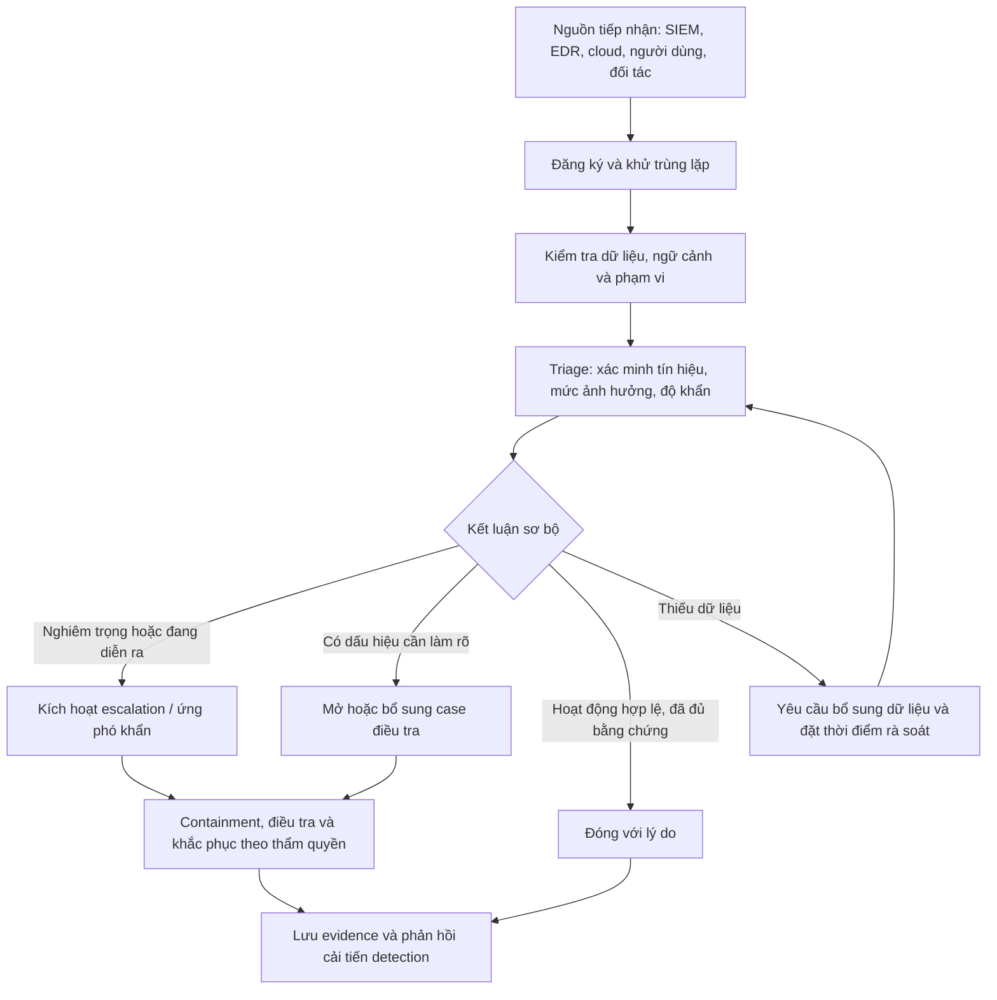

# Triage trong Incident Response: phân loại, xác minh và ưu tiên xử lý sự cố

## 1. Triage là gì?

Trong **Incident response** (ứng phó sự cố an toàn thông tin), *triage* là quá trình **tiếp nhận, làm rõ, đánh giá và định tuyến** một cảnh báo hoặc báo cáo bất thường để quyết định có cần điều tra sâu, ứng phó khẩn cấp, chuyển cho bộ phận khác, hay đóng với lý do có thể kiểm tra lại. Triage thường là điểm nối giữa hoạt động phát hiện với hoạt động ứng phó.

Một hệ thống có thể sinh hàng nghìn sự kiện bảo mật mỗi ngày. Không phải sự kiện nào cũng là tấn công; không phải cảnh báo nào cũng là sự cố đã được xác nhận. Triage giúp đội ứng phó tập trung vào tín hiệu quan trọng, phát hiện sớm tình huống có thể gây thiệt hại và tránh mất thời gian vì cảnh báo trùng lặp hoặc ít giá trị.

Trong học phần **SECURITY_SECURITY_ASSURANCE**, mục tiêu rộng hơn là **đánh giá có bằng chứng rằng các kiểm soát bảo mật đáp ứng mục tiêu đã đặt ra**, từ rủi ro, yêu cầu, security controls đến kiểm thử, audit và khắc phục. Vì vậy, triage không chỉ là quyết định vận hành tức thời: tổ chức còn cần chứng minh **quyết định được đưa ra dựa trên dữ liệu nào, đúng thẩm quyền hay không, có kịp thời không, và kết quả có được ghi nhận để cải thiện kiểm soát liên tục không**.

**Ví dụ:** SIEM tạo cảnh báo “một tài khoản đăng nhập từ địa điểm hiếm gặp”. Việc xác minh có thể cho thấy người dùng đang sử dụng VPN hợp lệ, có thể là tài khoản bị chiếm đoạt, hoặc chưa đủ dữ liệu để kết luận. Mỗi kết quả phải dẫn tới hành động và hồ sơ khác nhau.

Sau bài này, người học có thể:

- Phân biệt sự kiện, cảnh báo, sự cố nghi ngờ, sự cố đã xác nhận và triage.
- Áp dụng quy trình triage có tiêu chí rõ ràng: kiểm tra tín hiệu, bổ sung ngữ cảnh, xác định tác động và ưu tiên.
- Bảo toàn dữ liệu liên quan, chuyển cấp và đề xuất hành động theo đúng thẩm quyền.
- Thiết kế playbook, tiêu chí quyết định, chỉ số và bằng chứng để đánh giá chất lượng triage.

## 2. Phân biệt các đối tượng trong luồng ứng phó

| Thuật ngữ | Ý nghĩa | Ví dụ |
|---|---|---|
| **Event (sự kiện)** | Hoạt động được quan sát và ghi nhận | Một lần đăng nhập thất bại |
| **Detection / signal** | Dấu hiệu mà một quy tắc hoặc mô hình đánh dấu | Có nhiều lần đăng nhập thất bại trong thời gian ngắn |
| **Alert (cảnh báo)** | Thông báo cần đánh giá, thường có rule, tài sản, thời gian, ngữ cảnh | “Nhiều lần thất bại rồi thành công từ cùng IP” |
| **Triage** | Đánh giá sơ bộ để xác định bản chất, ưu tiên, phạm vi và đường xử lý | Kiểm tra tài khoản, IP, MFA, hành động kế tiếp |
| **Suspected incident** | Tình huống có chỉ dấu đủ đáng quan tâm để mở điều tra theo quy trình | Nghi ngờ tài khoản quản trị bị chiếm đoạt |
| **Confirmed incident** | Sự cố đáp ứng tiêu chí xác nhận của tổ chức sau khi có bằng chứng | Truy cập trái phép đã được xác minh |
| **Case / ticket** | Hồ sơ lưu thông tin, quyết định, người chịu trách nhiệm và tiến trình | Case `IR-2026-042` |
| **Response / containment** | Hoạt động hạn chế tác động và xử lý sự cố theo quy trình được phê duyệt | Vô hiệu hóa phiên đăng nhập hoặc cô lập máy khi được phép |

Một cảnh báo có thể liên kết nhiều sự kiện. Nhiều cảnh báo có thể cùng một sự cố, nhưng cũng có thể phản ánh nhiều sự cố độc lập. Không nên suy luận **“một alert = một incident”** hay **“không có alert = hệ thống an toàn”**.

Triage đôi khi cũng được áp dụng trực tiếp cho báo cáo từ người dùng, email, tin tức từ đối tác, kết quả threat hunting hoặc phát hiện từ kiểm toán. Vì thế, thiết kế quy trình phải xử lý cả trường hợp **không có detection rule hay log chuẩn hóa làm đầu vào**.

## 3. Vai trò của triage trong vòng đời Incident Response



Triage có thể diễn ra **lặp lại**, không chỉ một lần. Một cảnh báo mới có thể nâng mức ưu tiên của case hiện hữu; kết quả điều tra có thể thay đổi từ “nghi ngờ” thành “xác nhận”; bằng chứng mới có thể cho thấy tác động lớn hơn ban đầu.

Đối với tình huống có dấu hiệu gây hại đang diễn ra, **không chờ đủ mọi chi tiết để kích hoạt quy trình khẩn cấp**. Triage có trách nhiệm đưa ra quyết định sơ bộ phù hợp với mức rủi ro và thẩm quyền. Việc thực hiện hành động can thiệp có tác động lớn vẫn phải theo playbook, điều kiện cho phép và cơ chế phê duyệt đã xác định trước.

## 4. Đầu vào tối thiểu và kiểm tra độ tin cậy dữ liệu

Một hồ sơ triage nên bắt đầu với các trường có khả năng truy vết:

| Nhóm dữ liệu | Nội dung cần biết |
|---|---|
| **Định danh** | Alert ID / report ID, nguồn phát hiện, rule ID và phiên bản nếu có |
| **Thời gian** | `event_time`, `ingested_at`, thời điểm tạo alert, thời điểm bắt đầu triage, múi giờ |
| **Đối tượng** | User, tài khoản dịch vụ, host, ứng dụng, tenant, tài nguyên cloud và chủ sở hữu |
| **Hành vi** | Điều gì xảy ra, kết quả thành công/thất bại, số lần, loại sự kiện, liên kết event gốc |
| **Bằng chứng nguồn** | Log gốc, liên kết truy vấn, telemetry, case hiện hữu, báo cáo người dùng |
| **Ngữ cảnh** | Giá trị tài sản, môi trường production/test, vai trò đặc quyền, phê duyệt thay đổi, threat intelligence |
| **Trạng thái vận hành** | Người nhận, lịch sử hành động, thời hạn yêu cầu, kết quả bước kiểm tra trước |
| **Độ tin cậy** | Trường nào thiếu, độ trễ log, khả năng trùng lặp, độ tươi của enrichment, nguồn dữ liệu lỗi |

Các bước kiểm tra ban đầu:

1. **Xác định đúng alert:** nguồn gửi có được tin cậy không, ID có tồn tại không, liệu đây là một case đã mở hay sự kiện bị phát lại?
2. **Xác định thời gian:** các hệ thống có đồng bộ UTC và sai lệch đồng hồ không? Dùng mốc nào để tính việc “đang diễn ra”?
3. **Đối chiếu log gốc:** rule kết luận từ sự kiện nào? Có thể tái hiện truy vấn và thấy cùng dữ liệu không?
4. **Xem độ phủ telemetry:** log quan trọng có bị rớt, đến muộn hoặc thiếu trường không? Nếu thiếu dữ liệu, ghi rõ giới hạn thay vì suy luận an toàn.
5. **Bảo vệ thông tin:** chỉ thu các trường cần để đánh giá, không dán token, mật khẩu, khóa hoặc dữ liệu nhạy cảm vào ticket hay kênh trao đổi chung.

Ví dụ, dữ liệu geo-IP cho biết IP “ở quốc gia khác” **không tự chứng minh** vị trí vật lý của người đăng nhập. VPN, proxy, mạng doanh nghiệp, IP dùng chung và dữ liệu định vị không chính xác đều có thể gây sai. Triage cần đối chiếu với MFA, thiết bị, lịch sử đăng nhập, phiên hiện tại và xác minh có kiểm soát.

## 5. Quy trình triage theo từng bước

### Bước 1 — Tiếp nhận và xác lập trách nhiệm

Đưa cảnh báo vào hàng đợi có **mã định danh duy nhất, thời gian nhận, nguồn, trạng thái và nhóm chịu trách nhiệm**. Đặt trạng thái ban đầu như `new` hoặc `assigned`; xác định ai có trách nhiệm xác nhận tiếp nhận và ai chịu trách nhiệm cuối cùng cho case.

Tìm cảnh báo trùng theo tài sản, tài khoản, khoảng thời gian, loại hành vi và event ID. Việc gộp alert cần giữ **liên kết tới mọi nguồn gốc và thời điểm** để không xóa mất dấu vết. Cảnh báo cũ được cập nhật ngữ cảnh mới phải được xem lại mức ưu tiên.

### Bước 2 — Xác minh điều kiện kích hoạt

Truy ngược từ mô tả alert đến log gốc:

- Rule nào tạo alert, phiên bản nào, điều kiện nào đã khớp?
- Hành vi xảy ra thật trên hệ thống hay do parser, mapping trường, độ lệch thời gian hoặc dữ liệu thử?
- Sự kiện có thuộc phạm vi tài sản và môi trường đang giám sát không?
- Có lỗi thu thập, mất mẫu hoặc trùng sự kiện khiến kết quả sai không?
- Có thông báo bảo trì, diễn tập, kiểm thử được phê duyệt hay thay đổi cấu hình tương ứng không?

Đối chiếu ít nhất một nguồn độc lập khi rủi ro cao và có dữ liệu phù hợp. Không ép phải có hai nguồn trong mọi trường hợp: một audit log đáng tin cậy vẫn có thể đủ để kích hoạt xử lý; ngược lại, hai nguồn cùng lấy từ một pipeline lỗi có thể không độc lập thực sự.

### Bước 3 — Bổ sung ngữ cảnh và dựng dòng thời gian

Xác định **ai, làm gì, ở đâu, khi nào, bằng cách nào và trên tài sản nào**. Xem những sự kiện trước và sau cảnh báo để hiểu chuỗi hành vi, chẳng hạn:

- Thay đổi MFA, password reset, đăng nhập từ thiết bị mới.
- Gán quyền hoặc thay đổi IAM policy.
- Truy cập dữ liệu nhạy cảm sau đăng nhập.
- Tắt log, sửa cấu hình bảo vệ hoặc tạo phiên truy cập bất thường.
- Cảnh báo EDR/WAF/DLP liên quan trên cùng user, host hoặc phiên.

Trình bày timeline theo UTC và ghi nguồn của từng điểm thời gian. Với một sự kiện chưa xác thực, đánh dấu là **chưa xác minh**; không lẫn suy luận của người phân tích với sự kiện đã quan sát.

### Bước 4 — Đánh giá mức ảnh hưởng, độ khẩn và độ chắc chắn

Triage cần phân biệt ít nhất ba câu hỏi:

- **Impact / severity:** nếu hành vi thực sự độc hại, hậu quả có thể lớn đến mức nào?
- **Urgency:** có cần xử lý ngay để tránh thiệt hại tiếp diễn, mất bằng chứng hoặc vượt hạn phản hồi không?
- **Confidence:** bằng chứng đang có hỗ trợ giả thuyết độc hại mạnh đến đâu?

Xét mức quan trọng của tài sản, quyền đặc quyền, dữ liệu liên quan, tính tiếp diễn, độ rộng phạm vi, hành động gây hại đã ghi nhận và các biện pháp bảo vệ còn hoạt động. Không tự động gán severity cao chỉ vì rule đặt tên “critical”, và cũng không coi sự kiện nghiêm trọng là an toàn chỉ vì confidence chưa cao.

### Bước 5 — Đưa ra quyết định xử lý sơ bộ

Các nhóm kết quả nên được định nghĩa nhất quán:

| Kết quả triage | Khi nào dùng | Hành động tiếp theo |
|---|---|---|
| **Confirmed incident** | Bằng chứng đáp ứng tiêu chí xác nhận của tổ chức | Mở/kích hoạt incident, chỉ định chỉ huy, thực hiện response |
| **Suspected incident / needs investigation** | Có dấu hiệu đáng tin nhưng chưa xác định đủ | Mở case, điều tra sâu, đặt thời điểm cập nhật và người chịu trách nhiệm |
| **Benign true positive** | Hành vi thực sự khớp rule nhưng hợp lệ, có đủ căn cứ | Đóng hoặc theo dõi; ghi bằng chứng và cơ hội giảm nhiễu |
| **False positive** | Rule/parser/telemetry khớp sai hoặc logic diễn giải không đúng | Đóng có lý do, tạo yêu cầu sửa detection nếu cần |
| **Duplicate / linked** | Đã nằm trong case/cảnh báo khác | Gắn vào case gốc, cập nhật tác động; tránh làm mất bằng chứng |
| **Insufficient evidence** | Không có đủ dữ liệu để phân định | Ghi khoảng trống dữ liệu, yêu cầu bổ sung, lịch rà soát và mức ưu tiên |
| **Out of scope / referred** | Thuộc hệ thống hoặc trách nhiệm nhóm khác | Chuyển đúng đầu mối, kiểm tra đã tiếp nhận |

**Benign true positive** khác **false positive**. Nếu rule phát hiện thao tác xóa log, một quản trị viên có thể thật sự đã xóa log trong bảo trì được phê duyệt: tín hiệu là đúng, nhưng hành vi hợp lệ. Ngược lại, parser gán nhầm `event.code` và tạo “xóa log” khi không có thao tác xóa là false positive.

### Bước 6 — Escalate, phối hợp và kiểm soát hành động

Chuyển cấp khi phát hiện thuộc nhóm rủi ro cao, tác động đang tiếp diễn, phạm vi lan rộng, thiếu thẩm quyền, không đạt giới hạn thời gian hoặc có ràng buộc chuyên môn/pháp lý. Thông báo chuyển cấp phải nêu rõ **những điều đã biết, chưa biết, mức ưu tiên, căn cứ và hành động đã thực hiện**.

Người triage thường có quyền đọc bằng chứng, đặt mức ưu tiên, chuyển case; nhưng hành động làm gián đoạn dịch vụ như cô lập máy, thu hồi credential, khóa tài khoản hoặc chặn IP cần được gắn với **quyền hạn và playbook**. Với tình huống khẩn cấp đã có ủy quyền trước, vẫn phải ghi lại thời gian, phạm vi và lý do can thiệp.

### Bước 7 — Ghi nhận kết quả và phản hồi cải tiến

Đóng triage khi có quyết định rõ, người sở hữu bước tiếp theo và hồ sơ đủ để một người khác tái kiểm tra. Nếu chuyển điều tra, triage đã hoàn thành khi **đã bàn giao đầy đủ trách nhiệm và bằng chứng**, dù toàn bộ incident chưa kết thúc.

Ghi nhận các vấn đề phát hiện trong quá trình triage: rule tạo quá nhiều nhiễu, asset inventory sai, log thiếu trường, runbook lỗi thời, nguồn không được giám sát, quyền truy cập không phù hợp. Chuyển các phát hiện này thành công việc khắc phục có chủ sở hữu và thời hạn.

## 6. Phân loại mức độ ưu tiên: severity, urgency và confidence

Không có một bảng P0–P3 phù hợp với mọi tổ chức. Cần định nghĩa ngưỡng theo rủi ro, khả năng ảnh hưởng đến dịch vụ và nghĩa vụ phản hồi. Bảng sau chỉ là **ví dụ quy ước nội bộ giả định**, không phải chuẩn bắt buộc:

| Mức | Tình huống minh họa | Cách xử lý dự kiến |
|---|---|---|
| **P0 – Critical** | Có bằng chứng ransomware đang lan rộng hoặc tài khoản quản trị đang thực hiện thao tác phá hoại trên nhiều hệ thống trọng yếu | Kích hoạt kênh khẩn cấp, incident commander và các thẩm quyền containment đã duyệt |
| **P1 – High** | Nghi bị chiếm đoạt tài khoản đặc quyền với hoạt động nguy hiểm đã ghi nhận | Ưu tiên điều tra ngay, giữ chứng cứ, đánh giá can thiệp sớm |
| **P2 – Medium** | Cảnh báo có tín hiệu đáng quan tâm nhưng chưa cho thấy ảnh hưởng hoặc độ khẩn cao | Điều tra theo hàng đợi và mục tiêu phản hồi đã công bố |
| **P3 – Low** | Tín hiệu đơn lẻ độ tin cậy thấp trên tài sản ít quan trọng, chưa có dấu hiệu kết hợp | Đánh giá theo lịch, duy trì giám sát và nhận thông tin mới |

Quyết định ưu tiên phải được **cập nhật khi có thông tin mới**. Cảnh báo P3 trên thiết bị người dùng có thể thành P1 nếu sau đó có bằng chứng dữ liệu nhạy cảm đã bị truy cập trái phép.

Không tính priority chỉ bằng `severity × confidence` rồi xem điểm đó là chân lý: nếu confidence thấp nhưng hậu quả tiềm tàng cực lớn và hành vi đang diễn ra, đội ứng phó có thể cần kiểm tra hoặc kích hoạt biện pháp khẩn cấp ngay theo quy tắc được ủy quyền.

### 6.1. Thời hạn vận hành

Tổ chức thường xác định riêng:

- **Time to acknowledge:** từ khi tiếp nhận alert đến khi người/phân hệ chịu trách nhiệm xác nhận.
- **Time to triage:** từ mốc bắt đầu được định nghĩa đến quyết định triage ban đầu.
- **Time to escalate:** từ khi đủ điều kiện chuyển cấp đến khi bên nhận được thông báo và xác nhận.
- **Time to contain:** từ mốc kích hoạt điều kiện containment đến khi hoàn thành hành động được phê duyệt.

Ví dụ giả định, SOC có thể đặt mục tiêu *xác nhận tiếp nhận* P0 trong 5 phút và P1 trong 15 phút. Những số này chỉ mang tính minh họa. Hệ thống phải nêu rõ múi giờ, lịch trực, mốc bắt đầu/kết thúc và cách tính trường hợp báo động đến muộn hoặc đổi mức ưu tiên. Không được báo cáo rằng “đạt SLA” nếu dữ liệu thời gian không đáng tin.

## 7. Bảo toàn chứng cứ và chain of custody khi triage

Triage vừa cần hành động nhanh, vừa phải tránh làm mất dấu vết giúp điều tra hoặc kiểm toán. Các nguyên tắc thực hành:

1. **Ghi nhận nguồn và thời gian:** log gốc, sự kiện liên quan, nguồn xuất dữ liệu, thời điểm thu thập theo UTC, ID định danh và điều kiện truy vấn.
2. **Giữ bản gốc khi có thể:** truy vấn hoặc sao lưu theo quy trình bảo quản; ghi rõ bản sao làm việc, không sửa chứng cứ nguồn.
3. **Theo dõi tính toàn vẹn:** dùng checksum/hash hoặc cơ chế lưu trữ chống sửa/xóa khi phù hợp; checksum giúp nhận biết thay đổi nhưng **không tự xác thực nguồn phát sinh**.
4. **Giữ chain of custody:** ai thu thập, ai nhận, ai truy cập/chuyển giao, thời điểm và mục đích; gắn mã case tương ứng.
5. **Giới hạn tiếp cận:** áp dụng least privilege, phân loại dữ liệu và chính sách lưu giữ, tránh lan truyền log nhạy cảm qua chat/email không kiểm soát.
6. **Ghi tác động của thao tác điều tra:** truy vấn, thu thập dữ liệu volatile, cô lập thiết bị, thay trạng thái tài khoản có thể ảnh hưởng đến hệ thống và dấu vết.

Một số bằng chứng như phiên mạng, bộ nhớ hoặc token truy cập có tuổi đời ngắn. Nếu rủi ro mất chứng cứ cao, người triage phải **chuyển cấp kịp thời tới người có thẩm quyền thu thập phù hợp**, thay vì cố gắng tự thực hiện kỹ thuật vượt phạm vi vai trò.

Không nên thu thập tràn lan dữ liệu cá nhân chỉ vì “có thể cần”. Phạm vi, mục đích, quyền truy cập và thời gian lưu giữ chứng cứ cần dựa trên chính sách cùng nghĩa vụ áp dụng cho tổ chức.

### 7.1. Tách fact, hypothesis và decision

Ví dụ:

| Loại | Cách ghi |
|---|---|
| **Fact** | “Hệ thống identity ghi nhận đăng nhập thành công lúc 09:14:20 UTC từ IP 203.0.113.15.” |
| **Hypothesis** | “Có khả năng phiên này thuộc tài khoản bị chiếm đoạt; chưa xác minh chủ thể thao tác.” |
| **Decision** | “Nâng lên P1 để điều tra; yêu cầu xác nhận thiết bị và truy cập sau đăng nhập.” |
| **Evidence reference** | “Identity event ID `auth-8732`, truy vấn `Q-214`, bản lưu trong case `IR-042`.” |

Phân biệt các loại phát biểu giúp người trực ca tiếp theo hoặc kiểm toán viên hiểu được **vì sao** một quyết định được đưa ra tại thời điểm đó, ngay cả khi kết luận cuối cùng thay đổi.

## 8. Tình huống thực tế: cảnh báo đăng nhập đáng ngờ

Một hệ thống phát hiện một tài khoản quản trị đăng nhập thành công từ IP hiếm gặp, sau ba lần đăng nhập thất bại trong vòng vài phút. Các địa chỉ IP dưới đây là địa chỉ mẫu dành cho tài liệu, không phải nguồn đang hoạt động.

| Thời gian UTC | Dữ kiện có thể quan sát | Nguồn |
|---|---|---|
| 09:11:02 | Ba lần đăng nhập thất bại của `admin.ops` từ `203.0.113.15` | Identity provider |
| 09:14:20 | Đăng nhập thành công của `admin.ops` từ cùng IP | Identity provider |
| 09:14:23 | Sự kiện xác thực MFA thành công | Identity provider |
| 09:16:10 | Truy cập bảng quản trị hạ tầng | Cloud audit |
| 09:19:00 | SIEM tạo alert “unusual admin sign-in” | SIEM |

**Vòng triage đầu tiên:**

1. Nhận alert, gắn ID case và kiểm tra liệu đã có incident cùng tài khoản/IP không.
2. Xác minh các event ID gốc, múi giờ và rule version; kiểm tra dữ liệu MFA và cloud audit có cùng phiên hoặc cùng định danh không.
3. Xem tài khoản `admin.ops` thuộc ai, quyền hạn nào, có lịch trực hoặc thay đổi được phê duyệt trong thời điểm đó không.
4. Xem IP/thiết bị từng được dùng hợp lệ hay chưa; xác minh có VPN, NAT và thiết bị quản lý không. Không suy luận vị trí vật lý chỉ từ IP.
5. Tìm sự kiện sau đăng nhập: cấp quyền, tạo khóa, sửa cấu hình log, truy cập hoặc xuất dữ liệu nhạy cảm. Kiểm tra log có thiếu/đến muộn không.
6. Chưa có bằng chứng truy cập trái phép nhưng tài khoản đặc quyền và hoạt động quản trị có thể gây tác động lớn: mở **suspected incident**, gán ưu tiên phù hợp với chính sách, báo đầu mối SOC/identity và đặt thời điểm cập nhật.

**Hai nhánh kết quả có thể xảy ra:**

- **Nhánh A, hoạt động hợp lệ:** chủ tài khoản xác nhận qua kênh tin cậy rằng đang trực xử lý sự cố; phiên đăng nhập liên kết đúng thiết bị được quản lý, ticket được phê duyệt khớp hành động và không phát hiện hoạt động vượt phạm vi. Ghi rõ bằng chứng, có thể đóng **benign true positive**, đồng thời xem xét rule có cần bổ sung enrichment hay không.
- **Nhánh B, nghi ngờ gia tăng:** chủ tài khoản không nhận ra phiên, audit cho thấy tạo khóa truy cập mới ngoài phê duyệt hoặc thực hiện thay đổi IAM bất thường. Nâng ưu tiên, chuyển sang incident response theo playbook; đánh giá thu hồi phiên/credential, bảo toàn log và xác định phạm vi ảnh hưởng.

**MFA thành công không đủ để kết luận đăng nhập hợp lệ**; tương tự, IP lạ không đủ xác nhận chiếm đoạt tài khoản. Phán đoán phụ thuộc sự kết hợp nhiều bằng chứng, độ tin cậy của chúng và rủi ro khi chậm xử lý.

## 9. Playbook triage có cấu trúc

Playbook phải đủ cụ thể để người trực ca khác nhau có thể đưa ra quyết định nhất quán nhưng vẫn cho phép chuyển cấp khi tình huống nằm ngoài mẫu. Với cảnh báo truy cập tài khoản đặc quyền, playbook có thể gồm:

| Giai đoạn | Đầu vào cần xem | Kết quả cần ghi |
|---|---|---|
| Tiếp nhận | Alert ID, nguồn, thời điểm, tài khoản/tài sản | Case ID, owner, trạng thái xác nhận |
| Xác minh | Log gốc, rule version, event ID, telemetry health | Tín hiệu có thực và giới hạn dữ liệu |
| Enrichment | Asset criticality, quyền tài khoản, device, MFA, IP, ticket | Những ngữ cảnh đáng tin và độ tươi |
| Scope | Các phiên, tài sản, hành động liên quan, tác động đang diễn ra | Phạm vi sơ bộ và mức độ rủi ro |
| Decision | Tiêu chí xác nhận, severity/urgency/confidence | Phân loại và priority với lý do |
| Escalation | Điều kiện P0/P1, đầu mối trực, thẩm quyền can thiệp | Thời gian gửi, người nhận, xác nhận |
| Handoff | Timeline, evidence refs, giả thuyết chưa kiểm chứng | Case và bước điều tra/ứng phó tiếp |
| Feedback | Parser/rule lỗi, telemetry gap, allowlist kém | Finding cải tiến và người phụ trách |

Mẫu hồ sơ sau có tính **minh họa cấu trúc**, không phải định dạng API hoặc cấu hình sản phẩm cụ thể:

```yaml
case_id: IR-2026-042
source:
  type: siem_alert
  alert_id: ALT-8742
  rule_id: AUTH-UNUSUAL-ADMIN
  rule_version: "2.3"
received_at_utc: "2026-11-28T09:19:00Z"
asset:
  environment: production
  principal: admin.ops
  criticality: high
triage:
  owner: soc-shift-a
  started_at_utc: "2026-11-28T09:21:00Z"
  observed_facts:
    - "Authentication success after repeated failures"
    - "Related cloud admin console access"
  limitations:
    - "Device inventory refresh pending"
  classification: suspected_incident
  priority: P1
  confidence: medium
  rationale: >
    Privileged account with unusual authentication and subsequent
    admin activity; legitimacy not yet independently verified.
  next_action: "Escalate to identity response owner"
  next_review_at_utc: "2026-11-28T09:35:00Z"
evidence:
  references:
    - "identity-event:auth-8732"
    - "cloud-audit:event-9832"
  time_standard: UTC
handoff:
  recipient: identity-response-oncall
  status: awaiting_acknowledgement
```

Các trường và mốc thời gian trong YAML là dữ liệu giả định. Hồ sơ triển khai thực tế cần thêm **quyền truy cập, nhãn dữ liệu nhạy cảm, lịch sử cập nhật bất biến khi phù hợp, trách nhiệm phê duyệt và chính sách lưu giữ**. Không ghi mật khẩu, session token hoặc khóa bí mật vào trường `observed_facts`.

## 10. Khi nào cần hành động ngay?

Triage không phải bước ngăn cản hành động khẩn cấp. Một số tín hiệu có thể cần kích hoạt cơ chế ứng phó song song với thu thập thông tin:

- Dấu hiệu mã độc mã hóa đang tác động nhiều máy hoặc kho lưu trữ.
- Hoạt động xóa/phá hoại dữ liệu đang tiếp diễn trên hệ thống trọng yếu.
- Quyền quản trị bị sử dụng bất thường để thay đổi kiểm soát bảo mật hoặc tạo credential.
- Dữ liệu nhạy cảm có dấu hiệu bị truy xuất hoặc chuyển ra ngoài với rủi ro cao.
- Phát hiện hệ thống cốt lõi bị gián đoạn do hành vi có khả năng ác ý.

Một quyết định hành động phải cân đối **tốc độ giảm thiểu tác động**, **khả năng gián đoạn vận hành**, **mất chứng cứ** và **thẩm quyền ra lệnh**. Ví dụ, cô lập một máy có thể hạn chế lây lan, nhưng cũng có thể làm mất kết nối phục vụ thu thập một số dấu vết. Playbook cần mô tả điều kiện kích hoạt, người được phép quyết định, cách liên lạc, người thực hiện và cách ghi bằng chứng sau hành động.

Đối với nghi ngờ liên quan nhân sự, nghĩa vụ thông báo, dữ liệu cá nhân hoặc vi phạm hợp đồng, triage phải chuyển đúng bộ phận pháp chế, bảo mật dữ liệu, vận hành hay quản lý theo quy trình áp dụng. Thời hạn thông báo phụ thuộc quy định và hoàn cảnh cụ thể, không thể tự giả định từ tên loại sự cố.

## 11. Tự động hóa triage và giới hạn cần kiểm soát

SIEM, SOAR và các công cụ điều phối có thể tự động:

- Gom nhóm alert trùng lặp và liên kết với incident đang mở.
- Lấy mức quan trọng của tài sản, thông tin chủ sở hữu, IAM roles, danh sách thay đổi đã duyệt.
- Kiểm tra dấu hiệu đã biết, tạo timeline và liên kết sự kiện.
- Tạo case, định tuyến người trực, thông báo vượt thời gian phản hồi.
- Đề xuất mức ưu tiên và các bước kiểm tra tiếp theo.

Tự động hóa giúp giảm công việc lặp lại nhưng **không phải bằng chứng tự thân rằng kết luận là đúng**. Enrichment lỗi thời, join sai định danh hoặc rule loại trừ sai có thể gây đóng nhầm incident.

Vì vậy cần xác định:

1. **Mức quyền của từng thao tác:** chỉ đọc/enrich, thay đổi ticket hay hành động trực tiếp trên hệ thống?
2. **Điều kiện kiểm soát:** input hợp lệ, scope chính xác, phê duyệt hoặc ủy quyền theo playbook, bước xác nhận bổ sung khi có tác động lớn.
3. **Idempotency:** replay cùng alert không tạo nhiều case hoặc thực thi containment lặp không mong muốn.
4. **Fallback:** nếu connector, enrichment hoặc automation thất bại, chuyển sang xử lý thủ công; không mặc định đóng.
5. **Auditability:** lưu rule/playbook version, dữ liệu đầu vào, quyết định máy, quyết định con người, kết quả hành động và lỗi.
6. **Testing:** thử dữ liệu thiếu, sai format, timeout, duplicate, thay đổi schema và tình huống khẩn cấp cần escalation.

Tự động đánh giá `benign` nên có điều kiện có thể giải thích và được thử nghiệm trên cả trường hợp đối kháng giả lập. Những tình huống chưa đủ căn cứ thường cần người có trách nhiệm đưa ra quyết định.

## 12. Chất lượng triage: đo cái gì?

Một hệ thống triage được đánh giá tốt cần có thước đo **tốc độ, độ đúng và chất lượng bằng chứng**. Các chỉ số hữu ích gồm:

| Chỉ số | Ý nghĩa | Lưu ý |
|---|---|---|
| **Alert acknowledgement time** | Thời gian từ nhận đến xác nhận người xử lý | Quy định mốc bắt đầu và lịch trực |
| **Time to triage** | Thời gian đến quyết định phân loại sơ bộ | Không đánh đồng với thời gian khắc phục incident |
| **Escalation latency** | Độ trễ từ khi thỏa điều kiện chuyển cấp đến lúc chuyển đúng đầu mối | Theo dõi việc bên nhận có xác nhận |
| **Reclassification rate** | Tỷ lệ case đổi loại/mức ưu tiên khi có thêm bằng chứng | Không mặc định tỷ lệ cao là kém: có thể do bằng chứng đến muộn |
| **Closure reason completeness** | Tỷ lệ case đóng có lý do và dẫn chứng | Ghi logic, bằng chứng, người duyệt nếu cần |
| **Reopened case rate** | Case bị mở lại do thông tin mới hoặc đóng sai | Phân biệt nguyên nhân |
| **Evidence completeness** | Case có log gốc, timestamp, nguồn và timeline theo yêu cầu | Dùng mẫu phân loại theo loại cảnh báo |
| **Triage backlog/aging** | Case chưa xử lý và tuổi của chúng theo ưu tiên | Phát hiện quá tải và tồn đọng P0/P1 |
| **Automation error rate** | Lỗi enrichment/định tuyến/đóng tự động | Không tính timeout là “không có rủi ro” |

Có thể đo tỷ lệ đóng `false_positive`, nhưng **tỷ lệ này phụ thuộc chất lượng nhãn, loại cảnh báo và mức độ điều tra**. Không đánh giá nhân viên theo mục tiêu phải “đóng thật nhiều” hoặc “giảm số incident” vì dễ dẫn tới hạ mức ưu tiên, đóng vội hoặc bỏ qua tín hiệu.

Ví dụ, trong một tuần có 200 alert được triage, 50 case bị đóng là false positive. Tỷ lệ false positive **trong các alert đã được triage** là `50/200 = 25%`. Nó **không** phải precision của hệ thống phát hiện trên mọi sự kiện, cũng không cho biết có bao nhiêu sự cố thực tế đã bị bỏ sót. Muốn đánh giá false negative cần dữ liệu độc lập như incident được phát hiện bằng cách khác, diễn tập, threat hunting hoặc mẫu test có nhãn.

## 13. Kiểm thử quy trình triage để tạo bằng chứng assurance

Trong security assurance, cần kiểm tra **thiết kế quy trình** lẫn **hoạt động thực tế**. Những phép kiểm tra có giá trị:

| Tình huống kiểm thử | Đầu vào giả lập | Kết quả kỳ vọng |
|---|---|---|
| Alert hợp lệ, tác động cao | Đăng nhập admin bất thường kèm hành vi thay quyền trái phê duyệt | Escalate đúng nhóm, giữ evidence và priority phù hợp |
| Hoạt động hợp lệ khớp rule | Thao tác bảo trì có ticket đã duyệt, khớp tài sản và thời điểm | Benign true positive, lý do đóng và evidence rõ ràng |
| Parser sai | Một event bị mapping nhầm thành hành vi nguy hiểm | False positive, tạo việc sửa normalization/detection |
| Alert trùng | Hai thông báo chứa cùng event ID | Gắn một case, giữ liên kết hai nguồn và thời gian |
| Telemetry thiếu | Không có log sau một khoảng thời gian do collector lỗi | Không kết luận an toàn; ghi gap, giao người khắc phục |
| Escalation thất bại | Người nhận trực không phản hồi trong thời hạn | Có đường chuyển cấp dự phòng và dấu vết retry |
| Ưu tiên thay đổi | Alert ban đầu thấp, xuất hiện bằng chứng dữ liệu bị truy cập trái phép | Nâng priority, cập nhật timeline, báo nhóm response |
| Automation timeout | Connector lấy asset criticality bị lỗi | Gắn `unknown`, xử lý thủ công, không tự đóng |
| Case cần bảo mật | Log có thông tin nhạy cảm không liên quan | Chỉ sử dụng trường cần thiết, quyền truy cập phù hợp |
| Handoff giữa ca | Người triage đầu kết thúc ca khi case đang mở | Người nhận hiểu fact, hypothesis, decision, next steps |

Đánh giá nên thu được một bộ bằng chứng:

1. **Tài liệu quy trình:** triage playbook hiện hành, phân loại severity/priority, RACI hoặc phân công vai trò, escalation path và tiêu chí đóng case.
2. **Cấu hình vận hành:** routing, danh sách trực, SLA/SLO, phân quyền case, rule và connector liên quan.
3. **Bộ tình huống thử:** dữ liệu giả lập, expected outcomes, người kiểm thử, thời điểm, phạm vi, phiên bản playbook.
4. **Kết quả thực tế:** log nhận, case, alert, quyết định, các lần chuyển cấp, thời gian và phản hồi.
5. **Các phát hiện và khắc phục:** sai lệch kỳ vọng, nguyên nhân, người chịu trách nhiệm, hạn xử lý và kết quả kiểm tra lại.

**Ví dụ một phát hiện:** “Case P1 được tạo đúng, nhưng khi chuyển cấp ngoài giờ, nhóm phụ trách không xác nhận trong thời gian mục tiêu.” Điều cần khắc phục có thể là cấu hình paging, lịch trực hoặc đường chuyển cấp dự phòng. Việc chỉ sửa tiêu đề cảnh báo không giải quyết được sự thất bại trong luồng ứng phó.

### 13.1. Cách đánh giá một mẫu case

Đối với một case đã xử lý, kiểm toán viên hoặc người thực hiện assurance có thể lần lượt xác minh:

- Mốc `received_at`, `assigned_at`, `triage_decided_at` có tồn tại và đáng tin?
- Cảnh báo tham chiếu đến log nào, ở phiên bản detection nào?
- Có tài liệu hóa dữ kiện, giả thuyết và giới hạn thông tin?
- Priority có căn cứ vào phạm vi, tác động, tính tiếp diễn và ngữ cảnh?
- Quyết định đóng hoặc chuyển cấp có phù hợp playbook và người có thẩm quyền?
- Khi thiếu dữ liệu, có tạo việc bổ sung/khắc phục hay chỉ đóng vì “không đủ bằng chứng”?
- Handoff và hành động tiếp theo có được người nhận xác nhận?
- Có bằng chứng cải tiến control khi phát hiện quy trình thất bại?

Nếu không tìm được bằng chứng cho một bước, cần ghi **giới hạn bảo đảm** tương ứng. Trạng thái ticket “Resolved” tự nó chưa chứng minh incident đã được xử lý đúng.

## 14. Những sai lầm thường gặp

| Sai lầm | Hệ quả | Cách cải thiện |
|---|---|---|
| Đánh đồng alert với incident đã xác nhận | Báo động sai, ưu tiên không hợp lý | Định nghĩa trạng thái và tiêu chí xác nhận |
| Chỉ đọc mô tả rule, bỏ log gốc | Không nhận ra parser lỗi và dữ liệu giả | Truy ngược event ID, kiểm tra source |
| Tin tuyệt đối vào IP reputation/geo-IP | Kết luận sai về người dùng hoặc nguồn truy cập | Dùng nhiều ngữ cảnh, xem chất lượng dữ liệu |
| Đóng case vì “không tìm thêm được gì” | Khoảng trống telemetry bị che giấu | Ghi kết luận “insufficient evidence”, có follow-up |
| Khử trùng lặp làm mất alert riêng | Bỏ sót hành vi mới hoặc lan rộng | Giữ liên kết, timeline và cập nhật severity |
| Không phân biệt priority với confidence | Bỏ qua rủi ro cao khi bằng chứng còn ít | Đánh giá impact, urgency, confidence riêng |
| Tự ý containment ngoài thẩm quyền | Gián đoạn dịch vụ, mất chứng cứ, khó quy trách nhiệm | Theo playbook và ủy quyền đã duyệt |
| Lưu bằng chứng trong kênh chat công khai | Rò rỉ thông tin nhạy cảm, khó audit | Kho chứng cứ được phân quyền, tham chiếu trong case |
| Giao case nhưng không có xác nhận bàn giao | Case không có người chịu trách nhiệm | Cơ chế ack/escalation dự phòng |
| Chạy automation nhưng không giám sát lỗi | Case bị đóng/định tuyến sai hàng loạt | Kiểm thử, audit trail, fallback và theo dõi lỗi |
| Chỉ đo thời gian đóng ticket | Khuyến khích đóng vội, giảm chất lượng điều tra | Đo đồng thời độ đúng, evidence và handoff |

## 15. Bài thực hành: triage một cảnh báo cloud IAM

Một tổ chức giả định nhận cảnh báo: tài khoản dịch vụ `svc-deploy` có hành động tạo một API key mới ngoài lịch triển khai thường lệ. Tài khoản có quyền quản lý tài nguyên trong production. Dữ liệu hiện có gồm một cloud audit event, một cảnh báo SIEM, thông tin người sở hữu tài khoản và một ticket triển khai đang mở nhưng **chưa biết** sự kiện có thuộc ticket đó hay không.

Hãy đóng vai người trực SOC và tạo hồ sơ triage:

1. Ghi các **fact** đã có và **hypothesis** chưa được xác minh; không tự suy ra việc tạo key là ác ý.
2. Liệt kê những trường cần đối chiếu: identity, `event_id`, `event_time`, `source.ip`, `user_agent`, `resource`, `action`, `outcome`, tài nguyên bị ảnh hưởng và dữ liệu thiết bị.
3. Lập timeline, kiểm tra ticket có phê duyệt đúng quyền, tài khoản, thời gian và hành động hay không.
4. Xác định đánh giá sơ bộ về impact, urgency và confidence. Nêu **điều kiện khiến priority tăng** nếu xuất hiện dấu hiệu sử dụng API key để thay quyền hoặc đọc dữ liệu.
5. Chọn một trạng thái triage phù hợp với thông tin hiện tại; nêu ai sẽ được thông báo, cần xác minh điều gì tiếp theo và thời điểm rà soát.
6. Mô tả biện pháp bảo toàn chứng cứ và việc cần làm trước khi đề xuất thu hồi credential theo thẩm quyền.
7. Soạn bản handoff tối đa 10 câu cho nhóm cloud security: sự kiện, thời điểm, ảnh hưởng, evidence refs, điều đã biết/chưa biết, priority, hành động đã làm và việc cần thực hiện tiếp.

**Tiêu chí đạt:** người đọc có thể tái kiểm tra quyết định từ dữ kiện, thấy rõ sự khác biệt giữa bằng chứng và suy đoán, biết người chịu trách nhiệm bước tiếp theo và hiểu căn cứ thay đổi mức ưu tiên. Nếu thiếu log hoặc thông tin phê duyệt, bài làm phải ghi thành hạn chế cần giải quyết.

## 16. Ghi nhớ

Triage là **một quyết định dựa trên bằng chứng dưới áp lực thời gian**. Nó cần trả lời bốn câu hỏi liên tiếp: **điều gì thực sự được quan sát, có thể gây ảnh hưởng gì, cần làm gì tiếp theo, và ai chịu trách nhiệm?**

Với mục tiêu **security assurance**, một quy trình triage có giá trị khi để lại dấu vết đủ tin cậy: **alert/report → log và ngữ cảnh → phân loại và mức ưu tiên → quyết định → escalation hoặc đóng → theo dõi cải tiến**. Khi có bằng chứng mới, phải sẵn sàng điều chỉnh kết luận. Khi thiếu dữ liệu, phải làm rõ giới hạn và hướng xử lý thay vì giả định rằng không có sự cố.
