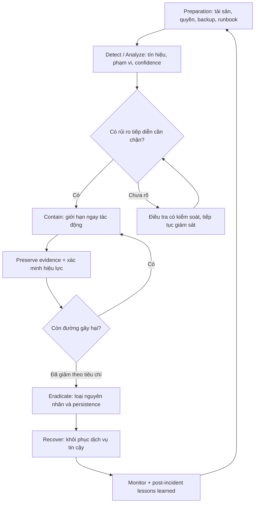
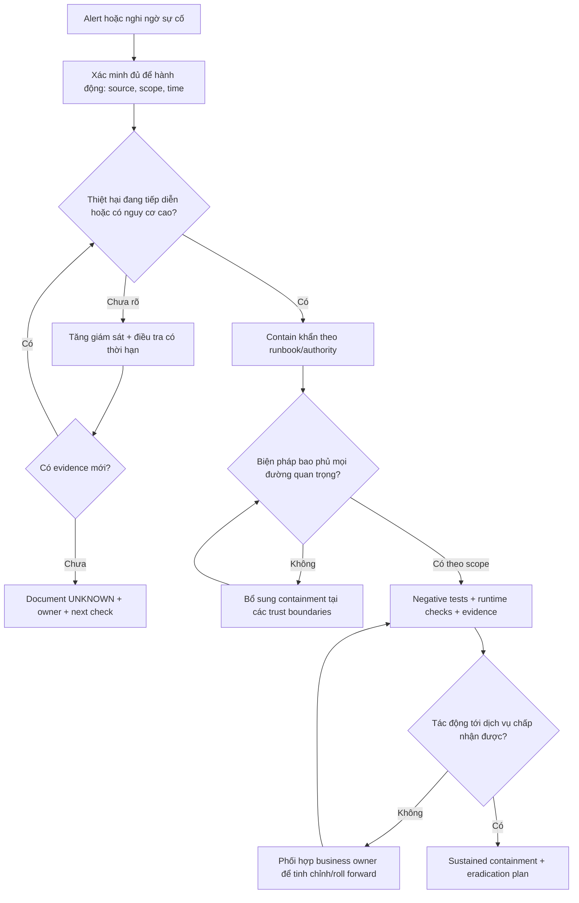
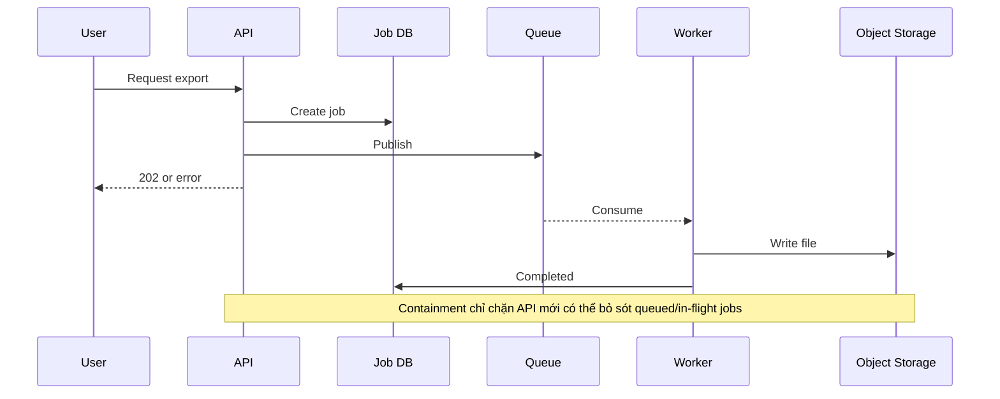
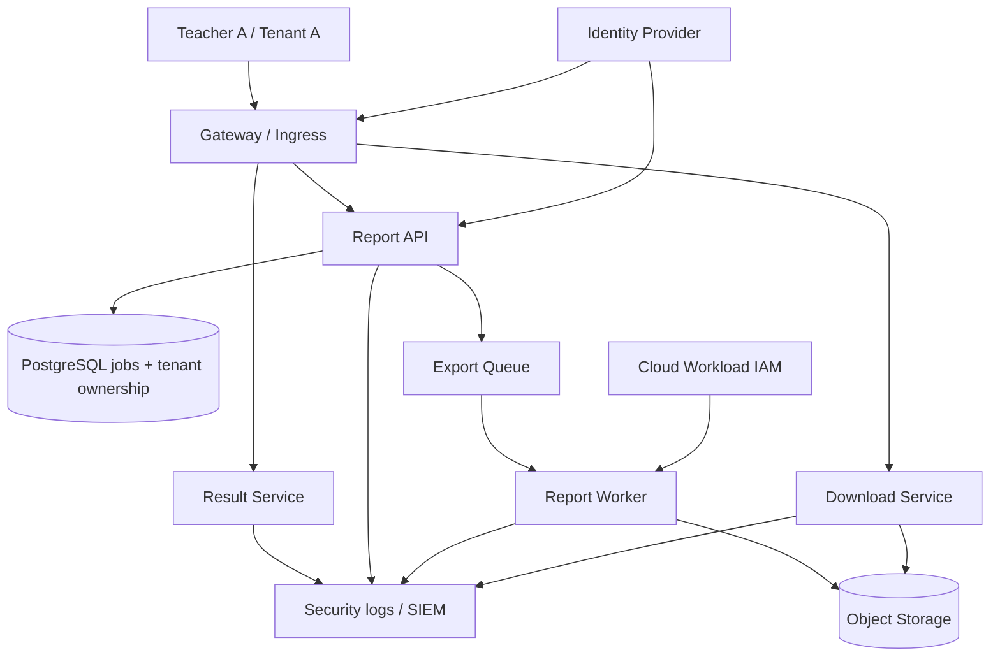

# Containment: cô lập sự cố, giới hạn tác động và chứng minh biện pháp ứng phó có hiệu lực

## 1. Một tình huống: phát hiện lộ dữ liệu nhưng chưa biết phải chặn ở đâu

Một nền tảng học tập Java/Spring Boot phục vụ nhiều trường học trên cùng cụm Kubernetes. Đội SOC nhận cảnh báo: tài khoản của một giáo viên thuộc tenant A liên tục yêu cầu tải báo cáo kết quả của tenant B. Log cho thấy một số request bị từ chối, nhưng có request thành công qua một endpoint cũ. Ngoài API, hệ thống còn có queue xử lý xuất file, worker bất đồng bộ, cache và object storage.

Nhóm trực đề xuất bốn hành động:

- Khóa toàn bộ tài khoản giáo viên trong hệ thống.
- Tắt toàn bộ cluster để chắc chắn dữ liệu không bị tải nữa.
- Chặn duy nhất request ở endpoint vừa phát hiện.
- Giới hạn ngay những đường có thể tiếp tục lộ dữ liệu, kiểm chứng từng đường, đồng thời bảo toàn evidence và phối hợp điều tra.

Ba phương án đầu có thể **quá rộng hoặc quá hẹp**. Tắt cluster có thể làm gián đoạn kỳ thi của nhiều trường; chặn một endpoint không ngăn worker xử lý job đã được xếp hàng; khóa mọi giáo viên không tương xứng với bằng chứng hiện có. Phương án thứ tư phản ánh đúng tư duy **containment dựa trên rủi ro và bằng chứng**.

**Containment** trong incident response là tập hoạt động nhằm **ngăn hoặc hạn chế một sự cố bảo mật tiếp tục lan rộng, gây thêm thiệt hại, mở rộng quyền kiểm soát hoặc làm lộ/thay đổi dữ liệu**, trong khi đội ứng phó vẫn thu thập bằng chứng, xác định phạm vi ảnh hưởng và chuẩn bị các bước xử lý tiếp theo.

Trong chương **Incident response** của module **SECURITY_SECURITY_ASSURANCE**, containment không được đánh giá chỉ bằng câu “đã chặn IP” hoặc “đã tắt service”. Cần chứng minh **security objective nào đang được bảo vệ, đường gây hại nào đã bị cắt, tài sản nào được kiểm tra, còn residual risk nào và biện pháp có tác động phụ gì**. Đây là cách kết nối incident response với chương trình security assurance liên tục.

### Mục tiêu học tập

Sau bài này, bạn có thể:

1. Phân biệt **containment, detection, triage, eradication, recovery** và các hoạt động bảo toàn bằng chứng.
2. Lựa chọn biện pháp containment phù hợp với severity, confidence, blast radius, business impact và thẩm quyền.
3. Thiết kế **short-term** và **sustained containment**, nêu điều kiện chuyển tiếp/thu hồi.
4. Áp dụng containment cho identity/session, network, endpoint, cloud IAM, Kubernetes, application, database, queue, object storage và supply chain.
5. Nhận diện các giới hạn như token còn hiệu lực, session cache, policy propagation delay, worker tồn đọng và alternate access paths.
6. Xây dựng runbook có owner, decision points, emergency escalation, rollback/roll-forward và communication.
7. Xác minh hiệu lực bằng **negative tests, runtime inventory, telemetry, before/after state và evidence có nguồn gốc**.
8. Kết nối containment với điều tra, root cause, eradication, recovery và post-incident improvement.
9. Vận dụng vào tình huống SaaS nhiều tenant sử dụng Java/Spring Boot, PostgreSQL, queue và object storage.

## 2. Containment nằm ở đâu trong chu trình incident response?

Các mô hình incident response có thể tổ chức các giai đoạn khác nhau theo phiên bản hướng dẫn và phương pháp tổ chức. Trên thực tế, **detect, analyze, contain, eradicate, recover và improve** thường diễn ra **chồng lấn**, không phải một chuỗi cố định mỗi bước hoàn tất mới được bắt đầu bước tiếp.



### 2.1. Phân biệt các khái niệm

| Hoạt động | Câu hỏi chính | Ví dụ |
|---|---|---|
| **Detection** | Có tín hiệu bất thường nào? | Alert nhiều request tải file ngoài tenant |
| **Analysis / triage** | Tín hiệu có đáng tin, tác động và phạm vi nào? | Xác nhận request success và dữ liệu thử |
| **Containment** | Cắt hoặc giới hạn đường gây hại ngay bằng cách nào? | Vô hiệu export route bị lỗi; chặn worker tiêu thụ job không hợp lệ |
| **Evidence preservation** | Làm sao giữ dấu vết đáng tin cho điều tra? | Bảo toàn logs, job records và artifact metadata |
| **Eradication** | Loại bỏ root cause và cơ chế duy trì xâm nhập? | Sửa BOLA, loại bỏ credential bị lộ, kiểm tra persistence |
| **Recovery** | Khôi phục hoạt động bình thường từ trạng thái tin cậy? | Rollout phiên bản đã sửa, mở lại export có kiểm soát |
| **Post-incident improvement** | Làm sao tránh tái diễn và rút ngắn thời gian phản hồi? | Regression tests, alert rules, hardening, runbook |

### 2.2. Containment không đồng nghĩa “đã sửa”

Khi một tính năng bị tắt, các request mới có thể không tiếp tục gây hại, nhưng code lỗi vẫn còn. Khi một máy chủ bị cô lập, persistence có thể vẫn tồn tại. Khi secret được thu hồi, có thể cần điều tra các bản sao, phiên đăng nhập và hành động đã xảy ra.

Vì vậy:

- **CONTAINED**: rủi ro tiếp diễn được hạn chế theo phạm vi đã xác minh.
- **ERADICATED**: nguyên nhân/persistence liên quan đã được xử lý theo phạm vi.
- **RECOVERED**: dịch vụ hoạt động lại theo security và business acceptance criteria.
- **CLOSED**: quyết định cuối đã được phê duyệt, evidence/lessons learned đầy đủ.

Không được coi các trạng thái này là đồng nghĩa. Một số tổ chức dùng tên khác, nhưng ý nghĩa và bằng chứng phải rõ.

## 3. Mục tiêu containment: giới hạn thiệt hại với tác động chấp nhận được

Một biện pháp containment cần phục vụ **security objective cụ thể**. Ví dụ:

- **Confidentiality:** ngăn đối tượng tiếp tục đọc/tải dữ liệu trái quyền.
- **Integrity:** ngăn thay đổi dữ liệu, pipeline, IAM hoặc artifact không được phép.
- **Availability:** giữ dịch vụ trọng yếu hoạt động, đồng thời giới hạn nguồn gây quá tải.
- **Identity assurance:** chặn sử dụng credential/session bị nghi chiếm.
- **Lateral movement:** hạn chế đường truyền từ tài sản bị ảnh hưởng sang tài sản khác.
- **Evidence integrity:** ngăn log/bằng chứng bị xóa hoặc sửa trái quyền.
- **Scope reduction:** khoanh vùng tài nguyên, tenant, account, region hoặc tiến trình nghi ảnh hưởng.

### 3.1. Nguyên tắc “nhỏ nhất nhưng đủ”

Không phải lúc nào cũng có thể chặn hẹp. Nếu đang có dấu hiệu exfiltration nghiêm trọng, cô lập rộng tạm thời có thể hợp lý. Nhưng nên lựa chọn **phạm vi nhỏ nhất có thể đáp ứng objective và thời gian xử lý**, với khả năng mở rộng nếu evidence cho thấy blast radius lớn hơn.

### 3.2. Ba câu hỏi trước hành động

1. **Nếu không làm gì trong ít phút tiếp theo, điều xấu gì có thể tiếp tục xảy ra?**
2. **Hành động đề xuất cắt được đường nào, còn đường nào khác?**
3. **Hành động đó có thể làm mất bằng chứng, gián đoạn nghiệp vụ, gây side effect hoặc đẩy actor sang đường khác không?**

Containment là quyết định vận hành trong điều kiện thông tin không hoàn chỉnh; không đợi mọi chi tiết được giải thích nếu thiệt hại đang diễn ra, nhưng phải ghi rõ assumptions và review lại khi có evidence mới.

## 4. Điều kiện ra quyết định: mức độ khẩn, confidence và blast radius

### 4.1. Các yếu tố chính

| Yếu tố | Câu hỏi |
|---|---|
| **Impact hiện tại** | Có dữ liệu thật đã bị truy cập, thay đổi hoặc mất khả dụng không? |
| **Potential impact** | Nếu tiếp tục, hậu quả có thể lan tới đâu? |
| **Confidence** | Có log/telemetry hoặc bằng chứng nào xác nhận sự cố? |
| **Exploitability** | Đường gây hại có còn mở và dễ lặp lại không? |
| **Time sensitivity** | Có thể chờ xác minh thêm hay cần containment ngay? |
| **Blast radius** | Một user, một tenant, nhiều tenants, cloud account hay cả organization? |
| **Critical dependencies** | Hệ thống kỳ thi, xác thực, thanh toán, bệnh viện... có bị ảnh hưởng nếu chặn? |
| **Preservation requirements** | Có cần snapshot, live state, forensic image, chain of custody không? |
| **Authority** | Người trực có quyền chặn đối tượng nào theo runbook? |
| **Reversibility** | Có thể hoàn tác an toàn hay phải roll forward? |
| **Adversary reaction** | Đối tượng có thể chuyển sang đường khác nếu nhận thấy chặn? |
| **Residual risk** | Sau containment còn những tokens, jobs, sessions, copies hoặc routes nào? |

### 4.2. Ví dụ ma trận ưu tiên

| Tình huống | Containment ban đầu có thể phù hợp | Cảnh báo |
|---|---|---|
| Một credential bị xác nhận lộ và đang được dùng | Thu hồi/giới hạn credential, sessions, kiểm tra hoạt động liên quan | Phải xác minh token/role propagation và alternate keys |
| Public bucket chứa dữ liệu nhạy cảm | Chặn public access, kiểm tra mọi đường đọc và bản sao | Không chỉ sửa một policy statement |
| Một pod bị nghi compromise | Cô lập network/workload theo runbook, bảo toàn evidence | Xóa pod ngay có thể làm mất volatile evidence |
| BOLA ở API export | Tạm vô hiệu hoặc hạn chế đường export trái quyền, worker/download | HTTP deny không đủ nếu job đã được publish |
| DDoS vào ingress | Lọc/rate limit có kiểm soát, điều phối upstream/provider | Không chặn mọi người dùng chung NAT |
| Nghi ransomware lan qua file share | Khoanh vùng host/share và quyền ghi, bảo vệ backups | Thao tác phá hủy hoặc restart có thể mất evidence |
| Một cảnh báo confidence thấp, chưa có tác động | Xác minh nguồn, tăng monitoring, giới hạn thử nghiệm | Không khóa toàn bộ hệ thống chỉ từ một alert |

Không có một **playbook vạn năng** áp dụng giống nhau cho mọi tình huống. Các quyết định phải dựa trên tài sản, risk appetite, nghĩa vụ và runbook của tổ chức.

## 5. Containment ngắn hạn và containment duy trì

### 5.1. Short-term containment

Mục tiêu: **ngăn thiệt hại tiếp diễn nhanh**, thường bằng biện pháp có thể kích hoạt trong thời gian ngắn.

Ví dụ:

- Chặn/disable một endpoint nhạy cảm tại gateway và service nếu có quyền.
- Thu hồi credential, phiên hoặc quyền truy cập nghi bị lạm dụng.
- Chặn egress tới destination bị nghi rò rỉ trong phạm vi xác định.
- Cô lập workload/host bị nghi compromise qua công cụ EDR hoặc network segmentation.
- Tạm ngừng worker tiêu thụ queue có job trái quyền, giữ lại dữ liệu điều tra.
- Hạn chế access policy của bucket/object hoặc signed-link issuance.

### 5.2. Sustained containment

Mục tiêu: **duy trì giới hạn rủi ro** khi đang điều tra và thực hiện root-cause fix, không làm hệ thống mất vận hành dài hạn ngoài mức chấp nhận.

Ví dụ:

- Chuyển tính năng sang chế độ chỉ đọc nếu policy cho phép.
- Tách workload nghi ngờ sang mạng/quarantine account riêng có quyền giám sát.
- Dùng role IAM tạm với phạm vi tối thiểu, giám sát việc chuyển đổi.
- Thiết lập rule ngăn triển khai lại image/config đã bị xác định ảnh hưởng.
- Bổ sung control tại queue/worker, state machine và download gateway.
- Duy trì audit logs, alerts và daily reassessment cho residual risk.

### 5.3. So sánh hai giai đoạn

| Tiêu chí | Ngắn hạn | Duy trì |
|---|---|---|
| **Mục tiêu** | Giảm thiệt hại tức thời | Ổn định giới hạn rủi ro trong điều tra/sửa lỗi |
| **Thời gian chuẩn bị** | Ngắn, qua runbook đã duyệt | Có thể yêu cầu thiết kế/review kỹ hơn |
| **Phạm vi** | Đôi khi rộng để phản ứng nhanh | Tinh chỉnh theo blast radius đã xác nhận |
| **Tính đảo ngược** | Cần ghi điều kiện revert | Chuyển sang architecture/policy mới |
| **Evidence** | Action timestamp, before/after, immediate tests | Continuous tests, monitoring và owner |
| **Rủi ro** | Làm gián đoạn dịch vụ/mất context | Tích tụ ngoại lệ và vận hành phức tạp |

**Containment duy trì không phải là thay thế vô thời hạn cho eradication.** Nếu root cause vẫn còn, phải có owner, thời hạn, controls bù đắp và phê duyệt residual risk.

## 6. Decision tree: khi nào cô lập rộng, khi nào khoanh vùng hẹp?



### 6.1. Không sử dụng decision tree như máy quyết định tự động

Các nhánh là khung tư duy. Thực tế có thể thiếu dữ liệu, actor đang hoạt động, hệ thống critical hoặc nghĩa vụ pháp lý. Người có thẩm quyền cần cân nhắc trade-offs và ghi rationale; một câu trả lời “yes/no” trong công cụ không thay thế incident command.

### 6.2. Stop conditions

Trong kế hoạch containment nên xác định khi nào cần **dừng thao tác hoặc chuyển hướng**:

- Thay đổi làm sập dịch vụ ngoài phạm vi chấp nhận.
- Phát hiện evidence đang bị mất nhanh hoặc actor chuyển sang đường khác.
- Hành động vượt quyền đã cấp hoặc cần approval mới.
- Có dấu hiệu ảnh hưởng hệ thống bên thứ ba/khách hàng ngoài phạm vi.
- Kiểm tra cho thấy containment không hiệu lực hoặc gây side effects bất ngờ.

Việc dừng một biện pháp không có nghĩa bỏ containment; có thể thay bằng phương án an toàn, được phê duyệt hơn.

## 7. Chuẩn bị trước sự cố: vì sao containment nhanh phải được thiết kế trước?

Khả năng containment phụ thuộc vào **preparation**. Khi incident đã xảy ra, việc tìm ai có quyền khóa role, ai quản lý ingress, hệ thống đang dùng token cache nào thường khiến trì hoãn và gia tăng tác động.

### 7.1. Tài sản cần chuẩn bị

- **Inventory:** dịch vụ, data classification, cloud accounts, regions, clusters, identities, owners.
- **Architecture/DFD:** luồng dữ liệu, trust boundaries, queue, workers, cache, storage.
- **Emergency contacts:** SOC, on-call, service owner, data/privacy owner, cloud/provider support.
- **Authority matrix:** hành động nào người trực được phép làm, khi nào cần risk/business approval.
- **Break-glass access:** danh tính đặc biệt có TTL, MFA, audit và review.
- **Isolation mechanisms:** EDR, firewall/SG, IAM disable, feature flags, deployment controls.
- **Backups/recovery:** immutable/isolated backups và phương án phục hồi đã kiểm tra.
- **Forensic readiness:** logging, snapshots, evidence repository, time synchronization, chain of custody.
- **Testing:** tabletop, game day, safe controlled containment drills và rollback tests.
- **Communications:** incident bridge, escalation channels và người phát ngôn được chỉ định.

### 7.2. Chuẩn bị không đồng nghĩa cấp quyền rộng thường trực

Không nên để mọi on-call user có full cloud administrator quyền vĩnh viễn chỉ để “sẵn sàng”. Có thể dùng cơ chế access ngắn hạn, approval/break-glass theo tình huống, role separation và audit đầy đủ, tùy khả năng nền tảng.

### 7.3. Bài tập diễn tập nhỏ

Trong staging, mô phỏng một test token bị lộ:

1. Xác nhận owner và người có quyền thu hồi.
2. Thực hiện revocation theo playbook.
3. Kiểm tra token mới/refresh token bị xử lý đúng policy.
4. Kiểm tra chức năng của người dùng hợp lệ.
5. Thu evidence và đo thời gian từ báo động tới kiểm chứng.

Diễn tập giúp phát hiện vấn đề về policy propagation, session caches, notification hoặc quyền vận hành **trước khi có sự cố thật**.

## 8. Incident command, quyền phê duyệt và phối hợp

Containment có thể tác động tới nhiều nhóm. Nếu mỗi nhóm tự chặn tài nguyên riêng, các hành động có thể xung đột, làm mất evidence hoặc kéo dài outage.

| Vai trò | Trách nhiệm trong containment |
|---|---|
| **Incident commander/coordinator** | Điều phối, xác định ưu tiên, quyết định/escalation theo policy |
| **SOC/IR analyst** | Xác minh alert, mở rộng điều tra, lưu evidence và cập nhật timeline |
| **Service owner** | Đánh giá business impact và điểm cắt kỹ thuật phù hợp |
| **SRE/platform** | Triển khai network/workload isolation, giám sát availability |
| **IAM/cloud security** | Thu hồi roles, keys, sessions, resource policies theo thẩm quyền |
| **Application engineering** | Feature flags, API authorization, queue/worker consistency, code paths |
| **Data/privacy owner** | Xác định dữ liệu nhạy cảm, phạm vi ảnh hưởng và nghĩa vụ liên quan |
| **Legal/compliance** | Đánh giá nghĩa vụ thông báo/bảo toàn hồ sơ khi phù hợp |
| **Communications/customer team** | Thông tin được duyệt tới stakeholder/khách hàng |
| **Forensic/evidence custodian** | Quy trình giữ tính toàn vẹn, nguồn gốc và quyền truy cập evidence |

### 8.1. RACI không thay authority

Một engineering owner có thể thực hiện thay đổi kỹ thuật nhưng không tự quyết định chấp nhận residual risk ảnh hưởng dữ liệu khách hàng. Một analyst có thể tạo ticket nhưng không nhất thiết có quyền vô hiệu toàn bộ user accounts. Cần xác định rõ **ai đề xuất, ai chấp thuận, ai thực hiện, ai kiểm chứng**.

### 8.2. Communication channels

Nếu hệ thống chat/email chính có nguy cơ compromise, có thể cần kênh out-of-band theo runbook. Không gửi token, private keys hoặc nguyên dữ liệu nhạy cảm vào hội thoại đông người. Thông báo nên phân biệt **đã xác nhận**, **đang điều tra** và **giả thuyết chưa kiểm chứng**.

### 8.3. Timeline tối thiểu

Ghi:

- Thời điểm phát hiện và nguồn tín hiệu.
- Bằng chứng ban đầu/nhận định confidence.
- Quyết định containment, người phê duyệt, thời điểm.
- Thao tác đã thực hiện, identity dùng thực hiện, resource IDs.
- Trạng thái trước/sau và kết quả kiểm chứng.
- Ảnh hưởng nghiệp vụ, những rủi ro còn lại, người phụ trách.
- Những thay đổi tiếp theo và handoff.

Không sửa timeline theo suy đoán rồi coi là sự kiện đã xảy ra. Nếu một thời điểm chỉ được ước lượng, đánh dấu đó là ước lượng.

## 9. Evidence preservation: containment có thể làm mất dấu vết

Một quyết định “xóa pod ngay” có thể ngăn process tiếp tục chạy, nhưng cũng có thể làm mất volatile memory, kết nối mạng, file tạm hoặc các thông tin điều tra. Ngược lại, chờ forensic image hoàn hảo khi dữ liệu đang tiếp tục bị xuất có thể làm tăng thiệt hại.

**Phải cân nhắc giữa tốc độ containment và bảo toàn bằng chứng**, dưới quyền incident commander và forensic policy.

### 9.1. Các nguồn evidence dễ biến mất

| Nguồn | Rủi ro khi containment |
|---|---|
| **Memory/process state** | Restart/shutdown có thể làm mất volatile artifacts |
| **Ephemeral container/pod** | Pod deletion có thể mất filesystem và identity context |
| **Queue/in-flight messages** | Clear queue có thể xóa chain of events hoặc job payload |
| **Session/token state** | Revoke có thể thay đổi trạng thái cần đối chiếu |
| **Short-retention logs** | Pipeline có thể rotate hoặc mất logs trước khi điều tra |
| **Cloud audit/config history** | Resource change hoặc retention có thể ảnh hưởng truy vết |
| **Object storage** | Delete/overwrite có thể mất bản gốc, versions, metadata |
| **Endpoint network connections** | Isolation làm mất active connection evidence |
| **Cache/temporary files** | Flush có thể xóa chỉ dấu hoặc kết quả side effect |

### 9.2. Quy tắc thực hành

- Xác định evidence quan trọng **trước thay đổi khi điều kiện cho phép**.
- Ưu tiên read-only snapshot, export logs, immutable evidence storage và timestamps.
- Không vô tình thực thi script dọn rác/cleanup làm mất dấu vết.
- Dùng phương án cô lập giữ nguyên host/pod khi có thể và phù hợp risk.
- Ghi lại chính hành động containment vì nó thay đổi evidence.
- Không tiếp tục khai thác/đọc dữ liệu trái quyền để “thu thêm chứng cứ” ngoài phạm vi.
- Với sự cố nghiêm trọng, phối hợp forensic specialists về chain of custody.

### 9.3. Chain of custody ở mức khái niệm

Một evidence record cần có nguồn, người thu, thời gian, phương pháp, địa điểm lưu, dấu vết bàn giao và biện pháp kiểm tra tính toàn vẹn thích hợp. Hash một file giúp phát hiện thay đổi bytes nhưng **không tự chứng minh file được thu từ nguồn đúng**; cần provenance và access/audit controls.

### 9.4. Khi nào phải chấp nhận đánh đổi?

Nếu actor đang xóa dữ liệu hàng loạt, cô lập ngay có thể quan trọng hơn lấy memory snapshot. Rationale cần được ghi rõ: **đã thấy gì, tác hại nào cần ngăn, evidence nào có thể mất và ai quyết định**. Sau containment, tiếp tục thu bằng chứng còn lại theo quy trình.

## 10. Containment ở network layer

Network containment nhằm **giới hạn các đường liên lạc có thể phục vụ xâm nhập, lateral movement, command-and-control hoặc exfiltration**.

### 10.1. Các biện pháp thường gặp

- Quarantine host/workload qua EDR hoặc network segment riêng.
- Chỉnh firewall/security group/NSG để hạn chế ingress/egress trong scope.
- Ngắt peering/route hoặc chặn destination xác định theo thẩm quyền.
- Chặn hoặc giới hạn public ingress tới một endpoint nhạy cảm.
- Hạn chế outbound proxy hoặc DNS access paths khi phù hợp.
- Giới hạn network access tới secret store/management plane.
- Áp dụng rate limiting/WAF mitigation cho một kiểu traffic có bằng chứng.

### 10.2. Không dùng IP như identity tuyệt đối

Trong hệ thống trường học, nhiều học viên có thể dùng chung NAT/proxy; nhiều attackers có thể dùng IP thay đổi. Chặn một IP có thể gây gián đoạn người dùng hợp lệ, trong khi actor có thể đổi đường. Nên kết hợp verified identity/session, resource scope và network context; không xem IP đơn lẻ là bằng chứng actor.

### 10.3. NetworkPolicy Kubernetes có giới hạn

Một Kubernetes NetworkPolicy có thể giúp hạn chế traffic **khi CNI hỗ trợ thực thi**. Các policies áp dụng thường được kết hợp theo union các đường được phép. Một policy tên `default-deny` chưa đủ nếu policy khác cho phép egress hoặc service còn đường truy cập ngoài scope chính sách.

### 10.4. Test containment network

Trong môi trường được cấp quyền, dùng destinations/test services do tổ chức kiểm soát:

- Kết nối bị cấm theo threat scenario không còn thành công.
- Những kết nối hợp lệ tới DB/queue/monitoring vẫn hoạt động.
- Cả ingress, egress, service mesh, proxy, IPv4/IPv6 khi liên quan được kiểm.
- Các replicas/pods mới tạo lại vẫn nhận policy tương ứng.
- Network rule change được audit và có thể đối chiếu với source-of-truth.

Không cần thực hiện scan diện rộng, flood hay truy cập mạng bên thứ ba để xác minh một control.

## 11. Containment identity, credentials và phiên đăng nhập

Khi một credential bị nghi đã lộ, **chặn IP hoặc reset password đơn lẻ** có thể chưa đủ. Đối tượng có thể còn access token, refresh token, API key, session cookie, IAM role session hoặc quyền giả mạo workload.

### 11.1. Những loại quyền cần đánh giá

| Cơ chế | Câu hỏi containment |
|---|---|
| **Password** | Reset/disable account có tác động thế nào tới active sessions? |
| **Session cookie** | Session server-side có thể bị revoke? Cookie được quản lý ra sao? |
| **Access JWT** | Token tự chứa còn hợp lệ tới expiry hay có denylist/introspection? |
| **Refresh token** | Có thể thu hồi token family và ngăn phát access token mới? |
| **API key** | Key có active ở nhiều integrations, pipelines hoặc môi trường? |
| **Cloud IAM role session** | Credentials ngắn hạn có còn sống tới expiration hoặc policy change? |
| **Service account token** | Workload có thể nhận token/identity mới sau restart? |
| **OAuth client credentials** | Secret/certificate, scopes, grant và sessions nào bị ảnh hưởng? |
| **Workload trust policy** | Principal ngoài ý muốn có thể assume/impersonate role? |
| **MFA/recovery factor** | Có thay đổi trái phép cần thu hồi/xác minh? |

### 11.2. Đặc biệt với JWT tự chứa

Nhiều access JWT được resource server xác minh cục bộ theo chữ ký/expiry và claims. **Đổi mật khẩu không nhất thiết làm token đã cấp mất hiệu lực ngay**, nếu hệ thống không có revocation/introspection/versioning controls thích hợp. Cần đánh giá TTL, key rotation, issuer, audience, cached authorization và cơ chế chặn session theo kiến trúc thực tế.

### 11.3. Không rotate keys một cách mù quáng

Key rotation có thể ảnh hưởng client compatibility, dữ liệu đã mã hóa và availability. Với signing key, đổi key có thể vô hiệu token khác ngoài mục tiêu; với encryption key, vô hiệu hoặc xóa nhầm key có thể khiến dữ liệu không giải mã được. Cần phân biệt **revoke compromised credential**, **rotate key material** và **recover/re-encrypt data**, có owner và kế hoạch rollback/roll-forward.

### 11.4. Tối thiểu hóa blast radius

Một kế hoạch tốt có thể thu hồi đúng principal, tạm giảm role permissions, chặn trust relationship, rotate credential đã xác nhận và theo dõi suspicious sessions. Nếu phạm vi ảnh hưởng chưa biết, cần mở rộng điều tra nhưng không mặc định khóa toàn bộ người dùng.

### 11.5. Bằng chứng hiệu lực

- Identity/session trước và sau, policy version.
- Evidence token/credential cũ **không còn thực hiện được hành động bị cấm** trong test an toàn.
- Không thể phát hành token mới từ credential đã thu hồi.
- Logs cho thấy attempted use bị từ chối theo expected behavior.
- Người dùng hợp lệ vẫn đăng nhập/hoạt động theo security policy.
- Tình trạng key/secret/cache propagation và residual risks được ghi rõ.

## 12. Containment trên endpoint và workload bị nghi compromise

Một host hoặc workload có thể là nơi actor duy trì tiến trình, credential, tool hoặc kết nối tới hệ thống khác. Khi nghi compromise, phản xạ “xóa instance ngay” không phải lúc nào cũng thích hợp.

### 12.1. Các mức cô lập

| Mức | Hành động có thể cân nhắc | Ưu và nhược điểm |
|---|---|---|
| **Enhanced monitoring** | Tăng quan sát endpoint/process/network | Ít gián đoạn nhưng không ngăn thiệt hại |
| **Restricted network** | Chỉ cho phép kênh quản trị/forensic đã duyệt | Giữ hệ thống để điều tra nhưng cần kiểm chứng không có bypass |
| **EDR isolation** | Dùng tính năng cô lập của EDR | Có thể giữ một số kênh quản trị, phụ thuộc agent/policy |
| **Service disable/quiesce** | Dừng chức năng/process bị ảnh hưởng | Giảm tác động nhưng có thể mất volatile state |
| **Workload quarantine** | Chuyển vào vùng kiểm soát cách ly | Cần quản trị ingress/egress, identity và dữ liệu |
| **Shutdown/rebuild** | Dừng hoặc thay thế bằng image tin cậy | Có thể cắt nhanh hoạt động nhưng dễ mất evidence |

### 12.2. Quyết định phụ thuộc threat và evidence

Với malware đang xóa dữ liệu, chặn ngay có thể ưu tiên hơn memory acquisition. Với nghi ngờ nhưng chưa xác nhận, isolation qua network có thể giữ khả năng điều tra mà không xóa instance. Những quyết định này thuộc quy trình incident response có thẩm quyền, không áp dụng máy móc.

### 12.3. Không tin host đã nghi compromise

Các logs/metrics từ host bị chiếm có thể bị actor xóa/sửa; cần đối chiếu dữ liệu độc lập như cloud control-plane logs, network telemetry, identity events hoặc snapshots được bảo vệ. Không thực thi scripts không rõ nguồn trên host nghi compromise để “chẩn đoán nhanh”.

### 12.4. Cách xác minh

- Resource/workload bị nghi không còn giao tiếp với destinations bị cấm.
- Kênh phục vụ điều tra được phép vẫn hoạt động theo runbook.
- Không có workload replacement tự sinh với policy cũ bị bypass.
- Identity/credentials gắn với host được rà soát riêng.
- Tác động tới khách hàng, autoscaling, health checks và monitoring được ghi.
- Evidence volatile cần thiết đã được bảo toàn khi điều kiện cho phép.

## 13. Containment trong cloud: IAM, resources và control plane

Cloud incident có thể lan qua nhiều services mà không cần actor đăng nhập host. Ví dụ workload identity bị lộ có quyền đọc storage, đổi route, tạo VM hoặc assume role sang account khác.

### 13.1. Những lớp containment cần xem xét

| Lớp | Điều cần hạn chế | Evidence xác minh |
|---|---|---|
| **Principal/role** | Credential, trust, effective permissions | Old credential denied, policy snapshot |
| **Resource policy** | Bucket/key/queue grants và public access | Read/write tests, actual resource policy |
| **Network/edge** | Security group, firewall, ingress/egress | Allowed/denied test flow |
| **Compute/workload** | VM/container/serverless execution | Revision, isolation status, runtime identity |
| **Control-plane changes** | Tạo/xóa/quản trị tài nguyên mới | Audit events, denied management actions |
| **Cross-account access** | Assume/impersonation và shared resource trust | Trust-policy review/test |
| **Evidence retention** | Logs, snapshots, audit trails | Protected log copies, chain of custody |
| **CI/CD and IaC** | Unauthorized deployments và config changes | Branch/pipeline controls, approved revisions |

### 13.2. IAM không phải lớp duy nhất

Chặn một identity policy không đủ nếu attacker có key khác, role session còn hiệu lực, resource policy cho phép một principal khác, hoặc object đã được copy sang location khác. Cần inventory về principal, resource, session và data paths theo threat model.

### 13.3. Provider propagation và eventual consistency

Thay policy có thể cần thời gian lan truyền theo provider/dịch vụ. **“API cập nhật policy thành công” không đồng nghĩa mọi request tức thời đã bị chặn**. Phải kiểm tra bằng effective permission tests với tài khoản/dữ liệu giả, đồng thời giữ monitoring trong giai đoạn chuyển trạng thái.

### 13.4. Cloud break-glass operations

Quyền khẩn cần đi kèm audit, thời hạn, approval theo policy và review sau khi thực hiện. Không thêm tài khoản admin vĩnh viễn rồi bỏ đó. Nếu security account/identity provider cũng có dấu hiệu compromise, dùng kênh và identity độc lập đã chuẩn bị, theo quy trình tổ chức.

### 13.5. Không xóa resources trước khi xác định nhu cầu điều tra

VM snapshots, cloud audit config history, object versions và serverless revisions có thể chứa evidence quan trọng. Khi cần ngăn thiệt hại, ưu tiên biện pháp ít phá evidence nếu khả thi; quyết định xóa/rebuild phải được ghi và phối hợp forensic/recovery.

## 14. Containment trong Kubernetes và container orchestration

Kubernetes có nhiều controllers và tài nguyên sống ngắn hạn. Cô lập một Pod không tự bảo đảm Deployment, CronJob hoặc HPA không tạo Pod mới từ template cũ.

### 14.1. Phạm vi phải xác định

- Cluster, namespace, Deployment/StatefulSet/DaemonSet/Job/CronJob.
- Pods, init containers, sidecars, image IDs/digests và service accounts.
- NetworkPolicies, CNI, ingress/gateway, service mesh policies.
- RBAC và workload identity liên kết cloud IAM.
- ConfigMaps, Secrets, volumes, storage attachments.
- Admission policies, mutating webhooks và controllers.
- Các replicas/regions/availability zones cùng image/config.

### 14.2. Biện pháp có thể cân nhắc

| Hành động | Khi nào có ích | Điểm phải chú ý |
|---|---|---|
| Hạn chế ingress tới service/route | Lỗ hổng nằm ở entry point public | Direct route, gateway khác, internal callers |
| Egress quarantine cho pods nghi compromise | Cần ngăn kết nối ra ngoài | CNI, các policies khác, DNS/proxy, allowed forensic path |
| Tạm dừng CronJob/worker consumption | Chặn xử lý tiếp messages có rủi ro | Jobs đang chạy và queue backlog vẫn còn |
| Rollout cấu hình hạn chế quyền | Cần sustained containment | Pod cũ, restart, admission, namespace khác |
| Thay workload identity | Credential/role có nguy cơ bị lạm dụng | Tokens cũ, cloud sessions, effective policies |
| Block image/config bị ảnh hưởng | Ngăn tái triển khai thành phần nguy hiểm | Admission/CI policy, rollback side effects |
| Cô lập node/host qua platform controls | Nghi compromise ở node/runtime | SLO, control-plane impact, evidence preservation |

### 14.3. “Delete pod” không nhất thiết giải quyết

Nếu Deployment controller tạo Pod mới với cùng image/config/secret, vấn đề có thể tái xuất hiện. Đồng thời deletion có thể làm mất volatile evidence. Khi quyết định cô lập, cần xét **resource controller** và nguồn triển khai, không chỉ Pod đang chạy.

### 14.4. NetworkPolicy không mặc định chặn mọi traffic

Một default-deny policy chỉ có hiệu lực theo các điều kiện platform hỗ trợ; nhiều policies có thể cùng cho phép thêm traffic. NetworkPolicy còn có những giới hạn về các đường host/network và dịch vụ cloud tùy CNI. Cần test hành vi thực và ghi phạm vi.

### 14.5. Read-only inventory minh họa

```bash
# Các lệnh chỉ đọc; chỉ dùng trên Kubernetes context được cấp quyền.
kubectl -n learning get deployments,statefulsets,daemonsets,jobs,cronjobs -o wide
kubectl -n learning get pods -o wide
kubectl -n learning get networkpolicies
kubectl -n learning get serviceaccounts

# Kiểm tra identities của images đã chạy; chưa phải kiểm thử cô lập.
kubectl -n learning get pods \
  -o jsonpath='{range .items[*]}{.metadata.name}{"\t"}{range .status.containerStatuses[*]}{.imageID}{" "}{end}{"\n"}{end}'
```

Những lệnh trên **không tự thay đổi hệ thống**, nhưng vẫn có thể tiết lộ topology nhạy cảm; kết quả cần bảo vệ. Chúng chỉ giúp xác định phạm vi, chưa chứng minh containment có hiệu lực.

## 15. Containment ở application layer và API gateway

Nhiều sự cố không bắt đầu từ compromise hạ tầng, mà từ business logic, lỗ hổng authorization, sai feature flag hoặc một API thiếu kiểm soát.

### 15.1. Các điểm cắt có thể có

- Feature flag tắt riêng chức năng export/import nhạy cảm.
- Gateway chặn route/method/actor không đủ quyền.
- Service layer enforce authorization và deny trước side effects.
- API version cũ bị vô hiệu hoặc giới hạn scope.
- Worker chỉ chấp nhận job có trạng thái/authorization hợp lệ.
- Download API kiểm tra tenant ownership/ACL trước trả file.
- Idempotency và rate limits ngăn lặp action gây tác động quá mức.

### 15.2. Chặn gateway chưa đủ nếu có đường bypass

Một route có thể được gọi qua service-to-service, worker, batch script, admin endpoint, GraphQL resolver hoặc queue. Nếu gateway chặn một path nhưng internal client vẫn có thể gọi service, containment có thể chưa đạt.

**Security invariant** nên mô tả **hành vi bị cấm**, không mô tả duy nhất HTTP response. Ví dụ: “Tài khoản tenant A không được tạo hoặc nhận file export của tenant B, kể cả qua API v1, worker và download link.”

### 15.3. Chế độ read-only là một phương án có điều kiện

Nếu nghi có thao tác sửa/xóa dữ liệu trái quyền, có thể cân nhắc chuyển một service sang read-only. Tuy nhiên chế độ này phải áp dụng xuyên database writes, asynchronous jobs, admin operations và alternate paths; nếu chỉ ẩn nút UI, không phải containment đáng tin.

### 15.4. Không để response giả an toàn

```text
HTTP status: 403 Forbidden
DB:            unauthorized_export_job_created = true
Queue:         unauthorized_message_published = true
Worker:        pending / may process
Storage:       no file yet
```

Trạng thái trên **chưa đạt containment** vì tác động có thể tiếp tục ở backend. Cần kiểm soát job/queue/worker và đánh giá file hoặc signed URLs đã được tạo.

## 16. Queue, worker và các side effects bất đồng bộ

Các hệ thống hiện đại thường tạo tác động *sau* HTTP response. Vì vậy containment không thể chỉ dừng request mới.

### 16.1. Vòng đời một export job



### 16.2. Các trạng thái phải xem

| State | Rủi ro tiếp diễn | Biện pháp và evidence cần |
|---|---|---|
| **New request** | API tạo job mới trái quyền | Block route/authz + negative tests |
| **Queued** | Job cũ chưa chạy | Quarantine/hold theo job identity, giữ evidence |
| **In-flight** | Worker đang tạo file | Safe pause/cancel policy, inspect side effects |
| **Retry/dead-letter** | Job có thể chạy lại sau lỗi | Xác minh retry/dead-letter queues |
| **Completed** | File đã tồn tại | Kiểm ACL, download links, object lifecycle |
| **Signed link issued** | Link có thể được dùng dù API mới đã chặn | TTL/revocation design, storage policy |
| **Reconciler/batch** | Scheduler có thể tái tạo job | Tạm dừng đường tái tạo theo policy |
| **Cache** | Dữ liệu/report cũ còn được phục vụ | Invalidate hoặc giới hạn truy cập có kiểm chứng |

### 16.3. Đừng purge queue mù quáng

Xóa toàn bộ queue có thể làm mất bằng chứng và công việc hợp lệ. Một cách tiếp cận là tạm dừng consumer, snapshot trạng thái, phân loại job theo owner/tenant/authorization và xử lý theo runbook. Tuy nhiên cách chọn phụ thuộc loại queue, tính bền vững, retention, tính năng pause và business impact.

### 16.4. Idempotency và event replay

Khi API/worker được mở lại, retry hoặc replay có thể tạo side effects ngoài mong muốn nếu idempotency không được enforce. Containment handoff sang recovery nên yêu cầu **kiểm soát replay, duplicate handling và authorization tại thời điểm xử lý** theo business policy.

### 16.5. Cần hiểu revocation policy

Nếu giáo viên được thu hồi quyền sau khi đã tạo job hợp lệ, worker nên xử lý thế nào? Có hệ thống yêu cầu đánh giá quyền lại khi thực thi; có hệ thống dùng authorized snapshot đã được phê duyệt. Quy tắc phải được xác định trước, không tùy tiện coi một cách là đúng cho mọi nghiệp vụ.

### 16.6. Kiểm chứng không gây mất dữ liệu thật

Trong staging dùng job/data giả, kiểm tra queue không còn phát sinh job trái quyền; worker không tạo file; legitimate jobs vẫn được xử lý sau containment nếu được phép. Production verification cần chú ý môi trường và rủi ro, không tự tạo export trên hồ sơ thật.

## 17. Dữ liệu và object storage: chặn tiếp cận, giữ toàn vẹn

Với sự cố liên quan dữ liệu, containment phải xét cả **nguồn**, **bản sao**, **đường phân phối** và **quyền thực tế**.

### 17.1. Những đường dữ liệu thường bị bỏ sót

- Application download API và API versions cũ.
- Public/private bucket policy và object ACL.
- CDN/cache phục vụ nội dung cũ.
- Signed URL hoặc presigned access token chưa hết hạn.
- Storage replication, backup hoặc export ở account/region khác.
- Internal service dùng role IAM có quyền rộng.
- Data pipeline/BI/reporting integrations hoặc scheduled exports.
- Temporary files trên worker/nodes.
- Database snapshots, object versions và data lake.

### 17.2. Mục tiêu containment

| Security property | Mục tiêu | Evidence |
|---|---|---|
| **Confidentiality** | Không có actor ngoài quyền tiếp tục đọc dữ liệu | Negative download/IAM tests, access logs |
| **Integrity** | Không có actor ngoài quyền tiếp tục sửa/xóa | Denied write/delete tests, object version/state |
| **Retention** | Evidence không bị xóa vô tình | Object version, retention/hold records |
| **Recovery** | Dữ liệu hợp lệ còn khả năng phục hồi | Backup integrity và restore plan |
| **Tenant isolation** | Không lẫn đối tượng/keys giữa tenants | App tests + resource policy/effective identity |

### 17.3. Encryption không thay thế containment truy cập

Một bucket có mã hóa at rest vẫn có thể trả plaintext cho principal được cấp quyền sai. Việc bật SSE/KMS không tự chặn BOLA, signed URL đã phát hoặc cloud IAM role quá rộng. Containment phải tập trung đúng access path.

### 17.4. Key lifecycle cần thận trọng

Vô hiệu/xóa encryption key có thể ngăn một số hoạt động nhưng cũng khiến dữ liệu cần phục hồi không giải mã được. Không dùng key deletion như giải pháp containment tức thời nếu chưa đánh giá tác động và được phê duyệt. Có thể ưu tiên giới hạn quyền sử dụng key hoặc identity theo chính sách và kiểm chứng.

### 17.5. Dấu vết truy cập trước đó

Containment ngăn **tác động tiếp diễn**, không thu hồi được những bản sao đã bị lấy trước đó. Phải điều tra phạm vi dữ liệu đã bị truy cập và nghĩa vụ thông báo/bảo vệ dữ liệu theo quy trình tổ chức; không tuyên bố “không còn rò rỉ” chỉ vì endpoint đã đóng.

## 18. Containment với ransomware, phá hoại dữ liệu và lateral movement

Trong các sự cố nghi ransomware hoặc actor có khả năng sửa/xóa tài nguyên, mục tiêu ưu tiên thường là **giảm khả năng lan rộng và bảo vệ các bản sao phục hồi tin cậy**.

### 18.1. Những nguyên tắc

- Xác định hosts/accounts/shares bị ảnh hưởng qua evidence.
- Cô lập đường lan truyền theo runbook, tránh tác động không cần thiết lên hệ thống chưa liên quan.
- Giới hạn credentials và quyền có khả năng bị lạm dụng.
- Bảo vệ backups, immutable recovery points và quyền quản trị backup.
- Không tự xóa/reinstall toàn bộ hệ thống khi chưa phối hợp forensic.
- Đánh giá external dependencies, identity provider, remote management và backup network.
- Kiểm tra actor có thể tái truy cập qua kênh khác hay không.

### 18.2. Ransomware containment khác “khôi phục file”

Một bản restore có thể đưa dữ liệu trở lại nhưng actor vẫn còn credential, persistence hoặc quyền quản trị. Cần điều tra và eradication trước hoặc phối hợp chặt với recovery từ môi trường tin cậy. Việc restore sớm lên mạng còn bị chiếm có thể khiến dữ liệu tiếp tục bị phá.

### 18.3. Không dùng các biện pháp phá hủy thiếu kiểm soát

Power-off, wipe, key deletion hoặc reset hàng loạt có thể ảnh hưởng evidence/availability. Khi actor đang gây thiệt hại nghiêm trọng, hành động khẩn có thể cần thiết, nhưng phải theo authority, prior preparation và ghi rationale.

### 18.4. Kết quả cần chứng minh

Không có thêm host/tài nguyên mới trong blast radius theo phạm vi monitoring; các đường lateral movement đã nhận diện bị hạn chế; quyền tiếp tục xóa/sửa dữ liệu trái phép bị chặn trong tests có kiểm soát; backups và critical systems được bảo vệ theo mục tiêu.

**Một tín hiệu “không có thêm alert” là chưa đủ**, vì monitoring cũng có thể bị compromise hoặc không bao phủ tất cả resources.

## 19. Containment cho denial-of-service và tài nguyên bị lạm dụng

Trong sự cố DoS/DDoS, chặn quá rộng có thể tự gây outage cho users hợp lệ. Mục tiêu là giảm traffic gây hại **mà vẫn giữ khả năng phục vụ các nhu cầu quan trọng**.

### 19.1. Các phương án cân nhắc

- Rate limits, quotas và circuit breakers có kiểm soát.
- WAF/CDN/upstream DDoS protection theo dịch vụ.
- Load shedding ưu tiên endpoints không thiết yếu.
- Giảm khả năng tạo job tốn tài nguyên hoặc export trùng lặp.
- Tách hàng đợi/lớp dịch vụ quan trọng và phụ.
- Điều chỉnh capacity khi phù hợp để hấp thụ traffic hợp lệ.
- Giám sát nguồn traffic và tình trạng queue/DB để xác định bottleneck.

### 19.2. Không chặn mọi người dùng cùng một IP

Nhiều học viên có thể cùng mạng trường, proxy hoặc NAT. IP-based blanket block có thể vô hiệu hóa kỳ thi cho cả trường. Cần lựa chọn rate policy theo identity, endpoint/action, tenant, device/session context và giới hạn nghiệp vụ khi phù hợp.

### 19.3. Định nghĩa success

Không chỉ “traffic giảm”, mà cần đo:

- SLO/SLA và error rate của các tác vụ học/thi trọng yếu.
- Latency của API và độ dài queue.
- Số request gây hại/không được phép đã được hạn chế.
- Số người dùng hợp lệ bị ảnh hưởng bởi mitigation.
- Khả năng monitoring và incident response tiếp tục hoạt động.

### 19.4. Biện pháp tự động phải có guardrails

Auto-block từ alert có false positives có thể trở thành công cụ gây DoS. Cần giới hạn thời hạn, scope, approval phù hợp, exception và khả năng đảo ngược khi xác nhận traffic là hợp lệ.

## 20. Containment với supply-chain hoặc deployment compromise

Nếu nghi artifact, CI/CD credential hoặc deployment pipeline bị lạm dụng, tắt một container có thể chưa đủ vì hệ thống tự động tiếp tục deploy image chứa vấn đề.

### 20.1. Các bề mặt liên quan

| Bề mặt | Rủi ro | Containment cân nhắc |
|---|---|---|
| **CI identity/secret** | Kẻ lạm dụng có thể build/publish/deploy | Thu hồi/giới hạn quyền và token theo scope |
| **Artifact registry** | Image/package giả hoặc bị thay thế | Quarantine/restrict promotion, kiểm chứng digest/provenance |
| **CD controller** | Reconcile phiên bản nguy hiểm trở lại | Tạm dừng hoặc kiểm soát deployment paths theo policy |
| **Source repository** | Unauthorized changes/branch bypass | Hạn chế write/publish, audit approvals |
| **Runtime workloads** | Image bị ảnh hưởng vẫn chạy | Inventory digest, cô lập hoặc rollout safe artifact |
| **Service account** | Artifact độc hại có thể dùng quyền rộng | Least privilege/credential containment |
| **Rollback path** | Rollback tự động tái đưa image lỗi | Block known-bad digest trong gate/admission khi phù hợp |

### 20.2. Digest và runtime inventory

Không chỉ ghi image tag `latest`. Với container artifact, đối chiếu digest khi kiểm soát bản đã triển khai. Một release candidate đã được xây lại nhưng CronJob cũ vẫn dùng image bị ảnh hưởng sẽ khiến containment thiếu đầy đủ.

### 20.3. Containment khác xác minh build sạch

Chặn deployment mới có thể giảm rủi ro, nhưng chưa chứng minh source/build infrastructure sạch. Cần điều tra và phục hồi trust chain, credentials, artifact provenance, release approvals và tất cả vị trí còn dùng artifact bị ảnh hưởng trước khi mở lại pipeline bình thường.

## 21. Các trade-off: giảm thiệt hại và giữ hệ thống hoạt động

### 21.1. Bảng so sánh quyết định

| Phương án | Hiệu quả ngăn rủi ro | Tác động availability | Evidence/forensics | Điều cần kiểm tra |
|---|---|---|---|---|
| Khóa một identity nghi bị chiếm | Tốt nếu identity là đường chính | Thấp-vừa tùy quyền | Giữ logs nhưng đổi session state | Tokens/alternate identities |
| Tắt API export | Ngăn request mới qua API đó | Chức năng export gián đoạn | Logs thường còn | Queue, worker, link và API cũ |
| Cô lập pod network | Hạn chế communication | Có thể ảnh hưởng jobs/health | Có thể giữ process state | Policies, CNI, autoscaling |
| Tắt toàn bộ cluster | Có thể dừng nhiều tác động | Rất cao | Mất volatile evidence | Khả năng khôi phục và affected tenants |
| Hạn chế bucket policy | Ngăn một số đường đọc/ghi | Ảnh hưởng download hợp lệ | Versions/logs thường giữ được | IAM, signed URL, replicas |
| Thu hồi credential CI | Hạn chế deploy trái phép | Pipeline ngừng tạm thời | Audit có thể bảo toàn | Tokens khác, sessions còn sống |
| Rate limit hẹp | Giảm abuse với tác động vừa phải | Tùy traffic | Có thể giữ quan sát | False positives, shared IP |
| Tắt toàn bộ authentication | Không phải containment hợp lệ | Gây mất security control | N/A | Không sử dụng như workaround |

### 21.2. Business priorities phải là input

Nếu đang diễn ra kỳ thi, yêu cầu availability có thể rất cao; nhưng confidentiality của điểm thi cũng quan trọng. Nên đánh giá:

- Tính năng nào có thể tạm tắt mà không ngừng toàn bộ kỳ thi?
- Có phương án chỉ đọc hoặc manual approval tạm thời không?
- Có cần thông báo người dùng bị ảnh hưởng không và ai phê duyệt?
- Có thể tách tenant bị nghi ảnh hưởng khỏi các tenant khác không?
- Biện pháp chặn có làm mất audit logs hoặc backup readiness không?

### 21.3. Không lựa chọn containment dựa trên một chỉ số

Giảm số request, giảm số alert hoặc CPU trở về bình thường **không chứng minh đã ngăn data exfiltration**. Mỗi quyết định phải có security property và acceptance criteria. Các signals vận hành và bảo mật phải được xem cùng nhau.

## 22. Ví dụ xuyên suốt: containment sự cố xuất bảng điểm xuyên tenant

### 22.1. Kiến trúc giả định

Nền tảng SaaS Java/Spring Boot có hai tenant trường học A/B. Người dùng có role learner, teacher và tenant admin; hệ thống có:

- **Gateway/Ingress:** HTTPS routing và một phần authentication.
- **Identity provider:** access/refresh tokens, sessions và role assignments.
- **Result service:** tra cứu và cập nhật điểm.
- **Report service:** tạo job xuất PDF.
- **PostgreSQL:** dữ liệu lớp, ownership và jobs.
- **Queue:** phát/nhận export events.
- **Report worker:** tạo PDF trong object storage.
- **Download service:** cấp quyền tải file.
- **Cloud IAM/KMS:** identities, object permissions và encryption.
- **Audit/logging:** security events, request IDs, cloud activity.



### 22.2. Sự cố được phát hiện

Test/timeline minh họa:

| Mốc | Quan sát |
|---|---|
| T0 | SOC nhận alert nhiều lần truy cập chéo tenant |
| T1 | Log ở endpoint `/api/v1/reports/{id}` cho thấy success trái ownership |
| T2 | Một số request `POST /api/reports/export` bị `403` nhưng DB có job trái quyền |
| T3 | Queue/worker tiếp tục xử lý một số job đã publish |
| T4 | Một file được tạo trong object storage bằng dữ liệu **giả** trong staging |
| T5 | Incident commander yêu cầu hạn chế export/download và xác minh đường ảnh hưởng |

Các mốc là **dữ liệu mô phỏng cho học tập**, không phải sự cố thực. Với production, không tự dùng dữ liệu học viên thật để tái hiện.

### 22.3. Risk và security objectives

**Risk:** actor từ tenant A có thể đọc hoặc xuất kết quả tenant B qua API cũ/async path.

**Immediate containment objective C-01:** không có request mới trái quyền tạo thành công report job/file.

**Objective C-02:** job đã queued/in-flight không tiếp tục tạo hoặc phát tán file trái quyền.

**Objective C-03:** file hoặc signed URL đã được tạo không còn cho actor trái quyền tải về theo policy.

**Objective C-04:** giữ các luồng học/thi không liên quan hoạt động trong giới hạn business được phê duyệt.

**Objective C-05:** bảo toàn audit, job state, các versions của object và cloud changes để điều tra.

### 22.4. Những biện pháp có thể phối hợp

| Bề mặt | Short-term containment có thể áp dụng | Điều phải đánh giá |
|---|---|---|
| **Gateway** | Hạn chế public routes/export methods trong scope | Internal/direct access và API version cũ |
| **Report API** | Feature flag chuyển export sang deny/approval-only | Config propagation và side effects |
| **Queue** | Pause/hold jobs có dấu rủi ro | In-flight/retry/dead-letter và mất việc hợp lệ |
| **Worker** | Chặn xử lý job thiếu authorization theo rule tạm | Thực thi trên mọi replicas và scheduler |
| **Download** | Hạn chế URL issuance và enforce ownership | Existing links, CDN/cache |
| **Storage** | Giới hạn ACL/IAM với object nhạy cảm | Signed URLs, replication/backup và quyền admin |
| **Identity** | Thu hồi session/credential có evidence liên quan | Các principal khác và token TTL |
| **Monitoring** | Tăng audit cho export/download/job state | Không log PII hoặc token; collector health |

Trong một tình huống thực, có thể chọn một tập con hành động đủ hiệu lực thay vì tất cả đồng thời. Mức can thiệp cần đúng authority, business impact và incident command.

### 22.5. Một feature flag chỉ có giá trị nếu được kiểm soát

Trong application, có thể dùng flag tạm để hạn chế chức năng export nhạy cảm, **nhưng cần bảo đảm enforcement tại service và các đường thay thế**. Ví dụ logic mô tả:

```java
// Pseudocode Java: các interface và types là giả định.
// Không phải implementation sản xuất có thể dùng ngay.
public ExportResult requestExport(
        AuthenticatedActor actor,
        UUID classId) {

    if (incidentControls.isExportSuspendedFor(actor.tenantId())) {
        securityAudit.record(
            actor, "EXPORT", "DENY_INCIDENT_CONTAINMENT", classId
        );
        throw new ExportTemporarilyUnavailableException();
    }

    // Authorization vẫn bắt buộc ngay cả khi flag được tắt.
    classPolicy.requireExportPermission(actor, classId);

    // Chỉ sau các checks mới tạo job/event trong transaction thích hợp.
    return exportJobs.createAuthorized(actor, classId);
}
```

**Giới hạn của ví dụ:** `incidentControls`, `classPolicy`, `securityAudit` và `exportJobs` là các abstraction giả định. Flag không được tạo điều kiện bypass authorization; backend worker/download vẫn phải kiểm tra quyền theo thiết kế. Nếu hệ thống không thể đọc cấu hình containment, cần định nghĩa fail-safe behavior cho tính năng nhạy cảm theo yêu cầu availability/security, không tùy tiện mở quyền.

### 22.6. Chặn trước side effects

Một endpoint có thể trả `403` nhưng vẫn tạo job trước đó. Để kiểm chứng containment, phải test:

- Request bị từ chối có đúng với policy không?
- DB có thêm unauthorized job không?
- Queue có message mới do request đó không?
- Worker có bắt đầu hoặc hoàn tất job trái quyền không?
- Storage có file mới hoặc signed URL mới không?
- Audit record mô tả đúng outcome thực tế không?

**Trả về lỗi HTTP không phải bằng chứng containment nếu phía sau vẫn còn side effects.**

### 22.7. Kiểm tra job đã tồn đọng

Nếu hàng đợi có job từ trước containment:

1. Xác định queue, consumer, job states và số lượng theo scope.
2. Bảo toàn metadata cần cho forensic và điều tra ownership.
3. Phân loại authorized/unauthorized/unknown jobs theo dữ liệu đáng tin.
4. Tạm ngừng hoặc quarantine đường xử lý rủi ro theo runbook.
5. Xác minh retry/dead-letter reprocessing và scheduled jobs.
6. Sau khi policy được sửa, có kế hoạch replay an toàn hoặc loại bỏ có thẩm quyền.
7. Ghi mọi quyết định ảnh hưởng tới jobs của người dùng hợp lệ.

Không purge queue chỉ vì khó phân loại, trừ khi quyết định có căn cứ và được phê duyệt theo chính sách.

## 23. Verification: chứng minh containment có hiệu lực

**Containment verification** cần kiểm chứng **đường gây hại thực sự bị hạn chế** chứ không chỉ configuration changes đã được ghi.

### 23.1. Chuỗi bằng chứng

**Detection → risk objective → containment decision → change/action → observed runtime state → negative/positive tests → telemetry → residual risk → review.**

| Cấp | Câu hỏi | Evidence |
|---|---|---|
| **Authorization** | Người thực hiện có quyền làm thay đổi? | Runbook, incident command approval |
| **Action** | Biện pháp nào đã được áp dụng lúc nào? | Change record, cloud audit, deployment event |
| **Declared state** | Cấu hình mong muốn có thay? | PR, policy document, feature flag revision |
| **Applied state** | Mọi đối tượng trong scope đã nhận thay đổi? | Pod/resource inventory, active version |
| **Effective behavior** | Đường gây hại còn hoạt động không? | Negative access/network/worker tests |
| **Availability** | Business-critical functions có bị phá quá mức không? | Positive tests, SLO/health metrics |
| **Evidence preservation** | Dấu vết cần thiết có được giữ an toàn? | Snapshot/log retention, custody record |
| **Residual risk** | Còn tokens, jobs, routes hoặc copies nào? | Gap inventory, owner, monitoring |
| **Continuous monitoring** | Biện pháp có duy trì hiệu lực? | Alert tests, drift, exception expiry |

### 23.2. Positive và negative tests bổ trợ nhau

**Negative test** xác minh actor/workload bị cấm không còn thực hiện được hành động rủi ro.

**Positive test** xác minh actor/workload hợp lệ vẫn hoạt động như policy cho phép, giảm nguy cơ rollback vội vàng hoặc gây outage ngoài ý muốn.

| Case | Test trong môi trường giả lập | Kỳ vọng |
|---|---|---|
| CT-01 | Teacher A export class B | Deny và không có job/message/file |
| CT-02 | Teacher A download report tenant B | Deny, không trả dữ liệu |
| CT-03 | Job trái quyền đã queued | Không được xử lý/phát file khi containment áp dụng |
| CT-04 | Retry/DLQ của job trái quyền | Không gây side effect khi replay |
| CT-05 | API v1 và đường service-to-service | Không có bypass trong scope |
| CT-06 | Existing signed link giả hết hạn/bị hạn chế | Access bị từ chối theo policy |
| CT-07 | Teacher A đọc kết quả chính mình | Vẫn allow nếu chức năng đó không bị hạn chế |
| CT-08 | Health/readiness của result-service | Vẫn đạt policy hoặc outage được ghi rõ |
| CT-09 | Tenant B thực hiện chức năng hợp lệ | Không bị ảnh hưởng ngoài quyết định containment |
| CT-10 | Pod mới/worker restarted | Containment config vẫn được áp dụng |
| CT-11 | Workload identity nghi bị lạm dụng | Denied actions ngoài quyền bằng test data |
| CT-12 | Audit/monitoring nhận test event | Logs/alerts tiếp tục hoạt động |

### 23.3. Một kiểm chứng cần đúng phạm vi

Test trên một replica staging không chứng minh production cluster, all regions, all service accounts hoặc API versions đã được chặn. Cần ghi rõ **scope, configuration version, workload identity, artifact digest và time**. Nếu chưa kiểm hết, ghi `PARTIAL/INCONCLUSIVE` theo policy.

### 23.4. Kiểm tra lối đi thay thế

Một service có thể được gọi qua:

- Public gateway.
- Internal ingress/service DNS.
- Admin API hoặc API version cũ.
- Queue/CronJob/scheduler.
- Backoffice integration.
- Object-storage direct link hoặc CDN.
- Cache/replicated data.

Chỉ chặn một path không đủ để kết luận **security invariant end-to-end** được bảo vệ.

### 23.5. Kiểm chứng không được làm tăng thiệt hại

Test cần nằm trong scope được cấp phép, dùng test accounts và synthetic objects; không cố exfiltrate dữ liệu thật hoặc tạo payload phá hoại để “chứng minh” control. Nếu production test là bắt buộc, phải theo kế hoạch với độ ảnh hưởng và stop conditions phù hợp.

## 24. Containment runbook có thể thực thi và kiểm toán

Runbook là một hướng dẫn có kiểm soát, nhưng không thay thế đánh giá bối cảnh. Mẫu dưới đây tập trung vào cấu trúc quyết định thay vì một tập lệnh thay đổi tài nguyên thực.

### 24.1. Mẫu YAML runbook

```yaml
runbook_id: "IR-CONT-DEMO-001"
title: "Containment suspicious cross-tenant export"
version: "v1-demo"
status: "ILLUSTRATIVE_NOT_APPROVED"
scope:
  environment: "staging-isolated"
  services:
    - "report-service"
    - "report-worker"
    - "report-download"
  resources:
    - "export-jobs"
    - "export-queue"
    - "synthetic-report-storage"
trigger:
  description: "Evidence of unauthorized cross-tenant export path"
  evidence_needed:
    - "Observed request/action and ownership"
    - "Relevant job/queue/storage effects"
authority:
  incident_commander: "<assigned-incident-lead>"
  executing_teams:
    - "application-owner"
    - "platform-on-call"
  approval_reference: "<incident-authority-and-approval>"
objectives:
  - "Stop new unauthorized export side effects"
  - "Prevent queued jobs from creating unauthorized files"
  - "Preserve logs and job evidence"
  - "Keep unrelated learning/assessment services available"
steps:
  - id: "C01"
    action: "Confirm initial evidence and record resource scope"
    owner: "incident-response"
  - id: "C02"
    action: "Apply approved export restriction at relevant boundaries"
    owner: "application-owner"
  - id: "C03"
    action: "Hold or quarantine suspicious queued work safely"
    owner: "platform-on-call"
  - id: "C04"
    action: "Restrict unauthorized download/storage access"
    owner: "cloud-security"
  - id: "C05"
    action: "Preserve audit and before/after state"
    owner: "forensic-evidence-custodian"
  - id: "C06"
    action: "Run authorized negative and positive control tests"
    owner: "security-verification"
  - id: "C07"
    action: "Review residual risk and hand off to root-cause fix"
    owner: "incident-commander"
stop_conditions:
  - "Unexpected impact to non-test data"
  - "Business-critical outage beyond authorized scope"
  - "Containment validation fails"
reassessment:
  cadence: "<incident-defined-interval>"
  triggers:
    - "New affected API version or region"
    - "Token/job/file bypass"
    - "Monitoring or collector failure"
    - "Recovery or rollback action"
evidence:
  storage: "restricted-incident-evidence"
  redact_secrets_and_personal_data: true
  retain_under_policy: "<approved-evidence-policy>"
```

Các giá trị ở đây là giả định; **không xem mẫu là một mệnh lệnh vận hành đã được phê duyệt**. Từng tổ chức phải có người chịu trách nhiệm và resource/authorization phù hợp.

### 24.2. Checklist theo trình tự

**Trước thao tác**

- [ ] Có incident ID, owner, severity/confidence và phạm vi ban đầu?
- [ ] Có quyền thực hiện và điểm escalation/approval?
- [ ] Đã xác định rủi ro gây hại tiếp diễn và phương án cắt?
- [ ] Có phương án bảo toàn evidence phù hợp với tính khẩn cấp?
- [ ] Có danh sách các dependencies và business-critical services?
- [ ] Có điều kiện dừng, thông tin người trực và kế hoạch khôi phục tạm?

**Trong thao tác**

- [ ] Ghi timestamp, action, identity, resource và before-state?
- [ ] Chỉ thay các đối tượng trong scope đã được duyệt?
- [ ] Theo dõi alerts, health, log delivery và data impact?
- [ ] Thực hiện cả đường chính lẫn alternate paths có rủi ro?
- [ ] Ghi những hành động không thành công hoặc còn chờ propagation?
- [ ] Không vô tình xóa evidence/jobs/snapshots?

**Sau thao tác**

- [ ] Đọc lại actual/effective state và negative tests?
- [ ] Positive tests cho nghiệp vụ không thuộc scope bị chặn?
- [ ] Xác minh queue, workers, cache, storage/signed URLs khi liên quan?
- [ ] Có residual risk, owner và thời hạn kiểm tra lại?
- [ ] Đã liên kết evidence với incident, cloud changes và release?
- [ ] Có kế hoạch eradication, recovery và reopen rule nếu rollback?

## 25. Hồ sơ evidence containment và assurance case

### 25.1. Evidence record minh họa

```yaml
containment_record_id: "IR-CONT-REC-DEMO-01"
incident_id: "IR-DEMO-2026-11"
security_objective: "Không tạo hoặc phân phối report xuyên tenant"
scope:
  service: "report-service"
  environment: "staging"
  cluster: "<cluster-id>"
  namespace: "learning"
  tenant_fixtures: ["tenant-A", "tenant-B"]
  artifact_digest: "sha256:<observed-image-digest>"
initial_evidence:
  - "restricted://<redacted-request-and-response>"
  - "restricted://<job-queue-state-before>"
  - "restricted://<cloud-access-logs>"
decision:
  type: "short-term-containment"
  description: "Suspend affected export path and unauthorized job processing"
  decided_by: "<authorized-incident-commander>"
  approved_at: "<UTC-timestamp>"
action:
  source_change: "<reviewed-change-or-emergency-record>"
  applied_at: "<UTC-timestamp>"
  executed_by: "<authorized-workload-or-operator>"
validation:
  negative_cases:
    - "cross-tenant-new-export-denied-no-side-effects"
    - "queued-unauthorized-job-not-executed"
    - "cross-tenant-download-denied"
  positive_cases:
    - "unaffected-result-read-works"
    - "monitoring-available"
  actual_result: "NOT_RUN"
  artifacts:
    - "restricted://<observed-state-after>"
    - "restricted://<test-report>"
business_impact:
  affected_functionality: "report-export"
  accepted_by: "<authorized-business-owner>"
residual_risk:
  - "Existing signed links require further review"
  - "Production region B not yet assessed"
next_steps:
  - "Root-cause fix and independent retest"
  - "Continue monitored containment"
status: "PENDING_VERIFICATION"
```

Không được điền `CONTAINED_VERIFIED` trước khi thu evidence thực. Mẫu dùng placeholder cho IDs/URLs/timestamps và chỉ diễn giải một tình huống staging.

### 25.2. Claim – argument – evidence

**Claim C-CONT-01:** Request mới không thể tạo job export trái tenant trong scope.

**Argument:** Gateway/service đang áp dụng restriction phù hợp; các request thử với actor/tenant trái quyền bị từ chối **trước** khi tạo DB/queue side effects.

**Evidence:** Active configuration, release ID, negative integration tests, DB/queue state và timestamps.

**Claim C-CONT-02:** Jobs đã tồn tại không tiếp tục tạo file ngoài quyền.

**Argument:** Consumer/job validation đang enforce containment; in-flight, retry và dead-letter paths trong scope đã được kiểm tra.

**Evidence:** Queue/worker inventory, job lifecycle record, negative tests và storage state.

**Claim C-CONT-03:** Containment không gây gián đoạn vượt phạm vi được phê duyệt.

**Argument:** API học/thi không liên quan tiếp tục hoạt động theo SLO được xác định; export tạm bị hạn chế theo quyết định business owner.

**Evidence:** Functional tests, health metrics, business impact log và approval.

**Claim C-CONT-04:** Việc cô lập được giám sát và sẽ được đánh giá lại.

**Argument:** Alerts, on-call, rule health và ownership được duy trì trong thời gian chờ eradication.

**Evidence:** Synthetic alert tests, monitoring dashboard/data, runbook acknowledgement và review timeline.

### 25.3. Ma trận trạng thái xác minh

| Kết quả | Ý nghĩa |
|---|---|
| **NOT_STARTED** | Chưa thực hiện biện pháp |
| **ACTION_APPLIED** | Thay đổi đã gửi/áp dụng, chưa chứng minh hiệu lực |
| **PARTIALLY_CONTAINED** | Một số đường bị chặn, đường khác còn hoặc chưa xác định |
| **CONTAINED_VERIFIED** | Các objectives trong scope được kiểm chứng đã đạt |
| **INCONCLUSIVE** | Thiếu dữ liệu/test hoặc collector lỗi |
| **CONTROL_FAILED** | Test thực tế cho thấy biện pháp không ngăn đường gây hại |
| **CONTROLS_DEGRADED** | Containment có hiệu lực trước đó nhưng mất tác dụng/drift |
| **SUPERSEDED_BY_ERADICATION** | Bản sửa gốc thay thế control tạm, có retest |
| **ROLLED_BACK_RISK_REOPENED** | Hoàn tác làm đường gây hại có thể mở lại |

**“Alert không còn firing” không tương đương “CONTAINED_VERIFIED”**. Actor có thể đã ngừng hoạt động, logging có thể bị tắt hoặc rule bỏ sót đường khác. Cần negative behavior tests và evidence tình trạng thật.

### 25.4. Chất lượng bằng chứng

| Tiêu chí | Câu hỏi |
|---|---|
| **Relevance** | Có chứng minh đúng security objective không? |
| **Provenance** | Ai thu, từ hệ thống và identity nào? |
| **Integrity** | Có kiểm soát chỉnh sửa và audit trail? |
| **Freshness** | Gắn đúng thời điểm thay đổi/kiểm chứng? |
| **Scope completeness** | Có các regions/roles/queues/paths quan trọng? |
| **Reproducibility** | Có thể chạy lại test với fixture? |
| **Availability** | Evidence có thể truy xuất khi audit/incident review? |
| **Confidentiality** | Có giảm nhạy cảm, hạn chế quyền và retention đúng? |
| **Honest limitations** | Những điều chưa kiểm được ghi rõ? |

Nếu bằng chứng chỉ là một ảnh “policy enabled”, nó hỗ trợ claim cấu hình ở một thời điểm chứ chưa đủ chứng minh effective containment.

## 26. Eradication và recovery: điều kiện bàn giao sau containment

### 26.1. Từ containment đến eradication

Khi đường gây hại được giới hạn, đội kỹ thuật và điều tra phải xử lý nguyên nhân:

- Vá lỗ hổng code/authz/configuration.
- Loại bỏ persistence và unauthorized accounts/keys.
- Xem lại trust relationships/IAM, secret lifecycle và alternate identities.
- Rà soát artifacts/CI/CD nếu nghi supply-chain compromise.
- Xác minh hạ tầng, workload image và data state từ nguồn tin cậy.
- Điều tra những bản sao/đường rò rỉ có thể còn.

**Containment không tự xóa cơ chế duy trì tấn công.** Không mở lại service chỉ vì activity tạm giảm.

### 26.2. Khi nào có thể recovery?

Một số điều kiện:

1. Root cause có bản sửa hoặc mitigation bền vững được duyệt.
2. Các privileged identities/credentials liên quan được xử lý.
3. Artifact/config/resource phục hồi có nguồn gốc tin cậy.
4. Backup/data integrity được xác nhận khi cần.
5. Security regression tests đạt cho threat scenario ban đầu và đường liên quan.
6. Monitoring, logging và incident alerts hoạt động.
7. Business owner đồng ý mức gián đoạn và cách phục hồi.
8. Residual risk và rollback conditions được phê duyệt.

### 26.3. Mở lại chức năng theo giai đoạn

Một cách tiếp cận là khôi phục trên staging, sau đó canary limited tenant/workload, kiểm tra positive và negative tests, mở rộng theo phạm vi đã duyệt. Với security-sensitive functionality như export kết quả thi, phải đặc biệt chú ý jobs cũ, idempotency, signed URLs, API versions và cache.

### 26.4. Rollback có thể tái đưa sự cố

Nếu rollout bản sửa gây lỗi nghiệp vụ và đội vận hành rollback về image/config cũ, phải xem containment nào vẫn cần giữ. Một rollback có thể khôi phục availability nhưng tái mở BOLA hoặc IAM privilege; cần **incident/risk re-evaluation**, không tự đóng vì “dịch vụ đã hoạt động”.

### 26.5. Handoff có bằng chứng

```text
CONTAINMENT HANDOFF
Incident / scope: IR-DEMO / report-export tenant A/B
Actions applied: restricted API + queue/worker + storage controls
Effective checks: negative + positive tests with synthetic fixtures
Evidence: timestamps, runtime versions, rule IDs, test outcomes
Known gaps: existing links, region B, historical data access
Sustained controls: owners, monitoring, review schedule
Eradication plan: root-cause fix + security regression tests
Recovery criteria: reviewed artifact + verified runtime behavior
Escalation: incident commander / service and risk owners
```

## 27. Đo hiệu quả containment

### 27.1. Các chỉ số cần phân biệt

| Chỉ số | Định nghĩa | Điều cần cẩn trọng |
|---|---|---|
| **Time to acknowledge** | Từ detection tới đội có trách nhiệm xác nhận | Ack không có nghĩa xử lý |
| **Time to containment action** | Từ detection tới thao tác được thực hiện | Action không bảo đảm hiệu lực |
| **Time to verified containment** | Từ detection tới evidence cho thấy objectives đạt | Phải ghi scope và kiểm thử |
| **Blast radius after containment** | Tài sản/tenant mới bị ảnh hưởng sau action | Phụ thuộc monitoring coverage |
| **Unauthorized activity recurrence** | Hành vi trái quyền còn tiếp diễn? | “0 events” có thể là telemetry gap |
| **Containment coverage** | Tỷ lệ paths/instances trong scope đã kiểm chứng | Không đánh đồng đếm resource với hiệu lực |
| **Business impact** | Users, tenants, SLO và thời gian tính năng bị hạn chế | Chặn rộng quá mức có thể gây thiệt hại |
| **Evidence preservation success** | Bằng chứng cần thiết được giữ an toàn? | Không tính file tồn tại nếu provenance thiếu |
| **Containment rollback rate** | Biện pháp bị revert vì không tương thích | Cần học từ nguyên nhân và risk |
| **Residual risk age** | Bao lâu còn dựa vào biện pháp tạm? | Không coi sustained containment là fixed |
| **Reopen rate** | Đường gây hại tái xuất hiện sau recovery? | Liên kết releases và policy changes |
| **Detection/collector coverage** | Logs và audit bao phủ đúng các paths? | Tránh false confidence từ “không alert” |

### 27.2. Ví dụ đo thời gian

Nếu alert được tạo lúc `10:00`, quyết định containment lúc `10:04`, policy apply lúc `10:06` và negative tests xác nhận các đường trong scope bị chặn lúc `10:11`:

- Time to containment action tính theo mốc được định nghĩa có thể là **6 phút**.
- Time to verified containment là **11 phút**.
- Khoảng 5 phút giữa apply và verification vẫn có uncertainty về hiệu lực.

Không nên báo “containment within 6 minutes” như thể đã chứng minh an toàn từ thời điểm apply. Thời gian thực cần tính từ event/detection theo định nghĩa nhất quán của chương trình, sử dụng timestamps đáng tin.

### 27.3. Metrics có thể bị thao túng

Nếu chỉ thưởng “cô lập càng nhanh”, đội ngũ có thể tắt toàn bộ hệ thống không cần thiết hoặc bỏ qua evidence. Nếu chỉ đo “ít outage”, họ có thể trì hoãn chặn một đường đang lộ dữ liệu. Nên xem **speed, effectiveness, customer impact, evidence và residual risk cùng nhau**.

## 28. Sai lầm thường gặp và cách tránh

| Sai lầm | Hậu quả | Thực hành tốt |
|---|---|---|
| Coi alert là incident confirmed | Chặn quá rộng từ tín hiệu sai | Triage confidence, scope và risk |
| Chờ điều tra đầy đủ mới containment mọi trường hợp | Thiệt hại tiếp diễn | Escalation và action khẩn theo ngưỡng |
| Xóa pod/host ngay khi nghi compromise | Mất evidence, controller tạo lại | Preservation và isolation theo runbook |
| Chặn một IP rồi nói đã sạch | Actor đổi IP, NAT ảnh hưởng users | Verified identity, path, resource controls |
| Chặn gateway nhưng bỏ qua API/worker nội bộ | Alternate paths tiếp tục gây hại | Trust-boundary review |
| Trả `403` nhưng vẫn tạo queue job | Async side effects trái quyền | Test DB/queue/worker/storage |
| Tắt service nhưng không xử lý signed URLs | File vẫn có thể tải | Download/storage/TTL review |
| Reset password mà không xem JWT/refresh sessions | Token cũ còn có thể dùng | Session/key lifecycle tests |
| Rotate encryption key thiếu kế hoạch | Mất khả năng giải mã dữ liệu hợp lệ | Key lifecycle và recovery review |
| Xóa toàn bộ queue hoặc logs để “làm sạch” | Mất việc hợp lệ và evidence | Quarantine/retention có thẩm quyền |
| Dùng NetworkPolicy tên default-deny và tự tin | CNI/other policies có thể cho phép | Effective connectivity tests |
| Quên autoscaling/CronJobs/replicas | Workload mới tái mở đường | Controller/deployment inventory |
| Không cập nhật IaC sau hotfix | Reconciliation ghi đè containment | Source-of-truth change management |
| Không giám sát telemetry gap | “0 alerts” do collector down | Pipeline health và synthetic checks |
| Chỉ kiểm negative, không kiểm chức năng hợp lệ | Outage quá mức và rollback vội | Positive/negative tests |
| Đóng incident khi traffic giảm | Root cause/persistence chưa xử lý | Eradication và recovery criteria |
| Không ghi scope/assumptions | Không audit, không biết còn risk ở đâu | Claim/evidence rõ phạm vi |
| Risk acceptance không owner/hạn | Biện pháp tạm tồn tại vô hạn | Approved exception + review triggers |
| Rollback về bản lỗi không reopen | Rủi ro tái xuất hiện | Runtime drift + incident/risk update |
| Containment phá đối tượng ngoài scope | Thiệt hại và vi phạm quyền | Authority, stop conditions, communication |

## 29. Bài tập tình huống: lựa chọn containment trên hệ thống đa tenant

Một nền tảng học trực tuyến có ba tenant trường A/B/C, API Spring Boot, PostgreSQL, queue, Redis cache, report-worker Kubernetes và cloud object storage. SOC phát hiện:

1. Một số request tới API v1 tải báo cáo tenant B dưới token teacher A thành công.
2. API v2 từ chối các request đó, nhưng queue có job export cũ còn chờ.
3. Worker được cấu hình tự retry tối đa theo chính sách; một số jobs đã được thực hiện.
4. Các file đã tạo có signed download links còn hiệu lực.
5. `report-worker` đang dùng service account với storage permissions rộng.
6. Đội phát triển đã sửa một controller, nhưng chưa deploy bản mới.
7. Một region dự phòng chưa được collector kiểm tra vì cloud audit API lỗi.
8. Nền tảng đang trong tuần thi, yêu cầu đọc kết quả hợp lệ phải tiếp tục.
9. Nhóm trực đề xuất khóa toàn bộ users tenant A, xóa queue và restart cluster.

Bạn đóng vai điều phối security assurance trong một **diễn tập có phép với dữ liệu giả**.

### Nhiệm vụ

1. Viết **năm containment objectives** phân biệt confidentiality, integrity, availability và evidence preservation.
2. Đề xuất mức ưu tiên, nhưng ghi rõ assumptions và phần cần điều tra thêm.
3. Vẽ attack/data flow từ gateway → API v1/v2 → job DB → queue → worker → storage → download.
4. Tìm ít nhất sáu **alternate paths hoặc residual risks** nếu chỉ chặn gateway.
5. Đánh giá vì sao khóa mọi user tenant A là không tương xứng khi chưa có thêm evidence.
6. Lập bảng short-term containment và sustained containment có owner, approval và stop condition.
7. Phân tích cách xử lý jobs queued/in-flight/retry mà không purge toàn bộ và không làm mất evidence.
8. Đưa ra phương án hạn chế file/signed links đã tạo, cùng tiêu chí kiểm chứng.
9. Nêu cách xác định effective cloud IAM permissions của worker trong phạm vi test.
10. Phân biệt status `ACTION_APPLIED` và `CONTAINED_VERIFIED` cho trường hợp controller mới chỉ được merge.
11. Thiết kế ma trận positive và negative tests cho API, worker, cache và storage.
12. Đề xuất monitoring và alert về **new unauthorized export**, existing link use và audit collector gap.
13. Viết phần residual risk cho region DR chưa có evidence, không tự đánh dấu “safe”.
14. Mô tả những evidence dễ mất nếu xóa Pods hoặc queue ngay.
15. Lập timeline quyết định containment và tiêu chí để mở lại dịch vụ.
16. Nêu điều kiện cần có trước eradication verification và recovery.
17. Viết assurance claim đúng phạm vi, không dùng tuyên bố “hệ thống đã an toàn tuyệt đối”.
18. Đề xuất hai cải tiến dài hạn cho authorization và incident readiness.

### Gợi ý tự đánh giá

Một kế hoạch tốt phải **chặn request mới, xử lý jobs đang tồn tại, bảo vệ file đã tạo, rà soát sessions và IAM, giữ evidence, kiểm tra các đường bypass**. Không được coi merge PR, HTTP `403` hoặc “không còn alert” là bằng chứng containment đã thành công. Đảm bảo học/thi hợp lệ có thể tiếp tục nếu đáp ứng risk decision; phần chưa kiểm phải có owner và thời hạn.

## 30. Câu hỏi tự ôn tập, tóm tắt và tài liệu tham khảo

### 30.1. Câu hỏi tự ôn tập

1. Containment là gì trong incident response, và khác eradication ở điểm nào?
2. Vì sao containment và evidence preservation có thể xung đột?
3. Khi nào nên chọn cô lập rộng tạm thời thay vì thu hẹp từng service?
4. Short-term containment khác sustained containment thế nào?
5. Những yếu tố nào ảnh hưởng tới quyết định containment khẩn?
6. “Action applied” và “containment verified” khác nhau ở bằng chứng nào?
7. Vì sao chặn một IP không chắc chặn được actor, đặc biệt với NAT của trường học?
8. Những điểm yếu nào còn tồn tại nếu chỉ tắt public gateway route?
9. Kubernetes controller/autoscaler có thể làm containment của một Pod thất bại ra sao?
10. NetworkPolicy có những điều kiện nào để thực sự enforce?
11. Vì sao đổi password không nhất thiết thu hồi access JWT đã cấp?
12. Khi nào không nên vô hiệu encryption key chỉ để chặn truy cập?
13. Một cloud IAM policy đã đổi có tự chứng minh effective permissions giảm ngay không?
14. Vì sao queue, retry, dead-letter và worker phải nằm trong threat model?
15. Một API trả `403` có thể vẫn tiếp tục tạo thiệt hại theo cách nào?
16. Khi xử lý export job, vì sao không nên xóa toàn bộ queue ngay?
17. Signed URL hoặc CDN cache có thể làm dữ liệu tiếp tục bị tải sau containment thế nào?
18. Tại sao encryption at rest không thay ứng dụng kiểm tra quyền?
19. Đối với ransomware, vì sao restore không đồng nghĩa eradication?
20. Những controls nào cần bảo vệ backups trong khi actor còn có quyền quản trị?
21. Containment DoS cần cân bằng security với availability ra sao?
22. Khi pipeline bị compromise, vì sao chỉ dừng một pod không đủ?
23. Những evidence nào chứng minh một biện pháp containment có hiệu lực?
24. Vì sao cần positive tests bên cạnh negative tests?
25. Làm sao ghi nhận một region hoặc API chưa được kiểm mà không tạo “compliant” giả?
26. Incident commander, service owner và risk owner có trách nhiệm khác nhau ra sao?
27. Handoff sang eradication và recovery cần những thông tin tối thiểu nào?
28. Rollback về bản cũ có thể ảnh hưởng containment như thế nào?
29. “Time to containment action” khác “time to verified containment” thế nào?
30. Những triggers nào cần khiến đội ứng phó đánh giá lại phạm vi cô lập?

### 30.2. Ghi nhớ

- **Containment nhằm hạn chế tác động tiếp diễn của sự cố** trong khi điều tra và chuẩn bị xử lý nguyên nhân; nó **không mặc nhiên là eradication hoặc recovery**.
- Quyết định containment phải dựa trên **risk, impact, confidence, blast radius, business criticality, evidence preservation và thẩm quyền**, không chỉ loại alert.
- Cần phân biệt **short-term** và **sustained containment**, đồng thời đặt owner, review cadence, stop conditions và residual risk.
- **Một thay đổi cấu hình được apply chưa chứng minh security property có hiệu lực.** Phải xác minh trạng thái thực tế và hành vi bị chặn bằng evidence trong phạm vi.
- Hệ thống cloud/microservices cần xem **identity/session, gateway, application, queue, worker, cache, storage, IAM, network, backup và CI/CD** như các ranh giới liên quan.
- **HTTP `403` không đủ** khi side effects có thể xảy ra trước hoặc sau response; cần DB/queue/storage assertions.
- Thu hồi password/keys không bảo đảm mọi token, session hoặc role credential cũ mất hiệu lực ngay; cần kiểm tra lifecycle/propagation.
- Containment nhanh nhưng làm mất forensic evidence, gián đoạn toàn bộ tenants hoặc tái tạo workload lỗi có thể gây hại thêm.
- **Assurance evidence** cần ghi risk objective, decision, approval, action, actual/effective state, tests, timing, limitations và monitoring.
- Recovery nên dựa trên root-cause remediation, artifact/config đáng tin, security regression tests, business acceptance và khả năng phát hiện rủi ro tái diễn.

### 30.3. Tài liệu tham khảo định hướng

- **NIST SP 800-61 Rev. 3 — Incident Response Recommendations and Considerations for Cybersecurity Risk Management:** khung tổ chức incident response trong quản trị rủi ro; chú ý phiên bản hiện hành và cách gắn với NIST CSF.
- **NIST Cybersecurity Framework (CSF) 2.0:** các chức năng Govern, Identify, Protect, Detect, Respond và Recover; containment là hoạt động trong ngữ cảnh phản ứng và giảm rủi ro.
- **NIST SP 800-53 và SP 800-53A:** controls và cách đánh giá bằng chứng cho IR, access control, audit, configuration/change management và monitoring.
- **NIST SP 800-86 — Guide to Integrating Forensic Techniques into Incident Response:** quản lý evidence, nguồn dữ liệu và khía cạnh pháp chứng.
- **NIST SP 800-184 — Guide for Cybersecurity Event Recovery:** chuẩn bị và triển khai phục hồi.
- **CISA Incident Response Playbooks và hướng dẫn ứng phó phù hợp:** tham khảo vai trò, quy trình escalation, containment và handoff; cần đối chiếu scope/phiên bản.
- **MITRE ATT&CK:** mô tả các hành vi và đường lan rộng có thể giúp threat modeling/incident analysis; không coi mapping là bằng chứng hoàn tất containment.
- **OWASP API Security Top 10 và Application Security Verification Standard (ASVS):** yêu cầu bảo vệ object authorization, business functions và dữ liệu API.
- **Kubernetes Documentation — NetworkPolicy, Security Context, Workloads/Controllers, Audit và RBAC:** cơ chế và giới hạn containment trong Kubernetes.
- **Cloud provider IAM, incident response, network isolation và storage security guidance:** chi tiết effective permissions, session/token behavior và cloud control-plane theo AWS/Azure/Google Cloud hoặc provider được sử dụng.
- **FIRST CSIRT Services Framework:** tham chiếu tổ chức dịch vụ, vai trò và điều phối ứng phó sự cố.

Khi áp dụng vào hệ thống thật, cần theo runbook và quyền đã được phê duyệt, đánh giá thay đổi theo rủi ro, bảo vệ dữ liệu/cá nhân và tuân thủ nghĩa vụ liên quan. **Containment có giá trị security assurance khi có thể chứng minh đúng đường gây hại đã được hạn chế trong phạm vi cụ thể, tác động phụ được quản lý, bằng chứng được bảo toàn và các bước eradication–recovery có điều kiện rõ ràng.**
