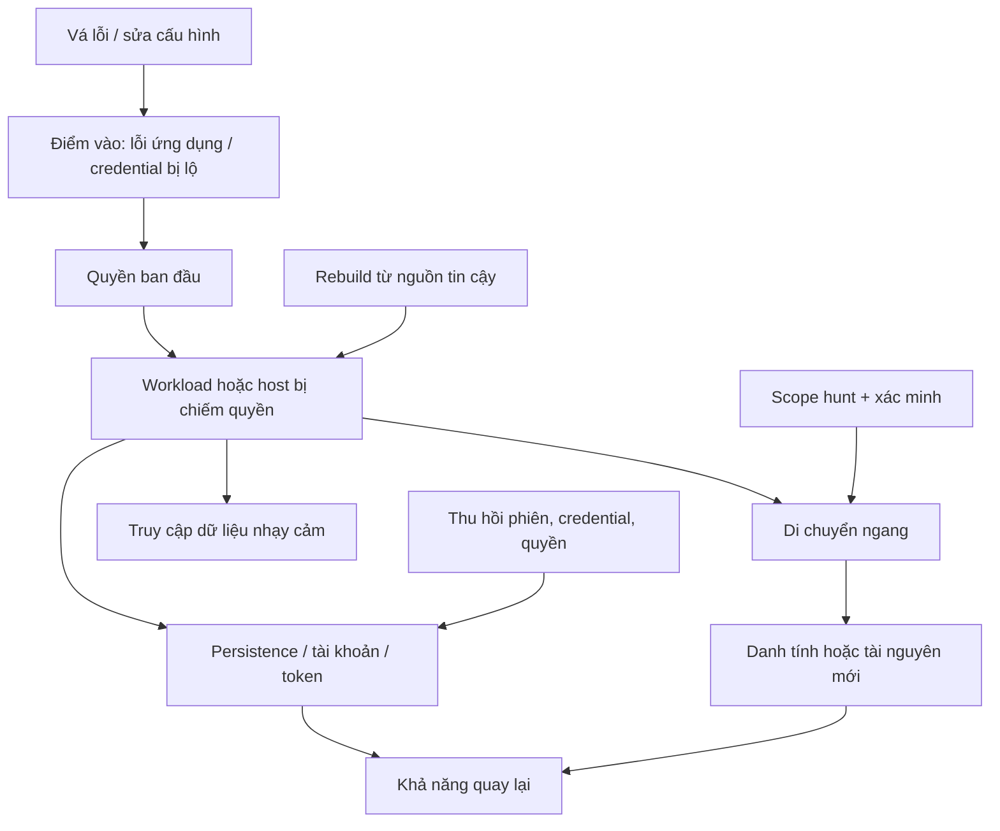
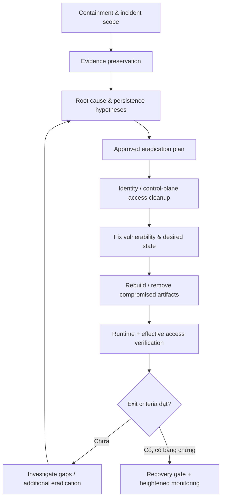

# Eradication: Loại bỏ nguyên nhân xâm nhập và xác minh hệ thống đã được làm sạch

## 1. Mục tiêu học tập

Sau bài này, người học có thể:

- Giải thích **eradication** trong quy trình ứng phó sự cố, phân biệt với **containment**, **recovery** và **post-incident improvement**.
- Xác định phạm vi xâm nhập, nguyên nhân gốc, cơ chế duy trì quyền truy cập và các tài sản có thể bị ảnh hưởng trước khi quyết định cách loại bỏ.
- Lựa chọn giữa **làm sạch có kiểm soát**, **xây dựng lại từ nguồn tin cậy**, **vá lỗi**, **thu hồi quyền** và **luân chuyển thông tin xác thực** theo mức độ tin cậy của tài sản.
- Phối hợp loại bỏ chỗ bám trụ của đối tượng xâm nhập trên máy chủ, danh tính, hạ tầng cloud, Kubernetes, pipeline CI/CD và hệ thống dữ liệu.
- Bảo toàn bằng chứng, ghi nhận quyết định và kiểm chứng kết quả eradication trước khi khôi phục dịch vụ.
- Thiết kế các **control**, **kịch bản kiểm thử**, **tiêu chí hoàn thành**, **bằng chứng assurance** và chỉ số theo dõi nguy cơ tái xâm nhập.

Bài học thuộc chương **Incident response** của dịch vụ `SECURITY_SECURITY_ASSURANCE`. Mục tiêu rộng hơn là xây dựng cách đánh giá **có bằng chứng** rằng hệ thống đáp ứng mục tiêu bảo mật, từ phân tích rủi ro, yêu cầu và security controls đến kiểm thử, audit và khắc phục phát hiện. Ở giai đoạn eradication, trọng tâm là **chứng minh các điều kiện cho phép sự cố tiếp diễn hoặc tái diễn đã được xử lý đến mức rủi ro chấp nhận**, trong khi vẫn giữ khả năng điều tra và duy trì hoạt động nghiệp vụ.

## 2. Eradication là gì?

**Eradication** là tập hợp hành động nhằm loại bỏ **thành phần độc hại**, **quyền truy cập trái phép**, **cơ chế tồn tại bền vững (persistence)** và **nguyên nhân kỹ thuật cho phép cuộc xâm nhập** khỏi môi trường bị ảnh hưởng, dựa trên hiểu biết về phạm vi sự cố.

Ví dụ, một máy chủ web bị khai thác lỗ hổng tải tệp có thể xuất hiện tệp mã độc và một tài khoản có đặc quyền bị lạm dụng. Xóa tệp đáng ngờ là chưa đủ nếu endpoint dễ bị khai thác vẫn tồn tại, token bị đánh cắp còn hợp lệ hoặc thành phần tự tái tạo tệp chưa bị phát hiện.

Mục tiêu của eradication không đơn giản là “không còn thấy cảnh báo”. Cần trả lời:

1. **Tác nhân xâm nhập đã có quyền gì và ở đâu?**
2. **Những đường vào và đường quay lại nào vẫn tồn tại?**
3. **Đã loại bỏ hoặc vô hiệu hóa chúng bằng cách nào?**
4. **Có bằng chứng rằng thay đổi đã có hiệu lực trên mọi tài sản liên quan không?**
5. **Rủi ro còn lại có được xác định, sở hữu và chấp nhận đúng thẩm quyền không?**

### 2.1. Phân biệt các giai đoạn gần nhau

| Giai đoạn | Câu hỏi chính | Ví dụ hành động | Tiêu chí chứng minh |
|---|---|---|---|
| **Detection & analysis** | Sự cố là gì, phạm vi và độ tin cậy ra sao? | Phân tích log, endpoint, tài khoản, đường truy cập | Có giả thuyết và bằng chứng đã đối chiếu |
| **Containment** | Làm sao giới hạn thiệt hại ngay? | Cách ly máy, chặn luồng mạng, vô hiệu một phiên | Tác động/khả năng lan rộng đã bị giới hạn theo mục tiêu |
| **Eradication** | Làm sao loại bỏ chỗ bám trụ và nguyên nhân? | Rebuild máy, thu hồi credential, sửa lỗ hổng, bỏ persistence | Đường xâm nhập và dấu vết tồn tại liên quan đã được xử lý, có recheck |
| **Recovery** | Làm sao đưa dịch vụ trở lại vận hành an toàn? | Khôi phục dữ liệu sạch, mở lại traffic theo giai đoạn | Dịch vụ đạt yêu cầu nghiệp vụ và bảo mật với giám sát tăng cường |
| **Post-incident** | Cần ngăn tái diễn và cải thiện chương trình thế nào? | RCA, cập nhật chính sách, detection, đào tạo | Hành động cải tiến có owner và bằng chứng hoàn thành |

Các hoạt động có thể chồng lấn: ví dụ vừa giữ cô lập một hệ thống vừa xây dựng môi trường sạch, hoặc khôi phục một dịch vụ ít rủi ro trong khi vẫn điều tra tài sản khác. **Thứ tự là quyết định dựa trên rủi ro và bằng chứng**, không phải một kịch bản cứng áp dụng cho mọi sự cố.

### 2.2. Eradication không thể “thu hồi” dữ liệu đã bị lấy đi

Nếu dữ liệu đã bị sao chép khỏi tổ chức, việc xóa mã độc và thu hồi quyền **không khiến bản sao bên ngoài biến mất**. Cần theo dõi riêng phạm vi dữ liệu bị lộ, nghĩa vụ thông báo theo chính sách/quy định áp dụng, giảm thiểu tác hại và đánh giá rủi ro còn lại. Đây là phần quan trọng của kết luận sự cố nhưng không thể dùng “eradication thành công” để suy ra “không có hậu quả rò rỉ”.

## 3. Mô hình tư duy: Tài sản, đường xâm nhập và cơ chế tái xuất hiện

Một cách hữu ích để phân tích eradication là xác định **đồ thị phụ thuộc của cuộc xâm nhập**:



*Sơ đồ mang tính khái niệm:* mũi tên cuối thể hiện biện pháp xử lý một nhóm mắt xích, không phải quy trình tự động thực thi.

Đội ứng phó cần kiểm tra cả:

- **Initial access:** lỗi ứng dụng, phơi lộ endpoint, credential bị rò rỉ, thiếu xác thực hay thay đổi cấu hình.
- **Execution/privilege:** mã không được phép, tài khoản quyền cao, dịch vụ hệ thống hoặc quyền container/node.
- **Persistence:** dịch vụ, tác vụ tự chạy, tài khoản mới, SSH key, API token, IAM policy, automation/controller và tài nguyên đã bị sửa.
- **Lateral movement:** tài sản/danh tính khác bị chạm tới, kết nối và khả năng dùng một credential ở nhiều môi trường.
- **Defense impairment:** logging, EDR, endpoint protection, admission, backup hoặc chính sách cloud bị vô hiệu.
- **Data access:** dữ liệu nhạy cảm được đọc, sửa, xuất hay mã hóa; mức độ tin cậy của dữ liệu backup.

Một chỉ dấu (IOC) như hash file hoặc IP mạng là thông tin có ích, nhưng **không phải mô hình đầy đủ của xâm nhập**. Khi đối phương đổi tên tệp, cơ sở hạ tầng hoặc tài khoản, chỉ dò IOC cũ có thể bỏ sót cùng hành vi.

## 4. Điều kiện khởi động và quyền ra quyết định

Eradication thường bắt đầu khi đội ứng phó đã **giới hạn tác động cấp bách** và có đủ thông tin để chọn cách xử lý không làm mất bằng chứng then chốt. Trước mỗi thay đổi có tác động lớn cần xác định:

1. **Incident commander / owner:** ai điều phối và quyết định phạm vi?
2. **Asset owner:** ai hiểu phụ thuộc nghiệp vụ và chịu trách nhiệm vận hành?
3. **Security/forensic lead:** bằng chứng nào cần thu trước khi thay đổi hoặc xóa?
4. **IAM/cloud/platform owner:** ai có quyền thực thi thu hồi, rebuild hoặc cập nhật policy?
5. **Legal/privacy/compliance liaison:** có yêu cầu bảo quản, thông báo hoặc giới hạn xử lý dữ liệu nào?
6. **Business continuity owner:** mức gián đoạn chấp nhận và thứ tự dịch vụ ưu tiên?
7. **Reviewer/approver:** ai kiểm chứng kết quả và cho phép mở lại hoạt động?

Với tài sản hạ tầng chia sẻ, thao tác “làm sạch” có thể ảnh hưởng đến nhiều hệ thống không cùng owner. Quyết định cần mô tả **mục tiêu, tài sản, rủi ro, thời điểm, cách thực hiện, kế hoạch khôi phục và tiêu chí rollback**.

### 4.1. Khi nào chưa nên xóa hoặc rebuild ngay?

Ví dụ:

- Chưa biết liệu có credential hoặc tài sản khác đã bị xâm nhập.
- Chưa có bản ghi, snapshot hoặc log cần thiết để xác định nguyên nhân và phạm vi.
- Hệ thống là nguồn chứng cứ duy nhất cho một sự cố nghiêm trọng.
- Cần bảo toàn dữ liệu vì điều tra pháp lý hoặc yêu cầu nghiệp vụ.
- Quyền thực hiện thay đổi chưa được xác nhận, hoặc quy trình khôi phục không đáng tin.
- Hành động khắc phục có thể báo động tác nhân xâm nhập và kích hoạt xóa chứng cứ, nếu đội ứng phó chưa sẵn sàng.

Điều đó không có nghĩa luôn phải trì hoãn. Nếu hệ thống đang gây thiệt hại nghiêm trọng, **containment ưu tiên an toàn** có thể cần được thực hiện ngay theo playbook, đồng thời ghi lại những bằng chứng thu được và giới hạn của điều tra.

## 5. Bảo toàn bằng chứng trước và trong eradication

Eradication thường liên quan đến xóa file, hủy tài nguyên, thu hồi token, thay disk hoặc thay đổi log. Các hành động này có thể phá hủy dữ liệu điều tra nếu không được tổ chức.

### 5.1. Những loại bằng chứng cần cân nhắc

| Lớp | Ví dụ bằng chứng | Vì sao cần |
|---|---|---|
| **Thời gian và điều phối** | Incident ID, timeline, decision log, người phê duyệt | Tái lập quyết định và thứ tự hành động |
| **Host/endpoint** | Snapshot/disk image, process/service inventory, runtime metadata, EDR telemetry | Xác định hành vi, persistence và phạm vi |
| **Identity** | IAM role binding, phiên, token metadata, lịch sử cấp/thu hồi, MFA events | Truy đường quyền và khả năng tái sử dụng |
| **Cloud control plane** | Audit API, security group/route changes, resource inventory, object metadata | Tìm tài nguyên/tuyến thay đổi ngoài quy trình |
| **Kubernetes** | Pod/Deployment spec, ServiceAccount, RBAC, admission events, audit, node inventory | Xác định quyền trong cluster và workload bị ảnh hưởng |
| **Network** | DNS, flow/firewall/proxy logs, connection metadata | Khảo sát lateral movement và outbound behavior |
| **Application/data** | Access logs, transaction history, file/object integrity, DB audit | Xác định dữ liệu bị truy cập, sửa hoặc xuất |
| **Build/CI/CD** | Pipeline run, commit, artifact digest, signer, deployment record | Kiểm tra chuỗi cung ứng và nguồn triển khai |
| **Bằng chứng sau sửa** | State snapshot mới, test results, quyền hiệu lực, telemetry | Chứng minh eradication có tác dụng |

Đối với máy đang chạy, **bằng chứng volatile** như bộ nhớ hoặc kết nối có thể mất khi tắt máy. Việc thu memory hoặc disk image cần có người có chuyên môn, quyền phù hợp và quy trình bảo quản; không mặc định thu memory ở mọi sự cố vì chi phí, dữ liệu nhạy cảm và nguy cơ ảnh hưởng dịch vụ.

### 5.2. Chain of custody và tính tin cậy

Ghi người thu thập, nguồn, thời điểm UTC, phương pháp, công cụ/phiên bản, nơi lưu và lịch sử truy cập. Khi phù hợp, sử dụng hash/checksum và quyền lưu trữ ngăn chỉnh sửa ngoài quy trình. Bản ghi cần nói rõ **đã thay đổi tài nguyên gì trong quá trình thu bằng chứng**, vì một số thao tác thu thập có thể làm thay đổi metadata.

Một bản snapshot chứa dữ liệu bí mật, token hoặc thông tin cá nhân cần được phân quyền và lưu giữ theo chính sách. Không gửi nội dung nhạy cảm vào ticket hoặc kênh chat không được phê duyệt.

### 5.3. Thu thập không bằng chứng không đồng nghĩa không có xâm nhập

Một máy đã tắt có thể không còn process hay kết nối. Một collector bị vô hiệu có thể không ghi log trong cửa sổ quan trọng. Nếu thiếu dữ liệu, ghi **UNKNOWN/NOT_ASSESSED** cho luận điểm chưa chứng minh và tìm nguồn bổ trợ; không biến sự vắng mặt của sự kiện thành kết luận đã sạch.

## 6. Xác định phạm vi và nguyên nhân gốc trước khi xử lý

**Scoping** là xác định tất cả tài sản, danh tính, dữ liệu và đường truy cập có thể bị ảnh hưởng. **Root cause analysis** là tìm điều kiện cho phép sự cố xuất hiện và tiếp diễn.

### 6.1. Câu hỏi điều tra tối thiểu

- Sự kiện đầu tiên có thể xác nhận xảy ra lúc nào? Có khoảng thời gian không quan sát được?
- Điểm vào là gì? Có hơn một đường vào?
- Tài sản bị ảnh hưởng là một VM, một Pod, toàn bộ node, hay quyền ở mức cluster/cloud account?
- Những credential nào có thể đã lộ, và ở nơi khác chúng còn hợp lệ không?
- Tài khoản/role/policy, dịch vụ hệ thống, tác vụ, cron job, webhook, CI job hoặc image nào đã bị sửa?
- Có thay đổi security controls như firewall, logging, backup, admission và encryption không?
- Có bằng chứng lateral movement, truy cập dữ liệu hoặc hành vi sau khi containment?
- Còn host, namespace, region, tenant hoặc môi trường DR nào thiếu telemetry?
- Thành phần nào tái tạo tài nguyên? Ví dụ Kubernetes Deployment controller, autoscaling group hay IaC pipeline.

### 6.2. Phân biệt ba mức độ thông tin

| Trạng thái | Ý nghĩa | Ví dụ |
|---|---|---|
| **Confirmed compromised** | Có bằng chứng đáng tin về xâm nhập | Host chạy mã trái phép; IAM binding ngoài phê duyệt |
| **Potentially affected** | Có đường tiếp cận hoặc dấu vết liên quan, chưa đủ xác nhận | Workload khác dùng chung credential bị lộ |
| **No evidence observed** | Chưa thấy chỉ dấu trong dữ liệu đã kiểm; không bảo đảm không có | Tài sản được scan nhưng log thiếu một khoảng thời gian |

Đừng dùng “không phát hiện” thay cho “đã được chứng minh sạch”. Cần ghi rõ phạm vi và hạn chế khi sử dụng kết quả để quyết định khôi phục.

### 6.3. Đối soát nhiều nguồn

Ví dụ một service account bị lộ từ Pod:

1. Đọc Kubernetes PodSpec, ServiceAccount, secret mounts và quyền RBAC liên quan.
2. Xác định liên kết đến cloud workload identity/IAM.
3. Truy cloud audit để tìm hoạt động của danh tính này ở các account/region.
4. Xem network flow và truy cập các dịch vụ dữ liệu liên quan.
5. Kiểm tra các deployment, job và automation có thể đã sử dụng cùng credential.
6. Đối soát findings của EDR/SIEM với trạng thái tài nguyên thực.

Khả năng attacker dùng token ngoài cluster khiến việc “xóa Pod” không đủ để chặn quyền nếu token vẫn còn hợp lệ.

## 7. Lựa chọn chiến lược eradication

Có hai cách làm thường gặp: **làm sạch có kiểm chứng** hoặc **thay thế bằng hệ thống sạch từ nguồn đã tin cậy**. Có thể kết hợp theo từng thành phần.

| Chiến lược | Phù hợp khi | Lợi ích | Hạn chế/rủi ro |
|---|---|---|---|
| Gỡ thành phần độc hại | Phạm vi artifact hẹp, được xác minh, hệ thống không mất nền tảng tin cậy | Giảm gián đoạn | Có thể bỏ sót persistence hoặc thay đổi ngầm |
| Vá lỗi và sửa cấu hình | Đã xác định lỗ hổng/sai cấu hình nguyên nhân | Đóng đường khai thác | Chưa xử lý các foothold, credential đã lộ |
| Thu hồi quyền, key, token và session | Danh tính có thể đã bị chiếm | Chặn tái sử dụng credential | Phải xét quyền kế thừa, token cache, tác động đến dịch vụ |
| Reimage/rebuild từ golden image | Host/workload mất độ tin cậy, có nguồn build sạch | Giảm phụ thuộc vào việc biết mọi artifact độc hại | Cần khôi phục dữ liệu/cấu hình và kiểm nguồn artifact |
| Replace immutable workload | Container/VM được quản lý theo IaC | Tái lập và có phiên bản | Controller, image hoặc pipeline bẩn có thể tạo lại tài nguyên lỗi |
| Xoay vòng hạ tầng/identity ở phạm vi rộng | Compromise ở cấp cluster/account hoặc khóa gốc | Khôi phục ranh giới tin cậy mạnh hơn | Phức tạp, có thể gây gián đoạn nếu thiếu kế hoạch |
| Restore từ backup đáng tin | Dữ liệu bị sửa/mã hóa, bản backup có độ tin cậy | Phục hồi dữ liệu | Backup có thể chứa mã độc/cấu hình yếu hoặc không đáp ứng RPO |

### 7.1. Khi nào ưu tiên rebuild?

Khi host có khả năng bị kiểm soát ở quyền cao, hoặc không thể xác nhận tính toàn vẹn của hệ điều hành/runtime, **rebuild từ nguồn tin cậy** thường có độ tin cậy cao hơn cố gắng gỡ từng dấu vết. Cần xác minh:

- Golden image, AMI/base image, package source và artifact digest có nguồn đáng tin.
- Pipeline build/CI/CD không bị chiếm quyền.
- Cấu hình IaC/policy mới đã khắc phục đường xâm nhập.
- Dữ liệu khôi phục được kiểm tra và không đưa lại persistence nguy hiểm.
- Danh tính/secret gắn với tài sản cũ được thu hồi hoặc thay thế thích hợp.

**Rebuild không giải quyết mọi sự cố** nếu nguyên nhân là credential cloud bị lộ hoặc một policy ở control plane vẫn cấp quyền cao.

### 7.2. Tránh xóa nhầm trước khi biết nguồn tái tạo

Trong nền tảng có controller, Pod bị xóa có thể được tạo lại từ Deployment vẫn trỏ tới image độc hại. VM bị thay thế có thể được autoscaling group tạo lại với user-data hoặc image cũ. Eradication phải xử lý **nguồn trạng thái mong muốn, quyền điều khiển và đường phát hành**, không chỉ tài nguyên đang chạy.

## 8. Eradication ở lớp danh tính và quyền truy cập

Credential bị đánh cắp thường cho phép tác nhân xâm nhập tiếp tục truy cập ngay cả sau khi máy ban đầu đã được làm sạch.

### 8.1. Các thành phần cần rà soát

- Tài khoản người dùng mới hoặc không còn hợp lệ.
- Session, refresh token, API key, access key, SSH key và credential dài hạn.
- Service accounts, workload identities, managed identities và principal ngoài tổ chức.
- Role bindings, membership, custom IAM policies và quyền kế thừa.
- Cấu hình MFA, recovery options, OAuth app grants, federation/trust relationships.
- Break-glass accounts và các cơ chế cấp quyền khẩn cấp.
- Credential chứa trong repository, build artifact, log, snapshot và secret manager.

Một sự cố **credential exposure** không tự kết thúc khi đổi mật khẩu. Cần xem session/token còn tồn tại, khả năng refresh, các bản sao credential, nơi sử dụng và thời gian revoke có hiệu lực theo từng dịch vụ.

### 8.2. Trình tự thu hồi có kiểm soát

1. Xác định principal, quyền hiệu lực, tài nguyên và phiên liên quan.
2. Giữ các audit record và metadata cần thiết theo quy trình bằng chứng.
3. Khóa hoặc thu hồi đường truy cập nguy hiểm khi cần containment.
4. Tạo/cấp lại credential sạch qua kênh an toàn, không qua môi trường đã mất tin cậy.
5. Cập nhật consumer hợp lệ và kiểm tra ứng dụng hoạt động.
6. Thu hồi credential cũ và phiên liên quan; xác minh không còn được chấp nhận.
7. Rà soát quyền kế thừa, trust policy, delegated grants và các quyền mới tạo.
8. Theo dõi activity audit, thử xác thực có kiểm soát và đối soát trạng thái IAM sau sửa.

Trình tự cụ thể phụ thuộc mức nguy cấp: với tài khoản quản trị bị lạm dụng đang hoạt động, **thu hồi ngay** có thể ưu tiên hơn duy trì chức năng; với bí mật của hệ thống không bị khai thác rõ, kế hoạch xoay vòng cần tránh khiến hệ thống đồng loạt mất kết nối.

### 8.3. Xác minh quyền hiệu lực

Không chỉ đọc tên role. Một principal có thể nhận quyền từ group, resource policy, policy kế thừa, trust relationship hoặc credential khác. Sau thay đổi, kiểm tra **effective access** cho các hành động nhạy cảm và xác minh token/phiên cũ không còn thực hiện được hành động bị cấm.

Nếu hệ thống không hỗ trợ thu hồi token ngay, cần ghi thời gian sống còn lại, biện pháp bù trừ và rủi ro tồn dư, thay vì đánh dấu “đã thu hồi toàn bộ” không có bằng chứng.

## 9. Eradication ở máy chủ, endpoint và nền tảng hệ điều hành

### 9.1. Những điều cần xử lý

Trên host bị ảnh hưởng, điều tra có thể cho thấy:

- Tệp thực thi hoặc service chưa được phê duyệt.
- Cơ chế tự khởi động, scheduled tasks/cron, agent và cấu hình hệ thống bất thường.
- Người dùng/nhóm/quyền quản trị mới, SSH authorized keys hoặc credential lạ.
- Binary/library hoặc cấu hình ứng dụng bị sửa.
- Firewall, EDR, log pipeline và cơ chế cập nhật bị tắt.
- Lỗ hổng OS hoặc ứng dụng, dịch vụ public, tài khoản mật khẩu yếu.
- Kết nối đến tài sản khác và khả năng mở rộng quyền.

Eradication phải xử lý **thành phần độc hại**, **nguồn persistence**, **điểm vào**, **credential liên quan** và **kiểm soát bị thay đổi**.

### 9.2. Quy trình rebuild host tham chiếu

```text
Asset đã cách ly và đã thu bằng chứng cần thiết
             ↓
Khóa nguồn deploy/cấp quyền đáng ngờ
             ↓
Chọn image chuẩn và artifact đã kiểm chứng
             ↓
Tạo host thay thế trong mạng bị giới hạn
             ↓
Áp dụng OS/network/identity hardening + patch
             ↓
Khôi phục dữ liệu đã kiểm tra tính tin cậy
             ↓
Kiểm chứng cấu hình, phiên bản, EDR, logging, quyền
             ↓
Thử nghiệp vụ và thử các điều kiện từng bị khai thác
             ↓
Mở kết nối từng bước theo recovery gate
             ↓
Thu hồi/xử lý host cũ theo quyết định bảo toàn chứng cứ
```

Một host mới không mặc nhiên đáng tin nếu bootstrap script hoặc image nguồn đã bị sửa. Cần kiểm tra provenance, quyền quản lý image và pipeline.

### 9.3. Khi bắt buộc làm sạch tại chỗ

Có môi trường khó rebuild ngay như thiết bị đặc thù, hệ thống legacy hoặc host có phụ thuộc phần cứng. Nếu chọn làm sạch tại chỗ:

- Nêu lý do và người chấp nhận rủi ro của chiến lược.
- Thiết kế danh sách artifact, persistence và cấu hình cần khắc phục dựa trên forensic findings.
- Ghi từng hành động và trạng thái trước/sau.
- Kiểm tra độc lập bằng EDR/host scan, inventory, log và hành vi mạng.
- Duy trì giám sát tăng cường và kế hoạch thay thế khi có điều kiện.
- Tránh khẳng định “đã sạch tuyệt đối” khi mức tin cậy của host không thể được khôi phục hoàn toàn.

## 10. Eradication trong cloud và IAM control plane

Trong cloud, xâm nhập có thể để lại **quyền quản lý tài nguyên**, **API keys**, **tài nguyên phụ**, **route/firewall rules**, **storage access** hoặc **automation**. Xóa VM nhiễm mã độc là chưa đủ nếu actor vẫn có quyền API.

### 10.1. Lập bản đồ bề mặt bị tác động

| Bề mặt | Điều cần truy vấn | Ví dụ khắc phục |
|---|---|---|
| **Identity/IAM** | Principal mới, role bindings, trust policy, access keys, session | Thu hồi/bỏ quyền trái phép, rotation và xác minh |
| **Network** | Public IP, security group, firewall, route, peering, VPN | Khôi phục baseline và kiểm thử reachability |
| **Compute** | VM image, startup script, scheduled task, autoscaling template | Rebuild và sửa nguồn template |
| **Storage/Data** | Bucket/object permissions, sharing, snapshot, backup | Thu hẹp quyền, kiểm tính toàn vẹn và mức lộ |
| **Serverless/PaaS** | Function code, environment, triggers, connectors, roles | Deploy lại artifact sạch, sửa trigger và quyền |
| **Security logging** | Audit trail, sink, retention, quyền xóa, alerts | Khôi phục thu thập và bảo vệ bằng chứng |
| **Automation/IaC** | Service principal, pipeline, state files, secrets | Sửa IaC, khóa pipeline bị chiếm, cấp lại credential |
| **Multi-account/region** | Phạm vi tổ chức, cross-account trust, tài sản ít giám sát | Quét hết phạm vi, xử lý liên kết và vùng mù |

### 10.2. Nguồn bằng chứng

Ưu tiên cloud audit API, asset inventory, IAM effective permissions, snapshots cấu hình, logs từ các dịch vụ và kết quả kiểm thử. Audit event cho biết **hành động đã được yêu cầu hoặc thực hiện theo semantics của provider**; muốn biết trạng thái thực, cần lấy **cấu hình và quyền hiệu lực sau thay đổi**.

Một API audit có kết quả `success` khi gán quyền chưa chắc đồng nghĩa rằng principal có đúng quyền đó tại thời điểm đánh giá; quyền có thể được thu hồi hoặc policy khác thay đổi. Ngược lại, không thấy event không chứng minh thay đổi chưa từng xảy ra nếu audit thiếu phạm vi hoặc bị vô hiệu.

### 10.3. Kiểm tra vùng kiểm soát độc lập

Nếu attacker có quyền sửa audit sink hoặc quy tắc bảo mật, cần xác minh log còn đầy đủ, quyền xóa/sửa đã bị hạ và các thay đổi nhạy cảm có thể được phát hiện độc lập. Với cloud managed services, quyền truy cập trực tiếp một số thành phần thuộc provider có thể giới hạn; ghi rõ nguồn bằng chứng do nhà cung cấp cung cấp và phần khách hàng đã tự kiểm.

## 11. Eradication trong Kubernetes và container platform

Kubernetes có đặc điểm: **Pod có thể được tái tạo**, service account có thể mang quyền cluster/cloud và controller có khả năng sửa tài nguyên. Vì vậy, một Pod bị xâm nhập không nhất thiết chỉ là vấn đề của Pod.

### 11.1. Xác định mức xâm nhập

| Mức nghi ngờ | Tác động cần kiểm tra | Hướng xử lý |
|---|---|---|
| **Container process** | Mã lạ trong container, quyền process, dữ liệu mount | Điều tra Pod, thay image sạch, sửa vulnerability |
| **Pod/ServiceAccount** | Token, Kubernetes RBAC và quyền cloud gắn với Pod | Thu hồi credential/quyền, xác minh Pod và API activity |
| **Node** | HostPath, privileged, runtime socket, kernel/node integrity | Điều tra/rebuild node và các Pod cùng node |
| **Controller/namespace** | Deployment/DaemonSet/Job/Helm release hoặc admission bị sửa | Sửa nguồn trạng thái mong muốn và chính sách |
| **Cluster control plane** | ClusterRoleBinding, webhook, API settings, cloud IAM | Đánh giá phạm vi toàn cluster, rotation và kế hoạch khôi phục tin cậy |
| **Supply chain** | Registry, image, pipeline, signing keys bị lộ | Xây lại artifact/pipeline và kiểm provenance |

### 11.2. Các truy vấn read-only hữu ích

Trong môi trường được cấp phép, có thể kiểm tra một số trạng thái sau:

```bash
kubectl -n payments get deployment payments-api -o yaml
kubectl -n payments get pods -l app=payments-api -o json
kubectl -n payments get serviceaccounts
kubectl -n payments get rolebindings
kubectl get clusterrolebindings
kubectl -n payments get networkpolicies
```

Các lệnh trên chỉ là **bước thu thập**, không tự chứng minh cluster đã sạch. Cần kiểm cả Pod hiện tại, Pod cũ còn tồn tại khi rollout, danh tính thực dùng, image digest, quyền cloud và log theo khoảng thời gian sự cố.

Hạn chế lưu toàn bộ output `-o json`/`-o yaml` vào kho công khai, vì chúng có thể chứa metadata, environment hoặc thông tin nội bộ cần bảo vệ.

### 11.3. Tránh tái tạo Pod độc hại

Giả sử Pod `payments-api` bị chiếm quyền và đang chạy một image có cấu hình không an toàn. Xóa riêng Pod sẽ khiến Deployment controller có thể tạo Pod mới **từ cùng Pod template**. Eradication cần:

1. Ngăn nguồn deploy không được tin cậy tiếp tục phát hành.
2. Xác định digest image, registry và provenance; thay bằng artifact sạch.
3. Vá lỗ hổng ứng dụng hoặc cấu hình đã dẫn tới xâm nhập.
4. Kiểm và sửa ServiceAccount, Kubernetes RBAC và workload/cloud identity.
5. Rà admission policies, NetworkPolicy, Secrets và các controller liên quan.
6. Thay thế các Pod/Node có mức tin cậy không đạt theo kế hoạch.
7. Xác minh trạng thái runtime của **tất cả Pod trong phạm vi** và kiểm thời hạn rollout.
8. Giám sát token activity, API audit, network behavior và sự kiện cấu hình mới.

Nếu node có dấu hiệu bị chiếm quyền, **deploy lại ứng dụng trên node đó có thể chưa đủ**. Cần chiến lược cách ly, thay node và kiểm tra các workload cùng node.

### 11.4. Xử lý thay đổi IAM/RBAC lâu dài

Một ClusterRoleBinding bị thêm trái phép có thể cho phép tạo workload mới. Cần xác minh:

- Actor và danh tính liên quan có còn phiên hợp lệ không.
- Binding đã bị thu hồi và effective RBAC của principal không vượt baseline.
- ClusterRole, RoleBinding, admission webhook và ServiceAccount khác có bị sửa không.
- Audit pipeline có quan sát được các thay đổi trong khoảng nghi bị xâm nhập không.
- Có custom operator/controller tạo lại Binding hoặc thay đổi security controls không.

Dù một resource đã được xóa, điều tra vẫn cần giữ bản ghi trước khi xóa và xác nhận không có cơ chế tái tạo.

## 12. Ứng dụng, dữ liệu, secrets và khả năng phục hồi

### 12.1. Sửa nguyên nhân ở ứng dụng

Với sự cố bắt nguồn từ một lỗ hổng ứng dụng, eradication thường cần:

- Xác định đường đầu vào và phiên bản thành phần bị ảnh hưởng.
- Triển khai bản sửa hoặc cấu hình giảm thiểu đã được kiểm thử.
- Vô hiệu tính năng hoặc endpoint không còn cần thiết khi phù hợp.
- Kiểm authorization, parsing/input validation, session handling và dependency có liên quan.
- Xác minh bản runtime mới đã chạy trên toàn bộ instance.
- Thử lại kịch bản lỗi trong môi trường được kiểm soát theo mục tiêu bảo mật.

**Vá lỗi chưa thay thế việc loại bỏ mã, tài khoản, dữ liệu bị sửa hoặc token còn hợp lệ**. Hai việc phải được nối trong kế hoạch.

### 12.2. Secrets và khóa mã hóa

Danh sách secret cần đánh giá thường rộng hơn credential “nhìn thấy” trong log:

- DB password, API tokens, OAuth credentials, SSH keys.
- Signing keys, webhook secrets, service-to-service certificates.
- Cloud access keys và workload identity credentials.
- KMS key policy và quyền sử dụng khóa.
- Secrets trong repository, CI variables, container image, backup và log.

Khi nghi lộ khóa ký hoặc thông tin xác thực, kế hoạch luân chuyển phải xét **phạm vi hiệu lực của chữ ký/token đã phát hành**, các client phụ thuộc và cơ chế thu hồi. Đổi khóa trong secret manager nhưng không cập nhật consumer hoặc không vô hiệu phiên cũ có thể gây gián đoạn hoặc chưa giải quyết rủi ro.

### 12.3. Tính toàn vẹn của dữ liệu và backup

Nếu attacker có quyền sửa/xóa/mã hóa dữ liệu, chỉ cần khôi phục dịch vụ chạy lại là chưa đủ. Cần xác minh:

- Thời điểm có thể bắt đầu bị sửa và snapshot backup còn đáng tin.
- Dữ liệu nào thay đổi bất thường; có nguồn đối soát nghiệp vụ độc lập không.
- Backup có chứa persistence, account lạ, policy sai hoặc script tự khởi động không.
- Restore rehearsal có kiểm tra tính toàn vẹn và đáp ứng RPO/RTO theo chính sách không.
- Quyền truy cập và kết nối sau restore đã được thu hẹp theo baseline chưa.

Một bản backup “trước ngày phát hiện” chưa chắc sạch nếu xâm nhập bắt đầu sớm hơn. Cần xem **thời điểm compromise có thể bắt đầu**, không chỉ thời điểm alert được tạo.

## 13. CI/CD, supply chain và nguồn triển khai sạch

Khi incident liên quan đến artifact hoặc pipeline, eradication phải bảo đảm **không tiếp tục phát hành thành phần bị chiếm quyền**.

### 13.1. Các điểm cần kiểm

| Thành phần | Rủi ro | Kiểm chứng sau sửa |
|---|---|---|
| Source repository | Commit trái phép, workflow bị sửa, secret lộ | Review history, branch protections, secret scanning |
| CI/CD runner | Runner bị chiếm, credential hoặc cache nhiễm | Runner image/rebuild, quyền runner, secrets rotation |
| Artifact registry | Tag bị thay, image không rõ nguồn | Digest/provenance, quyền push, ký/verify nếu có |
| Deployment service account | Quyền thay cluster/cloud quá rộng | Effective IAM/RBAC, scope và audit |
| IaC state / templates | Policy hoặc network được tạo lại trái baseline | Plan/review, runtime state và drift checks |
| Signing keys | Artifact có thể được ký bằng khóa lộ | Rotation/trust update, thu hồi theo khả năng nền tảng |
| GitOps/controller | Tự tái tạo tài nguyên sai | Kiểm source repo và reconciliation status |

Nếu nghi ngờ signing key đã lộ, việc “artifact có chữ ký hợp lệ” không còn là bằng chứng đủ của nguồn tin cậy. Cần làm rõ **thời gian khóa bị ảnh hưởng**, chủ thể sử dụng khóa và phạm vi các artifact cần rebuild/revalidate.

### 13.2. Nguồn sạch cần được kiểm chứng độc lập

Có thể dựa vào artifact hash/digest, provenance, quy trình review và quyền phân phối để tăng tin cậy, nhưng không có một chỉ số duy nhất chứng minh toàn bộ build pipeline sạch. Khi mức xâm nhập vào supply chain cao, cần thiết kế chuỗi phục hồi có **người phê duyệt, tài khoản và môi trường** không phụ thuộc vào chính hệ thống bị nghi đã mất tin cậy.

## 14. Kế hoạch eradication có thứ tự và điều kiện dừng

Một kế hoạch hữu dụng nên theo **dependency graph**: hạ quyền nguồn điều khiển, sửa nguồn tái tạo, thay tài sản và xác minh. Trình tự có thể khác nhau theo sự cố, nhưng cần ghi rõ.

### 14.1. Mẫu các giai đoạn



Không phải lúc nào cũng xử lý identity trước host: nếu credential đang bị dùng để gây thiệt hại, containment có thể phải thực hiện ngay; nếu hệ thống đã cô lập nhưng chưa có snapshot cần thiết, bằng chứng có thể được ưu tiên. Hình chỉ mô tả logic ra quyết định có kiểm soát.

### 14.2. Mẫu eradication action register

```yaml
incident_id: INC-2026-042
phase: eradication
scope:
  environment: production
  affected_assets:
    - payments-api
    - service-account-payments
assumptions:
  - "Initial access bắt đầu từ ứng dụng bị lỗi"
  - "Token workload có khả năng đã lộ"
actions:
  - id: ERA-01
    goal: "Thu hồi đường truy cập trái phép"
    owner: identity-team
    approval_ref: CHG-2026-218
    evidence_before: "evidence://incident-042/iam-before"
    change: "Thu hồi binding và credential liên quan"
    evidence_after: "evidence://incident-042/iam-after"
    verify: "Effective IAM/RBAC và session/credential validity"
    status: planned

  - id: ERA-02
    goal: "Khắc phục đường xâm nhập ở ứng dụng"
    owner: application-team
    approval_ref: CHG-2026-219
    evidence_before: "evidence://incident-042/vulnerable-release"
    change: "Triển khai bản build sạch đã vá lỗi"
    evidence_after: "evidence://incident-042/release-evidence"
    verify: "Runtime digest + kiểm thử hồi quy bảo mật"
    status: planned

  - id: ERA-03
    goal: "Xác nhận không còn cơ chế quay lại trong phạm vi"
    owner: security-incident-team
    verify: "Scoping hunt, persistence checks, log review"
    status: planned
recovery_gate:
  owner: incident-commander
  requires:
    - "Tất cả hành động mức rủi ro cao đã được kiểm chứng"
    - "Khoảng trống bằng chứng đã được đánh giá"
    - "Kế hoạch giám sát tăng cường được kích hoạt"
```

Đây là **mẫu kế hoạch**, không phải dữ liệu của sự cố thật. Trường `status: planned` cho biết các hành động chưa diễn ra; không được diễn giải những `evidence_after` dự kiến là bằng chứng đã tồn tại.

### 14.3. Quy tắc kiểm soát thay đổi

Mỗi hành động nên có:

- Asset/resource ID rõ ràng, môi trường, người thực thi và thời điểm.
- Phê duyệt phù hợp với severity và thẩm quyền.
- Bằng chứng trước sửa, nếu việc thu thập không làm tăng thiệt hại không chấp nhận được.
- Trình tự phụ thuộc, cách kiểm chứng và phương án rollback hoặc rebuild bổ sung.
- Quyết định xử lý rủi ro tồn dư.
- Kết quả thực tế và người xác nhận độc lập khi phù hợp.

Không tự động xóa hàng loạt tài nguyên production dựa trên một chỉ dấu kém tin cậy. Với các bước không thể đảo ngược, xác định tác động và quyền trước khi thực hiện.

## 15. Tự động hóa eradication: Khi nào nên và không nên?

Automation có thể tăng tốc xử lý lặp lại, chẳng hạn vô hiệu một access key bị xác định đã lộ hoặc thay workload bằng artifact sạch. Tuy nhiên, automation cũng có thể xóa mất bằng chứng hoặc gây outage rộng nếu xử lý sai đối tượng.

### 15.1. Điều kiện thiết kế

- **Trigger tin cậy:** dữ liệu đầu vào có danh tính, freshness và mức chắc chắn thích hợp.
- **Scope giới hạn:** automation chỉ sửa những tài sản được chỉ định, quyền tối thiểu.
- **Preconditions:** kiểm trạng thái hiện tại và điều kiện không đổi giữa lúc đánh giá và thực thi.
- **Idempotency:** chạy lại không tạo tác động ngoài ý muốn.
- **Auditability:** ghi actor/automation ID, action, target, before/after và kết quả.
- **Rollback/compensation:** biết cách phục hồi hoặc thay thế khi thao tác thất bại.
- **Guardrails:** bảo vệ tài khoản break-glass, dữ liệu forensic và môi trường trọng yếu.
- **Human review:** những thay đổi nhiều hệ thống, rủi ro cao hoặc không thể đảo ngược cần phê duyệt theo quy trình.
- **Independent validation:** re-query tài sản sau khi thao tác, không chỉ dựa vào API response success.

### 15.2. Ví dụ logic kiểm soát ở mức giả mã

```text
INPUT: finding, approved_plan, asset_inventory, current_state

if finding.confidence is insufficient:
    route_to_analyst("Needs more evidence")
elif asset not in approved_plan.scope:
    stop("Asset is outside authorized scope")
elif preconditions_have_changed(current_state):
    stop("Re-evaluate target and blast radius")
elif action_is_irreversible and not approved_plan.has_required_approval:
    stop("Approval required")
else:
    preserve_required_evidence()
    execute_preapproved_action()
    new_state = collect_independent_runtime_evidence()
    if exit_criteria_met(new_state):
        record_verified_completion()
    else:
        open_followup_investigation()
```

Đây chỉ là mô hình logic giáo dục, không phải công cụ thực thi. Trong sản xuất, điều kiện cạnh tranh, lỗi API từng phần, quy trình dừng khẩn cấp và quản lý credential của automation còn phải được thiết kế và thử nghiệm.

## 16. Xác minh đã loại bỏ và tiêu chí chuyển sang recovery

Một hành động sửa xong **chưa đồng nghĩa eradication thành công**. Cần kiểm các giả thuyết trước đó và tìm dấu hiệu hệ thống tiếp tục bị chiếm quyền.

### 16.1. Ma trận xác minh

| Giả thuyết rủi ro | Phép kiểm sau sửa | Kết quả có thể chấp nhận | Giới hạn cần ghi |
|---|---|---|---|
| Endpoint còn lỗ hổng ban đầu | Kiểm phiên bản đã vá và thử lại kịch bản trong phạm vi an toàn | Lỗ hổng không còn tái hiện; control có hiệu lực | Có thể tồn tại lỗ hổng khác chưa biết |
| Malware/persistence còn trên host | Rebuild provenance + EDR/host inventory + kiểm hệ thống | Artifact/nguồn tái tạo liên quan không còn theo dữ liệu kiểm | Không thể chứng minh tuyệt đối không còn mã lạ |
| Credential còn hợp lệ | Kiểm trạng thái revoke và thử dùng token cũ có kiểm soát | Token/session cũ không còn quyền bị cấm | Một số hệ thống có TTL/cache cần theo dõi |
| Quyền IAM/RBAC còn rộng | Effective permission checks, bindings, trust policy | Principal không còn quyền trái baseline | Quyền có thể đến từ nguồn chưa bao phủ |
| Kubernetes controller tái tạo Pod lỗi | Kiểm template, registry digest, toàn bộ Pod runtime | Chỉ image/Pod config đã duyệt còn chạy | Cần xét workload/namespace khác |
| Đường lateral movement còn mở | Network policy, route và thử luồng có phép | Luồng không được phép bị chặn | Phép test không bao phủ mọi nguồn/đích |
| Log/audit từng bị tắt | Kiểm cấu hình, gửi event test, xác minh tại sink | Event mới tới kho đúng thời hạn | Khoảng log đã mất có thể không phục hồi |
| Dữ liệu bị sửa | Đối soát DB/object/backup với nguồn tin cậy | Dữ liệu khôi phục đạt tiêu chí integrity | Không thể xóa dữ liệu đã bị lấy ra ngoài |
| Tài sản liên quan chưa được kiểm | Inventory và scoping hunt xuyên môi trường | Các tài sản rủi ro cao được đánh giá hoặc có phương án rủi ro | Tài sản UNKNOWN phải được nêu rõ |

### 16.2. “Không thấy dấu hiệu” là bằng chứng có giới hạn

Một lần quét EDR không thấy IOC sau rebuild là tín hiệu tích cực nhưng chưa đủ để kết luận mọi đường quay lại đã bị đóng. Cần kết hợp **nhiều lớp**:

1. Bằng chứng đã sửa **nguyên nhân gốc**.
2. Bằng chứng đã loại bỏ **persistence và credential** liên quan.
3. Cấu hình/identity/network ở trạng thái hiệu lực **đúng baseline**.
4. Kiểm thử hành vi trước đây có thể khai thác đã thất bại theo kỳ vọng.
5. Detection/telemetry còn hoạt động và giám sát các hành vi có thể tái diễn.
6. Tài sản trong phạm vi đã được bao phủ, vùng mù và rủi ro tồn dư được ghi rõ.

### 16.3. Recovery gate

Trước khi mở lại traffic, restore thông tin nhạy cảm hoặc cho phép hệ thống hoạt động toàn diện, người quyết định cần xem xét:

- Tài sản bị ảnh hưởng và phụ thuộc quan trọng đã được xác định.
- Đường vào và persistence chính đã được xử lý hoặc có biện pháp bù trừ được duyệt.
- Quá trình rebuild/patch và credential rotation đã được kiểm chứng.
- Cấu hình an toàn, audit và detection đã được phục hồi.
- Có kết quả test chức năng, hiệu năng cơ bản và bảo mật.
- Backup/restore hoặc phương án phục hồi được đánh giá đáng tin.
- Những điểm **UNKNOWN** đã được giảm thiểu hoặc chấp nhận bởi người có thẩm quyền.
- Có kế hoạch theo dõi tăng cường, thời hạn và điều kiện quay lại containment nếu xuất hiện dấu hiệu tái xâm nhập.

Không cần đợi một tuyên bố “100% sạch tuyệt đối” vốn khó chứng minh. Mục tiêu là **mức tin cậy có căn cứ** và **rủi ro còn lại được quản trị rõ ràng**.

## 17. Evidence-based eradication trong security assurance

Một kết luận eradication đáng tin cậy cần liên kết:

**Incident hypothesis → Scope → Root cause → Control/remediation → Execution record → Observed state → Validation result → Residual risk → Recovery decision.**

### 17.1. Mẫu bản ghi đánh giá

```yaml
incident_id: INC-2026-042
assessment_id: ERA-ASMT-2026-011
phase: eradication
asset:
  environment: production
  workload: payments-api
  namespace: payments
hypothesis: "Workload credential đã lộ và có quyền vượt baseline"
control_id: IAM-WORKLOAD-004
expected:
  workload_identity: "payments-api-sa"
  privileged_access: false
observed_before:
  service_account: "shared-deployer"
  privileged_binding_present: true
actions:
  - "Thu hồi binding trái baseline"
  - "Thay credential nghi lộ và cập nhật workload"
  - "Sửa deployment template"
observed_after:
  service_account: "payments-api-sa"
  privileged_binding_present: false
verification:
  effective_rbac_checked: true
  old_token_validity_checked: true
  runtime_pods_checked: true
  audit_pipeline_checked: true
status: "VERIFIED_IN_SCOPE"
checked_at: "2026-11-28T04:20:00Z"
evidence_before: "evidence://incident-042/iam-before"
evidence_after: "evidence://incident-042/iam-after"
owner: incident-response-team
reviewer: platform-security
residual_risk: "Đang giám sát các nguồn IAM khác ngoài phạm vi"
```

Đây là **bản ghi minh họa**, không phải kết quả thực tế. Trạng thái `VERIFIED_IN_SCOPE` nghĩa là các phép kiểm được liệt kê đã có kết quả đạt **trong phạm vi đã ghi**. Việc điền một trường `checked: true` vào tài liệu không tự tạo bằng chứng: mỗi trường cần tham chiếu đến đầu ra kiểm tra có thể xác minh.

### 17.2. Tiêu chí chất lượng bằng chứng

| Tiêu chí | Câu hỏi cần trả lời |
|---|---|
| **Đúng đối tượng** | Có định danh asset, account/cluster/namespace, user và phạm vi sự cố? |
| **Đúng nguyên nhân** | Hành động sửa có liên kết với attack path và root cause đã xác minh? |
| **Đủ coverage** | Những credential, node, tài sản và account liên quan đã được kiểm tra? |
| **Đúng thời điểm** | Evidence before/after được thu khi nào; có overlap trong rollout/rotation? |
| **Đúng nguồn** | Đã dùng trạng thái hiệu lực từ IAM/cloud/API/runtime hay chỉ xem PR? |
| **Có thể tái lập** | Có phiên bản công cụ, truy vấn, policy/baseline, test case và điều kiện đo? |
| **Tin cậy** | Evidence có chain of custody, quyền lưu trữ và integrity controls cần thiết? |
| **Có reviewer** | Ai phê duyệt kết quả và các ngoại lệ? Có tách trách nhiệm phù hợp? |
| **Còn giới hạn gì** | Có dữ liệu log mất, vùng chưa quét hoặc hậu quả exfiltration chưa giải quyết? |

### 17.3. Phân biệt kết luận thực hiện và kết luận hiệu quả

| Trạng thái | Ý nghĩa |
|---|---|
| `ACTION_COMPLETED` | Một hành động đã được thực thi theo kế hoạch |
| `VALIDATION_PENDING` | Chưa có phép kiểm sau sửa hoặc kết quả đang chờ hội tụ |
| `VERIFIED_IN_SCOPE` | Đã đạt tiêu chí kiểm chứng trong phạm vi được định nghĩa |
| `PARTIALLY_VERIFIED` | Một số phép kiểm đạt nhưng vẫn có lỗ hổng hoặc nguồn không đủ |
| `UNKNOWN` | Thiếu dữ liệu để đánh giá một giả thuyết/tài sản quan trọng |
| `EXCEPTION_APPROVED` | Còn rủi ro được chấp nhận có thời hạn và biện pháp bù trừ |
| `REOPENED` | Có bằng chứng tái diễn hoặc kết quả trước đó bị vô hiệu |

Bộ nhãn thực tế do tổ chức quy định, nhưng **đã chạy lệnh xong** không đồng nghĩa **đã chứng minh loại bỏ thành công**.

## 18. Case study: API bị xâm nhập và token Kubernetes bị lộ

**Bối cảnh giả định:** dịch vụ `orders-api` chạy trong namespace `orders`. Một lỗi xử lý dữ liệu đầu vào cho phép mã không được phép chạy trong container. Pod tự gắn Kubernetes ServiceAccount token; tài khoản này có RoleBinding vượt nhu cầu, đọc được một số Secret nhạy cảm. EDR/runtime monitoring phát hiện hành vi lạ và đội vận hành cô lập workload.

### 18.1. Điều tra ban đầu

Bằng chứng cho thấy:

- Một Pod chạy process không thuộc image đã duyệt.
- ServiceAccount token có thể đã bị truy cập.
- Kubernetes API audit cho thấy một số request từ danh tính ServiceAccount đó.
- Deployment đang trỏ tới image có phiên bản ứng dụng chứa lỗi.
- Chưa có bằng chứng chắc chắn node đã bị chiếm đặc quyền host.
- Trong một khoảng thời gian, cloud IAM audit pipeline có độ trễ lớn.

Phạm vi ban đầu là **container bị xâm nhập**, **danh tính workload có thể bị lộ** và **những tài nguyên mà danh tính này có thể chạm tới**. Không được chỉ dựa vào Pod bị phát hiện để loại bỏ mọi khả năng lateral movement.

### 18.2. Kế hoạch xử lý

| Thứ tự logic | Hành động | Bằng chứng cần có |
|---|---|---|
| 1 | Bảo toàn Pod/runtime và audit evidence theo điều kiện an toàn | Incident timeline, object metadata, logs/snapshot |
| 2 | Khóa đường bị lạm dụng và kiểm session/credential | IAM/RBAC trạng thái trước/sau, API audit |
| 3 | Sửa nguyên nhân ứng dụng và rebuild image qua pipeline đáng tin | Commit/review, artifact digest, kết quả test |
| 4 | Giảm quyền ServiceAccount, tắt token mount nếu API không cần | RoleBinding, Pod template và effective RBAC |
| 5 | Thay Pod và kiểm tra node liên quan | Pod UID/digest mới, node assessment |
| 6 | Hunt các API calls và tài nguyên bị truy cập bởi danh tính liên quan | Cloud/K8s audit, inventory, finding theo tài sản |
| 7 | Phục hồi telemetry thiếu và đối soát khoảng log trễ | Data health, backfill status, UNKNOWN windows |
| 8 | Kiểm chứng runtime, app behavior và network restrictions | Runtime test, functional test, network checks |
| 9 | Xác nhận recovery gate và tăng giám sát | Phê duyệt, residual risk, monitoring period |

### 18.3. Tình huống sai cách

Đội ứng cứu chỉ xóa Pod và restart Deployment, sau đó tắt cảnh báo vì không thấy process lạ nữa.

Điều này **chưa đạt eradication** vì:

- Deployment vẫn có thể tạo lại Pod với image chứa lỗi.
- Token bị lộ có thể tiếp tục được dùng ngoài Pod tùy cơ chế và thời gian hiệu lực.
- RoleBinding vẫn cho quyền không cần thiết.
- Những Secret đã đọc có thể bị sao chép; cần đánh giá và rotation khi phù hợp.
- Logging thiếu khoảng quan sát, không thể nói chắc chưa có API activity khác.
- Không có xác minh lỗ hổng đã được vá hay Pod mới có đúng identity.

### 18.4. Kết luận phù hợp sau xử lý

Một kết luận có thể ghi:

> Đã thay workload bằng image đã vá và được kiểm chứng, sửa ServiceAccount/RBAC theo baseline, xử lý credential nghi lộ và xác minh các Pod đang chạy trong namespace `orders`. Các phép kiểm được nêu đã đạt trong phạm vi cluster và thời gian đánh giá. Một khoảng audit cloud đến trễ đã được đối soát một phần; các hoạt động không thể khôi phục đầy đủ vẫn được ghi nhận là UNKNOWN và tiếp tục giám sát theo kế hoạch.

Đây là **mẫu diễn đạt kết luận có điều kiện**, không phải xác nhận rằng sự cố thực đã xảy ra. Một kết luận tốt ghi cả việc đã làm, bằng chứng kiểm tra và phần chưa thể chứng minh.

## 19. Các chỉ số cho eradication assurance

Chỉ số không nhằm “thưởng” đội xử lý nhanh bằng cách bỏ qua xác minh. Phải thể hiện **phạm vi**, **rủi ro** và **chất lượng chứng cứ**.

| Chỉ số | Cách tính/ý nghĩa | Giới hạn cần nêu |
|---|---|---|
| **Time to containment** | Từ khi phát hiện/xác nhận theo định nghĩa đến khi giới hạn tác động | Không đồng nghĩa sự cố đã được loại bỏ |
| **Time to eradication** | Từ mốc xác định đến khi đạt tiêu chí eradication đã duyệt | Cần nhất quán mốc bắt đầu/kết thúc, độ phức tạp khác nhau |
| **Verification coverage** | Số tài sản/credential/control thuộc phạm vi đã kiểm sau sửa / tổng số cần kiểm | Thiếu inventory làm mẫu số sai |
| **Root-cause closure rate** | Số nguyên nhân đã được sửa và recheck / số nguyên nhân đã xác định | Không phản ánh nguyên nhân còn chưa tìm ra |
| **Credential revocation completion** | Credential/phiên rủi ro đã thu hồi và xác nhận / tổng đã xác định | Token cache, hệ thống ngoài phạm vi |
| **Repeat compromise / recurrence** | Sự cố tái diễn do cùng nguyên nhân hoặc foothold | Phụ thuộc khả năng phát hiện và khoảng theo dõi |
| **Evidence completeness** | Bản ghi có trước/sau, thời điểm, owner, method, result và reviewer | Không chứng minh sự kiện chưa được biết đến |
| **Residual risk aging** | Rủi ro/ngoại lệ còn mở, quá hạn | Đừng gộp ngoại lệ đã duyệt vào PASS |
| **Time to verified recovery** | Từ eradication gate đến lúc dịch vụ phục hồi và được kiểm chứng | Phải tách khỏi thời gian xử lý xâm nhập |

Ví dụ, trong một incident có 12 tài sản có khả năng bị ảnh hưởng, 8 tài sản đã được kiểm tra đầy đủ và 2 có phát hiện cần khắc phục bổ sung. Không thể nói “đã làm sạch 100%” chỉ vì cả hai tài sản đầu tiên đã reimage. Báo cáo đúng cần nêu **8/12 tài sản đã được đánh giá**, **4 tài sản còn chưa kết luận**, tình trạng hai finding và mức rủi ro của từng tài sản.

## 20. Những sai lầm thường gặp

1. **Đồng nhất containment với eradication:** chặn IP hoặc cách ly máy có thể giảm thiệt hại nhưng không loại bỏ lỗi/credential.
2. **Xóa chỉ dấu rồi coi là sạch:** IOC có thể đổi, persistence và đường quay lại còn tồn tại.
3. **Rebuild từ nguồn chưa được tin cậy:** image, pipeline hoặc template nhiễm tiếp tục tái tạo vấn đề.
4. **Không kiểm root cause:** xóa tệp độc hại nhưng giữ nguyên endpoint bị khai thác.
5. **Không rà quyền kế thừa:** thu hồi một RoleBinding nhưng principal vẫn có quyền qua group/policy khác.
6. **Chỉ đổi mật khẩu:** phiên, token, key hoặc ủy quyền khác vẫn còn giá trị.
7. **Xóa Pod mà không sửa Deployment:** controller tạo lại cùng cấu hình yếu.
8. **Không xem xét cloud control plane:** attacker còn quyền tạo tài nguyên mới sau khi VM bị hủy.
9. **Không bảo toàn bằng chứng:** mất dữ liệu xác định phạm vi và chuỗi tấn công.
10. **Không kiểm backup:** restore đưa lại cấu hình yếu, persistence hoặc dữ liệu bị sửa.
11. **Không xem dữ liệu bị lộ:** eradication không xóa bản sao mà attacker đã lấy.
12. **Bỏ qua công cụ audit bị tắt:** không thấy dấu hiệu tái diễn có thể do thiếu telemetry.
13. **Tự động xóa diện rộng:** gây outage hoặc phá bằng chứng chỉ vì một alert không chắc chắn.
14. **Đóng incident ngay sau khi chạy patch:** chưa kiểm trạng thái runtime và hành vi bị chặn.
15. **Đánh dấu PASS cho UNKNOWN:** các tài sản chưa quét bị loại khỏi báo cáo khiến kết luận sai.
16. **Không có điều kiện quay lại containment:** mở traffic quá sớm khi xuất hiện dấu hiệu lặp lại.
17. **Không ghi ngoại lệ và chủ sở hữu:** rủi ro còn lại tiếp tục tồn tại vô thời hạn.
18. **Chỉ đánh giá một mốc thời gian:** không có giám sát sau mở lại dịch vụ nên bỏ qua tái xâm nhập.

## 21. Bài tập vận dụng

Một doanh nghiệp vận hành API thương mại điện tử trên cloud và Kubernetes. Đội ứng phó phát hiện:

- **A:** một Pod xử lý đơn hàng chạy process trái phép; Pod được gắn ServiceAccount token.
- **B:** một ServiceAccount liên quan có quyền đọc Secrets ở nhiều namespace.
- **C:** tài khoản cloud IAM tạo thêm security group mở cổng quản trị ra Internet ngoài change ticket.
- **D:** đội phát triển đã vá ứng dụng trong Git nhưng runtime còn các Pod cũ.
- **E:** EDR của một node không gửi log trong 12 giờ; không rõ node đó có bị chiếm không.
- **F:** backup được tạo trước ngày phát hiện 10 ngày nhưng thời điểm bắt đầu xâm nhập chưa được xác định.

### 21.1. Nhiệm vụ

1. Phân biệt bước **containment**, **eradication** và **recovery** cho A–F, xác định việc nào có thể thực hiện song song.
2. Lập danh sách tài sản và danh tính **confirmed**, **potentially affected** và **UNKNOWN**, giải thích nguồn bằng chứng.
3. Với A–B, đề xuất kế hoạch xử lý Pod, Deployment, ServiceAccount, Kubernetes RBAC, workload identity và Secrets.
4. Với C, chỉ ra cách truy IAM audit, effective permissions và trạng thái network sau sửa để khẳng định rule không còn mở.
5. Với D, thiết kế phép kiểm **tất cả Pod thực chạy**, image digest, source CI/CD và kết quả test lỗ hổng đã vá.
6. Với E, xác định điều kiện cần để gọi node “đã được đánh giá”, và cách xử lý khi EDR mất telemetry.
7. Với F, xác định bằng chứng cần có để chọn backup phù hợp, test restore và tránh đưa lại persistence.
8. Tạo ba eradication actions trong action register có owner, preconditions, approval, evidence before, evidence after và verification method.
9. Viết **recovery gate** với tiêu chí về root cause, credential, runtime, audit, data integrity và residual risk.
10. Viết kết luận assurance không quá 200 từ, thể hiện rõ điều đạt, điều chưa chứng minh và người chịu trách nhiệm.

### 21.2. Gợi ý tự đánh giá

- **A:** xóa Pod chỉ là một phần; cần sửa nguyên nhân ứng dụng và xác minh hình ảnh mới qua Deployment/controller.
- **B:** thu hồi hoặc giảm quyền hiệu lực, xử lý token/secret có thể lộ, audit các lần sử dụng.
- **C:** phải sửa cấu hình và quyền của actor có thể tạo lại luật; kiểm cả IPv4/IPv6, route và truy cập hiệu lực.
- **D:** merge PR không chứng minh runtime đã được thay; còn Pod cũ là rủi ro cho tới khi xử lý/được phê duyệt.
- **E:** thiếu telemetry là **UNKNOWN**, cần nguồn bổ trợ, đánh giá node và kế hoạch khôi phục quan sát.
- **F:** tuổi backup không đủ xác định an toàn; cần xác định compromise window và kiểm tra integrity.
- Để đóng eradication, phải có **bằng chứng đã sửa nguyên nhân và cơ chế tồn tại**, **recheck**, **phạm vi rõ** và **rủi ro còn lại được quản trị**.

## 22. Ghi nhớ cốt lõi

**Eradication** nhằm loại bỏ các điều kiện cho phép xâm nhập tồn tại hoặc tái diễn: mã độc, persistence, quyền trái phép, credential bị lộ, lỗ hổng và cấu hình yếu. Mức độ xử lý phụ thuộc vào **phạm vi thực**, **độ tin cậy của hệ thống**, **nguồn tái tạo** và **nguy cơ ảnh hưởng nghiệp vụ**. Không có một thao tác gỡ bỏ nào thay thế được điều tra root cause, đối soát identity và xác minh ở runtime.

Trong chương trình `SECURITY_SECURITY_ASSURANCE`, kết luận có giá trị được xây từ **bằng chứng trước/sau, tiêu chí kiểm chứng rõ ràng, quyền phê duyệt, độ bao phủ và quản trị residual risk**. Chỉ nên chuyển sang recovery khi người chịu trách nhiệm có đủ cơ sở rằng các đường tái xâm nhập quan trọng đã bị xử lý, việc theo dõi tiếp tục hoạt động và mọi khoảng trống chưa giải quyết đều được nhận diện minh bạch.
