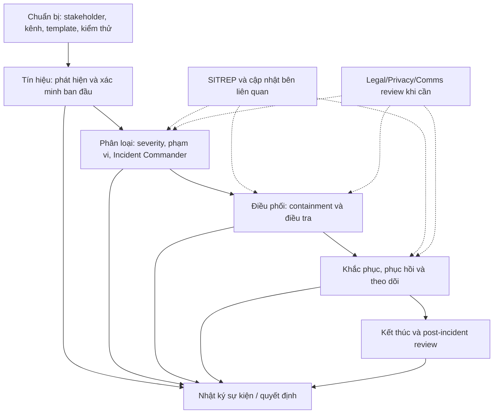

# Communication trong Incident Response: Truyền thông sự cố có kiểm soát và có bằng chứng

## 1. Vai trò của communication trong ứng phó sự cố

Khi xảy ra một sự cố an ninh mạng, các nhóm kỹ thuật phải đồng thời xác minh tín hiệu, cô lập tác động, điều tra nguyên nhân và khôi phục hệ thống. Nếu thông tin không được điều phối, tổ chức có thể mất thời gian vì chỉ đạo mâu thuẫn, tiết lộ dữ liệu chưa được kiểm chứng, bỏ lỡ một bên liên quan quan trọng hoặc thông báo quá muộn cho người có quyền quyết định.

**Incident response communication** là quá trình **thu thập, xác minh, phân loại, truyền đạt, ghi nhận và cập nhật thông tin** trong suốt vòng đời sự cố để các bên phù hợp có thể hành động nhất quán, đúng thời điểm và theo thẩm quyền.

Trong chương **Incident response** của module **SECURITY_SECURITY_ASSURANCE**, communication không chỉ là kỹ năng viết thông báo. Đây còn là một **security control có thể đánh giá bằng bằng chứng**: ai được thông báo, theo điều kiện nào, bằng kênh nào, nội dung nào được xác minh, quyết định nào được phê duyệt, và có lịch sử chứng minh rằng thông tin quan trọng đã đến đúng người hay không.

Ví dụ: một sự cố rò rỉ credential cloud có thể yêu cầu Security Operations (SOC) liên hệ Cloud Platform để vô hiệu hóa token, Incident Commander quyết định mức ưu tiên, Legal/Privacy đánh giá nghĩa vụ thông báo, Customer Support chuẩn bị trả lời khách hàng và người phát ngôn được ủy quyền điều phối thông tin bên ngoài. Nếu các nhóm này nhận những kết luận khác nhau về phạm vi ảnh hưởng, cả hành động kỹ thuật lẫn niềm tin của khách hàng đều có thể bị tổn hại.

### Mục tiêu học tập

Sau bài học, người học có thể:

1. Phân biệt điều phối kỹ thuật, báo cáo tình huống và thông báo tới bên ngoài.
2. Thiết kế mô hình trách nhiệm, stakeholder matrix, quy tắc escalation và nhịp cập nhật.
3. Viết thông điệp dựa trên **thông tin đã xác minh, giả thuyết, điều chưa biết và hành động đang diễn ra**.
4. Chọn kênh liên lạc bảo mật và kênh dự phòng khi hạ tầng danh tính hoặc công cụ trao đổi bị ảnh hưởng.
5. Tạo bằng chứng phục vụ audit về các quyết định, thông báo, phê duyệt và hành động.
6. Kiểm thử quy trình bằng tabletop exercise và cải tiến sau sự cố.

## 2. Phân biệt ba luồng communication

Ba luồng có liên hệ nhưng phục vụ mục đích khác nhau.

| Luồng | Người nhận chính | Nội dung cần thiết | Ví dụ |
| --- | --- | --- | --- |
| **Technical coordination** | SOC, incident responders, SRE, Cloud/Network/DBA, chủ dịch vụ | Chỉ dấu kỹ thuật, tác vụ, owner, tình trạng containment, bằng chứng, rủi ro của thay đổi | “Đã vô hiệu hóa access key K; xác minh chưa còn phiên hoạt động” |
| **Situation reporting (SITREP)** | Incident Commander, quản lý, ban điều hành, risk owners | Tác động nghiệp vụ, mức độ ưu tiên, sự thật đã xác minh, quyết định và nhu cầu hỗ trợ | “Tác động được xác nhận ở dịch vụ A; phạm vi dữ liệu vẫn đang điều tra” |
| **External communication** | Khách hàng, nhà cung cấp, cơ quan quản lý, đối tác, báo chí khi phù hợp | Thông tin được phê duyệt, tác động liên quan, hành động cần thực hiện và mốc cập nhật tiếp theo | Thông báo về gián đoạn dịch vụ hoặc sự kiện dữ liệu được xác định |

Các luồng không nên dùng chung một tin nhắn nguyên văn. Một log kỹ thuật có thể chứa địa chỉ nội bộ, dữ liệu cá nhân hoặc thông tin khai thác; bản cập nhật điều hành cần giải thích tác động và quyết định hơn là đổ một lượng lớn chỉ số kỹ thuật. Thông báo ra ngoài phải được kiểm tra tính chính xác, mức độ tiết lộ và các yêu cầu pháp lý/hợp đồng.

**Tính nhất quán không có nghĩa mọi người được xem cùng mức chi tiết.** Tính nhất quán là những khẳng định quan trọng không mâu thuẫn với một nguồn sự thật chung, còn quyền truy cập thông tin tuân theo nguyên tắc *need-to-know*.

## 3. Những rủi ro mà communication phải kiểm soát

| Rủi ro | Hậu quả | Kiểm soát communication |
| --- | --- | --- |
| Không báo đúng người | Chậm containment, không ai phê duyệt gián đoạn dịch vụ | On-call roster, escalation rule, người thay thế |
| Truyền thông tin chưa xác minh | Hành động sai, làm khách hàng hoang mang | Tách confirmed / suspected / unknown và nguồn bằng chứng |
| Kênh liên lạc bị xâm phạm | Kẻ tấn công thấy kế hoạch điều tra hoặc giả mạo chỉ đạo | Kênh dự phòng đã kiểm thử, xác minh danh tính ngoài kênh |
| Lộ dữ liệu qua cuộc họp/chat/ticket | Dữ liệu nhạy cảm bị lan truyền thêm | Phân loại thông tin, quyền truy cập, redaction |
| Không lưu dấu vết quyết định | Không tái dựng được lý do, thời gian và trách nhiệm | Decision log, timestamp, approver, bản thông điệp đã gửi |
| Cập nhật chậm hoặc thiếu nhịp | Các nhóm quyết định dựa trên trạng thái đã lỗi thời | Nhịp SITREP, event-driven escalation, next-update time |
| Thông báo ngoài không nhất quán | Sai lệch cam kết, tranh cãi pháp lý hoặc mất niềm tin | Approval workflow, người phát ngôn được ủy quyền |
| Kết luận “đã xong” quá sớm | Dừng điều tra, bỏ sót phiên/asset bị ảnh hưởng | Tiêu chí đóng sự cố, xác minh phục hồi và theo dõi tiếp |

Chương trình assurance cần định nghĩa **phép kiểm** cho mỗi rủi ro, thay vì chỉ có hướng dẫn chung “trao đổi đầy đủ”.

## 4. Communication theo vòng đời sự cố

Quá trình ứng phó có thể được trình bày theo các hoạt động chuẩn bị, phát hiện/phân tích, containment, eradication, recovery và post-incident improvement. Tên gọi/giai đoạn có thể khác tùy framework và tổ chức; communication diễn ra **xuyên suốt**, không chờ một giai đoạn riêng.



### 4.1. Chuẩn bị

Thiết lập danh sách liên hệ, vai trò và người thay thế; kênh primary/backup; các điều kiện escalation; template đã được review; cơ chế xác thực người chỉ đạo và diễn tập. Chỉ lưu thông tin liên hệ cá nhân theo chính sách bảo vệ dữ liệu của tổ chức.

### 4.2. Phát hiện và xác minh ban đầu

Người nhận cảnh báo tạo *initial incident record* nêu dữ liệu đã có, ảnh hưởng quan sát được, nghi vấn, nguồn log, thời điểm và người xử lý. Không chờ kết luận nguyên nhân gốc mới thông báo người chịu trách nhiệm khi tiêu chí kích hoạt đã đạt.

### 4.3. Phân loại và containment

Incident Commander thống nhất mức độ ưu tiên, phạm vi hiện biết, các cuộc gọi/hành động nhạy cảm cần phê duyệt và nhịp cập nhật. Trong lúc cô lập tài sản, điều phối phải tránh chỉ đạo trái ngược, chẳng hạn một nhóm tắt server trong khi nhóm khác cần bảo toàn bộ nhớ phục vụ điều tra.

### 4.4. Khôi phục

Thông báo về tiến độ phục hồi phải phân biệt **dịch vụ đã hoạt động** với **rủi ro an ninh đã được giải quyết**. Việc service health trở lại bình thường không chứng minh credentials đã được thu hồi, lỗ hổng đã được vá hoặc hoạt động bất thường không tái diễn.

### 4.5. Đóng sự cố và hậu kiểm

Gửi kết luận theo phạm vi đã xác minh, các việc còn mở, lịch giám sát sau phục hồi và người chịu trách nhiệm. Lưu lại nguyên nhân gốc đã xác nhận, các điểm chưa thể kết luận và bài học; cập nhật runbook, stakeholder matrix và chương trình kiểm thử.

## 5. Vai trò và ranh giới trách nhiệm

Một sự cố nên có **đầu mối điều phối** và cơ chế phân quyền ra quyết định. Danh xưng có thể thay đổi theo quy mô tổ chức nhưng trách nhiệm phải rõ.

| Vai trò | Nhiệm vụ truyền thông | Quyền hạn và lưu ý |
| --- | --- | --- |
| **Incident Commander (IC)** | Định hướng ưu tiên, thống nhất trạng thái, tổ chức nhịp cập nhật, yêu cầu quyết định | Thường là người điều phối, không nhất thiết tự phê duyệt mọi quyết định pháp lý/kinh doanh |
| **Technical Lead / Response Lead** | Tổng hợp bằng chứng kỹ thuật, phân công containment và khôi phục | Trình bày kết quả đã kiểm chứng; không tự khẳng định nghĩa vụ pháp lý |
| **Scribe / Documentation Lead** | Ghi timeline, decision log, các phiên bản SITREP, action owners | Lưu dấu vết nhưng không biến ghi chú không rõ nguồn thành sự thật |
| **Security Operations / DFIR** | Triage, điều tra, phân tích indicators và đánh giá phạm vi | Kiểm soát bằng chứng nhạy cảm, bảo toàn dữ liệu điều tra |
| **Service / Platform Owner** | Nêu tác động nghiệp vụ và khả năng khôi phục, xác nhận test | Phê duyệt thay đổi vận hành theo quyền được giao |
| **Legal / Privacy / Compliance** | Đánh giá yêu cầu thông báo, bảo mật pháp lý và nghĩa vụ hợp đồng | Thẩm định nội dung theo luật, hợp đồng và thẩm quyền liên quan |
| **Corporate Communications / PR** | Chuẩn bị thông điệp, điều phối kênh phát hành và phát ngôn | Không đưa ra suy đoán chưa được nhóm xử lý xác minh |
| **Customer Support / Account Management** | Tiếp nhận câu hỏi khách hàng, cập nhật theo thông điệp đã duyệt | Escalate thông tin mới, không tự mở rộng phạm vi khẳng định |
| **Executive / Business Owner** | Đánh giá tác động lớn và quyết định rủi ro kinh doanh | Nhận báo cáo hành động được, không cần toàn bộ log thô |
| **Third-party / Provider Liaison** | Điều phối với nhà cung cấp, MSSP, cloud vendor | Ghi case ID, thời điểm liên hệ, phạm vi thông tin đã chia sẻ |

### Ví dụ RACI cho hoạt động truyền thông

RACI: **R** = Responsible (thực hiện), **A** = Accountable (chịu trách nhiệm cuối cùng), **C** = Consulted, **I** = Informed.

| Hoạt động | IC | Technical Lead | Scribe | Legal/Privacy | Comms |
| --- | --- | --- | --- | --- | --- |
| Khởi tạo và phân phối SITREP nội bộ | A | R | R | C khi liên quan | I |
| Xác minh phạm vi kỹ thuật | A về điều phối | R | I | C khi ảnh hưởng dữ liệu | I |
| Duy trì nhật ký quyết định | A | C | R | I | I |
| Đánh giá nghĩa vụ thông báo bên ngoài | C | C | I | A/R | R về chuẩn bị thông điệp |
| Phê duyệt công bố thông điệp | C | C | I | A về khía cạnh pháp lý | R theo thẩm quyền phát ngôn |
| Hậu kiểm quy trình communication | A | R | R | C | C |

Bảng này là **ví dụ phân công**, không thay thế cơ chế phê duyệt của từng tổ chức. Các quy trình phải quy định rõ người có quyền phê duyệt thông báo, người phát ngôn và phương án dự phòng; tránh có nhiều người tự cho mình quyền phát hành thông tin ra ngoài.

## 6. Stakeholder matrix: ai cần biết gì, khi nào?

**Stakeholder matrix** là công cụ xác định đối tượng, điều kiện kích hoạt, nội dung cần nhận, kênh và người chịu trách nhiệm.

| Bên liên quan | Trigger điển hình | Nội dung trọng tâm | Kênh và bằng chứng |
| --- | --- | --- | --- |
| SOC/on-call | Alert vượt tiêu chí incident | Dữ kiện, asset, triage, ticket, hành động khẩn | Incident platform, paging record |
| Platform/Network/DBA | Cần kiểm tra hoặc thay đổi hệ thống | Scope kỹ thuật, chỉ đạo, rollback, dấu vết kiểm thử | Kênh hạn chế quyền, change ticket |
| IC và lãnh đạo dịch vụ | Khai báo incident hoặc thay đổi ảnh hưởng | Severity, business impact, quyết định, blockers | SITREP có version, nhận xác nhận |
| Legal/Privacy | Có khả năng ảnh hưởng dữ liệu/ nghĩa vụ thông báo | Loại dữ liệu, phạm vi, mốc thời gian, độ chắc chắn | Kênh bảo mật; request for assessment |
| Ban điều hành | Tác động trọng yếu, rủi ro doanh nghiệp | Tác động khách hàng, nguồn lực, lựa chọn quyết định | Executive update đã kiểm chứng |
| Nhà cung cấp | Sự cố có liên quan dịch vụ/khóa/đường mạng của họ | Evidence tối thiểu cần support, contract reference | Support ticket bảo mật, case ID |
| Khách hàng/đối tác | Nghĩa vụ hợp đồng, rủi ro, gián đoạn và phê duyệt thích hợp | Tác động liên quan, việc cần làm, thời điểm cập nhật | Kênh được duyệt, bản phát hành lưu vết |
| Cơ quan quản lý hoặc cơ quan thực thi pháp luật | Điều kiện pháp luật/cơ quan có thẩm quyền áp dụng | Nội dung và thời hạn theo yêu cầu xác định | Kênh chính thức, xác nhận gửi/nhận |
| Báo chí/công chúng | Quyết định phát ngôn công khai | Thông điệp xác minh, không tiết lộ bí mật điều tra | Người phát ngôn ủy quyền, bản lưu |

Thời điểm và yêu cầu thông báo bên ngoài **phụ thuộc loại sự cố, hợp đồng, loại dữ liệu, ngành, quốc gia/vùng lãnh thổ và luật áp dụng**. Không nên tự ấn định một thời hạn chung cho mọi tổ chức. Ngay trong giai đoạn chưa xác định chính xác tác động, có thể cần **chuyển đánh giá cho Legal/Privacy kịp thời** để xác định nghĩa vụ, thay vì tự suy đoán rồi trì hoãn.

### “Need to know” không đồng nghĩa chặn thông tin cần hành động

Nguyên tắc tối thiểu hóa chia sẻ không cho phép giữ kín những chi tiết khiến đội chịu trách nhiệm không thể xử lý. Ví dụ, SRE cần biết các tài nguyên phải cô lập và cửa sổ thay đổi; nhưng không cần toàn bộ dữ liệu khách hàng hoặc bản dump credential. Hãy phân tách bằng chứng nhạy cảm và chỉ dẫn hành động.

## 7. Severity, escalation và nhịp cập nhật

**Severity** của incident và **priority** của một tác vụ không nhất thiết giống nhau. Một sự cố có tác động dữ liệu nghiêm trọng có thể được xếp severity cao dù hệ thống vẫn hoạt động; một tác vụ khôi phục thiết bị ít liên quan có thể có priority thấp trong cùng incident.

### Ma trận kích hoạt minh họa

| Mức | Điều kiện minh họa | Điều phối | Nhịp SITREP nội bộ gợi ý |
| --- | --- | --- | --- |
| **SEV-1 / Critical** | Nghi ảnh hưởng nhiều dịch vụ thiết yếu hoặc dữ liệu đặc biệt nhạy cảm; cần quyết định cấp cao | IC chính thức, war room, đại diện kỹ thuật/rủi ro | Theo quyết định của IC; ví dụ 15–30 phút |
| **SEV-2 / High** | Tác động đáng kể nhưng có phạm vi ban đầu tương đối giới hạn | IC/on-call và chủ dịch vụ | Ví dụ 30–60 phút |
| **SEV-3 / Moderate** | Sự kiện được kiểm soát, không thấy tác động lan rộng | Chủ incident và các nhóm cần thiết | Ví dụ mỗi vài giờ hoặc khi có thay đổi đáng kể |
| **SEV-4 / Low** | Phát hiện nhỏ hoặc yêu cầu điều tra không khẩn cấp | Quy trình ticket và owner | Theo SLA và thời hạn xử lý |

**Các mốc thời gian trên chỉ minh họa**, không phải SLA hoặc nghĩa vụ pháp lý chung. Tổ chức phải phê duyệt severity criteria, nhịp cập nhật theo thời gian thực tế và **event-driven triggers**; không đợi tới mốc định kỳ nếu phát hiện dữ liệu bị ảnh hưởng, hoạt động đang diễn ra hoặc một quyết định containment khẩn cấp.

### Các trigger phải escalation ngay

- Xác nhận hoặc có dấu hiệu đáng tin cậy về truy cập trái phép vào dữ liệu nhạy cảm.
- Phát hiện actor có quyền cao, có thể thay IAM, log, KMS, backup hoặc hệ thống identity.
- Containment thất bại, phạm vi ảnh hưởng mở rộng hoặc hệ thống trọng yếu mất khả năng phục hồi.
- Có bằng chứng rằng kênh liên lạc hoặc công cụ quản trị incident đã bị xâm phạm.
- Có khả năng phát sinh nghĩa vụ thông báo theo luật/hợp đồng, hoặc có yêu cầu từ cơ quan có thẩm quyền.
- Quyết định cần phê duyệt ảnh hưởng lớn tới khách hàng, an toàn, khả năng cung cấp dịch vụ hoặc bảo toàn bằng chứng.
- Phát hiện sự kiện mâu thuẫn với tuyên bố đã phát hành, cần cải chính hoặc cập nhật kịp thời.

Mỗi escalation nên có **trigger, người gọi, người nhận, thời gian, nội dung, cách xác nhận nhận được và fallback khi không có phản hồi**.

## 8. Chọn kênh communication an toàn và phương án dự phòng

Trong sự cố, email, chat hoặc IdP của chính tổ chức có thể bị tấn công. Kênh communication phải được lựa chọn theo **mức nhạy cảm, khả năng sẵn sàng và sự tin cậy của danh tính người tham gia**.

| Kênh | Phù hợp | Rủi ro cần kiểm soát |
| --- | --- | --- |
| Incident management platform | Incident ID, action items, timeline, SITREP, paging | Quyền truy cập, log audit, availability và retention |
| Kênh chat/war room hạn chế quyền | Điều phối nhanh giữa các responder | Mời nhầm người, bot/app bên thứ ba, account bị chiếm |
| Conference/voice bridge | Quyết định khẩn cấp, phối hợp nhiều đội | Xác minh người tham gia, ghi âm theo chính sách, thiếu biên bản |
| Email được kiểm soát | Thông điệp chính thức, phê duyệt, hồ sơ bên ngoài | Forward nhầm, phishing, domain/IdP bị chiếm |
| Secure file/evidence repository | Chia sẻ artifact, logs, kết quả pháp chứng | Đường link công khai, quyền quá rộng, thay/xóa dữ liệu |
| Out-of-band / backup channel | Kênh chính hoặc SSO bị ảnh hưởng | Danh tính, quyền quản trị và danh sách số liên lạc phải xác minh trước |

### Quy tắc chống giả mạo chỉ đạo

1. Với lệnh cực kỳ nhạy cảm như xoay khóa tổ chức, xóa máy chủ, vô hiệu hóa tenant hoặc công bố dữ liệu, dùng quy trình phê duyệt độc lập phù hợp.
2. Khi nghi kênh chat/IdP bị xâm phạm, **không gửi toàn bộ kế hoạch điều tra lên chính kênh đó**; chuyển sang kênh dự phòng đã được kiểm thử.
3. Xác minh người gọi bằng phương thức đã biết trước; không chỉ tin số điện thoại/tên hiển thị trong tin nhắn.
4. Không gửi password, API token, private key hoặc dữ liệu khách hàng thô trong chat. Dùng kho evidence có quyền truy cập giới hạn và tham chiếu thay vì đính kèm dữ liệu.
5. Ghi lại quyết định quan trọng và người phê duyệt vào hệ thống có thể truy vết sau khi hành động khẩn cấp được thực thi.

Kênh dự phòng phải được **diễn tập từ trước**. Một danh sách số liên lạc không được cập nhật hoặc công cụ ngoài băng cần đăng nhập qua cùng IdP đang bị sự cố không thực sự là phương án dự phòng.

## 9. Single source of truth: Incident record và trạng thái xác minh

Nhiều nhóm có thể ghi nhận các sự kiện riêng lẻ; cần một **incident record** làm điểm tham chiếu chung cho trạng thái và quyết định. Record không nhất thiết chứa mọi log thô nhưng phải liên kết được tới bằng chứng gốc có kiểm soát.

### Cấu trúc đề xuất

| Trường | Mục đích |
| --- | --- |
| Incident ID và mức severity | Xác định phiên điều phối và thứ tự ưu tiên |
| Status / phase | Triaging, contained, recovering, monitoring, closed theo định nghĩa tổ chức |
| Incident Commander và người thay thế | Đầu mối điều phối, thẩm quyền cập nhật |
| First observed / detected / declared | Phân biệt mốc sự kiện, phát hiện và khai báo; lưu timezone |
| Affected services/assets | Phạm vi được xác minh và phạm vi còn điều tra |
| Business/customer impact | Tác động đã chứng minh, giả thuyết và unknowns |
| Evidence references | Liên kết log, timeline, forensic artifact có bảo vệ |
| Action register | Việc phải làm, owner, deadline, trạng thái và kết quả |
| Decision log | Quyết định, lý do, người phê duyệt, thời gian, dữ liệu đầu vào |
| Communication log | Thông điệp, version, người nhận, thời điểm và xác nhận gửi |
| Next-update time | Ngăn khoảng im lặng ngoài dự kiến |
| Open risks / blockers | Điều kiện còn thiếu để kết luận hoặc phục hồi |
| Closure and follow-up | Tiêu chí hoàn thành, xác minh và hạng mục hậu kiểm |

### Mức độ chắc chắn của thông tin

Một bản ghi nên phân biệt:

- **CONFIRMED:** có nguồn bằng chứng hỗ trợ rõ ràng và người chịu trách nhiệm xác nhận.
- **SUSPECTED:** giả thuyết hợp lý, cần tiếp tục thu thập bằng chứng; không phát biểu như sự thật.
- **UNKNOWN:** chưa có khả năng kết luận do thiếu dữ liệu, quyền, log hoặc thời gian.
- **REFUTED:** giả thuyết đã được kiểm chứng là không đúng trong phạm vi xét; cần nêu điều kiện và nguồn.
- **CHANGED/SUPERSEDED:** kết luận cũ đã được thay thế do dữ liệu mới; giữ lịch sử hiệu chỉnh.

**Không bao giờ xóa im lặng một tuyên bố cũ** khi có phát hiện mới quan trọng. Hãy ghi phiên bản, lý do thay đổi và thông báo cải chính cho người đã nhận kết luận trước đó khi cần.

## 10. Mẫu SITREP: Báo cáo tình huống ngắn nhưng hành động được

**Situation Report (SITREP)** nên đủ rõ để người nhận biết *đang có vấn đề gì, tác động ra sao, điều gì đã xác minh, việc gì đang làm, quyết định nào cần đưa ra và bao giờ cập nhật tiếp*.

Mẫu có thể dùng để lập hồ sơ nội bộ:

```text
INCIDENT: <incident-id> | SEVERITY: <mức được phê duyệt>
AS OF: <thời điểm, múi giờ> | VERSION: <số phiên>
INCIDENT COMMANDER: <vai trò/đầu mối>
STATUS: <triaging / contained / recovering / monitoring / closed>

1. SUMMARY (confirmed):
   - <sự việc đã xác minh và bằng chứng tham chiếu>
2. IMPACT (confirmed):
   - <dịch vụ/khách hàng/dữ liệu, phạm vi và thời gian đã xác nhận>
3. SUSPECTED / UNKNOWN:
   - <giả thuyết và điều chưa xác định, không suy diễn>
4. ACTIONS COMPLETED:
   - <việc đã thực hiện, owner, thời điểm, kết quả xác minh>
5. ACTIONS IN PROGRESS:
   - <việc, owner, ETA nếu đáng tin cậy, blockers>
6. DECISIONS REQUIRED:
   - <quyết định, người có quyền, hạn cần quyết định>
7. EXTERNAL NOTIFICATION:
   - <trạng thái Legal/Privacy review, chưa/sẽ thông báo theo phê duyệt>
8. NEXT UPDATE:
   - <thời điểm cập nhật hoặc điều kiện kích hoạt sớm hơn>
EVIDENCE: <tham chiếu bảo mật, không chép token/log nhạy cảm>
```

**Không ép phải có ETA phục hồi** khi thiếu căn cứ. Có thể ghi “chưa xác định; đánh giá lại khi hoàn tất kiểm tra X”, đồng thời cam kết giờ cập nhật trạng thái tiếp theo thay vì hứa một giờ khôi phục chưa được kiểm chứng.

### Ví dụ SITREP nội bộ giả định

Tình huống sau được dựng để học cách diễn đạt, **không phản ánh sự cố thật**.

```text
INCIDENT: INC-DEMO-024 | SEVERITY: SEV-2
AS OF: 2026-11-28 09:30 UTC | VERSION: 3
IC: Incident Commander on duty
STATUS: Containment in progress

CONFIRMED:
- Hệ thống giám sát ghi nhận API key của workload payment-worker
  được sử dụng từ nguồn ngoài danh sách IP vận hành được duyệt.
- Key đã bị vô hiệu hóa lúc 09:18 UTC; kiểm tra gọi API bằng key cũ
  cho kết quả bị từ chối theo phép thử được phê duyệt.

IMPACT:
- Chưa xác nhận được dữ liệu khách hàng đã bị truy cập.
- Đang đối chiếu cloud API logs và quyền hiệu lực của key.

UNKNOWN:
- Chưa biết toàn bộ thời gian key có thể đã bị lộ.
- Chưa hoàn tất đối chiếu các phiên được cấp trước khi key bị vô hiệu hóa.

NEXT ACTIONS:
- Cloud Security: rà soát quyền và phiên, hạn cập nhật 10:00 UTC.
- Service Owner: triển khai credential thay thế, xác minh giao dịch.
- Legal/Privacy: đánh giá các điều kiện thông báo nếu xuất hiện
  bằng chứng về dữ liệu bị ảnh hưởng.

NEXT UPDATE: 10:00 UTC hoặc sớm hơn nếu có bằng chứng mở rộng tác động.
```

Điểm quan trọng: không dùng cụm từ “chưa có rò rỉ” khi thực tế chỉ biết **chưa xác nhận được** có truy cập dữ liệu; hai phát biểu có ý nghĩa hoàn toàn khác nhau.

## 11. Communication nội bộ trong war room và giao ca

War room là nơi phối hợp; nếu không có kỷ luật, nó dễ trở thành luồng chat khó tìm, lẫn giả thuyết và quyết định.

### Quy tắc điều phối hữu ích

1. **Mỗi tác vụ có một owner:** “team đang xem” không đủ để xác định người chịu trách nhiệm.
2. **Một sự kiện – một mốc thời gian:** dùng timestamp có timezone và tham chiếu bằng chứng.
3. **Quyết định tách khỏi ý kiến:** phân biệt đề xuất, phê duyệt và hành động thực tế đã thực thi.
4. **Chống trùng việc:** IC hoặc scribe theo dõi action register; không để hai người đồng thời đổi cùng chính sách gây ghi đè.
5. **Quản lý phạm vi chia sẻ:** tài liệu forensic và dữ liệu nhạy cảm nằm trong kho riêng; war room chỉ chứa đường dẫn có kiểm soát.
6. **Theo dõi giả thuyết:** mỗi giả thuyết có dữ liệu ủng hộ/phản bác và người kiểm tra.
7. **Giao ca có xác nhận:** người nhận ca xác nhận đã đọc trạng thái, các quyết định nguy hiểm và công việc chưa hoàn tất.

### Mẫu handover

```text
HANDOVER: <incident-id> / <time-zone-aware-timestamp>
Outgoing IC/Lead: <...>
Incoming IC/Lead: <...>
Last confirmed situation: <...>
Actions completed and verified: <...>
Work in progress / owners: <...>
Critical unknowns and potential escalations: <...>
Evidence preservation constraints: <...>
Next required decision: <...>
Next SITREP deadline: <...>
Acknowledged by incoming lead at: <...>
```

Nhật ký giao ca giúp giảm rủi ro lặp lại thao tác làm mất chứng cứ, bỏ sót yêu cầu pháp lý hoặc tuyên bố phục hồi quá sớm.

## 12. External communication: thông báo dựa trên sự thật và thẩm quyền

Thông báo bên ngoài có thể liên quan khách hàng, đối tác, nhà cung cấp, bảo hiểm, cơ quan quản lý hoặc công chúng. Cần có cơ chế xét duyệt **tùy đối tượng và nghĩa vụ áp dụng**, không để một cá nhân kỹ thuật tự suy đoán thời hạn hoặc nội dung pháp lý.

### Những nguyên tắc phải duy trì

- **Chính xác:** nói điều đã biết và chưa biết; phân biệt sự cố dịch vụ với việc đã xác nhận lộ dữ liệu.
- **Kịp thời:** làm rõ ai đánh giá mốc thông báo và ai có quyền phê duyệt; không lấy lý do chưa hoàn tất root cause để trì hoãn mọi liên hệ.
- **Liên quan người nhận:** mô tả tác động, hành động họ cần làm, nơi nhận hỗ trợ và giờ cập nhật tiếp.
- **Tối thiểu hóa dữ liệu:** không công khai log nội bộ, exploit details, địa chỉ nhạy cảm, danh sách tài khoản hoặc nhận dạng nạn nhân không cần thiết.
- **Nhất quán theo phiên bản:** các kênh customer support, status page, account management và PR dùng thông điệp đã được duyệt.
- **Có thể kiểm chứng:** giữ bản thông báo chính xác, thời điểm gửi, danh sách nhóm nhận và kết quả gửi/nhận khi có.
- **Có khả năng cải chính:** nếu ảnh hưởng thay đổi, cập nhật và giải thích lý do; không xóa thông tin cũ mà không lưu lịch sử.

### Các câu cần tránh

| Câu rủi ro | Vấn đề | Cách diễn đạt có căn cứ hơn |
| --- | --- | --- |
| “Không có dữ liệu nào bị ảnh hưởng.” | Có thể chưa điều tra đủ | “Chúng tôi chưa xác định được phạm vi dữ liệu bị ảnh hưởng; việc điều tra đang diễn ra.” |
| “Sự cố đã được giải quyết hoàn toàn.” | Có thể mới khôi phục dịch vụ | “Dịch vụ đã phục hồi theo kiểm tra hiện có; chúng tôi tiếp tục giám sát và điều tra.” |
| “Hệ thống của chúng tôi bảo mật tuyệt đối.” | Khẳng định không có cơ sở | Nêu kiểm soát và kết quả đã được xác minh trong phạm vi |
| “Mọi khách hàng đều an toàn.” | Có thể chưa xác định population | Nêu nhóm khách hàng liên quan đã xác định, giới hạn điều tra và lịch cập nhật |
| “Chắc chắn do đối tác gây ra.” | Có thể chỉ là giả thuyết | “Chúng tôi đang xác minh nguồn gốc sự kiện với các bên liên quan.” |

Không nên sử dụng template này để bỏ qua nghĩa vụ thông báo. Nếu một quy định yêu cầu thông tin cụ thể, phải tuân thủ nội dung và thủ tục **áp dụng thực tế** theo tư vấn của bộ phận có thẩm quyền.

### Mẫu thông báo khách hàng theo dạng khung

```text
Tiêu đề: Thông tin cập nhật về sự cố <mô tả ngắn có kiểm chứng>

Chúng tôi đang xử lý một sự cố được phát hiện vào
<ngày, giờ, múi giờ> liên quan đến <dịch vụ/phạm vi đã xác định>.

Những gì chúng tôi đã xác nhận:
- <thông tin đã kiểm chứng và mức ảnh hưởng liên quan đến người nhận>

Những gì đang tiếp tục xác minh:
- <nội dung chưa xác định, diễn đạt thận trọng>

Những biện pháp đã thực hiện:
- <hành động xác minh được, không tiết lộ thông tin nhạy cảm>

Người nhận cần làm gì (nếu có):
- <hướng dẫn phù hợp với rủi ro, có thể hành động>

Chúng tôi sẽ cập nhật tiếp vào <mốc thời gian/kênh> hoặc
sớm hơn nếu có thông tin quan trọng.

Liên hệ hỗ trợ: <kênh chính thức đã được xác minh>
```

Đây chỉ là **khung biên tập**. Trước khi gửi, cần xác nhận thông tin, đối tượng nhận, mức nhạy cảm, nghĩa vụ pháp luật/hợp đồng và phê duyệt theo chính sách tổ chức.

## 13. Legal, Privacy, Regulatory và hợp đồng: một luồng quyết định riêng

Một sự cố an ninh không mặc nhiên là **data breach theo định nghĩa pháp lý**, và cũng không phải mọi vi phạm dữ liệu đều có cùng yêu cầu thông báo. Nghĩa vụ phụ thuộc vào luật, ngành, nơi xử lý dữ liệu, vai trò controller/processor hoặc các vai trò pháp lý tương ứng, hợp đồng và mức tác động đã xác định.

Vì thế, communication playbook nên chứa:

1. **Trigger tham vấn Legal/Privacy:** chẳng hạn có dấu hiệu dữ liệu cá nhân, thông tin sức khỏe, tài chính hoặc bí mật khách hàng có thể bị truy cập trái phép.
2. **Các trường thông tin cần đánh giá:** loại dữ liệu, số lượng, đối tượng, quốc gia liên quan, thời gian, trạng thái khôi phục và mức độ chắc chắn.
3. **Người chịu trách nhiệm phân tích nghĩa vụ:** Legal/Privacy/Compliance theo tổ chức, phối hợp bên dịch vụ và bảo hiểm khi hợp đồng yêu cầu.
4. **Quy trình phê duyệt:** người ký, kênh chính thức, thẩm quyền phát ngôn, lịch lưu hồ sơ và chứng nhận gửi.
5. **Cơ chế cập nhật:** nếu điều tra phát hiện thêm tác động sau thông báo đầu tiên thì cần sửa/bổ sung ra sao.
6. **Bảo toàn bằng chứng:** không để thông báo hoặc yêu cầu hợp tác khiến dữ liệu pháp chứng bị sửa, xóa ngoài quy trình.

**Không gán một thời hạn như “24 giờ” hay “72 giờ” cho mọi sự cố**. Mọi mốc bắt buộc phải do đội có thẩm quyền xác minh theo quy định và hợp đồng đang có hiệu lực. Nếu có sự không chắc chắn về thời điểm bắt đầu tính hạn, hãy ghi lại mốc phát hiện, mốc xác nhận và mốc chuyển đánh giá cho Legal một cách chính xác.

### Hợp tác với nhà cung cấp và bên thứ ba

Hợp đồng có thể quy định thời gian thông báo, điểm liên hệ, giới hạn chia sẻ dữ liệu và quyền điều tra. Khi liên hệ provider, lưu case ID, giờ mở case, mức độ ưu tiên, bằng chứng đã chia sẻ, yêu cầu tiếp theo và bản phản hồi có nguồn. Thông tin đến từ nhà cung cấp cần được đánh dấu là **provider-reported** cho đến khi được kiểm tra hoặc chấp nhận theo mô hình trách nhiệm phù hợp.

## 14. Bằng chứng communication cho Security Assurance

Một tổ chức có thể trả lời tin nhắn rất nhanh nhưng vẫn **không chứng minh được** rằng communication control được thực thi đúng nếu không có nhật ký và phép kiểm.

### Hồ sơ bằng chứng tối thiểu

- **Incident ID**, severity, loại sự cố và phạm vi đánh giá.
- **Communication policy version**, stakeholder matrix và escalation triggers tại thời điểm áp dụng.
- **Message ID/version**, bản nội dung gửi, trạng thái factual confidence và người chịu trách nhiệm xác minh.
- **Người nhận/nhóm nhận**, kênh, timestamp gửi, receipt/acknowledgment khi cần.
- **Approval chain**: ai phê duyệt nội dung ngoài, dựa trên quyết định nào và thời điểm.
- **Action/decision links**: yêu cầu được gửi dẫn tới tác vụ nào, kết quả ra sao.
- **Các mốc thời gian không có dữ liệu**, nếu chat/paging system gián đoạn.
- **Bằng chứng kiểm thử**: kết quả diễn tập, kênh dự phòng, paging test, follow-up đã thực hiện.

Ví dụ YAML minh họa một record, **không phải dữ liệu sự cố thật**:

```yaml
communicationRecord:
  incidentId: INC-DEMO-024
  messageId: MSG-019
  version: 2
  classification: internal-restricted
  type: situation-update
  approvedAt: "2026-11-28T09:25:00Z"
  approvedByRole: incident-commander
  sentAt: "2026-11-28T09:30:00Z"
  channel: incident-management-platform
  audience: [incident-responders, service-owners]
  contentRef: "evidence://incident-demo-024/messages/MSG-019-v2"
  evidenceRefs:
    - "evidence://incident-demo-024/timeline/snapshot-0930"
  acknowledgment:
    required: true
    receivedFrom: [service-owner-oncall]
    pendingFrom: [platform-oncall]
  nextUpdateAt: "2026-11-28T10:00:00Z"
```

Tệp minh họa cần được điều chỉnh theo policy của tổ chức. **Phê duyệt bởi IC** không thay thế đánh giá/approval của Legal hoặc Comms nếu thông điệp thuộc loại cần phê duyệt riêng. Nhật ký nên có cơ chế bảo vệ integrity và kiểm soát quyền truy cập; dữ liệu cá nhân liên hệ và bằng chứng kỹ thuật nhạy cảm không cần sao chép vào bản tổng hợp.

### Tiêu chí đánh giá control communication

| Control ID | Yêu cầu | Bằng chứng bắt buộc | Ví dụ điều kiện |
| --- | --- | --- | --- |
| COM-01 | Sự cố mức cao có đầu mối điều phối được chỉ định | Incident declaration + assignment event | IC và backup được xác nhận |
| COM-02 | Escalation tới đúng responder theo trigger | Trigger log + paging/ack | Người trực nhận và phản hồi trong SLA đã duyệt |
| COM-03 | SITREP đúng nhịp và ghi sự thật/unknowns | Timeline + bản SITREP | Không có gap cập nhật vượt ngưỡng không được phê duyệt |
| COM-04 | Thông báo ngoài được kiểm tra và duyệt | Approval trail + message artifact | Không có phát hành chưa được ủy quyền |
| COM-05 | Có đường dự phòng khi kênh chính không khả dụng | Runbook + kết quả tabletop/failover test | Thử chuyển kênh thành công |
| COM-06 | Decision log có thể truy xuất và tái dựng | Decision log + evidence refs | Có người, thời gian, lý do và kết quả |
| COM-07 | Handover không bỏ sót tác vụ quan trọng | Handover artifact + acknowledgment | Người nhận ca xác nhận việc đang mở |

Một mẫu ghi nhận không có acknowledgment có thể là **FAIL** nếu policy bắt buộc xác nhận và đã hết hạn, nhưng có thể là **UNKNOWN** nếu hệ thống paging bị hỏng và chưa biết thông điệp đã đến hay chưa. Phải định nghĩa rõ quy tắc phân loại trước khi chấm điểm.

## 15. Phân biệt kết luận có bằng chứng: PASS / FAIL / UNKNOWN

Các kết quả thường dùng:

| Kết quả | Diễn giải trong communication assurance |
| --- | --- |
| **PASS** | Yêu cầu áp dụng, bằng chứng đủ và mới chứng minh quy trình đã đạt |
| **FAIL** | Có bằng chứng một điều kiện bắt buộc không đạt, như gửi trễ SLA hoặc bỏ qua approval |
| **UNKNOWN** | Thiếu log gửi/nhận, danh sách stakeholder không rõ hoặc kênh lỗi khiến không thể kết luận |
| **EXCEPTION** | Sai khác được chấp nhận rủi ro có điều kiện, owner, thời hạn và biện pháp bù trừ |
| **NOT_APPLICABLE** | Control không áp dụng theo baseline và loại sự cố đã xác định |

**Không có tin nhắn trên kênh đã bị hỏng không tự chứng minh người nhận chưa được thông báo qua phương án dự phòng.** Ngược lại, một tin nhắn đã gửi (sent) chưa chắc người xử lý đã nhận và hiểu; với hành động quan trọng cần cơ chế acknowledgment hoặc xác minh phản hồi.

Trong các kỳ audit, đo cả **control evidence coverage**. Nếu có 20 incident thuộc phạm vi, nhưng chỉ 15 có đủ thông tin theo policy, không nên báo rằng quy trình communication tuân thủ 100% chỉ dựa trên 15 hồ sơ hoàn chỉnh.

## 16. Kịch bản minh họa: Cloud credential bị lộ trong dịch vụ thanh toán

Một workload chạy trong cloud dùng credential để truy cập storage. Detection phát hiện phiên API bất thường từ nguồn ngoài dự kiến. Nhóm bảo mật chưa biết token đã bị lộ từ lúc nào và chưa xác định dữ liệu khách hàng có bị truy cập hay không.

### Timeline và thông điệp có kiểm soát

| Giờ (UTC, giả định) | Diễn biến | Communication và bằng chứng |
| --- | --- | --- |
| 09:05 | Detection tạo alert | SOC tạo incident ID, gắn alert ID và dữ kiện confirmed |
| 09:10 | SOC xác minh alert đủ đáng tin để khai báo incident | IC được chỉ định, paging tới Cloud Platform và Service Owner |
| 09:18 | Credential bị vô hiệu hóa theo quy trình | Technical Lead gửi kết quả thao tác và bằng chứng kiểm tra từ chối |
| 09:25 | Đánh giá sơ bộ ảnh hưởng dịch vụ | IC phân phối SITREP v1, nêu impact và unknowns |
| 09:35 | Phát hiện log liên quan data access chưa đủ | Ghi UNKNOWN về dữ liệu; Legal/Privacy nhận yêu cầu đánh giá |
| 09:50 | Dịch vụ hoạt động với credential thay thế | Thông báo service recovery, **không** tuyên bố điều tra hoàn tất |
| 10:10 | Tiếp tục đối chiếu session và storage access | SITREP v2 cập nhật phạm vi/giới hạn; nhịp tiếp theo được công bố |
| Sau đó | Điều tra đủ để đưa quyết định theo thẩm quyền | Legal/Comms đánh giá có phải thông báo ngoài hay không, theo nghĩa vụ thực tế |

Đây là một **tình huống học tập giả định**. Mốc thời gian và quy trình thông báo không phải chuẩn áp dụng cho mọi tổ chức.

### Hai cách viết và hậu quả

**Cách không nên dùng:** “Credential đã được xoay vòng. Không có rò rỉ dữ liệu. Sự cố đã khắc phục xong.”

Câu này gộp ba kết luận khác nhau, trong khi nhóm mới xác minh rằng credential bị vô hiệu hóa và dịch vụ đã khôi phục. Dữ liệu bị truy cập chưa được xác định, các phiên tạm thời và cơ chế persistence có thể còn cần điều tra.

**Cách phù hợp hơn:** “Credential liên quan đã được vô hiệu hóa và hoạt động sử dụng credential cũ bị từ chối trong phép kiểm tra đã thực hiện. Dịch vụ hiện vận hành với credential thay thế. Nhóm điều tra đang xác minh các phiên đã được cấp và phạm vi truy cập dữ liệu; chưa đủ bằng chứng để kết luận về ảnh hưởng dữ liệu.”

### Nếu kênh chat nội bộ bị nghi xâm phạm?

IC kích hoạt runbook out-of-band, xác minh người tham gia qua kênh dự phòng và hạn chế truyền chỉ dấu điều tra trên kênh cũ. Quyết định chuyển kênh, danh sách người tham gia, bằng chứng xác thực người chỉ đạo và thông tin cần chuyển tiếp được ghi trong hồ sơ có quyền hạn phù hợp. Khi hệ thống chuẩn an toàn trở lại, tài liệu được đồng bộ vào incident record nhưng vẫn giữ rõ nguồn và thời gian.

## 17. Incident communication trong tình huống khó

### 17.1. Phạm vi ảnh hưởng thay đổi nhanh

SITREP nên dùng các mốc **“as of”** cụ thể và tạo version mới khi có phát hiện. Nếu từ 2 service tăng thành 5 service chịu ảnh hưởng, cần cập nhật người đã nhận thông tin ban đầu và xác định quyết định containment nào cần thay đổi.

### 17.2. Nhiều tổ chức cùng xử lý

Cloud provider, MSSP, SaaS vendor, đơn vị outsource và khách hàng doanh nghiệp có thể tham gia theo hợp đồng khác nhau. Phải xác định điểm liên hệ, quyền chia sẻ, case ID và **bên nào có quyền tuyên bố trạng thái kỹ thuật/ pháp lý**. Không để trách nhiệm bị đẩy qua lại vì mọi bên đều nghĩ bên khác sẽ thông báo.

### 17.3. Hệ thống email/IdP bị ảnh hưởng

Ưu tiên kênh dự phòng đã xác minh, giữ danh sách người nhận an toàn, không gửi dữ liệu nhạy cảm qua công cụ ngoài chính sách nếu không có quyết định rủi ro phù hợp. Các bên cần biết khi nào **kênh cũ không còn đáng tin** để tránh hành động theo chỉ đạo giả mạo.

### 17.4. Khác biệt múi giờ và ngôn ngữ

Sử dụng timestamp có timezone, tránh “sáng mai” hoặc “đã khôi phục hôm qua” trong thông tin điều tra xuyên khu vực. Nếu dịch thông báo, phải kiểm tra nghĩa của “confirmed”, “suspected”, “affected”, “potentially” và các điều kiện pháp lý; lưu cả bản gốc và bản đã phát hành.

### 17.5. Thông tin kỹ thuật nhạy cảm và pháp chứng

Không chuyển nguyên mẫu malware, thông tin đăng nhập hoặc dữ liệu điều tra chưa được làm sạch cho toàn bộ nhóm. Gửi tóm tắt có liên kết tới kho evidence; việc cung cấp artifacts cho đối tác hoặc cơ quan bên ngoài phải có thẩm quyền và tuân thủ quy trình bảo toàn bằng chứng.

## 18. Kiểm thử communication qua tabletop và diễn tập

Một playbook chưa được thử không bảo đảm hoạt động khi sự cố thật xảy ra. **Tabletop exercise** kiểm tra quy trình quyết định và trao đổi; một số khả năng kỹ thuật như paging, failover channel hoặc lưu log cần **bài test chức năng riêng**.

### Bộ tình huống kiểm thử

| Test ID | Tình huống | Kết quả kỳ vọng |
| --- | --- | --- |
| COM-T01 | Alert SEV-1 ngoài giờ và người trực đầu không phản hồi | Escalation đúng tuyến, có backup, lưu ack |
| COM-T02 | Sự cố data access chưa đủ bằng chứng | SITREP phân biệt confirmed/suspected/unknown |
| COM-T03 | IC nhận thông tin kỹ thuật mâu thuẫn từ hai nhóm | Có cơ chế xác minh và cập nhật bản tình huống |
| COM-T04 | Chat/SSO chính bị nghi xâm phạm | Chuyển sang kênh dự phòng, xác minh danh tính người chỉ đạo |
| COM-T05 | Có khả năng phát sinh nghĩa vụ thông báo | Legal/Privacy được đưa vào đúng thời điểm; có record quyết định |
| COM-T06 | Dịch vụ phục hồi nhưng điều tra chưa kết thúc | Thông điệp không tuyên bố “an toàn hoàn toàn” |
| COM-T07 | Thay ca lúc rủi ro cao nhất | Handover có action owners, unknowns, quyết định cần đưa ra |
| COM-T08 | Thông báo khách hàng cần điều chỉnh sau phát hiện mới | Approval/versioning và thông báo bổ sung được thực hiện |

### Phương pháp kiểm thử và chấm điểm

1. **Xác định mục tiêu:** ví dụ IC nhận đủ quyết định trong SLA đã duyệt, Legal tham gia theo trigger, backup channel hoạt động.
2. **Tạo tình huống và giả định:** hệ thống nào mất, ai đang trực, thông tin nào chỉ là giả thuyết.
3. **Cho người tham gia thực hiện thao tác thật trong phạm vi an toàn:** gọi paging test, tạo SITREP, ghi decision log, xét duyệt draft.
4. **Thu bằng chứng:** timestamp, message versions, ack, approval, handover và kết quả route test.
5. **Đánh giá theo tiêu chí:** PASS / FAIL / UNKNOWN cho từng control, không chấm “tốt” chỉ vì người tham gia thấy tự tin.
6. **Phân công remediation và retest:** sửa roster, template, quyền kho evidence hoặc escalation; thử lại điều kiện đã thất bại.

Tập luyện nên mô tả rõ đâu là **simulation**, đâu là **thao tác thực**. Không gửi thông báo giả định cho khách hàng thật hoặc cơ quan quản lý; thông tin diễn tập phải được gắn nhãn để không nhầm với sự cố thực.

## 19. Đo lường hiệu quả communication

| Chỉ số | Định nghĩa | Giới hạn khi diễn giải |
| --- | --- | --- |
| **Time to declare incident** | Từ tín hiệu đủ điều kiện đến thời điểm khai báo incident | Phụ thuộc nguồn thời gian, định nghĩa trigger |
| **Escalation acknowledgment time** | Từ gửi yêu cầu đến lúc người có trách nhiệm xác nhận | Sent khác received; ack cũng chưa chứng minh xử lý xong |
| **SITREP timeliness** | Tỷ lệ cập nhật được phát hành theo nhịp đã phê duyệt | Cập nhật đúng giờ nhưng sai nội dung vẫn không đạt chất lượng |
| **Decision traceability** | Tỷ lệ quyết định quan trọng có owner, lý do, thời gian và approval | Đếm decision logs không thay thế đánh giá tính đúng đắn |
| **External approval compliance** | Thông điệp ngoài được phê duyệt đúng quy trình / tổng thông điệp phải phê duyệt | Cần đối chiếu kênh ngoài hệ thống chuẩn |
| **Stakeholder coverage** | Tỷ lệ bên bắt buộc đã nhận thông báo theo trigger | Mẫu số phải tính từ stakeholder matrix, không chỉ người có log |
| **Handover completeness** | Tỷ lệ giao ca có thông tin bắt buộc và ack | Checklist đẹp chưa chứng minh người nhận hiểu quyết định |
| **Backup-channel test pass rate** | Bài thử liên lạc dự phòng thành công / bài thử bắt buộc | Một lần test không chứng minh kênh luôn sẵn có |
| **Communication correction rate** | Số thông điệp phải sửa do thông tin thiếu/sai | Chỉ số phải được phân tích theo nguyên nhân, không khuyến khích che giấu lỗi |
| **Post-incident actions verified** | Hạng mục cải tiến communication được retest thành công | Đóng ticket không tương đương cải thiện đã chứng minh |

### Tránh KPI gây tác dụng ngược

Chỉ tối ưu **tốc độ gửi thông điệp** có thể khuyến khích công bố thông tin chưa xác minh. Chỉ tối ưu **số lượng tin nhắn** làm các đội bị ngập cập nhật. Cần kết hợp **kịp thời, tính chính xác, độ bao phủ người nhận, khả năng hành động, bảo mật và chất lượng bằng chứng**.

Một bảng điều khiển nên chỉ ra những incident còn thiếu decision log, không có SITREP trong khoảng quan trọng hoặc không có evidence về external approval, kể cả khi các incident khác đạt.

## 20. Những lỗi thường gặp

1. **Không có một nguồn thông tin chung:** mỗi nhóm giữ một timeline và đưa ra kết luận khác nhau.
2. **Không phân biệt fact và hypothesis:** biến nghi vấn truy cập trái phép thành tuyên bố đã bị lộ dữ liệu.
3. **Đợi root cause mới thông báo IC/Legal:** bỏ lỡ thời điểm cần phân loại, quyết định và đánh giá nghĩa vụ.
4. **Giao mọi truyền thông cho SOC:** SOC không thể tự quyết định thẩm quyền phát ngôn và nghĩa vụ pháp lý.
5. **Mời quá nhiều người vào kênh kỹ thuật:** tăng rò rỉ thông tin, làm loãng quyết định và khó kiểm soát quyền.
6. **Chỉ dùng công cụ có thể đã bị xâm phạm:** kế hoạch containment bị lộ hoặc chỉ đạo bị giả mạo.
7. **Không có phương án cho người trực vắng mặt:** escalation dừng ở một số điện thoại hoặc tài khoản.
8. **Không ghi thời điểm có múi giờ:** báo cáo hậu kiểm nhầm chuỗi sự kiện và thời hạn.
9. **Tuyên bố sự cố kết thúc khi service trở lại:** bỏ qua truy cập dữ liệu, persistence, phiên còn hiệu lực hoặc phần điều tra chưa hoàn tất.
10. **Hứa ETA khôi phục không có căn cứ:** tạo kỳ vọng sai; giờ cập nhật tiếp theo đáng tin hơn một lời hứa thiếu dữ liệu.
11. **Chia sẻ raw evidence không kiểm soát:** phát tán secret, dữ liệu cá nhân hoặc thông tin pháp chứng.
12. **Không lưu version và approval thông điệp:** không chứng minh ai đã nhận điều gì ở thời điểm nào.
13. **Thiếu giao ca:** mất quyết định, lặp thao tác hoặc bỏ sót task quan trọng.
14. **Đóng finding khi cập nhật runbook:** chưa diễn tập lại để chứng minh quy trình mới hoạt động.
15. **Dùng template như công thức pháp lý:** bỏ qua luật/hợp đồng và thẩm quyền cụ thể.
16. **Bỏ qua communication khi incident chỉ đang được nghi vấn:** các quyết định quan trọng vẫn cần owner và diễn giải mức độ chắc chắn.

## 21. Bài tập thực hành và câu hỏi tự đánh giá

1. Một account cloud production bị nghi xâm phạm. Incident Commander mới được bổ nhiệm, còn Cloud Platform muốn xóa VM ngay. Hãy lập decision/escalation flow để vừa containment vừa bảo toàn bằng chứng.
2. SOC tìm thấy event truy cập secret manager nhưng chưa có quyền xem log data access. Viết SITREP ngắn phân biệt thông tin confirmed, suspected và unknown.
3. Email/SSO của tổ chức có dấu hiệu bị chiếm. Hãy đề xuất kênh dự phòng, quy trình xác minh người tham gia và cách lưu bằng chứng các quyết định.
4. Một incident SEV-1 có 12 stakeholders cần thông báo nhưng communication log chỉ ghi đã gửi cho 9 người; 2 người được gọi điện không có biên bản và một người chưa rõ. Tính coverage có thể xác minh được; các trường hợp còn lại xử lý ra sao?
5. Dịch vụ đã phục hồi nhưng điều tra chưa biết dữ liệu có bị truy cập không. Viết một thông điệp cho lãnh đạo và một thông điệp khung cho khách hàng, nêu khác biệt về mức chi tiết và phê duyệt.
6. Một khách hàng yêu cầu thông tin trước khi điều tra hoàn tất. Điều gì có thể xác nhận ngay, điều gì cần legal review và đâu là cách cam kết nhịp cập nhật mà không hứa sai?
7. Trong buổi giao ca, người nhận không biết rằng thao tác xóa một disk đang bị tạm dừng để bảo toàn chứng cứ. Thiết kế mẫu handover và điều kiện acknowledgment để ngăn tái diễn.
8. Viết các tiêu chí PASS/FAIL/UNKNOWN cho COM-02 (escalation), COM-04 (external approval) và COM-05 (backup channel).
9. Một công ty có 20 incident cần SITREP theo policy; 15 hồ sơ đầy đủ, 3 hồ sơ thiếu timestamp, 2 hồ sơ không có evidence. Hãy thiết kế báo cáo coverage/quality tránh tính thiếu bằng chứng như PASS.
10. Sau tabletop, nhóm cập nhật danh sách liên hệ mới nhưng chưa chạy paging test. Có đủ điều kiện đóng finding “backup contact không hoạt động” không? Vì sao?

**Tiêu chí bài làm:** câu trả lời cần truy vết **rủi ro → loại thông tin → người nhận và thẩm quyền → kênh và trigger → bằng chứng gửi/nhận/phê duyệt → kết luận → khắc phục và retest**. Đối với thông tin chưa xác minh, phải nói rõ giới hạn và bước điều tra tiếp theo.

## 22. Tài liệu tham khảo

- **NIST SP 800-61 – Incident Response Recommendations / Computer Security Incident Handling Guide**: nền tảng để xây dựng quy trình ứng phó, điều phối và cải tiến; đối chiếu phiên bản hiện hành phù hợp với tổ chức.
- **NIST Cybersecurity Framework (CSF) 2.0**: các chức năng Govern, Identify, Protect, Detect, Respond, Recover, bao gồm điều phối và quản lý truyền thông trong xử lý rủi ro.
- **NIST SP 800-53**, đặc biệt các nhóm **IR** (Incident Response), **AU** (Audit and Accountability), **CA** (Assessment, Authorization, and Monitoring) và **CP** (Contingency Planning): tham khảo yêu cầu control và bằng chứng đánh giá.
- **ISO/IEC 27035 series – Information security incident management**: tham khảo quản lý và điều phối sự cố an toàn thông tin.
- **FIRST Traffic Light Protocol (TLP) 2.0**: một cơ chế gắn nhãn giới hạn chia sẻ thông tin phù hợp trong cộng đồng xử lý sự cố; không thay thế chính sách phân loại nội bộ hoặc nghĩa vụ pháp luật.
- **Hướng dẫn và nghĩa vụ thông báo của cơ quan có thẩm quyền, luật áp dụng và hợp đồng cụ thể**: xác định chính xác trường hợp, thời hạn, người nhận và nội dung phải thông báo.

Communication hiệu quả không phải số lượng thông điệp được gửi, mà là **khả năng chuyển thông tin đã được kiểm chứng tới đúng người có quyền hành động, đúng lúc, qua kênh đáng tin, có lịch sử quyết định và cơ sở bằng chứng rõ ràng**. Một chương trình incident response assurance trưởng thành kiểm tra được cả việc trao đổi thông tin lẫn các lỗ hổng, sai lệch và cải tiến trong chính quy trình trao đổi đó.
