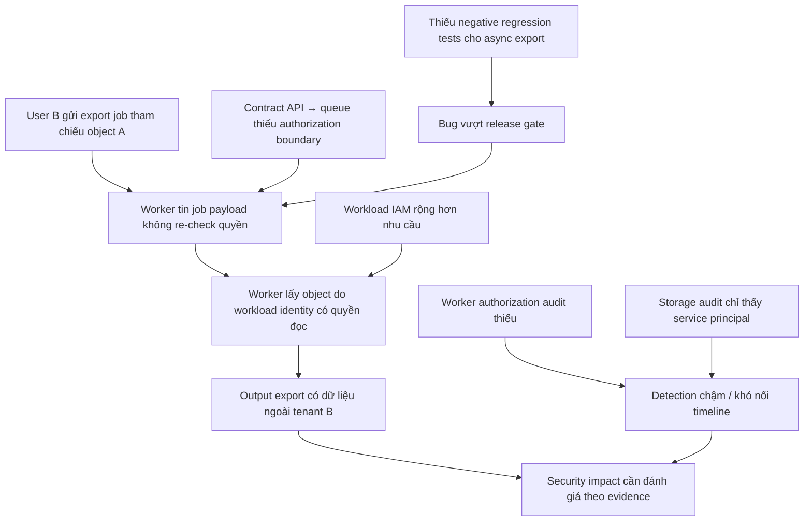
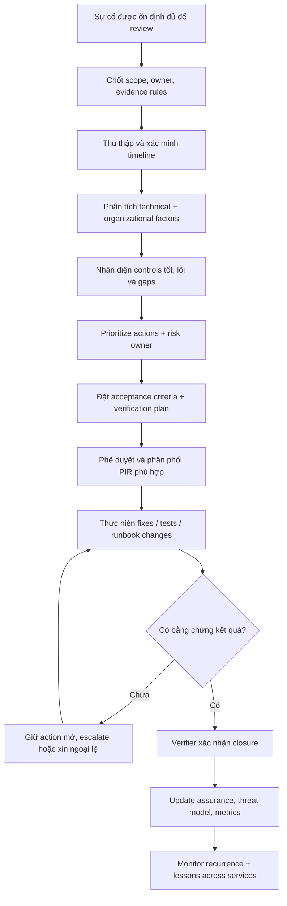
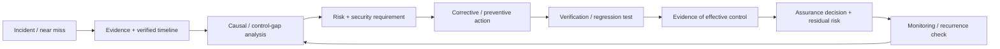

# Lessons learned

Một nền tảng SaaS quản lý tài liệu cho nhiều tenant gặp sự cố: một tài khoản hợp lệ của tenant B kích hoạt chức năng export và nhận được đường dẫn tải file chứa dữ liệu thử nghiệm thuộc tenant A. Đội ứng cứu nhanh chóng chặn luồng export có lỗi, thu hồi các liên kết tải còn hiệu lực, kiểm tra phạm vi ảnh hưởng, sửa kiểm tra quyền ở worker và triển khai bản sửa. Dịch vụ đã khôi phục, khách hàng bị ảnh hưởng được xử lý theo quy trình thông báo áp dụng, và sự cố được đánh dấu “resolved”.

Hai tuần sau, một nhóm khác phát hiện cùng lớp lỗi ở luồng gửi tài liệu qua email. Bản sửa ban đầu chỉ xử lý một endpoint; test hồi quy chưa bao phủ worker khác; các cảnh báo chỉ ghi request ở gateway mà không ghi quyết định phân quyền trong tác vụ bất đồng bộ; và quy trình thiết kế trước đó đã mặc định rằng “API kiểm tra quyền rồi thì worker có thể tin job payload”.

**Sửa được một lỗi không đồng nghĩa tổ chức đã học được từ sự cố.** Nếu kết luận chỉ là “developer cần cẩn thận hơn”, tổ chức khó ngăn lỗi lặp lại. Ngược lại, một quá trình **Lessons learned** có chất lượng phải chỉ ra **điều gì đã xảy ra, vì sao hệ thống và quy trình cho phép nó xảy ra, điều gì giúp/hạn chế khả năng phát hiện và ứng cứu, cần thay đổi control nào, ai chịu trách nhiệm và có bằng chứng gì chứng minh thay đổi đã có hiệu lực**.

**Lessons learned** trong **Incident response** là hoạt động học hỏi có hệ thống từ một sự cố hoặc tình huống gần xảy ra (*near miss*), thông qua thu thập bằng chứng, tái dựng sự kiện, phân tích nguyên nhân/yếu tố góp phần, đánh giá khả năng phòng ngừa–phát hiện–ứng cứu–phục hồi và **chuyển kết luận thành cải tiến được kiểm chứng**. Hoạt động này thường được triển khai bằng *post-incident review (PIR)*, *after-action review (AAR)*, *postmortem* hoặc một quy trình phân tích sau sự cố phù hợp.

Trong module **SECURITY_SECURITY_ASSURANCE**, Lessons learned là mắt xích của assurance liên tục: **incident evidence → failure analysis → security requirement/control gap → corrective/preventive action → regression/operational verification → assurance claim/risk decision → monitoring và tái đánh giá**. Báo cáo hoàn thành chỉ là điểm bắt đầu; giá trị thật xuất hiện khi thay đổi làm giảm khả năng tái diễn hoặc giới hạn tác động và tổ chức có bằng chứng chứng minh.

## 1. Mục tiêu học từ sự cố

Một chương trình Lessons learned tốt nhằm:

1. **Hiểu diễn biến:** xây timeline có căn cứ và phân biệt điều đã biết với điều suy luận.
2. **Giải thích cơ chế thất bại:** xác định đường dẫn và các điều kiện tạo thành sự cố, không dừng ở lỗi đầu tiên được nhìn thấy.
3. **Đánh giá hệ thống kiểm soát:** prevention, detection, containment, response, recovery và communication đã hoạt động hoặc thất bại thế nào.
4. **Ghi nhận điều làm tốt:** quyết định, tool, bằng chứng hay phối hợp nào giúp giảm thiểu thiệt hại.
5. **Xác định cải tiến có trách nhiệm:** hành động cụ thể với owner, ưu tiên, thời hạn và acceptance criteria.
6. **Kiểm chứng hiệu quả cải tiến:** không đóng action chỉ vì ticket hoặc pull request đã hoàn thành.
7. **Cập nhật rủi ro và assurance:** sửa threat model, security requirements, control baseline, test coverage và residual risk.
8. **Chia sẻ kiến thức đúng người:** nâng khả năng phát hiện và phản ứng của các team mà vẫn bảo vệ dữ liệu nhạy cảm.

**Đầu ra không phải một danh sách lời khuyên chung** như “đào tạo thêm”, “viết tài liệu tốt hơn” hay “nhân viên cần lưu ý”. Đầu ra phải dẫn tới cải tiến vận hành/kiến trúc/quy trình đo được.

### 1.1. Khi nào cần làm Lessons learned?

- Sau security incident được xác nhận, dù đã khắc phục hoàn toàn hay chưa.
- Sau near miss: một control khác ngăn được hậu quả, nhưng đường tấn công đáng chú ý đã tồn tại.
- Sau false negative hoặc sự cố phát hiện muộn, kể cả chưa chứng minh có compromise.
- Sau containment/recovery thất bại hoặc kéo dài bất thường.
- Sau tabletop exercise, purple-team exercise, diễn tập backup/restore hoặc incident simulation.
- Sau các thay đổi khẩn cấp làm lộ khoảng trống trong quyền, logging hoặc runbook.
- Khi cùng một loại finding liên tục tái xuất hiện ở nhiều dịch vụ.

Quy mô và hình thức review nên **tương xứng với mức độ nghiêm trọng, ảnh hưởng, độ không chắc chắn và giá trị học hỏi**. Một near miss nhỏ có thể cần review gọn; sự cố liên quan nhiều tenant, quyền quản trị hoặc dữ liệu nhạy cảm thường cần điều tra liên chức năng và kiểm soát bằng chứng chặt hơn.

### 1.2. Không chờ “mọi việc xong” mới lưu chi tiết

Trong lúc sự cố đang diễn ra, nhóm phản ứng nên ghi **decision log**, thời điểm, giả định và những tín hiệu quan sát được, miễn việc ghi không cản trở containment. Nhưng **PIR đầy đủ không được thay thế quá trình ứng cứu**. Khi tình huống còn nguy hiểm, ưu tiên an toàn, containment, bảo toàn chứng cứ và phục hồi theo playbook.

## 2. Phân biệt Lessons learned, PIR, RCA và retrospective

| Khái niệm | Câu hỏi trọng tâm | Đầu ra | Không nên hiểu nhầm |
| --- | --- | --- | --- |
| **Incident response (IR)** | Làm sao phát hiện, kiểm soát và phục hồi an toàn? | Containment, eradication, recovery, communication | Khôi phục không tự giải thích nguyên nhân gốc |
| **Post-incident review (PIR)** | Điều gì đã xảy ra, cái gì hiệu quả/chưa hiệu quả và cần làm gì? | Timeline, findings, actions, ownership | Không chỉ viết “sự cố đã đóng” |
| **Root-cause analysis (RCA)** | Cơ chế và yếu tố nào dẫn tới hậu quả? | Causal model, contributing factors, evidence | Một sự cố không nhất thiết có một “root cause” duy nhất |
| **After-action review (AAR)** | Kỳ vọng gì, thực tế ra sao, khác biệt vì đâu, sẽ cải tiến gì? | Bài học, thay đổi vận hành | Không chỉ áp dụng cho incident thật |
| **Retrospective nhóm** | Quá trình cộng tác, delivery và phối hợp được cải thiện thế nào? | Working agreements, experiments | Không thay thế phân tích security controls và bằng chứng |
| **Lessons learned program** | Làm sao tri thức từ nhiều sự cố trở thành cải tiến có thể kiểm chứng? | Backlog, patterns, control updates, assurance tracking | Không kết thúc khi tài liệu được xuất bản |

Tên gọi có thể khác giữa các tổ chức. Điều quyết định là **độ đầy đủ của nội dung, tính kiểm chứng và việc thực hiện action**, không phải nhãn “RCA” hay “PIR”.

### 2.1. “Root cause là developer quên kiểm tra quyền” có đủ không?

Chưa đủ. Cần hỏi tiếp:

- Vì sao worker tin dữ liệu tenant trong message từ queue?
- Business authorization có được quy định bắt buộc tại từng trust boundary không?
- Threat model có bao phủ workflow bất đồng bộ không?
- Review và test có positive/negative cross-tenant controls không?
- Vì sao regression suite không phát hiện?
- Tại sao logging không nối được API request với worker output?
- Incident runbook có biết cách thu hồi link export và vô hiệu hóa job không?
- Tổ chức nào sở hữu cả luồng API→queue→worker→storage?

Đây là các **yếu tố hệ thống**, không phải bằng chứng để đổ lỗi cho một cá nhân.

## 3. Văn hóa không đổ lỗi và trách nhiệm giải trình

**Blameless postmortem** không có nghĩa “không ai chịu trách nhiệm” hoặc “mọi hành vi đều được bỏ qua”. Nó là phương pháp điều tra giả định rằng người tham gia đã ra quyết định dựa trên **thông tin, công cụ, áp lực và giới hạn tồn tại tại thời điểm đó**; mục tiêu là hiểu những điều kiện khiến một lựa chọn có vẻ hợp lý nhưng dẫn tới hệ quả không mong muốn.

### 3.1. Câu hỏi tốt hơn câu hỏi đổ lỗi

| Câu hỏi dễ gây đổ lỗi | Câu hỏi học hỏi tốt hơn |
| --- | --- |
| Ai đã deploy bản lỗi? | Những điều kiện review, test và gate nào cho phép bản build đó được deploy? |
| Tại sao SRE không thấy alert? | Có nguồn log nào bị thiếu, alert routing nào chưa hoạt động và SOC biết gì lúc ấy? |
| Ai quên thu hồi token? | Quy trình containment có liệt kê token/session nào, và có cơ chế xác minh việc thu hồi không? |
| Vì sao developer bỏ qua boundary tenant? | Contract giữa API và worker mô tả authorization ra sao, có test nào bảo vệ contract không? |
| Tại sao người trực không xử lý nhanh? | Người trực nhận tín hiệu nào, có runbook/quyền công cụ/đầu mối nào chưa sẵn sàng? |

### 3.2. Trách nhiệm giải trình và điều tra hành vi

Nếu có dấu hiệu cố tình vi phạm chính sách, lạm dụng quyền hoặc hành vi có thể cần đánh giá nhân sự/pháp lý, tổ chức phải xử lý qua **kênh có thẩm quyền và quy trình thích hợp**. Không dùng buổi PIR kỹ thuật làm diễn đàn buộc tội hoặc công bố thông tin cá nhân. Đồng thời không che giấu một control gap vì sợ ảnh hưởng đánh giá cá nhân.

### 3.3. Ghi nhận quyết định hợp lý trong điều kiện thiếu thông tin

Ví dụ, responder tạm chặn export toàn hệ thống vì chưa xác minh được phạm vi dữ liệu bị ảnh hưởng. Sau review có thể đề xuất khả năng cô lập theo tenant để giảm downtime. Điều đó **không có nghĩa quyết định containment ban đầu là sai**; nó phản ánh hệ thống hiện tại chưa có biện pháp tinh hơn và nhóm chọn phương án hạn chế thiệt hại.

## 4. Khi nào bắt đầu và kết thúc review?

Một mô hình thực tế có ba thời điểm:

1. **Trong sự cố:** capture evidence/decision log tối thiểu; ghi những vấn đề cần quay lại.
2. **Sau ổn định:** tổng hợp timeline, phỏng vấn người liên quan, kiểm tra nguồn dữ liệu và tổ chức PIR.
3. **Sau PIR:** thực hiện, kiểm chứng, theo dõi các actions và đánh giá lại các security claims.

Không có lịch bắt buộc dùng chung cho mọi tổ chức. Cần xác định thời hạn theo chính sách nội bộ, mức độ nghiêm trọng, nghĩa vụ thông báo, khả năng có dữ liệu và khối lượng điều tra. Review quá sớm có thể thiếu bằng chứng; quá muộn sẽ làm mất ngữ cảnh. Với incident lớn có thể có **bản sơ bộ** và **bản cập nhật** khi forensic hoặc impact assessment hoàn thiện.

### 4.1. Điều kiện có thể mở PIR chính thức

- Nguy cơ đang diễn ra được kiểm soát đủ để không cản ứng cứu.
- Có incident owner và người điều phối review.
- Những bằng chứng dễ mất đã được bảo toàn theo hướng dẫn điều tra.
- Các bên liên quan cần thiết đã được xác định.
- Có danh sách thông tin chưa biết và kênh bổ sung khi có kết quả mới.
- Có quy tắc bảo mật, quyền truy cập và phê duyệt phân phối báo cáo.

**Không cần giả định mọi câu hỏi đều đã có lời giải**. PIR vẫn có thể nêu `UNKNOWN` hoặc `INCONCLUSIVE` cùng kế hoạch tìm thêm evidence.

## 5. Thiết lập phạm vi, vai trò và quyền truy cập

### 5.1. Xác định incident scope

Một PIR nên ghi:
- Incident ID, owner, severity và trạng thái theo hệ thống quản lý sự cố.
- Môi trường, regions/accounts/clusters/workloads bị tác động.
- Tenant/customer groups hoặc data classification liên quan, theo mức tiết lộ được phép.
- Thời gian bắt đầu được suy đoán/quan sát, thời gian phát hiện, containment và recovery.
- Những control domains liên quan: IAM, application authz, network, logging, backup, CI/CD.
- Những phần chưa kiểm chứng (asset out-of-scope, thiếu log, data retention limits).
- Nguồn và trạng thái bằng chứng, ví dụ audit logs/forensics được bảo vệ.
- Phiên bản release/config đã chạy lúc incident và bản fix.

### 5.2. RACI thu gọn

| Vai trò | Trách nhiệm |
| --- | --- |
| **Incident commander / IR lead** | Đảm bảo hoạt động response đã ghi nhận và trạng thái ổn định |
| **PIR facilitator** | Dẫn dắt thảo luận, giữ ngôn ngữ không đổ lỗi, kiểm chứng action |
| **Security investigator / SOC** | Timeline detection, evidence integrity, hypotheses |
| **Service owner / developer** | Giải thích logic và data flow, root conditions, regression plan |
| **Platform/SRE** | Deployment, IAM/network, logs, rollback/recovery, SLO |
| **Data/privacy/legal owner** | Đánh giá dữ liệu, nghĩa vụ thông báo, retention và bảo mật |
| **Risk owner** | Ưu tiên/chấp nhận residual risk theo thẩm quyền |
| **Action owner** | Thực hiện và cung cấp bằng chứng hoàn thành cải tiến |
| **Assurance reviewer** | Xác minh claim–evidence và closure criteria |

Người điều phối không nhất thiết là người trực tiếp debug sự cố. Với tình huống nhạy cảm, một facilitator trung lập giúp người tham gia chia sẻ đầy đủ mà không biến cuộc họp thành tranh luận về lỗi cá nhân.

### 5.3. Không mở rộng quyền chỉ vì đang viết PIR

Người viết báo cáo không được tự đọc tài liệu tenant, raw credentials, private keys hay dữ liệu khách hàng ngoài quyền. Kênh pháp chứng/IR có thể có thẩm quyền xử lý riêng; PIR nên dùng **evidence đã được phép, đã giảm nhạy cảm** hoặc tham chiếu tới kho được quản trị quyền.

## 6. Bảo toàn bằng chứng và độ tin cậy của nguồn

Một review chất lượng cần phân biệt **sự kiện đã được quan sát**, **lời kể của người tham gia** và **giả thuyết chưa xác minh**.

### 6.1. Các nguồn thường sử dụng

- Cloud control-plane audit, IAM/IdP logs và hoạt động break-glass.
- API gateway/access logs, application authorization events.
- Queue/worker audit, job lifecycle, object storage data-access logs.
- Network flow, DNS, WAF/proxy và egress telemetry khi liên quan.
- Alert/detection timeline, case/incident management records.
- CI/CD deployments, artifact digests, infrastructure changes.
- Configuration/IaC snapshots tại các thời điểm liên quan.
- Ticket, change approvals, chat/bridge decision log trong phạm vi cho phép.
- Backup/restore result, containment commands và recovery validation.
- Phỏng vấn responder, developer, product owner và data owner.
- External provider notices, nếu có nguồn đáng tin và được phép sử dụng.

### 6.2. Đánh dấu chất lượng bằng chứng

| Mức | Ý nghĩa | Cách viết |
| --- | --- | --- |
| **Observed / verified** | Có sự kiện hoặc phép kiểm chứng cụ thể hỗ trợ | “Audit event EV-07 ghi role change lúc…” |
| **Corroborated** | Nhiều nguồn độc lập phù hợp | “CI log và cloud audit cùng xác nhận…” |
| **Reported** | Người tham gia nhớ lại, chưa đối chiếu | “Người trực nhớ rằng alert xuất hiện trước…” |
| **Inferred** | Suy luận hợp lý từ tập chứng cứ | “Có khả năng job đã sử dụng quyền worker…” |
| **Unknown** | Thiếu bằng chứng hoặc không thể kết luận | “Chưa xác định số object thực sự được tải…” |
| **Contradictory** | Nguồn chưa thống nhất | “Gateway log và worker record lệch thời gian…” |

Không nên dùng câu “không thấy event” để kết luận “không có hành động” khi chưa chứng minh nguồn log được bật, có coverage và retention trong khoảng điều tra.

### 6.3. Chain of custody và bản gốc

Với incident có khả năng cần forensic, tranh chấp hoặc audit, cần lưu thông tin về **ai thu thập, khi nào, từ đâu, cách bảo toàn tính toàn vẹn, ai truy cập/chuyển giao và có xử lý/redact gì**. Hash, immutable storage, audit access hoặc quy trình chain-of-custody có thể phù hợp tùy mức rủi ro và nghĩa vụ.

Báo cáo Lessons learned không nên sao chép toàn bộ raw evidence. Hãy lưu **evidence references** đến kho an toàn, phân quyền đúng và bảo vệ dữ liệu nhạy cảm.

### 6.4. Giới hạn retention và độ trễ

Một nguồn log có thể bị xoay vòng, lấy mẫu, đến muộn hoặc hết hạn trong lúc incident vẫn mở. Hãy ghi khoảng trống quan sát như một **finding về khả năng điều tra**. Không khôi phục bằng cách tự suy đoán dữ liệu chưa có.

## 7. Dựng timeline dựa trên sự kiện và nhận thức

Timeline là trục xương sống của PIR. Để tránh đánh giá hậu nghiệm, nên có hai lớp:

- **Technical/event timeline:** những hành động hệ thống thực sự xảy ra theo nguồn bằng chứng.
- **Human/decision timeline:** lúc đội biết điều gì, tin điều gì và quyết định gì tại thời điểm đó.

Một hành động lúc 10:00 có thể chỉ được phát hiện lúc 11:00. Không được phê phán decision lúc 10:30 dựa trên log mà mọi người chỉ tìm thấy lúc 11:15.

### 7.1. Ví dụ timeline giả lập

| Thời gian UTC | Technical event | Lúc đó team biết gì? | Evidence/confidence |
| --- | --- | --- | --- |
| 09:00 | Release `r42` đưa worker mới vào production | Deploy báo healthy | CI/deploy log, verified |
| 09:17 | User B tạo export job với object thuộc A | Chưa có alert từ worker | API/job log, corroborated |
| 09:18 | Worker đọc object qua service identity | SOC chưa nối được job với object access | Storage audit + worker ref, inferred/verified theo từng trường |
| 09:23 | Đường dẫn export được tạo | Không có cảnh báo cross-tenant | Output metadata, verified |
| 09:35 | Support nhận phản ánh có tài liệu không đúng | Support chuyển ticket bảo mật | Support ticket, verified |
| 09:42 | SOC mở incident, xác định cần kiểm tra export | Chưa biết tenant scope | Case log, verified |
| 09:50 | Tạm dừng tạo export jobs | Đã thấy đường ảnh hưởng chính | Change/operations log |
| 10:05 | Thu hồi test/download links theo cơ chế hiện có | Chưa biết mọi link cũ đã hết hiệu lực? | Revocation check, cần xác minh |
| 11:10 | Xác nhận lỗi worker tin job payload không có re-authorization | Đã có reproduction trên test tenants | Regression test + code review |
| 13:30 | Patch/rollback được triển khai | Cần xác nhận cả API và worker | Deployment ref + smoke test |
| 15:00 | Negative tests trên test A/B đạt, log và recovery được xác minh phần trong scope | Hành vi trong test đã đúng | Test run, verified |
| Ngày kế tiếp | Impact analysis hoàn thiện theo bằng chứng sẵn có | Residual uncertainty được công bố | Impact report, có giới hạn |

Toàn bộ mốc trên là **ví dụ học thuật**, không mô tả incident có thật. Với sự cố thực tế phải ghi ngày/tháng/năm, timezone, nguồn dữ liệu, precision và những khoảng không chắc chắn.

### 7.2. Phân biệt các mốc quan trọng

- **First known occurrence:** thời điểm sớm nhất có chứng cứ; chưa chắc là lúc lỗi bắt đầu tồn tại.
- **Detection:** khi một hệ thống hoặc con người nhận được tín hiệu nhận diện.
- **Acknowledgment:** khi người trực tiếp nhận và phản hồi.
- **Triage start:** khi có người bắt đầu xác minh.
- **Containment start/effective:** khi bắt đầu biện pháp và khi nó thực sự chặn được đường ảnh hưởng.
- **Eradication/remediation:** loại bỏ nguyên nhân đang hoạt động hoặc sửa control.
- **Service recovery:** dịch vụ hoạt động trở lại theo tiêu chí.
- **Security verification:** điều kiện bảo mật được kiểm chứng sau recovery.
- **Closure/PIR action closure:** quyết định đóng incident và đóng các cải tiến có bằng chứng; có thể khác ngày.

Đừng dùng một mốc “resolved_at” để thay thế toàn bộ vòng ứng cứu.

### 7.3. Event time, ingestion time và clock skew

Log từ cloud API, application, queue và worker có thể dùng timestamp khác nhau. Để dựng thứ tự chính xác:
1. Dùng UTC và nêu nguồn thời gian.
2. Phân biệt event-time với lúc SIEM/collector ingest.
3. Kiểm tra clock skew hoặc sai timezone.
4. Xem các thao tác async/retry có thể đến sai thứ tự.
5. Ghi confidence khi không chứng minh được quan hệ nhân quả.
6. Không dùng một correlation ID do client tùy ý cung cấp làm bằng chứng identity nếu chưa được ràng buộc tại trust boundary.

## 8. Tạo bản đồ nguyên nhân và yếu tố góp phần

Một sự cố bảo mật thường có **nhiều lớp nguyên nhân**. Thay vì chỉ hỏi “dòng code nào lỗi?”, phân tích cần liên kết:

- **Triggering event:** điều kiện kích hoạt hậu quả.
- **Technical mechanism:** vì sao hành động có thể vượt policy.
- **Preventive control gap:** vì sao control không chặn.
- **Detection gap:** vì sao tín hiệu không phát hiện sớm.
- **Response/recovery gap:** vì sao containment hoặc restore gặp khó.
- **Organizational/process factor:** thiếu ownership, contract, review, runbook hoặc deadline.
- **Systemic factor:** cấu trúc nền tảng hoặc incentive khiến cùng lỗi có thể lặp ở nhiều nơi.

### 8.1. Causal graph của incident SaaS



Các mũi tên biểu diễn **giả thuyết nhân quả cần kiểm tra**, không được khẳng định mọi yếu tố chắc chắn đúng trước khi có chứng cứ. Ví dụ IAM có thể chỉ là **yếu tố mở rộng blast radius**, không phải nguyên nhân cho phép worker bypass business authorization.

### 8.2. 5 Whys: dùng để khám phá, không dùng thay bằng chứng

Ví dụ:
1. Vì sao export chứa object của tenant khác? Worker không kiểm tra owner/authorization tại thời điểm xử lý.
2. Vì sao worker không kiểm tra? Contract message mang object ID nhưng không yêu cầu authorization context đáng tin và re-check.
3. Vì sao contract thiếu? Thiết kế coi API là điểm kiểm soát quyền duy nhất.
4. Vì sao giả định không bị phát hiện? Threat modeling và security review chưa bao phủ queue/worker boundary.
5. Vì sao review bỏ sót? Ownership của luồng end-to-end và checklist cross-service authorization chưa rõ.

**Không có gì bảo đảm đúng năm câu hỏi hoặc một chuỗi tuyến tính phản ánh toàn bộ nguyên nhân.** Khi có nhánh song song — ví dụ CI test coverage, secret/IAM scope hoặc logging — phải phân tích từng nhánh bằng evidence. Tránh “5 Whys” kiểu cuối cùng chỉ dẫn về “con người không cẩn thận”.

### 8.3. Fault tree và bow-tie

Với incident lớn, có thể mô hình hóa:
- **Fault tree:** những tập điều kiện nào cùng đủ để tạo outcome?
- **Bow-tie:** threat và các biện pháp ngăn sự kiện ở phía trước; các biện pháp giảm tác động ở phía sau.
- **Causal/learning review:** mối quan hệ giữa thiết kế, công cụ, tín hiệu, trách nhiệm và quyết định.

Mô hình có ích nếu giúp đưa ra hành động cụ thể; không cần sử dụng tất cả công cụ phân tích cho mọi incident.

## 9. Phân loại findings từ Lessons learned

PIR cần phân biệt **lỗ hổng kỹ thuật**, **failure trong detection**, **response process gap** và **điểm yếu hệ thống**.

| Nhóm | Ví dụ | Hành động điển hình |
| --- | --- | --- |
| **Preventive control failure** | Worker không kiểm tra quyền với object | Sửa authorization contract, review boundary |
| **Blast-radius limitation gap** | Worker IAM đọc mọi bucket | Tách workload identity, thu hẹp resource policy |
| **Detection gap** | Không có event authorization ở worker | Structured audit event + canary + correlation rule |
| **Data/source gap** | Cloud data-access logs chỉ bật một region | Asset inventory và logging coverage test |
| **Response gap** | Không có lệnh tắt export theo tenant | Feature kill switch / granular containment |
| **Recovery gap** | Rollback không tự phục hồi queue state | Recovery drill và idempotent workflow |
| **Communications gap** | Support không biết kênh security escalation | Intake runbook, owner, time-bound escalation |
| **Governance gap** | Ngoại lệ IAM không có expiry | Exception register, expiry control |
| **Testing gap** | Chỉ test synchronous API, bỏ async | End-to-end negative regression suite |
| **Assurance gap** | Báo cáo trước release dựa vào PR merge | Effective-state verification và claim limits |

Không gộp mọi finding thành “security bug”. Mỗi nhóm có owner, cách kiểm tra, mức ưu tiên và thời gian xử lý khác nhau.

### 9.1. Phân loại các kiểm soát

- **Prevent:** chặn đường truy cập trái phép hoặc biến đổi nguy hiểm trước khi có hậu quả.
- **Detect:** quan sát và phát cảnh báo có thời gian/mức bao phủ xác định.
- **Respond/contain:** cô lập nguồn, khóa quyền, dừng tác vụ, thu hồi token/link.
- **Recover:** đưa dịch vụ/dữ liệu về trạng thái an toàn có thể kiểm chứng.
- **Assure:** thu bằng chứng, đối chiếu requirement và bảo đảm quyết định có căn cứ.

Một action “thêm alert” **không thay thế** action sửa lỗi authorization. Một action “viết test” không tự thay thế thay đổi code/runtime control đã thất bại.

## 10. Phân biệt điều đã làm tốt và điều cần cải thiện

Lessons learned không chỉ là bảng lỗi. Những **điều hoạt động hiệu quả** cần được ghi với bằng chứng để duy trì khả năng này.

Ví dụ:
- Support nhận diện bất thường và chuyển đúng kênh security.
- SOC đã sẵn sàng incident commander và decision log.
- Feature flag cho phép tạm dừng export mà không tắt toàn bộ API.
- Test tenants A/B giúp xác minh lỗi mà không truy cập thêm dữ liệu khách hàng.
- Deployment by digest cho phép xác minh chính xác bản khắc phục.
- Cloud audit archive độc lập còn đầy đủ dù logging ứng dụng bị thiếu.
- Kênh backup/on-call còn hoạt động khi một tool chính bị lỗi.

Đồng thời phải hỏi **điều tốt có phụ thuộc vào một cá nhân may mắn đang trực hay không**. Nếu phụ thuộc, có thể cần runbook, diễn tập hoặc cơ chế phân phối quyền.

### 10.1. “Làm tốt” cũng cần câu hỏi kiểm chứng

Nếu phản hồi nhanh vì một kỹ sư duy nhất biết lệnh thu hồi link export, đó là một lần response thành công nhưng cũng cho thấy **single-person dependency**. Kết luận tốt là: giữ phương án containment hiệu quả, chuẩn hóa công cụ, permissions và runbook để nhiều người được phép có thể thực hiện.

## 11. Detection và triage: đánh giá khoảng trống quan sát

### 11.1. Những câu hỏi review

1. Dấu hiệu đầu tiên của incident đến từ alert, customer, support hay test?
2. Hành vi nào lẽ ra phải sinh audit event mà không có?
3. Log source có bật ở đúng environment/account/region?
4. Event có được gửi, parse, retained và searchable?
5. Rule correlation nào nên ghép API request, job ID, worker và storage?
6. Alert có đủ bối cảnh để analyst phân biệt false positive?
7. Độ trễ phát hiện gồm event production lag, ingestion, alert routing, acknowledgment hay triage?
8. Những suppressions hoặc thresholds nào đã che sự kiện?
9. SOC có quyền xem evidence cần thiết mà không vi phạm privacy?
10. Nếu nguồn log bị mất, có cảnh báo **pipeline unhealthy** hay không?

### 11.2. Một ví dụ detection improvement

Trước incident, storage audit chỉ ghi `worker-role read object`, không gắn trực tiếp user cuối. Sau incident:
- API ghi event `export.requested` với authenticated user, tenant và job ID.
- Worker ghi `export.authorized/denied` dựa trên quyền được xác minh tại execution time.
- Object access được liên kết với job ID trong context được phép.
- SIEM rule báo khi job truy cập object ngoài allowed scope, kèm source health.
- Regression test tạo test job trái tenant rồi xác minh event tới alert.

Không ghi access token hoặc toàn bộ document body để “dễ correlation”. Sử dụng references tối thiểu và schema có version.

### 11.3. Detection gap khác absence of attack

Nếu pipeline bị thiếu trong 30 phút, có thể ghi **coverage gap**. Không được ghi “không có truy cập bất thường trong 30 phút” chỉ vì query trả rỗng.

## 12. Containment, eradication và recovery: review decision quality

### 12.1. Containment

Hỏi:
- Có kill switch/tính năng cô lập theo service, tenant, account hoặc principal?
- Ai có thẩm quyền kích hoạt?
- Làm sao xác minh containment đã có hiệu lực trên API, queue, worker, storage và cache?
- Có background jobs hoặc retry tiếp tục chạy sau khi chặn API?
- Một temporary security rule mở trong incident đã được thu hồi chưa?
- Những biện pháp containment có gây data loss, outage hoặc phá evidence không?

**Dừng request mới không bảo đảm queue đang có đã dừng.** Review cần kiểm tra luồng bất đồng bộ và side effects.

### 12.2. Eradication/remediation

Một bản sửa cần loại bỏ **cơ chế lỗi**:
- Không chỉ chặn một object ID mà sửa check authorization cho mọi object relevant.
- Không chỉ chặn ở API mà kiểm tra tại worker/trust boundary phù hợp.
- Không chỉ thu hồi một token mà xem xét quyền và vòng đời secret.
- Không chỉ thêm log mà sửa pipeline/alert delivery.
- Không chỉ reset configuration mà thêm drift detection/guardrail.

### 12.3. Recovery và điều kiện kết thúc

Recovery không chỉ là service health `HTTP 200`. Có thể cần:
- Positive tests cho nghiệp vụ hợp lệ.
- Negative tests cho đường bị khai thác.
- Kiểm tra data consistency, queue replay/idempotency.
- Thu hồi link/token/keys theo scope.
- Audit và detector hoạt động lại.
- Backup/restore hoặc DR checks nếu incident ảnh hưởng dữ liệu.
- Xác nhận version và config đang chạy đúng bản đã kiểm thử.
- Giám sát tái diễn và runbook tăng cảnh giác trong giai đoạn sau recovery.

Khi incident ảnh hưởng dữ liệu hoặc khả năng cung cấp dịch vụ, PIR nên đối chiếu mục tiêu **RTO (Recovery Time Objective)** — khoảng thời gian khôi phục mục tiêu — và **RPO (Recovery Point Objective)** — mức mất dữ liệu theo thời gian có thể chấp nhận — với kết quả thực tế và evidence của restore. RTO/RPO là mục tiêu được doanh nghiệp phê duyệt, **không tự suy ra từ thời điểm đóng incident** hoặc việc một lần backup báo thành công. Nếu phục hồi đạt availability nhưng làm lộ dữ liệu, mất audit hoặc khôi phục quyền sai, cần ghi riêng các security recovery gaps.

## 13. Hành động khắc phục và phòng ngừa: ưu tiên hiệu quả

Một lesson chỉ trở thành thay đổi khi có **action item cụ thể**, owner, ưu tiên, thời hạn và cách kiểm chứng.

### 13.1. Phân biệt hành động

| Loại | Ý nghĩa | Ví dụ |
| --- | --- | --- |
| **Immediate containment** | Giảm ảnh hưởng đang diễn ra | Tạm dừng export theo tenant |
| **Corrective action** | Sửa điều kiện gây sự cố đã biết | Re-authorization ở worker |
| **Preventive action** | Giảm khả năng lớp lỗi xuất hiện nơi khác | Contract library và design-review checklist |
| **Detective improvement** | Phát hiện sớm hơn hoặc rõ hơn | Worker authz event và correlation rule |
| **Recovery improvement** | Khôi phục an toàn, hạn chế downtime | Job cancellation và replay runbook |
| **Assurance improvement** | Chứng minh controls có hiệu lực | End-to-end cross-tenant regression + evidence |
| **Governance improvement** | Khắc phục ranh giới trách nhiệm | Flow owner và exception expiry |

### 13.2. Tiêu chí SMART và security acceptance

Một action tốt nên:
- **Specific:** thay đổi cụ thể ở control nào, asset nào?
- **Measurable:** điều kiện pass/fail và bằng chứng?
- **Achievable:** có owner, dependencies, năng lực thực hiện?
- **Relevant:** trực tiếp giảm rủi ro/hậu quả nào?
- **Time-bound:** có mốc, cơ chế escalation và follow-up?

Không đóng action theo tiêu chí “tạo ticket” hoặc “PR merged” nếu mục tiêu là khắc phục trạng thái production.

### 13.3. So sánh action yếu và action mạnh

| Action yếu | Vì sao yếu | Action tốt hơn |
| --- | --- | --- |
| “Developer cẩn thận hơn” | Không xác định control hoặc test | Bắt buộc authz decision ở worker, có integration test |
| “Nâng chất lượng logging” | Không có event/schema hoặc scope | Ghi worker authorization event có job ID và actor; test SIEM |
| “Đào tạo thêm về tenant isolation” | Khó đánh giá hiệu quả nếu đứng riêng | Cập nhật threat model template, review contract, negative tests; đào tạo bổ trợ |
| “Tăng giám sát” | Không biết alert nào hoặc response path | Rule cụ thể, owner, test canary và SOC runbook |
| “Tạo backup” | Có backup chưa chắc restore được | Restore drill trong scope, đo integrity/RTO |
| “Đóng lỗi khi fix merged” | Không chứng minh runtime đã thay | Verify artifact digest và regression test môi trường đích |
| “Sửa tất cả services trong tương lai” | Không có phạm vi/lịch | Inventory tất cả async workers + owner, remediation wave và deadlines |

## 14. Prioritization theo rủi ro và blast radius

Không nên đặt hàng chục action có cùng mức ưu tiên mà không xét tác động. Có thể đánh giá:
- Mức độ ảnh hưởng confidentiality, integrity, availability.
- Đường tấn công còn hoạt động, exposure và exploitable conditions.
- Độ nhạy cảm dữ liệu và số tenant/system có thể ảnh hưởng.
- Khả năng phát hiện hiện tại và thời gian phản ứng.
- Độ tin cậy evidence về nguyên nhân.
- Khả năng lặp lại ở các services cùng pattern.
- Tốc độ triển khai/độ khó sửa và dependencies.
- Khả năng gây gián đoạn bởi remediation.
- Nghĩa vụ pháp lý/hợp đồng hoặc yêu cầu bắt buộc trong scope.

### 14.1. Fix trực tiếp không phải lúc nào đủ

Ví dụ, sửa quyền worker ở một service có thể nhanh và cần ưu tiên, nhưng nếu nhiều workers dùng shared library hoặc shared message contract, action phòng ngừa lâu dài phải xử lý **class of vulnerability**. Có thể chia:
1. Contain risk hiện tại.
2. Fix path được xác nhận.
3. Audit sibling paths và shared components.
4. Thêm preventive controls ở design/CI.
5. Test/monitor để phát hiện tái diễn.

### 14.2. Risk acceptance phải rõ ràng

Nếu action bị trì hoãn vì không tương thích hoặc thiếu khả năng vendor, rủi ro còn lại cần được người có thẩm quyền đánh giá, có control bù, expiry/review trigger và phân biệt `ACCEPTED_RISK` với `VERIFIED_FIXED`. Không chuyển mọi action khó thành “không còn phù hợp” chỉ để làm đẹp dashboard.

## 15. Action register: mỗi bài học có owner và evidence

### 15.1. Action table minh họa

| Action ID | Hành động | Owner | Ưu tiên | Tiêu chí hoàn thành |
| --- | --- | --- | --- | --- |
| `IR-L01` | Worker re-authorize object access ở execution time | Backend owner | Critical | Negative A/B test, artifact/config readback |
| `IR-L02` | Thu hẹp worker cloud/storage IAM | Platform/IAM owner | High | Effective policy + allowed/denied access tests |
| `IR-L03` | Tạo cross-tenant tests cho mọi async export paths | AppSec/QA | High | Test inventory, CI gate và coverage review |
| `IR-L04` | Worker audit event và correlation rule | SOC + Backend | High | Synthetic event tới SIEM + alert routing |
| `IR-L05` | Kill switch theo tenant và job cancellation | SRE + Backend | High | Controlled drill, no orphan jobs |
| `IR-L06` | Cập nhật trust-boundary threat model | Security architect | Medium | Design review và approval |
| `IR-L07` | Tổ chức tabletop về async data incident | IR lead | Medium | Exercise report và cải tiến runbook |
| `IR-L08` | Tìm cùng anti-pattern ở sibling services | Platform/Service owners | High | Scope inventory, findings + retest |
| `IR-L09` | Cập nhật logging health monitoring | Observability owner | Medium | Canary và source-health alert |
| `IR-L10` | Review bằng chứng sau deploy trước closure | Assurance owner | High | Closure policy, reviewer sign-off |

Priority ở đây **minh họa**, cần phân loại dựa trên rủi ro thực tế, mức độ ảnh hưởng và khả năng triển khai. Đừng gán deadline giả định như một chuẩn bắt buộc cho mọi sự cố.

### 15.2. Mỗi action phải có một người chịu trách nhiệm cuối

Có thể có nhiều team thực hiện, nhưng cần **một accountable owner** để theo dõi tiến độ. Các dependencies như thay authz contract, rollout worker, SIEM parser và test fixtures cần được ghi để không báo action “đúng hạn” trong khi chưa thể triển khai.

### 15.3. Exit criteria đủ mạnh

Với `IR-L01`, một điều kiện đóng phù hợp:
1. Worker kiểm tra authorization theo **nguồn dữ liệu đáng tin** tại execution boundary.
2. Positive export cho owner hợp lệ thành công.
3. Negative export cho user khác tenant bị từ chối.
4. Không xuất output trái quyền kể cả khi job được retry.
5. Runtime artifact digest/config khớp bản được test.
6. Findings liên quan đã retest theo phiên bản và môi trường.
7. Reviewer có quyền xác nhận evidence và residual limitations.

Các điều kiện này phải gắn vào tracker; không được thay bằng “đã code xong”.

## 16. Mẫu dữ liệu Lessons learned có cấu trúc

Mẫu YAML sau là **hồ sơ giảng dạy**, không phải schema chính thức của một hệ thống quản lý incident. Những placeholder phải thay bằng tham chiếu tới evidence thật được phân quyền.

```yaml
incident_lessons_learned:
  incident_id: "INC-<identifier>"
  review_id: "PIR-<identifier>"
  service: "SECURITY_SECURITY_ASSURANCE"
  review_version: "1.0"
  status: "<draft|reviewed|actions-in-progress|closed>"
  confidentiality: "<internal-restricted>"
  owner: "<incident-or-security-owner>"

  incident_scope:
    environments: ["production"]
    assets: ["document-api", "export-worker", "object-storage"]
    tenant_scope_ref: "<protected-impact-assessment>"
    detected_at: "<UTC-timestamp>"
    contained_at: "<UTC-timestamp>"
    recovered_at: "<UTC-timestamp>"
    affected_release_digest: "<artifact-digest>"
    known_unknowns: ["<uncertain-claim>"]

  evidence:
    timeline_ref: "<verified-timeline>"
    original_log_archive_ref: "<restricted-evidence-vault>"
    custody_or_integrity_ref: "<preservation-record>"
    decision_log_ref: "<incident-command-log>"
    confidence_notes: "<what-is-inferred-vs-observed>"

  analysis:
    triggering_events: ["<event-ref>"]
    technical_mechanisms: ["<finding-id>"]
    contributing_factors: ["<control-or-process-gap>"]
    successful_controls: ["<control-and-evidence-ref>"]
    failed_or_missing_controls: ["<gap-and-evidence-ref>"]
    detection_gap_ref: "<source-rule-pipeline-assessment>"
    response_gap_ref: "<containment-review>"
    recovery_gap_ref: "<recovery-review>"
    affected_requirements: ["SR-AUTH-01", "SR-LOG-02"]

  actions:
    - id: "IR-L01"
      type: "corrective"
      owner: "<backend-owner>"
      risk_ref: "<risk-id>"
      description: "Re-authorize objects in export worker"
      due_at: "<approved-UTC-date>"
      status: "<open|in-progress|deployed|verified|accepted-risk>"
      acceptance_criteria:
        - "Positive tenant export succeeds"
        - "Cross-tenant export is denied with no unauthorized output"
        - "Runtime digest matches retested artifact"
      change_ref: "<reviewed-commit-or-change>"
      test_evidence_ref: "<retest-run>"
      verified_by: "<authorized-reviewer>"
      verified_at: "<UTC-timestamp>"

  assurance:
    updated_threat_model_ref: "<threat-model-version>"
    updated_control_baseline_ref: "<policy-version>"
    regression_suite_ref: "<ci-test-suite>"
    residual_risks: ["<risk-id>"]
    supported_claims: ["CLM-IR-LL-01"]
    limitations: ["<evidence-gap-or-out-of-scope>"]

  follow_up:
    next_review_at: "<date-or-trigger>"
    action_register_ref: "<tracker>"
    recurrence_monitor_ref: "<detection-or-metric>"
    review_approved_by: "<authorized-approver>"
```

**Không lưu raw credentials, dữ liệu khách hàng hoặc thông tin pháp chứng nhạy cảm trực tiếp trong YAML**. Dùng tham chiếu vào kho bảo mật và quyền phù hợp. `status: closed` trong hồ sơ review không đồng nghĩa mọi action luôn đã xong; nếu tổ chức cho phép tách đóng PIR và đóng action, phải thể hiện rõ trạng thái từng action.

## 17. Quy trình PIR từ đầu đến cuối



### Bước 1 — Chuẩn bị

- Xác định review scope, confidentiality và người điều phối.
- Đánh dấu những hạng mục cần xử lý gấp trước họp.
- Thu decision log, event references và release/config context.
- Phân phối trước agenda và những câu hỏi mở.
- Xác nhận người tham gia có quyền xem thông tin được chia sẻ.

### Bước 2 — Dựng timeline

- Đặt từng mốc theo bằng chứng và timestamp.
- Đánh dấu time source, UTC và clock uncertainty.
- Phân biệt sự kiện hệ thống, nhận thức của responder, quyết định.
- Chỉ ra nơi timeline có khoảng trống do logging/sampling/retention.

### Bước 3 — Phân tích

- Đi qua threat path và control boundaries.
- Hỏi vì sao prevention/detection/containment/recovery có hoặc không hoạt động.
- Xem những yếu tố thuộc people/process/tool/architecture/context.
- Kiểm tra xem phát hiện có lặp ở sibling services hay không.

### Bước 4 — Lựa chọn cải tiến

- Tách containment đã thực hiện khỏi permanent fix.
- Đánh giá ưu tiên và blast radius.
- Chỉ định action owner và verifier, dependencies, deadline.
- Viết acceptance criteria trước khi triển khai.

### Bước 5 — Phê duyệt và chia sẻ

- Security/IR, service owner và risk owner kiểm tra tính chính xác.
- Legal/privacy/compliance review khi dữ liệu hoặc nghĩa vụ yêu cầu.
- Công bố bản phù hợp từng audience, không đưa evidence nhạy cảm vào tài liệu rộng.
- Lưu phiên bản chính thức và lịch sử chỉnh sửa khi kết luận mới xuất hiện.

### Bước 6 — Theo dõi đến khi chứng minh

- Owner thực hiện fix/guardrail/test.
- CI/CD hoặc môi trường được cấp phép chạy regression.
- Verifier đọc effective-state evidence, không chỉ ticket status.
- Cập nhật finding, risk register và assurance case.
- Thiết lập alert/metric phát hiện tái diễn hoặc control drift.

## 18. Tổ chức một buổi PIR hiệu quả

Một buổi review cần điều phối để người tham gia **được phép đưa ra thông tin bất lợi**, không bị đẩy vào tranh cãi hoặc phán xét.

### 18.1. Agenda mẫu

| Phần | Nội dung |
| --- | --- |
| Mục tiêu và phạm vi | Nêu giới hạn thông tin, cách làm không đổ lỗi |
| Tóm tắt incident | Ảnh hưởng, trạng thái, known unknowns |
| Timeline | Điều đã xảy ra so với điều nhóm biết ở thời điểm đó |
| What worked | Controls, quyết định và phối hợp giúp giảm tác động |
| What didn't work | Preventive, detective, response, recovery gaps |
| Causal hypotheses | Đánh giá bằng evidence, không suy diễn cá nhân |
| Counterfactuals | Nếu control X hoạt động, outcome có khác không? |
| Action drafting | Specific, owner, risk, due, evidence, priority |
| Assurance & follow-up | Các claim nào cần đánh giá lại, ai verify |
| Approval/distribution | Ai duyệt, ai được xem, thông tin nào phải hạn chế |

Thời lượng nên phù hợp độ phức tạp; có thể cần nhiều phiên chuyên đề. Không ép kết luận về root cause khi forensic còn thiếu hoặc người chịu trách nhiệm quan trọng chưa thể tham gia.

### 18.2. Câu hỏi dẫn dắt hữu ích

1. Chúng ta đã kỳ vọng control nào chặn/nhận diện tình huống?
2. Những tín hiệu thực tế có sẵn trước khi team biết sự cố?
3. Những quyết định nào hợp lý với dữ liệu đang có lúc ấy?
4. Điều kiện nào làm tác động nặng hơn hoặc nhẹ đi?
5. Nếu cùng tình huống xảy ra vào cuối tuần hoặc khi provider outage, response có khác không?
6. Có những thành phần dùng chung chứa cùng pattern không?
7. Nếu chỉ sửa bug hiện tại, đường tương tự nào còn tồn tại?
8. Có thể biến bài học này thành policy, test hoặc automation đáng tin không?
9. Hành động nào rủi ro cao đến mức cần evidence trước khi đóng?
10. Làm sao biết cải tiến còn hoạt động sau sáu tháng hoặc sau release tiếp theo?

### 18.3. Giữ riêng sự kiện và đánh giá

Ví dụ câu “SRE chậm trễ vì không quan tâm” là suy đoán động cơ. Viết thành “Alert được gửi lúc 10:05 đến một nhóm không có on-call ở thời điểm đó; incident được acknowledgment lúc 10:42; routing owner và backup contact chưa được cấu hình”. Câu thứ hai có thể kiểm chứng và dẫn tới action.

## 19. Cập nhật threat model và security requirements

Lessons learned phải quay lại thiết kế security assurance. Một sự cố thường hé lộ **giả định threat model trước đó không đúng**.

### 19.1. Ví dụ thay đổi assumption

Trước sự cố:
> API xác thực và phân quyền trước khi tạo export; worker tin mọi job được API gửi.

Sau review:
> Queue là trust boundary riêng; job payload có thể bị giả mạo, cũ, replay, sai quyền hoặc được tạo bởi service/identity khác. Worker phải xác minh các ràng buộc cần thiết tại thời điểm xử lý và không tin tenant/object scope do client tự cung cấp.

### 19.2. Cập nhật security requirement cụ thể

**SR-AUTH-EXPORT-01:** Mỗi job export phải được ràng buộc với request principal/tenant đáng tin và worker kiểm tra quyền trên object tại execution boundary hoặc bằng cơ chế authorization delegation có giới hạn, còn hiệu lực và được thiết kế bảo mật; không xuất nội dung ngoài phạm vi được cấp.

**SR-LOG-EXPORT-02:** Các quyết định cho phép/từ chối export ở API và worker có audit event đủ actor/tenant/job/object refs để liên kết điều tra mà không lưu dữ liệu/secret không cần thiết.

**SR-RECOVERY-03:** Có thể dừng tạo job mới, hủy hoặc cô lập pending jobs, thu hồi output links và kiểm tra tác động trong phạm vi incident theo quy trình được phê duyệt.

**SR-ASSURANCE-04:** CI và release evidence phải bao phủ positive/negative cross-tenant export, retry và async completion; khi thiếu test/evidence phải ghi INCOMPLETE thay vì PASS.

### 19.3. Không thiết kế lại requirement chỉ vì một lần test

Các requirements phải được security architect, product owner và risk owner rà soát theo bối cảnh dữ liệu, quyền và kiến trúc. Một giải pháp phù hợp có thể là worker recheck trực tiếp; ở hệ thống khác có thể dùng capability token ngắn hạn được ký và ràng buộc scope chặt. Dù chọn cách nào cũng cần chứng minh security property chứ không chỉ áp đúng “mẫu fix” của một incident.

## 20. Chuyển Lessons learned thành regression tests

Một nguyên tắc quan trọng là: **nếu có thể tự động kiểm chứng thuộc tính bị phá vỡ, nên tạo test bảo vệ nó trước các thay đổi tiếp theo**.

### 20.1. Từ incident tới test case

| Incident observation | Security invariant | Test |
| --- | --- | --- |
| User B tạo export object của A | Không xuất dữ liệu ngoài tenant khi thiếu quyền | Cross-tenant async export denied |
| Worker tin dữ liệu tenant trong payload | Không tin identity/authorization do client tự khai | Forged/untrusted job fields rejected |
| Retry tạo output ngoài scope | Retry không bypass quyền hay nhân bản output trái phép | Retry/idempotency authorization test |
| Job đã bị thu hồi vẫn xử lý | Revocation được thực thi theo contract | Revoked job cannot produce output |
| API deny nhưng storage có access | Các đường dữ liệu tuân policy end-to-end | API/worker/storage correlation test |
| Logging thiếu worker event | Authorization decision có audit trail | Synthetic denied event tới archive |
| Rollback không dừng pending jobs | Containment xử lý cả async queue | Cancellation/kill-switch drill |

### 20.2. Negative test cần positive control

Nếu user B nhận `404` với `doc-a`, phải biết `doc-a` có thật và user A được phép dùng nó. Nếu queue đang down, job không tạo output có thể do outage, không phải authorization. Test nên dùng **test tenant A/B, test objects, trạng thái tiền điều kiện đã xác minh** và kiểm tra các side effects.

### 20.3. Test kết quả async

Một API trả `202 Accepted` không phải bằng chứng job an toàn. Cần kiểm tra worker outcome, output object, notification, link expiry, retry và idempotency theo threat model. Với dữ liệu thật, không chủ động lấy thêm object ngoài quyền; dùng test fixtures.

### 20.4. Test ở đúng release/config

Retest trên staging build A chỉ chứng minh hành vi trong phạm vi đó. Nếu production dùng image digest B, IAM policy khác hoặc worker version chưa deploy, phải đối chiếu deployment evidence và chạy kiểm tra được phê duyệt ở môi trường đích hoặc ghi giới hạn claim.

## 21. Tích hợp vào CI/CD và release gate

Một PIR phải xác định **vì sao release gate không bắt được control gap** và thêm guardrails phù hợp.

### 21.1. Ví dụ policy sau incident

- Authz requirement cho async workers trở thành mục bắt buộc trong design review.
- Regression suite có positive/negative cross-tenant test.
- Các thay đổi queue/job schema phải kích hoạt security tests.
- IAM permissions của worker có policy-as-code và effective-state verification.
- CI artifacts được gắn digest với test results.
- Detector/worker audit event có schema contract và canary.
- Release pipeline phân biệt `PASS`, `FAIL`, `NOT_RUN`, `INCOMPLETE` và `CONDITIONAL`.
- Ngoại lệ cho blocking security gate cần owner, risk assessment, thời hạn và control bù.

### 21.2. Fail closed có thể cần giới hạn theo risk

Không phải mọi logging regression đều phải chặn mọi release bằng một quy tắc duy nhất; policy phải xét criticality và yêu cầu bắt buộc. Tuy nhiên, **tool error hoặc not run không được tự chuyển thành PASS**. Một release có thể cần review/conditional approval có thẩm quyền thay vì bỏ qua kết quả thiếu.

### 21.3. Sửa nguyên nhân gate bị bypass

Nếu CI test đã tồn tại nhưng được tắt bằng flag do PR tùy ý sửa, chỉ thêm test mới không đủ. Cần xem quyền sửa pipeline, branch protection, owners và audit. Lessons learned phải xem **control có bị bypass không**, không chỉ xem output test.

## 22. Runbook, tabletop và chuẩn bị cho incident tiếp theo

### 22.1. Cập nhật runbook theo hành vi đã học

Runbook mới có thể bao gồm:
- Nhận diện dấu hiệu cross-tenant export.
- Ai có quyền dừng worker/queue theo service/tenant.
- Cách thu hồi download links và token.
- Danh mục logs và query/evidence references.
- Cách kiểm tra pending jobs sau containment.
- Phương pháp đánh giá blast radius mà không thu dữ liệu trái quyền.
- Nhóm cần thông báo, kênh escalation và backup on-call.
- Restore/recover path và acceptance criteria.
- Điều kiện kích hoạt forensic/legal/privacy review.
- Những lệnh/hành động rủi ro cần change window/approval.

### 22.2. Tabletop exercise

Có thể diễn tập: support phát hiện export chứa dữ liệu ngoài tenant vào cuối tuần; SOC có một nguồn log bị thiếu; job queue vẫn có pending work; cloud region phụ chưa có kill switch. Nhóm phải ra quyết định về containment, thông báo, impact assessment, root-cause hypothesis và phục hồi.

**Mục tiêu tabletop không phải chứng minh người trực nhớ mọi lệnh**, mà phát hiện thiếu công cụ, quyền, kiến thức, quy trình phối hợp và evidence.

### 22.3. Verify runbook bằng controlled drill

Một tài liệu “có bước thu hồi link” chưa chứng minh thao tác có hiệu quả. Khi được phép, dùng test links/jobs để kiểm tra:
- Người có quyền thực hiện được không?
- Có hiệu lực với các cache/worker/bản sao?
- Có log và alert về thao tác?
- Có thể rollback/restore khi dừng nhầm?
- Đã kiểm soát side effects và dọn fixture?

## 23. Đo lường và theo dõi hiệu quả Lessons learned

### 23.1. Những metrics có thể dùng

| Metric | Ý nghĩa | Giới hạn |
| --- | --- | --- |
| **Time to detect** | Từ earliest observable event đến detection | Không biết chính xác onset thì phải nêu giả định |
| **Time to acknowledge** | Từ alert/ticket đến người trực nhận | Alert quality và thời gian làm việc ảnh hưởng |
| **Time to contain** | Từ detection đến containment có hiệu lực | Bắt đầu action khác lúc chặn xong |
| **Time to recover** | Từ sự cố tới service/security recovery theo tiêu chí | Service healthy chưa chắc data integrity đúng |
| **Evidence coverage** | Các mốc quan trọng có nguồn hỗ trợ? | Nhiều log không đồng nghĩa đủ |
| **Action completion rate** | Bao nhiêu action đã thực hiện? | Closed ticket chưa chắc verified |
| **Verified action rate** | Bao nhiêu action có test/evidence đạt? | Test có thể chỉ trên staging |
| **Action age / overdue risk** | Những cải tiến trọng yếu còn mở bao lâu? | Ưu tiên theo risk, không chỉ deadline |
| **Recurrence of failure class** | Lỗi tương tự còn xảy ra ở service khác? | Cần taxonomy/root-cause mapping |
| **Detection coverage/freshness** | Có phát hiện scenario đã học? | Synthetic tests không đại diện mọi biến thể |
| **Control drift frequency** | Policy/permissions lặp lại sai lệch không? | Mức phát hiện phụ thuộc inventory |
| **Near-miss reporting** | Tổ chức phát hiện sớm điều nguy hiểm không? | Số nhiều có thể do văn hóa báo cáo tốt hơn |
| **Restoration drill outcome** | Khả năng recovery được chứng minh? | Một drill chưa chứng minh mọi tình huống |
| **Residual risk exposure** | Rủi ro chưa khắc phục nào đang tồn tại? | Phải đi cùng thời hạn/owner/control bù |

### 23.2. MTTR không đủ để đánh giá khả năng học hỏi

Một nhóm có thể giảm thời gian khôi phục nhưng cùng lớp lỗi vẫn tái phát. Một nhóm khác dành thời gian xử lý dài hơn vì phạm vi nghiêm trọng nhưng có recovery an toàn và nâng control toàn diện. **Đừng biến metric thành cơ chế gây áp lực làm giảm chất lượng PIR hoặc che giấu near misses.**

### 23.3. Phân biệt tiến độ thực hiện và hiệu quả thực tế

- **Output metric:** bao nhiêu tickets được tạo/đóng, bao nhiêu runbooks được viết.
- **Outcome metric:** test/controls hoạt động, detection sớm hơn, hạn chế blast radius, giảm recurrence trong phạm vi quan sát.

Đầu ra dễ đo hơn nhưng không đủ bảo đảm kết quả. Cần kiểm chứng action với failure mode ban đầu.

### 23.4. Baseline và thời gian theo dõi

Trước khi tuyên bố “đã giảm tái diễn”, cần biết phạm vi quan sát, số lần thay đổi, quy mô hệ thống và độ nhạy của monitoring. Không có incident mới trong một tuần sau fix chưa đủ chứng minh control hiệu quả lâu dài.

## 24. Tích lũy bài học qua nhiều incident

Một PIR xử lý một tình huống; chương trình Lessons learned cần tìm **patterns lặp**.

### 24.1. Taxonomy hữu ích

- Trust boundary missing/incorrect.
- Excess privilege/IAM blast radius.
- Incomplete asset inventory.
- Configuration drift.
- Missing negative tests.
- Incomplete logging/telemetry.
- Detection rule false negative.
- Alert routing/on-call gap.
- Containment too coarse.
- Recovery not rehearsed.
- Third-party dependency blindness.
- Expired/unowned exception.
- Ambiguous runbook/ownership.
- Incomplete security requirement.
- Insufficient evidence for closure.

### 24.2. Cross-service sweep

Khi tìm thấy một pattern như “worker tin job payload”, đừng chỉ review worker có incident. Có thể tạo danh sách các workflow async khác (billing, notification, document processing, file conversion) rồi kiểm tra **cùng điều kiện trust boundary**. Mỗi dịch vụ có thể có cách kiểm soát riêng nhưng cần evidence về requirement chung.

### 24.3. Incident knowledge base có kiểm soát

Mỗi entry nên có incident ID, failure class, affected controls, anonymized patterns, fixes, tests, owners và links tới evidence được bảo vệ. Không đưa thông tin exploit chi tiết, secret, dữ liệu khách hàng hay danh tính nhạy cảm vào tài liệu rộng chỉ để dễ tìm kiếm.

### 24.4. Dùng bài học trong thiết kế mới

- Threat-model templates thêm check về async boundaries.
- Security architecture review thêm kiểm tra hiệu lực authorization ở execution time.
- CI test starter kit có bộ cross-tenant workflow fixtures.
- Platform baseline có workload IAM separation.
- SOC onboarding có correlation queries và canary.
- Incident runbooks có checklist xử lý pending queues và links.

Đây là cách chuyển **kinh nghiệm phản ứng** thành **năng lực phòng ngừa có tính tổ chức**.

## 25. Báo cáo Lessons learned theo đối tượng

Không phải mọi audience cần cùng một mức chi tiết.

| Đối tượng | Cần biết gì? | Nội dung cần hạn chế |
| --- | --- | --- |
| **Engineering/Platform** | Causal mechanisms, controls, fixes, test contracts | Raw customer data hoặc credentials |
| **SOC/IR** | Detection gaps, timeline, response runbooks, evidence refs | Dữ liệu vượt quyền điều tra |
| **Risk/Leadership** | Business impact, residual risk, ưu tiên và owner | Chi tiết khai thác không cần cho quyết định |
| **Assurance/Audit** | Requirements, evidence quality, status, verify results | Raw evidence có thể lưu kho phân quyền |
| **Privacy/Legal/Compliance** | Phạm vi dữ liệu/nghĩa vụ thông báo và chứng cứ liên quan | Chỉ trao đổi theo quy trình bảo mật |
| **Customer/External** | Thông tin theo nghĩa vụ/điều khoản và mức đã xác minh | Internal security details gây rủi ro không cần thiết |

### 25.1. Không công bố suy luận như sự thật

Trong impact statement, phân biệt:
- Có bằng chứng **dữ liệu đã được truy cập**.
- Có bằng chứng **đường truy cập có thể tồn tại**.
- Chưa biết **phạm vi dữ liệu** vì log thiếu.
- Đã thực hiện containment và kiểm tra ở **môi trường nào**.
- Những rủi ro tiếp tục được theo dõi.

Việc diễn giải nghiêm túc các mức chắc chắn là một phần của accountability và security assurance.

### 25.2. Nghĩa vụ pháp lý và notification

Một số sự cố có thể phát sinh nghĩa vụ thông báo theo luật, hợp đồng, chính sách hoặc quy định ngành/vùng. **Không suy ra một thời hạn hoặc phạm vi thông báo cố định cho mọi tổ chức**; cần người có thẩm quyền xác định áp dụng cụ thể. PIR nên ghi thông tin notification decision ở mức phù hợp, tránh biến diễn đàn kỹ thuật thành tư vấn pháp lý.

### 25.3. Chỉnh sửa báo cáo khi phát hiện mới

Có thể tạo `v1.0 Preliminary`, `v1.1 Confirmed` hoặc phiên bản khác theo hệ thống của tổ chức. Phải ghi lịch sử thay đổi, thay đổi mức độ tin cậy và hành động ảnh hưởng. Không sửa âm thầm timeline đã công bố hoặc xóa unknowns khi không có evidence mới.

## 26. Claim – Argument – Evidence cho Lessons learned

### 26.1. Claim có phạm vi

> **CLM-IR-LL-01:** Đối với incident và các tài sản trong phạm vi xác định, tổ chức đã thực hiện review có bằng chứng, xác định những failure modes và control gaps quan trọng, giao action có owner và tiêu chí xác minh, thực hiện/kiểm chứng các biện pháp đã hoàn tất, đồng thời ghi nhận và quản trị các rủi ro hoặc khoảng trống chưa được giải quyết.

Claim này **không** chứng minh không còn lỗ hổng, mọi action đã đóng hoặc lớp sự cố chắc chắn sẽ không tái diễn.

### 26.2. Argument

1. Có incident record và scope được phê duyệt.
2. Timeline phân biệt observed/inferred/unknown với evidence refs.
3. Analysis xét nhiều yếu tố thay vì chỉ trách nhiệm cá nhân.
4. Các controls prevention/detection/response/recovery đã được đánh giá.
5. Có corrective/preventive actions trực tiếp liên quan failure modes.
6. Actions có owner, priority, deadline, risk và acceptance criteria.
7. Verification dựa trên effective control và security regression tests.
8. Open/accepted risks được ghi đúng trạng thái và người quyết định.
9. Threat model, requirement baseline, SIEM/runbook và CI được cập nhật khi cần.
10. Có ongoing monitoring và trigger re-review để phát hiện tái diễn.

### 26.3. Evidence matrix

| Evidence ID | Hiện vật | Hỗ trợ kết luận | Giới hạn |
| --- | --- | --- | --- |
| `EV-LL-01` | Incident record và status/change history | Sự cố/điểm quyết định được ghi | Không tự chứng minh diễn biến kỹ thuật |
| `EV-LL-02` | Source logs, forensic metadata và evidence manifest | Timeline và impact analysis | Có thể có retention/coverage gaps |
| `EV-LL-03` | Decision log và post-incident interview notes | Nhóm biết gì, quyết định gì | Hồi tưởng có thể lệch |
| `EV-LL-04` | Causal graph/RCA được review | Lý do đề xuất actions | Giả thuyết cần evidence |
| `EV-LL-05` | Control coverage assessment | Prevention/detection/response/recovery gaps | Không bao phủ mọi threat path |
| `EV-LL-06` | Action register + owner/priority/due | Có kế hoạch cải tiến có trách nhiệm | Kế hoạch chưa là kết quả |
| `EV-LL-07` | Code/IaC change và approval | Fix được đề xuất/quản trị | Chưa chứng minh đã deploy |
| `EV-LL-08` | Positive/negative regression test và runtime readback | Control hoạt động trong scope test | Có thể khác môi trường đích |
| `EV-LL-09` | Logging canary, SOC detection/runbook drill | Khả năng phát hiện/response cải thiện | Chỉ kịch bản được thử |
| `EV-LL-10` | Updated threat model/requirements | Bài học ảnh hưởng design controls | Không tự chứng minh enforcement |
| `EV-LL-11` | Exception/risk register | Residual risks có owner và hạn | Risk acceptance không là fix |
| `EV-LL-12` | Action closure reviews + recurrence monitoring | Cải tiến được verify và theo dõi | Không bảo đảm không còn biến thể khác |

### 26.4. Traceability từ incident tới assurance



Điểm quan trọng là **không nhảy từ “PIR approved” trực tiếp tới “risk eliminated”**. Claim loại bỏ rủi ro chỉ có cơ sở khi những điều kiện cần đã được khắc phục và evidence đủ cho đúng phạm vi.

## 27. Khả năng tái diễn và vòng kiểm chứng dài hạn

Một hệ thống có thể pass test vào ngày fix nhưng tái diễn sau upgrade, thay kiến trúc hoặc sao chép code pattern sang dịch vụ khác.

### 27.1. Thiết lập recurrence trigger

- Bất kỳ incident/finding cùng class xuất hiện ở service khác.
- Một security regression test chuyển sang FAIL.
- Worker IAM/bucket policy vượt baseline.
- Event schema hoặc SIEM rule không còn nhận diện condition.
- Service/queue/worker mới không có authorization contract.
- Build/release khác digest được retest nhưng chưa có evidence tương đương.
- Incident runbook không thể thực hiện trong tabletop.
- Exception hết hạn hoặc control bù bị tắt.
- Logging source mất coverage hoặc alert canary thất bại.
- Tenant data model/chia sẻ tài nguyên thay đổi.

### 27.2. Thời hạn review tùy risk

Những control trọng yếu có thể được recheck ở release gate hoặc theo thay đổi cấu hình; những cải tiến tổ chức cần tabletop định kỳ. Lịch recheck phải dựa trên risk/volatility, không gán con số chung chỉ để báo “đã tuân thủ”.

### 27.3. Action “verified” có thể mở lại

Nếu evidence mới cho thấy fix chỉ áp ở staging, chưa áp ở region khác hoặc đã drift, cần mở lại finding/action theo quy trình. **Closure là một kết luận có điều kiện theo thời gian và phạm vi**, không phải trạng thái bất biến.

## 28. Tình huống thực hành và hướng giải

### Tình huống A — PIR kết luận do “sai sót con người”

Một responder dùng nhầm credential lúc containment. Báo cáo kết luận “cần cẩn thận hơn”. Có vấn đề gì?

**Có.** Phải điều tra vì sao credential cùng tên, quyền và môi trường dễ nhầm, có confirmation prompt, least privilege, emergency runbook và safe test không. Đề xuất cải tiến công cụ và quy trình, không chỉ quy lỗi cá nhân.

### Tình huống B — Đóng action sau PR merge

Một pull request đã thêm authorization check ở worker nhưng image production chưa được thay. Action được đánh dấu verified. Hợp lệ không?

**Không.** PR merge chỉ là evidence của thay đổi source. Closure yêu cầu deployment đúng artifact/config và positive/negative test trên phạm vi được phê duyệt.

### Tình huống C — Missing logs được xem là không có impact

Không tìm thấy object-storage access event trong khoảng incident, nhưng data-access logging đã tắt trước đó. Có thể kết luận không có object bị đọc không?

**Không.** Đây là logging coverage gap. Phải nêu phần chưa biết và tìm evidence bổ trợ có thẩm quyền, không suy ra không có hành vi.

### Tình huống D — Sửa API nhưng quên worker

API chặn cross-tenant request; queue vẫn có job cũ, worker xử lý bằng quyền rộng. Điều này nói gì về Lessons learned?

**Fix mới chưa bảo vệ toàn trust boundary.** Cần kiểm tra worker authorization, queued jobs, retry, output links và test end-to-end. Bài học nên nâng thành requirement cho các async workflows.

### Tình huống E — Containment nhanh nhờ một người

Một SRE quen hệ thống dừng toàn bộ export trong vài phút. Nhóm đánh dấu response thành công và không cần action. Có nên không?

**Chưa đủ.** Ghi nhận điều làm tốt, nhưng cần kiểm tra backup on-call, permission và runbook để không phụ thuộc vào một người hoặc một ca trực.

### Tình huống F — Nhiều incident giống nhau ở nhiều team

Ba dịch vụ khác nhau gặp lỗi vì tin tenant ID từ message payload. Mỗi PIR đã có một fix riêng. Chương trình Lessons learned nên làm gì?

**Nhận diện systemic pattern** và thực hiện cross-service sweep, threat-model template, security contract và regression suite chung. Không chỉ xử lý từng incident như sự kiện độc lập.

### Tình huống G — Thời gian phát hiện giảm nhưng lỗ hổng vẫn tái diễn

MTTD giảm một nửa sau khi thêm rule, nhưng cùng class lỗi xuất hiện ở worker khác. Thành công chưa?

**Có cải tiến detection nhưng preventive control còn thiếu.** Cần phân biệt outcome, tiếp tục sửa nguyên nhân hệ thống và đo recurrence/coverage.

### Tình huống H — Tabletop không có kỹ năng vận hành

Runbook ghi “thu hồi mọi link export”, nhưng người trực không đủ quyền và không biết công cụ nào dùng. Có thể đóng action “runbook updated” không?

**Không nếu acceptance criteria đòi hỏi khả năng thực thi.** Cần phân quyền, tool, diễn tập và xác minh đường thu hồi với dữ liệu test.

### Tình huống I — Review quá sớm rồi coi giả thuyết là sự thật

PIR ngày đầu suy rằng user cuối đã truy cập toàn bộ documents; điều tra ngày sau cho thấy chỉ output metadata được tạo. Phải làm gì?

Cập nhật báo cáo có version, phân biệt giả thuyết và confirmed impact, điều chỉnh risk/action theo evidence. Không âm thầm chỉnh văn bản cũ.

### Tình huống J — Một giải pháp “đào tạo thêm” được gắn Critical

Sau lỗ hổng IAM, action duy nhất là tổ chức một buổi đào tạo kiến thức least privilege. Có đủ không?

**Không.** Đào tạo có thể bổ trợ nhưng cần sửa effective permissions, policy-as-code, review quyền và test allowed/denied. Acceptance criteria phải kiểm chứng được.

### Tình huống K — Fix gây gián đoạn kinh doanh

Nhóm giảm quyền worker đột ngột trên production khiến export hợp lệ hỏng và phải khôi phục rule cũ. Lessons learned là gì?

Cần xét **availability risk của remediation**, làm rõ connectivity/permission matrix, test positive business paths, rollout có kiểm soát và contingency/rollback. Không vì thế bỏ luôn least privilege.

### Tình huống L — Sự cố liên quan vendor nhưng không có bằng chứng

Một SaaS vendor cung cấp log bị hạn chế và team suy đoán incident do họ. Có thể ghi vendor là root cause không?

**Không khi thiếu evidence.** Cần phân biệt inherited controls, provider reports, contractual audit rights và unknowns. Chỉ kết luận trong phạm vi có căn cứ; action có thể gồm khả năng cung cấp log, SLA và giám sát bên mình.

### Tình huống M — Accepted risk được đánh dấu fixed

Một tính năng không thể sửa sớm, risk owner phê duyệt ngoại lệ 30 ngày với control bù. Tracker chuyển finding thành “verified fixed”. Đúng không?

**Không.** Trạng thái phải là accepted/mitigated có hạn tùy policy, không đồng nghĩa fixed. Ghi owner, expiry, monitoring và kế hoạch hoàn tất.

### Tình huống N — Báo cáo chứa token và dữ liệu khách hàng

Một PIR đính kèm raw HTTP requests và object contents nhằm chứng minh impact; tài liệu được chia sẻ cho toàn đội. Có rủi ro gì?

**Có nguy cơ tạo lộ dữ liệu thứ cấp.** Cần redact/minimize, bảo vệ raw evidence trong kho phân quyền, ghi retention và sử dụng refs. Không cần mọi thành viên xem nội dung khách hàng để hiểu failure mode.

### Tình huống O — Incident đã resolved nhưng actions còn mở

Khôi phục dịch vụ và đóng incident, song action cập nhật detector và kiểm tra sibling services chưa xong. Có được ghi PIR hoàn thành không?

Có thể đóng **tài liệu review** theo quy trình riêng, nhưng phải giữ **action register, risk và owner đang mở**, không xóa follow-up. Tránh gộp trạng thái incident/PIR/action thành một “DONE” mơ hồ.

### Tình huống P — Security test chỉ có negative case

Sau fix, test user B tải tài liệu A bị từ chối; nhưng service đang down, cả user A cũng không tải được. Test đã chứng minh authorization đúng chưa?

**Chưa.** Cần positive control xác nhận A có quyền thực hiện và hệ thống hoạt động, rồi negative test B bị chặn. Failure không phải lúc nào chứng minh deny.

### Tình huống Q — Sửa một cluster nhưng quên DR

Production cluster chính có fix và audit; DR cluster giữ worker version cũ. Báo cáo ghi “toàn bộ hệ thống đã an toàn”. Hợp lệ không?

**Không.** Phải xét region/DR scope, deployment lineage và verify tương ứng, hoặc công khai vùng chưa được kiểm chứng.

### Tình huống R — Không có incident mới nên action rất hiệu quả

Sau khi bật alert, không có incident trong một tuần. Nhóm kết luận đã loại bỏ hoàn toàn rủi ro. Có đủ không?

**Không.** Cần test scenarios, source-health canary, evidence hiệu lực của control, độ bao phủ và theo dõi dài hơn theo risk. Không có sự cố được báo không chứng minh không còn đường khai thác.

## 29. Checklist Lessons learned

- [ ] Đã xác định incident/PIR ID, owner, scope và confidentiality.
- [ ] Có quy tắc chỉ chia sẻ evidence cho người được phép.
- [ ] Hoạt động response vẫn được ưu tiên khi nguy cơ chưa ổn định.
- [ ] Timeline phân biệt event time, detection time và decision time.
- [ ] Mỗi mốc quan trọng có evidence refs hoặc confidence/unknown rõ.
- [ ] Bảo toàn log, audit, deployment/config state và decision log theo policy.
- [ ] Không coi thiếu log là bằng chứng không xảy ra hành vi.
- [ ] Phỏng vấn người liên quan không theo hướng đổ lỗi.
- [ ] Ghi nhận control/quyết định đã hoạt động tốt và vì sao.
- [ ] Có causal model gồm technical, process, organizational factors.
- [ ] Phân biệt triggering event, root/contributing causes và blast-radius gaps.
- [ ] Đánh giá prevention, detection, containment, recovery và communications.
- [ ] Cập nhật impact assessment khi có evidence mới.
- [ ] Không lưu raw secret/customer data trong PIR công khai nội bộ.
- [ ] Có requirement/control mapping và affected trust boundaries.
- [ ] Mỗi finding có priority, owner và evidence.
- [ ] Corrective/preventive/detective/recovery actions được tách khi cần.
- [ ] Mỗi action có tiêu chí nghiệm thu, deadline và dependencies.
- [ ] Actions không đóng chỉ vì ticket/PR đã merge.
- [ ] Có test positive và negative cho hành vi lỗi.
- [ ] Có test background jobs/retries/async khi incident liên quan.
- [ ] Retest gắn đúng artifact digest, config và environment.
- [ ] Có logging/detection canary và source coverage verification.
- [ ] Có incident runbook/tabletop/drill cho response gap.
- [ ] Có risk acceptance được duyệt, có hạn cho việc chưa sửa.
- [ ] Có cross-service sweep nếu lỗi mang tính hệ thống.
- [ ] Threat model, requirements và control baseline được cập nhật phù hợp.
- [ ] Có kế hoạch giám sát recurrence/drift và recheck triggers.
- [ ] PIR report nêu known unknowns, evidence limitations và residual risk.
- [ ] Các phiên bản báo cáo thay đổi có audit/history.
- [ ] Assurance claim không vượt phạm vi evidence.
- [ ] Đã chọn người verify độc lập hoặc review thích hợp đối với critical fixes.
- [ ] PIR và action register được phân biệt trạng thái rõ ràng.
- [ ] Bài học đã được chia sẻ cho đúng audience mà không lộ dữ liệu nhạy cảm.

## 30. Kết luận

**Lessons learned** là giai đoạn biến kinh nghiệm ứng cứu thành khả năng bảo mật tốt hơn. Một post-incident review đáng tin không chỉ kể lại sự cố hay ghi tên người xử lý; nó **tái dựng timeline bằng chứng, phân tích các yếu tố kỹ thuật và hệ thống, xác định control đã thất bại hoặc đã giúp giảm tác động, chuyển kết luận thành action có owner và tiêu chí nghiệm thu, rồi kiểm chứng kết quả**.

Trong **SECURITY_SECURITY_ASSURANCE**, giá trị của Lessons learned nằm ở việc cập nhật **threat model, security requirements, control baseline, regression tests, detection rules, runbooks, risk register và assurance evidence**. Một bản sửa đã merge hoặc một tài liệu PIR đã duyệt chưa đủ để tuyên bố rủi ro đã được loại bỏ. Mọi kết luận phải gắn với tài sản, môi trường, phiên bản, thời gian và bằng chứng; những điểm chưa biết phải được công bố minh bạch.

Sự cố có thể không tránh được hoàn toàn, nhưng tổ chức có thể học để **ngăn đúng lớp lỗi tái diễn, phát hiện sớm hơn, giới hạn blast radius, phục hồi an toàn hơn và ra quyết định với mức độ chắc chắn rõ ràng**.

**Một bài học từ incident chỉ thực sự hoàn thành khi hành động cải tiến đã được xác minh bằng bằng chứng, có người chịu trách nhiệm duy trì và có cơ chế phát hiện nếu cùng điều kiện nguy hiểm xuất hiện trở lại.**
