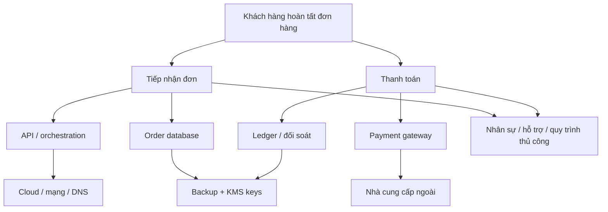
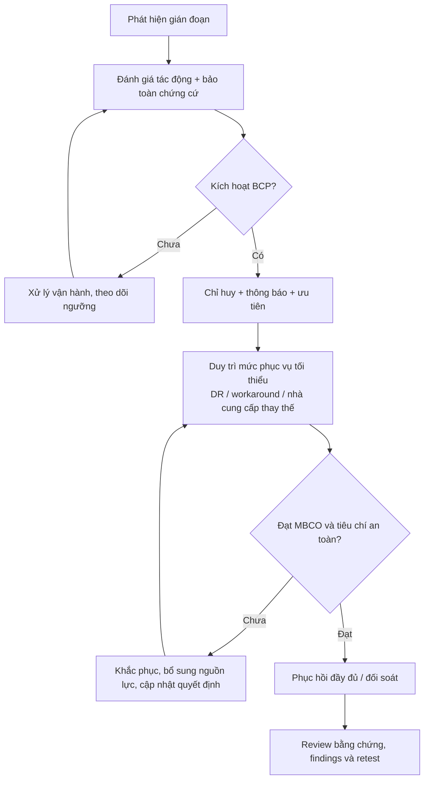

# Business continuity là gì? Nền tảng duy trì hoạt động kinh doanh và Security Assurance

## 1. Bắt đầu từ câu hỏi: khi hệ thống gặp sự cố, doanh nghiệp còn hoạt động được không?

Một ứng dụng có thể được thiết kế bảo mật tốt, có backup mỗi ngày và có hạ tầng dự phòng nhưng vẫn không thể phục vụ khách hàng khi gặp sự cố. Nguyên nhân có thể là nhân viên không biết ai có quyền tuyên bố tình trạng khẩn cấp, dịch vụ thanh toán phụ thuộc một nhà cung cấp duy nhất, dữ liệu dự phòng không khôi phục được, hoặc quy trình hỗ trợ khách hàng không có cách làm thủ công khi nền tảng dừng.

**Business continuity (BC – duy trì hoạt động kinh doanh)** là khả năng của tổ chức **tiếp tục cung cấp sản phẩm và dịch vụ ở mức chấp nhận được, trong khoảng thời gian chấp nhận được, khi xảy ra gián đoạn**. Nó quan tâm đến **giá trị kinh doanh và khả năng phục vụ**, không chỉ trạng thái “server đã chạy lại”.

Trong chương **Business continuity** của module **SECURITY_SECURITY_ASSURANCE**, nội dung cần gắn với mục tiêu security assurance: **đánh giá có bằng chứng** rằng tổ chức đáp ứng các mục tiêu bảo mật và tính liên tục, từ phân tích rủi ro, yêu cầu, security controls đến kiểm thử, audit, xử lý phát hiện và cải tiến trong phát triển lẫn vận hành.

Hãy xét một cửa hàng trực tuyến:

- Cơ sở dữ liệu vẫn chạy, nhưng cổng thanh toán bên thứ ba ngừng hoạt động: khách hàng **không thể hoàn thành giao dịch**.
- Đã chuyển sang region dự phòng, nhưng khóa giải mã không khả dụng tại đó: hệ thống **không đọc được dữ liệu**.
- Nhóm vận hành khôi phục được API, nhưng đội chăm sóc khách hàng không có kênh thông báo và danh sách đơn cần xử lý: việc **phục vụ khách hàng vẫn gián đoạn**.
- Một phần website được duy trì để tiếp nhận đơn ngoại tuyến và xác nhận sau: doanh nghiệp có thể **tiếp tục hoạt động ở mức tối thiểu** dù hệ thống chính chưa phục hồi.

Điều quan trọng là xác định **đâu là hoạt động cần tiếp tục**, **tiếp tục đến mức nào**, **trong bao lâu**, **với dữ liệu còn mới đến mức nào**, và **bằng chứng nào chứng minh được điều đó**.

### Mục tiêu học tập

Sau bài này, người học có thể:

1. Giải thích BC, business continuity management, BCP, disaster recovery, incident response và crisis management.
2. Sử dụng kết quả **Business Impact Analysis (BIA)** và đánh giá rủi ro để xác định hoạt động ưu tiên.
3. Diễn giải đúng **MTPD, RTO, RPO** và mức dịch vụ tối thiểu được chấp nhận.
4. Nhận diện phụ thuộc con người, quy trình, công nghệ, dữ liệu và nhà cung cấp trong một chiến lược continuity.
5. Hiểu vòng đời lập kế hoạch, kích hoạt, vận hành chế độ dự phòng, phục hồi và quay lại trạng thái bình thường.
6. Thiết kế các tiêu chí kiểm thử và **evidence package** để đánh giá khả năng continuity thay vì chỉ kiểm tra tài liệu.

## 2. Business continuity không chỉ là sao lưu hay hạ tầng dự phòng

Có nhiều thuật ngữ liên quan nhưng không đồng nhất.

| Khái niệm | Câu hỏi trung tâm | Ví dụ |
|---|---|---|
| **Business continuity (BC)** | Doanh nghiệp tiếp tục thực hiện hoạt động trọng yếu thế nào khi gián đoạn? | Duy trì nhận đơn, thanh toán, hỗ trợ khách hàng ở mức chấp nhận |
| **Business Continuity Management (BCM)** | Tổ chức quản trị khả năng continuity liên tục như thế nào? | Chính sách, phân vai, BIA, rủi ro, kế hoạch, diễn tập, cải tiến |
| **Business Continuity Plan (BCP)** | Khi gián đoạn, ai làm gì, theo trình tự và điều kiện nào? | Runbook chuyển sang xử lý đơn hạn chế, liên lạc khẩn cấp |
| **Disaster Recovery (DR)** | Khôi phục năng lực CNTT, dữ liệu và hạ tầng thế nào? | Restore database, failover region, phục hồi cluster |
| **Disaster Recovery Plan (DRP)** | Quy trình chi tiết để thực hiện DR là gì? | Danh sách bước restore, quyền thực thi, kiểm tra sau khôi phục |
| **Incident Response (IR)** | Phát hiện, phân tích, cô lập và xử lý sự cố an ninh ra sao? | Khoanh vùng ransomware, thu bằng chứng, ngăn lan truyền |
| **Crisis Management** | Ai quyết định ở cấp tổ chức khi sự cố vượt khả năng xử lý thông thường? | Kích hoạt ban chỉ huy, quyết định ưu tiên, thông báo đối tác |
| **High Availability (HA)** | Hạn chế gián đoạn bằng cơ chế chịu lỗi tự động như thế nào? | Replica, load balancer, failover một node |
| **Resilience** | Tổ chức/hệ thống chịu đựng, thích ứng và hồi phục trước gián đoạn đến mức nào? | Vận hành giảm tính năng, chuyển nhà cung cấp và phục hồi có kiểm soát |

**BC là phạm vi kinh doanh rộng hơn DR.** DR là một phần quan trọng của continuity khi hoạt động phụ thuộc CNTT, nhưng một bản sao database không giải quyết được thiếu nhân sự, đường truyền của đối tác, trung tâm chăm sóc khách hàng, quy trình phê duyệt hoặc rủi ro pháp lý.

**IR và BC/DR cần phối hợp.** Với ransomware, nhóm an ninh có thể yêu cầu cô lập tài khoản, giữ forensic evidence và tránh bật lại hệ thống chưa sạch. Nhóm continuity lại có nhiệm vụ duy trì dịch vụ thiết yếu. Phải có cơ chế phối hợp để không khôi phục từ dữ liệu nhiễm độc hoặc phá hủy chứng cứ trong lúc chạy theo RTO.

**HA không thay cho backup và DR.** Lỗi logic, xóa nhầm, ransomware hoặc cấu hình xấu có thể được đồng bộ sang tất cả replica. Hệ thống có khả năng chịu lỗi node vẫn có thể không chịu được lỗi dữ liệu hoặc sự cố vùng.

## 3. Những mục tiêu của business continuity

Business continuity là việc chấp nhận có thể **không phục hồi 100% ngay lập tức**, nhưng bảo vệ những yếu tố quan trọng nhất:

- **Con người và an toàn:** bảo đảm an toàn nhân sự, khách hàng và bên liên quan trước mục tiêu kỹ thuật.
- **Dịch vụ trọng yếu:** duy trì quy trình tạo giá trị quan trọng nhất; xác định mức dịch vụ tối thiểu có thể chấp nhận.
- **Dữ liệu và tính toàn vẹn:** tránh mất dữ liệu vượt khả năng chấp nhận và không vận hành trên dữ liệu sai lệch.
- **Tuân thủ và nghĩa vụ:** đáp ứng nghĩa vụ hợp đồng, thông báo, bảo mật, lưu vết và các yêu cầu pháp lý áp dụng.
- **Niềm tin khách hàng:** thông báo minh bạch, nhất quán và duy trì các kênh hỗ trợ.
- **Nguồn lực khan hiếm:** phân bổ nhân lực, năng lực máy chủ, mạng, đối tác và ngân sách cho hoạt động ưu tiên.
- **Phục hồi có trật tự:** bảo vệ dữ liệu/forensic evidence, đưa hệ thống trở lại trạng thái ổn định và giảm rủi ro tái phát.

Một kế hoạch tốt phải chỉ ra **mức độ phục vụ kỳ vọng**. Ví dụ trong hai giờ đầu, nền tảng chỉ tiếp nhận đơn và cấp mã theo dõi, chưa cần xử lý hoàn tiền tự động. Nếu hoạt động kinh doanh chấp nhận trạng thái này, đó có thể là một chiến lược continuity hợp lệ. Nếu nghĩa vụ thanh toán buộc xác nhận thời gian thực, chiến lược đó cần được đánh giá lại.

## 4. Business Impact Analysis (BIA): xác định điều quan trọng

**BIA – phân tích tác động kinh doanh** là quá trình xác định các hoạt động, sản phẩm và dịch vụ quan trọng, tác động theo thời gian nếu chúng gián đoạn, phụ thuộc của chúng và các yêu cầu ưu tiên phục hồi.

BIA khác với **risk assessment**:

- BIA chủ yếu trả lời: *“Nếu chức năng này không thể vận hành trong 15 phút, 2 giờ hay 1 ngày thì hậu quả tăng ra sao?”*
- Risk assessment trả lời: *“Những tình huống nào có thể gây gián đoạn, mức độ khả thi/tác động là gì, và kiểm soát cần thiết là gì?”*

BIA **không chỉ là bảng xếp hạng máy chủ quan trọng**. Một dịch vụ API có thể quan trọng vì hỗ trợ thanh toán; ngược lại, hệ thống được gọi là “core” có thể có phương án thủ công cho phép chịu gián đoạn lâu hơn. Phải bắt đầu từ hoạt động kinh doanh.

### 4.1. Cách thực hiện BIA

1. **Định danh sản phẩm, dịch vụ và quy trình:** ai sử dụng, giá trị gì được tạo, có ràng buộc hợp đồng/pháp lý nào.
2. **Mô tả tác động theo thời gian:** doanh thu, khách hàng, an toàn, nghĩa vụ, tính toàn vẹn, danh tiếng và chi phí.
3. **Xác định mức dịch vụ tối thiểu:** khối lượng cần duy trì, chức năng nào có thể tạm hoãn, thời gian chuyển sang phương án thủ công.
4. **Xác lập mục tiêu thời gian/dữ liệu:** RTO, RPO và giới hạn chịu gián đoạn theo ngữ cảnh, được chủ sở hữu kinh doanh phê duyệt.
5. **Lập sơ đồ phụ thuộc:** con người, quy trình, ứng dụng, dữ liệu, hạ tầng, địa điểm, đối tác, danh tính và bảo mật.
6. **Xếp ưu tiên và xác nhận giả định:** khả năng của nhà cung cấp, chi phí, chu kỳ cao điểm, giờ làm việc và nhân sự thay thế.
7. **Ban hành BIA có phiên bản:** người duyệt, ngày hiệu lực, ngày xem lại, trigger cập nhật.

### 4.2. Ví dụ BIA rút gọn

| Hoạt động kinh doanh | Tác động nếu gián đoạn | Mức dịch vụ tối thiểu gợi ý | Phụ thuộc tiêu biểu |
|---|---|---|---|
| **Tiếp nhận đơn** | Không ghi được giao dịch, mất doanh thu | Nhận đơn mới, xác nhận và đối chiếu sau | Web/API, identity, order DB, DNS |
| **Xử lý thanh toán** | Không hoàn tất đơn, phát sinh tranh chấp | Có đối soát và quản lý giao dịch chờ | Payment gateway, tokenization, network, ledger |
| **Hỗ trợ khách hàng** | Khiếu nại tăng, mất kênh hỗ trợ | Hotline/email và truy xuất lịch sử cơ bản | CRM, tổng đài, nhân viên, dữ liệu khách hàng |
| **Phân tích kinh doanh** | Báo cáo chậm, quyết định kém kịp thời | Báo cáo tổng hợp thủ công cuối ngày | Data warehouse, ETL, BI |
| **Đối soát cuối ngày** | Rủi ro tài chính và sai số giao dịch | Đối soát có kiểm soát trước thời hạn bắt buộc | Sổ cái, file từ đối tác, đội tài chính |

Dữ liệu trong bảng là **ví dụ**, không phải mức ưu tiên mặc định cho mọi doanh nghiệp. Quy trình đối soát có thể quan trọng hơn giao diện khách hàng trong tổ chức chịu nghĩa vụ quyết toán nghiêm ngặt.

## 5. Các mốc thời gian: MTPD, RTO, RPO và MBCO

Ba mốc thời gian thường gây nhầm lẫn. Chúng mô tả các yêu cầu khác nhau và phải được đặt trong bối cảnh BIA.

| Thuật ngữ | Ý nghĩa | Đơn vị | Câu hỏi |
|---|---|---|---|
| **MTPD** – Maximum Tolerable Period of Disruption | Thời lượng tối đa một hoạt động có thể bị gián đoạn trước khi tác động trở nên không thể chấp nhận | Phút, giờ, ngày | “Gián đoạn tối đa bao lâu?” |
| **RTO** – Recovery Time Objective | Mục tiêu thời gian để khôi phục hoạt động/dịch vụ đến mức đã định sau gián đoạn | Phút, giờ | “Phải khôi phục kịp khi nào?” |
| **RPO** – Recovery Point Objective | Mức mất dữ liệu theo *khoảng thời gian* được chấp nhận khi khôi phục | Phút, giờ | “Dữ liệu có thể lùi tối đa bao xa?” |
| **MBCO** – Minimum Business Continuity Objective | Mức dịch vụ/sản phẩm tối thiểu phải duy trì trong điều kiện gián đoạn | Năng lực, chức năng, số lượng | “Ít nhất còn làm được gì và bao nhiêu?” |
| **Actual recovery time** | Thời gian đo thực tế trong diễn tập/sự cố | Phút, giờ | “Mất bao lâu để đạt mức phục vụ đã định?” |
| **Actual data loss window** | Chênh lệch giữa thời điểm gián đoạn và điểm dữ liệu có thể phục hồi, theo cách đo đã xác nhận | Phút, giờ | “Mất/thiếu dữ liệu thực tế bao nhiêu?” |

**MTPD và RTO không giống nhau.** Trong một thiết kế hợp lý, RTO thường phải nằm trong giới hạn chịu gián đoạn và chừa dư địa thực tế để xử lý; không lấy bằng MTPD một cách máy móc.

**RPO không phải khoảng cách giữa hai lần backup.** Backup mỗi 15 phút chỉ là một thiết kế nhằm đáp ứng RPO tương ứng; nếu backup thất bại, không nhất quán hoặc không restore được, RPO thực tế có thể tệ hơn rất nhiều. Với database, cần xét cả transaction commit, replication lag, consistency, tính toàn vẹn và phụ thuộc của các thành phần khác.

### 5.1. Ví dụ định lượng

Giả sử chủ quy trình thanh toán duyệt các yêu cầu *minh họa*:

- MTPD: **8 giờ**.
- RTO: **2 giờ** để khôi phục **chức năng thanh toán quan trọng**.
- RPO: **15 phút** cho dữ liệu giao dịch, kèm quy trình đối soát.
- MBCO: **ít nhất 30% công suất giao dịch bình thường** và lưu được lịch sử thao tác bắt buộc.

Sự cố bắt đầu lúc **10:00 UTC**. Dịch vụ dự phòng đạt mức MBCO vào **11:40 UTC**; bản dữ liệu nhất quán mới nhất có thể phục hồi ở **09:40 UTC**.

| Tiêu chí | Mục tiêu | Quan sát | Kết luận |
|---|---|---|---|
| Thời gian phục hồi tới mức MBCO | ≤ 2 giờ | 1 giờ 40 phút | **Đạt RTO** |
| Khoảng lùi dữ liệu ở mốc sự cố | ≤ 15 phút | 20 phút | **Không đạt RPO** |
| Mức công suất | ≥ 30% | Giả sử phép đo xác nhận 35% | **Đạt MBCO** trong mẫu đo |
| Giới hạn chịu gián đoạn tối đa | ≤ 8 giờ | Khôi phục hoạt động tối thiểu sau 1 giờ 40 phút | Không vượt MTPD đối với mức phục vụ nêu trên |

Một kết luận “DR test PASS” chung cho cả kịch bản là **không chính xác** khi RPO không đạt. Cần ghi thành công và thất bại theo từng control, phát hiện điểm yếu sao lưu/replication và tổ chức retest sau khắc phục.

**Chú ý:** nếu dữ liệu 09:40 đã bị lệch với hệ thống thanh toán/ledger hoặc không thể đối soát an toàn, “20 phút” chưa mô tả đầy đủ tổn thất. RPO chỉ là một chiều đo, phải đi kèm kiểm chứng **data correctness và consistency**.

## 6. Các kịch bản gián đoạn cần chuẩn bị

Chiến lược BC nên dựa trên mối đe dọa, phơi nhiễm, khả năng thay thế và các phụ thuộc chung (*common-mode failure*).

| Kịch bản | Điều gì có thể xảy ra | Hướng continuity cần cân nhắc |
|---|---|---|
| **Ransomware** | Dữ liệu bị mã hóa/sửa, tài khoản bị chiếm | Cô lập môi trường, khôi phục từ bản sạch, chứng minh integrity |
| **Mất cloud region/zone** | API, storage, identity hoặc network suy giảm | Phân vùng lỗi, failover/DR site và đo RTO/RPO |
| **Mất KMS key/secret/identity provider** | Có dữ liệu nhưng không decrypt/xác thực được | Khôi phục quyền và vật liệu khóa được phép, giải pháp truy cập khẩn cấp |
| **Lỗi cấu hình hoặc rollout** | Tất cả replica nhận cấu hình sai | Rollback, canary, quy trình change freeze và khôi phục config |
| **DDoS hoặc mất đường mạng** | Hệ thống còn chạy nhưng khách hàng không truy cập | Bảo vệ lưu lượng, kênh thay thế, CDN/DNS và communication plan |
| **Mất dữ liệu hoặc sai logic** | Replica đồng bộ lỗi, backup cũng có thể bị ảnh hưởng | Point-in-time recovery, kiểm tra consistency và đối soát |
| **Đứt dịch vụ bên thứ ba** | Payment, email, SMS, SaaS phụ thuộc ngừng | Đối tác thay thế, chế độ xử lý chờ, manual workaround |
| **Sự cố vật lý/mất điện** | Văn phòng hoặc data center không khả dụng | Địa điểm khác, làm việc từ xa, di tản và khôi phục năng lực vận hành |
| **Thiếu nhân sự chủ chốt** | Chỉ một người nắm quyền hoặc runbook | Phân quyền, thay ca, đào tạo chéo, tài liệu offline |
| **Sai phạm hoặc mất niềm tin dữ liệu** | Không biết dữ liệu nào đúng sau sự cố | Khoanh vùng nguồn, audit trails, reconcile trước khi mở lại |

**Không chỉ thử mất một server.** Những trường hợp nghiêm trọng thường đồng thời ảnh hưởng nhiều vùng/đội/nhà cung cấp. Ví dụ failover dựa vào cùng một identity provider, DNS hoặc KMS với region chính chưa thực sự tách biệt rủi ro.

## 7. Sơ đồ phụ thuộc: từ hoạt động kinh doanh tới thành phần kỹ thuật

Một sơ đồ phụ thuộc giúp nhìn thấy điểm hỏng chung và thứ tự phục hồi.



Phân tích theo hướng **điểm thất bại và trách nhiệm**:

- Quy trình có thể yêu cầu nhiều thành phần cùng hoạt động; phục hồi từng server độc lập chưa đủ.
- Mỗi phụ thuộc phải có owner, mức độ trọng yếu, năng lực thay thế và điều kiện khôi phục.
- Nếu nhiều dịch vụ cùng phụ thuộc một KMS key hoặc một nhà cung cấp identity, đó là rủi ro tập trung.
- Những thành phần cho phép công việc thủ công cần có quy trình đối soát sau khi hệ thống trở lại.
- Các thành phần bảo mật như IAM, KMS, logging, network controls phải tồn tại cả ở môi trường dự phòng; nếu tạm giảm kiểm soát để duy trì hoạt động phải có phê duyệt và biện pháp bù trừ.

**Định nghĩa khôi phục ở cấp quy trình:** “API trả HTTP 200” chưa đủ nếu không tạo được đơn hợp lệ, không gửi được xác nhận, không ghi giao dịch đúng và không hỗ trợ được khách hàng.

## 8. Business Continuity Management: chu trình quản trị liên tục

BCM là chương trình quản trị mang tính chu kỳ, không phải một file kế hoạch được tạo một lần và cất vào kho tài liệu.


### 8.1. Các đầu ra cần có

| Giai đoạn | Đầu ra tối thiểu | Bằng chứng có thể đánh giá |
|---|---|---|
| Chính sách và phạm vi | Bối cảnh tổ chức, mục tiêu, owner, loại dịch vụ được bao phủ | Policy được duyệt, danh sách hoạt động/trách nhiệm |
| BIA | Phân tích tác động, MTPD, RTO, RPO, MBCO và phụ thuộc | BIA version, giả định và quyết định chủ sở hữu kinh doanh |
| Risk assessment | Kịch bản gián đoạn, mức rủi ro và biện pháp | Risk register, threat scenarios, risk treatment |
| Chiến lược continuity | Phương án duy trì/tạm thay thế và nguồn lực cần có | Thiết kế, hợp đồng, ngân sách, quyết định chấp nhận rủi ro |
| Kế hoạch và runbook | Vai trò, điều kiện kích hoạt, trình tự, rollback, contact | Tài liệu phiên bản, quyền truy cập, review/approval |
| Diễn tập/kiểm thử | Kịch bản, tiêu chí đạt, dữ liệu quan sát | Test plan, timestamps, test artifacts, kết quả so với mục tiêu |
| Khắc phục và cải tiến | Finding, owner, hạn, thay đổi và retest | Ticket, risk decision, evidence trước/sau |
| Giám sát vòng đời | Thay đổi service/vendor, plan freshness, overdue actions | Change log, review history, scorecard |

Từng hoạt động cần có **nhịp đánh giá theo rủi ro** và điều kiện xem lại khi có thay đổi lớn: kiến trúc, nhà cung cấp, quy trình kinh doanh, vị trí làm việc, nhân sự, yêu cầu pháp lý và các sự cố thực tế.

## 9. Chọn chiến lược continuity: kỹ thuật và phi kỹ thuật

Chiến lược phải đạt mục tiêu BIA với chi phí, rủi ro và vận hành chấp nhận được.

| Chiến lược | Có thể hỗ trợ | Giới hạn và điều cần chứng minh |
|---|---|---|
| **Active-active / multi-site** | Duy trì dịch vụ khi một thành phần/địa điểm suy giảm | Consistency, routing, lỗi dùng chung, năng lực xử lý khi mất một site |
| **Active-passive / warm standby** | Chuyển sang năng lực dự phòng khi sự cố | Thời gian kích hoạt, đồng bộ dữ liệu, DNS/IAM/KMS, quyền thực thi |
| **Cold standby / rebuild** | Khôi phục từ template/backup với chi phí thấp hơn | Build time, phụ thuộc hạ tầng, backup integrity, thời gian khôi phục |
| **Backup + point-in-time restore** | Phục hồi dữ liệu bị xóa hoặc bị sửa hỏng | Khả năng restore, dữ liệu mới nhất, độ nhất quán, quyền và khóa |
| **Manual workaround** | Duy trì một phần hoạt động khi ứng dụng ngừng | Công suất tối thiểu, bảo vệ dữ liệu, nhập lại và đối soát |
| **Alternative supplier/channel** | Tiếp tục giao dịch khi đối tác chính ngừng | Hợp đồng, tích hợp sẵn, thử chuyển đổi, rủi ro pháp lý |
| **Remote/alternative work site** | Duy trì năng lực con người khi không thể tới văn phòng | Thiết bị, kết nối, hỗ trợ, danh tính và an toàn thông tin |
| **Graceful degradation** | Tắt tính năng thứ yếu để giữ chức năng trọng yếu | Định nghĩa chức năng tối thiểu, kiểm thử tải và trải nghiệm khách hàng |

Một hệ thống có **multi-region** chưa chắc đạt RTO nếu chuyển DNS thủ công mất lâu, quyền KMS chưa sẵn hoặc dữ liệu bị lệch. Một phương án **manual workaround** chưa chắc đạt MBCO nếu nhân viên không được đào tạo hoặc lượng đơn vượt khả năng xử lý thủ công.

**Nguyên tắc bảo mật:** không đánh đổi vô thời hạn quyền truy cập, log audit, mã hóa hay xác thực để “khôi phục nhanh”. Trường hợp buộc giảm kiểm soát trong thời gian khẩn cấp cần giới hạn rõ, phê duyệt có thẩm quyền, giám sát và khôi phục kiểm soát sau sự cố.

## 10. Một BCP cần chứa những thông tin gì?

BCP cần **có thể thực thi**, không chỉ mô tả “sẽ sử dụng máy chủ dự phòng”.

| Thành phần | Câu hỏi cần trả lời |
|---|---|
| Mục đích và scope | Kế hoạch áp dụng cho sản phẩm, quy trình, site, khách hàng nào? |
| Điều kiện kích hoạt | Sự kiện nào, ngưỡng nào hoặc quyết định nào để kích hoạt BCP? |
| Quyền quyết định | Ai tuyên bố khủng hoảng, ưu tiên quy trình, cho phép failover và chi phí? |
| Vai trò thay thế | Nếu primary owner không có mặt, ai thay? |
| Cấp liên lạc | Kênh chính/dự phòng, danh sách nội bộ, khách hàng, nhà cung cấp, cơ quan liên quan |
| Hoạt động tối thiểu | MBCO, chức năng được duy trì, dữ liệu, công suất, giới hạn vận hành |
| Thứ tự khôi phục | Phụ thuộc phải khôi phục trước, các checkpoint xác nhận |
| Phương án thao tác | BCP runbook, DRP runbook, manual workaround, rollback |
| Bảo mật và bằng chứng | Ai được truy cập key, log, backup; giữ audit/forensic evidence ra sao? |
| Tiêu chí hoàn tất | Khi nào được kết luận dịch vụ phục hồi, ai xác nhận từ phía kinh doanh? |
| Quay về bình thường | Cách xử lý dữ liệu phát sinh trong thời gian dự phòng và đối soát |
| Bảo trì kế hoạch | Phiên bản, owner, ngày review, test gần nhất, findings còn mở |

**Các chi tiết dễ bị quên:** cách truy cập BCP khi hệ thống lưu tài liệu bị lỗi; thông tin liên hệ không phụ thuộc email tổ chức; quyền emergency access có thời hạn; danh sách service dependencies; yêu cầu phối hợp vendor; phương án chuyển ca nếu sự cố kéo dài qua nhiều giờ.

Một ví dụ cấu trúc hồ sơ ở mức khái niệm:

```yaml
plan_id: BCP-ORDERING-01
version: "3.0"
business_service: online-ordering
owner: head-of-commerce
approved_at_utc: "2026-11-20T09:00:00Z"
scope:
  environment: production
  business_processes: [receive-order, customer-notification]
recovery_objectives:
  rto_minutes: 120
  rpo_minutes: 15
  minimum_service:
    capabilities: [accept-order, issue-tracking-id]
    throughput_pct_of_normal: 30
activation:
  decision_role: incident-commander
  trigger: "Business ordering unavailable beyond approved threshold"
strategy:
  primary: restore-in-secondary-environment
  fallback: controlled-manual-order-queue
dependencies:
  - dns
  - identity
  - order-database
  - encryption-keys
  - support-staff
evidence_requirements:
  - business-transaction-test
  - recovery-timestamps
  - data-consistency-check
  - customer-communication-log
review:
  owner: continuity-manager
  next_review_on_change: true
```

*Đây là bản ghi mô phỏng.* Những ngưỡng và vai trò cần được doanh nghiệp thống nhất. YAML chỉ diễn đạt cấu trúc kế hoạch; không chứng minh tổ chức có thể thực hiện được các bước tương ứng.

## 11. Trình tự ứng phó khi một gián đoạn xảy ra

BCP không phải chạy tất cả thao tác ngay lập tức. Cần đặt **điểm quyết định** và mốc đo lường.

### Giai đoạn 1 — Phát hiện và đánh giá tác động

Xác định sản phẩm/quy trình nào đang bị ảnh hưởng, phạm vi khách hàng, tác động bảo mật và thời điểm gián đoạn. Thu nhận bằng chứng ban đầu, đồng bộ với incident response nếu có dấu hiệu tấn công, và xác định khả năng xử lý bằng vận hành bình thường.

### Giai đoạn 2 — Kích hoạt kế hoạch và chỉ huy

Người có thẩm quyền quyết định kích hoạt BCP/DRP dựa trên mức tác động và dự báo vượt giới hạn. Tổ chức kênh chỉ huy, phân vai, xác định dịch vụ ưu tiên, thông báo tới chủ quy trình và lưu decision log.

### Giai đoạn 3 — Duy trì mức phục vụ tối thiểu

Chuyển sang hạ tầng dự phòng, nhà cung cấp thay thế hoặc manual workaround theo thứ tự phụ thuộc. Kiểm soát truy cập, mã hóa, audit và các chính sách xử lý dữ liệu tiếp tục có hiệu lực ở mức được duyệt.

### Giai đoạn 4 — Kiểm chứng bằng giao dịch kinh doanh

Không chỉ xem container running hoặc database connected. Thử các giao dịch đại diện, xác minh đầu ra kinh doanh, mức công suất, tính nhất quán của dữ liệu và phản hồi từ người sử dụng. Ghi thời điểm đạt MBCO và trạng thái các mục tiêu khác.

### Giai đoạn 5 — Phục hồi đầy đủ và quay về trạng thái bình thường

Xác minh nguyên nhân và tình trạng an toàn của môi trường chính, chuẩn bị chuyển trở lại theo change control, đối soát dữ liệu phát sinh trong chế độ dự phòng, gỡ các quyền tạm thời và cập nhật thông tin khách hàng.

### Giai đoạn 6 — Post-incident review

Thu thập timeline, evidence của RTO/RPO/MBCO, những quyết định khó, trường hợp plan không khả thi, năng lực của đối tác và hành động khắc phục có owner/hạn. Không coi việc dịch vụ “đã chạy lại” là hoàn thành công việc assurance.



## 12. Vai trò và trách nhiệm trong BCM

Không thể giả định đội SRE hoặc IT sẽ tự quyết mọi ưu tiên kinh doanh.

| Vai trò | Trách nhiệm |
|---|---|
| **Lãnh đạo/BCM sponsor** | Phê duyệt mục tiêu continuity, nguồn lực, mức rủi ro chấp nhận và chính sách |
| **Business process owner** | Xác nhận BIA, tác động, RTO/RPO/MBCO, mức dịch vụ tối thiểu và tiêu chí phục hồi |
| **BCM/continuity coordinator** | Điều phối chương trình, kế hoạch, cập nhật, đào tạo, diễn tập và báo cáo |
| **Incident commander / crisis leader** | Điều phối quyết định và ưu tiên trong sự cố; kích hoạt/đóng pha khẩn cấp theo quyền hạn |
| **IT/Platform/SRE owner** | Thiết kế/khôi phục hệ thống kỹ thuật, đo thời gian, tính nhất quán, năng lực hạ tầng |
| **Security/IR owner** | Đánh giá an toàn môi trường phục hồi, bảo vệ chứng cứ, giám sát và rủi ro tái xâm nhập |
| **Data owner** | Xác định tính đúng đắn dữ liệu, quy tắc đối soát, quyền truy cập và hạn lưu trữ |
| **Communications/Legal/Compliance** | Thông báo đúng đối tượng, đúng thông tin và nghĩa vụ theo quy định áp dụng |
| **Vendor management** | Xác minh cam kết, điểm liên hệ, kế hoạch thay thế và bằng chứng diễn tập của đối tác |
| **Assurance/Audit** | Đánh giá mức đủ của bằng chứng, phát hiện thiếu sót, theo dõi remediation/retest |

Một người có thể kiêm nhiều vai trò trong doanh nghiệp nhỏ, nhưng phải nêu rõ **ai quyết định, ai thực thi, ai kiểm tra và ai phê duyệt đóng finding**. Khi rủi ro cao, cần tách người trực tiếp sửa hệ thống với người xác nhận kết quả, hoặc có cơ chế rà soát độc lập phù hợp.

## 13. Kiểm thử và diễn tập: “kế hoạch có” khác “kế hoạch chạy được”

Việc kiểm thử BC cần có tính tăng dần về độ thực tế và mức rủi ro.

| Hình thức | Thực hiện | Có thể chứng minh | Giới hạn |
|---|---|---|---|
| **Review tài liệu** | Kiểm tra phiên bản, contact, owner, dependency, runbook | Kế hoạch có nội dung và được rà soát | Không chứng minh vận hành thực tế |
| **Tabletop exercise** | Các vai trò thảo luận kịch bản và quyết định | Mức hiểu biết, phân vai, escalation và khoảng trống quy trình | Không đo được toàn bộ thời gian failover/restore |
| **Walkthrough/technical rehearsal** | Chạy thử từng bước trong môi trường kiểm soát | Trình tự, quyền truy cập, điều kiện tiên quyết | Có thể bỏ qua lỗi tích hợp và tải thực tế |
| **Functional exercise** | Khôi phục/đổi tuyến một phần với dữ liệu thử | Khả năng một số thành phần hoạt động | Chưa chắc đạt mức dịch vụ end-to-end |
| **Parallel recovery exercise** | Khôi phục hệ thống song song nhưng chưa chuyển dịch vụ thật | Restore và một số bài test độc lập | Không chứng minh đầy đủ đường khách hàng thực |
| **Controlled failover/interrupt test** | Chuyển sang phương án dự phòng trong phạm vi được duyệt | Khả năng continuity và đo RTO/RPO gần thực tế hơn | Có thể gây gián đoạn; cần phê duyệt, canary, rollback |
| **Post-incident evaluation** | Đánh giá sự cố thực dựa trên timeline và dữ liệu | Hành vi thực tế dưới điều kiện sự cố đã xảy ra | Không có điều kiện test/lặp lại có kiểm soát |

**Không sử dụng phép thử phá hoại trong production chỉ để có bằng chứng** nếu chưa được thẩm định và phê duyệt. Có thể bắt đầu bằng tabletop, dùng môi trường thử có cấu trúc tương đương và kiểm thử chức năng, rồi tăng độ thực tế khi có phương án an toàn.

### 13.1. Tiêu chí một lần diễn tập

Mỗi exercise nên có:

1. **Exercise ID**, phiên bản BCP/DRP, phạm vi, người duyệt và mục đích.
2. **Kịch bản gián đoạn**, điều kiện kích hoạt và các giả định được thông báo trước.
3. **Mục tiêu đo** từ BIA, gồm RTO/RPO/MBCO và yêu cầu bảo mật/tính toàn vẹn.
4. **Sơ đồ phụ thuộc** và tài nguyên được phép thay đổi.
5. **Người thực hiện/quan sát**, tuyến giao tiếp, thời gian bắt đầu, checkpoint.
6. **Bài kiểm tra nghiệp vụ** từ góc nhìn khách hàng và cơ chế đo công suất.
7. **Cách đánh giá** PASS/FAIL/INCONCLUSIVE theo từng control, không chỉ “test thành công”.
8. **Rollback và stop criteria**, phương án bảo vệ hệ thống đang vận hành.
9. **Raw evidence**, finding, owner, hạn khắc phục và điều kiện retest.

### 13.2. Negative test và điều kiện hủy diễn tập

Trong điều kiện được phép, có thể kiểm thử trường hợp DNS cập nhật chậm, credential dự phòng hết hạn, thiếu quyền đọc backup hoặc nhóm on-call primary không phản hồi. Những tình huống này thường phát hiện các “phụ thuộc ẩn”. Tuy nhiên, hoạt động giả lập mất khóa mã hóa hoặc xóa backup production là nguy hiểm; thay bằng môi trường thử, mô phỏng/chaos experiment được kiểm soát và kiểm tra quyền đọc bằng biện pháp không phá hoại.

## 14. Assurance: chứng minh continuity bằng bằng chứng nào?

Bằng chứng BC cần liên kết yêu cầu kinh doanh với kết quả diễn tập. Phải tách **văn bản được phê duyệt**, **khả năng đã triển khai** và **hành vi kiểm chứng**.

| Mệnh đề cần chứng minh | Bằng chứng thiết kế | Bằng chứng triển khai | Bằng chứng hành vi |
|---|---|---|---|
| Quy trình trọng yếu có mục tiêu khôi phục | BIA, owner sign-off, RTO/RPO/MBCO | Kế hoạch/strategy phù hợp, runbook có hiệu lực | Diễn tập đạt mục tiêu, giao dịch nghiệp vụ thành công |
| Có môi trường dự phòng | Thiết kế DR và danh mục dependency | Resource inventory, cấu hình backup/replication | Kết quả failover/restore trong phạm vi được duyệt |
| Khôi phục dữ liệu đúng | Chính sách retention/consistency, RPO | Backup job, restore procedure, KMS access | Restore, so sánh dữ liệu, đối soát và checkpoint |
| Nhân sự có khả năng vận hành BCP | Role assignment, đào tạo, contact tree | Kênh liên lạc, alternate owner, credential readiness | Tabletop, decision log, acknowledgement và timing |
| Nhà cung cấp hỗ trợ kế hoạch | Hợp đồng, risk assessment, RTO expectation | Các kênh escalation, điều kiện hỗ trợ | Vendor exercise hoặc bằng chứng hoạt động có phạm vi |
| Kiểm soát bảo mật vẫn được duy trì | Security requirements cho chế độ dự phòng | IAM, encryption, logging, network policies dự phòng | Kiểm tra effective access, key availability và event audit |
| Finding được xử lý | Remediation plan | Change record, owner, version mới | Retest bằng scenario liên quan và kết quả mới |

**Điều không thể kết luận:** một backup job trả “successful” không chứng minh restore đạt RPO/RTO; một policy đã ký không chứng minh con người nhớ quy trình; báo cáo của vendor về kiểm thử chung không chứng minh đúng tenant hoặc workload của tổ chức.

Cần công bố rõ **các giới hạn**: thử trên staging, ít dữ liệu, tải nhỏ, không thử khôi phục đầy đủ, chưa kiểm tra nhà cung cấp hoặc chưa xác minh tính nhất quán liên vùng. Những giới hạn này không làm bằng chứng vô giá trị, nhưng ngăn suy diễn quá mức.

## 15. Thiết kế evidence package cho một bài diễn tập BC

Một bản ghi đánh giá nên cho phép người khác dựng lại **điều kiện thử, mục tiêu, kết quả quan sát và căn cứ kết luận**.

### Ví dụ YAML evidence (mô phỏng)

```yaml
assessment_id: bc-assurance-20261128-001
business_process: online-ordering
control_id: BC-RECOVERY-01
baseline_version: bcp-ordering-v3
exercise:
  exercise_id: bc-ex-20261128-a
  scenario: "Primary region unavailable; recover in approved secondary"
  environment: controlled-test
  authorization_ref: EXERCISE-APPROVAL-024
  exercise_started_at_utc: "2026-11-28T10:00:00Z"
requirements:
  rto_minutes: 120
  rpo_minutes: 15
  minimum_throughput_pct: 30
observations:
  minimum_service_reached_at_utc: "2026-11-28T11:40:00Z"
  actual_recovery_minutes: 100
  last_recoverable_consistent_data_at_utc: "2026-11-28T09:40:00Z"
  actual_data_loss_window_minutes: 20
  observed_throughput_pct: 35
  business_transactions_checked: 20
assessment:
  rto: PASS
  rpo: FAIL
  minimum_service: PASS
  overall: FAIL
  rule_version: "bc-exercise-evaluator-v2"
  limitations: "Controlled test; only tested sample transactions"
evidence_refs:
  decision_log: "evidence/BC-RECOVERY-01/activation.json"
  recovery_timeline: "evidence/BC-RECOVERY-01/timeline.json"
  data_integrity_report: "evidence/BC-RECOVERY-01/data-check.json"
  transaction_test_report: "evidence/BC-RECOVERY-01/transactions.json"
  checksum_manifest: "evidence/BC-RECOVERY-01/checksums.sha256"
finding:
  id: BC-FIND-017
  owner: data-platform
  reason: "Observed data loss window exceeds approved RPO"
```

**Lưu ý:** ví dụ giả định đã xác minh một tập 20 giao dịch đại diện và 35% công suất trong môi trường thử; nó **không chứng minh** môi trường production đạt cùng kết quả. Chỉ ghi `overall: PASS` khi toàn bộ tiêu chí bắt buộc đã đạt, theo quy tắc được duyệt.

### Các trường tối thiểu

| Nhóm | Thông tin |
|---|---|
| **Scope** | Business process, service ID, môi trường, location, phụ thuộc, customer segment |
| **Policy** | Control ID, BIA/baseline version, RTO/RPO/MBCO, rule evaluation |
| **Exercise** | ID, người phê duyệt, scenario, mức thử, ngày/giờ, assumptions |
| **Evidence** | Raw logs, transaction IDs, metrics, restore point, checksum/integrity, decision log |
| **Timing** | UTC của gián đoạn giả định, kích hoạt, bắt đầu restore, đạt MBCO, full recovery |
| **Decision** | PASS/FAIL/INCONCLUSIVE từng tiêu chí và reason, limitations |
| **Follow-up** | Finding, owner, severity, due date, exception/acceptance và retest reference |

Bảo vệ evidence: bản sao backup, cấu hình key, số liệu khách hàng và thông tin liên hệ khẩn cấp có thể rất nhạy cảm. Chỉ lưu dữ liệu cần thiết, phân quyền đọc/ghi, dùng kho có lịch sử thay đổi, retention phù hợp và không đưa secret vào báo cáo công khai.

**Hash/checksum không thay thế xác thực nguồn.** Hash có thể phát hiện dữ liệu đã bị sửa nếu manifest được bảo vệ tin cậy; vẫn cần chứng minh collector lấy đúng dữ liệu từ đúng hệ thống, đúng thời điểm và điều kiện.

## 16. Tiêu chí PASS, FAIL và khoảng trống bằng chứng

Một lượt đánh giá security assurance không chỉ có “đã diễn tập” và “chưa diễn tập”.

| Trạng thái | Điều kiện | Hành động |
|---|---|---|
| **PASS** | Control áp dụng; dữ liệu đủ tin cậy, đủ mới và đáp ứng tiêu chí đã phê duyệt | Lưu evidence, tiếp tục quan sát và thử lại theo rủi ro |
| **FAIL** | Quan sát hợp lệ nhưng vượt RTO/RPO, không đạt MBCO, thao tác lỗi hoặc control khác không đạt | Finding, đánh giá tác động, owner, remediation, retest |
| **INCONCLUSIVE** | Thiếu dữ liệu, phép thử không thực hiện đúng scope, clock/timestamp không tin cậy hoặc không thể xác minh khôi phục | Ghi khoảng trống, thu lại và cải thiện test method |
| **NOT_APPLICABLE** | Control không áp dụng theo điều kiện scope BIA đã được duyệt | Giữ lý do loại trừ và nguồn phê duyệt |
| **Accepted exception** | Rủi ro chưa xử lý được phê duyệt hữu hạn với biện pháp bù trừ | Theo dõi riêng exception ID; không sửa kết quả FAIL thành PASS |

**Ví dụ:** không chạy được restore vì chưa được cấp quyền cho môi trường thử. Với control “tính sẵn sàng của quyền thực hiện restore”, nếu policy yêu cầu quyền phải sẵn có và đã có bằng chứng không đáp ứng, kết luận có thể là **FAIL**. Với control “RPO thực tế khi restore”, nếu restore chưa chạy và chưa có điểm dữ liệu để đo, kết luận thường là **INCONCLUSIVE**. Phải nêu rõ *claim* nào được đánh giá.

**Độ phủ diễn tập** cần công bố theo tập hoạt động ưu tiên, không chỉ đếm số kịch bản. Nếu có 12 quy trình trọng yếu, 9 quy trình có cuộc diễn tập hợp lệ trong chu kỳ và chỉ 7 đạt, báo:

- Coverage diễn tập hợp lệ: **9/12 = 75%**.
- Pass rate trong tập đã thử hợp lệ: **7/9 ≈ 77,8%**.
- 3 quy trình chưa thử và 2 quy trình FAIL cần được trình bày riêng; không ghi “77,8% toàn bộ hoạt động đạt continuity”.

## 17. Tình huống thực hành: failover nhanh nhưng business continuity vẫn thất bại

**Bối cảnh:** một nền tảng bán hàng có chính sách khôi phục order API trong 30 phút, dữ liệu không được lùi quá 10 phút. Đội kỹ thuật diễn tập chuyển region và báo “thành công trong 18 phút”.

Kết quả kiểm tra sâu hơn:

| Quan sát | Bằng chứng | Tác động |
|---|---|---|
| API phía dự phòng trả HTTP 200 sau 18 phút | Health-check và timestamp | Mới chứng minh endpoint sẵn sàng bề mặt |
| Dịch vụ identity của khu vực chính không khả dụng | Log xác thực, dependency mapping | Người dùng không đăng nhập được |
| KMS key của order DB chưa có quyền tại vùng dự phòng | Error log và key access | Dữ liệu không thể đọc/ghi hợp lệ |
| Payment gateway cần whitelist IP mới | Kết quả giao dịch thử | Đơn không thể hoàn tất |
| Chưa có đối soát các đơn phát sinh trong thời gian chuyển | Transaction log/ledger chưa xác minh | Nguy cơ sai dữ liệu và ảnh hưởng khách hàng |

**Đánh giá:** “API health-check đạt trong 18 phút” là evidence của một thành phần, **không đủ** để đánh giá RTO của **quy trình đặt hàng**. Nếu tiêu chí là tạo đơn và thanh toán thành công thì chưa đạt mức dịch vụ tối thiểu; phải ghi FAIL theo tiêu chí nghiệp vụ hoặc INCONCLUSIVE khi phép thử không đo được đủ chức năng. Chưa thể kết luận RPO khi không có dữ liệu nhất quán để so sánh.

**Hướng khắc phục:** cập nhật dependency inventory và DR runbook: identity, KMS, mạng/whitelist, payment gateway, đối soát và tuyến giao tiếp. Phân công owner, thử quyền key và kết nối trong môi trường an toàn, định nghĩa giao dịch end-to-end, đo công suất tối thiểu, thử rollback và retest. Mọi kết luận phải tham chiếu BIA được duyệt.

**Bài học:** continuity đo từ **khả năng vận hành kinh doanh**, không đo bằng thời gian khởi động một service. Công tác security assurance cần chỉ ra thiếu bằng chứng, không chỉ xác nhận thao tác kỹ thuật.

## 18. Những sai lầm phổ biến

| Sai lầm | Hậu quả | Cách khắc phục |
|---|---|---|
| Có backup được coi là có BC | Không biết dịch vụ/dữ liệu khôi phục được không | Restore thử, đo RTO/RPO, kiểm tra consistency |
| Chỉ đo uptime của server | Bỏ qua khả năng xử lý giao dịch và phục vụ khách hàng | Đo business transaction và MBCO |
| RTO/RPO do IT tự đặt mà không hỏi kinh doanh | Mục tiêu không phù hợp tác động thực | BIA có chủ quy trình phê duyệt |
| Nhầm RPO với tần suất backup | Đánh giá sai mất dữ liệu thực tế | Đo last recoverable consistent point và restore |
| Coi HA là DR | Replica đồng bộ lỗi cũng mất dữ liệu | Thiết kế backup độc lập, ranh giới lỗi, recovery test |
| Kế hoạch chỉ lưu trên hệ thống có thể bị ảnh hưởng | Mất đường truy cập trong sự cố | Kênh lưu và thông tin liên hệ khẩn cấp dự phòng |
| Không liệt kê identity, DNS, KMS, vendor | Failover tồn tại nhưng không thể hoạt động | Dependency mapping và kịch bản mất phụ thuộc chung |
| Chỉ tabletop rồi kết luận đạt RTO | Không đo được thời gian thực | Phân cấp test và nêu giới hạn rõ |
| Chỉ thử thành phần không thử nghiệp vụ | False assurance ở mức business | Giao dịch end-to-end và đối soát |
| Không có quyền quyết định và người thay thế | Chậm kích hoạt và phối hợp | RACI, incident commander, diễn tập contact tree |
| Vội khôi phục môi trường nhiễm độc | Tái lây nhiễm, mất forensic evidence | IR phối hợp BC, xác minh bản sạch và quyền |
| Ghi nhận “successful” khi chỉ một tiêu chí đạt | Che RPO/MBCO hoặc nghĩa vụ khác FAIL | Đánh giá theo từng control, kết luận tổng phù hợp |
| Không theo dõi finding hoặc thử lại | Kế hoạch lặp lại điểm yếu cũ | Owner, hạn, evidence trước/sau và retest |
| Đổi kiến trúc/nhà cung cấp nhưng không cập nhật BIA/BCP | Runbook lỗi thời và thiếu phụ thuộc mới | Review dựa trên thay đổi và định kỳ |

## 19. Bài tập thiết kế continuity cho một nền tảng học trực tuyến

**Bối cảnh giả định:** một nền tảng học trực tuyến có các chức năng đăng nhập, xem bài học, làm bài kiểm tra, chấm điểm, thanh toán khóa học và gửi email. Doanh nghiệp cần tiếp tục phục vụ học viên khi cloud region chính không khả dụng.

Giả sử chủ quy trình đề xuất yêu cầu *để thảo luận*, chưa phải mục tiêu được phê duyệt:

- Đăng nhập và xem bài học: RTO 2 giờ; RPO 30 phút cho dữ liệu tiến độ.
- Làm bài kiểm tra và lưu kết quả: RTO 4 giờ; RPO 5 phút, không được ghi nhận sai điểm.
- Thanh toán khóa học: có thể chuyển vào hàng đợi đối soát nếu gateway bị gián đoạn.
- Mức phục vụ tối thiểu: học viên vẫn truy cập bài đã đăng ký và không bị mất điểm đã xác nhận.

### Yêu cầu học viên

1. Xác định quy trình nào thực sự **trọng yếu theo thời gian**, và tác động khi gián đoạn 15 phút, 2 giờ, 8 giờ.
2. Làm BIA rút gọn: xác định MTPD, RTO, RPO, MBCO và các giả định cần phê duyệt.
3. Vẽ dependency map cho identity, content storage, database, KMS, DNS/CDN, email, payment và nhân sự hỗ trợ.
4. Đề xuất chiến lược duy trì dịch vụ khi mất region và khi bị ransomware; chỉ rõ vì sao hai kịch bản cần biện pháp khác nhau.
5. Viết điều kiện kích hoạt BCP, vai trò quyết định, các kênh liên lạc, quy trình manual workaround và tiêu chí kết thúc.
6. Lập kế hoạch tabletop và một functional recovery test an toàn, có stop/rollback.
7. Tạo bảng bằng chứng để đánh giá thực tế: timestamp phục hồi, điểm dữ liệu, kết quả một bài kiểm tra hoàn chỉnh, số liệu công suất, audit và đối soát.
8. Phân loại PASS, FAIL, INCONCLUSIVE nếu đạt RTO xem bài nhưng không khôi phục được dữ liệu điểm, hoặc không có quyền thử restore.

### Câu hỏi tự đánh giá

- Business continuity khác disaster recovery ở phạm vi nào?
- Vì sao backup thành công không chứng minh đạt RPO?
- Khi nào việc khôi phục API không đủ để tuyên bố đạt RTO của quy trình kinh doanh?
- Trong BIA, vai trò của business process owner khác vai trò platform engineer như thế nào?
- Nếu hệ thống dự phòng vẫn phụ thuộc KMS hoặc identity của khu vực chính, rủi ro nào còn tồn tại?
- Một bài tabletop có thể chứng minh điều gì và không chứng minh được điều gì?
- Khi nào nên kết luận FAIL thay vì INCONCLUSIVE trong một cuộc diễn tập BC?
- Nếu đổi nhà cung cấp thanh toán hoặc quy trình chấm điểm, những phần nào của BIA/BCP cần được xem lại?

## 20. Checklist đánh giá một chương trình business continuity

Trước khi công bố “đã có khả năng duy trì hoạt động”, cần kiểm tra:

- **Phạm vi có chủ sở hữu:** những sản phẩm/dịch vụ và quy trình trọng yếu nào được BIA bao phủ; những gì chưa được phân tích?
- **Các mục tiêu được phê duyệt:** MTPD, RTO, RPO, MBCO và giả định có nguồn từ phía kinh doanh.
- **Rủi ro và phụ thuộc:** mối đe dọa, các điểm lỗi chung, nhân sự/địa điểm/vendor/identity/KMS/data/logging.
- **Chiến lược có thể triển khai:** đủ người, quyền, hạ tầng, ngân sách, công suất và cơ chế vận hành thay thế.
- **BCP/DRP thực thi được:** activation, command structure, liên lạc, bước hành động, an toàn, rollback và return-to-normal.
- **Bằng chứng vận hành:** restore/failover/transaction test, timestamps, data consistency, mức công suất, decision log.
- **Kết luận đúng phạm vi:** tách PASS/FAIL/INCONCLUSIVE theo từng mục tiêu; công bố test coverage, dữ liệu quá cũ và giới hạn mô phỏng.
- **Finding và ngoại lệ được quản lý:** owner, mức ưu tiên, hạn xử lý, biện pháp bù trừ, quyết định chấp nhận rủi ro và retest.
- **Cải tiến liên tục:** xem lại BIA/plan sau thay đổi quan trọng, diễn tập theo rủi ro, huấn luyện nhân sự và đánh giá nhà cung cấp.
- **Bảo mật vẫn được kiểm soát:** giữ audit, bảo vệ dữ liệu và khóa, bảo toàn chứng cứ, loại quyền khẩn cấp sau khôi phục.

**Business continuity** là năng lực **duy trì hoạt động kinh doanh quan trọng ở mức có thể chấp nhận khi xảy ra gián đoạn**, không chỉ khôi phục một máy chủ. Trong chương trình security assurance, năng lực này chỉ đáng tin khi các mục tiêu được chủ quy trình xác nhận, chiến lược có khả năng thực thi, các kế hoạch được thử nghiệm và kết quả được chứng minh bằng **bằng chứng có thể tái kiểm tra**, với những khoảng trống được xử lý tới khi khắc phục xong.
