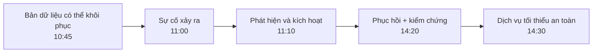
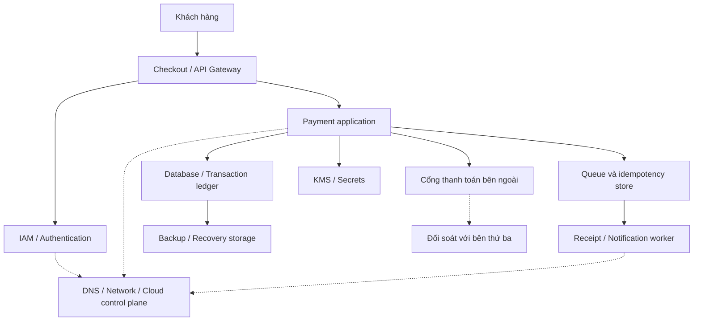
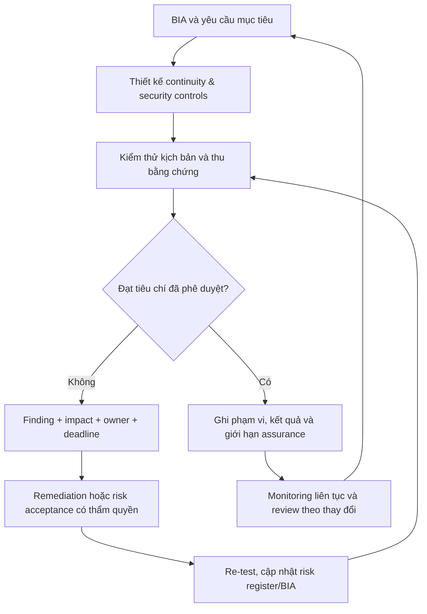

# Critical service: xác định và bảo đảm khả năng duy trì dịch vụ trọng yếu

## 1. Critical service là gì?

**Critical service** (dịch vụ trọng yếu) là một dịch vụ mà việc ngừng hoạt động, suy giảm chất lượng hoặc mất tính toàn vẹn trong một khoảng thời gian nhất định có thể gây ra tác động **không thể chấp nhận** đối với tổ chức, khách hàng, con người, nghĩa vụ hợp đồng hoặc mục tiêu bảo mật. Tính trọng yếu phụ thuộc vào **dịch vụ tạo ra kết quả gì cho ai, thời gian chịu gián đoạn và hậu quả thực tế**, chứ không chỉ phụ thuộc vào quy mô hạ tầng hay độ nổi tiếng của một ứng dụng.

Trong chương **Business continuity** thuộc module **SECURITY_SECURITY_ASSURANCE**, chủ đề này kết nối **business impact analysis (BIA)**, phân tích rủi ro, security controls, kiến trúc phục hồi, kiểm thử và audit. Security assurance yêu cầu tổ chức có **bằng chứng** chứng minh rằng những dịch vụ được xem là trọng yếu có mục tiêu duy trì/khôi phục rõ ràng, các phụ thuộc đã được nhận diện, biện pháp bảo vệ phù hợp và năng lực phục hồi đã được kiểm tra trong điều kiện thực tế.

Một ví dụ: nền tảng SaaS có dịch vụ truy cập hồ sơ khách hàng. Nếu dịch vụ chỉ gián đoạn hai phút, người dùng có thể chờ. Nếu ngừng sáu giờ khi bộ phận chăm sóc đang xử lý sự cố lớn, thiệt hại vận hành và uy tín có thể tăng đáng kể. Nếu dịch vụ vẫn truy cập được nhưng trả dữ liệu **sai khách hàng**, đó còn là vấn đề **integrity/confidentiality**, không đơn thuần là uptime.

**Điểm quan trọng:** một dịch vụ có thể đang “up” về mặt kỹ thuật nhưng **không còn cung cấp được chức năng nghiệp vụ cốt lõi một cách an toàn**. Kiểm tra health endpoint 200 OK không đủ chứng minh tính liên tục của dịch vụ.

### Mục tiêu học tập

Sau bài học, người học có thể:

1. Phân biệt *critical service*, *business process*, *application*, *resource* và *supporting dependency*.
2. Dùng BIA để xác định mức trọng yếu theo tác động thay đổi theo thời gian, thay vì suy luận từ số lượng server.
3. Xác định **maximum tolerable disruption**, **RTO**, **RPO**, mức dịch vụ tối thiểu và các điều kiện khôi phục an toàn.
4. Lập bản đồ các phụ thuộc kỹ thuật, con người, cơ sở hạ tầng, nhà cung cấp và dữ liệu; tìm điểm lỗi chung.
5. Thiết kế, kiểm thử và chứng minh bằng bằng chứng rằng dịch vụ có thể tiếp tục hoặc khôi phục trong mục tiêu được phê duyệt.
6. Chỉ ra giới hạn của tuyên bố assurance và cách quản lý thay đổi đối với một critical service.

## 2. Phân biệt dịch vụ trọng yếu với ứng dụng và hạ tầng

Hãy nhìn từ **kết quả nghiệp vụ** trước khi nhìn vào sơ đồ máy chủ:

| Khái niệm | Ví dụ trong nền tảng SaaS | Vai trò trong continuity |
| --- | --- | --- |
| **Business process** | Khách hàng thanh toán và nhận biên nhận | Hoạt động kinh doanh cần được duy trì |
| **Critical service** | Xử lý giao dịch thanh toán hợp lệ, bảo vệ và ghi nhận kết quả | Đơn vị cần xác định mức tối thiểu và mục tiêu phục hồi |
| **Application** | Payment API và trang checkout | Thành phần triển khai chức năng |
| **Data** | Ledger giao dịch, idempotency key, trạng thái đơn hàng | Bảo đảm tính đúng đắn của hoạt động sau phục hồi |
| **Technology dependency** | Database, queue, DNS, IAM, KMS, mạng | Tài nguyên cần hoạt động để cung cấp dịch vụ |
| **External dependency** | Đối tác cổng thanh toán, cloud region, nhà cung cấp DNS | Có thể nằm ngoài quyền điều khiển trực tiếp |
| **People/process dependency** | Đội on-call, người phê duyệt failover, hotline đối tác | Cần để điều phối khi công cụ tự động không đủ |

Một business process có thể dùng nhiều dịch vụ; một dịch vụ hỗ trợ nhiều business process. Đừng đồng nhất tên microservice với dịch vụ trọng yếu. `auth-service`, `customer-api` và `billing-worker` là tên thành phần; còn “khách hàng có thể đăng nhập và thực hiện giao dịch hợp lệ” là khả năng nghiệp vụ có thể kiểm chứng.

### Ví dụ phản trực giác

Một hệ thống dashboard có hàng triệu request mỗi ngày nhưng không ảnh hưởng giao dịch cốt lõi khi tạm ngừng có thể **ít trọng yếu hơn** một dịch vụ phát hành khóa chỉ có vài giao dịch mỗi tuần. Nếu khóa không được cấp hoặc thu hồi đúng lúc, nhiều dịch vụ khác có thể mất khả năng phục hồi hay rơi vào trạng thái không an toàn.

Tính trọng yếu cũng có thể thay đổi theo thời điểm: hệ thống tuyển sinh trong giai đoạn chốt hồ sơ, hệ thống thanh toán vào cuối ngày đối soát, hoặc dịch vụ giao dịch khi thị trường mở cửa. BIA cần ghi rõ **điều kiện và khoảng thời gian áp dụng**.

## 3. Xác định critical service bằng Business Impact Analysis (BIA)

**BIA** phân tích hậu quả của việc gián đoạn các hoạt động, cùng mức độ hậu quả tăng theo thời gian. Đây là cơ sở để xác định dịch vụ cần ưu tiên và mục tiêu phục hồi. BIA khác với đánh giá xác suất rủi ro: BIA hỏi **“Nếu gián đoạn xảy ra thì hậu quả theo thời gian là gì?”**; risk assessment hỏi thêm **“Vì sao và có khả năng xảy ra tới mức nào?”**

### 3.1. Các bước tiến hành BIA

1. **Xác định khả năng nghiệp vụ:** dịch vụ nào tạo ra kết quả quan trọng cho khách hàng, hoạt động nội bộ, tuân thủ hoặc an toàn?
2. **Đặt ranh giới:** ai dùng, quy trình nào phụ thuộc, các sản phẩm/tenant/vùng/môi trường nào nằm trong phạm vi?
3. **Xây kịch bản gián đoạn:** mất hoàn toàn, chậm nghiêm trọng, dữ liệu không tin cậy, mất chức năng riêng, đối tác ngừng hoạt động.
4. **Đánh giá tác động theo thời gian:** sau 15 phút, 1 giờ, 4 giờ, 24 giờ... ảnh hưởng đến khách hàng và mục tiêu bảo mật tăng ra sao? Mốc này do tổ chức chọn.
5. **Xác định mức không thể chấp nhận:** khi nào tổ chức vượt ngưỡng chịu đựng và vì sao?
6. **Xác định chức năng tối thiểu:** những giao dịch bắt buộc phải duy trì; những chức năng có thể tạm dừng an toàn?
7. **Liệt kê nguồn lực và phụ thuộc:** công nghệ, dữ liệu, người, địa điểm, quy trình, nhà cung cấp và đường truy cập đặc quyền.
8. **Thống nhất và phê duyệt:** business owner xác nhận hậu quả, đội kỹ thuật đánh giá tính khả thi, risk/security xác nhận tác động bảo mật.

### 3.2. Đánh giá tác động đa chiều

| Chiều tác động | Câu hỏi BIA | Bằng chứng đầu vào |
| --- | --- | --- |
| **Khách hàng/dịch vụ** | Khách hàng nào mất khả năng sử dụng chức năng thiết yếu? | Customer journeys, hợp đồng, SLI dịch vụ |
| **Tài chính** | Giao dịch bị trì hoãn, tiền có thể bị ghi nhận sai hoặc thất thoát? | Transaction volume, reconciliation record, business owner estimate |
| **Pháp lý/hợp đồng** | Gián đoạn có thể phát sinh nghĩa vụ nào trong phạm vi áp dụng? | Cam kết khách hàng, yêu cầu tuân thủ được tổ chức xác nhận |
| **An toàn/sức khỏe** | Có ảnh hưởng con người hay hệ thống an toàn? | Safety assessment, operational procedures |
| **Danh tiếng/niềm tin** | Khách hàng có mất lòng tin khi dịch vụ không đáng tin? | Customer service impact và đánh giá truyền thông |
| **Confidentiality** | Chế độ dự phòng có thể để lộ dữ liệu qua tenant hoặc tài khoản? | Data classification, access-control architecture |
| **Integrity** | Hoạt động có thể ghi dữ liệu trùng/sai khi failover, replay, restore? | Ledger, idempotency, checksum, consistency tests |
| **Availability** | Mất khả năng thực hiện công việc trọng yếu trong bao lâu? | End-to-end availability, dependency monitoring |
| **Khả năng phục hồi lâu dài** | Sự cố có làm mất bản sao, credential, nhân sự hoặc nhà cung cấp dự phòng? | Backup inventory, key escrow, vendor contract, personnel coverage |

Không cộng các mức tác động tùy tiện thành một điểm số rồi coi đó là sự thật khách quan. Tổ chức cần **rubric rõ ràng**, người phê duyệt và cơ chế nâng cấp khi có tác động đặc biệt nghiêm trọng (ví dụ an toàn con người, mất dữ liệu không thể phục hồi hoặc phạm vi nhiều khách hàng).

### 3.3. BIA minh họa theo thời gian

Giả sử một SaaS đa tenant đánh giá hai dịch vụ. Bảng chỉ là **ví dụ định tính**, không phải ngưỡng chung cho ngành.

| Khoảng gián đoạn | Giao dịch thanh toán | Dashboard phân tích |
| --- | --- | --- |
| 15 phút | Khách hàng chờ, một số giao dịch bị treo cần đối soát | Thống kê hiển thị chậm |
| 1 giờ | Hàng đợi tăng, đội hỗ trợ phát sinh công việc thủ công | Người dùng có thể dùng dữ liệu kỳ trước |
| 4 giờ | Đơn hàng và thanh toán đình trệ, ảnh hưởng tài chính đáng kể | Phòng báo cáo bị trễ |
| 8 giờ | Tác động đã vượt mức tổ chức cho phép theo giả định BIA | Có thể vẫn chưa vượt ngưỡng nếu không vào kỳ quyết toán |
| 24 giờ | Tác động nghiêm trọng kéo dài, nguy cơ tích lũy sai lệch đối soát | Có thể cần kích hoạt báo cáo tình huống tùy cam kết |

Kết luận **không phải** “dashboard luôn không quan trọng”. Dashboard dùng để xác định tình trạng bệnh nhân, giám sát an toàn hoặc đáp ứng yêu cầu pháp lý có thể rất trọng yếu. Phải xét **mục đích và ngữ cảnh sử dụng**, sau đó đối chiếu stakeholder thực tế.

## 4. Mô hình phân lớp criticality và tiêu chí quyết định

Nên áp dụng mức trọng yếu trên **service catalog**, định nghĩa rõ tiêu chí và thời điểm xem xét lại. Dưới đây là mô hình ví dụ:

| Phân lớp minh họa | Tiêu chí kinh doanh | Điều cần chuẩn bị |
| --- | --- | --- |
| **Tier 0 – Mission-critical** | Gián đoạn ngắn có thể gây tác động không chấp nhận hoặc lan rộng sang nhiều hoạt động tối quan trọng | Hạ tầng dự phòng tương xứng, cơ chế điều phối trực chiến, restore/failover được diễn tập |
| **Tier 1 – Business-critical** | Gián đoạn nhiều giờ gây ảnh hưởng đáng kể tới khách hàng, giao dịch hoặc nghĩa vụ | Kế hoạch phục hồi rõ, on-call, backup và kiểm thử định kỳ |
| **Tier 2 – Important** | Có thể chấp nhận gián đoạn giới hạn nếu có phương án tạm thời | Backup, runbook, kế hoạch phục hồi theo mức ưu tiên |
| **Tier 3 – Deferrable** | Có thể trì hoãn theo phạm vi BIA mà chưa vượt mức chịu đựng | Quy trình phục hồi tiêu chuẩn và theo dõi phụ thuộc |

**Tier và mốc thời gian không mặc nhiên tương ứng với số giờ cố định.** Tổ chức phải chuyển kết quả BIA thành các ngưỡng cụ thể và xác minh chúng. Một service có thể mang tier cao do **tính toàn vẹn hoặc an toàn**, dù số lượng request rất thấp.

### Các trường cần có trong danh mục critical service

- `service_id`, tên, mô tả kết quả nghiệp vụ và danh sách user/tenant ảnh hưởng.
- `business_owner`, `technical_owner`, `security_owner`, người thay thế và danh sách on-call.
- `criticality_tier`, ngày đánh giá, tiêu chí và bằng chứng phê duyệt.
- Các business process, dữ liệu quan trọng và phân loại thông tin.
- `RTO`, `RPO`, mức dịch vụ tối thiểu, giới hạn chịu gián đoạn và giới hạn mất dữ liệu.
- Tập phụ thuộc bắt buộc, phụ thuộc chung, nhà cung cấp và điều kiện lỗi liên đới.
- Các chế độ vận hành bình thường/dự phòng/suy giảm và điều kiện chuyển trạng thái.
- Kế hoạch bảo vệ dữ liệu, thủ tục phục hồi, failback và runbook sự cố.
- Kế hoạch kiểm thử, kết quả gần nhất, các ngoại lệ chưa khắc phục và lịch review.

Một bản ghi chỉ có cột “critical=true” thiếu dữ liệu cần thiết để kỹ sư hoặc auditor đánh giá tính sẵn sàng.

## 5. Các mốc continuity: MTPD, RTO, RPO và mức vận hành tối thiểu

Những khái niệm này phải được phân biệt trước khi triển khai công nghệ.

| Chỉ tiêu | Câu hỏi trả lời | Lưu ý |
| --- | --- | --- |
| **MTPD** (Maximum Tolerable Period of Disruption), còn được gọi **MAO** trong một số cách dùng | Hoạt động có thể gián đoạn tối đa bao lâu trước khi tác động không thể chấp nhận? | Ranh giới do BIA và chủ sở hữu nghiệp vụ xác lập |
| **RTO** (Recovery Time Objective) | Mục tiêu khôi phục một dịch vụ/chức năng tới mức chấp nhận được trong bao lâu sau gián đoạn? | Đặt đủ sớm để không vượt ngưỡng chịu đựng; phải bao gồm xác minh an toàn |
| **RPO** (Recovery Point Objective) | Tổ chức có thể chấp nhận mất tối đa bao nhiêu khoảng thời gian cập nhật dữ liệu? | Đo chênh lệch thời điểm trạng thái dữ liệu có thể khôi phục so với điểm gián đoạn |
| **MBCO** (Minimum Business Continuity Objective) hoặc mức dịch vụ tối thiểu được định nghĩa nội bộ | Cần duy trì tối thiểu mức kết quả nghiệp vụ nào trong gián đoạn? | Xác định chức năng, dung lượng, chất lượng và điều kiện kiểm soát phải còn |
| **SLO/SLA** | Mức chất lượng vận hành/cam kết dịch vụ thường kỳ? | Không thay thế RTO/RPO; uptime 99,9% không chứng minh phục hồi sau thảm họa |

### 5.1. RTO khác với thời gian bật server

Giả sử BIA xác định dịch vụ xử lý thanh toán có **MTPD = 8 giờ**. Chủ sở hữu đặt **RTO = 4 giờ** để có biên dự phòng trước khi mất khả năng chấp nhận. RTO phải là thời gian để **khả năng thanh toán tối thiểu thực sự hoạt động an toàn**, bao gồm bước xác minh tính đúng đắn của ledger, quyền truy cập, kết nối đối tác và giao dịch thử.

Thời gian tạo máy ảo mới trong 20 phút chỉ là một bước kỹ thuật. Nếu cần thêm 3 giờ kiểm tra dữ liệu và 2 giờ xử lý mạng, thời gian phục hồi khả năng nghiệp vụ có thể vượt RTO.

Không phải mọi RTO đều phải bằng nhau: hạ tầng IAM dùng chung có thể cần phục hồi sớm hơn một dịch vụ ứng dụng đang phụ thuộc vào nó.

### 5.2. RPO khác với mức trễ replication bình thường

Nếu **RPO = 15 phút**, tại điểm gián đoạn tổ chức chỉ chấp nhận mất tối đa 15 phút cập nhật dữ liệu theo mục tiêu đã được duyệt. Một snapshot mỗi 24 giờ **không đáp ứng** mục tiêu này khi xảy ra sự cố bất lợi. Sao chép bất đồng bộ có lag trung bình thấp cũng không bảo đảm RPO trong outage nếu backlog kéo dài hoặc failover chọn replica cũ.

Với hệ thống giao dịch tài chính, “mất 15 phút dữ liệu” còn có thể **không được phép về tính đúng đắn**: cần xác định giao dịch nào bắt buộc phải có chứng từ/idempotency, cơ chế replay, đối soát với đối tác và khả năng tái dựng từ event nguồn đáng tin. RPO là mục tiêu về **độ mới dữ liệu**, nhưng **không** chứng minh dữ liệu đúng, không bị mã độc sửa hoặc không bị giao dịch trùng.

Một dịch vụ có thể chấp nhận RPO theo phút cho cache, nhưng yêu cầu không mất dữ liệu đã xác nhận với ledger. Phải đặt mục tiêu theo **tập dữ liệu và ngữ nghĩa nghiệp vụ**, không dùng một RPO đơn nhất cho tất cả dữ liệu.

### 5.3. Minh họa timeline



Trong ví dụ minh họa trên, khoảng cách giữa bản dữ liệu khôi phục lúc 10:45 và sự cố 11:00 là **15 phút**, còn thời gian từ sự cố 11:00 tới khi **dịch vụ hoạt động an toàn** lúc 14:30 là **3 giờ 30 phút**. Nếu đây là dữ liệu duy nhất cần xét và không có lỗi integrity, phép đo minh họa đáp ứng RPO 15 phút và RTO 4 giờ. Tuy nhiên, muốn đưa ra kết luận assurance thật còn phải có bằng chứng thời điểm, khối lượng và tính hợp lệ của dữ liệu được khôi phục.

Một RTO phải được đánh giá với các điều kiện kịch bản đã xác định. Kết quả thành công một lần ở staging **không bảo đảm** cùng thời gian trong sự cố mất toàn vùng cloud khi nhiều dịch vụ và nhà cung cấp cùng chịu tải.

## 6. Bản đồ phụ thuộc: critical service không hoạt động một mình

Khả năng duy trì của một dịch vụ thường bị giới hạn bởi những phụ thuộc **không hiện diện trong dashboard của chính nó**: identity provider, DNS, KMS, hệ thống bí mật, mạng, cloud control plane, nhà cung cấp thanh toán, nhân sự có quyền phê duyệt, hoặc kho backup.

### 6.1. Lập bản đồ end-to-end

Ví dụ chức năng “khách hàng thanh toán và nhận biên nhận”:



Sơ đồ biểu diễn phụ thuộc **logic**, không đồng nghĩa tất cả thành phần có cùng RTO/RPO hay bắt buộc cùng hoạt động ở mức tối đa.

Cần ghi cho mỗi liên kết:

| Câu hỏi | Ví dụ |
| --- | --- |
| **Hard hay soft dependency?** | Không có ledger thì không thể chốt giao dịch; email biên nhận có thể gửi trễ theo chính sách |
| **Đồng bộ hay bất đồng bộ?** | Thanh toán xác nhận đồng bộ; biên nhận có thể xử lý qua queue |
| **Có thể chạy trong chế độ suy giảm?** | Tạm dừng checkout nhưng cho xem lịch sử giao dịch ở trạng thái chỉ đọc |
| **Có điểm lỗi chung?** | Primary và standby cùng dùng một KMS, cùng region hoặc cùng nhà cung cấp DNS |
| **Ai quản lý và khôi phục?** | Đội nội bộ, đối tác, nhân viên on-call khác múi giờ |
| **Thứ tự phục hồi?** | Mạng và KMS trước ứng dụng; ledger integrity trước mở ghi giao dịch |
| **Có thể chứng minh độc lập?** | Test thực tế bằng identity, quyền và dữ liệu gần với production |

### 6.2. Transitive dependency và shared failure domain

Nếu `Payment API → IAM → database`, việc database của IAM ngừng hoạt động có thể làm Payment API thất bại dù database thanh toán vẫn ổn. Đây là **phụ thuộc bắc cầu**.

Hai cụm ứng dụng ở hai availability zone vẫn có thể cùng hỏng nếu:

- Cùng dùng một region chứa mọi dữ liệu và khóa.
- Cùng dùng một bộ DNS/IAM/KMS duy nhất.
- Quy trình failover cần một credential chỉ có tại hệ thống đã ngừng.
- Hai bản sao cùng nhận dữ liệu bị mã hóa bởi ransomware hoặc lỗi logic.
- Cùng dựa vào một người phê duyệt không liên lạc được.

**HA trong nhiều availability zone không tự động bằng DR đa vùng**; DR đa vùng cũng không bảo đảm toàn vẹn dữ liệu. Cần xem miền lỗi thực tế, cách dữ liệu/khóa được sao chép và khả năng điều phối.

### 6.3. Những phụ thuộc phi kỹ thuật

Business continuity còn phụ thuộc vào con người và quy trình. BIA và runbook cần hỏi: ai có quyền chuyển tuyến DNS, ai truy cập kho backup khi SSO lỗi, ai phê duyệt dùng tiền dự phòng ở nhà cung cấp khác, có số liên lạc ngoài hệ thống đang sập không, ai thay thế incident lead, tài liệu có thể truy cập offline không?

Nếu chỉ một cá nhân giữ khóa phục hồi, critical service có **single point of failure** ở cấp vận hành, dù hạ tầng có nhiều replica.

## 7. Đánh giá kịch bản gián đoạn theo rủi ro

Không có một bài test đủ để chứng minh toàn bộ continuity. Phải chọn các tình huống có ý nghĩa đối với threat model và business impact.

| Kịch bản | Failure mode đáng chú ý | Điều cần kiểm chứng |
| --- | --- | --- |
| Mất một instance/availability zone | Ứng dụng mất node, network partition | Tự động chuyển tải; xử lý request đang thực hiện |
| Mất region/cloud account | Compute, storage, IAM hoặc control plane không dùng được | Khả năng khôi phục ở miền lỗi độc lập, DNS, KMS, dữ liệu |
| Ransomware và phá backup | Dữ liệu production và bản sao bị sửa/xóa | Bản sao đáng tin, bất biến khi cần, quyền tách biệt, khôi phục sạch |
| Lỗi triển khai logic | Ghi sai dữ liệu và nhân bản sai sang replica | Point-in-time restore, đối soát, rollback an toàn |
| Mất hoặc hỏng secret/KMS | Không giải mã được dữ liệu dù database còn | Phương án truy cập khóa được bảo vệ và diễn tập |
| Identity provider ngừng | Người dùng/on-call không đăng nhập | Break-glass được kiểm soát, xác thực cục bộ khi chính sách cho phép |
| Nhà cung cấp thanh toán lỗi | Phụ thuộc bên ngoài không nhận giao dịch | Tạm ngừng an toàn, queue, reconciliation, thông báo rõ |
| Lỗi mạng/DNS | Dịch vụ còn chạy nhưng không tới được | Nhiều đường truy cập, TTL, rollback, liên hệ đối tác |
| Lỗi hoặc thiếu nhân sự trực | Thao tác cần quyết định không diễn ra | RACI, người thay thế, escalation, runbook dễ truy cập |
| Dữ liệu bị lộ trong failover | Recovery bypass IAM, dùng tài khoản đặc quyền quá rộng | Kiểm soát phân quyền, audit và kiểm tra chéo tenant sau khôi phục |

Mỗi kịch bản cần xác định **giả định**: phạm vi mất, khả năng còn lại, trạng thái dữ liệu, nguồn dữ liệu quan sát và nhân sự. Nếu test chỉ giả lập restart pod, không được ghi báo cáo “đã thử mất toàn vùng”.

## 8. Thiết kế continuity từ mức dịch vụ tối thiểu

Không phải lúc nào cũng cần khôi phục 100% tính năng ngay. Khi BIA cho phép, định nghĩa **minimum viable service** để bảo vệ các giao dịch thiết yếu và giảm rủi ro.

Ví dụ payment service:

| Chức năng | Bình thường | Chế độ continuity | Lưu ý bảo mật |
| --- | --- | --- | --- |
| Xem trạng thái thanh toán | Dữ liệu gần thời gian thực | Có thể chỉ đọc, ghi rõ thời điểm cập nhật | Không hiển thị trạng thái chưa đối soát thành “đã hoàn tất” |
| Tạo giao dịch | Ghi và xác nhận qua đối tác | Tạm ngừng nếu ledger/đối tác không đáng tin | Tránh ghi nhận giao dịch ảo hoặc thu tiền trùng |
| Gửi biên nhận | Gửi ngay | Gửi muộn qua queue sau đối soát | Không tạo biên nhận giả khi chưa chốt |
| Truy cập admin | Quyền hạn thông thường | Break-glass có phê duyệt và ghi audit | Hạn chế phạm vi, thời gian và kiểm tra hậu sự cố |
| Báo cáo nâng cao | Đầy đủ | Tạm ngừng | Bảo toàn nguồn dữ liệu để tái lập sau |

Tránh “fail open” vô kiểm soát: bỏ authentication, vô hiệu phân quyền, ghi plaintext thay vì mã hóa, tắt audit hoặc cho phép xuyên tenant chỉ để đáp ứng RTO. Một cơ chế continuity đúng cần xác định **security invariants** — các điều kiện an toàn không được phá bỏ dù ở chế độ khẩn cấp.

### 8.1. Security invariants minh họa

1. Không xác nhận giao dịch khi không thể kiểm tra idempotency hoặc ghi ledger tin cậy.
2. Không lộ dữ liệu của tenant khác khi chuyển hướng hoặc khôi phục cache.
3. Secrets và khóa mã hóa vẫn phải quản lý theo chính sách; quyền break-glass có giám sát và thời hạn.
4. Hành động đặc quyền, thay đổi cấu hình, truy cập dữ liệu quan trọng vẫn để lại audit evidence.
5. Backup restore phải kiểm tra tính toàn vẹn, malware và quyền truy cập trước khi nhận traffic production.
6. Không cho dịch vụ hoạt động lại chỉ dựa trên health endpoint; phải kiểm thử giao dịch nghiệp vụ.

**Trade-off availability–security** phải được phê duyệt trước trong chính sách. Nếu các điều kiện an toàn tối thiểu không đạt, có thể cần **fail closed** hoặc chuyển read-only, kết hợp thông báo rõ tình trạng dịch vụ.

## 9. Backup, replication, failover và khôi phục

Các cơ chế này phục vụ mục tiêu khác nhau:

| Cơ chế | Giúp điều gì | Không tự chứng minh điều gì |
| --- | --- | --- |
| **Replication** | Duy trì bản sao dữ liệu gần thời gian thực | Không bảo vệ khỏi xóa/sửa nhầm được nhân bản |
| **Backup** | Khôi phục dữ liệu về điểm trước sự cố | Không bảo đảm tốc độ phục hồi hoặc backup sạch |
| **High availability (HA)** | Giảm gián đoạn khi thành phần lỗi trong miền thiết kế | Không nhất thiết xử lý hỏng dữ liệu, compromise hoặc mất vùng |
| **Disaster recovery (DR)** | Phục hồi sau hỏng hóc lớn ở phạm vi đã lập kế hoạch | Không tự bảo đảm đạt RTO/RPO nếu chưa diễn tập |
| **Failover** | Chuyển phục vụ sang thành phần dự phòng | Không chứng minh consistency hoặc tính an toàn sau chuyển |
| **Failback** | Đưa traffic và trạng thái trở lại cấu hình mục tiêu | Có thể gây ghi đè, mất dữ liệu hoặc một outage thứ hai |

Đối với dịch vụ giao dịch, phải thiết kế xử lý **split-brain**, duplicate request, eventual consistency, message replay và quyết định nguồn dữ liệu có thẩm quyền. Một retry “vô hại” ở HTTP có thể trở thành giao dịch thanh toán trùng nếu thiếu idempotency.

### 9.1. Phục hồi từ môi trường đã bị xâm nhập

Nếu nguyên nhân là ransomware hoặc account compromise, khôi phục từ backup vẫn có thể nạp lại malware, credential bị lộ hoặc cấu hình yếu. Thủ tục phục hồi cần:

- Cô lập hệ thống ảnh hưởng và xác định phạm vi tin cậy.
- Chọn điểm khôi phục đủ sạch dựa trên dữ liệu điều tra, không chỉ dựa trên timestamp mới nhất.
- Kiểm chứng backup còn nguyên vẹn, có thể giải mã và không chứa dấu hiệu độc hại đã biết.
- Xoay vòng hoặc vô hiệu hóa credential bị ảnh hưởng trước khi mở kết nối nhạy cảm.
- Kiểm tra IAM, network policy, logging, endpoint protection, dữ liệu và chức năng nghiệp vụ.
- Mở lại traffic theo giai đoạn, giám sát hành vi, có rollback và kế hoạch failback.

Bảo quản bản sao phục vụ forensic theo chính sách và không xóa bằng chứng để lấy chỗ phục hồi. Vai trò incident commander, recovery lead, security và business owner cần thống nhất tiêu chí **đủ an toàn để vận hành lại**.

## 10. Service catalog và bản ghi quyết định có thể kiểm toán

Để liên kết BIA, thiết kế hệ thống và bằng chứng assurance, mỗi critical service nên có bản ghi được version hóa. Ví dụ sau là **mẫu minh họa**, không phải schema bắt buộc:

```yaml
service_id: svc-payment-checkout
display_name: Payment checkout
business_capability: "Customer can complete and verify an authorized payment"
environment: production
business_owner: commerce_operations
technical_owner: payments_team
security_owner: security_assurance_team
criticality:
  tier: tier_1
  bia_version: "bia-checkout-v3"
  rationale: "Material customer and transaction impact after extended outage"
continuity_objectives:
  mtpd: "8h"
  rto: "4h"
  rpo:
    transaction_ledger: "0 confirmed transactions lost"
    reconstructible_analytics: "15m"
  minimum_business_service:
    - "Read-only display of verified transaction status"
    - "Resume authorized writes only after integrity checks"
dependencies:
  hard:
    - identity_provider
    - transaction_ledger
    - key_management
    - payment_provider
  soft:
    - analytics_dashboard
    - receipt_delivery
recovery:
  runbook_ref: "runbooks/payment-checkout-recovery"
  failover_approval_role: "incident_commander"
  data_validation: "reconciliation_and_idempotency_tests"
  security_gates:
    - "tenant_isolation_verified"
    - "audit_logging_active"
    - "credentials_validated"
assurance:
  latest_dr_test_id: "test-dr-2026-11"
  result: "Requires recorded evidence and business approval"
  next_review: "According to approved continuity schedule"
```

Trong ví dụ này, `rpo.transaction_ledger` được diễn tả bằng **tính chất nghiệp vụ** (không mất giao dịch đã xác nhận), không ép thành con số không có ý nghĩa. Mục tiêu kỹ thuật thực tế phải bao gồm giao thức xác nhận, durability, replay và reconciliation.

**Không được coi** khóa `latest_dr_test_id` hoặc `result` trong bản mẫu là bằng chứng đã kiểm thử. Kết quả thực phải liên kết tới hồ sơ có điều kiện thử, timeline, dữ liệu trước/sau, quyết định và người xác nhận.

### 10.1. Bảo đảm tính nhất quán giữa các hệ thống

Một bản ghi chỉ đáng tin nếu đối chiếu được với kiến trúc và cấu hình thực: dependency inventory, ownership, IAM, backup schedule, DR environment, dashboards và runbook. Nếu BIA yêu cầu RPO 15 phút nhưng backup cách nhau 24 giờ và không có cơ chế bền vững khác, đó là **control gap** phải đưa vào risk register và kế hoạch khắc phục.

Thay đổi dependency như chuyển payment provider, thay identity architecture hoặc đổi KMS có thể làm mục tiêu continuity cũ không còn khả thi. Cần trigger **impact assessment** và cập nhật service catalog/BIA khi có thay đổi quan trọng.

## 11. Quy trình kiểm chứng end-to-end cho critical service

Security assurance của business continuity là câu hỏi: **“Chúng ta đã chứng minh được điều gì, trong kịch bản nào, với mức bằng chứng nào?”**

### 11.1. Ma trận control – kiểm thử – bằng chứng

| ID | Yêu cầu có thể kiểm chứng | Phép thử | Bằng chứng kỳ vọng |
| --- | --- | --- | --- |
| **BC-01** | Dịch vụ có BIA và chủ sở hữu phê duyệt | Review service catalog, tài sản và impact over time | BIA version, rationale, chữ ký/approval |
| **BC-02** | Phụ thuộc trọng yếu đã được định danh | So sơ đồ với runtime, account, bên thứ ba | Dependency inventory, kiến trúc, owner |
| **BC-03** | RTO được đáp ứng trong kịch bản thiết kế | Thử gián đoạn và khôi phục end-to-end | Timeline outage, business transaction test, RTO measured |
| **BC-04** | RPO theo từng nhóm dữ liệu được đánh giá | Ghi dữ liệu trước sự cố, khôi phục và đối soát | Recovery point, transaction reconciliation, missing/duplicate records |
| **BC-05** | Khôi phục duy trì các security invariants | Kiểm tra IAM, encryption, tenant isolation, audit | Test results, policy diff, canary, audit events |
| **BC-06** | Backup còn đọc được khi production hỏng | Restore từ bản sao độc lập trong môi trường tách biệt | Restore transcript, data integrity check, key availability |
| **BC-07** | Mất nhà cung cấp/credential đã có đường phản ứng | Tabletop và thử quyền break-glass được phê duyệt | Playbook, access audit, participant decisions |
| **BC-08** | Failback không tạo mất dữ liệu hoặc outage mới ngoài chấp nhận | Diễn tập failback, double-write và consistency | Change log, diff, runbook và kết quả giao dịch |
| **BC-09** | Hành động khắc phục được theo dõi tới khi đóng | Review finding và re-test | Owner, due date, risk acceptance, retest evidence |
| **BC-10** | Khả năng quan sát continuity hoạt động | Kiểm tra dữ liệu monitoring, alert, log mất nguồn | Dashboard snapshot, alert/case ID, telemetry coverage |

### 11.2. Thử gì ngoài “server đã lên”?

Một bài thử thực tế nên xác minh:

1. **Trigger và phát hiện:** sự cố được phát hiện bằng metric/alert nào, lúc nào; có chỉ ra đúng dịch vụ không?
2. **Điều phối:** on-call, incident commander, business owner, đối tác có được liên lạc theo sơ đồ thật không?
3. **Phục hồi dependency:** hạ tầng, mạng, IAM, KMS, secrets, data store và bên thứ ba có thể hoạt động trong miền lỗi đã chọn?
4. **Khôi phục dữ liệu:** khôi phục tới recovery point nào; dữ liệu có đúng quyền, không mất/trùng và có thể đối soát?
5. **Chức năng nghiệp vụ:** giao dịch end-to-end chạy đúng ở chế độ tối thiểu, có bảo đảm security invariants?
6. **Thời gian:** đo từ mốc sự cố theo định nghĩa đến khi dịch vụ đạt tiêu chí an toàn; so với RTO.
7. **Chuyển lại:** failback và khôi phục chế độ thường có tránh được lỗi hoặc tác động mới?
8. **Giới hạn:** hạng mục nào không được thử, điều kiện giả định nào khiến kết luận không áp dụng cho sự cố thực?

Không nên chạy thử nghiệm phá hủy trên production khi chưa có quy trình bảo vệ phù hợp. Có thể dùng staging, sandbox, fault injection giới hạn, game day hoặc tabletop; nhưng phải **nêu rõ mức tương đồng với production** và phần nào còn thiếu.

### 11.3. Kết quả PASS cần điều kiện rõ

Ví dụ:

> **Claim:** Trong lần thử nghiệm DR tại môi trường staging tương đương sản xuất ở những phụ thuộc được liệt kê, dịch vụ checkout khôi phục chức năng xác nhận thanh toán an toàn trong 3 giờ 30 phút, đáp ứng mục tiêu RTO 4 giờ. Đã đối soát 100% giao dịch có trong bộ dữ liệu kiểm thử và xác nhận quyền tenant. Bài thử không bao gồm mất cloud control plane hoặc việc cổng thanh toán đồng thời ngừng hoạt động.

Claim trên là **cấu trúc câu minh họa**, không phải kết quả kiểm thử thật. Một kết quả đầy đủ cần số liệu đo có nguồn gốc, bản test, log, config version và phê duyệt. Nếu dùng production, phải xác định phạm vi khách hàng bị ảnh hưởng và chấp thuận thử nghiệm theo quy trình.

## 12. Quan sát và chỉ số vận hành continuity

**SLO uptime** có ích để theo dõi thường kỳ, nhưng dịch vụ trọng yếu còn cần kiểm tra **khả năng duy trì giao dịch và phục hồi khi có sự cố lớn**.

| Chỉ số | Phản ánh | Rủi ro diễn giải sai |
| --- | --- | --- |
| End-to-end business transaction success | Người dùng hoàn thành khả năng cốt lõi | HTTP 200 nhưng giao dịch sai vẫn được tính thành công |
| Availability theo hành trình và tenant | Phạm vi dịch vụ thực sự hoạt động | Trung bình toàn hệ thống che tenant bị gián đoạn |
| Detection/activation latency | Thời gian từ sự cố đến nhận biết/kích hoạt | Chỉ tính từ alert có thể che giai đoạn chưa phát hiện |
| Measured recovery duration | Thời gian khôi phục đạt mức chấp nhận | Bỏ bước xác minh dữ liệu và security sẽ làm kết quả đẹp giả |
| Restore point age / effective data loss | Độ mới dữ liệu khôi phục | Replication lag bình thường chưa chứng minh RPO sự cố |
| Backup/restore validation | Bản sao có thể phục hồi và đáng tin | Backup job “success” không chứng minh restore được |
| Dependency health/coverage | Sức khỏe thành phần bắt buộc | Missing telemetry bị hiểu nhầm là healthy |
| DR test coverage | Kịch bản và mức dịch vụ đã được thử | Đếm số test mà không xét chất lượng/phạm vi |
| Open continuity findings | Những khoảng trống đã nhận diện còn tồn tại | Chỉ số lượng mà bỏ mức tác động và thời gian tồn đọng |
| Security gate pass rate | Duy trì phân quyền, tính toàn vẹn, audit sau recovery | Một lần kiểm thử đạt không bảo đảm lần sau |

Định nghĩa metric cần đi kèm **mốc thời gian, nguồn dữ liệu, điều kiện tính, đơn vị, phân vùng và owner**. Trong chương trình security assurance, mỗi metric nên dẫn tới quyết định: alert, mở finding, kiểm thử lại hay điều chỉnh mục tiêu đã phê duyệt.

## 13. Tình huống xuyên suốt: mất region của dịch vụ thanh toán

### 13.1. Bối cảnh

Một nền tảng thương mại điện tử chạy dịch vụ `checkout` trong cloud region A, với region B dự phòng. Các thành phần được nhân bản gồm API, database và queue; nhưng KMS, DNS, IdP và cổng thanh toán có cách phụ thuộc riêng. BIA giả định payment checkout là **Tier 1**, MTPD 8 giờ, RTO 4 giờ, dữ liệu ledger không được mất các giao dịch đã xác nhận.

Sự cố giả định: region A mất dịch vụ hoàn toàn lúc **11:00 UTC**. Region B chưa từng nhận traffic production khối lượng lớn. Replica có dấu hiệu dữ liệu chậm, và hệ thống giám sát chỉ báo “database up”.

### 13.2. Phân tích trước khi bấm failover

| Câu hỏi | Điều phải xác minh |
| --- | --- |
| Database replica còn dữ liệu đến lúc nào? | Last durable transaction, replication offset và đối soát event từ payment provider |
| Có hai nơi cùng nhận ghi không? | Fencing/leader election, idempotency, trạng thái traffic cũ |
| KMS và secrets có dùng được tại B? | Khả năng giải mã, chính sách khóa, quyền workloads |
| DNS/routing có chuyển an toàn không? | TTL, chứng chỉ, health checks, khả năng rollback |
| IdP có xác thực được cả người dùng và responder? | Login path, break-glass đã giới hạn quyền và audit |
| Payment provider có thể xác nhận giao dịch cũ không? | APIs đối soát, trạng thái pending/unknown, retry policy |
| Logging và tenant boundary có còn? | Audit enabled, policy correct, cross-tenant tests |
| Có ai quyết định mở ghi lại? | Incident commander + payment business owner + security gate |

### 13.3. Timeline minh họa

| Mốc UTC | Hành động | Bằng chứng mong đợi |
| --- | --- | --- |
| 11:00 | Region A gián đoạn | Monitoring, synthetic transaction failures |
| 11:08 | On-call xác nhận và kích hoạt runbook | Incident declaration, alert ID, owner |
| 11:30 | Kiểm tra trạng thái dữ liệu/queue, chặn ghi ở A | Replication offset, fencing record |
| 12:20 | Khôi phục ứng dụng và dependency tại B | Deployment/config, IAM/KMS checks |
| 13:40 | Đối soát transaction ledger và quyền tenant | Transaction samples, mismatch report |
| 14:15 | Mở giao dịch thử, giám sát kết quả | End-to-end canary, security audit |
| 14:30 | Đạt mức dịch vụ tối thiểu | Business owner approval, RTO measurement |
| Sau đó | Theo dõi, xác định cách failback về cấu hình đích | Post-incident plan, reconciliation và evidence |

Đây là tình huống **giả định**. Tổng thời gian từ 11:00 đến 14:30 là **3 giờ 30 phút**, thấp hơn RTO 4 giờ trong ví dụ. Tuy nhiên, **chưa thể kết luận đạt RPO của ledger** nếu chưa xác nhận mọi giao dịch đã được hệ thống xác nhận từ phía khách hàng đều tồn tại hoặc được tái dựng và đối soát một cách hợp lệ.

### 13.4. Khi không thể khôi phục một cách an toàn

Giả sử region B không thể chứng minh idempotency state của 20 phút cuối. Mở lại ghi giao dịch có thể làm thu tiền trùng. Đội phản ứng có thể chọn **duy trì read-only và tạm ngừng tạo thanh toán mới** theo chính sách, đồng thời đối soát với bên thứ ba và minh bạch trạng thái cho khách hàng.

Quyết định này có thể khiến RTO đã cam kết **không đạt**, nhưng là thông tin assurance trung thực và giữ vững kiểm soát bảo mật. Cần mở finding, đánh giá rủi ro, xác định chủ sở hữu và phương án sửa lỗi; không “pass” bài thử bằng cách bỏ qua tính đúng đắn của dữ liệu.

### 13.5. Bằng chứng cần lưu

- Phiên bản BIA và service catalog, các mục tiêu được phê duyệt trước bài thử.
- Sơ đồ phụ thuộc thực tế, cloud/resource config, bản runbook dùng khi phục hồi.
- Alert và incident timeline với các mốc theo định nghĩa; thời điểm xác nhận dịch vụ đạt mức tối thiểu.
- Dữ liệu recovery point, replication/backup metrics, kiểm tra transaction consistency và reconciliation.
- Bản ghi security validation: IAM, KMS, tenant isolation, audit logging, secrets, network policy.
- Biên bản quyết định của incident commander, business owner và những giới hạn đã chấp nhận.
- Kết luận PASS/FAIL theo từng tiêu chí, finding, owner, hạn xử lý và bằng chứng re-test.

## 14. Vòng cải tiến và quản trị critical service

Việc chỉ định một dịch vụ là “critical” là một **quyết định có vòng đời**. BIA và các control liên quan phải được đánh giá lại khi:

- Dịch vụ có thêm khách hàng/tenant, xử lý loại dữ liệu nhạy cảm mới hoặc trở thành đầu vào của hoạt động trọng yếu khác.
- Mục tiêu kinh doanh, hợp đồng, giờ hoạt động hoặc yêu cầu tuân thủ thay đổi.
- Có thay đổi lớn về architecture, IAM, KMS, database, replication, nhà cung cấp hoặc địa điểm triển khai.
- Một sự cố/threat model mới cho thấy phụ thuộc chưa nhận diện hoặc kịch bản khôi phục không đủ.
- Kiểm thử DR thất bại, RTO/RPO không đạt hoặc phát hiện control có điểm mù.
- Quy trình vận hành/on-call hoặc người phê duyệt thay đổi.

### Luồng xử lý finding



Chấp nhận rủi ro cần người có thẩm quyền, thời hạn và điều kiện rõ; nó **không tương đương bằng chứng đạt RTO/RPO**. Nếu DR test thất bại nhưng vẫn được phép vận hành trong thời gian khắc phục, báo cáo phải ghi đầy đủ rủi ro còn tồn tại.

## 15. Sai lầm thường gặp

| Sai lầm | Hậu quả | Cách điều chỉnh |
| --- | --- | --- |
| Gắn criticality theo lượng CPU hoặc request | Chọn sai ưu tiên so với tác động thực | BIA theo kết quả nghiệp vụ, tác động thời gian |
| Coi microservice là đơn vị business continuity duy nhất | Không nhận diện đầy đủ hành trình và người dùng | Định nghĩa end-to-end business capability |
| Đặt RTO/RPO mà không có business owner xác nhận | Mục tiêu thiếu căn cứ hoặc không khả thi | BIA, phê duyệt và xác nhận kỹ thuật |
| Coi replication là backup | Lỗi logic/ransomware lan sang replica | Backup có kiểm tra restore, tách miền lỗi |
| Chỉ test restore database | Chưa chứng minh dịch vụ hoạt động an toàn | Kiểm tra transaction, IAM, DNS, KMS, provider |
| Chỉ đo pod/VM start time | Báo cáo RTO sai so với tác động thật | Tính tới khi đạt mức service tối thiểu |
| Coi failover thành công nếu trả HTTP 200 | Có thể trả dữ liệu sai hoặc ghi trùng | Business canary và integrity/security gates |
| Chạy DR không xét truy cập dữ liệu | Bỏ qua nguy cơ leak cross-tenant | Tenant isolation và access control test |
| Không tính dependency nhà cung cấp/người vận hành | Runbook thất bại khi mất đối tác hoặc on-call | Mapping và tabletop liên tổ chức |
| Chưa từng diễn tập failback | Có thể gây outage thứ hai hoặc ghi đè dữ liệu | Test thứ tự chuyển lại và reconciliation |
| Thấy ít outage rồi kết luận resilience tốt | Mức độ sẵn sàng chưa được kiểm chứng | Scenario test và bằng chứng coverage |
| Tắt bảo mật để phục hồi nhanh | Khôi phục sai trạng thái an toàn | Security invariants và phê duyệt theo policy |
| Không lưu giới hạn bài thử | Khẳng định bao phủ quá mức | Claim có phạm vi/kịch bản/giới hạn |
| BIA không được cập nhật sau thay đổi kiến trúc | Kết quả criticality và runbook lỗi thời | Change trigger và review định kỳ |

## 16. Bài tập áp dụng

Giả sử bạn tham gia nhóm assurance cho một nền tảng cung cấp **xác thực và thanh toán** cho nhiều tenant. Identity provider được dùng chung cho đăng nhập khách hàng, ứng dụng nội bộ và tài khoản on-call. Dịch vụ thanh toán cần IAM, ledger, KMS, DNS và một đối tác thanh toán bên ngoài.

Doanh nghiệp phỏng vấn sơ bộ và đề xuất: checkout có MTPD 8 giờ, RTO 4 giờ; ledger không được mất giao dịch đã xác nhận; dashboard báo cáo có thể chậm 24 giờ. Đội kỹ thuật cho biết backup ledger mỗi 12 giờ, replication không đồng bộ giữa hai region và chưa từng test failback. Các thông tin này chỉ là **giả định đầu bài** cần kiểm chứng, không phải kết quả BIA đã được phê duyệt.

Hãy thực hiện:

1. Xác định **business capability** và các dịch vụ có thể trọng yếu, giải thích vì sao danh sách microservice chưa đủ.
2. Viết bảng BIA đơn giản cho checkout, IAM và analytics theo các mốc gián đoạn, tác động CIA và mức tối thiểu phải duy trì.
3. Phân biệt MTPD, RTO, RPO; chỉ ra điều gì chưa đủ để tuyên bố đạt mục tiêu dữ liệu ledger.
4. Vẽ dependency graph chỉ rõ hard/soft dependency, dependency bắc cầu và ít nhất hai common failure domain.
5. Đề xuất ba kịch bản kiểm thử: mất region, lỗi logic làm sai ledger và IdP ngừng. Với mỗi kịch bản, ghi **đầu vào, điều kiện dừng, phép đo, security gates và bằng chứng cần lưu**.
6. Thiết kế hoạt động read-only/degraded mode cho checkout khi idempotency state không đáng tin, chỉ rõ việc nào được phép và bị chặn.
7. Soạn một assurance claim có giới hạn phạm vi sau khi **giả định** bài thử đạt 3 giờ 30 phút; nêu vì sao vẫn không kết luận RPO nếu thiếu đối soát giao dịch.
8. Lập finding cho lỗ hổng “chưa từng thử failback” và “backup 12 giờ không đáp ứng dữ liệu cần khôi phục nhanh nếu không có cơ chế bổ sung”; chỉ định owner và tiêu chí re-test.

**Tiêu chí đánh giá:** người đọc có thể đi từ tác động nghiệp vụ tới mục tiêu, phụ thuộc, control, bài test và evidence, đồng thời biết rõ điểm nào đã chứng minh và điểm nào mới là giả định.

## 17. Ghi nhớ

Một critical service là **khả năng nghiệp vụ cần được duy trì trong giới hạn rủi ro đã chấp nhận**, không chỉ là một phần mềm có gắn cờ ưu tiên. Để bảo đảm tính liên tục, tổ chức cần xác định criticality bằng BIA, đo tác động theo thời gian, phân biệt RTO/RPO với các SLO vận hành, nhận diện dependency và điểm lỗi chung, xác định mức dịch vụ tối thiểu an toàn, kiểm thử khôi phục end-to-end và lưu bằng chứng có thể xem lại. Trong **SECURITY_SECURITY_ASSURANCE**, kết luận đúng phải nêu **kịch bản, phạm vi, tiêu chí và giới hạn đã kiểm chứng** để chương trình security assurance cải tiến liên tục trong phát triển và vận hành.
