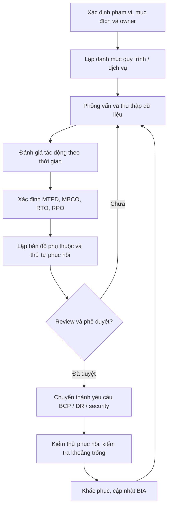
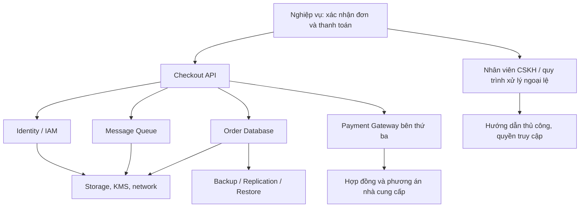
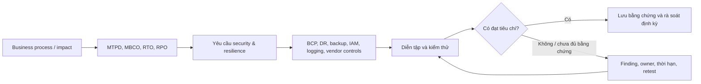

# Business impact analysis (BIA): xác định tác động gián đoạn và yêu cầu duy trì hoạt động

## 1. Business impact analysis là gì?

**Business impact analysis (BIA)**, hay *phân tích tác động kinh doanh*, là phương pháp xác định **hoạt động nào của tổ chức cần được duy trì hoặc khôi phục, tác động của việc gián đoạn tăng lên như thế nào theo thời gian, và mức gián đoạn tối đa mà tổ chức có thể chấp nhận**. Kết quả BIA là đầu vào để xác định mức ưu tiên, mục tiêu phục hồi, nguồn lực và phương án bảo đảm tính liên tục hoạt động.

Trong chương **Business continuity** của học phần **SECURITY_SECURITY_ASSURANCE**, BIA liên kết mục tiêu kinh doanh với yêu cầu bảo mật và bằng chứng kiểm chứng. Một tổ chức có thể có backup, hạ tầng dự phòng và quy trình phản ứng sự cố; tuy nhiên, để khẳng định các kiểm soát đó đáp ứng mục tiêu, cần biết **dịch vụ quan trọng nào phải hoạt động trở lại, trong thời gian bao lâu, được phép mất bao nhiêu dữ liệu và cần kiểm chứng bằng gì**. Đây là cách nối phân tích rủi ro, yêu cầu bảo mật, security controls, kiểm thử, audit và khắc phục phát hiện thành hoạt động assurance liên tục.

Ví dụ: hệ thống thanh toán có thể được backup hằng ngày nhưng nghiệp vụ chỉ chịu được mất tối đa **5 phút dữ liệu giao dịch**. Khoảng cách giữa bản backup và yêu cầu kinh doanh là một vấn đề quan trọng BIA giúp nhận diện. Nếu hệ thống khôi phục nhanh nhưng các khoản thanh toán đang xử lý bị đối soát sai, tính liên tục và tính toàn vẹn nghiệp vụ vẫn chưa được bảo đảm.

Sau bài học này, người học có thể:

- Phân biệt BIA với đánh giá rủi ro, kế hoạch duy trì hoạt động (BCP), kế hoạch khôi phục thảm họa (DRP) và kiểm thử phục hồi.
- Xác định tác động gián đoạn theo từng khoảng thời gian, các mức dịch vụ tối thiểu và yêu cầu **MTPD, RTO, RPO**.
- Lập bản đồ phụ thuộc giữa quy trình kinh doanh, con người, dữ liệu, công nghệ, bên thứ ba và các security controls.
- Chuyển kết quả BIA thành yêu cầu phục hồi có người phê duyệt, bằng chứng kiểm thử và kế hoạch khắc phục khoảng trống.

## 2. BIA trả lời câu hỏi nào?

BIA tập trung vào **hệ quả khi một hoạt động không thể thực hiện hoặc không còn đáng tin cậy**:

1. Nếu dịch vụ ngừng hoặc vận hành sai, ai bị ảnh hưởng và việc gì không thể hoàn tất?
2. Sau **15 phút, 2 giờ, 8 giờ hoặc vài ngày**, tác động sẽ thay đổi ra sao?
3. Mức dịch vụ tối thiểu nào phải được duy trì trong thời gian sự cố?
4. Khi nào hoạt động phải được khôi phục và tổ chức chịu được mất tối đa bao nhiêu dữ liệu?
5. Những nhân sự, cơ sở vật chất, nền tảng, thông tin, nhà cung cấp và quyền truy cập nào là điều kiện tiên quyết?
6. Nghiệp vụ nào cần được phục hồi trước nếu nguồn lực bị giới hạn?
7. Bằng chứng gì chứng tỏ các mục tiêu này có thể đạt trong một kịch bản gián đoạn thực tế?

BIA có ích cho cả sự cố kỹ thuật lẫn gián đoạn phi kỹ thuật: mất điện, thiên tai, dịch vụ bên thứ ba ngừng hoạt động, không có nhân sự chủ chốt, ransomware, dữ liệu bị hỏng, hệ thống định danh không dùng được hoặc địa điểm vận hành phải đóng cửa.

**BIA không mặc định tính xác suất của một cuộc tấn công**. Đó là một câu hỏi chủ yếu của *risk assessment*. BIA hỏi “nếu nghiệp vụ này gián đoạn thì tác động nào xảy ra và khi nào không thể chấp nhận được?”. Đánh giá rủi ro hỏi thêm “nguyên nhân nào có thể gây gián đoạn, khả năng xảy ra và kiểm soát hiện có như thế nào?”. Hai phân tích bổ sung cho nhau.

| Hoạt động | Câu hỏi chính | Kết quả điển hình |
|---|---|---|
| **BIA** | Gián đoạn hoặc mất tính đáng tin cậy gây tác động gì theo thời gian? | Quy trình trọng yếu, tác động, thời hạn phục hồi, phụ thuộc |
| **Risk assessment** | Nguyên nhân, khả năng và mức rủi ro là gì? | Kịch bản rủi ro, mức rủi ro, phương án xử lý |
| **BCP** | Làm cách nào duy trì nghiệp vụ ở mức tối thiểu trong gián đoạn? | Phương án vận hành thay thế, vai trò, liên lạc, thủ tục |
| **DRP** | Làm cách nào phục hồi dữ liệu, ứng dụng và hạ tầng hỗ trợ? | Quy trình chuyển đổi hệ thống, khôi phục, kiểm thử, rollback |
| **Incident response** | Cách nhận biết, kiểm soát, điều tra và xử lý sự cố bảo mật? | Triage, điều phối, containment, chứng cứ và xử lý |
| **Security assurance** | Có bằng chứng đủ rằng yêu cầu và biện pháp đang đáp ứng mục tiêu? | Truy vết yêu cầu → kiểm soát → kiểm thử → phát hiện → khắc phục |

Một DRP có thể vận hành chính xác về kỹ thuật nhưng vẫn không phù hợp nếu mục tiêu được chọn không xuất phát từ nhu cầu thực tế của nghiệp vụ. BIA giúp đặt ra **tiêu chí chấp nhận** trước khi thiết kế và kiểm tra phương án phục hồi.

## 3. Thuật ngữ cốt lõi: MTPD, RTO, RPO và MBCO

Các thuật ngữ cần được định nghĩa thống nhất trong tổ chức, đặc biệt vì nhiều tài liệu hoặc nhà cung cấp dùng tên gần giống nhau.

| Thuật ngữ | Ý nghĩa thực dụng | Đơn vị / ví dụ |
|---|---|---|
| **MTPD** (*Maximum Tolerable Period of Disruption*) | Khoảng gián đoạn tối đa trước khi tác động trở nên không thể chấp nhận theo tiêu chí kinh doanh | “Không được vượt 8 giờ” |
| **RTO** (*Recovery Time Objective*) | Thời gian mục tiêu để khôi phục hoạt động hoặc năng lực được xác định sau gián đoạn | “Khôi phục xử lý đơn trong 2 giờ” |
| **RPO** (*Recovery Point Objective*) | Giới hạn mục tiêu về tuổi dữ liệu có thể phải phục hồi lại; phản ánh lượng dữ liệu cập nhật có nguy cơ mất | “Không lùi điểm dữ liệu quá 5 phút” |
| **MBCO** (*Minimum Business Continuity Objective*) | Năng lực dịch vụ hoặc mức hoạt động tối thiểu cần duy trì trong gián đoạn | “Xử lý ít nhất 30% đơn ưu tiên” |
| **Thời gian ổn định nghiệp vụ sau phục hồi kỹ thuật** | Thời gian cần để đối soát, mở lại quy trình, xử lý tồn đọng và đạt mức nghiệp vụ đã cam kết | “Thêm 1 giờ đối soát” |

**MTPD khác RTO.** Nếu tổ chức chịu được gián đoạn tối đa 8 giờ, việc đặt RTO bằng đúng 8 giờ có thể không dành đủ thời gian để xác minh, đối soát và ổn định vận hành. Khi thiết kế, cần xác định **điểm kết thúc RTO** là phục hồi kỹ thuật hay phục hồi đủ năng lực nghiệp vụ, rồi bảo đảm thời gian của toàn chuỗi cần thiết vẫn nằm trong giới hạn không chấp nhận được.

**RPO khác tần suất backup.** Backup mỗi 15 phút không tự chứng minh đạt RPO 15 phút: bản backup có thể lỗi, replication có thể trễ, dữ liệu đang xử lý có thể không được capture nhất quán hoặc restore không khôi phục được tất cả thành phần giao dịch. RPO phải được kiểm thử với điểm dữ liệu và nghiệp vụ cụ thể.

**MBCO khác 100% công suất bình thường.** Một trung tâm chăm sóc khách hàng có thể cần tiếp nhận cuộc gọi khẩn cấp ở mức 40% công suất trong vài giờ trước khi phục hồi toàn diện. BIA phải xác định rõ đối tượng ưu tiên, điều kiện dừng và cách xử lý công việc tồn đọng.

### 3.1. Ví dụ minh họa các mốc thời gian

Một tổ chức giả định đánh giá quy trình **xác nhận và ghi nhận thanh toán trực tuyến**:

- **MTPD = 8 giờ:** sau 8 giờ, tác động vượt ngưỡng chấp nhận của doanh nghiệp.
- **RTO = 2 giờ:** mục tiêu khôi phục luồng thanh toán đủ năng lực theo định nghĩa.
- **RPO = 5 phút:** điểm dữ liệu giao dịch có thể phục hồi không được lùi quá 5 phút theo mục tiêu.
- **MBCO = 30% giao dịch ưu tiên:** trong thời gian gián đoạn có thể vận hành qua phương án dự phòng ở mức tối thiểu.
- **1 giờ ổn định/đối soát sau phục hồi kỹ thuật**, nếu công đoạn này chưa được bao gồm trong cách định nghĩa RTO của tổ chức.

Các con số này hoàn toàn **giả định để học**, không phải giới hạn bắt buộc bởi một tiêu chuẩn hay quy định. Trên thực tế, BIA phải phân tích ngưỡng tác động và có **chủ nghiệp vụ phê duyệt**. Việc chọn 2 giờ chỉ vì hạ tầng hiện có hỗ trợ 2 giờ là suy luận ngược; mục tiêu kinh doanh phải được phân biệt với khả năng hiện tại để nhìn thấy khoảng trống.

## 4. Phạm vi BIA: phân tích hoạt động kinh doanh trước, công nghệ sau

Một BIA tốt thường bắt đầu bằng **quy trình và kết quả kinh doanh** rồi mới ánh xạ đến hệ thống hỗ trợ.

Ví dụ, “xử lý đơn hàng” là một hoạt động nghiệp vụ, còn `order-service`, cơ sở dữ liệu và queue là những thành phần hỗ trợ. Nếu chỉ phân tích database bị lỗi, tổ chức có thể quên rằng vẫn không giao được hàng khi bên vận chuyển không nhận đơn hoặc nhân viên kho không truy cập hệ thống quản lý.

Tối thiểu cần xác định:

- **Đơn vị và đối tượng:** công ty, chi nhánh, nhóm khách hàng, nhà máy, khu vực địa lý, sản phẩm.
- **Hoạt động/sản phẩm/dịch vụ:** kết quả nghiệp vụ cụ thể và các mốc phục vụ khách hàng.
- **Ranh giới:** tình huống nào được tính là gián đoạn; phân biệt dịch vụ ngừng hẳn, chậm, sai dữ liệu hoặc mất tin cậy.
- **Thời điểm phụ thuộc:** giờ giao dịch cao điểm, cuối tháng, chốt sổ, ngày trả lương, giờ hoạt động của khách hàng.
- **Người chịu trách nhiệm:** business process owner, người kiểm tra thông tin, người phê duyệt kết quả.
- **Phụ thuộc:** nhân sự, nhà cung cấp, cơ sở vật chất, công nghệ, dữ liệu, phương tiện và yêu cầu pháp lý/hợp đồng.

Một quy trình có thể trọng yếu theo **tính toàn vẹn** ngay cả khi vẫn còn chạy. Ví dụ, hệ thống tính lương tiếp tục hoạt động nhưng dữ liệu bị thay đổi trái phép; dùng dữ liệu chưa được xác minh có thể gây hậu quả lớn hơn việc tạm dừng. BIA cần xét khả năng phải **dừng có kiểm soát, xác minh tính sạch của dữ liệu và chỉ khôi phục trên trạng thái tin cậy**.

## 5. Các vai trò và trách nhiệm

BIA là hoạt động phối hợp. Đội hạ tầng không thể tự quyết định thiệt hại kinh doanh; đội nghiệp vụ cũng cần kỹ sư cung cấp bằng chứng về phụ thuộc và khả năng khôi phục.

| Vai trò | Trách nhiệm |
|---|---|
| **Business process owner** | Xác định hoạt động, ngưỡng tác động, MBCO, yêu cầu phục hồi; phê duyệt giả định nghiệp vụ |
| **BCM / Business continuity coordinator** | Ban hành phương pháp, điều phối phỏng vấn, duy trì hồ sơ và theo dõi hành động |
| **IT / SRE / Platform / Data owner** | Cung cấp bản đồ hệ thống, phụ thuộc, khả năng phục hồi thực tế, backup/replication và kết quả kiểm thử |
| **Security / Incident response** | Đánh giá yêu cầu bảo mật, phương án khôi phục an toàn sau tấn công, bằng chứng và khoảng trống kiểm soát |
| **Finance / Legal / Compliance / Privacy** | Kiểm chứng thiệt hại, nghĩa vụ hợp đồng/pháp lý, dữ liệu nhạy cảm và tác động phi tài chính |
| **Supplier / Third-party manager** | Làm rõ nghĩa vụ, ràng buộc và năng lực duy trì dịch vụ của bên thứ ba |
| **Lãnh đạo có thẩm quyền** | Phê duyệt mức chịu đựng, ưu tiên và quyết định chấp nhận rủi ro hoặc cấp nguồn lực |

Khi một người vừa đề xuất ngưỡng tác động vừa tự phê duyệt toàn bộ kết quả, cần có cơ chế rà soát độc lập phù hợp. Những giả định không được xác nhận phải được ghi thành **khoảng trống dữ liệu** thay vì trình bày như số liệu đã chứng minh.

## 6. Quy trình thực hiện BIA từ đầu đến cuối



### Bước 1 — Xác định mục đích và đơn vị đánh giá

Chọn phạm vi theo dịch vụ hoặc quy trình kinh doanh có thể mô tả được, nêu rõ đơn vị chịu trách nhiệm và thời kỳ đánh giá. Xác định tiêu chí tác động được thống nhất trước khi phỏng vấn để tránh các nhóm tự dùng thang đo khác nhau.

Ví dụ, cùng một từ “nghiêm trọng” có thể mang nghĩa khác nhau giữa nhóm thương mại điện tử và nhóm quản lý danh tính. Định nghĩa phải gắn với hậu quả cụ thể, như không đáp ứng nghĩa vụ bảo vệ an toàn, mất khả năng thanh toán, thiệt hại tiền, sự cố dữ liệu hoặc vi phạm cam kết dịch vụ.

### Bước 2 — Lập danh mục và mô tả hoạt động

Mỗi hoạt động cần có: đầu vào, kết quả đầu ra, khách hàng sử dụng, chu kỳ vận hành, sản lượng bình thường/giờ cao điểm, người chịu trách nhiệm, nguồn lực và quy trình liên quan.

Nếu một chức năng có nhiều chế độ vận hành, chẳng hạn đặt hàng thường, xử lý đơn khẩn và hoàn tiền, nên phân biệt ngưỡng chịu đựng của từng hoạt động thay vì áp một thời hạn giống nhau.

### Bước 3 — Thu thập dữ liệu từ nhiều nguồn

Các nguồn có thể gồm phỏng vấn chủ quy trình, lịch sử downtime, số liệu giao dịch, quy định hợp đồng, yêu cầu báo cáo, nhật ký incident, phân tích ticket, bằng chứng thử khôi phục và tài liệu phụ thuộc. Phỏng vấn giúp phát hiện công việc thủ công khó thấy trong sơ đồ kỹ thuật; số liệu thực tế giúp thách thức giả định về doanh thu hoặc khối lượng tồn đọng.

Ghi lại **nguồn, người cung cấp, ngày thu thập, giả định, độ tin cậy và dữ liệu còn thiếu**. Ví dụ, “trung bình 1.200 đơn/giờ” khác rất xa “giờ cao điểm 6.000 đơn/giờ”; nếu chỉ dùng trung bình, tác động tại mùa bán hàng có thể bị đánh giá thấp.

### Bước 4 — Đánh giá tác động theo thời gian

Không chỉ hỏi “dịch vụ này quan trọng bao nhiêu?”. Hãy hỏi **sau mỗi khoảng gián đoạn, tác động nào xuất hiện và khi nào vượt ngưỡng chấp nhận**. Tác động có thể không tuyến tính: 30 phút đầu hầu như chưa gây thiệt hại, nhưng sau hạn chốt thanh toán hoặc thời điểm giao hàng, tác động tăng vọt.

Một bảng khảo sát minh họa:

| Hoạt động | 30 phút | 2 giờ | 8 giờ | 24 giờ |
|---|---|---|---|---|
| Ghi nhận thanh toán | Tăng queue, có thể xử lý bù | Tăng giao dịch bị bỏ dở, cần đối soát | Có thể vượt ngưỡng vận hành chấp nhận | Hậu quả lớn với khách hàng và đối tác |
| Chăm sóc khách hàng | Tồn đọng vừa phải | Khách phải chờ lâu, giảm chất lượng | Kênh hỗ trợ quan trọng quá tải | Vấn đề khách hàng chưa giải quyết tăng đáng kể |
| Tổng hợp báo cáo quản trị | Ảnh hưởng thấp nếu ngoài kỳ chốt | Có thể trì hoãn kiểm tra | Rủi ro nếu sát hạn báo cáo | Có thể lỡ thời hạn đã cam kết |

Đây là mô tả **giả định**, không được dùng làm kết luận cho doanh nghiệp thật. Chất lượng BIA phụ thuộc tiêu chí tác động và dữ liệu hỗ trợ từng ô, không phụ thuộc bảng có nhiều màu hay số điểm cao.

### Bước 5 — Xác định mức chịu đựng và mục tiêu phục hồi

Đối với từng hoạt động, chủ nghiệp vụ đề xuất và phê duyệt:

- **MTPD** dựa trên thời điểm hệ quả vượt mức chấp nhận.
- **MBCO** theo mức dịch vụ tối thiểu có thể duy trì, nhóm khách hàng và tính năng ưu tiên.
- **RTO** cho năng lực được định nghĩa; có thể có mục tiêu khác nhau giữa chế độ tối thiểu và phục hồi hoàn toàn.
- **RPO** cho từng loại dữ liệu quan trọng, xét khả năng tái tạo, đối soát và nghĩa vụ bảo vệ tính toàn vẹn.
- **Điều kiện vận hành an toàn** trước khi khôi phục, đặc biệt sau ransomware, chiếm quyền hoặc dữ liệu bị sửa đổi.

Cần thể hiện rõ đây là **mục tiêu yêu cầu** hay **khả năng hiện tại đã kiểm chứng**. Nếu muốn RTO 2 giờ nhưng diễn tập chỉ đạt 7 giờ, BIA vẫn có thể đặt yêu cầu 2 giờ, đồng thời lập một finding về khoảng trống cần xử lý.

### Bước 6 — Kiểm tra phụ thuộc và ưu tiên

Vẽ luồng hoạt động từ người dùng qua các dịch vụ đến dữ liệu và bên thứ ba. Tìm **single point of failure**, phụ thuộc ẩn, tài nguyên dùng chung và chuỗi phục hồi có thứ tự. Cần xét việc nhiều hệ thống cùng bị ảnh hưởng trong một kịch bản, chứ không chỉ giả định một máy chủ bị lỗi.

### Bước 7 — Phê duyệt, chuyển giao và kiểm chứng

Kết quả được review bởi chủ nghiệp vụ và các nhóm liên quan, lưu phiên bản và thay đổi. Chuyển RTO/RPO/MBCO thành yêu cầu BCP/DR, backup, replication, IAM, kiểm thử khôi phục và hợp đồng bên thứ ba. Nếu kết quả kiểm thử không đáp ứng yêu cầu, theo dõi finding với chủ sở hữu, hạn khắc phục và kiểm tra lại.

## 7. Xây dựng thang tác động và tiêu chí chấp nhận

BIA cần đánh giá nhiều chiều, không chỉ doanh thu bị mất.

| Chiều tác động | Câu hỏi đánh giá | Bằng chứng phù hợp |
|---|---|---|
| **Tài chính** | Doanh thu không thể phục hồi, lợi nhuận mất, chi phí bồi thường, làm thêm, phạt hợp đồng? | Số giao dịch, biên lợi nhuận, tài liệu tài chính, điều khoản hợp đồng |
| **Hoạt động** | Bao nhiêu giao dịch/tác vụ tồn đọng; có khả năng xử lý bù? | Hàng đợi, công suất, báo cáo năng lực |
| **Khách hàng/dịch vụ** | Bao nhiêu khách bị ảnh hưởng, bao lâu, có lựa chọn thay thế? | SLA, phản hồi khách hàng, khối lượng hỗ trợ |
| **Pháp lý/tuân thủ** | Có nghĩa vụ cụ thể hoặc thời hạn nào bị ảnh hưởng? | Văn bản áp dụng, cam kết đã ký, ý kiến pháp chế |
| **Uy tín** | Mức mất niềm tin, nguy cơ khách rời bỏ hoặc bị công khai? | Khảo sát, lịch sử sự cố và phản ứng truyền thông |
| **An toàn con người** | Có nguy cơ ảnh hưởng sức khỏe hoặc an toàn không? | Đánh giá an toàn, quy trình dừng khẩn, chuyên gia chuyên trách |
| **Bảo mật và toàn vẹn** | Dữ liệu sai, mất chứng cứ, thay đổi trái phép hoặc vi phạm quyền riêng tư? | Data classification, audit log, kiểm soát truy cập, hồ sơ dữ liệu |

Thang định tính có thể có các mức **thấp / vừa / cao / không thể chấp nhận**, nhưng mỗi mức nên có tiêu chí mô tả được. Chẳng hạn “không thể chấp nhận” có thể gắn với vượt hạn nghĩa vụ bắt buộc hoặc mất khả năng thực hiện hoạt động an toàn. Tránh gộp các chiều thành một điểm trung bình khiến một hậu quả nghiêm trọng bị làm mờ bởi các chiều còn lại.

**Tác động tăng theo thời gian không nhất thiết tuyến tính.** Một hạn thanh toán ở giờ thứ 4 có thể làm tác động nhảy vọt tại thời điểm đó. BIA nên đánh giá cả các **mốc hạn chót đặc biệt** và khoảng thời gian thông thường.

## 8. Ví dụ định lượng: nền tảng thương mại điện tử

Giả sử một doanh nghiệp giả định xử lý **1.200 đơn/giờ** ở giờ hoạt động thông thường, tương đương **20 đơn/phút**. Để minh họa, giả định:

- Khi checkout ngừng, **10% đơn dự định đặt trong thời gian gián đoạn mất vĩnh viễn**; phần còn lại có thể được khách đặt lại.
- **Lãi đóng góp trung bình 250.000 VND/đơn đã mất**.
- Chi phí trả thêm cho hỗ trợ khách hàng và chi phí đối soát phải được tính riêng nếu có dữ liệu; tránh đếm cùng tổn thất hai lần.
- Tốc độ đặt đơn được giả định không đổi trong khoảng tính. Đây không phải mô hình thay thế cho dữ liệu giờ cao điểm.

Trong **1 giờ gián đoạn**, 1.200 đơn được kỳ vọng; nếu 10% không thể phục hồi, sẽ có khoảng 120 đơn mất. Ước lượng lãi đóng góp mất:

\[
L_{\text{1h}} = 1.200 \times 10\% \times 250.000
             = 30.000.000\ \text{VND}
\]

Với **2 giờ**, nếu các giả định không đổi, phần này khoảng **60 triệu VND**. Đó chỉ là **một thành phần của tác động tài chính**; chưa bao gồm chi phí điều tra, xử lý tồn đọng, hoàn tiền, vi phạm hợp đồng hoặc tác động uy tín. Nếu người dùng chuyển sang một kênh đặt hàng khác trong giờ đó, mô hình cần hiệu chỉnh theo dữ liệu tránh đếm mất doanh thu đã được bù.

### 8.1. Tác động tới RPO

Với mức 20 đơn/phút, nếu hệ thống phục hồi về một thời điểm cách lúc sự cố **5 phút**, tối đa khoảng **100 đơn phát sinh trong khoảng đó cần được kiểm tra và đối soát** theo giả định tốc độ đều. Điều này **không có nghĩa chắc chắn mất 100 đơn**, vì có thể có giao dịch được ghi ở hệ thống thanh toán, hàng đợi, nhật ký append-only hoặc nguồn đối soát khác. BIA phải làm rõ:

- Bản ghi nào là nguồn sự thật của thanh toán và trạng thái đơn?
- Có khả năng phát lại, khôi phục hoặc đối soát an toàn không?
- Trạng thái “đã thu tiền nhưng chưa tạo đơn” được xử lý như thế nào?
- Khi replay, làm sao tránh tính tiền hoặc xuất kho hai lần?

RPO 5 phút chỉ hữu ích khi **tính nhất quán giữa các hệ thống liên quan** được xác định và kiểm chứng. Trong nhiều tình huống, nghiệp vụ không chấp nhận mất dữ liệu giao dịch dù chấp nhận vài phút trễ đồng bộ; khi đó cần thiết kế cơ chế xác thực, idempotency và đối soát, thay vì coi RPO là giấy phép mất dữ liệu.

### 8.2. Bảng kết quả BIA giả định

| Quy trình | MTPD giả định | RTO yêu cầu | RPO yêu cầu | MBCO trong gián đoạn | Phụ thuộc nổi bật |
|---|---:|---:|---:|---|---|
| Tiếp nhận và xác nhận thanh toán | 8 giờ | 2 giờ | 5 phút | 30% giao dịch ưu tiên | Identity, checkout, payment gateway, database, queue |
| Xử lý đơn và phân bổ tồn kho | 12 giờ | 4 giờ | 15 phút | Xử lý đơn ưu tiên bằng phương án thay thế | Order service, inventory DB, warehouse, nhân sự |
| Tra cứu lịch sử đơn cho CSKH | 24 giờ | 8 giờ | 1 giờ | Tra cứu thủ công case trọng yếu | Reporting, CRM, kho dữ liệu và danh sách khách |

Các giá trị chỉ thể hiện phương pháp. **Chủ nghiệp vụ phải chịu trách nhiệm xác nhận ngưỡng**, trong khi đội kỹ thuật chịu trách nhiệm đánh giá khả năng thực hiện. Có thể có những trường hợp mức độ tối thiểu dịch vụ cao hơn nhưng RTO dài hơn hoặc ngược lại; vì thế cần mô tả cụ thể trạng thái hoàn thành của từng mục tiêu.

## 9. Phân tích phụ thuộc và hiệu ứng dây chuyền

Một quy trình thường phụ thuộc nhiều tầng:



Để đánh giá khả năng đạt RTO, không chỉ cộng thời gian khởi động từng máy. Cần xác định **thứ tự và khả năng phục hồi song song**. Nếu checkout chỉ hoạt động sau IAM và payment gateway, một mục tiêu khôi phục checkout trong 2 giờ sẽ không khả thi khi nhà cung cấp thanh toán chỉ cam kết khôi phục sau 6 giờ và không có phương án thay thế.

Tương tự, kế hoạch phục hồi cơ sở dữ liệu có thể hoàn thành trong 30 phút nhưng môi trường không có khóa KMS dùng để giải mã dữ liệu, hoặc DNS chưa cập nhật. Những phụ thuộc này phải được phản ánh trong BIA và kiểm thử DR.

### 9.1. Danh mục nguồn lực và điểm yếu thường bị bỏ sót

- **Con người:** ai có kiến thức, quyền phê duyệt và quyền quản trị để kích hoạt phương án? Có người thay thế trong ngày nghỉ?
- **Identity và secret:** có thể truy cập tài khoản khẩn cấp, khóa mã hóa, chứng chỉ, kho secret và hệ thống quản lý quyền khi IdP chính ngừng hoạt động không?
- **Dữ liệu và tính toàn vẹn:** có dữ liệu nhất quán để khôi phục, bằng chứng kiểm tra dữ liệu sạch và cách đối soát giao dịch không?
- **Hạ tầng:** DNS, network, load balancer, region, nhà mạng, điện, nơi vận hành và giới hạn công suất?
- **Chuỗi cung ứng:** dịch vụ cloud, nhà cung cấp thanh toán, logistics, đối tác dữ liệu và thỏa thuận liên lạc khẩn cấp?
- **Security monitoring:** khi chuyển sang hệ thống dự phòng, log, cảnh báo, quyền quản trị và bảo vệ dữ liệu vẫn hoạt động không?
- **Tài liệu phục hồi:** runbook, inventory, sơ đồ phụ thuộc, số điện thoại hỗ trợ có truy cập được ngoài môi trường chính không?
- **Trở về hoạt động bình thường:** hệ thống primary và secondary có được đối soát dữ liệu trước failback, có phương án rollback không?

Không nên mặc định tất cả phụ thuộc đều ngừng cùng lúc; nhưng BIA và kế hoạch dự phòng phải **xét các kịch bản lỗi tương quan** như sự cố identity tập trung, hỏng đường mạng dùng chung hoặc ransomware ảnh hưởng cả production lẫn môi trường backup.

## 10. Đưa security vào BIA: khả dụng, toàn vẹn và bí mật

BIA truyền thống thường bắt đầu với **availability**, nhưng mục tiêu security assurance đòi hỏi nhìn cả **integrity** và **confidentiality** khi chúng tác động đến khả năng tiếp tục kinh doanh.

| Kịch bản | Tác động cần đánh giá | Điều kiện phục hồi an toàn |
|---|---|---|
| Mất dịch vụ do lỗi hạ tầng | Khách không giao dịch, công việc tồn đọng | Hạ tầng hoạt động và kiểm thử end-to-end đạt |
| Ransomware | Dịch vụ dừng, có thể mất dữ liệu và kiểm soát môi trường | Điều tra mức nhiễm, backup sạch, kiểm soát IAM/EDR, xác minh trước kết nối lại |
| Dữ liệu thanh toán bị sai lệch | Giao dịch hoàn tất sai, tổn thất và tranh chấp | Nguồn dữ liệu tin cậy, đối soát và kiểm tra tính nhất quán |
| Lộ thông tin nhạy cảm | Tác động pháp lý, hợp đồng, khách hàng; hoạt động có thể cần tạm dừng | Containment, đánh giá nghĩa vụ, bảo vệ quyền truy cập và điều kiện tiếp tục |
| Hỏng hoặc mất hệ thống IAM | Không xác thực được, không vận hành được phương án DR | Quy trình truy cập khẩn đã phê duyệt và được thử, bảo vệ audit log |
| Nhà cung cấp bên thứ ba bị gián đoạn | Hoạt động phụ thuộc bị dừng dù nội bộ còn chạy | Phương án chuyển đổi, công cụ dự phòng, cam kết và diễn tập |

**Phục hồi nhanh chưa chắc phục hồi an toàn**. Ví dụ, sau một cuộc tấn công làm thay đổi dữ liệu, việc đưa backup chưa được đánh giá lên production có thể đưa phần mềm độc hại trở lại hoặc làm sai số liệu. Tiêu chí chấp nhận nên bao gồm cả:

- Dữ liệu và hệ thống đã qua bước xác minh cần thiết.
- Quyền truy cập đặc quyền và bí mật đã được kiểm soát sau sự cố.
- Log, monitoring và cảnh báo vận hành trở lại.
- Các giao dịch đang dang dở được kiểm tra và đối soát.
- Chủ nghiệp vụ chấp nhận năng lực tối thiểu/phục hồi hoàn toàn dựa trên kết quả kiểm chứng.

Nếu kiểm soát an toàn cần thêm thời gian, phải phản ánh vào chiến lược và khả năng đáp ứng mục tiêu thay vì bỏ qua công đoạn đó để báo RTO đẹp.

## 11. Từ BIA đến phương án và thứ tự phục hồi

Một ma trận ưu tiên kỹ thuật thường phải xét thêm **chuỗi phụ thuộc**. Dịch vụ DNS hoặc identity có thể không trực tiếp tạo doanh thu, nhưng là điều kiện để nhiều hoạt động sinh doanh thu khôi phục. Do đó, ưu tiên khôi phục không nên chỉ là sắp xếp RTO từ nhỏ đến lớn.

Một cách làm có kiểm soát:

1. Từ BIA, xác định dịch vụ có hậu quả không chấp nhận sớm nhất.
2. Tìm toàn bộ phụ thuộc **bắt buộc** để đạt MBCO hoặc RTO.
3. Xác định nguồn lực khan hiếm: nhân sự, hạ tầng dự phòng, băng thông, khóa mã hóa, tài khoản khẩn cấp và nhà cung cấp.
4. Xác định tác vụ có thể làm song song, tác vụ phải làm theo thứ tự và bước xác minh sau khôi phục.
5. Lập thứ tự ưu tiên cho kịch bản cụ thể, có phương án khi một phụ thuộc không thể phục hồi.
6. Đánh giá xem chiến lược có đáp ứng RTO/RPO/MBCO **trong thử nghiệm**; ghi mọi chênh lệch.

Ví dụ, để phục hồi checkout cần có identity, database và payment gateway. Nếu nhóm DR phục hồi checkout API trước nhưng chưa khôi phục database và secret store, dịch vụ vẫn không thể nhận thanh toán đúng. BIA phải giúp đội kỹ thuật hiểu **đích nghiệp vụ**, còn kiểm thử DR xác nhận thứ tự thực thi đạt đích đó.

### 11.1. Những lựa chọn chiến lược có thể xuất phát từ BIA

| Yêu cầu được xác nhận | Chiến lược có thể đánh giá | Bằng chứng phải thu được |
|---|---|---|
| RTO ngắn, công suất cao | Hạ tầng dự phòng, tự động chuyển đổi, capacity reservation | Kết quả failover end-to-end và đo thời gian |
| RPO rất nhỏ | Replication phù hợp, transaction log, journaling, cơ chế đối soát | Kết quả kiểm tra điểm khôi phục và tính nhất quán |
| MBCO dưới 100% | Chế độ giảm tải có ưu tiên, kênh thay thế, quy trình thủ công | Diễn tập thông lượng tối thiểu và chất lượng xử lý |
| Có phụ thuộc vào nhà cung cấp | Hợp đồng, đầu mối khẩn, phương án chuyển đổi hoặc chấp nhận giới hạn | Test đường chuyển đổi và tài liệu nghĩa vụ |
| Sự cố có nguy cơ xóa hoặc sửa dữ liệu | Backup chống sửa/xóa khi phù hợp, bản sao tách biệt, quy trình khôi phục sạch | Restore test, kiểm tra khả năng truy cập và tính toàn vẹn |
| Cần vận hành trong tình huống IAM hỏng | Quyền truy cập khẩn cấp có kiểm soát, xác thực và audit phù hợp | Diễn tập truy cập, thu hồi và hậu kiểm |

Không có chiến lược nào tự động đáp ứng yêu cầu chỉ vì sản phẩm quảng cáo “high availability”. Phải kiểm tra **cấu hình thực tế, dữ liệu, tổ chức vận hành và tình huống lỗi phù hợp**.

## 12. Ví dụ hồ sơ BIA có thể kiểm tra lại

Một hồ sơ có cấu trúc giúp đối chiếu giữa nghiệp vụ, đội triển khai và kiểm toán. Ví dụ **YAML minh họa**, không phải schema bắt buộc hoặc file cấu hình của một nền tảng:

```yaml
bia_id: BIA-CHECKOUT-001
version: "1.0"
assessment_date: "2026-11-28"
service: "Checkout and payment confirmation"
business_owner: "E-commerce Operations"
scope:
  environment: production
  customer_segments: ["retail"]
  excluded: ["offline wholesale orders"]

business_impact:
  time_buckets: ["30m", "2h", "8h", "24h"]
  unacceptable_at: "8h"
  drivers:
    - "Unrecoverable abandoned orders"
    - "Payment reconciliation backlog"
    - "Partner/customer commitments"
  data_sources:
    - "Order volumes by hour"
    - "Payment reconciliation reports"
    - "Approved contractual requirements"

objectives:
  mtpd: "8h"
  rto_required: "2h"
  rpo_required: "5m"
  mbco: "30% of priority payment transactions"
  business_acceptance: "Reconciled priority payments can be processed"

dependencies:
  internal: ["identity", "checkout-api", "order-db", "queue", "kms"]
  external: ["payment-gateway"]
  people: ["on-call SRE", "payment operations"]

assurance:
  latest_restore_test: null
  evidence_required:
    - "End-to-end failover timeline"
    - "Reconciliation result"
    - "Recovery point verification"
    - "Approvals and open findings"
  status: "not_yet_validated"

approvals:
  business_owner: "pending"
  continuity_coordinator: "pending"
```

**Không coi hồ sơ này đã được phê duyệt**: các trường `pending`, `null` và `not_yet_validated` là dấu hiệu thiếu bằng chứng. Trong hệ thống thực, mỗi giá trị quan trọng cần gắn nguồn, người xác nhận, phiên bản và lịch rà soát. Mẫu chỉ nhằm thể hiện cấu trúc có thể truy vết.

## 13. Kiểm chứng BIA bằng bài kiểm thử và diễn tập

BIA là **nguồn yêu cầu phục hồi**; test cho biết chiến lược thực hiện được đến đâu. Một kế hoạch thử nên có điều kiện đầu vào, kịch bản, timestamp tin cậy, kết quả dự kiến, kết quả thực tế và tiêu chí chấp nhận.

| Phép thử | Câu hỏi chính | Bằng chứng cần giữ |
|---|---|---|
| **Restore dữ liệu** | Có thể phục hồi bản dữ liệu nhất quán trong giới hạn RPO không? | Timestamp điểm phục hồi, log restore, đối soát dữ liệu |
| **Failover ứng dụng** | Dịch vụ đạt năng lực nghiệp vụ cần thiết trong RTO không? | Timeline, kết quả giao dịch end-to-end, thông lượng |
| **MBCO** | Phương án thủ công/dự phòng có duy trì công suất tối thiểu thực tế không? | Số đơn xử lý, lỗi, danh sách nhân sự, feedback |
| **Mất phụ thuộc bên thứ ba** | Có thể xử lý khi payment gateway hoặc nhà mạng không dùng được? | Log chuyển đổi, đầu mối liên lạc, kết quả đối tác |
| **IAM/KMS gián đoạn** | Cơ chế khẩn cấp có giữ quyền truy cập cần thiết và audit không? | Biên bản diễn tập, bằng chứng phân quyền và thu hồi |
| **Ransomware/khôi phục sạch** | Có xác định bản sao tin cậy, khống chế truy cập và tránh tái nhiễm không? | Kết quả xác minh backup, checklist an ninh, quyết định mở hệ thống |
| **Đối soát và ổn định** | Sau khôi phục kỹ thuật, dữ liệu, queue, trạng thái đơn có nhất quán? | Báo cáo đối soát, backlog, phê duyệt nghiệp vụ |

### 13.1. Cách đo RTO và RPO trong diễn tập

Hãy xác định rõ **mốc bắt đầu** và **điều kiện kết thúc**:

- RTO đo từ thời điểm gián đoạn được chọn trong kịch bản tới khi *mức năng lực đã cam kết* hoạt động trở lại. Không báo kết thúc chỉ vì server vừa khởi động, nếu giao dịch thử vẫn thất bại.
- RPO đánh giá theo **thời điểm dữ liệu mới nhất đã khôi phục nhất quán** so với thời điểm gián đoạn, với các quy tắc rõ ràng về sự kiện đang bay, đồng bộ trễ và dữ liệu cần đối soát.
- Khi đánh giá một kịch bản an ninh, thêm điều kiện **khôi phục từ dữ liệu/hệ thống đáng tin cậy** và xác minh các bảo vệ thiết yếu.

Ví dụ, trong diễn tập hệ thống dừng lúc **10:00 UTC**. Lúc **11:35 UTC**, checkout xử lý được giao dịch thử và đạt MBCO đã định; thời gian đo đến mốc này là **1 giờ 35 phút**, trong RTO yêu cầu 2 giờ. Nếu điểm dữ liệu nhất quán mới nhất chỉ đến **09:50 UTC**, khoảng lùi là **10 phút**, **không đạt RPO 5 phút**. Kết quả tổng thể phải ghi rõ **RTO đạt, RPO không đạt**, không gộp thành “diễn tập thành công” mà che đi điểm yếu.

Một số tình huống không được phép thử phá hoại trên production. Có thể dùng diễn tập mô phỏng, môi trường cô lập hoặc thử từng thành phần, nhưng phải ghi **giới hạn phạm vi** của bằng chứng. Test trên môi trường giống production không chứng minh mọi yếu tố production đã được bao phủ nếu không có biện pháp đối chiếu phù hợp.

### 13.2. Khoảng trống giữa yêu cầu và khả năng hiện tại

| Tiêu chí | Yêu cầu BIA | Kết quả kiểm thử giả định | Kết luận |
|---|---:|---:|---|
| RTO checkout | ≤ 2 giờ | 1 giờ 35 phút | Đạt trong kịch bản thử |
| RPO dữ liệu giao dịch | ≤ 5 phút | 10 phút | **Không đạt** |
| MBCO giao dịch ưu tiên | ≥ 30% công suất | 35% | Đạt trong kịch bản thử |
| Khôi phục log giám sát | Có log/audit phục vụ điều tra | Log từ hệ thống DR bị thiếu | **Không đạt** |
| Đối soát sau phục hồi | Không còn giao dịch mồ côi chưa xử lý theo tiêu chí | Chưa kiểm tra | **Chưa có bằng chứng** |

Mỗi kết luận cần gắn mã test, ngày, hệ thống/phiên bản, người xác nhận và tài liệu chứng cứ. **“Chưa kiểm tra” khác “không đạt”**, nhưng cả hai đều là giới hạn không thể bỏ qua khi đưa ra kết luận assurance.

## 14. BIA dưới góc nhìn security assurance

Để dùng kết quả BIA đánh giá có bằng chứng rằng các mục tiêu bảo mật được đáp ứng, cần thiết lập mối liên hệ:



Một bộ bằng chứng cần trả lời được ít nhất:

1. **Tại sao mục tiêu tồn tại?** Hồ sơ BIA cho thấy tác động, mốc thời gian, căn cứ định lượng/định tính.
2. **Ai đã chấp nhận mục tiêu?** Chủ nghiệp vụ và người có thẩm quyền đã xem xét, phê duyệt.
3. **Kiểm soát nào thực hiện mục tiêu?** Bản đồ yêu cầu tới backup, replication, redundancy, IAM, monitoring, DRP, phương án vận hành thủ công và SLA bên thứ ba.
4. **Kiểm soát đã được thử ra sao?** Kịch bản tương ứng, điều kiện thử, dữ liệu đầu vào, log, timeline, RTO/RPO thực tế và kết quả đối soát.
5. **Khi chưa đạt thì xử lý thế nào?** Finding có ảnh hưởng, owner, deadline, phương án kiểm soát bù hoặc rủi ro được chấp nhận bởi đúng thẩm quyền, kết quả kiểm tra lại.
6. **Bao giờ cần đánh giá lại?** Sau thay đổi nền tảng, phụ thuộc, quy trình kinh doanh, khối lượng giao dịch, hợp đồng, nghĩa vụ hoặc sự cố lớn.

Có thể tạo một **traceability matrix**:

| Mục tiêu BIA | Kiểm soát tương ứng | Test xác nhận | Hồ sơ / bằng chứng |
|---|---|---|---|
| Thanh toán khôi phục ≤ 2 giờ | Failover checkout, DB, identity, payment gateway | E2E failover 2 giờ | Test run, timeline, transaction sample |
| Dữ liệu lùi không quá 5 phút | Replication và restore/đối soát | Khôi phục dữ liệu tại điểm lỗi | Recovery checkpoint, reconciliation |
| Đạt 30% công suất ưu tiên | Chế độ degraded operation, phân loại khách ưu tiên | Load test trên môi trường DR | Throughput, lỗi, kết quả business owner |
| Phục hồi sạch sau tấn công | Backup tách biệt, quản lý quyền và xác minh bản khôi phục | Controlled clean restore exercise | Bằng chứng toàn vẹn, nhật ký phê duyệt |
| Có giám sát khi chạy DR | Log forwarder, EDR, alert routing tại site dự phòng | Test sinh sự kiện sau failover | Event ID, alert ID, SOC acknowledgement |

Việc hệ thống có tài liệu BIA không chứng minh kết quả. Ngược lại, một lần khôi phục nhanh không tự chứng minh toàn bộ yêu cầu nếu chưa kiểm tra giới hạn dữ liệu, ngữ cảnh, năng lực và các phụ thuộc.

## 15. Duy trì BIA như một tài liệu sống

Kết quả BIA có thể nhanh chóng lỗi thời khi doanh nghiệp thay đổi. Cần quy định cơ chế rà soát theo lịch và theo **sự kiện kích hoạt**, chẳng hạn:

- Ra mắt sản phẩm mới, thêm kênh thanh toán, thay quy trình nghiệp vụ hoặc tăng quy mô đáng kể.
- Di chuyển hệ thống sang cloud, thay region, thay định danh hoặc cấu trúc dữ liệu.
- Thay nhà cung cấp, hợp đồng, SLA hoặc phụ thuộc công nghệ.
- Thay ngưỡng chấp nhận rủi ro, yêu cầu pháp lý hoặc mục tiêu kinh doanh.
- Diễn tập DR không đạt, xảy ra incident có tác động đáng kể, xuất hiện lỗi phục hồi hoặc bằng chứng gián đoạn chưa được xét.
- Phát hiện hạ tầng/quy trình mới không nằm trong danh mục BIA.

Khi cập nhật, lưu **người đề xuất, phần thay đổi, căn cứ, người phê duyệt, thời điểm hiệu lực, tác động tới BCP/DR và các test cần chạy lại**. Nếu thời hạn phục hồi bị rút ngắn, đội kỹ thuật phải đánh giá năng lực hiện tại và khoảng trống, không chỉ sửa một ô trong bảng.

### 15.1. Các chỉ số hữu ích

| Chỉ số | Cách diễn giải |
|---|---|
| **BIA coverage** | Tỷ lệ hoạt động trọng yếu trong danh mục đã có BIA được phê duyệt |
| **BIA freshness** | Bao nhiêu BIA được cập nhật trong chu kỳ quy định hoặc sau thay đổi lớn |
| **Dependencies validated** | Tỷ lệ phụ thuộc quan trọng đã được xác nhận với owner và kiểm thử |
| **RTO/RPO test attainment** | Tỷ lệ kịch bản kiểm thử đáp ứng mục tiêu, tách theo dịch vụ và thời điểm |
| **Untested critical objectives** | Mục tiêu quan trọng chưa có bằng chứng kiểm thử phù hợp |
| **Open resilience findings** | Finding quá hạn hoặc chưa được khắc phục, phân loại theo tác động nghiệp vụ |
| **MBCO exercise performance** | Công suất tối thiểu đạt được trong diễn tập so với nhu cầu |
| **Change-driven review compliance** | Mức độ cập nhật BIA sau các thay đổi kích hoạt |

Các chỉ số này giúp duy trì chương trình assurance, nhưng số lượng tài liệu được phê duyệt không phản ánh đầy đủ chất lượng nếu giả định và mục tiêu chưa được thử nghiệm.

## 16. Những lỗi thường gặp và cách khắc phục

| Lỗi | Hệ quả | Cách khắc phục |
|---|---|---|
| Bắt đầu từ danh sách server thay vì nghiệp vụ | Bỏ qua hoạt động thủ công, khách hàng và đối tác | Lập bản đồ quy trình, rồi mới ánh xạ hạ tầng |
| Chọn RTO bằng năng lực hiện tại | Che giấu khoảng trống giữa nhu cầu và khả năng | Ghi riêng `required` và `tested/current` |
| Coi backup thành RPO | Khôi phục có thể lùi xa hơn mục tiêu hoặc không nhất quán | Test restore, checkpoint và đối soát |
| Chỉ ước tính tác động tài chính | Bỏ qua an toàn, tuân thủ, dữ liệu, uy tín | Dùng ma trận tác động đa chiều có tiêu chí |
| Không xét giờ cao điểm/hạn chót | Đánh giá thấp thời điểm nghiêm trọng | Dùng nhiều kịch bản tải và mốc thời gian |
| Không phân tích phụ thuộc dùng chung | RTO không khả thi dù từng server phục hồi nhanh | Vẽ dependency graph và kiểm thử E2E |
| Quên quyền quản trị, KMS hoặc log khi DR | Hệ thống hoạt động thiếu an toàn hoặc không thể truy cập | Đưa control bảo mật vào điều kiện phục hồi |
| Dùng các con số mẫu như quy định chung | Mục tiêu không phù hợp với nghĩa vụ thực tế | Xác nhận căn cứ với owner, pháp chế, hợp đồng |
| Không có owner/phê duyệt | Tranh luận khi cần ưu tiên phục hồi | Xác lập thẩm quyền và lịch sử phê duyệt |
| Báo một test “đạt” dù RPO không đạt | Che dấu rủi ro dữ liệu | Tách kết quả theo từng tiêu chí và finding |
| Không cập nhật BIA sau thay đổi lớn | Kế hoạch phục hồi lỗi thời | Trigger review trong quy trình thay đổi |
| Giữ danh mục tác động mà không có phép thử | Không có bằng chứng vận hành | Liên kết yêu cầu tới DR test và kiểm tra định kỳ |

## 17. Bài thực hành: xây dựng BIA cho dịch vụ đặt lịch khám

**Bối cảnh giả định:** một tổ chức vận hành hệ thống đặt lịch khám. Người bệnh đặt lịch trực tuyến, nhân viên tiếp nhận xác nhận và bác sĩ xem danh sách lịch trong ngày. Hệ thống phụ thuộc vào dịch vụ xác thực, cơ sở dữ liệu lịch, SMS/email, cơ sở vật chất, đường truyền và nhân viên vận hành. Có phương án nhận lịch thủ công nhưng chưa diễn tập.

Hãy xây dựng BIA nhỏ theo các bước:

1. Phân tách ít nhất ba hoạt động: **đặt lịch mới**, **xem và điều chỉnh lịch của ngày hiện tại**, **gửi thông báo xác nhận**. Xác định chủ quy trình, đầu vào/đầu ra và khách hàng bị ảnh hưởng.
2. Chọn bốn khoảng thời gian gián đoạn (ví dụ 15 phút, 1 giờ, 4 giờ, 24 giờ); đánh giá tác động đến người bệnh, khả năng tiếp nhận, tồn đọng và nghĩa vụ liên quan. Ghi rõ giả định nào cần xác thực từ vận hành và pháp chế.
3. Đề xuất **MTPD, RTO, RPO và MBCO riêng** cho từng hoạt động. Làm rõ điều kiện để coi “đã phục hồi”: chỉ đăng nhập được hay đã tra cứu và cập nhật lịch an toàn?
4. Lập dependency map: identity, lịch hẹn, thông báo, dữ liệu, quyền truy cập khẩn, người trực, hệ thống dự phòng và phương án thủ công.
5. Xem xét một kịch bản dữ liệu lịch hẹn bị sửa trái phép. Nêu cách xác định nguồn tin cậy và kiểm tra trước khi mở lại dịch vụ; không mặc định backup mới nhất là sạch.
6. Thiết kế hai kịch bản kiểm thử: **mất kết nối dịch vụ đặt lịch** và **khôi phục từ bản dữ liệu trước khi lỗi xảy ra**. Đo thời gian hoạt động tối thiểu, điểm dữ liệu, công việc tồn đọng và số lịch phải đối soát.
7. Viết bảng đối chiếu **yêu cầu → kiểm soát → phép thử → evidence → finding**. Chỉ rõ ai phê duyệt rủi ro còn tồn tại và khi nào thử lại.

**Tiêu chí đạt:** BIA thể hiện tác động tăng theo thời gian, mục tiêu được đặt dựa trên nhu cầu nghiệp vụ, phụ thuộc đủ để nhận ra chuỗi phục hồi, và test có tiêu chí định lượng cùng bằng chứng. Trường hợp chưa có dữ liệu hoặc chưa diễn tập phải ghi `unknown` / `not tested`, không tự tuyên bố hệ thống đạt yêu cầu.

## 18. Ghi nhớ

BIA biến câu hỏi “dịch vụ này có quan trọng không?” thành các **mục tiêu có thể đo, phân công và kiểm chứng**:

**Hoạt động kinh doanh → tác động theo thời gian → MTPD/MBCO/RTO/RPO → phụ thuộc → phương án duy trì và khôi phục → kiểm thử → bằng chứng → khắc phục.**

Trong chương trình **SECURITY_SECURITY_ASSURANCE**, BIA là điểm kết nối giữa nhu cầu kinh doanh và các kiểm soát bảo mật, nhất là khả năng phục hồi an toàn trước sự cố. Một BIA có giá trị khi mục tiêu được chủ nghiệp vụ xác nhận, được chuyển thành điều kiện thiết kế và có kết quả diễn tập đủ tin cậy để chứng minh mức đáp ứng hoặc chỉ ra chính xác khoảng trống cần xử lý.
