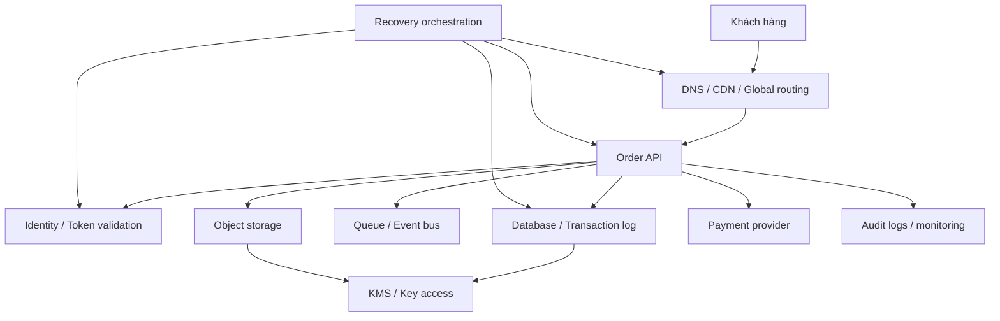
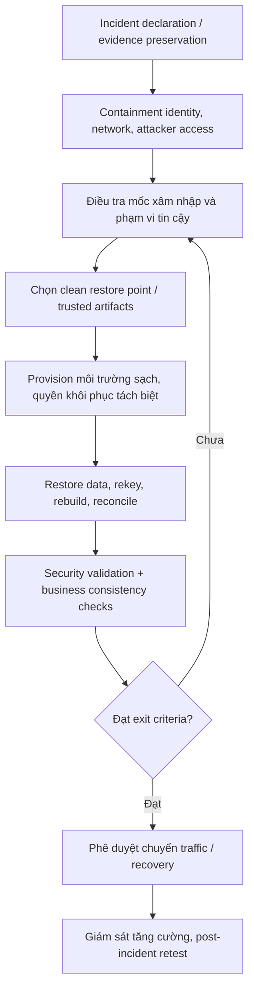
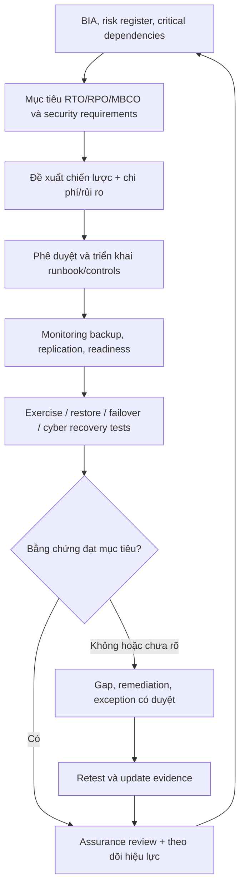

# Recovery Strategy trong Business Continuity: lựa chọn và chứng minh khả năng phục hồi

## 1. Recovery Strategy là gì và giải quyết vấn đề nào?

**Recovery Strategy (chiến lược phục hồi)** là tập các quyết định ở cấp tổ chức và kiến trúc về **cách duy trì hoặc khôi phục các hoạt động, dịch vụ, dữ liệu và năng lực thiết yếu** sau gián đoạn, trong khoảng thời gian và mức mất mát được chấp nhận. Chiến lược nêu **phương án năng lực, tài nguyên dự phòng, thứ tự ưu tiên và giới hạn**; từ đó mới xây thành kế hoạch, runbook, tổ chức diễn tập và vận hành khôi phục.

Trong chương **Business continuity** của module **SECURITY_SECURITY_ASSURANCE**, mục tiêu không dừng ở việc nói “chúng ta có backup” hay “hệ thống triển khai đa vùng”. Một **security assurance program** cần bằng chứng rằng phương án đã chọn thực sự hỗ trợ mục tiêu bảo mật và tính liên tục: dữ liệu không mất vượt mức được duyệt, các chức năng quan trọng được khôi phục trong thời hạn mục tiêu, kiểm soát bảo mật còn hiệu lực, và những điểm chưa chứng minh được phải được ghi thành rủi ro hay khoảng trống.

Hãy hình dung hệ thống đặt hàng gặp gián đoạn trong một vùng cloud. Tổ chức có backup mỗi đêm, nhưng kinh doanh yêu cầu khôi phục đặt hàng trong hai giờ và mất tối đa 15 phút giao dịch. **Backup tồn tại không đồng nghĩa chiến lược đạt yêu cầu**: phải biết bản sao mới đến đâu, cần bao lâu để tải dữ liệu, dựng database, cấp danh tính, khởi động dịch vụ, đổi đường truy cập và xác minh giao dịch. Nếu dữ liệu đã bị kẻ tấn công sửa hoặc mã hóa, bản sao mới nhất cũng có thể không đáng tin.

### Mục tiêu học tập

Sau bài học, người học có thể:

1. Phân biệt recovery strategy với Business Continuity Plan (BCP), Disaster Recovery Plan (DRP), Incident Response (IR) và backup.
2. Chuyển **Business Impact Analysis (BIA)**, rủi ro và nhu cầu nghiệp vụ thành RTO, RPO, mức dịch vụ tối thiểu và độ ưu tiên có thể kiểm chứng.
3. So sánh backup/restore, cold/warm/hot standby, active-passive, active-active, replication và cách vận hành thủ công.
4. Thiết kế trình tự phục hồi có xét dữ liệu, network, identity, secrets, bên thứ ba, phụ thuộc giữa các dịch vụ và tính nhất quán.
5. Phân biệt khôi phục sau lỗi hạ tầng với **cyber recovery** khi nghi đã bị xâm nhập hoặc làm sai lệch dữ liệu.
6. Xây tiêu chí diễn tập, thu evidence, đánh giá kết quả và cải tiến chiến lược liên tục.

**Phạm vi:** bài học tập trung vào việc **lựa chọn và chứng minh** chiến lược phục hồi. Ví dụ cloud, ứng dụng và số liệu đều minh họa; RTO, RPO, chi phí và sự phù hợp phải được quyết định trên cơ sở BIA, rủi ro, kiến trúc và phép đo của từng tổ chức.

## 2. Đặt Recovery Strategy đúng vị trí trong Business Continuity

Các thuật ngữ liên quan nhưng không đồng nhất:

| Khái niệm | Câu hỏi chính | Sản phẩm/bằng chứng |
|---|---|---|
| **Business Continuity Management (BCM)** | Tổ chức duy trì khả năng phục vụ hoạt động quan trọng như thế nào qua gián đoạn? | Chính sách, BIA, chiến lược, kế hoạch, đào tạo, review |
| **Business Impact Analysis (BIA)** | Hoạt động nào quan trọng và gián đoạn bao lâu thì gây tác động không chấp nhận được? | Phân tích tác động theo thời gian, độ ưu tiên, dependencies, mục tiêu |
| **Recovery Strategy** | Dùng cách tiếp cận, năng lực dự phòng và nguồn lực nào để đáp ứng mục tiêu? | Lựa chọn kiến trúc, trade-offs, owner, giới hạn, tiêu chí đo |
| **Business Continuity Plan (BCP)** | Làm thế nào tiếp tục cung cấp mức dịch vụ tối thiểu và phối hợp các bộ phận? | Quy trình con người, địa điểm, giao tiếp, phương án thay thế |
| **Disaster Recovery Plan (DRP)** | Khôi phục hệ thống công nghệ và dữ liệu theo thứ tự nào, bằng các bước gì? | Runbook, backup/failover procedure, điểm quyết định, rollback |
| **Incident Response (IR)** | Phát hiện, kiểm soát, điều tra và loại bỏ nguyên nhân sự cố an ninh như thế nào? | Incident timeline, containment, evidence, eradication, recovery decision |
| **High Availability (HA)** | Dịch vụ tiếp tục hoạt động khi một thành phần lỗi cục bộ như thế nào? | Redundancy, health checks, automatic failover, SLO evidence |
| **Backup** | Có bản sao dữ liệu để khôi phục không? | Backup policy, snapshots, backup inventory và restore verification |

Một hệ thống có HA trong cùng một vùng có thể vượt qua lỗi một máy nhưng không chống được sự cố cả vùng. Một hệ thống có DR đa vùng có thể khôi phục ứng dụng nhưng không giúp doanh nghiệp vận hành nếu nhân sự, mạng của đối tác hay quy trình thủ công đều không khả dụng. Recovery strategy vì vậy cần bao gồm cả **công nghệ lẫn người, quy trình, địa điểm, nhà cung cấp và an ninh dữ liệu**.

**IR và DR phối hợp nhưng có mục đích khác:** trong sự cố mã độc, IR phải xác định đường xâm nhập và giới hạn quyền attacker; DR phải khôi phục hệ thống/dữ liệu sạch. Chỉ chuyển traffic sang site dự phòng mà vẫn dùng credential bị xâm nhập có thể tạo thêm một site bị xâm nhập.

## 3. BIA: căn cứ để chọn chiến lược thay vì chọn công nghệ trước

**Business Impact Analysis** xác định tác động tăng theo thời gian khi một quy trình hoặc dịch vụ không còn đáp ứng nhu cầu. BIA thường cần sự tham gia của business owner, vận hành, công nghệ, bảo mật, pháp chế và các nhóm phụ thuộc.

### 3.1. Những yếu tố cần hỏi

Với một quy trình nghiệp vụ:

- **Sản phẩm/chức năng thiết yếu:** bước nào tạo giá trị trực tiếp và bắt buộc tiếp tục?
- **Ngưỡng chịu đựng gián đoạn:** sau bao lâu tác động tài chính, pháp lý, khách hàng hoặc vận hành vượt mức chấp nhận?
- **Mức dịch vụ tối thiểu:** phải xử lý tối thiểu bao nhiêu đơn, cuộc gọi, giao dịch hoặc hồ sơ trong trạng thái suy giảm?
- **Phụ thuộc:** nhân sự, nhà cung cấp, identity, network, cloud, database, thanh toán, điện, thiết bị, dữ liệu và quy trình phê duyệt.
- **Thời điểm nhạy cảm:** giờ cao điểm, chốt sổ, kỳ trả lương, cuối quý, thời hạn pháp lý.
- **Khả năng làm thủ công/hoãn:** công việc nào vẫn thực hiện tạm thời được, với rủi ro và giới hạn gì?
- **Dữ liệu cần bảo vệ:** bản ghi nào không thể tái tạo; giao dịch nào có thể nhập lại hoặc đối soát?

Một bảng BIA minh họa cho nền tảng thương mại:

| Hoạt động | Tác động khi gián đoạn | Mức tối thiểu khi suy giảm | Phụ thuộc trọng yếu |
|---|---|---|---|
| Nhận đơn hàng | Mất doanh thu, khách hàng không đặt được | Ghi nhận đơn mới qua kênh dự phòng có kiểm soát | Identity, API, database, queue |
| Xử lý thanh toán | Giao dịch bị treo, rủi ro đối soát | Dừng thu tiền mới nếu không xác nhận được trạng thái | PSP bên thứ ba, idempotency, ledger |
| Tra cứu đơn | Tăng liên hệ hỗ trợ, giảm trải nghiệm | Nhân viên hỗ trợ truy vấn tập dữ liệu đã được kiểm chứng | Read replica, API, access policy |
| Báo cáo phân tích | Chậm thông tin quản trị | Có thể hoãn một ngày theo phê duyệt | Data warehouse, batch jobs |

Đây là ví dụ, không phải khuyến nghị rằng báo cáo luôn ít quan trọng hoặc nhận đơn luôn quan trọng nhất. Cần dựa vào bối cảnh doanh nghiệp thực.

### 3.2. Các chỉ tiêu quan trọng

| Chỉ tiêu | Diễn giải | Ví dụ câu hỏi |
|---|---|---|
| **RTO — Recovery Time Objective** | Thời gian mục tiêu tối đa để một **hoạt động/dịch vụ** được phục hồi đến mức đã định sau mốc gián đoạn quy định | “Bao lâu sau sự cố, chức năng đặt hàng phải đạt mức tối thiểu?” |
| **RPO — Recovery Point Objective** | Giới hạn thời gian dữ liệu có thể bị mất so với điểm sự cố trong kịch bản đã định | “Có thể mất tối đa bao nhiêu phút giao dịch được ghi nhận?” |
| **MTPD/MAO** | Khoảng thời gian gián đoạn tối đa có thể chấp nhận trước khi tác động trở nên không thể chấp nhận; thuật ngữ và phương pháp cần thống nhất nội bộ | “Sau bao lâu hậu quả không thể chịu được?” |
| **MBCO — Minimum Business Continuity Objective** | Mức sản phẩm/dịch vụ tối thiểu phải đạt trong thời gian gián đoạn | “Trong chế độ suy giảm, phải giữ được bao nhiêu % năng lực?” |
| **WRT — Work Recovery Time** | Thời gian bổ sung để nhóm kinh doanh đưa quy trình trở lại hoạt động bình thường sau khi hệ thống kỹ thuật đã sẵn sàng (theo cách mô hình hóa đang dùng) | “Hệ thống lên rồi, nhân sự cần thêm bao lâu để đối soát?” |

**Cần ghi mốc bắt đầu và điểm kết thúc.** Có tổ chức tính RTO từ lúc gián đoạn, có tổ chức theo dõi thời gian thực thi DR từ khi tuyên bố kích hoạt. Nếu chỉ đo “từ lúc chạy script restore” và bỏ qua thời gian phát hiện/phê duyệt, kết quả đó **không tự chứng minh** đạt RTO kinh doanh.

### 3.3. Minh họa RPO bằng mốc thời gian

Giả sử sự cố làm ngừng hệ thống lúc **10:00**, bản dữ liệu mới nhất có thể phục hồi nhất quán đến **09:50**:

\[
\text{Độ mất mát dữ liệu theo thời gian} = 10{:}00 - 09{:}50 = 10\ \text{phút}.
\]

Nếu RPO đã duyệt là **15 phút**, điểm phục hồi này đáp ứng mục tiêu thời gian trong **kịch bản giả định**. Tuy nhiên, phải xác nhận dữ liệu lúc 09:50 thực sự **nhất quán và đủ giao dịch cần thiết**. Một snapshot gắn timestamp 09:59 nhưng không thể mở database hoặc thiếu log transaction không phải bằng chứng đạt RPO 1 phút.

### 3.4. RTO và RPO không thể được đặt tùy ý

RTO/RPO là **mục tiêu thiết kế và quản trị rủi ro**, không phải một lời đảm bảo tự động từ việc mua dịch vụ cloud. RPO gần 0 có thể đòi hỏi ghi đồng bộ hoặc cơ chế giao dịch phức tạp, làm tăng độ trễ/chi phí và tạo giới hạn khi đường truyền phân vùng. RTO rất thấp có thể đòi hỏi năng lực luôn sẵn sàng ở site dự phòng, tự động hóa và việc kiểm thử liên tục.

Trong thực tế, khi mục tiêu đặt ra không khả thi với ngân sách, phụ thuộc hoặc tính chất dịch vụ, cần đưa ra các **phương án, tác động, chi phí và rủi ro tồn dư** cho business/risk owner phê duyệt, không âm thầm nâng giá trị RPO hoặc chỉ đo phần dễ đạt.

## 4. Thiết kế từ các kịch bản gián đoạn khác nhau

Không có một phương án phục hồi tốt cho mọi kịch bản. Một bản sao trong cùng vùng có thể giải quyết hỏng ổ đĩa nhưng không khắc phục sự cố toàn vùng; replication nhanh có thể sao chép luôn dữ liệu bị xóa bởi attacker.

| Kịch bản | Điều kiện gây gián đoạn | Trọng tâm chiến lược | Cảnh báo quan trọng |
|---|---|---|---|
| Một instance/Pod lỗi | Compute hoặc process dừng | HA, restart, replica, health checks | Vẫn cần kiểm tra data/service dependencies |
| Mất Availability Zone | Hạ tầng một khu vực con không dùng được | Multi-zone placement, load balancing, database failover | Quota, capacity và routing ở AZ còn lại |
| Mất cloud region | Toàn bộ region hoặc control plane không dùng được | Cross-region DR, độc lập identity/DNS/network/data | Replication lag, quorum và đường failover |
| Xóa nhầm dữ liệu | Thao tác vận hành/automation | Backup, snapshots, point-in-time restore, versioning | Replication có thể đồng bộ cả thao tác xóa |
| Dữ liệu bị sửa hoặc nhiễm mã độc | Compromise, logic bug hoặc ransomware | Clean restore point, immutable/isolated copies, forensic validation | Bản sao mới nhất có thể chứa dữ liệu hỏng |
| Lộ/quyền IAM bị chiếm | Attacker còn sử dụng principal | Credential revoke, clean identity boundary, quyền khôi phục tách biệt | Site DR dùng chung key có thể cũng bị ảnh hưởng |
| Mất nhà cung cấp tích hợp | Payment, email, IdP hoặc DNS bên thứ ba | Provider alternatives, degraded mode, manual workflow | Một ứng dụng “up” vẫn không xử lý được giao dịch |
| Không có người điều hành/cơ sở làm việc | Thiên tai, mất điện, nhân sự | Cross-training, alternate work location, out-of-band communication | Công nghệ DR không thay thế continuity con người |

Khi đánh giá security assurance, phải **đặt tên kịch bản cụ thể**. “Đã test DR” là quá chung; nên ghi “đã khôi phục API và database tại vùng dự phòng khi giả định mất vùng chính, không mô phỏng mất IdP toàn cầu hoặc lỗi nhà cung cấp thanh toán”.

## 5. Phụ thuộc và điểm lỗi chung (common-mode failure)

Một chiến lược có thể trông dư thừa trên sơ đồ nhưng vẫn có **single point of failure**:

- Hai region cùng phụ thuộc một **identity tenant**, khóa mã hóa hoặc DNS provider.
- Cluster dự phòng chưa có quota compute/network, container registry hoặc image đã được xác minh.
- Database replica và bản sao chính dùng chung quyền admin đủ khả năng xóa cả hai.
- Backup được mã hóa bằng khóa chỉ tồn tại ở site chính, nên không thể giải mã khi site đó mất.
- Toàn bộ nhà cung cấp hạ tầng có shared control plane hoặc giới hạn dịch vụ ảnh hưởng nhiều region.
- Người có quyền kích hoạt DR không được cấp break-glass hoặc đang mất kênh liên lạc.

### 5.1. Phân tích dependency graph



Từ sơ đồ này, recovery của API cần nhiều hơn việc bật container mới. Ví dụ nếu API chỉ khởi động thành công nhưng không thể xác thực token, tìm bản ghi đơn hoặc phát event, nó **chưa đạt mức dịch vụ tối thiểu đã đặt**.

### 5.2. Ưu tiên thứ tự và khả năng khởi động song song

Thường cần:

1. **Control & identity:** quyền khôi phục, secrets, KMS, network, DNS, registry và observability tối thiểu.
2. **Data plane:** database, transaction logs, object storage, queues và hệ thống dữ liệu liên quan.
3. **Business services:** API, workers, routing và chức năng nghiệp vụ.
4. **Validation:** quyền truy cập, tính nhất quán, tích hợp bên ngoài và smoke/security tests.
5. **Operational handover:** người trực, khách hàng, support, reconciliation và giám sát sau failover.

Không phải mọi bước phải nối tiếp; provisioning mạng và restore dữ liệu có thể chạy **song song** nếu độc lập. Nhưng phải có **gates** rõ để tránh đưa traffic đến database chưa khôi phục xong hoặc chạy consumer làm trùng giao dịch.

## 6. Các họ chiến lược phục hồi

Không nên chọn “active-active” vì nghe hiện đại nhất. Mỗi chiến lược giải một bài toán bằng chi phí, độ phức tạp và mức độ phụ thuộc khác nhau.

| Phương án | Cách hoạt động | Ưu điểm | Giới hạn/rủi ro điển hình |
|---|---|---|---|
| **Backup & restore** | Tạo bản sao theo lịch/PITR, dựng lại hệ thống và restore khi cần | Chi phí vận hành dự phòng có thể thấp, hữu ích khi bị xóa/hỏng | Restore và validation mất thời gian; cần kiểm tra backup sạch |
| **Cold standby** | Chuẩn bị tài liệu/artifact/config, site ít hoặc không có compute chạy | Chi phí thấp hơn warm/hot, phù hợp RTO dài | Provision, đồng bộ và kiểm thử kích hoạt mất thời gian |
| **Warm standby** | Site có một phần năng lực chạy, dữ liệu được sao chép/đồng bộ | Cân bằng RTO và chi phí, có thể mở rộng khi kích hoạt | Chưa chắc đạt lưu lượng tối đa; cần kiểm tra scale-up |
| **Hot standby / active-passive** | Site dự phòng sẵn sàng nhận traffic khi primary lỗi | RTO có thể thấp nếu đã chuẩn bị đầy đủ | Chi phí cao hơn, failover phức tạp, lỗi chung và data lag |
| **Active-active** | Nhiều site cùng phục vụ traffic | Phân tán tải và khả năng chịu lỗi tốt khi thiết kế đúng | Đồng bộ dữ liệu, conflict, consistency, routing và split-brain khó |
| **Manual/degraded business mode** | Dùng chức năng tối thiểu hoặc quy trình ngoại tuyến tạm thời | Duy trì nghiệp vụ khi công nghệ phục hồi chưa xong | Công suất thấp, kiểm soát dữ liệu/đối soát khó |
| **Alternative supplier/site** | Chuyển sang nhà cung cấp hoặc địa điểm khác | Giảm phụ thuộc nhà cung cấp/địa điểm | Tính tương thích, hợp đồng, data residency và thời gian chuyển |

**Các tên cold/warm/hot có thể được diễn giải khác nhau giữa tài liệu và nhà cung cấp.** Cần ghi bằng **điều kiện đo được**: site nào đang chạy, năng lực bao nhiêu, dữ liệu đồng bộ thế nào, bước kích hoạt ra sao, RTO/RPO thực nghiệm bao nhiêu.

### 6.1. HA không thay thế backup

Trong active-active, cả hai site có thể cùng xử lý bản ghi sai do bug logic hoặc cùng bị xóa theo quyền quản trị. Khi đó **độ sẵn sàng cao** vẫn không tạo được **điểm khôi phục sạch trong quá khứ**. Với dữ liệu quan trọng, kiến trúc có HA và replication vẫn thường cần backup/PITR, retention, kiểm soát quyền xóa, và diễn tập khôi phục dữ liệu.

### 6.2. Backup không thay thế failover

Nếu RTO chỉ vài phút, việc dựng lại cluster/database từ backup có thể không kịp, đặc biệt khi dữ liệu lớn hoặc giới hạn tốc độ mạng/restore. RTO nghiêm ngặt có thể cần tài nguyên dự phòng hoặc thiết kế active-active, nhưng phải tính cả phát hiện gián đoạn, khởi động quy trình và kiểm tra traffic thực tế.

## 7. Chiến lược dữ liệu: replication, backup, restore và nhất quán

Ứng dụng chỉ phục hồi đúng khi **dữ liệu, metadata và quyền** của nó có thể phục hồi đến trạng thái hợp lệ. Vì vậy, RPO không chỉ phụ thuộc tần suất backup.

### 7.1. Các cơ chế dữ liệu bổ sung cho nhau

| Cơ chế | Thích hợp với | Cần xác minh |
|---|---|---|
| **Snapshot theo lịch** | Khôi phục trạng thái tại các mốc, giảm tác động xóa nhầm | Snapshot được tạo thành công, nhất quán, có quyền đọc/restore |
| **Point-in-Time Recovery (PITR)** | Phục hồi đến một điểm thời gian bằng backup và transaction logs | Chuỗi log liên tục, recovery window, thời gian apply log và consistency |
| **Asynchronous replication** | Dự phòng vùng/site với độ trễ chấp nhận được | Replication lag, thứ tự thay đổi, RPO thực nghiệm và failback |
| **Synchronous replication** | Hạn chế mất dữ liệu trong các điều kiện vận hành được hỗ trợ | Quorum/ack semantics, latency, hành vi khi mất kết nối và split-brain |
| **Versioning / object lock** | Phục hồi object bị ghi đè, đáp ứng retention/immutability theo chính sách | Quyền xóa version, chế độ lock, lifecycle và object thực tế |
| **Isolated/immutable backup** | Phục hồi sau ransomware, xóa phá hoại hoặc chiếm quyền admin | Ranh giới identity riêng, quyền xóa, retention, khả năng giải mã |
| **Application-level replay** | Phục hồi tiến trình từ event log/outbox khi phù hợp | Idempotency, ordering, duplicate handling và giao dịch liên dịch vụ |

**RPO mục tiêu không bằng replication lag quan sát tại một thời điểm.** Trong biến cố thực, điểm commit có thể chưa được xác nhận ở replica, worker có thể xử lý transaction dang dở, hoặc các hệ thống dùng mốc thời gian khác nhau. Cần xác minh điểm phục hồi **nhất quán theo nghiệp vụ** và dữ liệu thực sự có thể đọc/ghi.

### 7.2. Đồng bộ giữa nhiều dataset

Ví dụ một đơn hàng có:

```text
orders_db:    đơn #731 đã ghi COMMITTED
payment_psp:  giao dịch #P731 đã được xác nhận
events_queue: OrderPaid event có thể đang chờ gửi
inventory_db: tồn kho chưa giảm
```

Nếu chỉ restore `orders_db` đến 09:50 trong khi PSP đã xử lý thanh toán lúc 09:55, hệ thống có thể mất mối liên hệ giao dịch. Khôi phục phải có **đối soát và cơ chế idempotency**, ví dụ:

1. Dừng/tạm giữ consumer ở các luồng cần kiểm soát để không xử lý trùng.
2. Chọn consistent restore point theo phạm vi có thể bảo đảm.
3. Đối chiếu trạng thái thanh toán từ nguồn đáng tin, không tự động phát lại yêu cầu thu tiền.
4. Phát lại event chỉ với cơ chế deduplication/idempotency được thiết kế và kiểm thử.
5. Ghi các giao dịch cần xử lý thủ công, với owner và quyền phê duyệt.

Không nên tuyên bố “không mất dữ liệu” chỉ vì một database đạt RPO, trong khi outbox, blob, queue hoặc giao dịch với bên thứ ba không được tính.

### 7.3. Backup sạch và khả năng giải mã

Một backup có thể không dùng được nếu:

- Dữ liệu đã bị mã độc hoặc lỗi logic sửa trước thời điểm backup.
- Backup encryption key bị mất, bị xóa hoặc quyền đọc chỉ nằm ở account đã bị cô lập.
- Recovery account không có network, DNS, registry hoặc quyền cần thiết.
- Chỉ lưu nội dung database nhưng thiếu schema migration, cấu hình kết nối, secrets hoặc application version tương thích.
- Restore test chỉ kiểm tra job “Completed” mà không kiểm tra dữ liệu và chức năng thực tế.

Một chiến lược đáng tin cần có **backup integrity verification**, quản trị khóa, retention, điểm sạch theo threat model và diễn tập restore trên môi trường tách biệt. *Immutable backup* chỉ mạnh đến mức semantics và quyền quản trị của tính năng đó: cần kiểm tra ai có thể bypass retention, thay policy hoặc xóa bản sao.

### 7.4. Sao chép dữ liệu và ràng buộc pháp lý

Cross-region/cross-provider DR có thể phát sinh rủi ro **data residency**, quyền riêng tư, bí mật kinh doanh, egress cost và quy định hợp đồng. Recovery strategy phải biết nơi bản sao sẽ nằm, ai được quyền giải mã/truy cập và trong trường hợp khẩn cấp có được chuyển dữ liệu sang vùng đó không. Không mặc định mọi dữ liệu được phép replication xuyên biên giới.

## 8. Lựa chọn mức dự phòng: cold, warm, hot và active-active

### 8.1. Cold standby

**Cold standby** thường giữ **recipe, IaC, image, backup, tài liệu và quyền dự kiến**, nhưng chưa có đầy đủ capacity đang chạy. Khi khởi động DR cần provision môi trường, restore và cấu hình.

Phù hợp khi business chấp nhận RTO dài hơn, ít traffic hoặc chi phí standby cần thấp. Để đủ tin cậy phải chứng minh:

- Artifact/IaC có thể dùng được khi primary không truy cập được.
- Có quota, capacity, địa chỉ mạng và quyền provisioning trong vùng/site DR.
- Có backup/key/identity ở nơi thay thế.
- Provision + restore + verify có thời gian thực nghiệm nằm trong RTO, không chỉ dự toán trên giấy.

Một repository chứa Terraform không tự động là cold standby khả dụng nếu state file, secret, module hoặc container registry chỉ truy cập được từ site chính đang mất.

### 8.2. Warm standby

**Warm standby** duy trì một phần năng lực sẵn sàng: network, database replica, số ít application instances hoặc workload tối thiểu. Khi kích hoạt, tăng capacity và chuyển traffic.

Các kiểm tra quan trọng:

- Replica lag và khả năng promote database.
- Capacity cần tăng từ mức nhỏ đến MBCO: đủ quota/instance type/đường truyền không?
- Startup time, deployment secrets, cache warm-up và connection pool.
- Cách xử lý các request đang thực hiện khi traffic chuyển.
- DNS/routing TTL, session và yêu cầu truy cập của client.

Warm standby không tự nhiên có RTO cố định. Tài nguyên đang chạy chỉ là **một phần điều kiện**; kỹ thuật promote, đồng bộ, routing và kiểm tra chức năng vẫn quyết định tốc độ khôi phục.

### 8.3. Hot standby / active-passive

**Active-passive** có một site chủ động phục vụ và một site chuẩn bị nhận traffic. Khi primary lỗi, failover chuyển vai trò sang passive theo cơ chế thủ công, bán tự động hoặc tự động.

Cần trả lời:

- **Ai có quyền ra quyết định?** Auto failover dựa trên health nào, có chống flapping không?
- **Làm sao ngăn split-brain?** Nếu hai site tưởng mình là primary và cùng ghi dữ liệu, có thể phá consistency.
- **Replica đã bắt kịp chưa?** Có điểm dữ liệu nào có thể mất khi promote?
- **Làm sao đổi routing và session?** DNS, LB, client retry và stale caches ảnh hưởng ra sao?
- **Thử failback thế nào?** Khi primary quay lại, không tự chạy hai writers hoặc ghi đè dữ liệu mới.

Active-passive giúp hạ RTO khi được thiết kế và thử đúng; song không thể mặc định RPO = 0 nếu dữ liệu sao chép bất đồng bộ.

### 8.4. Active-active

**Active-active** có nhiều site cùng xử lý traffic. Đây có thể là stateless load balancing hoặc multi-writer stateful system; độ phức tạp rất khác nhau.

Một chiến lược active-active cần định nghĩa:

1. **Data ownership:** single-writer, partition theo tenant/key hay multiple writers?
2. **Consistency model:** strong/eventual consistency, conflict resolution và read-your-writes khi cần.
3. **Quorum và network partition:** hệ thống ưu tiên consistency hay availability khi mất kết nối?
4. **Routing:** weighted/geo routing, health checks, failover và session affinity.
5. **Capacity:** khi mất một site, site còn lại có xử lý MBCO hay toàn tải không?
6. **Observability:** biết request nào đã nhận, xử lý, bị retry hoặc trùng.
7. **Recovery/failback:** đồng bộ lại site hồi phục mà không gây xung đột hoặc mất giao dịch.

Active-active **không phải mặc định an toàn nhất**. Nếu business cần giao dịch tiền tệ, thiết kế multi-writer không có conflict semantics phù hợp có thể nguy hiểm hơn warm standby được kiểm soát tốt.

### 8.5. Chi phí và mức độ phức tạp

Không có thứ hạng chi phí hay RTO/RPO tuyệt đối đúng cho mọi provider. Nhìn chung, các phương án giữ **nhiều capacity luôn sẵn sàng, replication/đồng bộ phức tạp và kiểm tra liên tục** thường tốn chi phí vận hành hơn; đổi lại có tiềm năng giảm thời gian phục hồi. Phải lập **cost/risk assessment** cho compute, storage, transfer, licensing, staff, test, reserve capacity, secrets, logging và chi phí bỏ lỡ mục tiêu.

## 9. Recovery strategy sau tấn công mạng (Cyber Recovery)

Khôi phục sau lỗi phần cứng và sau compromise khác nhau ở một điểm nền tảng: **trạng thái hiện tại hoặc bản sao mới nhất có thể không đáng tin**.

### 9.1. Những giả định dễ nguy hiểm

- “Replica mới nhất là sạch”: một thao tác xóa/ghi dữ liệu độc hại có thể đã được replica áp dụng.
- “Đã chuyển sang region dự phòng”: attacker còn credential toàn cục hoặc IAM quyền cao vẫn truy cập được region đó.
- “Khôi phục image cũ là đủ”: image có thể chứa persistence hoặc dependency đã bị khai thác.
- “Backup nằm ở account khác nên attacker không xóa được”: các account có thể chia sẻ trust relationship/automation role có quyền phá backup.
- “Ứng dụng trả 200 nên đã khôi phục”: attacker có thể còn quyền và dữ liệu có thể bị sửa.

**Cyber recovery** vì thế cần phân biệt **restoration of service** với **restoration of trust**.

### 9.2. Một chuỗi cyber recovery an toàn



### 9.3. Identity và trust boundary của môi trường phục hồi

Tổ chức cần xác định:

- **Recovery identity:** tài khoản/quyền nào có thể truy cập backup và KMS key; có tách khỏi operational admin thường ngày?
- **Break-glass:** cách kích hoạt, xác thực mạnh, dual control nếu thích hợp, thời hạn cấp quyền và audit.
- **Clean network:** có đường dựng hệ thống không kéo artifact từ registry/repo nghi đã bị xâm nhập?
- **Trusted artifacts:** mã nguồn, image digest, IaC và dependencies được lấy từ mốc đáng tin và kiểm tra nguồn gốc.
- **Credential rotation:** service identities, API keys, database passwords, signing/encryption access có được rà soát?
- **Evidence boundary:** nơi lưu forensic artifact và log có được bảo vệ khỏi người hoặc công cụ đang khôi phục?

Nếu recovery key được giữ cùng nơi với primary và chỉ có quyền cấp từ hệ thống đã compromise, chiến lược có thể trở nên không thực thi được đúng lúc cần nhất.

### 9.4. Clean restore point và forensics

Chọn một thời điểm trước hành vi độc hại **không đơn thuần là trừ 30 phút từ lúc phát hiện**. Có thể có thời gian ẩn náu lâu, clock skew hoặc persistence từ trước. Forensics/IR cung cấp **mốc compromise sớm nhất biết được**, độ tin cậy và giới hạn log; recovery owner lựa chọn các restore points phù hợp và thử kiểm chứng.

Nếu chưa xác định điểm sạch chắc chắn, có thể cần:

1. Dựng môi trường cô lập từ nguồn tin cậy.
2. Restore nhiều mốc và so sánh integrity/security signals.
3. Reconcile dữ liệu hợp lệ phát sinh sau mốc phục hồi bằng nguồn độc lập đáng tin.
4. Ghi rõ phần dữ liệu không đủ bằng chứng, owner và quyết định rủi ro.

Đây là lý do một phương án cyber recovery có thể cần **thời gian lâu hơn** failover kỹ thuật thông thường; RTO phải được đánh giá theo loại kịch bản, không dùng một con số “DR 15 phút” để hứa phục hồi mọi ransomware event.

### 9.5. Dự phòng có thể bị nhiễm chung

Đối với bản sao dự phòng cùng quyền quản trị, cùng CI credentials hoặc cùng pipeline deploy, attacker có thể sửa cả primary lẫn standby. Kiểm tra bảo mật phải bao gồm **segregation of duties, write/delete protections, immutable retention nếu phù hợp, kiểm soát quyền backup/restore và khả năng điều tra thay đổi**.

## 10. Phục hồi không chỉ là kỹ thuật: quy trình và chế độ suy giảm

Trong nhiều tình huống, **một hoạt động có thể tiếp tục ở mức thấp hơn** trước khi hạ tầng phục hồi hoàn toàn. Đây là thành phần của BCP và recovery strategy, không phải lỗi thiết kế.

Ví dụ dịch vụ đặt hàng:

- Giao diện mua hàng có thể tạm hiển thị catalogue read-only khi database ghi không khả dụng.
- Bộ phận chăm sóc khách hàng có thể ghi **yêu cầu hỗ trợ** vào kênh dự phòng có kiểm soát, nhưng không tự tạo giao dịch thanh toán nếu không có cơ chế idempotency/đối soát.
- Đội kho có thể xử lý những đơn đã được xác nhận trước đó nếu dữ liệu đơn và quyền truy cập còn đáng tin.
- Khi hệ thống trở lại, cần nhập lại/đối soát dữ liệu ngoại tuyến theo quy trình có audit để không mất hoặc nhân đôi giao dịch.

### 10.1. Yêu cầu đối với manual workaround

| Thành phần | Câu hỏi |
|---|---|
| **Mức phục vụ tối thiểu** | Phải duy trì những nghiệp vụ nào; không được thực hiện hành động nào? |
| **An ninh và riêng tư** | Dữ liệu được ghi ở đâu, ai có quyền, giữ bao lâu, xóa thế nào? |
| **Dữ liệu và audit** | Mỗi yêu cầu có mã định danh, thời điểm, người thực hiện và nguồn kiểm chứng không? |
| **Giới hạn năng lực** | Bao nhiêu giao dịch/giờ, bao nhiêu nhân sự, cần bàn giao ca ra sao? |
| **Đối soát** | Khi hệ thống phục hồi, chống ghi trùng và bảo đảm tính toàn vẹn thế nào? |
| **Kích hoạt/hủy** | Ai phê duyệt bật hoặc tắt chế độ thủ công, và khi nào? |

Một phương án thủ công chưa được diễn tập không nên được tính như capacity đã chắc chắn đáp ứng MBCO. Phải thử với lượng công việc, nhân sự và dữ liệu đủ đại diện.

### 10.2. Nhà cung cấp và nhân sự

Đánh giá khả năng vận hành nếu **IdP, cổng thanh toán, DNS, kết nối Internet, cloud provider hoặc nhân sự chủ chốt** không sẵn sàng. Các hợp đồng SLA, vùng dự phòng hay hotline nhà cung cấp chỉ là **đầu vào**; phải có đường thực thi trong kịch bản và điều kiện hợp đồng cần kiểm. Một phương án chuyển provider có thể cần kiểm tra data portability, thay đổi API, key ownership và yêu cầu pháp lý.

## 11. Case study: chọn chiến lược phục hồi cho dịch vụ đặt hàng

### 11.1. BIA giả định và phạm vi

Một nền tảng thương mại gồm API đặt hàng, database giao dịch, object storage, message queue và một nhà cung cấp thanh toán bên ngoài. Chủ nghiệp vụ phê duyệt các mục tiêu **minh họa**:

| Thành phần/mục tiêu | Giá trị giả định | Điều kiện cần làm rõ |
|---|---|---|
| **Kịch bản chính** | Mất toàn bộ vùng cloud chính | Vùng chính không thể phục vụ traffic; DR region còn hoạt động |
| **RTO đặt hàng** | 120 phút | Từ lúc gián đoạn đến khi chức năng đặt hàng đạt MBCO |
| **RPO dữ liệu đơn** | 15 phút | So với mốc sự cố, trên tập giao dịch nghiệp vụ được xác định |
| **MBCO** | Tối thiểu 60% lưu lượng đặt hàng thường lệ | Chỉ tính giao dịch xác nhận thành công và được ghi bền vững |
| **Dữ liệu nhạy cảm** | Đơn hàng và thông tin khách hàng | Phải giữ quyền, mã hóa, audit và yêu cầu vị trí dữ liệu |
| **Bên thứ ba** | Payment Service Provider (PSP) | PSP còn khả dụng và dữ liệu cần đối soát có thể truy cập |
| **Kịch bản riêng** | Credential compromise/ransomware | Không giả định failover nhanh là đủ; phải đánh giá phục hồi tin cậy |

Đây là **giá trị cho bài tập**, không phải RTO/RPO khuyến nghị cho tất cả thương mại điện tử. Business owner còn cần xác định tác động của việc **một phần giao dịch mất**: có thể nhập lại hay phải liên hệ khách hàng, và ai chịu trách nhiệm đối soát?

### 11.2. So sánh ba phương án

Một nhóm thiết kế đề xuất:

| Phương án | Dữ liệu | Khởi động/routing | Nhận định so với yêu cầu |
|---|---|---|---|
| **A — Backup mỗi đêm, cold standby** | Bản sao gần nhất có thể cách nhiều giờ | Dựng hạ tầng và restore toàn bộ | Không chứng minh đạt RPO 15 phút; RTO 120 phút cũng chưa bảo đảm |
| **B — Warm standby đa vùng, async replication + PITR** | Theo dõi lag; có backup độc lập và transaction log | Promote replica, scale-up, failover có kiểm soát | Ứng viên phù hợp nếu test RPO/RTO, consistency và capacity đạt |
| **C — Active-active multi-writer** | Cần giải quyết consistency và conflict giữa vùng | Có sẵn nhiều site nhận traffic | Có thể giảm gián đoạn nhưng tăng chi phí/độ phức tạp; chưa chứng minh cần thiết |

Đội dự án **không nên chọn B chỉ vì tên gọi warm standby**. Phải đo thời gian phát hiện, kích hoạt, promote, scale, routing, security verification và business validation. B phải xử lý được khi primary không trả lời để chuyển vai trò, quota ở region dự phòng không đủ hoặc registry/IdP/KMS cùng lỗi.

### 11.3. Thiết kế đề xuất có điều kiện

Phương án B được đưa vào **thử nghiệm**, với các thành phần:

1. Database replica tại vùng DR, theo dõi replication lag, phương án promote và cơ chế fencing để tránh hai primary ghi cùng lúc.
2. PITR và backup độc lập có retention theo policy, không chỉ dựa vào replica.
3. Infrastructure as Code và artifact/image digest đã được phê duyệt, có thể truy cập từ vùng DR.
4. Hệ thống identity, secrets, KMS, DNS/routing, private network và audit logs có phương án hoạt động khi vùng chính mất.
5. Một nhóm instance ứng dụng tối thiểu sẵn sàng, có khả năng scale đến 60% tải theo MBCO.
6. Runbook có người quyết định, tiêu chí chọn vùng, kiểm tra data integrity, đối soát PSP/queue và bước failback.
7. Cyber recovery **tách biệt** khi có dấu hiệu compromise; không tự động promote dữ liệu không đáng tin.

### 11.4. Diễn tập giả định: kiểm tra RTO

Trong lab, giả định gián đoạn bắt đầu lúc **10:00 UTC** và có timeline như sau:

| Thời điểm | Hoạt động | Ý nghĩa |
|---|---|---|
| 10:00 | Bắt đầu kịch bản mất vùng chính | **t0** của RTO |
| 10:06 | Monitoring phát tín hiệu; on-call tiếp nhận | Thời gian phát hiện không được bỏ qua |
| 10:15 | Incident Commander và service owner phê duyệt failover | Decision gate |
| 10:36 | Replica được promote sau khi xác minh trạng thái và fencing | Data service sẵn sàng ở vai trò mới |
| 10:50 | Application capacity ở DR đạt mục tiêu thử | Compute phục hồi nhưng chưa đủ business validation |
| 11:00 | Global routing chuyển traffic tới DR | Khách hàng bắt đầu đi qua đường mới |
| 11:20 | Business transaction test, authorization và monitoring đạt | **t1** — dịch vụ đạt MBCO đã định |

Kết quả **giả định**:

\[
\text{Recovery time}=11{:}20-10{:}00=80\ \text{phút}.
\]

Nếu tiêu chí kết thúc thật sự là **MBCO 60% và giao dịch được xác nhận**, thời gian 80 phút đáp ứng RTO 120 phút **trong bài test đó**. Nếu tại 11:20 chỉ có health endpoint hoạt động nhưng không xử lý được thanh toán/ghi đơn, kết luận “RTO đạt” là sai. Thời gian phải gồm cả bước phát hiện và quyết định, không chỉ thời gian chạy lệnh promote database.

### 11.5. Diễn tập giả định: kiểm tra RPO

Giả sử dữ liệu mới nhất được phục hồi **một cách nhất quán và đã được xác minh** đến **09:52 UTC**, trước gián đoạn 10:00:

\[
\text{Data loss window}=10{:}00-09{:}52=8\ \text{phút}.
\]

Về **mốc thời gian**, 8 phút đạt RPO 15 phút. Nhưng điều kiện xác minh gồm:

- Đơn hàng nào đã COMMITTED trước 09:52 và sau 09:52?
- Hàng đợi/event/outbox có phục hồi nhất quán để không thiếu hoặc nhân đôi tác vụ?
- PSP đã xác nhận khoản thanh toán nào chưa được ghi vào database?
- Các object thuộc đơn hàng có khớp metadata và quyền truy cập không?
- Có bản ghi thử với timestamp và ID độc lập để kiểm tra, thay vì chỉ nhìn timestamp trên dashboard replication?

Một **replica lag = 8 phút** đọc ở 10:00 không tự chứng minh RPO 8 phút nếu còn giao dịch không được replay đúng. Kết quả phải kiểm tra tập dữ liệu/các invariants đã định nghĩa.

### 11.6. Quyết định sau bài test

Giả sử bài test đạt RTO/RPO và các kiểm tra quyền hoạt động, nhóm có thể kết luận **“B đáp ứng mục tiêu trong kịch bản mất vùng đã diễn tập, với cấu hình/phiên bản và điều kiện mô tả”**. Những điều chưa chứng minh, như mất IdP toàn cục, PSP unavailable hoặc ransomware lan sang standby, phải được ghi là **residual risk / untested scenario**. Không suy rộng một bài failover vùng sang “mọi thảm họa”.

## 12. Recovery runbook và các cổng quyết định

Chiến lược trả lời **chọn phương án nào và vì sao**; runbook trả lời **ai làm gì, theo thứ tự nào, điều kiện gì và làm sao xác nhận**.

### 12.1. Quy trình thực thi minh họa

```text
PRECONDITIONS
- Incident/continuity commander được chỉ định, liên lạc hoạt động
- Scope và kịch bản gián đoạn được xác minh
- Quyền break-glass/recovery được phê duyệt, có audit
- Backup/replica/keys và evidence snapshot được kiểm tra

DECIDE
1. Có kích hoạt DR hay chỉ cần HA/local recovery?
2. Có dấu hiệu compromise cần clean restore thay vì promote replica?
3. Ai phê duyệt, business impact và rollback là gì?

EXECUTE
4. Bảo toàn những chứng cứ cần thiết, chặn split-brain/old writers
5. Xác minh data restore point / replica state / consistency
6. Kích hoạt data plane và dependencies tại site dự phòng
7. Deploy/scale ứng dụng từ artifact được tin cậy
8. Cập nhật routing/DNS theo cơ chế đã được thử

VERIFY
9. Kiểm tra xác thực, phân quyền, dữ liệu, giao dịch, idempotency
10. Kiểm tra MBCO, RTO/RPO thực tế và telemetry
11. Lập biên bản chấp thuận từ IC + service/business owner
12. Giám sát tăng cường và đối soát các giao dịch bị gián đoạn

FOLLOW-UP
13. Quyết định failback khi an toàn; không mặc định tự chuyển về
14. Đóng/review incident, lưu evidence, mở remediation tickets
```

### 12.2. Gates không nên bỏ qua

| Gate | Tiêu chí | Nếu không đạt |
|---|---|---|
| **Identity readiness** | Người khôi phục và workload có quyền hợp lệ, credential an toàn | Dừng bước phụ thuộc; sửa IAM/secret theo quyền |
| **Data readiness** | Có restore point nhất quán, truy cập được khóa, không có nghi vấn corruption vượt ngưỡng | Chọn điểm khác hoặc mở cyber recovery |
| **Primary fencing** | Old primary không thể tiếp tục ghi khi DR trở thành primary | Chưa promote hoặc cần quy trình chống split-brain |
| **Workload readiness** | Artifact đúng revision, cấu hình và policy đạt kiểm tra | Không mở traffic cho workload chưa tin cậy |
| **Business acceptance** | Chức năng tối thiểu và giao dịch thực tế đạt MBCO | Tiếp tục degraded mode hoặc escalates |
| **Security monitoring** | Log/alert quan trọng có mặt tại vùng DR, thử mẫu thành công | Bổ sung giám sát/bù trừ, risk owner quyết định |

**Không phải mọi gate đều có thể chờ vô hạn** trong tình huống khẩn cấp. Quy trình có thể có nhánh đặc biệt khi tính mạng, an toàn hoặc rủi ro kinh doanh yêu cầu; nhánh đó cần người phê duyệt, biện pháp bù trừ và ghi rõ rủi ro, không âm thầm bỏ qua.

### 12.3. Failback: quay lại site cũ không đơn giản là đảo DNS

Khi site chính đã sửa xong, dữ liệu **phát sinh tại DR** trở thành nguồn quan trọng. Một failback an toàn cần:

1. Xác nhận lỗi gốc đã được xử lý và site chính thực sự an toàn.
2. Chọn vai trò dữ liệu primary mới, cơ chế chuyển writer và tránh split-brain.
3. Đồng bộ/đối soát dữ liệu đã ghi tại DR về site phục hồi.
4. Kiểm thử đường truyền, quyền, dependency, client session và side effects.
5. Chọn thời điểm và quy trình chuyển traffic, rollback nếu có lỗi.
6. Ghi xác nhận từ service owner và theo dõi sau failback.

Nếu không có **failback plan**, tổ chức có thể giữ hệ thống trong trạng thái tạm thời nhiều tuần, tích lũy rủi ro cấu hình, chi phí và dữ liệu không nhất quán.

## 13. Security controls phải còn hoạt động trong chế độ phục hồi

Một site DR thường được triển khai trong hoàn cảnh vội vàng, dễ phát sinh **đường tắt bảo mật**. Recovery strategy cần chứng minh **khả năng sử dụng, tính toàn vẹn và bảo mật đồng thời**, không xem bảo mật là phần có thể bỏ qua hoàn toàn trong khẩn cấp.

| Control | Câu hỏi cần kiểm tra tại DR | Phương pháp xác minh |
|---|---|---|
| **Identity/authorization** | Có đang sử dụng service identity và role đúng, không rộng hơn production quá mức? | IAM review, positive/negative authorization tests |
| **Secrets/KMS** | Khóa cần thiết có thể dùng, credential nghi lộ đã bị thu hồi/rotate? | KMS access, decrypt test với dữ liệu thử, audit |
| **Network segmentation** | Database/private services không vô tình mở Internet vì routing tạm thời? | Effective firewall/routes, test đường truy cập có phép |
| **Artifact integrity** | Image, IaC, package và backups có nguồn đáng tin? | Digest, provenance, restore validation |
| **Data privacy/residency** | Vùng dự phòng và quy trình xử lý dữ liệu phù hợp chính sách? | Region, replication/contract constraints, owner approval |
| **Audit logging** | Management/data events và alert routing hoạt động từ DR? | Event canary, log destination và retention |
| **Backup ở site DR** | Sau failover có tiếp tục tạo điểm khôi phục mới? | Job status, backup access và restore test |
| **Change management** | Thay đổi khẩn cấp có người sở hữu và audit không? | Incident decision log, ticket, post-emergency reconciliation |

Trong sự cố nghi compromise, **negative control** rất quan trọng: credential cũ không còn truy cập được, principal ngoài quyền bị chặn, endpoint quản trị không public, và một hành vi giám sát thử được phát hiện. Một application smoke test xanh không thay thế các kiểm tra này.

### 13.1. Đường phục hồi cần quyền riêng nhưng không vô kiểm soát

Break-glass account có thể giúp khi SSO/IdP không khả dụng. Tuy nhiên, đây là principal đặc quyền cao và có thể bị lạm dụng; cần quản lý credential, phân tách người sở hữu, kiểm tra định kỳ, audit, cơ chế thu hồi và giới hạn thời gian. Có quyền khôi phục **không đồng nghĩa** người dùng được tự ý bỏ qua các quy định về dữ liệu và chứng cứ.

### 13.2. Đừng hy sinh log để giảm thời gian

Khi provisioning vùng DR, cần đồng thời kiểm tra **event routing và cảnh báo**. Nếu hệ thống chỉ gửi log tại region chính, một sự cố ở DR có thể diễn ra mà không được phát hiện. Nên có kế hoạch thu log độc lập/đa vùng tùy kiến trúc, bao gồm cả log của các hành động failover, thay quyền và phục hồi database.

## 14. Diễn tập và kiểm thử chiến lược phục hồi

**Có tài liệu BCP/DRP không có nghĩa phương án vận hành được.** Đặc biệt, một cấu hình backup hoặc replica chỉ chứng minh cơ chế dự phòng được khai báo; phải thực hiện kiểm tra khôi phục với kết quả quan sát mới có bằng chứng về khả năng đáp ứng RTO/RPO.

### 14.1. Cấp độ diễn tập

| Phương pháp | Mục đích | Bằng chứng | Giới hạn |
|---|---|---|---|
| **Document/walkthrough review** | Kiểm tra owner, quyền, các bước, dependency, liên lạc và decision gates | Review log, issue list, phê duyệt cập nhật | Không chứng minh hệ thống phục hồi được |
| **Tabletop exercise** | Mô phỏng quyết định khi xuất hiện thông tin mới, sự cố liên chức năng | Timeline, decision log, gap và action items | Không xác nhận provisioning/restore thực |
| **Component restore test** | Khôi phục một database, object, VM hoặc key trên môi trường cô lập | Backup reference, restore log, data integrity checks | Không chứng minh end-to-end business workflow |
| **Partial failover test** | Chuyển một tầng hoặc một subset traffic có kiểm soát | Route, capacity, health, rollback records | Chưa phản ánh toàn hệ thống |
| **Full failover / recovery drill** | Diễn tập đầu-cuối cho kịch bản BIA đã duyệt | t0/t1, RTO/RPO, business acceptance, security tests | Một lần pass không đại diện cho mọi loại sự cố |
| **Failback test** | Kiểm tra đồng bộ ngược, chống split-brain và trở lại bình thường | Database consistency, routing và sign-off | Có thể làm gián đoạn; cần phê duyệt và rollback |
| **Cyber recovery exercise** | Khôi phục từ nguồn sạch khi primary có khả năng không đáng tin | IR findings, clean point, rekey, verify controls | Cần môi trường cách ly và quy tắc an toàn nghiêm ngặt |

### 14.2. Thiết kế bài test có thể kiểm chứng

Trước khi diễn tập:

1. Xác định **scenario**, giả định hỏng gì và phần nào **không** được mô phỏng.
2. Chốt **business acceptance criteria** như MBCO, RTO, RPO, mức độ toàn vẹn và quyền truy cập.
3. Xác định data fixture, transaction markers và những bản ghi dùng để đo điểm khôi phục.
4. Ghi cấu hình/snapshot của site chính, site DR, replication, backup, KMS, identity và routing.
5. Phân công người điều phối, người thao tác, người đo và người có quyền dừng.
6. Thiết lập **safety stop conditions**, backup bổ sung, rollback, cách xử lý dữ liệu thật và kênh liên lạc.
7. Định nghĩa nơi thu chứng cứ: event IDs, change IDs, timestamps, logs, screenshots khi cần.

Trong diễn tập:

- Không chỉ tính thời gian provision; đo từ **mốc gián đoạn đã thống nhất** đến khi business function đạt điều kiện.
- Với RPO, kiểm tra **dữ liệu thực tế và tính nhất quán** chứ không chỉ nhìn lag metric.
- Có positive tests (giao dịch hợp lệ chạy) và negative tests (principal ngoài quyền bị chặn, dữ liệu sai trạng thái không được xử lý).
- Đánh giá công suất dưới tải đại diện cho **MBCO**, không chỉ gửi một health request.
- Ghi failure, workaround, manual interventions và những hỗ trợ không dự kiến cần dùng.

Sau diễn tập:

- Phân loại **PASS, FAIL hoặc INCONCLUSIVE** cho từng control/target.
- Tạo gap với owner, mức ưu tiên, phương án xử lý và mốc tái kiểm tra.
- Lưu evidence, so sánh với phiên bản chiến lược trước, đánh giá rủi ro chưa bao phủ.
- Đối chiếu nguồn lực và chi phí thực tế; cập nhật tài liệu/automation khi có thay đổi.

### 14.3. Phải đo độ tin cậy qua nhiều lần

Một lần DR drill đạt RTO là bằng chứng **cho cấu hình và điều kiện của lần thử đó**. Không đảm bảo lần sau đạt nếu dữ liệu tăng gấp đôi, quota giảm, runbook hết hạn, thêm service mới hoặc nhân sự trực không còn. Với tài sản trọng yếu, nên định nghĩa **lịch thử dựa trên rủi ro và trigger sau thay đổi**; giám sát backup/replica liên tục; lưu lần kiểm thử gần nhất và tiêu chí làm mất hiệu lực của evidence.

### 14.4. Không diễn tập phá hoại trên môi trường chưa được cấp phép

Mô phỏng “mất region”, “ransomware” hoặc “xóa backup” có thể gây thiệt hại thật. Ưu tiên chaos engineering/DR drill trong môi trường cô lập, switch traffic hoặc fault injection **nằm trong RoE**; dùng dữ liệu giả hoặc xác nhận rõ việc sử dụng dữ liệu thật. Không tự ý tắt hạ tầng production, khóa account thật, xóa key hay làm mất đường backup chỉ để chứng minh có thể khôi phục.

## 15. Hồ sơ bằng chứng Recovery Assurance

Hồ sơ cần giúp người kiểm tra độc lập trả lời **chiến lược gì được chọn, mục tiêu nào được phê duyệt, thử trong tình huống nào, kết quả thật bao nhiêu và những điều gì còn chưa chứng minh**.

### 15.1. Các thành phần tối thiểu

| Thành phần | Thông tin quan trọng |
|---|---|
| **BIA và mục tiêu** | Business process, owner, RTO/RPO/MBCO, kịch bản, phiên bản phê duyệt |
| **Thiết kế chiến lược** | Topology, cold/warm/hot/active, data flow, region/provider, dependency graph |
| **Dữ liệu/restore** | Backup/snapshot IDs, restore point, replication lag history, key/permission |
| **Phiên bản triển khai** | IaC commit, image digest, platform versions, site configuration |
| **Quyền và phê duyệt** | Incident/continuity commander, người ra quyết định, change record, RoE |
| **Kịch bản thử** | Mô phỏng lỗi gì, điều gì không mô phỏng, environment, data fixture |
| **Bằng chứng chạy** | Event logs, timestamps, command outputs đã khử nhạy cảm, test IDs |
| **Kết quả nghiệp vụ** | Business transaction PASS/FAIL, throughput đạt MBCO, user accessibility |
| **Kết quả thời gian** | Mốc t0/t1, data cutoff, RTO/RPO đo thực nghiệm, units và assumptions |
| **Security controls** | Identity/KMS, network, artifact, logging, negative tests trong site DR |
| **Gap và quyết định** | FAIL/INCONCLUSIVE, owner, ticket, risk acceptance/exception, due date |
| **Retest và sign-off** | Bản sửa, phương pháp xác nhận, người review, giới hạn kết luận |

### 15.2. Evidence manifest giả lập

```yaml
evidence_id: BC-REC-EV-LAB-004
service: SECURITY_SECURITY_ASSURANCE
strategy: warm_standby_cross_region
business_process: order_acceptance
scenario: primary_region_unavailable
environment: authorized_recovery_lab
policy_revision: bc-baseline-example-r2
bia_revision: bia-orders-example-r3
test_run:
  id: DR-EXAMPLE-RUN-204
  started_at_utc: "2026-11-28T10:00:00Z"
  declared_by: continuity-commander
  scope:
    - order-api
    - orders-database
    - order-events
  exclusions:
    - "Global identity provider outage not exercised"
    - "Payment provider outage not exercised"
targets:
  rto_minutes: 120
  rpo_minutes: 15
  minimum_business_capacity_percent: 60
observed:
  business_recovered_at_utc: "2026-11-28T11:20:00Z"
  rto_minutes: 80
  consistent_restore_point_utc: "2026-11-28T09:52:00Z"
  data_loss_window_minutes: 8
  business_capacity_test: passed_for_tested_load
  identity_authorization_test: passed
  logging_canary_test: passed
artifacts:
  - "run/timeline-and-decisions-redacted.json"
  - "data/restore-point-evidence.json"
  - "data/transaction-consistency-test.json"
  - "runtime/business-capacity-report.json"
  - "security/authz-negative-tests.json"
  - "security/logging-canary.json"
assessment:
  status: pass_for_tested_scope
  reviewer: recovery-assurance-reviewer
follow_up:
  - "Test PSP unavailability separately"
  - "Evaluate compromised-credential recovery scenario"
```

**Đây là manifest hoàn toàn minh họa**, không phải dữ liệu của một buổi diễn tập thật. Các kết quả `passed` và thời gian chỉ được dùng cho thực tế khi có raw evidence tương ứng. Một bản ghi khớp schema không tự chứng minh các phép thử đã diễn ra.

### 15.3. Chuỗi truy vết BIA → Test → Decision

```text
Risk: region outage làm ngừng giao dịch đơn hàng
  → BIA: MBCO 60%, RTO 120 phút, RPO 15 phút
  → Strategy: warm standby + async replication + independent PITR
  → Dependencies: identity, KMS, network, DB, queue, PSP
  → DR runbook revision + exercise approval
  → Scenario: primary region unavailable
  → Observations: 80 phút đến MBCO; restore point -8 phút
  → Security/data/business validation evidence
  → Assurance review: PASS cho kịch bản/phạm vi đã kiểm
  → Gaps: PSP outage, compromised credential chưa test
  → Follow-up / change / retest
```

Điểm cốt lõi là **truy vết được từ câu hỏi nghiệp vụ đến bằng chứng hành vi**. Một screenshot “backup successful” không thể thay thế yêu cầu RPO và business recovery test.

### 15.4. Bảo quản chứng cứ

DR logs có thể chứa tên account, network topology, tài khoản break-glass, secret references, dữ liệu khách hàng và bản ghi giao dịch. Cần:

- Dùng fixture có nhãn rõ, bảo đảm không phát tán dữ liệu thật trong bài thực hành.
- Lưu bản gốc có phân quyền, bản chia sẻ được redact và chỉ giữ phần cần chứng minh.
- Ghi timestamp có múi giờ, test run ID, asset IDs, người thao tác và phiên bản cấu hình.
- Nếu dùng checksum, bảo vệ manifest/giá trị tham chiếu khỏi bị sửa cùng artifact; hash tự thân không chứng minh nguồn phát sinh.
- Lưu evidence theo retention và yêu cầu pháp lý/hợp đồng; không mở rộng quyền truy cập chỉ vì cần audit.

**Evidence freshness** cũng quan trọng: test năm trước có thể không đại diện hệ thống hiện tại sau nhiều lần mở rộng dữ liệu, đổi provider hoặc thêm dependency.

## 16. Phân loại kết quả, gaps và ngoại lệ

Không nên rút gọn mọi lần diễn tập thành PASS hoặc FAIL mà bỏ qua điều kiện.

| Trạng thái | Khi nào dùng | Ví dụ |
|---|---|---|
| **PASS — validated** | Đã chạy đúng kịch bản, tiêu chí mục tiêu và evidence đạt | Business service đạt MBCO 60% sau 80 phút và RPO 8 phút theo dữ liệu thử |
| **FAIL** | Có bằng chứng tiêu chí không đạt | RTO thực đo 150 phút khi mục tiêu 120 phút |
| **INCONCLUSIVE** | Thiếu quyền, log, fixture, môi trường khác dự kiến hoặc kết quả không kiểm tra được | Không xác minh consistency vì test data không có transaction marker |
| **NOT APPLICABLE** | Yêu cầu không áp dụng cho tài sản/kịch bản đã được phê duyệt | Không đánh giá payment provider trên hệ thống không dùng thanh toán |
| **ACCEPTED RISK** | Mục tiêu chưa đáp ứng nhưng risk owner chấp thuận có điều kiện | Workload có RPO lớn hơn yêu cầu trong thời gian khắc phục |
| **RETEST VERIFIED** | Có thay đổi và kiểm tra lại đạt trên revision phù hợp | Chỉnh restore script và diễn tập lại với data volume đã định |

**Accepted risk không biến một FAIL thành PASS.** Nên giữ kết quả kỹ thuật, quyết định nghiệp vụ/rủi ro, biện pháp bù trừ, owner và thời hạn riêng.

### 16.1. Nhóm khoảng trống thường gặp

| Gap | Tác động | Hành động phù hợp |
|---|---|---|
| **BIA gap** | RTO/RPO không có owner hoặc không tính hết business dependencies | Rà soát với business, xác định tiêu chí đo |
| **Asset/dependency gap** | Một service/queue/IdP cần thiết chưa nằm trong runbook | Cập nhật dependency graph, test case |
| **Capacity gap** | Site DR không phục vụ được MBCO | Reserve quota, scaling, load test |
| **Data consistency gap** | Restore thiếu transaction/event/metadata | PITR/transaction validation, reconciliation |
| **Security/trust gap** | Recovery dùng secret/identity sai hoặc artifact không tin cậy | KMS/IAM, clean recovery, negative tests |
| **Execution gap** | Quyền, script, người thao tác không đủ | Automation, runbook, cross-training |
| **Observability gap** | Không đo được mốc hoặc log/alert mất ở vùng DR | Telemetry, test canary và event IDs |
| **Test coverage gap** | Chỉ test lỗi một Pod, chưa test mất region/cyber attack | Lập lịch scenario-based exercises |
| **Failback gap** | Chưa có cách chuyển về mà không mất dữ liệu | Thiết kế và thử failback, fencing, sync |

Mỗi gap nên có risk statement, mức ưu tiên, asset/bia mục tiêu bị ảnh hưởng, owner, sửa đổi, cách kiểm chứng, target date và trạng thái mới. **Thiếu bằng chứng không đồng nghĩa chiến lược không thể hoạt động**, nhưng cũng không cho phép tuyên bố đã đáp ứng mục tiêu.

## 17. Tổ chức chương trình recovery assurance liên tục

Recovery strategy là một quyết định **đa chức năng**. Cloud/platform team có thể tạo vùng dự phòng, nhưng không thể tự định nghĩa thời gian mất doanh thu chấp nhận được hoặc quyết định dữ liệu giao dịch nào có thể bỏ.

### 17.1. Vai trò và trách nhiệm

| Vai trò | Trách nhiệm chính | Đầu ra cần có |
|---|---|---|
| **Business process owner** | Xác định tác động, MBCO, RTO/RPO mong muốn, tiêu chí nghiệp vụ và ưu tiên | BIA đã duyệt, business recovery acceptance |
| **BCM/Continuity lead** | Phối hợp chiến lược, con người/địa điểm/đối tác, lịch diễn tập và cập nhật BCP | Strategy decision, exercise plan, gap tracking |
| **IT/DR architect** | Thiết kế topology, replication, backup, failover/failback và dependencies | DR architecture, trade-off analysis, runbook |
| **Platform/SRE/Operations** | Vận hành site dự phòng, quota, routing, automation, telemetry và capacity | Operational readiness, test execution, change records |
| **Data/DB owner** | Consistency, transaction logs, backup/PITR, schema, reconciliation và integrity | Restore evidence, data cutoff, validation report |
| **Security/Incident Response** | Threat model, clean recovery, credential containment, security tests, bảo quản chứng cứ | Cyber recovery plan, containment/eradication evidence |
| **Security Assurance/Audit** | Mapping control tới evidence, kiểm tra phạm vi, chất lượng test và trạng thái gaps | Assurance conclusion, findings, retest tracking |
| **Legal/Privacy/Compliance** | Data residency, nghĩa vụ đối tác/khách hàng và bảo quản bằng chứng theo yêu cầu áp dụng | Constraints, communication/notification review |
| **Risk owner / Executive sponsor** | Duyệt trade-offs, ngân sách, ngoại lệ và rủi ro tồn dư | Risk acceptance có điều kiện, quyết định chiến lược |

Trong tổ chức nhỏ, một người có thể đảm nhiệm nhiều vai trò; tuy vậy quyền **quyết định kích hoạt DR**, **phê duyệt chuyển traffic**, **chấp nhận mất dữ liệu** và **tuyên bố recovery hoàn tất** phải được phân định để tránh xung đột khi khẩn cấp.

### 17.2. Vòng đời quản trị



### 17.3. Khi nào cần đánh giá lại chiến lược?

Nên trigger review khi:

- Business thay đổi mức dịch vụ tối thiểu hoặc độ nhạy của dữ liệu.
- Data volume, transaction rate hoặc nhu cầu năng lực tăng đáng kể.
- Thêm hệ thống phụ thuộc, API bên thứ ba, region, cloud provider hoặc loại identity.
- Kiến trúc database/queue chuyển sang hình thức consistency khác.
- Đổi quyền KMS, backup policy, security control, IAM hoặc network.
- Có incident, ransomware attempt, restore failure hoặc kết quả diễn tập không đạt.
- Thay nhân sự chính, hợp đồng, điều kiện pháp lý, RPO/RTO phê duyệt hoặc nguồn lực DR.

Không nên để chiến lược và runbook tồn tại hàng năm mà không đối chiếu **asset inventory thực tế**, đặc biệt khi dùng IaC/GitOps nhưng có thay đổi trực tiếp qua console hoặc API ngoài quy trình.

## 18. Metrics: đo chất lượng chiến lược và hiệu lực phục hồi

Metric tốt phải làm rõ **đơn vị quan sát, mốc thời gian, phạm vi kịch bản và tình trạng xác minh**. Tỷ lệ cao không có ý nghĩa nếu phần rủi ro nhất chưa được thử.

| Chỉ số | Phương pháp gợi ý | Điều cần tránh |
|---|---|---|
| **BIA coverage** | Số business processes thiết yếu có BIA/RTO/RPO/MBCO được duyệt / tổng cần có | Coi một bản BIA chung là đủ cho mọi dịch vụ |
| **Strategy coverage** | Số cặp (process, scenario) có phương án được phê duyệt / tổng cặp áp dụng | Loại kịch bản khó mà không ghi lý do |
| **Exercise coverage** | Số cặp (process, scenario) đã diễn tập trong chu kỳ / tổng phải diễn tập | Đếm 5 lần test cùng một Pod như 5 kịch bản |
| **Validated RTO success** | Tỷ lệ bài test có đủ mốc t0/t1 và phục hồi business đạt target | Chỉ đo hạ tầng hoặc exclude detection time |
| **Validated RPO success** | Tỷ lệ bài test có verified consistent recovery point đạt target | Lấy replication lag thay cho dữ liệu thực |
| **Recovery capacity achieved** | Throughput/sản lượng đạt so với MBCO trong kịch bản | Một request thành công chứng minh đạt năng lực |
| **Backup restore success** | Kịch bản restore đạt integrity, key access và function tests / tổng đã thử | Job backup thành công = restore pass |
| **Critical dependency readiness** | Dependency cần thiết được kiểm và có đường thay thế khi cần | Chỉ kiểm API, không kiểm DNS/IdP/KMS/queue |
| **Security control retention** | Tỷ lệ controls quan trọng đạt khi chạy tại site DR | Bỏ test authorization/logging khi khẩn cấp |
| **Gap closure with retest** | Gap đã sửa và xác minh / gap thuộc kỳ theo dõi | Đóng ticket khi mới merge config |
| **Exercise evidence freshness** | Thời gian từ buổi test đủ điều kiện gần nhất theo scenario | Giữ PASS khi topology hoặc data volume đã thay đổi |

### 18.1. Ví dụ báo cáo minh bạch

Giả sử có 10 tổ hợp (business process × recovery scenario) cần đánh giá trong quý:

- 5 tổ hợp được diễn tập và **PASS có evidence**.
- 2 tổ hợp diễn tập **FAIL** RTO hoặc data consistency.
- 1 tổ hợp **INCONCLUSIVE** vì thiếu quyền KMS trong lab.
- 2 tổ hợp chưa test.

**Validated coverage = 5/10 = 50%** trên tập scenario đã duyệt. Đừng gọi 50% là xác suất phục hồi khi xảy ra thảm họa; nó là tỷ lệ các tổ hợp mục tiêu **có bằng chứng đạt trong kỳ**. Các kết quả FAIL, INCONCLUSIVE và UNTESTED phải được báo riêng. Nếu thay đổi mẫu số, cần công bố revision của BIA/scenario inventory để so sánh đúng với kỳ trước.

### 18.2. Đo RTO/RPO trên nhiều lần thử

Nên báo **phân phối kết quả**, không chỉ lần nhanh nhất. Chẳng hạn có ba lần diễn tập cùng kịch bản với RTO 68, 80 và 115 phút: cả ba dưới mục tiêu 120 phút, nhưng lần 115 phút chỉ còn biên an toàn 5 phút. Hãy phân tích nguyên nhân chậm (quota, người phê duyệt vắng, restore bất thường), không chỉ ghi “3/3 PASS”.

Một lần test FAIL cũng có thể cho thông tin quý giá hơn nhiều lần chạy đường dễ. Báo cáo phải ghi điều kiện, thời gian, người vận hành, dữ liệu thử và độ đại diện, tránh dùng chỉ số để che các sự cố hoặc làm đội ngũ ngại diễn tập.

## 19. Bài thực hành: chọn Recovery Strategy và thiết kế bằng chứng

**Bối cảnh:** bạn thuộc nhóm nền tảng bảo mật của một hệ thống nhận đơn hàng. Business owner giao các giá trị giả lập: **RTO 2 giờ**, **RPO 15 phút**, **MBCO 60% năng lực xử lý đơn** cho kịch bản mất vùng cloud chính. Hệ thống có database, API, queue, identity, KMS, object storage và payment provider. Nhóm được phép thiết kế và thử nghiệm trong **staging/lab**; không được thực hiện fault injection phá hoại trên production.

### 19.1. Nhiệm vụ A — Chuyển BIA thành tiêu chí kiểm tra

1. Viết rõ mốc bắt đầu RTO và điều kiện kết thúc **business recovery**; xác định giao dịch thử chứng minh đạt 60% throughput.
2. Xác định đơn vị dữ liệu nào cần bảo toàn cho RPO: đơn hàng, payment reference, outbox/event, attachment.
3. Liệt kê assets, dependencies, owner, các vùng và loại dữ liệu nhạy cảm.
4. Chọn hai kịch bản bổ sung: xóa nhầm dữ liệu và nghi compromise admin credential; giải thích vì sao có thể cần chiến lược khác nhau.
5. Định nghĩa phần nào được khôi phục ở chế độ read-only/degraded nếu PSP không hoạt động, và giới hạn quyền thao tác.

### 19.2. Nhiệm vụ B — So sánh phương án

Đánh giá ít nhất ba phương án (backup & restore, warm standby, active-active hoặc active-passive). Với mỗi phương án:

- Nêu khả năng đáp ứng RTO/RPO theo **giả thuyết cần thử**, không chỉ theo quảng cáo.
- Xác định nơi lưu dữ liệu, keys, secrets, artifact, network và log.
- Chỉ ra common-mode failure, data consistency và vấn đề failback.
- Xác định dependency có thể làm recovery thất bại dù compute sẵn sàng.
- Đánh giá chi phí/độ phức tạp theo các nhóm chính mà không tự bịa con số giá.
- Chọn một phương án có lý do, đồng thời đưa ra **điều kiện phải xác minh** trước khi phê duyệt production.

### 19.3. Nhiệm vụ C — Thiết kế DR drill

1. Chốt **RoE, thời gian, môi trường, nguồn dữ liệu thử, an toàn và rollback**.
2. Định nghĩa test IDs và người ghi mốc t0/t1, event/correlation IDs.
3. Tạo transaction markers với timestamp để đo **consistent restore point**.
4. Diễn giải thứ tự khởi động: IAM/KMS/network → data → API/queue → routing → business tests.
5. Thiết kế positive/negative authorization controls và một audit log canary ở vùng DR.
6. Đặt tiêu chí PASS/FAIL/INCONCLUSIVE riêng cho RTO, RPO, MBCO, bảo mật và failback.
7. Mô tả cách phát hiện và tránh double-payment, duplicated orders hoặc mất event khi replay.
8. Xác định nội dung evidence package và người review.

### 19.4. Worksheet nộp bài

```markdown
# Recovery Strategy Assurance Worksheet

Business process / owner / data classification:
BIA revision / security requirement IDs:
Authorized scope / environment / DR scenario:
RTO target and exact start/end conditions:
RPO target and consistent-data criteria:
MBCO target and business transaction checks:
MTPD/MAO assumptions and business approval:

Primary and DR architecture:
Backup / replication / PITR mechanisms:
Identity / network / DNS / KMS / registry dependencies:
Common-mode risks and third-party dependencies:
Cold / warm / hot / active choice and rationale:
Cyber-recovery clean point and trust assumptions:
Capacity, quota and data residency constraints:

Exercise ID / owner / approval / safety stop:
Source event t0 / restored business t1:
Verified recovery point and affected transactions:
Observed RTO / RPO / MBCO:
Positive and negative controls:
Evidence and artifact references:
FAIL / INCONCLUSIVE / UNTESTED conditions:
Failback and rollback plan:

Conclusion for tested scope:
Residual risks and untested scenarios:
Owner / remediation ticket / retest criteria:
Reviewer and sign-off:
```

### 19.5. Câu hỏi tự đánh giá

| Tình huống | Kết luận phù hợp |
|---|---|
| Database replica đồng bộ nhưng người dùng không đăng nhập được vì IdP lỗi | Chưa đạt business recovery; phải xét identity dependency |
| Restore hoàn tất trong 30 phút nhưng mất 2 giờ để xác minh giao dịch | Không báo RTO 30 phút nếu điều kiện kết thúc là chức năng nghiệp vụ đã kiểm chứng |
| Bản sao mới nhất được tạo sau khi ransomware bắt đầu mã hóa dữ liệu | Cần clean restore point và integrity validation; không tự ưu tiên bản mới nhất |
| Region DR chạy bình thường nhưng audit logging chưa tới SIEM | Chưa đạt control logging/security; cần gap hoặc risk decision |
| Một bài failover PASS cho mất AZ | Không tự suy thành PASS cho mất toàn region hoặc compromise IAM |
| Có 60% compute capacity nhưng transaction success chỉ đạt 30% lưu lượng bình thường | MBCO chưa đạt nếu tiêu chí là đơn được xử lý thành công |
| Backup log ghi success nhưng không thể giải mã dữ liệu lúc restore | Restore chưa đạt; phải xem lại KMS/key readiness |
| DR site có RTO tốt nhưng cùng admin key có quyền xóa toàn bộ backup | Common-mode/cyber-recovery risk vẫn còn |
| Ứng dụng ở DR xử lý đơn đúng, nhưng PSP không có và không thể ghi nhận thanh toán | Chỉ có thể tuyên bố mức degraded service đúng phạm vi đã phê duyệt |

**Tiêu chí đạt:** người học phân biệt thiết kế và chứng cứ thực nghiệm; xác định đúng RTO/RPO/MBCO và mẫu số đo; lựa chọn phương án dựa trên rủi ro/chi phí; hiểu data consistency, IAM/KMS và common-mode failure; có plan diễn tập an toàn, business và security tests, tiêu chí failback, và báo cáo giới hạn trung thực.

## 20. Những sai lầm thường gặp

| Sai lầm | Hậu quả | Cách cải thiện |
|---|---|---|
| Chọn active-active trước khi có BIA | Tốn chi phí mà chưa biết mục tiêu đúng | Bắt đầu từ business impact, MBCO, RTO/RPO và risk |
| Dùng backup mỗi đêm cho mọi RPO | Có thể mất dữ liệu vượt thời hạn chấp nhận | Kiểm tra điểm phục hồi và dữ liệu giao dịch thực |
| Coi replication là backup | Xóa nhầm/độc hại có thể lan sang bản sao | Có PITR, backup độc lập, retention và restore tests |
| Khẳng định RPO dựa vào metric lag đơn lẻ | Không biết dữ liệu có nhất quán hay không | Kiểm tra transaction markers, outbox và đối soát |
| Khẳng định RTO theo thời gian restore DB | Ứng dụng/người dùng/PSP chưa thực sự hoạt động | Đo tới business recovery và MBCO |
| Bỏ qua thời gian phát hiện/quyết định | Báo RTO quá lạc quan | Ghi t0/t1 rõ và các giai đoạn trung gian |
| Coi multi-zone là đủ cho mất region | Dự phòng cùng vùng có thể cùng lỗi | Scenario-based cross-region tests khi yêu cầu |
| Coi warm standby là “có sẵn 100% tải” | Site DR không đủ quota hoặc capacity | Load test mức MBCO và scale-up duration |
| Đặt tên hot standby nhưng chưa có bản đồ quyền/key | Không thể kích hoạt khi primary lỗi | Kiểm tra identity, KMS, DNS, registry, quotas |
| Bật site DR khi primary vẫn ghi | Split-brain và mất nhất quán | Fencing, promotion protocol và failback plan |
| Restore database nhưng không xử lý queue/PSP | Giao dịch trùng, thiếu hoặc không đối soát | Consistency + idempotency + reconciliation |
| Chỉ diễn tập khôi phục từ lỗi hạ tầng | Không sẵn sàng khi image, credential và backup bị compromise | Cyber recovery drills, clean restore point, separate trust |
| Đem secret/credential production vào lab DR | Tăng nguy cơ lộ dữ liệu/tài khoản | Dùng dữ liệu và identity thử; tối thiểu hóa quyền |
| Bỏ security controls để “khôi phục nhanh” | DR hoạt động nhưng không an toàn | Xác minh IAM, network, logging, keys và artifacts |
| Không test failback | Dữ liệu DR không thể đồng bộ về primary | Diễn tập đường quay lại và quyết định writer |
| Chỉ có runbook mà không diễn tập | Các bước có thể không thực hiện được | Test theo cấp độ và ghi evidence/gaps |
| Đóng FAIL bằng accepted risk mà đổi thành PASS | Che rủi ro tồn dư | Giữ kỹ thuật FAIL, tách risk decision |
| Báo “DR đạt 100%” nhưng chỉ test một service | Sai phạm vi assurance | Ghi scenario, asset, dependencies, kết quả chưa test |
| Không ghi phiên bản, thời điểm và owner | Không thể biết evidence còn hiệu lực | Gắn BIA revision, topology, test run, reviewer |
| Không review khi data volume tăng | Restore time và capacity có thể vượt mục tiêu | Retest sau thay đổi quan trọng và định kỳ |

## 21. Tổng kết

**Recovery Strategy** là quyết định có căn cứ về **cách và mức năng lực** để duy trì hoặc khôi phục hoạt động sau gián đoạn. Nó phải xuất phát từ **BIA, MBCO, RTO, RPO, loại sự cố, tài sản quan trọng và sự phụ thuộc nghiệp vụ**, rồi cân nhắc backup/restore, replication, cold/warm/hot standby, active-passive, active-active hoặc phương án thủ công theo chi phí và rủi ro thực tế.

Đối với **Security Assurance**, chỉ có kiến trúc hoặc backup configuration **chưa đủ để kết luận**. Cần chuỗi có thể kiểm tra: **rủi ro → BIA/mục tiêu → chiến lược và controls → test scenario → thực thi → dữ liệu và dịch vụ được xác minh → decision → remediation → retest**. Mọi kết quả phải gắn với thời điểm, môi trường, phiên bản, dữ liệu, các quyền và dependency đã kiểm tra; phân biệt rõ **PASS, FAIL, INCONCLUSIVE và những kịch bản chưa diễn tập**.

Chiến lược tốt không chỉ đưa hệ thống “chạy lại”, mà giúp doanh nghiệp **phục hồi hoạt động đúng mức, bảo toàn tính toàn vẹn, duy trì kiểm soát bảo mật, hiểu rủi ro tồn dư và chứng minh khả năng cải thiện liên tục** trong phát triển và vận hành.
