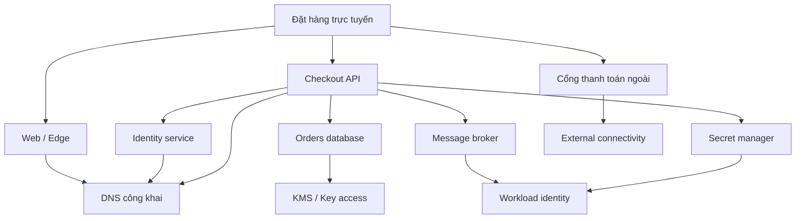
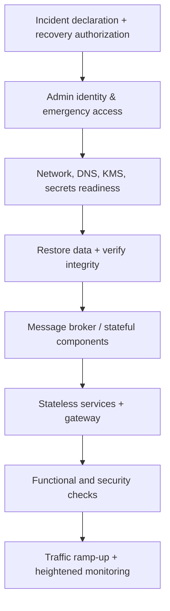

# Dependency mapping: Lập bản đồ phụ thuộc để bảo đảm tính liên tục của hoạt động kinh doanh

## 1. Mục tiêu học tập

Sau bài này, người học có thể:

- Giải thích **dependency mapping** trong **business continuity** và phân biệt bản đồ phụ thuộc với sơ đồ kiến trúc, danh sách tài sản, CMDB, service map và sơ đồ luồng dữ liệu.
- Xác định các **dịch vụ nghiệp vụ quan trọng**, mức độ ảnh hưởng khi gián đoạn, mục tiêu khôi phục **RTO/RPO** và các thành phần cần thiết để thực hiện dịch vụ đó.
- Biểu diễn quan hệ **dịch vụ sử dụng → thành phần cung cấp** bằng đồ thị có hướng, kèm loại phụ thuộc, chủ sở hữu, mức độ thiết yếu, điểm lỗi chung và nguồn bằng chứng.
- Truy tìm các phụ thuộc xuyên ứng dụng, dữ liệu, danh tính, DNS, mạng, cloud control plane, bảo mật, vận hành, con người và nhà cung cấp bên ngoài.
- Phân tích **blast radius**, single point of failure, khả năng failover, điều kiện tiên quyết và thứ tự phục hồi; nhận diện các giả định sai về multi-zone/multi-region.
- Thiết kế quy trình **đối chiếu bản đồ với thực tế**, kiểm thử có kiểm soát và lưu **bằng chứng security assurance** trong phát triển và vận hành.
- Áp dụng dependency mapping để xây dựng kế hoạch khắc phục, tabletop exercise, disaster recovery runbook và chương trình cập nhật liên tục.

Bài thuộc chương **Business continuity** của dịch vụ `SECURITY_SECURITY_ASSURANCE`. Phạm vi dịch vụ là xây dựng cách đánh giá **có bằng chứng** rằng hệ thống đáp ứng các mục tiêu bảo mật, từ phân tích rủi ro, yêu cầu và security controls đến kiểm thử, audit, khắc phục phát hiện; thực hiện security assurance liên tục trong phát triển và vận hành. Trong bối cảnh này, dependency mapping giúp chứng minh rằng **các thành phần và điều kiện cần để duy trì hoặc khôi phục dịch vụ quan trọng đã được nhận diện, kiểm soát và kiểm chứng**, thay vì chỉ có một sơ đồ mang tính giả định.

## 2. Dependency mapping là gì và giải quyết vấn đề nào?

**Dependency mapping** là quá trình nhận diện, mô tả và duy trì các quan hệ phụ thuộc giữa **năng lực nghiệp vụ**, **quy trình**, **dịch vụ**, **ứng dụng**, **dữ liệu**, **hạ tầng kỹ thuật**, **nhà cung cấp**, **con người** và **security controls**. Bản đồ được dùng để trả lời: nếu một thành phần lỗi, **dịch vụ nào bị ảnh hưởng**, ảnh hưởng theo cách nào, có phương án thay thế không, và phải phục hồi gì trước để đáp ứng mục tiêu liên tục hoạt động?

Ví dụ, dịch vụ **đặt hàng trực tuyến** cần một API, cơ sở dữ liệu, danh tính người mua, kết nối dịch vụ thanh toán và DNS. Hệ thống chạy trên ba availability zones nhưng mọi instance đều dùng cùng một identity provider hoặc một secret manager không có phương án thay thế. Từ góc nhìn máy chủ, kiến trúc trông có độ dự phòng tốt; từ góc nhìn dependency mapping, vẫn tồn tại **điểm lỗi chung** khiến cả dịch vụ dừng.

**Câu hỏi cốt lõi không phải “có bao nhiêu server?” mà là “quy trình nghiệp vụ còn hoạt động được đến mức nào khi từng điều kiện phụ thuộc biến mất?”**

### 2.1. Phân biệt những loại bản đồ dễ bị nhầm lẫn

| Khái niệm | Nội dung chính | Khác biệt quan trọng |
|---|---|---|
| **Asset inventory** | Liệt kê tài sản, ID, owner, phiên bản, môi trường | Biết tài sản tồn tại chưa đủ để biết nó phục vụ ai |
| **CMDB** | Quản lý configuration items và quan hệ cấu hình | Chất lượng phụ thuộc vào mức cập nhật và loại quan hệ được lưu |
| **Architecture diagram** | Trình bày cấu trúc hệ thống ở một mức trừu tượng | Có thể bỏ phụ thuộc gián tiếp, con người hoặc tài nguyên dùng chung |
| **Service map** | Biểu diễn các thành phần liên quan một dịch vụ | Có thể tập trung vào traffic runtime mà thiếu phụ thuộc khi khôi phục |
| **Data-flow diagram** | Biểu diễn đường đi và mức nhạy cảm của dữ liệu | Không phải mọi phụ thuộc về vận hành đều chuyển dữ liệu |
| **Dependency map** | Biểu diễn quan hệ phụ thuộc, điều kiện tác động và phương án thay thế | Phục vụ đánh giá gián đoạn, blast radius và thứ tự phục hồi |
| **Recovery runbook** | Các bước hành động khi khôi phục | Nên được suy ra và kiểm chứng dựa trên bản đồ phụ thuộc |

Một sơ đồ đẹp vẫn có thể sai nếu không chỉ rõ **thời điểm xác minh**, **nguồn dữ liệu**, **quan hệ động hay tĩnh** và **điều kiện failover**.

### 2.2. Dependency mapping là hoạt động assurance

Cần phân biệt **việc có bản đồ** và **bằng chứng bản đồ đúng/đủ**:

- Bản đồ đã được phê duyệt thể hiện *ý định thiết kế*.
- Discovery từ tracing/API/cloud inventory thể hiện *những quan hệ quan sát được*.
- Kiểm thử failover và tabletop thể hiện *hành vi trong điều kiện đã thử*.
- Evidence lưu rule, thời điểm, nguồn, kết quả và các giới hạn giúp *đánh giá mức độ tin cậy*.
- Quy trình cập nhật khi release, đổi IAM, thay nhà cung cấp hoặc đổi topology giúp bản đồ *không lỗi thời*.

Không có loại bằng chứng nào tự chứng minh toàn bộ hệ thống. Ví dụ, không thấy request đến một API phụ thuộc trong trace của một ngày chưa đủ chứng minh dịch vụ đó không cần cho quy trình quyết toán cuối tháng.

## 3. Liên hệ Business Impact Analysis, RTO và RPO

Dependency mapping nên bắt đầu từ **Business Impact Analysis (BIA)**, không bắt đầu bằng quét mạng rồi đếm tất cả kết nối.

### 3.1. BIA xác định điều gì?

BIA phân tích hệ quả của gián đoạn đối với quy trình hoặc năng lực kinh doanh:

- Tác động doanh thu, hợp đồng, nghĩa vụ pháp lý và trải nghiệm khách hàng.
- Tác động mất tính toàn vẹn dữ liệu, mất tính bí mật, mất chứng cứ kiểm toán.
- Thời điểm nhạy cảm: giờ cao điểm, ngày thanh toán, chốt sổ, phát hành.
- Nguồn lực tối thiểu để tiếp tục hoạt động và khả năng vận hành thủ công.
- Các quy trình cần ưu tiên phục hồi theo mức tác động và thời gian gián đoạn.

Các mục tiêu có thể bao gồm:

| Thuật ngữ | Ý nghĩa | Ví dụ minh họa |
|---|---|---|
| **RTO (Recovery Time Objective)** | Thời gian mục tiêu để khôi phục một dịch vụ/chức năng sau gián đoạn | Checkout phải hoạt động lại trong 60 phút |
| **RPO (Recovery Point Objective)** | Mức mất dữ liệu tối đa chấp nhận được, diễn tả theo thời gian | Đơn hàng không được mất quá 5 phút thay đổi |
| **MTPD / MAO** | Thời gian gián đoạn tối đa có thể chấp nhận trước khi tác động trở nên không thể chấp nhận; cách gọi/phạm vi theo phương pháp áp dụng | Quy trình thanh toán không thể gián đoạn quá ngưỡng được BIA phê duyệt |
| **Minimum service level** | Mức năng lực tối thiểu khi vận hành trong điều kiện suy giảm | Vẫn cho phép khách hàng tra cứu đơn hàng dù chưa thể thanh toán |
| **Recovery dependency** | Điều kiện cần có để thực hiện bước phục hồi | Phải có danh tính quản trị và giải mã backup trước khi restore DB |

**RTO không phải là thời gian khôi phục thực tế đã được chứng minh**; đây là mục tiêu. **RPO không đồng nghĩa thời gian backup chạy bao lâu**; nó đánh giá dữ liệu có thể bị mất theo thời gian. Cần đo kết quả diễn tập và xác định các giả định liên quan.

### 3.2. Đi từ dịch vụ nghiệp vụ xuống phụ thuộc

Ví dụ giả định từ BIA:

| Dịch vụ nghiệp vụ | Mức tối thiểu khi gián đoạn | RTO mục tiêu | RPO mục tiêu | Mức ưu tiên |
|---|---|---|---|---|
| Đặt hàng | Nhận và lưu đơn mới | 60 phút | 5 phút | Cao |
| Xem trạng thái đơn | Tra cứu trạng thái gần nhất | 4 giờ | 30 phút | Trung bình |
| Báo cáo quản trị | Báo cáo bản gần nhất | 24 giờ | 24 giờ | Thấp hơn |
| Xử lý hoàn tiền | Xếp hàng yêu cầu hoàn tiền an toàn | 2 giờ | 5 phút | Cao |

Đây là **giá trị giả lập**, không phải khuyến nghị áp dụng cho mọi tổ chức. Khi xác định phụ thuộc của một dịch vụ, phải biết **chức năng tối thiểu** đang được đo: thanh toán toàn phần có thể cần cổng thanh toán; tiếp nhận đơn và đưa vào hàng đợi có thể vẫn hoạt động khi cổng này tạm gián đoạn, tùy thiết kế và nghĩa vụ nghiệp vụ.

### 3.3. Áp lực do phụ thuộc đặt lên RTO/RPO

Một dịch vụ có RTO = 1 giờ không thể được chứng minh đạt chỉ vì VM khởi động trong 10 phút. Nếu còn cần:

- 15 phút để cấp lại quyền quản trị,
- 30 phút để phục hồi database,
- 20 phút để kiểm toàn vẹn và replay sự kiện,
- 15 phút để cập nhật DNS/cân bằng tải,
- 10 phút để smoke test bảo mật,

thì quy trình **nếu thực hiện tuần tự** vượt mục tiêu. Một số bước có thể chạy song song, nhưng chỉ khi đã kiểm chứng **điều kiện tiên quyết và nguồn lực**. Thời gian khôi phục end-to-end là độ dài **đường găng** của workflow thực, có thể cộng thêm thời gian chờ quyết định, failover, hội tụ và kiểm thử.

Đối với RPO, cần xác minh **trạng thái dữ liệu đã commit** và cơ chế replication/backup. “Có bản sao ở region khác” không đủ nếu replication bất đồng bộ trễ hơn RPO, cần nhiều datastore nhất quán với nhau hoặc backup bị mã hóa mà khóa không thể truy cập khi sự cố.

## 4. Mô hình đồ thị phụ thuộc có hướng

Một mô hình đơn giản:

**Node = một năng lực/tài nguyên/điều kiện**; **Edge = quan hệ một node cần node khác để hoạt động hoặc khôi phục**.

Quy ước của bài: **A → B nghĩa là A phụ thuộc vào B** (A là consumer, B là provider). Quy ước này phải được công bố rõ vì nhiều công cụ vẽ đồ thị theo chiều ngược.

### 4.1. Bản đồ ví dụ cho dịch vụ đặt hàng



Sơ đồ này **cố ý rút gọn**. Một tổ chức còn phải mô tả dependency vào network routes, storage, time sync, control plane, đội vận hành và hệ thống giám sát. Một edge thể hiện “có phụ thuộc” **chưa cho biết phụ thuộc có bắt buộc khi mọi thao tác hay chỉ khi khôi phục**.

### 4.2. Đặc tính bắt buộc của node

| Thuộc tính | Ví dụ | Mục đích |
|---|---|---|
| `node_id` | `service.checkout-api.prod` | ID ổn định, không dựa vào tên hiển thị |
| `type` | service, datastore, identity, network, third_party, team | Chọn cách xác minh |
| `environment` | production | Tránh lẫn với staging |
| `business_owner` | commerce-ops | Phê duyệt rủi ro và ưu tiên |
| `technical_owner` | checkout-team | Sửa cấu hình và khôi phục |
| `criticality` | high | Xác định mức tác động |
| `location_scope` | region-a / account-prod / cluster-1 | Tìm điểm lỗi chung |
| `recovery_strategy` | active-passive | Hiểu failover |
| `last_verified_at` | thời điểm có bằng chứng | Đo độ mới bản đồ |
| `evidence_refs` | trace / IaC / test / ticket | Truy vết thông tin |

Các ID như `account-prod` hoặc tên team trong bài là **giả lập**.

### 4.3. Đặc tính của edge

| Thuộc tính | Ý nghĩa | Ví dụ |
|---|---|---|
| `consumer_id` / `provider_id` | Chiều phụ thuộc | `checkout-api → orders-db` |
| `dependency_type` | Runtime, data, identity, control_plane, recovery, human, contractual | Khác nhau về tác động |
| `criticality` | hard, soft, optional trong chế độ vận hành được xét | Checkout cần DB để lưu đơn |
| `failure_behavior` | Fail closed, degraded, buffered, retries, fallback | Cổng thanh toán lỗi thì xếp hàng |
| `required_for` | Bình thường, minimum service, recovery hoặc từng business operation | KMS có thể cần khi restore DB |
| `timeout_budget` | Thời gian chờ/lỗi trước khi degrade | 2 giây với một API |
| `capacity_limit` | Mức năng lực khi dùng phương án dự phòng | Region dự phòng chỉ chịu 50% tải |
| `recovery_prerequisite` | Điều kiện phải có trước bước khác | Network và quyền để restore DB |
| `owner` | Nhóm hiểu dependency | Database/platform team |
| `confidence` | confirmed, inferred, unknown | Chất lượng bằng chứng |

Quan hệ có thể **có điều kiện**: dịch vụ thanh toán chỉ cần cho thao tác trả tiền, không cần để hiển thị lịch sử đơn; hoặc dependency chỉ xuất hiện trong failover. Nếu vẽ mọi cạnh như một quan hệ hard không điều kiện, bản đồ có thể gây sai thứ tự recovery.

### 4.4. Phụ thuộc AND, OR và quorum

Một điểm dễ sai: không phải mọi edge đều có nghĩa “mất B là A ngừng ngay”.

- **AND:** A cần đồng thời B và C; mất một trong hai có thể làm mất chức năng.
- **OR / alternative:** A dùng B *hoặc* C nếu failover được cấu hình và đã kiểm chứng.
- **Quorum:** A cần đủ số thành viên hoặc vùng hoạt động để đạt điều kiện đồng thuận.
- **Conditional:** A cần B chỉ khi thực hiện một chức năng, thời điểm hoặc giai đoạn phục hồi.
- **Degraded mode:** B lỗi, A có thể chạy nhưng ở mức dịch vụ giảm.

Ví dụ: ba replicas trên hai zones không đồng nghĩa không có SPOF nếu cả ba dùng một datastore hoặc một shared key. Ngược lại, mô hình “OR” chỉ có giá trị khi endpoint switching, routing, tính nhất quán dữ liệu và năng lực dự phòng đã được thử.

## 5. Các lớp phụ thuộc phải khảo sát

Dependency mapping cho business continuity rộng hơn sơ đồ microservices.

### 5.1. Phụ thuộc nghiệp vụ và con người

- Bộ phận chịu trách nhiệm phê duyệt khởi động DR, khôi phục dữ liệu và truyền thông.
- Nhân sự trực vận hành, chuyên gia của bên cung cấp và thời gian huy động.
- Kênh liên lạc khi email/chat doanh nghiệp gián đoạn.
- Quy trình kế toán, đối soát, xử lý thủ công và nghĩa vụ hợp đồng.
- Hạn chế truy cập tòa nhà, phòng máy, thiết bị vật lý và vùng địa lý.

Nếu việc failover cần hai người phê duyệt nhưng cả hai cùng phụ thuộc một IdP đang sự cố, quy trình **không sẵn sàng** dù hạ tầng dự phòng tồn tại.

### 5.2. Phụ thuộc ứng dụng và runtime

- API đồng bộ và bất đồng bộ, message queue, job scheduler, cache.
- Service discovery, ingress gateway, API gateway, container orchestration.
- Feature flag, configuration service, license server, artifact registry.
- Scheduler, autoscaler và các controller tái tạo workload sau lỗi.
- Dịch vụ có trạng thái: database, search index, object store, file system.

Một cache có thể là **soft dependency** nếu có bypass đã thử; nếu mọi request timeout khi cache lỗi, trên thực tế nó lại trở thành **hard dependency** dù thiết kế gọi nó là tùy chọn.

### 5.3. Phụ thuộc dữ liệu

- Nguồn dữ liệu có thẩm quyền, replication, log giao dịch, backup.
- Khóa giải mã, quyền truy cập snapshot và quy trình restore.
- Độ nhất quán giữa nhiều datastore, thứ tự replay event, idempotency.
- Data classification, retention và yêu cầu không khôi phục dữ liệu sai phiên bản.
- Luồng đồng bộ giữa regions và giới hạn của replication bất đồng bộ.

**RPO phải được đánh giá cho cả giao dịch nghiệp vụ**, không chỉ từng database độc lập. Ví dụ một đơn hàng đã ghi ở DB A nhưng trạng thái thanh toán tương ứng chưa cập nhật ở DB B có thể đòi hỏi đối soát sau recovery.

### 5.4. Phụ thuộc hạ tầng và cloud

- Compute/node pools, storage, load balancer, DNS, routing, peering, NAT, firewall.
- Availability zones, regions, accounts/projects/subscriptions và quota.
- Control plane API để deploy, đổi DNS, cập nhật load balancer hoặc khôi phục tài nguyên.
- Container registry, package repository, image build system.
- Nền tảng quản trị backup, monitoring và disaster recovery orchestration.

Cần phân biệt **runtime dependency** với **recovery-only dependency**. Một ứng dụng có thể tiếp tục chạy khi cloud control plane không truy cập được, nhưng **không thể scale, tạo node mới hoặc chuyển lưu lượng** trong lúc khôi phục.

### 5.5. Phụ thuộc identity, crypto và security

- Identity provider, SSO, MFA và các cơ chế break-glass.
- Workload identity, cloud IAM, RBAC, service account và quyền cấp tạm.
- KMS/HSM, certificate authority, signing keys, TLS và secret manager.
- Security gateway, WAF, firewall, admission policy và policy-as-code.
- Audit, SIEM, EDR, logging collector, cách giữ và xác minh bằng chứng.

Các security controls có thể không nằm trên đường xử lý yêu cầu bình thường nhưng là **điều kiện phục hồi an toàn**. Ví dụ hệ thống đã khôi phục chức năng nhưng audit logging vẫn hỏng: dịch vụ có thể có lưu lượng, song **recovery gate bảo mật** có thể chưa đạt.

### 5.6. Phụ thuộc bên thứ ba

- Payment gateway, nhà cung cấp DNS/IdP, SMS/email, CDN, SaaS.
- Cloud provider, kênh hỗ trợ, kho dự phòng, đối tác truyền dữ liệu.
- Hợp đồng, cam kết dịch vụ, chế độ bảo trì và kênh liên lạc khẩn cấp.
- Phụ thuộc **gián tiếp**: hai nhà cung cấp độc lập trên hợp đồng có thể cùng dựa vào một hyperscaler hoặc một nền tảng định danh.

Khi không thể quan sát nội bộ của bên thứ ba, ghi rõ **mức độ tin cậy** và bằng chứng thay thế: tài liệu kiến trúc, SLA, báo cáo assurance, cuộc thử failover đã quan sát, lịch sử outage và quy trình liên lạc. Không bịa chi tiết provider không có chứng cứ.

## 6. Bắt đầu mapping từ user journey và business operations

Một kỹ thuật thực tế là chọn **hành trình nghiệp vụ cụ thể**, sau đó truy ngược từng bước đến các điều kiện cần thiết.

Ví dụ journey “khách hàng hoàn tất một đơn hàng”:

1. Truy cập tên miền, TLS và CDN/edge.
2. Đăng nhập hoặc xác thực phiên.
3. Kiểm giỏ hàng, chính sách giá và tồn kho.
4. Tạo order và ghi bền vững dữ liệu.
5. Tương tác cổng thanh toán hoặc đưa yêu cầu vào hàng đợi theo thiết kế.
6. Phát sự kiện, xác nhận với khách và tạo quy trình hậu xử lý.
7. Ghi audit đối với các hành động bắt buộc.

Ở mỗi bước, ghi: **consumer**, **provider**, **lý do cần**, **failure mode**, **đường thay thế**, **owner** và **bằng chứng**. Đừng chỉ hỏi đội ứng dụng “gọi API nào?”; cần hỏi “nếu API đó chậm 30 giây hoặc không có trong 2 giờ, chức năng còn hoạt động không, có thất thoát dữ liệu không?”.

### 6.1. Bảng dependency theo business operation

| Business operation | Phụ thuộc quan trọng | Nếu lỗi | Minimum service level |
|---|---|---|---|
| Xem catalog | DNS, edge, catalog API, cache/search | Một số dữ liệu cũ hoặc lỗi tra cứu | Có thể dùng cache đã kiểm định |
| Đặt hàng | Auth, checkout API, orders DB, KMS, queue | Không nhận đơn an toàn | Không chấp nhận giao dịch nếu không ghi bền vững |
| Thanh toán | Payment integration, identity, transaction state | Thanh toán chưa xác nhận | Xếp hàng có kiểm soát nếu quy trình cho phép |
| Xuất hóa đơn | Invoice job, DB, object storage, ký số | Hóa đơn trễ | Xử lý sau khi hệ thống ổn định nếu được phép |
| Hoàn tiền | Approval, payment provider, ledger, audit | Chậm hoặc sai trạng thái tiền | Lưu yêu cầu an toàn, đối soát khi khôi phục |

Không có một “hard/soft” vĩnh viễn cho mọi dịch vụ: một dependency có thể hard đối với **thanh toán hoàn tất**, nhưng soft đối với **ghi nhận yêu cầu thanh toán**.

## 7. Phương pháp khám phá phụ thuộc và độ tin cậy của dữ liệu

Bản đồ chính xác thường cần **kết hợp discovery tự động và xác nhận bởi con người**.

### 7.1. Các nguồn bằng chứng

| Nguồn | Phát hiện tốt | Điều thường bỏ sót |
|---|---|---|
| Phỏng vấn business/technical owner | Chức năng tối thiểu, phê duyệt, quy trình thủ công | Quan hệ runtime ít ai nhớ |
| IaC, manifest, config repo | Desired dependencies, endpoint/secret references | Thay đổi thủ công và đường động |
| CMDB, cloud asset inventory | Tài sản và ownership | Luồng thực, dependency chỉ xuất hiện khi lỗi |
| Distributed tracing/APM | Lời gọi được quan sát, latency, caller/callee | Background job, sampling, luồng không chạy trong cửa sổ đo |
| Network flow/DNS logs | Kết nối đến host, endpoint và miền đích | Không luôn biết ý nghĩa nghiệp vụ hoặc TLS payload |
| DB/queue telemetry | Kết nối, topic, replication, consumer group | Phê duyệt và dependency ở control plane |
| Incident/outage history | Phụ thuộc đã gây gián đoạn thực | Quan hệ chưa từng bị lỗi |
| Backup/DR exercises | Điều kiện để khôi phục và thứ tự cần thiết | Sự kiện runtime mới sau lần kiểm thử |
| Supplier documentation | Cam kết, kiến trúc công bố, giới hạn dịch vụ | Phụ thuộc nội bộ không công khai |

### 7.2. Giới hạn của quan sát thụ động

Không thấy traffic **không đồng nghĩa không phụ thuộc**. Những quan hệ chỉ xuất hiện khi:

- Token hết hạn và cần làm mới.
- Failover sang region khác.
- Chạy batch cuối ngày/tháng hoặc quyết toán.
- Tái khởi động service và cần truy cập registry/secrets.
- Scale từ zero, tạo node mới hoặc restore backup.
- Thay chứng chỉ, xoay vòng khóa và cấp quyền quản trị khẩn cấp.

Vì vậy cần khảo sát **normal operation**, **degraded operation**, **recovery mode** và **maintenance mode**. Mỗi quan hệ phải nêu rõ hoàn cảnh có thể quan sát.

### 7.3. Quy trình xác minh một cạnh phụ thuộc

1. Xác định quan hệ dự kiến từ owner hoặc cấu hình.
2. Tìm chứng cứ thực: trace, kết nối, IaC, logs hoặc test.
3. Kiểm tính chính xác của consumer/provider IDs, môi trường, thời gian.
4. Xác nhận **ngữ nghĩa**: hard/soft, bắt buộc khi startup hay runtime, dữ liệu hay control plane.
5. Kiểm fallback hoặc alternate path trong điều kiện mô phỏng an toàn.
6. Ghi trạng thái `CONFIRMED`, `INFERRED` hoặc `UNKNOWN` kèm nguồn và người xác nhận.
7. Đặt thời hạn rà soát lại và trigger cập nhật khi thay đổi kiến trúc.

Một cạnh `UNKNOWN` không nhất thiết là lỗi kiến trúc, nhưng là **khoảng trống assurance** nếu thuộc dịch vụ trọng yếu.

## 8. Mô hình dữ liệu có cấu trúc cho dependency map

Sử dụng định dạng có cấu trúc giúp review, version control và kiểm tra logic. Đây là **schema minh họa**, không phải định dạng mặc định của công cụ CMDB/DR nào.

```yaml
map_id: BCM-COMMERCE-2026-01
version: "1.0"
business_service:
  id: business.checkout
  name: "Tiếp nhận đơn hàng"
  minimum_service_level: "Có thể xác nhận đã ghi bền vững đơn"
  rto_minutes: 60
  rpo_minutes: 5
  owner: commerce-operations
nodes:
  - id: service.checkout-api
    type: application
    environment: production
    technical_owner: checkout-team
    location_scope: "region-a / cluster-prod"
  - id: data.orders-db
    type: datastore
    environment: production
    technical_owner: data-platform
    location_scope: "region-a / db-cluster-1"
  - id: security.workload-identity
    type: identity
    environment: production
    technical_owner: iam-team
  - id: security.kms-orders
    type: encryption_key_service
    environment: production
    technical_owner: security-platform
edges:
  - consumer: service.checkout-api
    provider: data.orders-db
    dependency_type: runtime
    required_for: [minimum_service]
    criticality: hard
    failure_behavior: fail_closed
    evidence: ["trace://checkout/orders-db"]
    confidence: confirmed
  - consumer: service.checkout-api
    provider: security.workload-identity
    dependency_type: identity
    required_for: [startup, recovery]
    criticality: hard
    evidence: ["config://checkout/workload-identity"]
    confidence: confirmed
  - consumer: data.orders-db
    provider: security.kms-orders
    dependency_type: recovery
    required_for: [restore_from_backup]
    criticality: hard
    evidence: ["test://drill-2026-04/key-access"]
    confidence: confirmed
review:
  verified_at: "2026-11-28T04:30:00Z"
  reviewed_by: business-continuity-team
  evidence_ref: "evidence://bcm/checkout/map-2026-01"
```

Các đường tham chiếu `trace://` và `test://` chỉ là ký hiệu minh họa. Trong triển khai thực tế cần chỉ rõ môi trường, tài sản, danh tính, phiên bản, điều kiện failover, RTO/RPO liên quan và quyền truy cập kho bằng chứng.

### 8.1. Kiểm tra chất lượng dữ liệu

- **Không có dangling edge**: mọi consumer/provider phải tồn tại trong registry hoặc là một external dependency được khai báo.
- **ID ổn định** khi thay tên hiển thị hoặc thay instance.
- **Scope rõ ràng**: production/staging, tài khoản, region và tenant không bị nhập nhằng.
- **Ownership đầy đủ**: node/edge trọng yếu phải có người chịu trách nhiệm.
- **Criticality có giải thích**: tại sao hard/soft trong chế độ vận hành nào?
- **Evidence có thời gian**: nguồn nào xác nhận lần cuối và còn phù hợp?
- **Không trùng node logic** do nhiều cách gọi cùng một dịch vụ.
- **Các cạnh vòng** được phân tích như dependency cycle, không tự động coi là lỗi dữ liệu.
- **Fallback có bằng chứng**: dự phòng chưa được thử phải ghi `UNVERIFIED`.
- **Thay đổi phải được review**: tránh map trong Git không còn khớp runtime.

## 9. Phân tích blast radius và single point of failure

**Blast radius** là phạm vi tài sản hoặc năng lực có thể bị ảnh hưởng khi một thành phần thất bại hoặc không còn đáng tin. Dependency graph hỗ trợ tìm các consumer trực tiếp và gián tiếp của node lỗi.

Nếu A phụ thuộc B, B phụ thuộc C, lỗi C có thể tác động B rồi A. Tuy nhiên, mức tác động cần xét **alternative path, cache, degraded mode, redundancy, quorum và điều kiện lỗi**. Truyền mọi lỗi theo đồ thị mà không xét điều kiện có thể phóng đại blast radius.

### 9.1. Một số phân tích cần thực hiện

- **Reverse dependency:** nếu DNS lỗi, những dịch vụ nào sử dụng DNS trực tiếp hoặc gián tiếp?
- **Shared dependency:** bao nhiêu dịch vụ trọng yếu dùng cùng một IdP/KMS/network hub?
- **SPOF:** có node nào khi lỗi khiến toàn bộ minimum service level không thể đạt?
- **Correlated failure:** hai vùng dự phòng có cùng control plane, cùng identity, cùng kho bí mật hay cùng nguồn điện/đường mạng?
- **Concentration risk:** bao nhiêu năng lực quan trọng dồn lên một third party hoặc đội vận hành?
- **Recovery bottleneck:** có một tài nguyên/nhóm người nào phải hoàn thành hàng loạt thao tác tuần tự?
- **Cut set:** tập thành phần mà nếu cùng lỗi thì dịch vụ không còn đường đáp ứng minimum service.

### 9.2. Ví dụ phân tích reverse dependencies bằng Python

Đoạn code **chỉ dùng dữ liệu giả lập trong bộ nhớ**, không truy cập môi trường production, không thay đổi tài sản. Quy ước cạnh vẫn là `consumer → provider`:

```python
from collections import defaultdict, deque

dependencies = {
    "business.checkout": ["service.checkout-api", "service.edge"],
    "service.checkout-api": [
        "data.orders-db",
        "security.workload-identity",
        "service.dns",
    ],
    "service.edge": ["service.dns"],
    "data.orders-db": ["security.kms-orders"],
    "security.workload-identity": ["service.dns"],
    "service.dns": [],
    "security.kms-orders": [],
}

reverse = defaultdict(set)
for consumer, providers in dependencies.items():
    for provider in providers:
        reverse[provider].add(consumer)


def potential_dependents(failed_node):
    """Các consumer có thể bị ảnh hưởng (chưa xét fallback)."""
    impacted = set()
    queue = deque([failed_node])
    while queue:
        provider = queue.popleft()
        for consumer in reverse[provider]:
            if consumer not in impacted:
                impacted.add(consumer)
                queue.append(consumer)
    return sorted(impacted)


print(potential_dependents("service.dns"))
# Có thể gồm: business.checkout, service.checkout-api,
# service.edge, security.workload-identity
```

Kết quả là **danh sách có khả năng bị ảnh hưởng**, không phải kết luận dịch vụ chắc chắn down. Các điều kiện AND/OR, cache, trạng thái failover và tính sẵn sàng của kết nối phải được đánh giá thêm trước khi quyết định mức rủi ro.

### 9.3. Tránh hiểu sai multi-region

Đặt hai bản sao ở hai regions **chưa đủ** để khẳng định tính độc lập nếu:

- Cùng dùng một global IdP hoặc secret manager.
- Dữ liệu replication không đạt RPO.
- Quy trình failover yêu cầu cloud control plane đang không truy cập được.
- DNS TTL, resolver cache hoặc client retry kéo dài thời gian chuyển đổi.
- Region dự phòng không đủ capacity/quota.
- Chỉ có một tài khoản cloud có quyền cấp phép thực hiện DR.
- Cùng registry hoặc CI/CD pipeline có thể phát hành image lỗi cho cả hai.
- Các nhóm support/phê duyệt chỉ sử dụng một kênh liên lạc đang outage.

**Bằng chứng failover thực nghiệm** là yếu tố cần thiết để kiểm chứng giả thuyết “region dự phòng độc lập”.

## 10. Recovery dependency và thứ tự khôi phục

Một đồ thị vận hành không tự suy ra chính xác thứ tự DR. Cần lập **recovery dependency graph**, vì một dịch vụ có thể cần một tài nguyên để *khởi động lại* nhưng không cần nó trong quá trình *phục vụ request đang chạy*.

### 10.1. Thứ tự logic điển hình



Sơ đồ là **ví dụ một workflow**, không phải thứ tự bắt buộc. Một số thành phần có thể khôi phục song song hoặc theo ưu tiên khác. Nếu một operator cần quyền IAM để tạo network, phải khôi phục quyền quản trị trước; nếu một database cần KMS để giải mã, key access phải có trước hoặc trong bước restore.

### 10.2. Điều kiện tiên quyết và critical path

Một bản recovery task nên có:

| Trường | Ví dụ | Tác dụng |
|---|---|---|
| `task_id` | `DR-RESTORE-DB` | Truy vết |
| `predecessors` | network-ready, KMS-ready, backup-verified | Điều kiện không thể bỏ qua |
| `estimated_duration` | 25 phút | Dự báo; phải so với kết quả drill |
| `duration_observed` | 38 phút | Bằng chứng hiệu năng thực tế |
| `owner` | db-platform | Thực thi |
| `approval` | incident commander | Quyết định |
| `success_criteria` | DB consistent, encryption/access correct | Exit gate |
| `fallback` | Restore sang secondary region | Kịch bản thay thế |
| `evidence_ref` | drill log/DB check | Kiểm chứng |

Không tính RTO bằng cách **cộng máy móc thời gian của mọi node** hoặc **lấy thời gian lớn nhất của một node**. Kết quả phụ thuộc thứ tự, các bước song song, điều kiện con người, số lượng nhân sự và test/approval gate. Mô hình DAG với duration có thể hỗ trợ tính đường găng; các dependency cycle cần được giải quyết bằng kế hoạch khôi phục có trạng thái/bootstrap tách biệt.

### 10.3. Chu trình phụ thuộc khi startup và recovery

Ví dụ dịch vụ A cần đăng ký với B trước khi chạy, trong khi B lại cần kết nối A để có cấu hình. Có thể tạo deadlock khi cùng khởi động lại dù hệ thống hoạt động bình thường sau khi ổn định.

Để xử lý:

1. Phát hiện strongly connected components hoặc cycle trong graph.
2. Phân biệt điều kiện **startup** với **steady-state**.
3. Thiết kế bootstrap mode, seed configuration hoặc dịch vụ nền độc lập.
4. Kiểm thử cold-start từ trạng thái cả cụm đều tắt, không chỉ restart từng container.
5. Ghi thứ tự thực tế và các thao tác thủ công còn bắt buộc.

Một bản đồ không thấy cycle trong normal request traces vẫn có thể bỏ sót dependency khi cold-start.

## 11. Mapping cho cloud, Kubernetes và shared platform

### 11.1. Phụ thuộc Kubernetes

Một Deployment có replicas ở nhiều nodes có thể phụ thuộc vào:

- Kubernetes API/control plane để scale, rollout hoặc sửa cấu hình.
- Kubelet/container runtime và node pool để chạy Pod.
- CNI/NetworkPolicy, CoreDNS, ingress controller, cloud load balancer.
- CSI/storage, KMS, Secrets, workload identity, admission policies.
- Registry hoặc image cache để tạo Pod mới.
- Namespace RBAC, operator, custom controllers và các resource quotas.
- Cluster autoscaler hoặc cloud quota khi thiếu node.

**Phân biệt lúc đang chạy với lúc tái tạo**: Pod đang chạy có thể còn phục vụ khi image registry mất kết nối; nhưng node mới không thể kéo image nếu cache không có. Vì vậy registry có thể là **recovery-only dependency**, rất quan trọng dù không xuất hiện trong application traces.

### 11.2. Multi-account, region và control plane

Khi doanh nghiệp dùng nhiều cloud accounts hoặc subscriptions:

- Xác định network trust giữa account, DNS sharing và các route transit.
- Xác định quyền của nhóm DR trong cả vùng chính và vùng dự phòng.
- Kiểm quota/capacity ở region thay thế và khả năng tạo tài nguyên mới.
- Kiểm KMS key, backup vault, replication policy và khả năng giải mã tại nơi khôi phục.
- Kiểm chứng account/project bảo mật hoặc logging có thể tiếp tục quan sát khi vùng chính lỗi.
- Không giả định cơ chế IAM global và regional có cùng tính sẵn có.

Đặc biệt, một backup lưu ở tài khoản riêng nhưng vẫn dùng khóa chỉ tồn tại ở vùng chính có thể **không thể restore** khi vùng chính mất quyền truy cập. Phải kiểm quy trình khôi phục ở **phạm vi mục tiêu thực**.

### 11.3. Security gates trong recovery

Một dịch vụ trở lại trả HTTP 200 chưa chắc đủ điều kiện mở traffic production. Dependency map nên nêu các control là **gate để khôi phục an toàn**:

- Xác thực người dùng và quyền dịch vụ hoạt động đúng.
- TLS/certificates, key management và dữ liệu mã hóa không bị vô hiệu.
- Audit logging và security monitoring đã được khôi phục theo yêu cầu.
- Network segmentation, WAF/firewall và policy có hiệu lực.
- Artifact được dùng để khôi phục là build đã phê duyệt.
- Backup/data restore được kiểm tra tính toàn vẹn.
- Đội ứng phó biết rủi ro còn lại và đã phê duyệt bước mở lại.

Nếu bắt buộc mở dịch vụ khi một control chưa sẵn sàng, phải có **quyết định chấp nhận rủi ro có thẩm quyền**, biện pháp bù trừ, thời hạn và giám sát tăng cường; không chuyển trạng thái control thành PASS chỉ vì cần khôi phục nhanh.

## 12. Phụ thuộc vào nhà cung cấp và người vận hành

### 12.1. Third-party dependency registry

Với mỗi supplier quan trọng, nên có:

| Trường | Ví dụ | Ý nghĩa |
|---|---|---|
| Dịch vụ phụ thuộc | Cổng thanh toán đối tác | Hoạt động cần nhà cung cấp |
| Phạm vi/khu vực | Production tại Việt Nam và region dự phòng | Phạm vi tác động |
| Chủ hợp đồng và technical owner | Finance operations / integration team | Điểm liên hệ |
| Failover option | Nhà cung cấp phụ hoặc chế độ xếp hàng | Giảm tác động |
| Chế độ vận hành khi outage | Tạm dừng thu tiền, vẫn nhận đơn chờ xử lý nếu được phép | Minimum service |
| SLA / hỗ trợ | Cam kết và kênh liên lạc theo hợp đồng | Khả năng khôi phục |
| Evidence | Kết quả DR drill, báo cáo thử kết nối, assurance report | Mức độ tin cậy |
| Last reviewed | Thời điểm đánh giá | Tránh thông tin lỗi thời |

SLA **không phải bằng chứng** rằng ứng dụng của doanh nghiệp sẽ đạt RTO. SLA là cam kết/thỏa thuận theo phạm vi nhất định; business continuity của doanh nghiệp còn phụ thuộc tích hợp, dữ liệu, điều phối failover và năng lực đội vận hành.

### 12.2. Human dependencies

Không bỏ qua:

- Người có quyền break-glass hoặc phê duyệt failover.
- Người quản lý DNS, key recovery, backup restore và change approval.
- Nhà cung cấp hỗ trợ có thể chỉ làm việc trong giờ hành chính.
- Kênh liên lạc dự phòng, số điện thoại, on-call và cách xác thực khẩn cấp.
- Khả năng nhiều người cùng nghỉ, cùng chịu ảnh hưởng thiên tai hoặc mất kết nối.

Khi security team yêu cầu MFA nhưng phương thức MFA phụ thuộc IdP đang outage, phải có **quy trình khẩn cấp được kiểm soát**, không thiết kế bypass vô hạn hoặc tài khoản dùng chung không audit.

## 13. Mapping cho tình huống ransomware, mất cloud region và sự cố identity

### 13.1. Ransomware: bản đồ giúp giới hạn ảnh hưởng thế nào?

Trong ransomware, phụ thuộc cần hiểu không chỉ ở runtime mà còn là **đường lan truyền quyền**:

- Tài khoản backup có bị truy cập từ domain identity đang bị chiếm?
- Key và snapshot backup có bị xóa qua cùng quyền cloud không?
- Các hệ thống dữ liệu có dùng chung mount hoặc tài khoản có quyền ghi rộng?
- DR environment có thực sự cách ly về quyền, network và artifact?
- Log, EDR, DNS và kênh điều phối có còn hoạt động?
- Khi khôi phục dữ liệu, có nguy cơ đưa lại mã độc hoặc cấu hình lỗi?

Dependency mapping hỗ trợ điều tra **blast radius** và thiết kế thứ tự phục hồi từ nguồn sạch. Nhưng **sự tồn tại của bản đồ không chứng minh một hệ thống đã sạch**; cần điều tra và xác minh eradication trước hoặc phối hợp với recovery.

### 13.2. Mất cloud region

Giả sử hai regions có ứng dụng stateless active-passive nhưng dữ liệu replication bất đồng bộ. Cần xác minh:

1. Backup/replica tại region dự phòng có **dữ liệu nào mới nhất đã commit**.
2. IAM/KMS/secrets tại vùng dự phòng có khả dụng không.
3. DNS hoặc traffic management có chuyển hướng đúng và trong thời gian mong đợi không.
4. Năng lực vùng dự phòng có đáp ứng minimum service không.
5. Kết nối third-party có chấp nhận endpoint/IP thay thế không.
6. Audit, monitoring và incident communications có còn hoạt động không.
7. Bước failover có phụ thuộc control plane của region đang outage không.
8. RTO/RPO thực tế đo được từ diễn tập và điều kiện đo.

Tuyên bố “triển khai hai regions” chỉ là **design evidence**, không thay thế bằng chứng diễn tập.

### 13.3. Identity provider outage

IdP có thể ảnh hưởng tới **người dùng đăng nhập mới**, **dịch vụ lấy token mới** và **quản trị viên khôi phục hệ thống** theo các cách khác nhau. Một ứng dụng có phiên còn hiệu lực có thể tiếp tục phục vụ một phần, nhưng người dùng mới không đăng nhập được; một service chỉ làm mới token theo chu kỳ có thể lỗi muộn hơn.

Cần xem thời hạn token/cache, khả năng token validation offline, luồng MFA/SSO, break-glass, service identity và những bước recovery cần IdP. Không kết luận “identity không quan trọng” chỉ vì thử một API khi token vẫn còn hợp lệ.

## 14. Kiểm thử bản đồ phụ thuộc bằng kịch bản giả lập và diễn tập

Không nên dùng production làm nơi thử ngẫu nhiên các hành động gây gián đoạn. Kiểm thử cần **phạm vi được phê duyệt**, môi trường thích hợp và điều kiện rollback rõ ràng.

### 14.1. Các cấp độ kiểm chứng

- **Document review / tabletop:** chủ nghiệp vụ và kỹ thuật xác nhận quy trình, các bước, owner và các trường hợp lỗi.
- **Static analysis:** kiểm mapping từ IaC, manifest, asset inventory, contracts và CMDB.
- **Observation:** dùng traces, flow logs, DNS/DB telemetry và incidents thực để đối soát.
- **Component recovery test:** restore một DB, kiểm token renewal, đổi DNS hoặc phục hồi workload trong môi trường kiểm soát.
- **Integrated failover test:** thử user journey end-to-end và minimum service level khi một vùng/provider không khả dụng trong phạm vi thử.
- **Full DR exercise:** diễn tập tổ chức, con người, tài liệu, security gates và truyền thông theo kế hoạch có thẩm quyền.

Mỗi cấp chứng minh những điều khác nhau. Ví dụ tabletop đạt không có nghĩa replication đã đáp ứng RPO; restore một snapshot đạt không chứng minh luồng business đã toàn vẹn.

### 14.2. Ma trận test cho checkout

| Test ID | Giả thuyết | Cách thử an toàn | Kỳ vọng và bằng chứng |
|---|---|---|---|
| DEP-01 | Orders DB là hard dependency của tạo đơn | Mô phỏng database không khả dụng trong staging | API từ chối nhận đơn chưa ghi bền vững; không tạo trạng thái sai |
| DEP-02 | Cache là soft dependency của xem catalog | Mô phỏng cache lỗi | Service dùng fallback có giới hạn, đo latency và chất lượng |
| DEP-03 | DNS ảnh hưởng nhiều nhóm dịch vụ | Giả lập DNS lỗi trong môi trường thử | Xác định chức năng nào còn chạy và phụ thuộc token/cache |
| DEP-04 | KMS cần cho restore DB | Restore backup với quy trình DR đã duyệt | Khóa có thể dùng, dữ liệu giải mã và integrity test đạt |
| DEP-05 | Payment provider lỗi không làm mất đơn | Mô phỏng gateway timeout/failed response | Trạng thái giao dịch không bị ghi thành công giả |
| DEP-06 | Region dự phòng đủ capacity | Thử chuyển tải được duyệt | Minimum service đạt trong ngưỡng đo, không vượt quota |
| DEP-07 | Quyền khẩn cấp hoạt động khi SSO lỗi | Tabletop và kiểm phương án break-glass được duyệt | Có quyền kiểm soát và audit, không để lại bypass sau thử |
| DEP-08 | Logging vẫn khả dụng sau DR | Phát event thử không nhạy cảm | Event tới sink, source/time rõ và alert health hoạt động |

Không thử trực tiếp bằng cách tắt một security control production nếu có phương án giả lập hoặc thử biệt lập đáp ứng mục tiêu. Với thay đổi thực, cần kế hoạch an toàn, phê duyệt và giám sát.

### 14.3. Một kết quả test đủ chứng minh điều gì?

Mỗi test nên ghi:

- Môi trường và scope: production/staging, region, tài sản, version.
- Điều kiện trước thử: dữ liệu, tải, trạng thái cache, quyền và network.
- Thao tác/chèn lỗi được thực hiện và người có thẩm quyền.
- Expected minimum service, RTO/RPO và điều kiện bảo mật.
- Observed behavior, timestamp, thời gian khôi phục, dữ liệu bị mất hoặc đối soát.
- Evidence refs, logs, traces, trạng thái runtime và dữ liệu đo.
- Tình trạng rollback, phát hiện, limitation và owner khắc phục.

Một lần kiểm tra thành công ở staging là bằng chứng **trong staging**; không được tuyên bố production đã đạt RTO/RPO nếu chưa có cách ngoại suy được phê duyệt và diễn tập phù hợp.

## 15. Liên kết dependency map với security controls và assurance

Dependency mapping hỗ trợ kiểm tra cả **availability** lẫn các mục tiêu security khác như **confidentiality** và **integrity** khi phục hồi.

| Control ID | Security / continuity objective | Dependency liên quan | Phép kiểm |
|---|---|---|---|
| BCM-MAP-01 | Mọi dịch vụ trọng yếu có danh sách phụ thuộc được duyệt | Business process → service → provider | Coverage review, owner sign-off |
| BCM-MAP-02 | Không có SPOF chưa xử lý ở đường phục vụ tối thiểu | Shared DNS/IdP/KMS/network/database | Graph analysis, failover test, exception |
| BCM-DR-03 | Khôi phục dịch vụ trong RTO mục tiêu | Recovery tasks và prerequisites | Integrated drill, timestamps, critical path |
| BCM-DATA-04 | Khôi phục dữ liệu đạt RPO và integrity | Backup, replication, KMS, database | Restore test, log position/consistency check |
| BCM-IAM-05 | Quyền khẩn cấp hoạt động có kiểm soát | IdP, MFA, break-glass, cloud IAM | Access drill và audit |
| BCM-SEC-06 | Security controls vẫn có hiệu lực sau failover | Logging, network, TLS, secrets, IAM | Post-failover security validation |
| BCM-3RD-07 | Có phương án cho third party trọng yếu | Payment/DNS/SaaS | Supplier review và scenario test |
| BCM-CHG-08 | Thay đổi hệ thống cập nhật map đúng hạn | CI/CD, CMDB, discovery | Drift detection, freshness metric |

### 15.1. Chuỗi bằng chứng

```text
Business objective và BIA
             ↓
Dependency map có version + owner
             ↓
Criticality, failure mode, recovery prerequisites
             ↓
Security & continuity controls
             ↓
Test plan + telemetry + drill
             ↓
Expected vs observed (RTO, RPO, security gates)
             ↓
PASS / FAIL / UNKNOWN / EXCEPTION
             ↓
Finding + remediation + evidence sau sửa
```

Một bản đồ chỉ được coi là có giá trị assurance khi các cạnh quan trọng được **xác nhận đủ phạm vi**, còn mới và có thử nghiệm tương xứng với rủi ro.

### 15.2. Các trạng thái đánh giá nên phân biệt

- `PASS`: dependency/control đã được xác minh đáp ứng yêu cầu tại thời điểm và phạm vi đo.
- `FAIL`: có bằng chứng phụ thuộc hoặc năng lực phục hồi không đạt điều kiện baseline.
- `UNKNOWN`: thiếu dữ liệu, không đủ quyền quan sát hoặc chưa kiểm chứng trường hợp trọng yếu.
- `NOT_APPLICABLE`: control không áp dụng cho node/operation đã xác định.
- `EXCEPTION_APPROVED`: còn rủi ro đã được chấp nhận bởi người có thẩm quyền, có thời hạn và biện pháp bù trừ.
- `PENDING_VALIDATION`: bản đồ/thiết kế đã sửa nhưng chưa chạy phép kiểm xác nhận.

Không gộp `UNKNOWN` và `EXCEPTION_APPROVED` vào PASS; việc này khiến lãnh đạo tin rằng có năng lực DR đã được chứng minh trong khi chỉ có kế hoạch.

## 16. Phát hiện stale dependencies và duy trì bản đồ liên tục

Bản đồ phụ thuộc không phải tài liệu lập một lần trước cuộc audit. Kiến trúc thay đổi theo release, di chuyển dữ liệu, cập nhật nhà cung cấp và luồng kết nối; bản đồ có thể lỗi thời chỉ sau vài sprint.

### 16.1. Nguồn thay đổi cần kích hoạt review

- Tạo mới/xóa service, endpoint, job, queue, database.
- Thay network route, DNS, VPC peering, security group hoặc private endpoint.
- Đổi cloud account/region, cluster, node pool hay kiến trúc failover.
- Thay IdP, OAuth provider, key manager, certificate authority, secret store.
- Thêm/sửa hợp đồng third party, thay SLA và quy trình hỗ trợ.
- Thay backup/replication, schema dữ liệu hoặc hành trình thanh toán.
- Security incident, outage, audit finding hoặc DR exercise phát hiện quan hệ chưa biết.
- Thay recovery team, người phê duyệt hoặc kênh liên lạc khẩn cấp.

### 16.2. Continuous reconciliation

Một pipeline có thể kết hợp:

1. **Discover:** thu assets, endpoint, manifests/IaC, traces và các thông tin có quyền truy cập.
2. **Normalize:** chuẩn hóa stable IDs, môi trường, node type và edge semantics.
3. **Compare:** đối chiếu với dependency map versioned đang được phê duyệt.
4. **Review:** owner xác nhận cạnh mới, cạnh mất, edge có điều kiện, criticality.
5. **Assess:** phân tích blast radius và tác động đến RTO/RPO, security gates.
6. **Update:** thay map, DR plan, runbook, test coverage và owner.
7. **Verify:** thử lại những giả thuyết failover hoặc recovery bị tác động.
8. **Evidence:** ghi khác biệt, phê duyệt, thời điểm và kết luận.

Không dùng tracing tự động để xóa ngay một cạnh chỉ vì không thấy traffic trong một ngày. Có thể đó là dependency của batch cuối tháng hoặc chỉ dùng khi restore.

### 16.3. Drift với desired architecture

Các sai khác thường gặp:

| Drift | Hậu quả | Cách xác minh |
|---|---|---|
| Thêm dịch vụ trung gian nhưng không cập nhật DR plan | Recovery ordering sai | Runtime trace, IaC, owner review |
| Thay secret manager/KMS region | Backup có thể không giải mã được khi outage | Restore rehearsal |
| Đổi DNS provider nhưng emergency contact cũ | Khó failover khi sự cố | Vendor contract và tabletop |
| Thêm phụ thuộc mạng xuyên account | Tăng blast radius và rủi ro IAM | Cloud network graph và permission review |
| Dùng chung IdP cho cả primary/secondary | Mất failover độc lập | Identity outage scenario test |
| Đổi quy trình phê duyệt DR | Recovery bị chậm hoặc không thể thực hiện | Decision exercise và quyền khẩn cấp |

## 17. Phân tích tình huống: Hai regions nhưng vẫn dừng checkout

**Bối cảnh giả lập:** một nền tảng thương mại triển khai checkout API ở hai regions. Region A nhận traffic chính, Region B dự phòng. Database có replica bất đồng bộ. Khi Region A gặp sự cố, nhóm vận hành dự định chuyển DNS sang Region B.

Trong diễn tập, họ phát hiện:

- Kubernetes workloads ở Region B chưa từng scale tới mức tải tối thiểu đã duyệt.
- KMS key cần để restore snapshot chỉ có thể truy cập qua một quy trình quản trị phụ thuộc IdP chính.
- Người duyệt failover chỉ nhận thông báo qua một hệ thống SSO đang gián đoạn.
- Payment provider yêu cầu allowlist IP mới, nhưng chưa cập nhật nguồn Region B.
- Hệ thống logging ở Region B không gửi đủ audit events.
- Replica dữ liệu có replication lag vượt RPO ở thời điểm thử.

### 17.1. Đánh giá bằng dependency map

| Phát hiện | Loại dependency | Tác động | Kết luận ban đầu |
|---|---|---|---|
| Không đủ capacity Region B | Compute / quota | Minimum service có thể không đạt | FAIL nếu bài test không đạt ngưỡng |
| Key access phụ thuộc IdP chính | Identity / recovery / crypto | Không thể restore đúng hạn | FAIL hoặc UNKNOWN theo bằng chứng |
| Quy trình phê duyệt cùng SSO | Human / control plane | Thời gian quyết định kéo dài | FAIL nếu không có phương án khẩn cấp đạt |
| Payment IP chưa được allowlist | Third party / network | Không thể thanh toán qua region dự phòng | FAIL cho thao tác thanh toán |
| Audit Region B thiếu | Security gate | Recovery thiếu khả năng truy vết theo yêu cầu | FAIL/UNKNOWN theo phạm vi kiểm tra |
| Replication lag vượt RPO | Data consistency | Rủi ro mất giao dịch | FAIL đối với RPO đã duyệt |

Thực tế thử nghiệm có thể chứng minh **đường failover chưa đáp ứng yêu cầu**, ngay cả khi workload ở cả hai regions đang ở trạng thái `Ready`.

### 17.2. Kế hoạch khắc phục

1. Rà BIA để xác định minimum service và RTO/RPO vẫn phù hợp.
2. Đưa tất cả dependencies phục hồi vào graph: KMS, IdP, người phê duyệt, provider allowlist, audit và replication.
3. Điều chỉnh phương án key/identity access và break-glass có audit, trong giới hạn bảo mật.
4. Chuẩn bị capacity/quota và kiểm traffic routing/failover ở Region B.
5. Phối hợp bên thanh toán xác minh endpoint/IP dự phòng.
6. Kiểm audit sink, lưu trữ và detection ở vùng dự phòng.
7. Cải thiện replication hoặc thay đổi quy trình phục hồi để đáp ứng RPO.
8. Chạy lại bài test end-to-end, ghi thời gian thực, độ nhất quán dữ liệu và security controls.

### 17.3. Kết luận có trách nhiệm

> Kiến trúc có triển khai hai regions nhưng bài diễn tập không chứng minh được năng lực phục hồi checkout trong mục tiêu đã phê duyệt. Các phụ thuộc KMS/IdP, quyền phê duyệt, khả năng kết nối payment provider, audit logging và replication đã được ghi nhận thành findings. Chỉ sau khi khắc phục và re-test đạt yêu cầu mới có cơ sở kết luận DR readiness trong phạm vi đã kiểm.

Đây là **mẫu kết luận**, không phải kết quả thực tế của một tổ chức.

## 18. Bằng chứng security assurance cho dependency mapping

Một bản đồ đáng tin cậy cần thông tin **ai xác nhận, dựa trên nguồn nào, lúc nào, và kiểm thử nào đã chứng minh cách hệ thống phản ứng khi dependency lỗi**.

### 18.1. Mẫu assessment record

```yaml
assessment_id: BCM-MAP-ASMT-2026-014
business_service_id: business.checkout
dependency_map_version: "1.0"
control_id: BCM-DR-03
environment: staging-dr
scope:
  primary_region: region-a
  recovery_region: region-b
hypothesis: "Checkout có thể tiếp tục minimum service trong RTO"
rto_target_minutes: 60
rpo_target_minutes: 5
test:
  id: DR-REGION-FAILOVER-04
  scenario: "Primary region unavailable"
observed:
  recovery_minutes: 74
  measured_data_loss_minutes: 3
  security_audit_sink: "healthy"
result:
  rto: FAIL
  rpo: PASS
  security_gate: PASS
  overall: FAIL
checked_at: "2026-11-28T05:00:00Z"
owners:
  business: commerce-operations
  technical: platform-dr
evidence_refs:
  - "evidence://bcm/drill-04/timeline"
  - "evidence://bcm/drill-04/replication"
  - "evidence://bcm/drill-04/security-checks"
finding_ref: BCM-FINDING-2026-032
```

Số liệu và đường dẫn chỉ là **giả lập**. Kết luận `RPO: PASS` trong bài test cần dựa trên định nghĩa và phương pháp đo mất dữ liệu được phê duyệt, không chỉ độ trễ replica tại một thời điểm. Tương tự, kiểm `security_audit_sink: healthy` là một phần của security gate, chưa nhất thiết chứng minh mọi sự kiện bắt buộc đã được ghi.

### 18.2. Tiêu chí đánh giá chất lượng bằng chứng

| Tiêu chí | Câu hỏi |
|---|---|
| Đúng business service | Có ID, minimum service và BIA/version tương ứng? |
| Đúng phạm vi | Có production/staging, region, tài khoản, vendor, dữ liệu và chế độ vận hành? |
| Đúng thời điểm | Bản đồ/test được xác minh khi nào, sau bao nhiêu thay đổi? |
| Đủ loại dependency | Có runtime, recovery-only, identity, data, human và third party? |
| Có độ tin cậy | Mỗi cạnh trọng yếu có source, confidence, người review và giới hạn? |
| Có thử nghiệm | Có fault scenario, tiền điều kiện, expected và observed? |
| Có kết quả bảo mật | Identity, encryption, audit và network controls đã được kiểm sau failover? |
| Có khả năng tái lập | Có phiên bản map, workflow, artifact, tài nguyên và log? |
| Có khả năng truy vết | Có findings, owner, SLA, evidence trước/sau và recheck? |
| Minh bạch rủi ro | Những phần chưa kiểm và ngoại lệ còn hiệu lực được nêu rõ? |

### 18.3. Đừng coi evidence của nhà cung cấp thay thế kiểm thử doanh nghiệp

Một báo cáo availability hoặc SLA của cloud provider có thể hỗ trợ hiểu mức bảo đảm ở lớp nhà cung cấp. Nhưng mục tiêu RTO/RPO của **business service** còn bị chi phối bởi application, data, identity, network, human approval và kiến trúc DR của khách hàng. Kết luận của tổ chức phải dựa trên bằng chứng tích hợp ở phạm vi dịch vụ mình vận hành.

## 19. Chỉ số vận hành chương trình dependency mapping

| Chỉ số | Định nghĩa thực hành | Điểm cần tránh |
|---|---|---|
| **Critical service coverage** | Dịch vụ quan trọng có bản đồ được duyệt / tổng dịch vụ quan trọng theo BIA | Bỏ dịch vụ chưa có owner khỏi mẫu số |
| **Dependency validation coverage** | Cạnh trọng yếu đã được xác minh / tổng cạnh trọng yếu đã biết | Chỉ đếm số node, không xét edges |
| **Unknown dependency count** | Quan hệ nghi ngờ nhưng chưa kiểm chứng, phân theo mức tác động | Gộp UNKNOWN vào PASS |
| **Map freshness** | Tuổi của bằng chứng và lần review gần nhất | Báo “cập nhật” khi chỉ đổi timestamp |
| **Recovery plan alignment** | Bước DR có prerequisite và owner khớp map / tổng bước cần kiểm | Đã sửa map nhưng chưa cập nhật runbook |
| **Shared dependency concentration** | Số dịch vụ trọng yếu dựa vào cùng IdP/KMS/vendor/network hub | Không xét các nhánh dự phòng thực |
| **RTO/RPO test attainment** | Số kịch bản đã thử đạt mục tiêu / số kịch bản có áp dụng | Chỉ báo số lần drill, không báo kết quả |
| **Change-to-map lag** | Thời gian từ thay đổi kiến trúc đến map được xác minh/cập nhật | Chỉ tính thay đổi có ticket |
| **Finding remediation time** | Thời gian từ phát hiện dependency gap đến re-test đạt | Đóng ticket trước khi xác minh thực |
| **Third-party readiness** | Nhà cung cấp trọng yếu có kịch bản outage và phương án được review / tổng | Coi SLA là kế hoạch DR của doanh nghiệp |

Ví dụ: tổ chức có 40 dịch vụ trọng yếu, chỉ 30 dịch vụ có bản đồ được xác minh trong chu kỳ. Trong 30 bản đồ đó, 6 dịch vụ chưa kiểm thử failover đối với một shared identity dependency. Báo cáo cần nêu **75% critical service mapping coverage** và tách riêng **6 dịch vụ thiếu failover validation**; không được kết luận “75% đã sẵn sàng DR” khi các phép kiểm RTO/RPO còn chưa thực hiện.

## 20. Những sai lầm thường gặp

1. **Chỉ liệt kê tài sản:** inventory không thể hiện ai phụ thuộc vào ai và theo điều kiện nào.
2. **Lấy network traffic làm sự thật tuyệt đối:** phụ thuộc batch, cold-start hoặc restore có thể không xuất hiện trong kỳ đo.
3. **Đánh đồng runtime và recovery dependency:** image registry hoặc control plane có thể chỉ cần lúc tạo lại workload.
4. **Không gắn với BIA:** bản đồ rất chi tiết nhưng không biết dịch vụ nghiệp vụ nào cần phục hồi trước.
5. **Dùng edge không có chiều rõ:** reverse impact analysis và recovery order có thể bị đảo ngược.
6. **Mọi edge đều là hard dependency:** làm phóng đại blast radius và khiến kế hoạch DR sai.
7. **Tin dự phòng mà chưa thử:** hai regions vẫn có thể cùng dùng IdP, DNS hoặc key access.
8. **Không xét năng lực dự phòng:** failover thành công một request không chứng minh chịu được tải tối thiểu.
9. **Quên dữ liệu và khóa giải mã:** có backup nhưng không thể restore hoặc RPO không đạt.
10. **Không xét danh tính, phê duyệt và nhân sự:** recovery dừng vì không ai có quyền hoặc kênh liên lạc hỏng.
11. **Tin vào SLA nhà cung cấp như RTO của doanh nghiệp:** bỏ qua những bước khách hàng chịu trách nhiệm.
12. **Quên security gate:** dịch vụ chạy lại nhưng logging, TLS, IAM hoặc network policy sai.
13. **Không giải quyết dependency cycle:** cold-start bị deadlock dù hệ thống steady-state hoạt động.
14. **Quét tự động rồi không có owner review:** edge có thể đúng về kết nối nhưng sai về ý nghĩa nghiệp vụ.
15. **Không version map và evidence:** không thể tái lập kết luận sau một release hoặc outage.
16. **Không cập nhật khi thay đổi kiến trúc:** backup/DR runbook lệch thực tế.
17. **Coi “chưa thấy lỗi” là PASS:** không có diễn tập hay dữ liệu thì phải ghi UNKNOWN.
18. **Chỉ báo một tỷ lệ coverage:** che khuất những dependency trọng yếu chưa xác minh.
19. **Tối ưu số lượng node mà bỏ điểm lỗi chung:** cùng một provider/identity ở nhiều hệ thống vẫn có correlated failure.
20. **Đóng finding khi mới cập nhật tài liệu:** cần re-test và bằng chứng đường phục hồi thực đã cải thiện.

## 21. Bài tập thực hành: Lập bản đồ phụ thuộc cho hệ thống bán hàng

**Tình huống:** công ty bán hàng có dịch vụ Checkout, Order Tracking và Reporting. Hạ tầng sử dụng Kubernetes, database có replica ở hai regions, cổng thanh toán bên ngoài, cloud IAM/KMS, DNS, message queue và hệ thống audit. BIA giả định yêu cầu Checkout RTO 60 phút, RPO 5 phút; Order Tracking RTO 4 giờ; Reporting RTO 24 giờ.

Các quan sát được cung cấp:

| Mã | Quan sát |
|---|---|
| A | Checkout API gọi Orders DB, IAM token service, message queue và payment integration |
| B | Orders DB cần KMS key để restore backup; quyền key chỉ được cấp ở tài khoản chính |
| C | DNS dùng chung cho Checkout và Order Tracking |
| D | Region phụ có compute dự phòng nhưng chưa kiểm capacity và chưa cho phép IP với payment provider |
| E | Khi SSO lỗi, không rõ nhóm DR dùng tài khoản nào để phê duyệt chuyển vùng |
| F | Reporting chạy batch cuối tháng, không xuất hiện trong APM ở tuần đo |
| G | Audit log tại region dự phòng chưa có bài kiểm chứng end-to-end |
| H | Một tài nguyên message queue mới được thêm bởi release gần đây nhưng chưa có trong CMDB |

### 21.1. Yêu cầu bài làm

1. Xác định **business services** và minimum service level phải ưu tiên theo BIA.
2. Vẽ đồ thị có hướng với quy ước `consumer → provider`, gồm ít nhất 15 node và 18 cạnh; phân biệt runtime, recovery-only, data, identity, human và third-party dependencies.
3. Với mỗi dependency trọng yếu, ghi `owner`, `criticality`, `failure_behavior`, `confidence` và một nguồn bằng chứng.
4. Chỉ ra **ít nhất ba điểm lỗi chung** và mô tả blast radius nếu DNS, IdP hoặc KMS không sẵn sàng.
5. Đánh giá liệu hai regions đủ để khẳng định đạt RTO/RPO hay chưa; nêu các phép đo còn thiếu.
6. Đề xuất **recovery prerequisites** và thứ tự bước có thể chạy song song; giải thích những bước nào nằm trên đường găng.
7. Thiết kế **sáu test cases** bao gồm lỗi database, KMS, identity, payment provider, DNS và audit collector.
8. Giải thích vì sao dữ liệu APM một tuần không thể kết luận Reporting độc lập với các dịch vụ khác.
9. Xây dựng quy trình phát hiện tài nguyên mới H và cập nhật map/CMDB/DR plan.
10. Viết assessment record có expected/observed, bằng chứng, kết luận PASS/FAIL/UNKNOWN, owner và hành động khắc phục.

### 21.2. Gợi ý tự đánh giá

- **A:** kiểm edge theo từng operation; payment provider có thể là hard cho “thanh toán hoàn tất” nhưng có thể có fallback được phê duyệt cho “tiếp nhận đơn”.
- **B:** đây là **recovery-only dependency** trọng yếu; backup có thể không khôi phục được nếu không có KMS/permissions tại vùng đích.
- **C:** DNS là shared dependency; mất DNS không có nghĩa mọi phiên đang chạy dừng ngay, cần xét cache/TTL và đường truy cập.
- **D:** chưa đủ bằng chứng DR readiness; kiểm capacity, route, allowlist và giao dịch thật có kiểm soát.
- **E:** phụ thuộc human/identity, cần runbook break-glass có audit và phê duyệt.
- **F:** reporting có dependency theo lịch, phải bổ sung job inventory và phỏng vấn owner.
- **G:** security gate chưa được chứng minh; ghi UNKNOWN/PENDING_VALIDATION, không tự coi pass.
- **H:** là dependency drift; cần đối soát IaC, runtime, CMDB và điều chỉnh recovery order.

Một bài giải tốt kết nối được **BIA → dependency graph → failure impact → recovery prerequisites → test evidence → findings → recheck**, nêu rõ những phần chỉ được giả định.

## 22. Tổng kết

**Dependency mapping** giúp nhìn hệ thống theo **năng lực nghiệp vụ và điều kiện để năng lực đó tồn tại hoặc được khôi phục**, chứ không chỉ theo tài sản kỹ thuật. Một bản đồ có giá trị cần chỉ rõ chiều quan hệ, mức thiết yếu, điều kiện tác động, owner, nguồn dữ liệu, phụ thuộc gián tiếp và đặc biệt là các đường thay thế **đã được kiểm thử**.

Trong `SECURITY_SECURITY_ASSURANCE`, mục tiêu không phải chỉ giao một file sơ đồ. Cần **chứng minh** rằng các dependency quan trọng đã được nhận diện, rằng mục tiêu RTO/RPO và security controls được đánh giá theo hành vi thực tế, rằng mọi khoảng trống được ghi nhận minh bạch và rằng khi cấu trúc hệ thống thay đổi, bản đồ và kế hoạch phục hồi tiếp tục được xác minh. Câu hỏi kết thúc mỗi đợt đánh giá là: **dịch vụ nghiệp vụ nào được bảo vệ, phụ thuộc vào những gì, điều gì sẽ xảy ra khi từng mắt xích lỗi, kết quả đã được kiểm thử đến đâu và ai chịu trách nhiệm cho rủi ro còn lại?**
