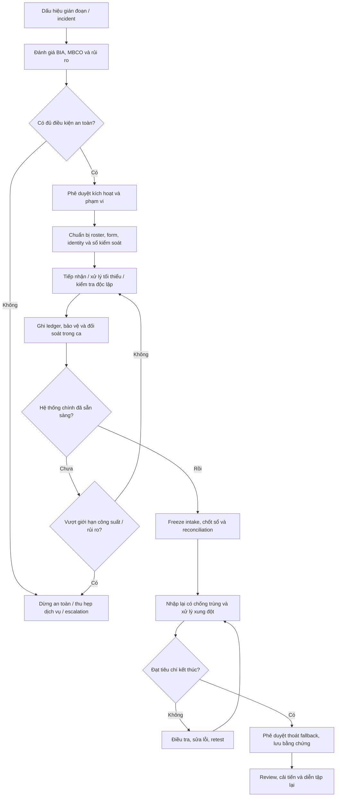

# Manual fallback: Duy trì hoạt động thủ công khi hệ thống gián đoạn

## 1. Manual fallback là gì và giải quyết vấn đề nào?

**Manual fallback** là phương án duy trì những hoạt động nghiệp vụ tối thiểu bằng **quy trình do con người thực hiện, có biểu mẫu, quy tắc kiểm soát và cơ chế ghi nhận riêng**, khi hệ thống tự động chính không còn cung cấp dịch vụ ở mức chấp nhận được. Phương án có thể sử dụng giấy, công cụ ngoại tuyến, hệ thống đơn giản tách biệt, xác nhận qua kênh liên lạc dự phòng hoặc thao tác thủ công được phê duyệt trong môi trường hạn chế.

Ví dụ, khi nền tảng xử lý đơn hàng ngừng hoạt động, doanh nghiệp có thể tiếp nhận **yêu cầu đặt hàng dự phòng** theo biểu mẫu đã kiểm soát và xác nhận trạng thái “đang chờ xử lý”; sau khi hệ thống khôi phục, nhân viên kiểm tra quyền xử lý, tính trùng lặp và đối soát trước khi nhập dữ liệu. Phương án này khác với việc tự ý mở quyền database, ghi thông tin thẻ thanh toán vào bảng tính hoặc bỏ qua bước chống gian lận để “duy trì tốc độ”.

Trong chương **Business continuity** của module **SECURITY_SECURITY_ASSURANCE**, manual fallback là một phần của năng lực **bảo đảm hoạt động liên tục có bằng chứng**. Bài học không chỉ nêu “khi hệ thống hỏng thì làm thủ công”, mà phải trả lời được:

1. Hoạt động nghiệp vụ nào **được phép** chuyển sang thủ công và vì sao?
2. Điều kiện nào kích hoạt, tạm dừng và chấm dứt fallback?
3. Quy trình thủ công có giữ được những yêu cầu bảo mật, an toàn, chất lượng và tuân thủ quan trọng không?
4. Hồ sơ tạo ra khi làm thủ công được kiểm soát ra sao, và dữ liệu được **đối soát, khôi phục, đồng bộ** như thế nào?
5. Bằng chứng nào chứng minh phương án đã được kiểm thử, có owner, không vượt giới hạn và đã đóng đúng cách?

**Manual fallback không tự động là phương án tốt nhất.** Với một số dịch vụ như chuyển tiền, quyết định y tế, thao tác hệ thống an toàn công nghiệp hoặc xử lý dữ liệu bị hạn chế, quy trình thủ công không đáp ứng được kiểm soát bắt buộc có thể **không được phép**. Khi đó phương án đúng là dừng chức năng nhạy cảm một cách an toàn, thông báo minh bạch và khôi phục bằng con đường đã phê duyệt.

## 2. Phân biệt manual fallback với failover, degraded mode và manual override

| Khái niệm | Bản chất | Ví dụ | Lưu ý về assurance |
| --- | --- | --- | --- |
| **Automated failover** | Chuyển tải sang hệ thống dự phòng bằng cơ chế kỹ thuật | Primary database lỗi, standby tiếp nhận | Kiểm tra tính sẵn sàng, đồng bộ, quyền và kết quả chuyển đổi |
| **Degraded mode** | Hệ thống tiếp tục chạy với chức năng hoặc công suất giảm | Ứng dụng chỉ cho tra cứu, tạm dừng cập nhật | Cần kiểm soát tính đúng đắn của chức năng còn mở |
| **Manual fallback** | Con người thực hiện nghiệp vụ tối thiểu theo quy trình dự phòng | Nhân viên ghi nhận yêu cầu và cấp mã tham chiếu để xử lý sau | Cần quản trị thao tác, trách nhiệm, hồ sơ, kiểm tra và đối soát |
| **Manual override** | Con người ghi đè quyết định hoặc cơ chế tự động | Quản lý phê duyệt trường hợp ngoài quy tắc | Có thể làm suy yếu control; không đồng nghĩa fallback hợp lệ |
| **Disaster recovery (DR)** | Khôi phục hệ thống, dữ liệu, hạ tầng sau sự cố | Restore từ backup hoặc chuyển vùng dự phòng | Manual fallback có thể tồn tại song song với DR, không thay thế DR |

Hai hướng ứng phó thường hoạt động song song: **đội kỹ thuật phục hồi dịch vụ** và **đội nghiệp vụ duy trì công việc tối thiểu**. Nếu một trong hai không có đầu mối điều phối, tổ chức dễ xảy ra tình trạng dữ liệu được cập nhật đồng thời ở hai nơi mà không biết cách hòa giải.

### Manual fallback không phải “làm mọi thứ bằng tay”

Một fallback tốt thường **thu hẹp chức năng**, ví dụ chỉ nhận và xác nhận yêu cầu, chưa hứa đã xử lý thanh toán, xuất kho hay thay đổi trạng thái tài khoản. Giới hạn giúp giảm nguy cơ thao tác sai, lạm dụng quyền, gian lận và khó đối soát sau phục hồi.

## 3. Bắt đầu từ Business Impact Analysis (BIA)

**Business Impact Analysis** giúp xác định hoạt động nào thật sự cần tiếp tục, tác động nếu gián đoạn, mức tối thiểu có thể chấp nhận và thời gian cần khôi phục. Không nên chọn quy trình thủ công chỉ vì một nhóm có thể làm được; cần chứng minh nó hỗ trợ mục tiêu nghiệp vụ và nằm trong mức rủi ro được chấp nhận.

### Những khái niệm cần phân biệt

- **RTO (Recovery Time Objective):** thời gian mục tiêu khôi phục năng lực dịch vụ theo định nghĩa tổ chức. Một quy trình fallback có thể giúp duy trì một phần năng lực trong thời gian chờ nhưng không tự chứng minh hệ thống chính đã đạt RTO.
- **RPO (Recovery Point Objective):** mức mất dữ liệu chấp nhận được, thường biểu diễn theo khoảng thời gian đối với dữ liệu hệ thống được bảo vệ. Một form thủ công không tự đảm bảo RPO nếu hồ sơ thất lạc hoặc không nhập lại được.
- **MTPD/MAO:** thời gian gián đoạn tối đa có thể chịu được đối với hoạt động, theo cách định nghĩa trong phương pháp BIA đang dùng. Không nên đánh đồng nó với RTO.
- **Minimum Business Continuity Objective (MBCO):** mức dịch vụ hoặc công suất tối thiểu cần duy trì theo kế hoạch liên tục kinh doanh.
- **Recovery backlog:** lượng hồ sơ hoặc giao dịch chờ kiểm tra và nhập lại sau khi dịch vụ phục hồi.

Các con số phải do chủ nghiệp vụ và risk owner phê duyệt. Nếu fallback chỉ đạt 20% công suất cần thiết thì nó có thể phù hợp cho một sự cố ngắn, nhưng không đáp ứng MBCO trong sự cố kéo dài.

### Ví dụ BIA giả định

| Hoạt động | Tác động nếu dừng | Mục tiêu tối thiểu | Có cho fallback? | Ràng buộc |
| --- | --- | --- | --- | --- |
| Tiếp nhận yêu cầu hỗ trợ khách hàng | Mất yêu cầu, chậm xử lý | Ghi nhận và cấp mã tham chiếu | **Có** | Không ghi bí mật xác thực, phân loại dữ liệu |
| Tiếp nhận yêu cầu đặt hàng | Chậm doanh thu và fulfillment | Tiếp nhận yêu cầu, chưa xác nhận thực hiện | **Có điều kiện** | Giới hạn loại đơn, chống trùng, xác nhận sau phục hồi |
| Xác nhận thanh toán cuối cùng | Rủi ro tiền, gian lận, tranh chấp | Dừng an toàn và thông báo | **Không nếu thiếu kiểm soát bắt buộc** | Không tự ghi dữ liệu thẻ hay coi chứng từ tay là đã thanh toán |
| Phê duyệt thay đổi quyền IAM production | Rủi ro leo thang đặc quyền | Quy trình khẩn cấp có hai người phê duyệt | **Chỉ theo runbook riêng** | Giữ audit trail, xác thực danh tính, giới hạn quyền và thời hạn |
| Cập nhật kết quả xét nghiệm nhạy cảm | Nguy cơ an toàn và sai hồ sơ | Theo quy trình chuyên ngành đã phê duyệt | **Phụ thuộc pháp luật và quy trình** | Không tự thiết kế cách xử lý thay thế |

*Đây là bảng minh họa để học phương pháp; quyết định thực tế phụ thuộc nghiệp vụ, an toàn con người, pháp luật, hợp đồng và controls đang áp dụng.*

## 4. Chọn phạm vi nghiệp vụ được phép xử lý thủ công

Một phương án fallback cần xác định **được làm**, **không được làm**, và **chỉ được làm khi có phê duyệt bổ sung**.

### Ví dụ phân lớp chức năng

| Mức chức năng | Hoạt động | Điều kiện ví dụ |
| --- | --- | --- |
| **F0 – Dừng an toàn** | Tạm ngừng thao tác có thể gây mất tiền, mất dữ liệu hoặc nguy hiểm | Hiển thị trạng thái, phát thông báo, ghi yêu cầu hỗ trợ |
| **F1 – Ghi nhận chờ xử lý** | Nhận một yêu cầu có định danh, thời gian, owner và trạng thái pending | Có biểu mẫu tối thiểu, phân loại thông tin và giới hạn công suất |
| **F2 – Xử lý thủ công có kiểm soát** | Kiểm tra và thực hiện nghiệp vụ đủ điều kiện | Hai người kiểm tra nếu cần, quyền hạn/giới hạn tiền hoặc số lượng |
| **F3 – Ngoại lệ đặc biệt** | Can thiệp liên quan dữ liệu/quyền/hành động nhạy cảm | Cần risk acceptance và approval theo quy trình riêng; có thể bị cấm |

Không phải mọi tổ chức sử dụng cách đặt tên F0–F3 này; đây là **mô hình quyết định minh họa**. Điểm quan trọng là chức năng được mở khi fallback không được mặc nhiên vượt qua các control bắt buộc của hệ thống chính.

### Đánh giá dependencies

Một quy trình tưởng như “thủ công” vẫn có thể phụ thuộc vào email, IAM, mạng, điện, máy in, VPN, kho hồ sơ hoặc dịch vụ ký số. BIA và kế hoạch continuity phải xét:

- Nếu SSO/IdP mất, người được phép có truy cập được biểu mẫu và kênh dự phòng?
- Nếu mạng doanh nghiệp gián đoạn, hồ sơ có được lưu bảo mật và có cách chuyển giao?
- Nếu hệ thống xác minh khách hàng không hoạt động, nhân viên có được phép nhận yêu cầu không?
- Nếu đội kiểm soát gian lận, tài chính hoặc Legal không phản hồi, bước nào bắt buộc tạm dừng?
- Nếu nhà cung cấp bên ngoài là nguồn của sự cố, phương án fallback có phụ thuộc cùng nhà cung cấp đó không?

**Common-mode failure** là rủi ro khi hệ thống chính và fallback cùng phụ thuộc một thành phần có thể cùng hỏng. Nếu cả hai phải đăng nhập qua IdP đang gặp sự cố thì chưa có đường dự phòng thực chất.

## 5. Threat model cho manual fallback

Chuyển sang thủ công làm thay đổi ranh giới tin cậy. Những kiểm soát ứng dụng từng tự động áp dụng — xác thực, phân quyền, kiểm tra đầu vào, chống trùng, lưu nhật ký, hạn mức, mã hóa, phát hiện gian lận — có thể không còn được thực thi như trước.

| Mục tiêu bảo mật | Đe dọa trong fallback | Control cần xét |
| --- | --- | --- |
| **Confidentiality** | Form chứa dữ liệu cá nhân bị để công khai hoặc gửi qua ứng dụng cá nhân | Data minimization, kiểm soát quyền, kênh và nơi lưu an toàn |
| **Integrity** | Hồ sơ bị sửa/xóa, nhập lại sai số lượng hoặc người yêu cầu | Số tham chiếu duy nhất, sửa theo lịch sử, kiểm tra kép |
| **Availability** | Nhiều yêu cầu hơn công suất thủ công dẫn đến backlog mất kiểm soát | Giới hạn tiếp nhận, ưu tiên, bố trí ca và ngưỡng dừng |
| **Authentication** | Người giả danh khách hàng/nhân viên yêu cầu thao tác nhạy cảm | Xác minh qua phương thức được phê duyệt, kênh độc lập khi cần |
| **Authorization** | Nhân viên tự thực hiện nghiệp vụ vượt mức phê duyệt | Separation of duties, approval thresholds, role roster |
| **Accountability** | Không biết ai ghi, ai duyệt, ai nhập lại hồ sơ | Ledger có owner, thời điểm, nguồn và decision log |
| **Fraud resistance** | Xử lý trùng, thanh toán giả, yêu cầu khẩn cấp ép bỏ bước | Trạng thái pending, chống trùng, maker-checker, đối soát |
| **Recoverability** | Bản giấy và dữ liệu tự động xung đột | Quy trình khóa sổ, reconcile, idempotency và phê duyệt ngoại lệ |

**Không nên sao chép quy trình tự động sang bảng tính rồi giả định giữ nguyên tính an toàn.** Khi control tự động không thể thực thi, phải có biện pháp thay thế có thể chứng minh hoặc giảm phạm vi chức năng đến khi rủi ro chấp nhận được.

## 6. Vai trò và trách nhiệm trong tình huống fallback

Một kế hoạch phải có người chịu trách nhiệm ra quyết định và người sở hữu từng luồng hồ sơ.

| Vai trò | Trách nhiệm trọng tâm | Bằng chứng cần có |
| --- | --- | --- |
| **Business Continuity Lead** | Đánh giá MBCO, công suất, ưu tiên và phương án kinh doanh | Quyết định kích hoạt/giảm phạm vi, thời gian và lý do |
| **Incident Commander** | Điều phối với ứng phó sự cố và khôi phục kỹ thuật | Incident ID, severity, SITREP, quyết định liên đội |
| **Process Owner** | Xác định bước nào được làm thủ công, tiêu chí chất lượng | SOP được phê duyệt, danh sách bước bắt buộc |
| **Fallback Operator** | Ghi nhận/thực hiện tác vụ được phép | Dấu vết actor, timestamp, record ID và trạng thái |
| **Checker / Approver** | Độc lập kiểm tra các nghiệp vụ nhạy cảm | Approval ID, phạm vi quyền, kết quả kiểm tra |
| **Security/Privacy** | Đánh giá bảo vệ dữ liệu, identity, gian lận, ngoại lệ | Risk assessment, quyền và sự kiện bất thường |
| **IT/DR Lead** | Phục hồi hệ thống, xác nhận readiness khi đưa trở lại | Test khôi phục, change/restore record |
| **Reconciliation Owner** | Đối soát dữ liệu thủ công với nguồn hệ thống, xử lý xung đột | Reconciliation report, exception log |
| **Audit / Assurance Reviewer** | Xác minh bằng chứng và việc tuân thủ baseline | Control assessment và kết quả retest |

Nếu nhóm nhỏ khiến cùng một người phải giữ nhiều vai trò, cần đánh giá xung đột nhiệm vụ và xác định kiểm soát bù trừ. Không được tuyên bố đã áp dụng **four-eyes principle** nếu trên thực tế cùng một người vừa tạo vừa tự phê duyệt cùng giao dịch.

### Quy tắc ủy quyền

- **Không mở rộng quyền mặc định** chỉ vì chuyển sang fallback.
- Hạn mức và loại nghiệp vụ được phép phải rõ, có risk owner phê duyệt.
- Quyền tạm thời có thời hạn, được kiểm tra và thu hồi khi kết thúc.
- Danh sách người thay thế và đường escalation cần được chuẩn bị trước.
- Phê duyệt nhạy cảm cần xác minh danh tính người phê duyệt, đặc biệt khi kênh liên lạc chính bị ảnh hưởng.

## 7. Điều kiện kích hoạt, không kích hoạt và dừng fallback

Kế hoạch fallback cần **decision gate** thay vì “ai đó thấy hệ thống chậm nên tự chuyển sang làm tay”.

### Ma trận quyết định minh họa

| Tình huống | Hành động đề xuất | Điều kiện xác minh |
| --- | --- | --- |
| Hệ thống gián đoạn ngắn nhưng còn trong ngưỡng chấp nhận | Theo dõi, chuẩn bị fallback | Thống nhất service state và thời điểm đánh giá lại |
| Dự báo không đáp ứng MBCO/RTO nếu tiếp tục chờ | IC và Business Continuity Lead xem xét kích hoạt | Chấp thuận, staff readiness, biểu mẫu và control khả dụng |
| Dịch vụ xác thực khách hàng không khả dụng | Chỉ mở các chức năng không đòi xác thực nhạy cảm | Không cho phép thao tác vượt điều kiện nhận dạng bắt buộc |
| Không có nơi lưu hồ sơ bảo mật hoặc người kiểm tra độc lập theo policy | **Không kích hoạt** quy trình F2; chuyển F0/F1 nếu an toàn | Risk owner ghi lý do và phương án khác |
| Dữ liệu tự động và dữ liệu thủ công có khả năng cùng được cập nhật | Đặt hàng rào ngăn xử lý kép trước khi kích hoạt | Freeze/scope, correlation ID, ownership |
| Hệ thống chính phục hồi kỹ thuật nhưng chưa kiểm tra dữ liệu | Giữ fallback có giới hạn hoặc tạm dừng tiếp nhận mới | Readiness test, reconciliation plan, go/no-go |
| Không còn bảo đảm tính toàn vẹn hay bảo mật của hồ sơ | **Dừng an toàn và escalation** | Incident/security assessment, bảo toàn bằng chứng |

### Các điều kiện kích hoạt nên ghi trong runbook

1. **Trigger quan sát được:** incident severity, hệ thống nào hỏng, tác động nghiệp vụ hoặc thời gian ngừng vượt ngưỡng.
2. **Người có quyền:** ai kích hoạt, người thay thế, ai có quyền dừng.
3. **Phạm vi:** khách hàng, loại yêu cầu, ca làm, khu vực, mức giao dịch.
4. **Điều kiện an toàn:** vật tư/hệ thống dự phòng, kiểm soát quyền, kênh, biểu mẫu, nhân sự và điểm kiểm tra.
5. **Thời hạn và ngưỡng đánh giá lại:** ví dụ mỗi ca hoặc khi vượt một mức backlog được duyệt.
6. **Điều kiện chuyển về hệ thống chính:** hệ thống ổn định, dữ liệu được đóng băng/đối soát, người có thẩm quyền phê duyệt.

**Mục tiêu** không phải kích hoạt fallback nhanh nhất bằng mọi giá, mà là chuyển sang phương án **đã được phép và có thể kiểm chứng** trước khi tác động kinh doanh vượt khả năng chịu đựng.

## 8. Sơ đồ vòng đời manual fallback



Sơ đồ là một quy trình tham khảo. Những sự cố lớn có thể cần nhiều vòng containment/restore và quyết định pháp lý riêng; không nên giản lược thành “hệ thống online thì kết thúc”.

## 9. Runbook vận hành thủ công từng bước

Một **manual fallback runbook** phải đủ cụ thể để một nhóm đã được đào tạo có thể làm theo mà không sáng tác quy tắc ngay giữa sự cố.

### Bước 0: Kiểm tra điều kiện trước khi sử dụng

- Xác nhận đây là **runbook version** được phê duyệt và đúng môi trường/dịch vụ.
- Kiểm tra người phê duyệt, operator, checker và các kênh liên lạc dự phòng.
- Xác minh biểu mẫu an toàn, nơi lưu hồ sơ, mã tham chiếu, lịch giao ca và ngưỡng công suất.
- Kiểm tra các nghiệp vụ **không được thực hiện** và người có quyền escalation.
- Xác nhận giới hạn dữ liệu được ghi; không thu thêm dữ liệu chỉ vì hệ thống tự động đang hỏng.

### Bước 1: Khai báo và kích hoạt

1. Liên kết với **incident ID** và mốc thời gian có timezone.
2. Ghi hệ thống, chức năng bị ảnh hưởng, phạm vi, tác động và trạng thái chưa chắc chắn.
3. Người có thẩm quyền phê duyệt **fallback activation record**.
4. Thông báo đội thực hiện, khách hàng hoặc đối tác khi cần theo kênh được duyệt.
5. Cố định **thời điểm bắt đầu và phạm vi thao tác** để tránh hệ thống chính và fallback xử lý trùng.

### Bước 2: Tiếp nhận yêu cầu

- Dùng form đã kiểm soát và cấp **record ID duy nhất**.
- Ghi thời điểm, actor, loại nghiệp vụ, mã tham chiếu và trạng thái.
- Chỉ thu những trường được phê duyệt; xác thực người yêu cầu theo quy trình khả dụng.
- Nếu không thể xác minh một yếu tố bắt buộc, đặt trạng thái **HOLD / NEEDS_VERIFICATION**, không ghi nhận là đã thực hiện.
- Ghi rõ “đã tiếp nhận” khác “đã hoàn thành” để khách hàng không hiểu nhầm.

### Bước 3: Kiểm tra và thực hiện

- Kiểm tra điều kiện cho phép, hạn mức và phê duyệt thứ hai nếu áp dụng.
- Đánh dấu decision: **ACCEPT / HOLD / REJECT**, lý do và người quyết định.
- Chỉ thực hiện những hành động đã được mô tả trong runbook.
- Ghi bằng chứng xác nhận; nếu thiếu điều kiện thì dừng, không điền dữ liệu giả để qua bước kiểm tra.

### Bước 4: Giám sát trong suốt fallback

- Theo dõi số yêu cầu pending, thời gian chờ, lỗi, khả năng đối soát, sự cố bảo mật và sức chịu tải con người.
- Ghi mọi sửa đổi như một **sự kiện bổ sung**, không âm thầm ghi đè hồ sơ gốc.
- Kiểm kê sổ/biểu mẫu cuối ca; khóa hoặc niêm phong dữ liệu theo chính sách.
- Cập nhật SITREP và risk owner nếu vượt công suất, có dữ liệu nhạy cảm hoặc phát hiện gian lận.

### Bước 5: Chuyển giao và đóng

- Đóng phiên tiếp nhận thủ công tại mốc đã phê duyệt.
- Chốt số lượng, phiên bản và kiểm kê toàn bộ hồ sơ.
- Đối soát với trạng thái hệ thống chính trước khi nhập lại.
- Nhập dữ liệu theo quy trình có kiểm tra trùng, xử lý xung đột, traceability.
- Phê duyệt chuyển lại dịch vụ tự động, thu hồi quyền tạm thời, lưu retention và hậu kiểm.

## 10. Thiết kế biểu mẫu và ledger thủ công an toàn

**Ledger** là sổ sự kiện hoặc danh sách hồ sơ có thể truy vết từng yêu cầu; trong fallback, ledger thường quan trọng hơn số liệu tổng. Dù là giấy hay bảng tính ngoại tuyến, phải có quy tắc về định danh, quyền sửa, định dạng thời gian, kiểm kê và bàn giao.

### Trường thông tin tối thiểu

| Trường | Ý nghĩa | Kiểm soát |
| --- | --- | --- |
| `fallback_session_id` | Nhóm các hồ sơ trong một lần kích hoạt | Gắn incident và approval |
| `record_id` | Định danh duy nhất của yêu cầu | Sinh theo chuỗi được kiểm soát, ngăn trùng và phát hiện mất số |
| `received_at` | Thời điểm tiếp nhận có timezone | Đồng bộ hoặc ghi nguồn thời gian, không sửa tùy tiện |
| `request_ref` | Mã tham chiếu nghiệp vụ | Ưu tiên mã thay vì sao chép dữ liệu cá nhân |
| `operation_type` | Loại nghiệp vụ được phép | Chọn từ danh mục, không tự do ghi lệnh nguy hiểm |
| `status` | PENDING, HOLD, APPROVED, REJECTED, IMPORTED | Chuyển trạng thái có quy tắc và dấu vết |
| `operator_id` | Người tiếp nhận | Danh tính có xác minh |
| `checker_id` | Người kiểm tra độc lập nếu cần | Không trùng operator cho tác vụ bắt buộc SoD |
| `decision_ref` | Quyết định/approval kèm lý do | Tham chiếu đến kho có quyền truy cập |
| `evidence_ref` | Nơi lưu bằng chứng bổ sung | Tránh sao chép bí mật vào form |
| `reconciled_at` | Thời điểm đối soát | Chỉ cập nhật sau khi xác nhận kết quả |

Ví dụ CSV **chỉ có header, không chứa dữ liệu khách hàng**:

```csv
fallback_session_id,record_id,received_at,request_ref,operation_type,status,operator_id,checker_id,decision_ref,evidence_ref,reconciled_at
```

CSV không có cơ chế bảo mật mặc định: không có audit trail, quyền granular hoặc khóa chống sửa. Nếu bắt buộc dùng bảng tính/CSV, phải bổ sung lưu trữ mã hóa, quyền truy cập, phiên bản/niêm phong, sao lưu và quy trình kiểm kê phù hợp. Đối với hồ sơ nhạy cảm, biểu mẫu giấy phải được quản lý vật lý, không để ở khu vực công cộng hoặc chụp và gửi qua ứng dụng cá nhân.

### Phân biệt record ID và idempotency key

- **Record ID:** xác định một bản ghi trong ledger dự phòng.
- **Idempotency key / business operation ID:** xác định *một nghiệp vụ logic*, được dùng khi nhập lại để tránh thực hiện hai lần.
- **External reference:** liên kết tới yêu cầu hoặc giao dịch mà bên khác có thể đã xử lý.

Chúng có thể khác nhau. Hai hồ sơ thủ công khác record ID vẫn có thể là **hai bản ghi của cùng một yêu cầu**; vì vậy chỉ kiểm tra trùng record ID là chưa đủ để ngăn thực hiện nghiệp vụ hai lần.

## 11. Các security controls không được bỏ qua khi làm thủ công

### 11.1. Xác thực và phân quyền

Nếu identity provider gặp sự cố, không thay xác minh danh tính bằng việc người gọi tự xưng tên hoặc gửi ảnh chụp credential. Cần phương thức xác minh dự phòng được phê duyệt trước, giới hạn loại thao tác và xác nhận độc lập cho hành động nhạy cảm.

Không ghi plaintext password, OTP, recovery code, access token hay private key trong ledger. Quyền của người tham gia chỉ nên đủ để hoàn thành vai trò fallback; nếu cấp quyền khẩn cấp, đặt thời hạn và thu hồi sau kết thúc.

### 11.2. Separation of duties và giới hạn hành động

Với những nghiệp vụ có khả năng gian lận hoặc tác động lớn:

- Operator ghi yêu cầu; checker xác minh điều kiện và bằng chứng.
- Approver được ủy quyền cho phép hành động vượt ngưỡng, không phê duyệt theo một tin nhắn có thể giả mạo.
- Đối soát và phát hành kết quả cuối cần có kiểm tra độc lập nếu rủi ro yêu cầu.
- Ghi rõ thay thế nhân sự khi thiếu người, không âm thầm bỏ bước SoD.

Nếu không thể thực thi SoD cần thiết, hướng an toàn có thể là **chỉ nhận yêu cầu chờ xử lý** hoặc dừng hoạt động, thay vì cấp phép tạm thời cho một người làm tất cả.

### 11.3. Bảo vệ dữ liệu và riêng tư

- Thu thập dữ liệu tối thiểu theo mục đích được duyệt.
- Giới hạn người nhận và nơi lưu; dùng kênh mã hóa được phép hoặc kho vật lý bảo vệ.
- Ghi thời hạn giữ và xóa/hủy hồ sơ theo yêu cầu và nghĩa vụ kiểm toán.
- Giữ bản ghi gốc đúng mức cần cho đối soát, không phát tán bản sao vô kiểm soát.
- Có quy trình xử lý biểu mẫu thất lạc hoặc bị xem trái phép như một sự cố an ninh.

**Không dùng phương án offline tùy tiện để lưu dữ liệu thẻ thanh toán, thông tin xác thực hoặc dữ liệu chuyên ngành được quản lý nghiêm ngặt.** Nếu quy định/tiêu chuẩn của ngành yêu cầu một đường xử lý riêng, phải dùng giải pháp và quy trình được phê duyệt cho loại dữ liệu đó; không tự tạo workaround bằng file Excel hay giấy.

### 11.4. Bảo toàn chứng cứ

Bản ghi thủ công cần có nguồn gốc, thời điểm, người thực hiện, lịch sử sửa và điểm bàn giao. Khi sửa lỗi, tạo amendment/annotation liên kết bản gốc, nêu lý do và người phê duyệt. Việc có chữ ký không tự chứng minh một yêu cầu là hợp lệ nếu danh tính người ký hoặc nội dung ký không được xác minh.

## 12. Vận hành ở công suất giới hạn và quản lý backlog

Manual fallback thường chậm hơn tự động. Vì vậy **khả năng duy trì nghiệp vụ** cần đo bằng tải thực tế, không bằng cam kết chủ quan của người vận hành.

Giả sử trong một bài diễn tập có các số liệu **giả định**:

- Hệ thống chính tiếp nhận trung bình **240 yêu cầu/giờ**.
- Quy trình thủ công đã thử xử lý an toàn **35 yêu cầu/giờ** với một tổ gồm operator và checker.
- Nghiệp vụ thiết yếu đã được BIA xác định cần duy trì **30 yêu cầu/giờ**; các yêu cầu khác có thể đưa vào hàng chờ theo policy.
- Thời gian fallback dự kiến **4 giờ**.

Nếu nhóm chỉ mở cho luồng thiết yếu 30 yêu cầu/giờ, công suất 35 yêu cầu/giờ **có thể đủ trong điều kiện thử**, với dự phòng chỉ 5 yêu cầu/giờ. Nhưng nếu nhận toàn bộ 240 yêu cầu/giờ thì backlog tăng xấp xỉ **205 yêu cầu/giờ**, sau 4 giờ là **820 yêu cầu chờ**, giả sử không thay đổi tải và không có xử lý khác. Đây là rủi ro mà kế hoạch phải xử lý bằng giới hạn intake, thông báo trạng thái và ưu tiên.

Các kết luận còn phải xét: năng suất theo ca, thời gian kiểm tra kép, lỗi nhập liệu, mệt mỏi, giờ cao điểm, mạng/kênh phụ thuộc và thời gian **nhập lại** sau sự cố. Số liệu trong diễn tập không tự động bảo đảm công suất trong một sự cố kéo dài.

### Quy tắc quản lý backlog

1. Xác định nhóm ưu tiên theo rủi ro và tác động, không ưu tiên chỉ vì khách hàng yêu cầu to tiếng.
2. Ghi đầy đủ yêu cầu bị từ chối, chờ hoặc chuyển kênh theo policy.
3. Không nhận quá mức có thể bảo quản hồ sơ và đối soát an toàn.
4. Đặt ngưỡng escalation theo số lượng pending, tuổi hồ sơ và năng lực ca tiếp theo.
5. Xác minh yêu cầu quá hạn được xử lý theo cam kết phù hợp khi hệ thống phục hồi.
6. Phân biệt SLA tiếp nhận thủ công với SLA hoàn thành giao dịch; không đưa ra lời hứa sai.

## 13. Đồng bộ khi khôi phục: rủi ro lớn nhất của manual fallback

**Reconciliation** là quá trình đối chiếu bản ghi/ý định được ghi nhận thủ công với trạng thái có thẩm quyền của hệ thống để xác định nghiệp vụ nào đã được xử lý, nghiệp vụ nào cần nhập lại, nghiệp vụ nào trùng và trường hợp nào cần điều tra.

Lỗi thường xảy ra khi hệ thống “đã lên” nhưng chưa được khóa luồng xử lý mới, dẫn đến **split-brain nghiệp vụ**: cả hệ thống tự động và sổ thủ công cùng nhận hoặc sửa một yêu cầu trong khoảng giao nhau.

### Các bước đối soát theo trình tự

1. **Xác định mốc chuyển đổi:** xác nhận chính xác cửa sổ fallback, clock assumptions và các kênh còn tiếp nhận.
2. **Freeze và chốt sổ:** khóa intake thủ công khi thích hợp; ghi tổng hồ sơ, số thứ tự, checksum/niêm phong hoặc biên bản kiểm kê.
3. **Chụp trạng thái hệ thống chính:** thu snapshot/transaction state đủ tin cậy ở thời điểm đánh giá, theo quyền đọc được phê duyệt.
4. **Map mã nghiệp vụ:** liên kết record ID với business operation ID và external reference.
5. **Phân loại:** chưa có trên hệ thống, đã xử lý, có trạng thái không rõ, trùng, xung đột hoặc hồ sơ không hợp lệ.
6. **Review quyết định:** những trường hợp có khả năng ảnh hưởng tiền, quyền hoặc dữ liệu nhạy cảm phải được checker/owner xử lý.
7. **Import có idempotency:** dùng API/queue được hỗ trợ, hạn chế ghi thẳng vào database để vượt business rules.
8. **Đối chiếu kết quả:** xác nhận outcome từ hệ thống đích, không chỉ “request gửi thành công”.
9. **Phê duyệt hoàn tất:** chứng minh không còn hồ sơ chưa quyết định hoặc đã có exception được quản lý.
10. **Lưu và hủy dữ liệu tạm:** theo retention, bảo toàn bằng chứng và quy định riêng tư; thu hồi quyền dự phòng.

### Bảng phân loại cần thiết

| Trạng thái đối soát | Ý nghĩa | Hành động phù hợp |
| --- | --- | --- |
| **UNSEEN** | Không tìm thấy nghiệp vụ tương ứng ở hệ thống đích | Có thể nhập sau khi xác thực, theo policy |
| **ALREADY_PROCESSED** | Hệ thống chính đã ghi nhận cùng nghiệp vụ | Không thực hiện lại; liên kết outcome và đóng hồ sơ |
| **UNCERTAIN_OUTCOME** | Có bằng chứng đã gửi hoặc trạng thái không xác định | **Dừng tự động retry**; điều tra và xác nhận trước |
| **DUPLICATE_REQUEST** | Nhiều hồ sơ có thể đại diện cùng nghiệp vụ | Nhờ checker xác định bản chuẩn, giữ liên kết bản trùng |
| **CONFLICT** | Giá trị/trạng thái thủ công khác trạng thái hệ thống | Escalation tới process owner, ghi quyết định xử lý |
| **REJECTED** | Hồ sơ không đáp ứng điều kiện kiểm soát | Không nhập, lưu lý do và thông báo phù hợp |
| **RECONCILED** | Đã xác định outcome và bằng chứng hoàn tất | Khóa trạng thái, liên kết mã giao dịch hệ thống |

**“Exactly-once” không thể suy ra chỉ từ việc gán ID duy nhất trong bảng tính.** Khi có mạng gián đoạn hoặc API timeout, client có thể không biết request đã được thực hiện hay chưa. Cần kết hợp idempotency do hệ thống đích hỗ trợ, truy vấn trạng thái theo business reference, quy tắc xử lý uncertain outcome và bước đối soát độc lập.

## 14. Ví dụ thuật toán đối soát và replay an toàn

Đây là **pseudocode** minh họa cho một hệ thống hỗ trợ API tra cứu và ghi nhận idempotent; không phải chương trình để chạy trực tiếp trên production.

```text
for each sealed_fallback_record in approved_ledger_order:
    assert record.belongs_to_approved_fallback_session
    assert record.passed_required_identity_and_approval_checks

    key = record.business_operation_id
    actual = target_system.lookup_by_business_operation_id(key)

    if actual is confirmed_completed:
        record.mark_reconciled(actual.id, "ALREADY_PROCESSED")
        continue

    if actual is ambiguous or target_system.lookup_failed:
        record.mark_hold("UNCERTAIN_OUTCOME")
        escalate_to_reconciliation_owner()
        continue

    if record.has_conflict_or_duplicate_with_other_records:
        record.mark_hold("CONFLICT")
        request_independent_review()
        continue

    result = target_system.submit_with_idempotency_key(
        key, validated_payload_from(record)
    )

    if result is confirmed_completed:
        record.mark_reconciled(result.id, "IMPORTED")
    else:
        record.mark_hold("UNCERTAIN_OUTCOME")
        escalate_to_reconciliation_owner()

independent_checker.review_counts_totals_exceptions()
authorized_owner.approve_fallback_closure()
```

Thực tế còn cần kiểm soát schema, phân quyền API, rate limits, retry/backoff, tính thứ tự của nghiệp vụ phụ thuộc, ký/kiểm tra nguồn dữ liệu và khả năng rollback. Không nên tự động replay toàn bộ khi có hồ sơ thiếu xác minh hoặc không biết trạng thái hiện tại của hệ thống đích.

### Đối chiếu ba chiều

Trong những nghiệp vụ có giá trị cao, nên đối chiếu ít nhất:

**(1) Ledger thủ công ↔ (2) Hệ thống nghiệp vụ ↔ (3) Nguồn xác nhận độc lập**, chẳng hạn xác nhận từ bên thanh toán hoặc kiểm kê vật lý khi phù hợp. Hai nguồn không độc lập cùng ghi lại một lỗi sẽ khó phát hiện sai lệch hơn ba nguồn có vai trò khác nhau.

## 15. Communication trong và ngoài thời gian fallback

Sự cố liên tục kinh doanh không chỉ là vấn đề công nghệ. Mỗi nhóm cần biết **những chức năng còn mở, chức năng tạm dừng, giới hạn công suất, loại xác nhận có thể phát hành và thời gian cập nhật tiếp**.

### Các luồng thông tin

| Đối tượng | Nội dung chính | Bằng chứng |
| --- | --- | --- |
| Nhân viên vận hành | Runbook version, chức năng được phép, hạn mức, owner và quy trình kiểm tra | Hướng dẫn được nhận, ca làm và acknowledgment |
| Đội DR/IT | Hệ thống còn xử lý gì, mốc freeze, số hồ sơ pending, dependency | Incident log, thay đổi, checkpoint |
| Risk/Security/Privacy | Dữ liệu nhạy cảm, quyền tạm, ngoại lệ, khả năng gian lận | Risk decision, monitoring/finding |
| Ban điều hành | MBCO, công suất, tác động khách hàng, blockers và lựa chọn quyết định | SITREP và decision log |
| Khách hàng/đối tác | Chức năng gián đoạn, trạng thái yêu cầu, bước họ cần làm | Thông điệp đã duyệt, thời gian phát hành |
| Legal/Compliance | Khả năng phát sinh nghĩa vụ liên quan dữ liệu/hợp đồng | Kết quả đánh giá, approvals và hồ sơ thông báo |

**Không ghi “giao dịch hoàn tất” khi chỉ vừa tiếp nhận biểu mẫu.** Các thông điệp phải phân biệt confirmed, pending và unknown; giữ phiên bản và dấu vết phê duyệt. Mốc thông báo bên ngoài theo pháp luật và hợp đồng phải được người có thẩm quyền xác định theo sự cố thực tế, không suy đoán một hạn chung.

Nếu kênh email/chat chính bị ảnh hưởng, cần kênh dự phòng có xác minh danh tính và bảo vệ thông tin. Biểu mẫu chứa dữ liệu nhạy cảm không nên bị chia sẻ qua ứng dụng nhắn tin cá nhân chỉ để giảm chậm trễ.

## 16. Thiết kế baseline và tiêu chí assurance

Để manual fallback trở thành một capability được bảo đảm, cần chuyển yêu cầu nghiệp vụ và bảo mật thành **rules có thể kiểm tra**.

| Rule ID | Yêu cầu | Bằng chứng cần có | Kết quả mong đợi |
| --- | --- | --- | --- |
| **MF-01** | Chỉ kích hoạt khi có trigger và owner phê duyệt | Incident ID, activation decision, scope | Không có phiên fallback tự phát |
| **MF-02** | Chỉ xử lý chức năng được phê duyệt | Runbook version, operation types, operator logs | Không có thao tác ngoài phạm vi |
| **MF-03** | Có phân quyền và kiểm tra kép theo mức rủi ro | Operator/checker IDs, approval trail | Thỏa separation of duties bắt buộc |
| **MF-04** | Hồ sơ có định danh, thời gian và trạng thái có thể kiểm toán | Ledger, amendments, kiểm kê, retention | Có thể tái dựng từng yêu cầu |
| **MF-05** | Dữ liệu được bảo vệ khi lưu, chuyển và hủy | Access review, storage/location controls | Không có kênh chia sẻ trái policy |
| **MF-06** | Backlog và công suất nằm trong giới hạn phê duyệt | Throughput, pending age, threshold alerts | Escalation khi vượt ngưỡng |
| **MF-07** | Khi khôi phục, mọi hồ sơ có outcome hoặc exception có owner | Reconciliation report, import IDs, exception log | Không bỏ sót hoặc xử lý trùng ngoài kiểm soát |
| **MF-08** | Fallback được diễn tập và cải tiến | Test plan, pass/fail, findings, retest | Không chỉ là tài liệu tồn tại |
| **MF-09** | Quyền và kênh tạm được đóng sau kết thúc | Deactivation, access revoke, archive records | Không để tồn đọng quyền khẩn cấp |

### Ví dụ YAML mô tả một baseline

Đây là **mô hình kiểm tra tự định nghĩa**, không phải cấu hình chạy trực tiếp trên cloud, workflow engine hay hệ thống thanh toán.

```yaml
baseline:
  id: BCP-MANUAL-FALLBACK
  version: "1.0.0"
  state: approved
  scope:
    businessProcess: customer-order-intake
    environment: production
    fallbackLevel: F1
  owner: Business Continuity Lead
  approvedBy: Business Owner and Security
  sourceRevision: "<approved-revision>"

rules:
  - id: MF-01
    requirement: "Fallback activation requires recorded authorization"
    evidence:
      - incident-identifier
      - activation-approval
      - authorized-scope
    onMissingEvidence: UNKNOWN
    severity: high
  - id: MF-04
    requirement: "All requests have auditable immutable references"
    evidence:
      - sealed-ledger
      - amendments-register
      - custody-record
    onMissingEvidence: UNKNOWN
    severity: high
  - id: MF-07
    requirement: "All fallback records are reconciled or controlled exceptions"
    evidence:
      - reconciliation-summary
      - destination-outcomes
      - approved-exceptions
    onMissingEvidence: UNKNOWN
    severity: critical
```

Các khóa `onMissingEvidence` hay `sealed-ledger` là quy ước minh họa của một bộ đánh giá giả định; phải định nghĩa evaluator và cơ chế thu thập thật trước khi dùng cho báo cáo compliance.

## 17. Mẫu hồ sơ kích hoạt, quyết định và đóng phiên

Hồ sơ mẫu **giả định** dưới đây minh họa cách giữ tính truy vết mà không chứa thông tin khách hàng hay credential:

```json
{
  "fallbackSessionId": "MF-DEMO-20261128-01",
  "incidentId": "INC-DEMO-043",
  "baselineId": "BCP-MANUAL-FALLBACK",
  "baselineVersion": "1.0.0",
  "process": "customer-order-intake",
  "activation": {
    "approvedAt": "2026-11-28T05:00:00Z",
    "approvedByRole": "business-continuity-lead",
    "level": "F1",
    "scope": "Capture requests only; no payment confirmation",
    "reason": "Primary order API unavailable"
  },
  "roles": {
    "processOwner": "Order Operations",
    "reconciliationOwner": "Finance Operations",
    "securityReviewer": "Security Assurance"
  },
  "evidenceRefs": [
    "evidence://mf-demo/activation-approval",
    "evidence://mf-demo/ledger-seal",
    "evidence://mf-demo/reconciliation-report"
  ],
  "closure": {
    "status": "PENDING_RECONCILIATION",
    "remainingRecords": 12,
    "lastReviewedAt": "2026-11-28T07:00:00Z"
  }
}
```

Đây là **dữ liệu học tập**, không phải phiên fallback thực. Việc ghi `closure.status = PENDING_RECONCILIATION` thể hiện **chưa đủ điều kiện kết thúc** dù dịch vụ có thể đã khôi phục. Một bộ assurance không được tự đánh dấu phiên này PASS/closed khi còn hồ sơ chưa có outcome hoặc ngoại lệ hợp lệ.

## 18. Một tình huống end-to-end: dịch vụ đặt hàng ngừng hoạt động

### Bối cảnh

Một doanh nghiệp thương mại điện tử có dịch vụ đặt hàng dùng API, kho hàng và cổng thanh toán. Đợt gián đoạn cloud làm API tạo đơn không hoạt động trong vài giờ. BIA xác định doanh nghiệp cần **tiếp nhận yêu cầu của nhóm khách hàng ưu tiên** nhưng không được bỏ qua xác nhận thanh toán, kiểm tra tồn kho và cơ chế chống trùng.

Kế hoạch fallback đã được phê duyệt là **F1 – chỉ ghi nhận yêu cầu**: nhân viên được phép cấp một mã tham chiếu, xác nhận đã tiếp nhận, không cam kết đơn hàng đã hoàn tất, không thu và lưu thông tin thẻ.

### Diễn biến minh họa

| Mốc (UTC, giả định) | Hoạt động | Bằng chứng |
| --- | --- | --- |
| 08:00 | Sự cố được khai báo và đánh giá ảnh hưởng | Incident ID, service health, BIA scope |
| 08:15 | Business Continuity Lead duyệt F1 với công suất và giới hạn rõ | Activation record, approver, runbook version |
| 08:20 | Kích hoạt đội tiếp nhận, ledger được đánh số và lưu an toàn | Staff roster, checklist, storage controls |
| 08:30–10:00 | Nhận yêu cầu, cấp mã, xác nhận trạng thái pending | Ledger records, operator ID, timestamps |
| 09:20 | Một khách hàng gửi lại yêu cầu từ kênh khác | Flag khả năng trùng theo business reference; checker xử lý |
| 10:15 | API tạo đơn khôi phục kỹ thuật | Restore report, smoke test, dữ liệu chưa đối soát |
| 10:30 | Ngừng tiếp nhận thủ công và chốt ledger | Seal/count record, custody handover |
| 10:45–11:30 | Đối soát yêu cầu; chia UNSEEN/ALREADY_PROCESSED/UNCERTAIN | Reconciliation report và decisions |
| 11:45 | Nhập các yêu cầu hợp lệ theo idempotency hỗ trợ | API outcome IDs, test verification |
| 12:00 | Còn 2 hồ sơ chưa xác minh danh tính | HOLD, owner, SLA, thông báo trạng thái |
| 13:00 | Chủ nghiệp vụ phê duyệt chuyển về quy trình thường; hồ sơ HOLD tiếp tục xử lý theo exception process | Closure decision, access revocation, follow-up |

### Những quyết định assurance quan trọng

**Một:** tại 10:15, API khôi phục **không có nghĩa fallback đã hoàn tất**. Bộ hồ sơ thủ công vẫn phải chốt và đối soát.

**Hai:** một khách hàng có thể gửi cùng yêu cầu qua nhiều kênh. Nếu chỉ kiểm tra unique record ID, tổ chức vẫn có thể tạo hai đơn. Phải dựa trên định danh nghiệp vụ và đối chiếu trạng thái thật.

**Ba:** hai hồ sơ HOLD không được tự chuyển thành APPROVED chỉ để đạt 100% tỷ lệ hoàn tất. Cần giữ owner, deadline, lý do và bằng chứng xử lý sau đó.

**Bốn:** mọi thông báo ra ngoài phải phân biệt *“đã nhận yêu cầu”* với *“đã xác nhận đơn hàng/thanh toán”*.

## 19. Tình huống thứ hai: quy trình khẩn cấp khi IdP không khả dụng

Giả sử cloud production vẫn hoạt động nhưng IdP chính bị gián đoạn. Một số hoạt động quản trị cần thiết để khôi phục dịch vụ không thể thực hiện bằng SSO.

**Manual fallback ở đây không phải cho phép bất kỳ quản trị viên nào dùng tài khoản root không kiểm soát.** Tổ chức cần:

1. Xác định **break-glass identities** và phạm vi quyền đã được phê duyệt từ trước.
2. Bảo vệ credential theo chính sách; quy định người giữ, cách xác minh, cấp phát, phục hồi và thay đổi credential sau sự cố.
3. Dùng quy trình độc lập để xác nhận quyết định truy cập khẩn cấp và thời hạn.
4. Ghi mọi hành động từ identity khẩn cấp qua các nguồn audit phù hợp; nếu audit cũng không hoạt động phải đánh giá rủi ro và thu hẹp thao tác.
5. Khi IdP phục hồi, xác minh phiên/quyền, chấm dứt truy cập khẩn cấp, luân chuyển credential nếu cần và hậu kiểm.

Nếu emergency access không đủ bằng chứng hoặc không kiểm soát được quyền, có thể phải **dừng thay đổi quản trị nhạy cảm** và escalation tới người có thẩm quyền. Cần diễn tập trước tình huống mất IdP, tránh phụ thuộc cùng một IdP để mở kho credential khẩn cấp.

## 20. Diễn tập manual fallback: không chỉ kiểm tra biểu mẫu

Một kế hoạch chưa được thực hành có thể thất bại đúng lúc cần nhất. Cần phối hợp **tabletop exercise** để kiểm tra quyết định và vai trò, với **functional test** kiểm tra được form, sổ, kênh, handover và reconciliation.

### Test matrix gợi ý

| Test ID | Kịch bản | Kết quả cần chứng minh |
| --- | --- | --- |
| MF-T01 | Hệ thống chính mất kết nối ngoài giờ | Có người được gọi, đánh giá trigger và phê duyệt |
| MF-T02 | Người phê duyệt chính vắng mặt | Người thay thế đúng thẩm quyền, không bypass |
| MF-T03 | Yêu cầu chứa trường dữ liệu nhạy cảm không cần thiết | Operator từ chối/loại bỏ theo policy, không lưu secret |
| MF-T04 | Nhân viên cố xử lý tác vụ F2 trong phiên chỉ cho F1 | Bị chặn bởi quy trình, tạo finding/decision |
| MF-T05 | Hai form có cùng business request | Trùng lặp bị phát hiện trước import |
| MF-T06 | API timeout sau khi submit, không biết outcome | Không retry vô điều kiện; HOLD và đối chiếu |
| MF-T07 | Hệ thống chính phục hồi trong lúc nhân viên còn nhận yêu cầu | Mốc freeze và cutover được thống nhất |
| MF-T08 | Một trang ledger bị thất lạc hoặc bị sửa | Kiểm kê phát hiện, bảo toàn, escalation |
| MF-T09 | Fall back kéo dài vượt công suất dự kiến | Backlog alert và giảm phạm vi/đổi ca |
| MF-T10 | Hệ thống đăng nhập/kênh chính cũng bị ảnh hưởng | Kênh dự phòng được dùng, danh tính được xác minh |
| MF-T11 | Nhập lại gặp record không xác định quyền hoặc không khớp | Exception được quản lý, không ép ghi |
| MF-T12 | Kết thúc phiên và bảo quản hồ sơ | Reconciliation, thu hồi quyền, retention và closure sign-off |

### Quy trình tổ chức diễn tập

1. **Xác định mục tiêu đo:** thời gian kích hoạt, MBCO trong điều kiện thử, số hồ sơ/phút, lỗi, thời gian đối soát và tỷ lệ test đạt.
2. **Dựng giả định rõ ràng:** nguồn nào mất, có/không có kết nối, nhân sự nào trực và dữ liệu nào giả lập.
3. **Sử dụng môi trường hoặc dữ liệu an toàn:** không làm ngừng dịch vụ production hoặc thực hiện giao dịch tiền thật để chạy test khi chưa có quy trình phù hợp.
4. **Thực hiện từng checkpoint:** activation, intake, dual control, ledger sealing, recovery, reconciliation, closure.
5. **Lưu bằng chứng:** test ID, participant roles, timestamps, hồ sơ giả lập, approval và kết quả.
6. **Đánh giá FAIL/UNKNOWN:** không gọi “PASS” nếu chưa thực hiện bước xác minh cuối.
7. **Mở việc khắc phục và retest:** cập nhật form, danh sách liên hệ, kiểm soát quyền hoặc công suất; kiểm tra lại lỗi trước khi đóng.

Một tabletop chỉ cho thấy người tham gia hiểu **cách ra quyết định**, không chứng minh năng lực xử lý 1.000 hồ sơ thủ công hoặc tính an toàn của thuật toán nhập lại. Những năng lực cần kết quả chức năng phải được kiểm thử riêng.

## 21. Evidence và cách kết luận trạng thái assurance

Bằng chứng phải liên kết được **mục tiêu kinh doanh → rule → hành vi thực tế → đánh giá → khắc phục/retest**.

### Mẫu record đánh giá giả định

```json
{
  "assessmentId": "ASSURANCE-MF-2026-11-28-01",
  "fallbackSessionId": "MF-DEMO-20261128-01",
  "ruleId": "MF-07",
  "baselineVersion": "1.0.0",
  "assetOrProcess": "customer-order-intake",
  "assessedAt": "2026-11-28T12:30:00Z",
  "result": "FAIL",
  "expected": "All manual records are reconciled or held as approved exceptions",
  "observed": "Two pending records have no documented owner or exception",
  "evidenceRefs": [
    "evidence://mf-demo/reconciliation-report",
    "evidence://mf-demo/exception-register"
  ],
  "findingId": "MF-FIND-017",
  "owner": "Order Operations",
  "retestRequired": true
}
```

*Giá trị trong JSON là ví dụ học tập, không phải bằng chứng vận hành thực tế.*

### Ngữ nghĩa kết quả

| Trạng thái | Cách áp dụng |
| --- | --- |
| **PASS** | Rule áp dụng và dữ liệu kiểm tra đủ tin cậy chứng minh đạt |
| **FAIL** | Quan sát được điều kiện bắt buộc không đạt |
| **UNKNOWN** | Thiếu record, quyền truy xuất, scope hoặc không thể xác minh |
| **EXCEPTION** | Sai khác đã được chấp thuận, có risk owner, phạm vi, hạn và kiểm soát bù trừ |
| **NOT_APPLICABLE** | Control không áp dụng theo phạm vi được định nghĩa trong baseline |

Trong ví dụ trên, hai hồ sơ pending **có thể hợp lệ** nếu chúng đã được đặt HOLD có owner, hạn và exception process được phê duyệt; nhưng nếu chưa có những yếu tố đó, chưa thể công nhận rule MF-07 đạt. Không được chuyển FAIL thành PASS chỉ vì đã đóng incident chính.

Khi thu thập evidence cần có tài sản/quy trình, baseline version, người đánh giá, thời điểm có timezone, nguồn gốc hồ sơ, tool/query nếu có, link bằng chứng gốc, quyết định và quyền truy cập. Số hồ sơ, tổng đối soát và exception count nên có bằng chứng đọc lại, tránh chỉ ghi một con số ước lượng.

## 22. Các chỉ số theo dõi độ tin cậy của fallback

| Chỉ số | Ý nghĩa | Cảnh báo diễn giải |
| --- | --- | --- |
| **Time to activate safely** | Thời gian từ trigger đến lúc fallback được phép vận hành | Nhanh nhưng bỏ approval không phải kết quả tốt |
| **Minimum service capacity achieved** | Công suất dịch vụ thiết yếu thực tế so với MBCO | Tính cả thời gian kiểm tra và kiểm soát lỗi |
| **Backlog growth and age** | Số hồ sơ chờ và tuổi hồ sơ theo mức ưu tiên | Nhập lại quá chậm có thể làm tác động kéo dài sau restore |
| **Error/exception rate** | Số lỗi hoặc hồ sơ bị HOLD trên tổng hồ sơ | Cần phân tích nguyên nhân thay vì khuyến khích che giấu lỗi |
| **Dual-control compliance** | Nghiệp vụ cần hai người có đủ bằng chứng của hai vai trò | Hai chữ ký không đáng tin nếu không xác minh danh tính |
| **Ledger completeness** | Tỷ lệ hồ sơ có đủ mã, thời gian, trạng thái, owner và nguồn | Không được loại hồ sơ thất lạc khỏi mẫu số |
| **Reconciliation completion** | Hồ sơ có outcome hoặc exception hợp lệ / tổng hồ sơ đã tiếp nhận | Phải phân loại HOLD và UNCERTAIN_OUTCOME riêng |
| **Duplicate prevention** | Số nghiệp vụ trùng được phát hiện trước khi thực hiện | Số ít không chứng minh không có duplicate chưa nhìn thấy |
| **Security/privacy incidents during fallback** | Các mất mát, chia sẻ trái phép hoặc sai lệch liên quan fallback | Số incident thấp có thể do thiếu giám sát |
| **Exercise coverage** | Quy trình/kịch bản đã được kiểm tra và đủ bằng chứng / tổng bắt buộc | Tabletop không thay thế bài thử chức năng |
| **Time to close residual work** | Từ khi hệ thống phục hồi đến khi các hồ sơ còn mở có quyết định | Phân biệt service recovery với business process recovery |

Chất lượng assurance tăng khi chỉ số phản ánh **bảo mật, công suất, dữ liệu và khả năng phục hồi**, thay vì chỉ báo phần trăm giao dịch “được nhập lại” mà không xét tính trùng lặp và hậu quả.

## 23. Sai lầm thường gặp

1. **Viết “có thể xử lý thủ công” mà không có runbook:** người vận hành tự ý định nghĩa bước và quyền.
2. **Chuyển cả nghiệp vụ nhạy cảm sang form giấy:** mất xác thực, kiểm tra gian lận hoặc yêu cầu pháp lý.
3. **Không phân biệt tiếp nhận với hoàn tất:** khách hàng tưởng giao dịch đã được xử lý.
4. **Cho mọi nhân viên dùng một tài khoản dự phòng chung:** không thể truy vết người thực hiện.
5. **Gửi bảng tính chứa dữ liệu cá nhân qua chat cá nhân:** làm phát sinh sự cố rò rỉ thứ cấp.
6. **Không có mã tham chiếu nghiệp vụ:** chỉ sinh record ID không ngăn xử lý trùng.
7. **Không chốt sổ khi cutover:** hệ thống tự động và con người cùng xử lý hai lần.
8. **Retry vô điều kiện khi API timeout:** không biết giao dịch đã thực hiện hay chưa.
9. **Dùng RTO làm bảo đảm không mất dữ liệu:** lẫn lộn thời gian khôi phục với RPO và chất lượng ledger.
10. **Không kiểm thử công suất thực:** quy trình vừa đủ với 10 hồ sơ nhưng thất bại khi backlog hàng trăm.
11. **Mặc định hệ thống online nghĩa là kết thúc fallback:** bỏ sót nhập lại, exception và thu hồi quyền.
12. **Sửa bản ghi gốc không có lịch sử:** không biết ai thay đổi số tiền, trạng thái hoặc thông tin yêu cầu.
13. **Bỏ qua nhân viên thay ca:** mất ownership, thiếu kiểm kê và thay đổi quyết định không được truyền đạt.
14. **Chấp nhận rủi ro vô thời hạn:** tình trạng manual mode kéo dài không có review hoặc expiration.
15. **Thử runbook chỉ bằng đọc tài liệu:** chưa xác minh kênh, nhân sự, form, idempotency và reconciliation.
16. **Coi mọi hồ sơ không có bằng chứng là PASS:** bỏ qua UNKNOWN và che điểm yếu của chương trình assurance.

## 24. Bài tập và câu hỏi tự đánh giá

1. Một dịch vụ hỗ trợ có thể xử lý thủ công 25 yêu cầu/giờ nhưng BIA yêu cầu mức tối thiểu 60 yêu cầu/giờ. Hãy đề xuất thay đổi phạm vi, kênh hoặc kế hoạch nhân sự; cần những phép thử nào để khẳng định MBCO?
2. Nghiệp vụ có chức năng xác nhận thanh toán và kiểm soát gian lận tự động. Khi gateway mất kết nối, nên chọn F0, F1 hay F2? Nêu điều kiện để không biến fallback thành nguy cơ tài chính.
3. Hai nhân viên ghi cùng một yêu cầu vào hai bảng tính khác nhau. Làm sao phát hiện và ngăn thực hiện trùng khi hệ thống hồi phục?
4. Một yêu cầu đã gửi lên API nhưng timeout. Vì sao không nên retry ngay? Hãy đề xuất các bước xử lý `UNCERTAIN_OUTCOME`.
5. Đội kỹ thuật khôi phục service lúc 10:00, nhưng còn 50 hồ sơ thủ công chưa có owner. Có được đóng phiên fallback hay không, và cần bằng chứng gì?
6. Một nhà cung cấp cloud/IdP gặp sự cố, người điều hành muốn cấp quyền root cho mọi SRE để khôi phục. Hãy mô tả cách đánh giá điều kiện break-glass, quyền, audit và thu hồi.
7. Một nhân viên lưu form chứa dữ liệu nhạy cảm trên thiết bị cá nhân để tránh mất dữ liệu. Phân tích rủi ro, hành động ứng phó và kiểm soát thay thế.
8. Tạo stakeholder matrix và RACI cho một manual fallback thuộc lĩnh vực logistics, trong đó có operator, checker, process owner, IT/DR, security, customer support và reconciliation owner.
9. Định nghĩa kiểm thử positive, negative, duplicate, missing-record và cutover cho một sổ tiếp nhận yêu cầu thủ công.
10. Một diễn tập xử lý 40 hồ sơ, trong đó 35 đã được đối soát và 5 hồ sơ không có thông tin chủ sở hữu. Hãy phân loại kết quả MF-07, tìm gap và nêu điều kiện đóng finding.
11. BIA quy định RPO thấp hơn thời gian kiểm kê ledger trong khi form có thể thất lạc. Hãy phân tích vì sao fallback hiện tại chưa chứng minh RPO và đưa ra biện pháp cải thiện.
12. Thiết kế decision log ghi lại thời điểm kích hoạt, phê duyệt, phạm vi, thay đổi limits, kết quả kiểm kê, quyết định chuyển về và người ký xác nhận.
13. Khi một workload có thể tiếp tục xử lý ngầm sau khi đội tuyên bố “hệ thống ngừng”, cách nào kiểm tra không có split-brain giữa luồng tự động và thủ công?
14. Hãy chọn một rule từ MF-01 đến MF-09 và nêu cụ thể bằng chứng nào tạo ra PASS, FAIL, UNKNOWN hoặc EXCEPTION.

**Tiêu chí bài làm:** phải kết nối được **BIA/rủi ro → chức năng được phép → điều kiện kích hoạt → trách nhiệm và security controls → bằng chứng từng hồ sơ → đối soát → xác minh kết thúc và cải tiến**. Khi thiếu bằng chứng, cần nói rõ giới hạn kết luận thay vì tự coi phương án đã an toàn.

## 25. Tài liệu tham khảo

- **ISO 22301 – Security and resilience — Business continuity management systems:** tham khảo cách xây dựng và cải tiến hệ thống quản lý hoạt động liên tục, bao gồm phân tích tác động, chiến lược và diễn tập.
- **ISO/IEC 27031 – ICT readiness for business continuity:** tham khảo mối quan hệ giữa sẵn sàng ICT và yêu cầu continuity, cùng khả năng phục hồi các phụ thuộc công nghệ.
- **NIST SP 800-34 Rev. 1 – Contingency Planning Guide for Federal Information Systems:** các khái niệm BIA, contingency strategy, plan, training, exercise và maintenance.
- **NIST SP 800-53**, đặc biệt các họ **CP** (Contingency Planning), **AC** (Access Control), **AU** (Audit and Accountability), **IA** (Identification and Authentication), **MP** (Media Protection) và **IR** (Incident Response): tham khảo mục tiêu kiểm soát và bằng chứng.
- **NIST Cybersecurity Framework 2.0:** tham khảo tích hợp Govern, Protect, Detect, Respond và Recover khi chuyển sang phương án dự phòng.
- **Tài liệu nội bộ về BIA, process SOP, backup/restore, DR, chính sách dữ liệu, quy định ngành và hợp đồng:** nguồn có thẩm quyền để xác định điều kiện được phép làm thủ công, hạn mức, retention và nghĩa vụ thông báo thực tế.

**Manual fallback hiệu quả khi tổ chức biết chính xác những việc có thể tiếp tục, những việc phải dừng an toàn và cách chứng minh từng quyết định.** Phương án chỉ thật sự hoàn tất khi hồ sơ thủ công được bảo vệ, đối soát với hệ thống có thẩm quyền, các sai khác có owner và kiểm soát tạm thời đã được thu hồi. Đó là cách biến một giải pháp ứng biến thành năng lực business continuity có thể đánh giá và cải tiến bằng bằng chứng.
