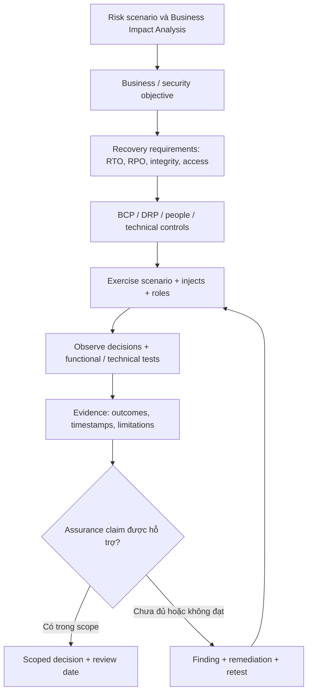
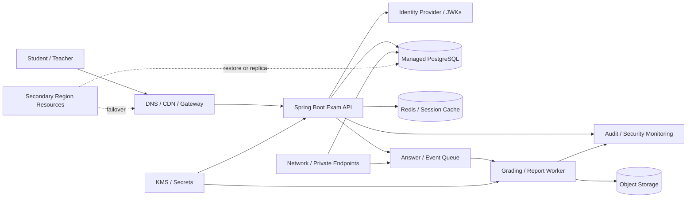
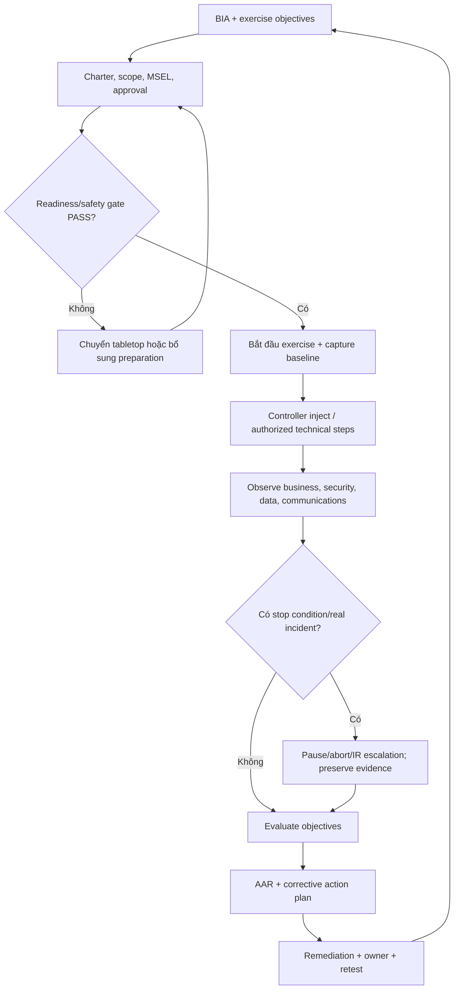

# Continuity exercise: diễn tập duy trì hoạt động kinh doanh và chứng minh năng lực phục hồi

## 1. Tình huống mở đầu: có kế hoạch liên tục kinh doanh nhưng đã sẵn sàng chưa?

Một nền tảng học tập phục vụ nhiều trường học sử dụng Java/Spring Boot, PostgreSQL được quản lý, Kubernetes, hàng đợi xuất báo cáo và object storage. Trong tuần thi cuối kỳ, nhà cung cấp cloud gặp gián đoạn tại một khu vực. Hệ thống có tài liệu “Business Continuity Plan” (BCP), một bản backup hàng ngày và sơ đồ failover sang region dự phòng. Nhóm vận hành tuyên bố: “Đã có disaster recovery, chắc chắn sẽ hoạt động.”

Khi tổ chức một cuộc diễn tập thử, đội trực phát hiện:

- DNS vẫn trỏ một phần traffic tới ingress ở region bị ảnh hưởng.
- Dịch vụ đăng nhập khu vực dự phòng chưa kiểm tra kết nối tới identity provider.
- Bản sao database có replication lag; không ai biết các bài thi vừa nộp có bị thiếu không.
- Report worker nhận lại job sau khi failover, có nguy cơ tạo PDF trùng lặp.
- Đường tải báo cáo vẫn hoạt động, nhưng kiểm tra quyền theo tenant ở cấu hình dự phòng chưa được xác minh.
- Người có quyền phê duyệt chuyển đổi region không trực trong khung giờ diễn tập.

**Có kế hoạch, có backup và có dashboard xanh chưa chứng minh tổ chức duy trì được hoạt động trong điều kiện sự cố.** Điều còn thiếu là thực hành phối hợp và bằng chứng quan sát được về năng lực phục hồi.

**Continuity exercise (diễn tập liên tục kinh doanh)** là hoạt động có mục tiêu, kịch bản, người tham gia, phạm vi, giới hạn an toàn và tiêu chí đánh giá được xác định trước nhằm **kiểm tra khả năng con người, quy trình, công nghệ, dữ liệu và các bên liên quan duy trì hoặc khôi phục hoạt động ưu tiên khi xảy ra gián đoạn**.

Trong chương **Business continuity** của module **SECURITY_SECURITY_ASSURANCE**, continuity exercise là một phương thức **security assurance dựa trên bằng chứng**: xác định mục tiêu rủi ro, kiểm tra controls và quy trình, đo kết quả, khắc phục điểm yếu và diễn tập lại để nâng độ tin cậy theo thời gian. Diễn tập không chỉ để “làm cho đủ checklist”, mà để phát hiện giả định chưa đúng **trước khi sự cố thực xảy ra**.

### Mục tiêu học tập

Sau bài này, bạn có thể:

1. Phân biệt business continuity, disaster recovery, incident response, tabletop exercise, simulation và recovery test.
2. Dùng Business Impact Analysis (BIA) để lựa chọn quy trình trọng yếu và đặt mục tiêu diễn tập theo RTO, RPO, MTPD/MAO và business requirements.
3. Thiết kế exercise charter, scope, objectives, scenario, injects, evaluation criteria và stop conditions.
4. Xác định người điều phối, người chơi, người quan sát, người chấm đánh giá, lãnh đạo quyết định và vai trò đối tác.
5. Lựa chọn mức thực hành từ thảo luận trên bàn đến functional drill, technical recovery, parallel operations và full-scale simulation.
6. Kiểm chứng tính sẵn sàng của backup, failover, DNS, IAM, workloads, queues và business flows mà không gây gián đoạn vượt phạm vi.
7. Ghi nhận kết quả theo **observed behavior, timestamps, evidence, constraints, uncertainties và business impact**.
8. Đánh giá cả availability, integrity, confidentiality, tenant isolation và khả năng truyền thông trong phục hồi.
9. Xây dựng After-Action Report (AAR), improvement plan, remediation owner và lịch retest.
10. Tổ chức một continuity exercise cho nền tảng học tập đa tenant trong thời gian thi với bằng chứng đáng tin.

## 2. Phạm vi của continuity exercise và các khái niệm liên quan

Business continuity (BC) hướng đến **duy trì các hoạt động sản phẩm/dịch vụ thiết yếu ở mức chấp nhận được** khi xảy ra gián đoạn. Công nghệ là một thành phần, không phải toàn bộ câu trả lời.

| Thuật ngữ | Trọng tâm | Ví dụ trong nền tảng học tập |
|---|---|---|
| **Business continuity management (BCM)** | Chương trình quản trị khả năng liên tục kinh doanh | Chính sách, BIA, plans, chủ sở hữu, diễn tập và cải tiến |
| **Business Continuity Plan (BCP)** | Cách duy trì chức năng nghiệp vụ ưu tiên | Cho phép nộp bài thi, thông báo thay đổi lịch thi, hỗ trợ giảng viên |
| **Disaster Recovery Plan (DRP)** | Khôi phục công nghệ và dữ liệu sau gián đoạn | Chuyển region, phục hồi PostgreSQL, khôi phục Kubernetes |
| **IT contingency planning** | Chuẩn bị phương án thay thế/khôi phục hệ thống IT | Cấu hình secondary cluster, backup, runbook và thứ tự khởi động |
| **Incident response (IR)** | Phát hiện, phân tích, containment và xử lý sự cố bảo mật | Cô lập credential bị chiếm, chặn lộ dữ liệu |
| **Crisis management** | Quyết định chiến lược, phối hợp stakeholder và thông tin | Quyết định lùi kỳ thi, thông báo khách hàng |
| **Continuity exercise** | Thực hành kiểm tra tổ chức có thực hiện các plans/controls được không | Tabletop mất region, dry-run khôi phục, drill thông báo |
| **Recovery test** | Kiểm chứng một khả năng phục hồi cụ thể | Restore một backup vào môi trường cô lập |
| **Live failover** | Chuyển hoạt động thật sang phương án dự phòng | Di chuyển traffic có kiểm soát, đo tác động nghiệp vụ |

### 2.1. Diễn tập không mặc nhiên là disaster recovery

Một cuộc tabletop trao đổi về cách tổ chức dạy học nếu hệ thống chấm điểm không khả dụng là continuity exercise dù không thực sự failover database. Ngược lại một test restore database là **thành phần kiểm chứng kỹ thuật**, chưa bao phủ cách ban giám hiệu thông báo, giáo viên xử lý bài thi đang dở hoặc đội hỗ trợ tiếp nhận yêu cầu.

### 2.2. Diễn tập không mặc nhiên là incident thật

Exercise có thể dùng dữ liệu giả, quyết định giả lập và nhãn “EXERCISE” để tránh kích hoạt phản ứng khẩn cấp ngoài ý muốn. Nếu trong diễn tập phát hiện một sự cố thật, phải có **quy tắc phân biệt exercise traffic với actual incident** và điều kiện dừng/chuyển sang quy trình IR thực.

### 2.3. Security assurance trong continuity

Chương trình assurance cần trả lời: “Chúng ta có **bằng chứng** các controls và quy trình có khả năng đáp ứng business security objectives khi một thành phần hoặc con người không còn sẵn sàng không?” Chỉ có danh sách các hoạt động được thực hiện **không tự chứng minh mục tiêu cuối đã đạt**.

## 3. Từ risk scenario đến assurance claim và bằng chứng

Một continuity exercise nên bắt đầu từ rủi ro của tổ chức, không chỉ từ tính năng sẵn có của công cụ chaos testing.

### 3.1. Chuỗi thiết kế



### 3.2. Ví dụ claim tốt

**Quá rộng:** “Nền tảng bảo đảm khả năng liên tục 24/7 khi cloud bị lỗi.”

**Có thể đánh giá hơn:** “Trong diễn tập ở staging ngày T, với luồng nộp bài thử trên release R, đội vận hành thực hiện chuyển dịch vụ phụ thuộc sang vùng thử đã phê duyệt; các bài nộp giả nằm trong khoảng RPO mục tiêu, nghiệp vụ được khôi phục trong RTO mục tiêu, không ghi nhận truy cập chéo tenant trong các test cases thuộc scope.”

Claim cần nêu rõ **đối tượng, scenario, môi trường, thời điểm, phương pháp và limits**. Một diễn tập thành công trên staging **không tự chứng minh** production sẽ đạt cùng RTO/RPO trong mọi loại sự cố.

### 3.3. Claim–evidence mapping

| Claim | Loại evidence hỗ trợ |
|---|---|
| Đội biết ai quyết định kích hoạt BCP | Kịch bản, decision log, escalation/approval timestamps |
| Dịch vụ quan trọng hoạt động trong thời gian mục tiêu | Business transaction tests, recovery timestamps, SLO observations |
| Mất dữ liệu nằm trong ngưỡng cho phép | Checkpoints, restored data comparison, reconciliation records |
| Quyền và cô lập tenant vẫn được duy trì | Positive/negative authorization tests sau failover |
| Thông tin đến stakeholder đúng thời điểm | Message drafts, approved exercise sends, receipts/acknowledgements |
| Backup có thể restore | Restore job, integrity checks, app functional tests |
| Provider dependency được xử lý | Dependency list, escalation simulation, service status/evidence theo scope |
| Kế hoạch được cải tiến sau exercise | AAR, assigned findings, fixes, retest evidence |

**Một ảnh cho thấy “backup job completed” không thể thay thế bằng chứng ứng dụng đã phục hồi dữ liệu đúng và sử dụng được.**

## 4. Business Impact Analysis (BIA) là nền tảng chọn mục tiêu

**Business Impact Analysis** xem xét tác động của gián đoạn đối với hoạt động và xác định các quy trình, dependency, nguồn lực và thời gian chấp nhận được. BIA thường đưa ra các đầu vào quan trọng cho BCP/DRP và chương trình exercise.

### 4.1. Câu hỏi cần trả lời

- Quy trình nào thực sự quan trọng: nộp bài thi, chấm điểm, truy cập kết quả, gửi thông báo hay xuất báo cáo?
- Nếu gián đoạn 15 phút, 2 giờ hoặc một ngày, ảnh hưởng tới học sinh, giáo viên, hợp đồng và quy định ra sao?
- Giới hạn sai lệch dữ liệu và thời gian phục hồi được phê duyệt là gì?
- Dịch vụ nào là dependency cứng: IdP, DNS, database, secrets, KMS, queue, đối tác email/SMS?
- Có cách làm thủ công thay thế không và có bảo vệ tính toàn vẹn/thông tin cá nhân không?
- Những thời điểm nào là peak activity như kỳ thi hoặc công bố điểm?
- Ai sở hữu quá trình nghiệp vụ và ai có quyền chấp nhận downtime?

### 4.2. Những chỉ số không được nhầm

| Chỉ số | Ý nghĩa chính | Câu hỏi kiểm chứng |
|---|---|---|
| **RTO (Recovery Time Objective)** | Thời gian mục tiêu để khôi phục hoạt động/dịch vụ tới mức được xác định sau gián đoạn | Các chức năng trong scope phục hồi trong bao lâu? |
| **RPO (Recovery Point Objective)** | Điểm dữ liệu mà tổ chức chấp nhận mất so với thời điểm gián đoạn | Có bao nhiêu thay đổi đã xác nhận không có trong bản phục hồi? |
| **MTPD / MAO** | Khoảng gián đoạn tối đa có thể chịu trước tác động không thể chấp nhận, tùy hệ thuật ngữ tổ chức | Nếu quá khoảng này, hậu quả nghiệp vụ là gì? |
| **WRT (Work Recovery Time)** | Thời gian để hoàn tất hoạt động xử lý/đối soát nghiệp vụ sau khi hệ thống kỹ thuật đã khôi phục, theo cách tổ chức định nghĩa | Sau khi DB phục hồi, giảng viên cần bao lâu để đối soát? |
| **MTD/MTTR** | Các chỉ số thời gian kỹ thuật/hoạt động, định nghĩa thay đổi theo tổ chức | Có cùng điểm bắt đầu/kết thúc với RTO không? |
| **SLO** | Mục tiêu mức dịch vụ vận hành bình thường hoặc degraded mode | Sau recovery, chức năng có đạt ngưỡng chất lượng được duyệt? |

**RTO và RPO là mục tiêu, không phải số đo tự động đạt được chỉ vì được ghi trong tài liệu.** Phải xác định chính xác mốc thời gian, tập dữ liệu và các hoạt động nghiệp vụ áp dụng.

### 4.3. RTO khác RPO như thế nào?

Giả sử xảy ra gián đoạn lúc 10:00. Mục tiêu RTO 60 phút nghĩa là hoạt động được định nghĩa phải phục hồi trong 60 phút từ mốc sự cố theo cách đo đã duyệt. Mục tiêu RPO 5 phút nghĩa là điểm dữ liệu phục hồi được phải không cũ hơn mức mất dữ liệu chấp nhận được theo mốc sự cố/điểm đo đã quy định.

RPO 5 phút **không** có nghĩa hệ thống phục hồi trong 5 phút; RTO 60 phút **không** có nghĩa được phép mất 60 phút dữ liệu. Nếu các bài thi đã được xác nhận nộp thành công nhưng biến mất sau recovery, cần đánh giá **data integrity và giao dịch đã được ACK**, không chỉ so sánh timestamp của backup.

### 4.4. Ví dụ BIA mang tính minh họa

| Quy trình | Priority giả định | RTO mục tiêu | RPO mục tiêu | Điều kiện bổ sung |
|---|---|---|---|---|
| Nộp bài thi trực tuyến | Rất cao | 30 phút | Gần 0 hoặc ngưỡng được BIA duyệt | Không làm mất bài đã ACK; tenant isolation |
| Xác thực học viên | Rất cao | 30 phút | Phụ thuộc IdP và session design | Không bypass authentication khi degraded |
| Xem điểm đã công bố | Cao | 2 giờ | 15 phút | Không trả dữ liệu sai tenant |
| Báo cáo xuất PDF | Trung bình | 8 giờ | 1 giờ cho job metadata, tùy quyết định | Job idempotency, không tạo file trái quyền |
| Thông báo email/SMS | Theo kỳ thi | 4 giờ | Theo queue retention | Không gửi trùng hoặc tiết lộ thông tin |

Tất cả số trong bảng là **giả định để học**, không phải khuyến nghị RTO/RPO mặc định. Đối với dữ liệu bài thi, thiết kế và chính sách thực tế có thể yêu cầu mức nghiêm ngặt hơn; số mục tiêu phải được business/risk owner phê duyệt.

### 4.5. RTO của cả chuỗi phụ thuộc

Một API “healthy” không có nghĩa workflow nộp bài đã phục hồi. Quy trình có thể cần authentication → ghi database → phát event → xác nhận nộp → xem lại bài. Vì vậy yêu cầu RTO ở cấp nghiệp vụ cần **định nghĩa end-to-end completion criteria** và các dependencies quan trọng.

## 5. Các loại continuity exercise và mức độ tác động

Không phải tổ chức nào cũng nên bắt đầu bằng failover production. Có nhiều mức diễn tập, tăng dần độ thực tế, chi phí và rủi ro.

| Loại | Cách thực hiện | Điều kiểm chứng | Giới hạn |
|---|---|---|---|
| **Checklist / orientation** | Rà soát plans, danh sách liên hệ, quyền | Tính hiện hành và khả năng hiểu quy trình | Không chứng minh kỹ năng thực thi |
| **Tabletop exercise (TTX)** | Nhóm thảo luận trước tình huống giả lập | Quyết định, escalation, roles, assumptions | Không kiểm chứng thực tế API/failover |
| **Walkthrough** | Lần lượt đi qua kế hoạch, quyền, công cụ | Thứ tự bước, missing dependencies | Có thể chưa chạy live actions |
| **Functional exercise** | Người tham gia thực hiện vai trò, communications, approvals trong mô phỏng | Coordination và thời gian phản hồi | Technical recovery có thể được mô phỏng |
| **Technical drill / component recovery test** | Restore DB, switch endpoint, kiểm credential ở staging | Hiệu lực một component/đường phục hồi | Chưa chắc đo end-to-end business workflow |
| **Simulation / game day** | Tạo fault được kiểm soát và quan sát hệ thống | Failover, resilience, incident operations | Cần chuẩn bị safety, có thể ảnh hưởng hệ thống |
| **Parallel operation** | Khởi chạy hệ thống dự phòng song song, traffic giả hoặc bản sao an toàn | Khả năng vận hành môi trường dự phòng | Data consistency, cost, isolation cần kiểm tra |
| **Full-scale / live failover exercise** | Nhiều nhóm và hệ thống thật tham gia theo kế hoạch | Tính khả thi và phối hợp gần thực tế nhất | Rủi ro disruption, cần thẩm quyền và safeguards cao |

### 5.1. Mức độ cao không đồng nghĩa tốt hơn ở mọi thời điểm

Một tabletop có thể phát hiện không ai được phân công gọi cloud provider — vấn đề mà chạy failover script đơn lẻ khó thấy. Một restore drill có thể phát hiện key backup không còn hoạt động — vấn đề tabletop dễ bỏ qua. Tổ chức cần **danh mục diễn tập cân bằng** theo rủi ro và độ trưởng thành.

### 5.2. Điều diễn tập có thể và không thể chứng minh

- **Tabletop:** chứng minh các quyết định và phối hợp **trong mô phỏng**; không chứng minh data restore thật.
- **Technical drill:** chứng minh một thao tác kỹ thuật **trên môi trường và dữ liệu được thử**; không tự chứng minh logistics/communications.
- **Live failover:** quan sát được behavior thật hơn, nhưng chỉ trong **scenario, traffic, version, dependencies và thời điểm thử**.

Không dùng một kết quả PASS của một loại exercise để tuyên bố mọi lớp BCP đạt.

## 6. Năng lực chuẩn bị trước khi lên lịch diễn tập

Trước exercise, cần làm rõ những yếu tố quyết định thành công:

1. **Business ownership:** sponsor, process owner, risk owner và người phê duyệt.
2. **Scope:** chức năng, users/tenants, services, accounts/regions, environments.
3. **BIA inputs:** priorities, RTO/RPO, recovery sequence, MTPD/MAO nếu dùng.
4. **Plans:** BCP/DRP/incident runbooks cùng phiên bản và thay đổi gần đây.
5. **Dependencies:** IdP, DNS, cloud provider, telecom, điện, nguồn nhân lực, vendor.
6. **Recovery resources:** credentials/break-glass, backups, images, infrastructure definitions.
7. **Observability:** logs, metrics, traces, audit and business transaction checkpoints.
8. **Test fixtures:** tài khoản/dữ liệu giả, cách thu thập bằng chứng không rò rỉ PII.
9. **Communication:** người nhận/giả lập người nhận, approval, nhãn EXERCISE.
10. **Safety:** stop conditions, guardrails, contingency plan cho chính cuộc diễn tập.
11. **Evaluator plan:** expected results, người quan sát, các mốc cần đo.
12. **Post-exercise process:** AAR, findings ownership, remediation và retest.

### 6.1. Readiness gate

Một cuộc live drill không nên triển khai nếu chưa có đáp án tối thiểu cho:

- Ai có quyền bắt đầu và dừng?
- Làm thế nào đảo ngược thay đổi nếu gây impact?
- Có backup và phương án khôi phục đã được xác minh phù hợp?
- Có giới hạn blast radius thực thi bởi kỹ thuật, không chỉ ghi “không ảnh hưởng”?
- Có thể phân biệt traffic thật và dữ liệu thử không?
- Có người trực giám sát cả security, reliability và business outcomes không?

Nếu thiếu, có thể đổi sang tabletop hoặc chạy staging drill để đạt mục tiêu học tập mà không tăng rủi ro vô ích.

### 6.2. Diễn tập có điều phối, không phải tấn công bất ngờ

Một **no-notice exercise** có thể có giá trị khi được lãnh đạo phê duyệt và có safety cell theo dõi, nhưng không nên tự tạo sự cố bất ngờ trên production. Người điều phối cần có khả năng dừng cuộc diễn tập và xử lý một incident thật độc lập với nội dung mô phỏng.

## 7. Xác định phạm vi và kịch bản dựa trên rủi ro

Exercise phải giả định một gián đoạn có tính hợp lý đối với tổ chức và liên quan đến những controls cần kiểm chứng.

### 7.1. Một số kịch bản

| Kịch bản | Rủi ro chính | Câu hỏi cần diễn tập |
|---|---|---|
| Cloud region outage | Mất một nhóm managed services | Chuyển region, state/data có nhất quán không? |
| Identity provider outage | Users không đăng nhập hoặc token không refresh | Có degraded mode an toàn, không bypass auth? |
| Database corruption | Dữ liệu bị lỗi/không tin cậy | Restore point nào phù hợp, có đối soát integrity? |
| Ransomware nghi xâm nhập | Nhiều tài nguyên mất trust | Cô lập và phục hồi từ backup/identity tin cậy thế nào? |
| DNS hoặc certificate failure | Clients không kết nối đúng endpoint | Có khả năng đổi route mà vẫn xác minh TLS? |
| Queue outage | Job export/notification tồn đọng | Backlog, retry, idempotency và business prioritization? |
| Third-party service outage | Email/SMS/SSO/payment không khả dụng | Kênh thay thế và communications? |
| Key personnel unavailable | Không ai có quyền/phê duyệt chuyển vùng | Ủy quyền và succession? |
| Facility/connectivity disruption | Staff không tới văn phòng | Remote access, contact tree và human workflow? |
| Data residency constraint | Không thể đơn giản chuyển vùng | Recovery location có phù hợp quy định/hợp đồng? |

### 7.2. Xác định ranh giới

Không chọn kịch bản “cloud down” mơ hồ. Hãy định nghĩa:

- **Failure domain:** region, availability zone, service, network path hay nhân sự.
- **Affected services:** những thành phần nào mất, những gì vẫn còn.
- **Data state:** replication lag, point-in-time backup, in-flight transactions.
- **Business time:** giờ thi, công bố điểm, giờ thấp điểm hoặc holiday.
- **Known constraints:** RTO/RPO, capacity dự phòng, compliance, data residency.
- **Safety boundaries:** không làm hại dữ liệu thật, không vượt quyền cloud.
- **Exercise assumptions:** các thành phần “được mô phỏng hỏng” không nhất thiết hỏng thật.

### 7.3. Kịch bản phải kiểm tra các quyết định, không chỉ chạy script

Ví dụ “region A gián đoạn” nên đặt câu hỏi: ai tuyên bố sự cố? Có đủ evidence để kích hoạt DR không? Dùng phương án degraded service nào? Ai duyệt thông báo khách hàng? Chuyển region có làm thay đổi security boundary? Khi nào dừng retry tự động? Những câu hỏi này đánh giá khả năng của **con người và quy trình**.

## 8. Quản lý an toàn và quyền hạn của cuộc diễn tập

Một continuity exercise có thể trở thành sự cố thật nếu fault injection hoặc failover ảnh hưởng production, làm mất dữ liệu hoặc khiến các integrations bên ngoài nhận lệnh sai.

### 8.1. Guardrails bắt buộc

- **Written authorization:** scenario và các hành động kỹ thuật được phê duyệt.
- **Scope boundaries:** environment, accounts, resources, time windows và dữ liệu test.
- **Blast radius limitation:** test tenant, sandbox, read-only, capacity limits hoặc circuit breakers.
- **Observability:** business transaction metrics, security alerts, health và collector status.
- **Stop conditions:** điều kiện dừng ngay, người có quyền dừng, kênh liên hệ.
- **Rollback/roll-forward plan:** trạng thái nguồn/đích và cách trở lại an toàn.
- **Evidence preservation:** timestamps, logs, test identifiers và custody.
- **Communication controls:** thông điệp gắn nhãn `EXERCISE` và recipient rõ.
- **Security invariants:** không tắt authn/authz/TLS/tenant isolation chỉ để làm exercise pass.
- **Third-party coordination:** không tác động provider/đối tác ngoài quyền đã được cấp.

### 8.2. Không được xem “diễn tập” là giấy phép gây gián đoạn

Không cố tình xóa dữ liệu production, tắt hệ thống ngoài scope, gửi hàng loạt cảnh báo thật hoặc truy cập thông tin người dùng thật để kiểm tra. Nếu cuộc diễn tập có yêu cầu tác động live, phải tuân thủ quy trình change/incident của tổ chức và giới hạn đã được phê duyệt.

### 8.3. Stop vs pause vs abort

| Quyết định | Ý nghĩa | Ví dụ |
|---|---|---|
| **Pause** | Dừng tạm để xác minh tình huống mà vẫn giữ trạng thái an toàn | Metrics collector chưa trả dữ liệu |
| **Abort** | Kết thúc exercise trước dự kiến do rủi ro/thiếu an toàn | Transaction thật bị ảnh hưởng ngoài phạm vi |
| **Transition to real incident** | Kích hoạt IR thật khi phát hiện sự cố ngoài kịch bản | Dấu hiệu compromise hoặc data leakage thật |
| **Controlled rollback** | Khôi phục trạng thái trước theo plan được duyệt | Canary failover gây latency vượt giới hạn |
| **Continue with adaptation** | Điều chỉnh inject trong phạm vi cho phép | Đổi một bài thử kỹ thuật thành decision tabletop |

Một exercise bị abort **không nhất thiết thất bại toàn bộ**; chính việc phát hiện giới hạn an toàn và thực hiện dừng đúng quy trình cũng có thể là evidence về năng lực vận hành. Tuy nhiên các objectives chưa kiểm chứng phải ghi rõ NOT_TESTED.

## 9. Vai trò, điều phối và tách người chơi khỏi người đánh giá

| Vai trò | Nhiệm vụ |
|---|---|
| **Executive sponsor** | Phê duyệt mục tiêu, nguồn lực, rủi ro và mức tham gia |
| **Exercise director** | Điều phối cuộc diễn tập, quyết định start/pause/abort theo thẩm quyền |
| **Controller/facilitator** | Phát scenario/injects theo kế hoạch, quản lý thời gian |
| **Players** | Thực hành các quyết định và hành động như khi sự cố |
| **Evaluators/observers** | Ghi quan sát, đối chiếu tiêu chí và bằng chứng |
| **Safety officer** | Theo dõi blast radius, quyền, stop conditions và chuyển sang IR khi cần |
| **Incident/BCP commander (player)** | Điều phối response và recovery trong kịch bản |
| **Business process owner** | Đánh giá mức hoạt động tối thiểu và tác động tới người học |
| **SRE/platform/DBA** | Thực hành recovery của cloud/K8s/database/network |
| **Application/Java team** | Kiểm tra workflow, queue, authz và dữ liệu nghiệp vụ |
| **Security/AppSec/IR** | Đánh giá confidentiality/integrity, identity, evidence và rủi ro |
| **Communications/legal/privacy** | Thực hành approval, notifications và nghĩa vụ liên quan |
| **Third-party liaison** | Thử escalation đến provider/đối tác theo phạm vi |

### 9.1. Ranh giới cần thiết

Người thiết kế inject biết trước tình huống không nên giả vờ là người chơi bị bất ngờ khi đánh giá khả năng phát hiện. Người chấm cần ghi **observed actions**, không chỉ ý định. Một tổ chức nhỏ có thể kiêm vai trò nhưng phải công bố giới hạn độc lập khi rút ra kết luận assurance.

### 9.2. Người chơi phải thực hiện đúng quyền

Trong exercise, không nên dùng super-admin chung cho mọi thao tác vì sẽ che vấn đề về break-glass/access segregation. Nếu mục tiêu kiểm tra quyền khẩn, phải dùng cơ chế ủy quyền được phê duyệt và ghi lại thời gian nhận quyền, hành động, thời điểm thu hồi.

### 9.3. Các đội không kỹ thuật vẫn có vai trò

Hệ thống khôi phục nhưng đội hỗ trợ chưa biết trạng thái dịch vụ, giáo viên nhận thông điệp sai hoặc phụ huynh không được thông báo theo quy định có thể khiến continuity objectives chưa đạt. Exercise nên xem xét **business operations và communication**, không chỉ kết quả lệnh restore.

## 10. Exercise charter và kế hoạch đánh giá

Một exercise charter ngắn nhưng cụ thể giúp tất cả nhóm hiểu mục tiêu, phạm vi và điều kiện an toàn.

### 10.1. Mẫu charter

```yaml
exercise_id: "BC-EX-DEMO-008"
title: "Learning-platform continuity during regional service disruption"
status: "ILLUSTRATIVE_NOT_APPROVED"
organization: "example-learning-platform"
environment: "isolated-staging"
scenario:
  event: "Primary-region dependencies become unavailable"
  time_context: "Peak examination window (simulated)"
  primary_region: "<simulated-region-A>"
  recovery_region: "<approved-test-region-B>"
business_objectives:
  - "Students can submit synthetic answers using an approved path"
  - "No acknowledged submission is silently lost"
  - "Cross-tenant access is denied after recovery"
  - "Service and stakeholder communications are coordinated"
targets:
  rto: "<business-approved-RTO>"
  rpo: "<business-approved-RPO>"
  minimum_service: "Submit and verify test exam results"
scope:
  services:
    - "identity-integration"
    - "exam-api"
    - "postgresql-recovery"
    - "report-queue"
    - "storage"
  data: "synthetic accounts and synthetic exam results only"
  excluded: ["production-user-data", "unapproved-provider-disruption"]
roles:
  director: "<exercise-director>"
  safety_officer: "<safety-owner>"
  evaluator: "<independent-or-assigned-evaluator>"
  business_owner: "<business-process-owner>"
authorization:
  reference: "<approved-change-and-exercise-id>"
  window: "<approved-start-end>"
success_criteria:
  - "Approved recovery decision is recorded"
  - "Critical synthetic end-to-end flow restored in target window"
  - "Recovered data reconciles with defined checkpoint and RPO"
  - "Authorized access succeeds, unauthorized cross-tenant access fails"
  - "Audit/monitoring and communication tests produce evidence"
stop_conditions:
  - "Unexpected effect on real users or data"
  - "Loss of access to safety monitoring"
  - "Security control weakened outside approved scope"
outputs:
  - "Chronological exercise log"
  - "Technical and business test results"
  - "After-action report with remediation owners"
```

Mẫu trên sử dụng dữ liệu giả, **không phải một approval để gây sự cố thực**. Không điền RTO/RPO hoặc đánh dấu PASS bằng suy đoán; cần lấy mục tiêu từ BIA và actual tests.

### 10.2. Objectives phải đo được

**Yếu:** “Nhóm phải làm tốt khi cloud hỏng.”

**Mạnh hơn:** “Trong kịch bản mất region A ở staging, trong khoảng RTO đã phê duyệt, ít nhất một user giả thuộc tenant A nộp và truy xuất bài thi được xác nhận; tenant B không thể truy cập dữ liệu tenant A; điểm dữ liệu phục hồi được đối soát với checkpoint; on-call xác nhận và ban hành thông điệp exercise đã phê duyệt.”

### 10.3. Phân nhóm success criteria

| Nhóm | Acceptance criteria có thể quan sát |
|---|---|
| **People** | Người trực và dự phòng nhận nhiệm vụ, thực hiện đúng quyền |
| **Process** | Quyết định BCP/DR, escalation và communications đúng trình tự |
| **Technology** | Services khôi phục, dependency readiness và routing chính xác |
| **Data** | Recovery point, integrity, reconciliation và ownership được xác nhận |
| **Security** | Authn/authz, TLS, IAM, audit và tenant isolation không suy yếu |
| **Business** | Minimum viable operations đạt, stakeholders được hỗ trợ |
| **Evidence** | Timestamps, methods và results có thể tái kiểm tra |

### 10.4. Kỳ vọng realistic nhưng có giới hạn

Trong một tabletop, evaluator có thể ghi `SIMULATED_DECISION_PASS` cho việc gọi đúng người; không được đổi thành `TECHNICAL_FAILOVER_VERIFIED`. Trong technical drill, chỉ một số business workflows được kiểm, nên report phải ghi đúng phần còn thiếu.

## 11. Exercise scenario, Master Scenario Events List và injects

**Scenario** mô tả bối cảnh gián đoạn; **inject** là thông tin hoặc tình huống được người điều phối đưa vào để thúc đẩy người chơi ra quyết định. Với các cuộc diễn tập có cấu trúc, **Master Scenario Events List (MSEL)** là lịch các sự kiện/injects dự kiến, điều kiện phát và mục tiêu đánh giá.

### 11.1. Một inject phải kiểm tra điều gì?

Mỗi inject cần có:

- **ID và thời điểm:** mốc diễn tập hoặc điều kiện kích hoạt.
- **Người nhận:** incident commander, business owner, SRE, DBA, security hay truyền thông.
- **Thông tin được tiết lộ:** player biết được gì vào thời điểm đó.
- **Expected action/decision:** hoạt động nào cần quan sát.
- **Evaluation criterion:** hành động nào là phù hợp theo plan/policy.
- **Evidence source:** controller log, ticket, communication, test output.
- **Safety control:** không gửi thông báo thật hoặc tác động tài nguyên ngoài scope.

### 11.2. Ví dụ MSEL cho gián đoạn region trong tuần thi

| Mốc giả lập | Inject | Người nhận | Điều cần quan sát |
|---|---|---|---|
| T+00 | Dashboard cho thấy API nộp bài có latency cao | On-call/SRE | Xác nhận cảnh báo, định danh impacted workflow |
| T+05 | Primary region không truy cập được một managed dependency | Incident commander | Escalation, decision criteria kích hoạt BCP/DR |
| T+10 | Một trường báo học viên không nhận acknowledgement bài thi | Business owner/support | Cách phân biệt submitted/unknown, thông tin tới trường |
| T+15 | Replica lag tăng, checkpoint chưa đồng bộ | DBA/data owner | RPO assessment và bảo vệ integrity |
| T+20 | Secondary region phục hồi compute nhưng IdP route không hoạt động | App/Security | Phát hiện dependency và không bypass auth |
| T+25 | Queue có một số event có thể replay | Platform/app team | Idempotency, duplicate handling, DLQ và job reconciliation |
| T+35 | Có giả định credential dùng ở secondary quá rộng | IAM/Security | Kiểm tra effective policy, không hạ security controls |
| T+45 | Giáo viên yêu cầu xem điểm khi dữ liệu chưa đối soát | Business owner | Degraded mode và policy công bố dữ liệu |
| T+60 | Recovery workflow mẫu hoàn tất | Evaluator/owner | Business functional tests, RTO/RPO và limitations |
| T+70 | Primary phục hồi, có đề xuất failback | Incident commander | Điều kiện failback, split-brain, dữ liệu hai phía |

Các mốc **không phải target thời gian mặc định**. Kịch bản chỉ gợi ý các quyết định cần kiểm tra; thời gian thực và success criteria phải dựa vào BIA.

### 11.3. Phân biệt thời gian mô phỏng và thời gian đo được

Một exercise có thể cho rằng 15 phút trong câu chuyện đã trôi qua trong khi nhóm thảo luận thực tế 3 phút. Không dùng thời gian giả lập đó để báo “đã đạt RTO 15 phút”. **RTO kỹ thuật chỉ đo được khi có timestamp của hoạt động khôi phục thực**, với điểm bắt đầu/kết thúc đã định.

### 11.4. Điều chỉnh inject một cách minh bạch

Controller có thể thay lịch nếu người chơi đang xử lý một vấn đề quan trọng, nhưng phải ghi lý do. Không nên thêm inject để cố ý đánh lừa một người chơi rồi chấm fail khi tiêu chí chưa được công bố phù hợp. Objective là học và kiểm chứng năng lực, không phải tìm người để đổ lỗi.

## 12. Diễn tập truyền thông, escalation và điều phối bên ngoài

Continuity phụ thuộc vào việc truyền thông **đúng người, đúng thời điểm và đúng nội dung đã được xác minh**. Công nghệ có thể hoạt động trở lại nhưng khách hàng vẫn mất khả năng tổ chức lớp học nếu nhận chỉ dẫn sai.

### 12.1. Chuỗi communication trong một sự cố

1. On-call nhận và xác nhận signal.
2. Incident/BCP coordinator đánh giá severity và affected business process.
3. Gọi business owner và technical owners đúng theo contact tree.
4. Lãnh đạo được phân quyền quyết định degraded mode, kỳ thi và thông báo.
5. Customer support nhận hướng dẫn thống nhất để phản hồi.
6. Người dùng/đối tác nhận thông tin theo kênh và thời điểm đã phê duyệt.
7. Cập nhật khi trạng thái thay đổi; có người chịu trách nhiệm phiên bản thông điệp.
8. Xác nhận đóng communication và cung cấp post-incident summary khi phù hợp.

### 12.2. Hai lỗi phổ biến

**Lỗi thiếu communication:** kỹ thuật đang khôi phục nhưng nhà trường không biết có nên tiếp tục cho học viên nộp bài không, dẫn tới trùng lặp hoặc mất dữ liệu.

**Lỗi nói quá mức:** gửi thông báo “không có dữ liệu bị mất” trước khi hoàn thành RPO reconciliation. Một kết luận không có evidence có thể gây hậu quả lớn hơn việc ghi “chưa xác nhận, đang đối soát”.

### 12.3. Mẫu thông điệp exercise có kiểm soát

> **EXERCISE – KHÔNG PHẢI SỰ CỐ THẬT.** Trong kịch bản thử gián đoạn hệ thống nộp bài tại khu vực A, nhóm vận hành đang đánh giá phương án phục hồi. Trạng thái giả lập: chức năng nộp bài chưa được xác minh hoạt động; quyền truy cập và tính toàn vẹn dữ liệu phải được kiểm chứng trước khi thông báo phục hồi. Mọi hoạt động với người dùng thật vẫn theo quy trình bình thường.

Thông điệp chỉ nên gửi tới kênh diễn tập đã cho phép. Nếu định thử kênh SMS/email thật, cần danh sách recipient thử và chấp thuận riêng để tránh gây hoang mang.

### 12.4. Kênh dự phòng

Một exercise nên kiểm tra điều gì xảy ra nếu chính chat, email, IdP hoặc status page của tổ chức bị gián đoạn. Có thể sử dụng một kênh out-of-band đã chuẩn bị; không gửi secrets, dữ liệu bài thi hoặc thông tin nhạy cảm qua kênh thiếu kiểm soát.

### 12.5. Evidence

Đo thời điểm gửi/nhận/ack, tỷ lệ người liên hệ được, sai lệch phiên bản thông điệp, approval delay và cách cập nhật thông tin. **Tin nhắn đã được soạn** không tương đương **tin nhắn đã đến đúng người** nếu mục tiêu yêu cầu delivery.

## 13. Liên kết business service map với kiến trúc phục hồi

Một bản sơ đồ microservices chỉ có ích cho continuity nếu thể hiện được **đường phục vụ nghiệp vụ** và các dependencies cần trong recovery.

### 13.1. Kiến trúc minh họa của nền tảng học tập



### 13.2. Map một quy trình tới dependencies

| Business operation | Dependencies cần thiết | Điều cần kiểm chứng sau failover |
|---|---|---|
| Đăng nhập học viên | IdP/JWKs, session store, DNS/TLS | Issuer/audience/expiry, legitimate login, deny invalid token |
| Mở bài thi | API, database, cache, config, clock | Đúng tenant, đề thi và cửa sổ làm bài |
| Nộp bài | API, DB, transaction, acknowledgement, queue theo design | ACK tương ứng bản ghi bền vững, không mất/nhân đôi |
| Chấm điểm | Worker, queue, DB/object references | Exactly-once business effect qua idempotency/reconciliation |
| Xem kết quả | API, DB, authorization, cache | Không trả nhầm kết quả tenant hoặc dữ liệu stale |
| Xuất PDF | Queue, worker, storage, signed links | Không duplicate, ACL/TTL, đúng dữ liệu |
| Audit sự kiện | Log producer, collector, sink, clock | Event tạo và đến nơi, không thất thoát |
| Thông báo | Email/SMS vendor, queue, templates | Không gửi trùng, không lộ dữ liệu, có fallback |

### 13.3. Nhận diện single points of failure (SPOF)

Một secondary Kubernetes cluster không giải quyết SPOF nếu cả hai region dựa vào một identity provider, secret manager, khóa KMS hoặc DNS configuration không hoạt động trong scenario. BIA và exercise cần xác định **failure domains và control-plane dependencies**, không chỉ availability của compute.

### 13.4. Dependencies con người

Runbook có thể yêu cầu một người duy nhất nắm thủ tục ký chứng thư hoặc approve DNS switch. Nếu người đó không thể liên lạc, tổ chức cần delegation/break-glass có audit. Đây là dependency quan trọng ngang với database hoặc network.

## 14. Diễn tập degraded mode và ứng dụng Java/Spring Boot

Continuity không luôn có nghĩa tất cả chức năng phải hoạt động đầy đủ. Một hệ thống có thể vận hành ở **minimum acceptable service level** trong thời gian khôi phục, nhưng không được bỏ các security invariants thiết yếu.

### 14.1. Phân biệt chức năng cần và có thể trì hoãn

| Tình trạng | Quyết định có thể xem xét | Yêu cầu không thể tự bỏ |
|---|---|---|
| PDF export worker down | Tạm hoãn export, ghi trạng thái “pending” | Không báo “completed” giả, bảo vệ job và dữ liệu |
| Notification vendor down | Đưa thông báo vào queue/alternative workflow | Không gửi lặp dữ liệu nhạy cảm |
| Cache down | Đọc DB có kiểm soát nếu capacity cho phép | Không bỏ tenant/object authorization |
| Secondary region chưa có chấm điểm | Cho nộp bài theo policy, chấm sau | Bảo đảm ACK và data integrity |
| IdP down | Dùng cơ chế dự phòng đã thiết kế, hoặc tạm dừng login | Không chấp nhận token không xác thực |
| Read replica bị lag | Có thể chặn xem kết quả chưa đối soát | Không trả điểm cũ như điểm mới |

### 14.2. Fail-closed cho bảo mật, graceful degradation cho nghiệp vụ

Nếu authorization service không phản hồi, chọn mặc định **allow all** để “đạt availability” có thể tạo lỗ hổng nghiêm trọng. Một thiết kế an toàn định nghĩa rõ thuộc tính nào phải fail-closed và chức năng nào có thể degraded mà vẫn bảo vệ dữ liệu/identity.

Không có một giải pháp chung cho mọi hệ thống: cần threat model, business requirements, khả năng caching policy được chứng minh và thời gian hiệu lực của quyết định quyền.

### 14.3. Spring Boot readiness không tương đương nghiệp vụ sẵn sàng

Spring Boot Actuator/readiness probe có thể xác nhận process đáp ứng một số health indicators. Nhưng application “UP” vẫn có thể không nộp được bài nếu DB ở trạng thái read-only sai, IdP route lỗi hoặc tenant mapping chưa đồng bộ. Exercise nên dùng **business transaction probes** bên cạnh technical health.

### 14.4. Ví dụ cấu hình degraded mode mang tính mô tả

```yaml
# Pseudocode cấu hình nghiệp vụ, không phải key chuẩn của Spring Boot.
continuity:
  mode: "EXAM_SUBMISSION_ONLY"
  reason: "regional-recovery-exercise"
  approved_by: "<authorized-business-and-security-owner>"
  effective_until: "<reviewed-time>"
  capabilities:
    exam_read: true
    exam_submit: true
    grading: false
    report_export: false
  security_invariants:
    authenticate: "REQUIRED"
    authorize_tenant_object: "REQUIRED"
    audit_critical_actions: "REQUIRED"
  telemetry:
    mode_change_event: true
    degraded_feature_requests: true
```

Các keys là **mô hình khái niệm do ứng dụng tự triển khai**, không thể copy vào Spring Boot để có chức năng. Cần audit thay đổi mode, enforce ở server/worker chứ không chỉ ẩn UI, và xác minh tất cả paths thuộc scope.

### 14.5. Kiểm chứng chức năng ưu tiên

Sau khi bật degraded mode ở staging:

- Student giả đăng nhập qua đúng issuer/audience.
- Student mở đúng đề/tenant và nộp bài, có ACK gắn transaction.
- Request nộp lại được xử lý theo idempotency/duplicate policy.
- Teacher tenant A không xem hoặc sửa bài của tenant B.
- Report export tạm bị từ chối hoặc queued theo contract, không tạo side effect trái phép.
- Audit event quan trọng vẫn được phát, nhận và bảo vệ.
- Runbook cho người dùng/hỗ trợ thể hiện rõ chức năng đang tạm hạn chế.

## 15. Bài kiểm tra backup, restore và data integrity

Một backup hoàn tất không chứng minh có thể restore, còn một restore hoàn tất không chứng minh dữ liệu nghiệp vụ đúng. Continuity exercise nên kiểm chứng từ **recovery point → restored system → reconciliation → business transaction**.

### 15.1. Tối thiểu bốn lớp evidence

1. **Protection configuration:** backup scope, schedule, retention, encryption/key policy.
2. **Actual recovery points:** các bản backup/snapshot/WAL/log segments thực có.
3. **Restore execution:** thời gian, thao tác, môi trường, errors và dependencies.
4. **Data validation:** bản ghi/checksum/transaction fixtures và business invariants.

### 15.2. Phân biệt backup với replication

Replication có thể giữ dữ liệu gần thời gian thực nhưng cũng có thể lan truyền xóa nhầm hoặc dữ liệu hỏng. Backup có retention phù hợp giúp quay lại recovery point, còn replication hỗ trợ availability/RPO tùy thiết kế. Chỉ có replica không thay thế một chiến lược backup độc lập.

### 15.3. PostgreSQL recovery scenario

Một lần thử có thể:

1. Tạo test data của hai tenant và lưu checkpoint IDs/timestamps.
2. Ghi các transactions đã commit và application ACK.
3. Chọn bản recovery point phù hợp (snapshot/PITR theo khả năng dịch vụ).
4. Restore vào database cô lập, không overwrite production.
5. Kết nối ứng dụng hoặc validation harness bằng credential thử.
6. Kiểm tra số records, transaction IDs, ownership, schema/migrations và các constraints.
7. Đối soát những ACK trước mốc dự kiến, xác định missing/duplicate records.
8. Kiểm tra clock, encryption keys, connection policy và audit.
9. Ghi actual data-loss interval và time to usable service.

### 15.4. RPO phải đo qua dữ liệu đã xác nhận

Ví dụ checkpoint:

| Submission ID (giả) | Event time | App ACK | Sau restore | Kết luận |
|---|---|---|---|---|
| `SUB-A001` | 09:58:30 | 09:58:31 | Có và đúng | Preserved |
| `SUB-A002` | 09:59:55 | 09:59:56 | Có và đúng | Preserved |
| `SUB-B003` | 10:00:01 | 10:00:02 | Chưa có | Cần xác định theo recovery cutoff/RPO và nghĩa vụ với user |
| `SUB-B004` | 10:00:10 | Chưa ACK | Chưa có | Không thể coi là acknowledged data loss nếu chưa xác minh semantics |

Bảng chỉ minh họa. **Một mất bài đã ACK có thể vi phạm data integrity/business contract ngay cả khi số phút nằm trong RPO đã khai báo**; cần rà soát thiết kế ACK, replication và nghĩa vụ với người dùng.

### 15.5. Tại sao restore bị lỗi dù backup có sẵn?

- Key KMS/secret hoặc trust policy không sẵn ở region phục hồi.
- Backup thiếu WAL/transaction logs hoặc metadata.
- Schema migration làm version ứng dụng không tương thích.
- Network/private endpoint chặn DB connection.
- DB capacity thấp, restore quá chậm.
- Dữ liệu backup đã bị hỏng trước khi phát hiện.
- Permissions/roles không được khôi phục hoặc bị khôi phục quá rộng.
- Object storage references/signed URLs không khớp.

Từng failure là đầu vào cho improvement plan, không chỉ ghi “backup test failed” chung chung.

### 15.6. Khôi phục an toàn

Không restore dữ liệu cá nhân thật vào môi trường test thiếu quyền, mã hóa hoặc retention. Dùng dữ liệu giả, dữ liệu đã được xử lý theo policy hoặc hệ thống cô lập có bảo vệ tương đương khi bắt buộc. Với dữ liệu thi cử, luôn có sự tham gia của data/business owner để xác minh **nghĩa vụ integrity**.

## 16. Queue, event replay và tính nhất quán sau phục hồi

Trong các hệ thống phân tán, outage có thể xảy ra sau khi API ACK nhưng trước khi worker hoàn tất, hoặc sau khi worker tạo file nhưng trước khi ACK message. Nếu khôi phục thiếu cơ chế chống lặp, cùng một job có thể chạy hai lần.

### 16.1. Những trạng thái cần diễn tập

| Trạng thái | Rủi ro khi failover/restart | Kiểm chứng |
|---|---|---|
| **Queued nhưng chưa xử lý** | Job bị mất/không được consume | Queue durability và replay |
| **In-flight, chưa ACK** | Redelivery và side effect lặp | Idempotency key + business state |
| **Worker ghi file rồi crash** | Hai file/cùng job nếu replay | Unique job/object mapping |
| **Outbox chưa publish** | DB commit nhưng downstream thiếu event | Outbox relay/reconciliation |
| **Dead-letter queue** | Những job lỗi bị bỏ quên sau DR | DLQ inventory/retry policy |
| **Scheduled jobs/CronJobs** | Chạy ở cả primary và secondary | Leader election/fencing và job ownership |
| **Retry storm** | Quá tải secondary khi dependency hồi phục | Backoff, limits và queue capacity |
| **Tenant context missing** | Worker chạy job sai tenant/quyền | Authz/ownership validation tại consumption |

### 16.2. Không giả định exactly-once delivery

Nhiều broker cung cấp at-least-once hoặc các giao thức giao nhận có điều kiện. Cần thiết kế **business idempotency** và dedup dựa trên ID phù hợp, thay vì suy rằng queue chỉ giao message một lần. “Exactly once” ở một tầng không tự động bảo đảm side effects ngoại vi như PDF/email/database đạt exactly once.

### 16.3. Ví dụ mã Java minh họa tính lặp an toàn

```java
// Pseudocode: các repository, transaction và exception đều giả định.
// Quy tắc idempotency và authorization phải được thiết kế riêng cho hệ thống thật.
@Transactional
public ProcessResult handle(ExportCommand cmd) {
    ExportJob job = jobs.findByIdForUpdate(cmd.jobId())
        .orElseThrow(JobNotFoundException::new);

    if (job.isCompleted()) {
        return ProcessResult.alreadyCompleted(job.resultRef());
    }

    // Không tin tenant hoặc quyền chỉ do producer ghi trong message.
    policy.requireWorkerAllowedToProcess(job);
    jobs.markProcessing(job.id(), cmd.deliveryId());

    // External file write phải có key/idempotency/reconciliation phù hợp.
    return exportCoordinator.processWithRecoveryChecks(job);
}
```

Đoạn minh họa **không giải quyết atomicity giữa DB transaction và external object storage**; cần thiết kế state machine, object key stable, transaction/outbox, retry và reconciliation để tránh job completed giả hoặc file trùng. Không dùng nguyên đoạn làm production implementation.

### 16.4. Exercise acceptance criteria

Một lần mô phỏng worker restart hoặc failover cần chứng minh:

- Mọi job giả được ACK trước outage có kết quả hợp lý theo business contract.
- Không phát sinh export file trái quyền.
- Không tạo duplicate business effects khi message được phát lại.
- Jobs không hoàn tất có trạng thái rõ và có cách retry/compensate.
- Queue lag và recovery backlog giảm trong giới hạn chấp nhận.
- Audit/trace có thể liên kết job ID với outcome và phiên bản ứng dụng.

### 16.5. Recovery không chỉ là trả queue về 0

Queue depth bằng 0 có thể vì mọi messages bị drop, hoặc consumer ACK trước khi commit kết quả. Phải kiểm tra **business outcome, count reconciliation và integrity**, không chỉ operational graph.

## 17. IAM, TLS, secrets và security controls khi khôi phục

Một lỗi continuity nguy hiểm là **khôi phục availability bằng cách nới lỏng bảo mật**. Ví dụ dùng root IAM key, tắt TLS verification hoặc bỏ qua tenant authorization để hệ thống “lên nhanh”.

### 17.1. Security invariants sau recovery

| Control | Acceptance criteria |
|---|---|
| **Authentication** | Token sai chữ ký/issuer/audience/expiry vẫn bị từ chối |
| **Authorization** | Role/tenant/object restrictions không thay đổi trái policy |
| **Workload IAM** | Secondary services chỉ có quyền đã duyệt trên data/resources |
| **TLS** | Certificate/hostname/chain được xác minh, không tắt kiểm tra |
| **Secrets** | Credential được nạp từ nguồn chuẩn, không hardcode trong image |
| **Encryption** | DB/storage/backup/replication dùng key policy hợp lệ |
| **Audit/logging** | Các security events còn được tạo và gửi tới sink đúng |
| **Network** | Only-approved ingress/egress paths, không mở admin port rộng |
| **Data boundaries** | Dữ liệu tenant A không xuất hiện trong tenant B |
| **Break-glass** | Quyền khẩn được cấp ngắn hạn, có audit và thu hồi |

### 17.2. Identity provider như một dependency

Nếu IdP ở region lỗi, token validation có thể vẫn hoạt động nhờ cached JWKs trong một giới hạn phù hợp, nhưng login/refresh/token revocation có thể khác. Không tự suy rằng mọi cached token có thể dùng vô hạn hoặc rằng một application tự tạo token “dự phòng” là an toàn.

Exercise cần xác định token lifecycle, refresh, issuer/audience, key rotation, revoked sessions và user experience theo kiến trúc thực.

### 17.3. KMS/key availability và data recovery

Backup được mã hóa có thể không giải mã ở vùng dự phòng nếu key policies, grants, replication hoặc cơ chế tương ứng chưa được thiết kế. Diễn tập cần kiểm tra khả năng phục hồi **mà không export secrets trái quyền**. Không tùy tiện tắt mã hóa hoặc xóa/rotate key nếu chưa đánh giá tác động.

### 17.4. Break-glass phải được thử, nhưng không làm mất audit

Một tabletop có thể phát hiện không ai có quyền activate secondary infrastructure. Với kỹ thuật, dùng account thử và quy trình đã duyệt để đo thời gian xin quyền, MFA/approval, logs và việc thu hồi sau exercise. Không duy trì quyền quản trị rộng thường trực chỉ để vượt qua một bước khó trong diễn tập.

### 17.5. Negative tests về tenant isolation

Sau failover, một test teacher tenant A gọi `GET /results/{idB}` phải bị từ chối; test login hợp lệ của tenant A phải thành công; download signed URL giả quá hạn hoặc ngoài scope phải bị từ chối. Kiểm cả API và asynchronous worker nếu luồng nghiệp vụ cho phép nhiều entry points.

## 18. Cloud region outage, DNS và failback

Một thiết kế multi-region thường có **nhiều cấp failover**: compute, database, storage, networking, DNS/CDN, identity và application state. Diễn tập phải định nghĩa trạng thái dữ liệu và đường traffic trước/sau.

### 18.1. Những câu hỏi của technical drill

1. Primary region unavailable được **mô phỏng hay thực sự tạo fault**?
2. Ai cho phép chuyển hướng traffic? Có tự động hay manual approval?
3. Secondary có đủ compute/network capacity, quotas và licenses?
4. Database là synchronous replica, asynchronous replica hay restore từ backup?
5. Data consistency, write ownership và split-brain prevention được xử lý ra sao?
6. TLS certificates, DNS, service endpoints, allowed origins có phù hợp?
7. App/worker có sử dụng đúng cloud IAM identities/key access trong secondary?
8. Users đã kết nối cũ, caches và in-flight transactions xử lý thế nào?
9. Các bên thứ ba có allowlist IP/domain theo vùng cũ không?
10. Khi primary hồi phục, tiêu chí failback và data reconciliation là gì?

### 18.2. DNS TTL không phải tổng thời gian chuyển vùng

Một record DNS có TTL thấp có thể giúp một số resolvers cập nhật nhanh hơn, nhưng cache layers, client connections, TLS, health checks và propagation behavior vẫn ảnh hưởng. **Không tuyên bố RTO chỉ bằng TTL đã cấu hình**; cần quan sát end-to-end requests từ test clients với các network perspectives phù hợp.

### 18.3. Split-brain và read-only decision

Nếu hai vùng cùng cho phép writes nhưng không có cơ chế giải quyết consistency, dữ liệu có thể phân kỳ. BCP/DRP cần nêu ai là write leader, khi nào secondary được ghi, dữ liệu ở primary cũ sẽ được xử lý thế nào. Diễn tập nên quan sát khả năng **fencing**/write-protection theo design, không tự tắt tất cả safeguards để tăng availability.

### 18.4. Provider responsibilities

Cloud provider có thể chịu trách nhiệm về nền tảng và service availability trong phạm vi hợp đồng, nhưng khách hàng vẫn cần cấu hình multi-region architecture, IAM, recovery data, workloads và failover process của mình. Một SLA hoặc compliance report của provider **không chứng minh hệ thống khách hàng phục hồi đúng RTO/RPO**.

### 18.5. Diễn tập khi không có secondary region thực

Có thể kiểm thử decision tree, configuration templates, restore in isolated environment, regional dependency inventory và failover readiness, rồi ghi rõ **live regional failover NOT_TESTED**. Không giả vờ kết quả tabletop là bằng chứng full failover.

## 19. Kubernetes và workload recovery: controller không phải toàn bộ đáp án

Kubernetes có thể tự tạo lại Pods sau khi một instance lỗi. Nhưng restart và self-healing ở Pod level **không bảo đảm** backup, network, identity, database hoặc full business continuity.

### 19.1. Những lớp cần đánh giá

- **Workload definitions:** Deployment, StatefulSet, Job/CronJob, init containers, sidecars.
- **Image identity:** digest, registry availability và artifact provenance.
- **Configuration:** ConfigMaps, Secrets, runtime feature flags, policies và namespace.
- **Storage:** persistent volumes, reclaim semantics, snapshots và data locality.
- **Network:** ingress/gateway, CNI/NetworkPolicies, service mesh và DNS.
- **IAM:** RBAC, service accounts, cloud workload identity.
- **Scheduling:** node pools, quotas, taints/tolerations, topology constraints và capacity.
- **Observability:** metrics/log pipeline, health indicators và audit events.
- **Controllers:** autoscaling, CronJobs, old templates và reconciliation.

### 19.2. Read-only inventory minh họa

```bash
# Chỉ thực hiện ở Kubernetes context được cấp quyền.
# Đây là các lệnh quan sát, không mô phỏng outage và không tự phục hồi.
kubectl -n learning get deployments,statefulsets,jobs,cronjobs -o wide
kubectl -n learning get pods -o wide
kubectl -n learning get serviceaccounts,networkpolicies
kubectl -n learning get events --sort-by=.lastTimestamp

# Kiểm tra image ID của các containers đang chạy.
kubectl -n learning get pods \
  -o jsonpath='{range .items[*]}{.metadata.name}{"\t"}{range .status.containerStatuses[*]}{.name}{"="}{.imageID}{" "}{end}{"\n"}{end}'
```

Những câu lệnh này cung cấp **observed state**, không chứng minh app data integrity hoặc security behavior. Không gọi lệnh thay đổi cluster trong exercise ngoài phạm vi có phê duyệt.

### 19.3. Recovery ở cluster dự phòng

Nếu có secondary cluster, cần kiểm image digest được deploy, liveness/readiness, PVC/storage class, workload identity và network rules. Một helm release thành công vẫn có thể để một CronJob dùng image/role cũ; inventory phải bao gồm các workloads có khả năng tạo job sau failover.

### 19.4. Pods healthy chưa chắc business healthy

`kubectl get pods` có thể hiển thị `Running` cho mọi Pod trong khi database connection hoặc token verification lỗi. Exercise cần request/workflow probes, kiểm quyền truy cập theo tenant và trạng thái dữ liệu thực tế.

### 19.5. Không dùng tính năng autohealing làm bằng chứng thay DR

Pod restart có thể đủ cho một process crash nhưng không đủ cho region outage, corrupted data hoặc attack đã ảnh hưởng toàn bộ image/secret. Technical resilience và business continuity phải được đánh giá theo đúng failure domain.

## 20. Thiết kế technical tests và ví dụ kiểm chứng bằng Java

Một continuity exercise cần chứng minh các chức năng **được phép hoạt động**, hành vi **bị cấm vẫn bị ngăn**, và dữ liệu được **khôi phục đúng contract**.

### 20.1. Ma trận test sau recovery

| Test ID | Tình huống | Expected |
|---|---|---|
| BC-01 | Student A đăng nhập bằng token hợp lệ | Authentication thành công theo policy |
| BC-02 | Student A dùng token sai issuer/audience | Deny |
| BC-03 | Student A nộp bài giả trong region phục hồi | ACK và persisted submission tương ứng |
| BC-04 | Student A nộp lại cùng idempotency key | Không nhân đôi business effect |
| BC-05 | Teacher A xem bài thi của mình theo quyền | Allow |
| BC-06 | Teacher A xem bài tenant B | Deny, không lộ dữ liệu |
| BC-07 | Worker retry job đã completed | Không tạo PDF/notification trùng |
| BC-08 | DB restore checkpoint | Data fixture được đối soát, missing records ghi nhận |
| BC-09 | Cloud IAM của worker ở secondary | Actions ngoài quyền bị deny |
| BC-10 | Audit event cho nộp bài và deny trái tenant | Event được tạo, forward và bảo vệ |
| BC-11 | Report export tạm disabled theo degraded mode | Không tạo job/file trái policy |
| BC-12 | DNS/client kết nối endpoint dự phòng | TLS và routing đúng, không bypass auth |
| BC-13 | Backup/restore khôi phục quyền và schema | Không tạo privilege regression |
| BC-14 | Operator thực hiện escalation và approval | Decision record, timestamp đầy đủ |

### 20.2. Mã integration test Spring Boot minh họa

```java
// Pseudocode kiểm chứng nghiệp vụ với Testcontainers/staging fixture.
// Các helper, token issuer, test repository là giả định, cần hiện thực.
@SpringBootTest
@AutoConfigureMockMvc
class ContinuityRecoveryAssuranceIT {
    @Autowired MockMvc mvc;
    @Autowired SyntheticExamFixtures fixtures;
    @Autowired SignedTestTokenIssuer tokens;

    @Test
    void recoveredServicePersistsAcknowledgedSubmission() throws Exception {
        var studentA = fixtures.studentIn("tenant-A");
        var examA = fixtures.examFor(studentA);
        var submissionId = fixtures.newSubmissionId();

        mvc.perform(post("/api/exams/{id}/submissions", examA.id())
                .header("Authorization", "Bearer " + tokens.forActor(studentA))
                .header("Idempotency-Key", submissionId)
                .contentType(MediaType.APPLICATION_JSON)
                .content(fixtures.syntheticAnswerJson()))
            .andExpect(status().is2xxSuccessful());

        assertThat(fixtures.persistedSubmissionCount(submissionId))
            .isEqualTo(1);
    }

    @Test
    void recoveredServiceStillRejectsCrossTenantResultRead() throws Exception {
        var teacherA = fixtures.teacherIn("tenant-A");
        var resultB = fixtures.resultIn("tenant-B");

        mvc.perform(get("/api/results/{id}", resultB.id())
                .header("Authorization", "Bearer " + tokens.forActor(teacherA)))
            .andExpect(status().isForbidden());

        assertThat(fixtures.unexpectedDataAccessFor(resultB.id())).isFalse();
    }
}
```

Đây là **ví dụ cấu trúc, không phải mã chạy được ngay**. Các helpers không thuộc Spring Boot; `MockMvc` có thể chạy trong một test context không trùng toàn bộ đường gateway/IdP thực tế. Muốn hỗ trợ claim về failover, cần kết hợp test này với observed infrastructure, restored DB/data, artifact/config versions và end-to-end checks trên môi trường phục hồi.

### 20.3. Test chức năng hợp lệ và không hợp lệ

Một app “được khôi phục” nhưng API cho mọi token truy cập bất cứ tenant nào **không đạt security continuity**. Ngược lại app từ chối tất cả requests có thể đảm bảo không lộ dữ liệu nhưng chưa đạt business availability. Bài test nên bao phủ **cả positive và negative paths**, cùng bảo toàn dữ liệu.

### 20.4. Phân biệt technical assertion và business assurance

Một test JUnit pass không đủ kết luận “trường học có thể tổ chức thi” nếu user sessions, hệ thống công bố đề, giám sát thời gian và hỗ trợ người dùng vẫn lỗi. Recovery acceptance cần business owner tham gia và định nghĩa **minimum viable workflow**.

## 21. Đo kết quả: RTO, RPO, năng lực phối hợp và độ tin cậy

Khi đánh giá một exercise, không chỉ hỏi “cuối cùng có khởi động được service không?”. Cần đo **đúng mục tiêu đã định**, phân biệt test đạt, đạt một phần, chưa kiểm hoặc vi phạm giới hạn an toàn.

### 21.1. Thống nhất các mốc thời gian

| Mốc | Ký hiệu | Nội dung |
|---|---|---|
| Bắt đầu gián đoạn theo kịch bản có tác động thực | `t_failure` | Mốc dùng đo RTO nếu phương pháp quy định như vậy |
| Hệ thống phát hiện triệu chứng | `t_detected` | Mốc telemetry hoặc người dùng phát hiện |
| Đội có trách nhiệm acknowledge | `t_ack` | Đo phản ứng ban đầu |
| Quyết định kích hoạt BCP/DR | `t_decision` | Có approval/rationale |
| Các thao tác phục hồi bắt đầu | `t_restore_start` | Bắt đầu thực thi plan |
| Infrastructure báo ready | `t_infra_ready` | Technical state, chưa chắc business ready |
| Business flow đạt acceptance criteria | `t_business_ready` | Mốc phục hồi nghiệp vụ theo tiêu chí |
| Data reconciliation được xác nhận | `t_data_verified` | Kết quả về tính toàn vẹn/RPO |
| Thông báo approved service recovery | `t_communicated` | Người nhận biết trạng thái mới |
| Kết thúc exercise và đưa tài nguyên về trạng thái an toàn | `t_exercise_end` | Cleanup và post-test checks |

Nếu organizational RTO được đo từ `t_failure` tới `t_business_ready` thì:

\[
\text{Observed recovery duration} = t_{\text{business ready}} - t_{\text{failure}}
\]

Không thay `t_business_ready` bằng `t_infra_ready` chỉ để báo đạt. Trong tabletop, thời gian scenario được “nhảy nhanh” không sử dụng làm **observed technical recovery duration**.

### 21.2. Đo RPO theo recovery point

Giả sử disruption lúc 10:00, khôi phục point-in-time state tới 09:56; mức dữ liệu có thể thiếu theo điểm phục hồi là khoảng 4 phút theo giả định dữ liệu có timestamp đáng tin. Tuy nhiên:

- Cần biết những giao dịch đã được hệ thống ACK trước downtime.
- Có trường hợp asynchronous replication chưa kịp áp dụng một số commits.
- Cần xem transactional boundary, audit và reconciliation.
- Một RPO “4 phút” chỉ mô tả dữ liệu so với điểm phục hồi, **không tự bảo đảm những giao dịch quan trọng đã ACK được giữ nguyên**.

Với exam submissions, business requirement có thể đòi hỏi không mất bất kỳ bài đã xác nhận. Đó là invariant riêng phải đo bằng test fixtures và transaction IDs.

### 21.3. Metrics kỹ thuật, bảo mật và nghiệp vụ

| Metric | Ý nghĩa | Giới hạn |
|---|---|---|
| **Observed RTO** | Thời gian tới khi business flow hoạt động như yêu cầu | Phụ thuộc điểm bắt đầu/kết thúc đã thống nhất |
| **Observed RPO/data-loss window** | Khoảng dữ liệu không có ở recovery point | Không thay transaction-level integrity |
| **Time to decision** | Khả năng kích hoạt BCP/DR nhanh | Quyết định nhanh nhưng sai không có ích |
| **Time to communicate** | Thời gian tới thông điệp đã duyệt và nhận được | Draft chưa phải delivered |
| **Restore reliability** | Tỷ lệ restore jobs/tests có kết quả | Cần kiểm usability và scope |
| **Business transaction success** | Số luồng ưu tiên đạt acceptance | Test fixture đại diện hạn chế |
| **Data reconciliation completeness** | Transactions/objects đối chiếu được | Thiếu inventory làm chỉ số sai |
| **Security control retention** | Authn/authz/TLS/IAM/audit tiếp tục hiệu lực | Không chỉ xem settings “enabled” |
| **Dependency readiness** | IdP, queue, DB, DNS, secrets hoạt động | Một thành phần ready chưa đủ cả workflow |
| **Manual intervention/error** | Những bước không được tự động hóa và sai sót | Cần phân biệt con người với thiếu thiết kế |
| **Communication reachability** | Stakeholders/owners có được liên hệ và phản hồi? | Simulation ≠ notification thật |
| **Sustained operation duration** | Hệ thống duy trì ổn định sau phục hồi | Một request pass không đủ |
| **Return-to-normal quality** | Khả năng failback/rollback có dữ liệu nhất quán | Có thể chưa thuộc phạm vi exercise |
| **Evidence coverage** | Bao nhiêu claims có test/evidence đúng scope? | Nhiều file không bằng bằng chứng tốt |

### 21.4. Đo workload theo giai đoạn

Một vùng phục hồi có thể đáp ứng vài request thử nhưng không đủ capacity cho giờ thi. Exercise cần xác định mức tải **phù hợp và an toàn**: số học viên đồng thời giả, tốc độ submissions, queue backlog, latency và error rate. Không dùng traffic flood trên production hoặc bên thứ ba để “chứng minh” peak capacity nếu chưa được phép.

### 21.5. Đừng làm đẹp kết quả

Nếu RTO đạt nhưng RPO thất bại, kết luận không phải “DR đạt 100%”. Nếu database restore thành công nhưng không thể đăng nhập hoặc authorization bị sai, business continuity chưa được chứng minh. **Một mục tiêu đạt không bù tự động cho một security invariant bị vi phạm.**

## 22. Thu thập bằng chứng để tạo assurance case

Một exercise có giá trị audit khi bên thứ ba có thể thấy **mục tiêu đã đặt, cách thử, điều gì thực sự xảy ra, ai quyết định, kết quả, giới hạn và việc khắc phục**.

### 22.1. Các loại evidence

| Loại | Ví dụ |
|---|---|
| **Planning evidence** | BIA version, exercise charter, approval, scope, MSEL |
| **Decision evidence** | Incident/BCP command log, approvals, decision timestamps |
| **Technical change evidence** | IaC, config revision, cloud audit, deployment IDs |
| **Runtime state** | DB recovery point, image digest, infrastructure identity, routing |
| **Data integrity evidence** | Checkpoints, ACK IDs, record reconciliation, checksums |
| **Security test evidence** | Positive/negative authz/IAM/TLS tests, audit delivery |
| **Performance/availability evidence** | End-to-end transaction timing, SLO, queue lag |
| **Communication evidence** | Exercise message draft, approval, receipt/ack |
| **Third-party evidence** | Simulated/provider response, dependency owner and escalation |
| **Evaluation evidence** | Observer notes, scored objectives, limitations, safety events |
| **Improvement evidence** | AAR, findings, corrective actions, retest outcome |

### 22.2. Evidence quality attributes

- **Relevance:** liên quan trực tiếp tới claim cần chứng minh.
- **Provenance:** biết nguồn, identity công cụ/người thu và phương pháp.
- **Integrity:** có dấu vết sửa đổi, lưu trữ và hash/signature phù hợp.
- **Freshness:** khớp release, config, dữ liệu và thời điểm exercise.
- **Completeness:** bao phủ service/tenant/region/actor đã đặt trong scope.
- **Repeatability:** có test fixture và điều kiện đủ tái kiểm tra.
- **Independence:** reviewer phù hợp với mức risk; không chỉ tin “developer nói pass”.
- **Confidentiality:** evidence không làm lộ credentials, đề thi hoặc PII thật.
- **Uncertainty:** ghi rõ phần chưa thử, mô phỏng, hoặc không đo được.
- **Decision traceability:** gắn với approval, owner và remediation.

### 22.3. Mẫu evidence record

```yaml
evidence_id: "EV-BC-DEMO-008-01"
exercise_id: "BC-EX-DEMO-008"
claim_id: "CLM-BC-EXAM-SUBMISSION"
business_requirement: "Acknowledged exam submissions preserved"
environment:
  type: "isolated-staging"
  cluster: "<recovery-cluster-id>"
  service: "exam-api"
  application_artifact: "sha256:<observed-image-digest>"
  database_recovery_point: "<observed-recovery-point-id>"
scenario:
  condition: "Primary-region service disruption (simulated)"
  trigger: "<authorized-exercise-inject-id>"
method:
  tests:
    - "synthetic-submission-after-recovery"
    - "commit-ack-checkpoint-reconciliation"
    - "cross-tenant-read-negative-test"
  approved_runbook: "<versioned-runbook-reference>"
observations:
  disruption_time: "<UTC-event-timestamp>"
  service_restored_time: "<UTC-observed-business-ready>"
  restore_reconciliation_time: "<UTC-data-verified>"
  acknowledged_transactions: "<observed-count>"
  missing_acknowledged_transactions: "<observed-count>"
  unauthorized_reads_observed: "<observed-count>"
assessment:
  rto_target: "<business-approved-RTO>"
  rpo_target: "<business-approved-RPO>"
  outcome: "NOT_ASSESSED"
  limitations:
    - "Production traffic and real external identity provider not tested"
artifacts:
  - reference: "restricted://<test-report>"
    sha256: "<real-content-digest>"
  - reference: "restricted://<recovery-log>"
    sha256: "<real-content-digest>"
review:
  evaluator: "<authorized-evaluator>"
  business_owner: "<authorized-business-owner>"
  reviewed_at: "<UTC-timestamp>"
```

Đây là **schema minh họa**. Các giá trị trong dấu ngoặc và outcome không thể tự biến thành bằng chứng đã chạy. Khi thực hành phải lưu actual results, không sao chép `PASS` giả.

### 22.4. Claim, argument, evidence và limitation

```text
GOAL: Nộp bài thi được duy trì/khôi phục đúng mục tiêu trong scenario S
 |
 +-- CLAIM A: Quyết định kích hoạt BCP/DR đúng thẩm quyền
 |     +-- EVIDENCE: Decision log, escalation, approval
 |
 +-- CLAIM B: Các dependencies phục hồi đủ cho business flow
 |     +-- EVIDENCE: Runtime identity, DB readiness, network/IdP tests
 |
 +-- CLAIM C: Luồng nộp bài đạt RTO trong phạm vi thử
 |     +-- EVIDENCE: Timestamps của synthetic end-to-end transactions
 |
 +-- CLAIM D: Data integrity/RPO được đánh giá theo checkpoint
 |     +-- EVIDENCE: Restore point, committed ACK IDs, reconciliation
 |
 +-- CLAIM E: Authentication/authorization và audit không suy yếu
 |     +-- EVIDENCE: Negative/positive tests, log-delivery checks
 |
 +-- CLAIM F: Communication và governance hoạt động
       +-- EVIDENCE: Contact tree exercise, decision/message receipts
 |
 +-- ASSUMPTIONS: Staging fixture phản ánh một phần production topology
 +-- LIMITATIONS: Không đo live peak production load hoặc provider outage thật
```

### 22.5. Giới hạn của screenshot và log đơn lẻ

Screenshot “all pods running” là observed Kubernetes state; không phải proof app nộp bài được. Log `restore job completed` không chứng minh dữ liệu đúng. Message “DR activated” không chứng minh approved decision hoặc recipients nhận thông tin. **Evidence phải đi cùng một assertion cụ thể và method phù hợp**.

## 23. Case study: diễn tập mất region vào giờ thi

### 23.1. Kịch bản

Nền tảng có region A (primary) và region B (recovery). Để diễn tập **không làm gián đoạn người dùng thật**, nhóm tạo một tenant thử và môi trường isolated staging phản ánh các critical dependencies. Một số quyết định về provider outage được mô phỏng bằng inject; các thành phần DB restore, API workflow và authorization được chạy thật trong vùng thử.

**BIA targets giả định cho bài tập:**

- Business RTO cho chức năng nộp bài: **60 phút**.
- RPO mục tiêu cho tập dữ liệu thử: **5 phút**.
- Mọi bài thi đã ACK phải được đối soát; trường hợp thiếu phải được xác định và xử lý theo policy.
- Không cho phép cross-tenant data access sau recovery.
- Audit security events và communication flow phải hoạt động trong scope.

Các giá trị là **mục tiêu giáo dục**, không đại diện yêu cầu của một tổ chức thật.

### 23.2. Timeline minh họa với quan sát

| Mốc thực nghiệm giả định | Diễn biến | Evidence |
|---|---|---|
| 09:00 | Controller đánh dấu bắt đầu scenario outage | Approved exercise trigger |
| 09:04 | On-call xác nhận và mở bridge | Alert acknowledgement/incident log |
| 09:10 | Incident commander quyết định activate DR | Decision + authorization |
| 09:16 | Team phát hiện secondary thiếu permission đọc secret | IAM denied event |
| 09:25 | Cấp quyền đúng scope qua quy trình được duyệt; kiểm chứng | IAM change + effective test |
| 09:35 | Database restore xong nhưng chưa đối soát dữ liệu | Restore report |
| 09:43 | Secondary API đáp ứng readiness | Kubernetes/API runtime state |
| 09:48 | Synthetic student hoàn tất business submission workflow | End-to-end test |
| 09:51 | Reconciliation cho thấy recovery point cuối ở 08:53 | Checkpoint/DB comparison |
| 09:55 | Negative test tenant isolation đạt trong fixtures | Authorization test |
| 10:02 | Đội truyền thông hoàn thành exercise message approval | Message approval + receipt |
| 10:08 | Evaluator kết luận từng objective, mở findings | Signed evaluation/AAR draft |

### 23.3. Đánh giá đúng

**RTO:** nếu đo từ 09:00 đến lúc business workflow hoạt động 09:48, observed recovery là 48 phút và **đạt mục tiêu RTO 60 phút trong staging scenario đã thử**.

**RPO:** nếu recovery point 08:53 so với disruption lúc 09:00 và dữ liệu nằm trong mô hình thử, age của recovery point là 7 phút, **không đạt mục tiêu RPO 5 phút**. Cần tiếp tục kiểm tra các giao dịch đã ACK, không chỉ nhìn mức 7 phút.

**Security:** test tenant isolation trên một tập fixtures đạt; điều này **chưa chứng minh tất cả tenants, API versions hoặc production configuration an toàn**.

**Communication:** approval ở 10:02 chứng minh một phần decision flow, nhưng nếu mục tiêu yêu cầu recipient thật nhận và acknowledge mà không có evidence, communication objective chỉ có thể ghi **PARTIAL/NOT_VERIFIED**.

**Kết luận tổng:** exercise đạt một số objectives và phát hiện các gaps quan trọng. **Không kết luận “DR PASS toàn diện”** vì RPO fail và một số phạm vi chưa được kiểm chứng.

### 23.4. Những findings được mở

| Finding | Root cause giả định | Priority cần đánh giá | Action |
|---|---|---|---|
| **BC-F01** | IAM role secondary thiếu quyền secret theo design | High nếu cản trở RTO | Fix IaC/identity dependency, retest |
| **BC-F02** | Recovery point vượt RPO mục tiêu | Theo dữ liệu/ACK impact | Rà soát replication/backup, integrity testing |
| **BC-F03** | Recipient acknowledgement chưa có evidence | Theo yêu cầu communication | Thử delivery/ack trong kênh kiểm soát |
| **BC-F04** | API v1 và peak load chưa nằm trong test scope | Assurance coverage gap | Bổ sung test hoặc nêu limitation được duyệt |
| **BC-F05** | Kết quả idempotency sau queue replay chưa quan sát | Potential duplicate effects | Thêm stateful replay test |

Mỗi finding cần owner, due date, acceptance criteria, evidence và risk decision. Không “đóng” chỉ vì mọi người đã trao đổi trong debrief.

### 23.5. Câu hỏi evaluator đặt sau sự kiện

- Tại sao không phát hiện thiếu secret permission trước exercise?
- Secondary IAM policy có được quản lý bằng IaC và review cùng primary không?
- 09:48 service “usable” nghĩa là nộp bài end-to-end hay chỉ API trả 2xx?
- Những ACK nào nằm trong 08:53–09:00, có bị thiếu và có thể đối soát không?
- Có người đã dùng quyền break-glass không? Quyền đã được thu hồi?
- Có những failed/unknown transactions nào cần giải thích cho học viên?
- Nếu scenario xảy ra trong production, peak load/IdP/vendor khác biệt thế nào?
- Bằng chứng nào thực sự chứng minh security controls không bị bỏ qua?

### 23.6. Lưu ý về quyền riêng tư và dữ liệu

Không nên lấy điểm thi hoặc bài làm thật của học viên để kiểm tra bằng cách khôi phục vào một môi trường staging thông thường. Dùng synthetic fixtures; nếu yêu cầu dữ liệu thật vì đặc tính kỹ thuật, phải có môi trường được phê duyệt và bảo vệ dữ liệu tương đương theo tổ chức.

## 24. Runbook tổ chức continuity exercise

Runbook cho **exercise** cần tách khỏi runbook cho **incident thật**: có nhãn, test identities, controller authority và stop conditions. Ví dụ bên dưới mô tả công việc cần có, không chứa thao tác phá vỡ môi trường live.

### 24.1. Giai đoạn 1 — Pre-exercise

1. Xác định sponsor, business owner, director và safety officer.
2. Lấy BIA/baseline, RTO/RPO cùng danh sách workflows quan trọng.
3. Chọn kịch bản có threat/failure assumptions rõ ràng.
4. Thiết lập scope và xác nhận các resources nằm trong quyền diễn tập.
5. Soạn charter, MSEL, inject scripts, evaluation worksheets.
6. Chuẩn bị synthetic users, test data, checkpoints và evidence repository.
7. Kiểm tra contact tree, escalation, break-glass và third-party coordination.
8. Xác nhận access permissions, rollback plan và hệ thống giám sát.
9. Có approval và readiness gate cho mức tác động kỹ thuật.
10. Brief controllers/evaluators về an toàn, bảo mật thông tin và sự cố thật.

### 24.2. Giai đoạn 2 — Conduct

1. Ghi starting state và phiên bản triển khai/config.
2. Director công bố bắt đầu exercise, nhắc rõ “EXERCISE”.
3. Controller đưa inject theo MSEL, có ghi actual timestamps.
4. Players thực hiện decisions/communications/technical tests trong scope.
5. Evaluators ghi **thực tế quan sát** mà không chỉ đánh giá trí nhớ người chơi.
6. Safety officer theo dõi stop conditions và real incident triggers.
7. Thu technical logs/test evidence có redaction và provenance.
8. Kiểm tra business positive/negative flows, data integrity và security invariants.
9. Ghi deviations khỏi kế hoạch, điều gì không chạy, lý do.
10. Director chốt thời điểm kết thúc, phục hồi test resources đúng trạng thái an toàn.

### 24.3. Giai đoạn 3 — Immediate debrief

- Mỗi vai trò nêu gì đã hoạt động và điều gì gây chậm trễ.
- Tách evidence của từng mục tiêu với nhận định/phỏng đoán.
- Ghi các điều bất ngờ: dependency thiếu, quyền không có, runbook sai, data gap.
- Không dùng debrief làm buổi quy trách nhiệm cá nhân.
- Xác định các findings cần xử lý ngay nếu ảnh hưởng tới production risk.

### 24.4. Giai đoạn 4 — Formal evaluation và improvement

1. Consolidate timeline, evidence và test results.
2. Chấm từng objective theo tiêu chí đã định.
3. Phân loại gaps: people, process, technology, vendor, data hoặc security.
4. Xác định root causes, ảnh hưởng và khả năng tái diễn.
5. Gắn owner, priority, corrective action, due date.
6. Xác định temporary safeguards nếu gap có risk hiện tại.
7. Trình sponsor/risk owner phê duyệt kết quả và xử lý residual risk.
8. Cập nhật BCP, DRP, architecture, runbook và training.
9. Lập kế hoạch retest, không tự đánh dấu closed sau khi sửa tài liệu.
10. Ghi bài học và phạm vi chưa thử cho lần tiếp theo.

### 24.5. Mẫu tiến trình an toàn



## 25. After-Action Report (AAR) và hồ sơ kết quả

**AAR** không nên chỉ là bản tường thuật “diễn tập thành công”. Nó phải cho biết **mục tiêu nào đạt, bằng chứng nào hỗ trợ, điều gì không đạt, vì sao và phải thay đổi gì**.

### 25.1. Cấu trúc AAR

| Phần | Nội dung |
|---|---|
| **Executive summary** | Scope, kịch bản, kết luận có giới hạn |
| **Objectives and BIA references** | Business/security outcomes và targets |
| **Exercise method** | Tabletop, functional, technical, parallel hay live |
| **Authorization/safety** | Phê duyệt, excluded resources, stop conditions |
| **Participants** | Roles, contact tree, observers và external parties |
| **Scenario/MSEL** | Injects đã dùng, thay đổi và những bước chỉ mô phỏng |
| **Chronology** | Actual vs simulated timestamps, decisions/actions |
| **Results per objective** | PASS/FAIL/PARTIAL/INCONCLUSIVE/NOT_TESTED |
| **Technical evidence** | Restore logs, runtime state, business flows, data checkpoints |
| **Business/security impact** | Availability, data integrity, privacy, tenant isolation |
| **Findings/root causes** | Weaknesses, confidence và priority |
| **Corrective actions** | Owner, deadline, acceptance criteria và retest |
| **Assumptions/limitations** | Những gì kết luận không bao phủ |
| **Approvals and retention** | Reviewers, decision, nơi lưu chứng cứ |

### 25.2. AAR YAML minh họa

```yaml
report_id: "AAR-BC-DEMO-008"
exercise_id: "BC-EX-DEMO-008"
exercise_type: "hybrid-tabletop-and-staging-technical"
status: "ILLUSTRATIVE_NOT_APPROVED"
scope:
  environment: "isolated-staging"
  business_process: "exam-submission"
  scenario: "simulated-primary-region-loss"
objectives:
  - id: "OBJ-RTO"
    target: "60 minutes (example)"
    observed: "48 minutes (fictional result)"
    outcome: "PASS_IN_TEST_SCOPE"
  - id: "OBJ-RPO"
    target: "5 minutes (example)"
    observed: "7-minute recovery-point age (fictional result)"
    outcome: "FAIL"
  - id: "OBJ-AUTHZ"
    target: "cross-tenant access denied"
    observed: "staging fixtures passed"
    outcome: "PASS_IN_TEST_SCOPE"
  - id: "OBJ-COMMS"
    target: "approved notification delivered and acknowledged"
    observed: "approval recorded, recipient acknowledgement not tested"
    outcome: "PARTIAL"
findings:
  - id: "BC-F02"
    concern: "Recovery point exceeds RPO"
    owner: "<database-and-business-owner>"
    corrective_action: "<replication-and-recovery-improvement>"
    acceptance_criteria: "<approved-RPO-and-ACK-reconciliation>"
    retest_status: "NOT_RUN"
limitations:
  - "No live production load/failover"
  - "External identity provider not simulated as fully unavailable"
evidence:
  - "restricted://<timeline-and-observations>"
  - "restricted://<checkpoint-and-reconciliation-report>"
  - "restricted://<security-positive-negative-tests>"
review:
  exercise_director: "<director>"
  business_owner: "<business-owner>"
  assurance_reviewer: "<reviewer>"
  decision: "PARTIAL_NOT_FULLY_ASSURED"
```

**Tất cả kết quả trên là giả định** để học cách báo cáo trung thực; không phải record của hệ thống thật.

### 25.3. Rủi ro của AAR quá lạc quan

Nếu toàn bộ người tham gia nói “mọi thứ ổn” nhưng không có dữ liệu RPO hoặc restore test, kết luận không được phép nâng lên technical assurance. Nếu exercise chỉ kiểm một region staging, AAR không được nói “global production DR fully verified”. Ghi giới hạn chính xác là **điểm mạnh của đánh giá có trách nhiệm**, không phải thất bại.

## 26. Đánh giá mức độ đạt và quản lý những phần chưa kiểm chứng

### 26.1. Bộ trạng thái rõ ràng

| Trạng thái | Khi sử dụng | Không được diễn giải là |
|---|---|---|
| **PASS_VERIFIED** | Đã thử trong scope, quan sát đáp ứng acceptance criteria và có evidence | Tất cả scenarios/production đều đạt |
| **PARTIAL** | Một số bước đạt nhưng còn phụ thuộc/phạm vi chưa đạt hoặc chưa kiểm | PASS đầy đủ |
| **FAIL** | Kết quả thực tế vi phạm tiêu chí đặt trước | Chỉ là “diễn tập không vui” |
| **INCONCLUSIVE** | Test lỗi, thiếu evidence hoặc outcome không thể kết luận | PASS vì không thấy lỗi |
| **NOT_TESTED** | Chưa thực hiện objective hoặc ngoài phạm vi | Không tồn tại rủi ro |
| **SIMULATED_ONLY** | Chỉ thảo luận/quyết định giả lập, không chạy bước kỹ thuật | Technical recovery verified |
| **ABORTED_FOR_SAFETY** | Dừng theo stop condition | Tất cả objectives tự động fail/pass |
| **APPROVED_DEVIATION** | Sai lệch đã có risk decision đúng thẩm quyền | Control đã đạt yêu cầu gốc |
| **RETEST_PENDING** | Có thay đổi khắc phục, chưa kiểm chứng lại | Closed |
| **RETEST_VERIFIED** | Sau sửa đã đạt lại trên scope được xác định | Không còn cần monitoring |

Một cuộc exercise có thể có nhiều outcomes khác nhau cho nhiều objectives. **Trạng thái của từng objective quan trọng hơn một nhãn tổng “SUCCESS”.**

### 26.2. Scoring theo evidence, không chấm theo ấn tượng

Một rubric đơn giản có thể đánh giá:

- **People:** đúng người, đúng quyền, backup personnel có thể thay.
- **Process:** decision tree, escalation và communications có hiệu lực.
- **Technology:** restore/failover theo method đã duyệt.
- **Data:** RPO, integrity, reconciliation và ownership đạt.
- **Security:** authn/authz/IAM/TLS/audit không suy yếu.
- **Business:** minimum acceptable workflows hoạt động trong giới hạn.
- **Evidence:** thông tin có nguồn gốc, timeline và scope rõ.

Mỗi lĩnh vực nên có **tiêu chí đạt riêng**, không lấy điểm trung bình che một failure nghiêm trọng. Ví dụ điểm cao ở communications không bù cho việc mất các bài thi đã ACK hoặc trả dữ liệu sai tenant.

### 26.3. Không coi một cuộc abort vì an toàn là bằng chứng xấu về con người

Nếu safety officer phát hiện có thể chạm dữ liệu production ngoài scope và dừng drill, đó có thể là **safety control hoạt động đúng**. Nhưng recovery objective chưa chạy thì vẫn NOT_TESTED. Kết quả nên tách “safety process passed” và “technical recovery not assessed”.

### 26.4. Cách ghi unknown trong AAR

Ví dụ:

> “Tại thời điểm kết thúc, không có evidence cho thấy region dự phòng có thể xử lý đúng lượng bài thi đồng thời của production. Staging đã pass với traffic thử giới hạn. Capacity objective ở peak production được ghi NOT_TESTED, có owner đánh giá bằng kế hoạch performance exercise riêng.”

Đây là cách bảo đảm **assurance claim không rộng hơn evidence**.

## 27. Corrective actions, retest và chương trình diễn tập liên tục

Một exercise chỉ có ý nghĩa dài hạn khi phát hiện được chuyển thành thay đổi cụ thể và kiểm chứng lại.

### 27.1. Phân loại root cause

| Loại gap | Ví dụ | Cải tiến |
|---|---|---|
| **People** | Chỉ một người biết thủ tục chuyển region | Training, succession và cross-skill |
| **Process** | Không rõ khi nào quyết định activate DR | Decision matrix, authority, runbook |
| **Architecture** | IdP/KMS là single point of failure ngoài giả định | Dependency redesign, approved fallback |
| **Configuration** | Secondary IAM thiếu/nhầm quyền | IaC + effective permission tests |
| **Data** | Restore point vượt RPO | Replication/backup design và reconciliation |
| **Application** | Job replay tạo duplicate PDF | Idempotency, transactional outbox, tests |
| **Security** | Degraded mode bỏ qua authorization | Fail-safe design, negative tests |
| **Observability** | Không biết thứ tự sự kiện và mất dữ liệu | Audit/schema/correlation cải tiến |
| **Communications** | Contact list sai, message thiếu approval | Contact tree test, templates |
| **Vendor dependency** | Third-party contact ngoài giờ không có | Contract/SLA escalation và fallback |
| **Exercise governance** | Scenario gây rủi ro ngoài scope | Readiness gate và safety review |

### 27.2. Mẫu corrective action record

```yaml
action_id: "CAP-BC-DEMO-002"
origin:
  exercise_id: "BC-EX-DEMO-008"
  finding_id: "BC-F02"
root_cause: "Recovery data state older than approved RPO"
risk:
  scenario: "Loss of recently acknowledged exam submissions"
  impact: "Integrity of exam records and user trust"
owner: "database-platform-team"
business_owner: "exam-platform-product-owner"
priority: "REQUIRES_RISK_ASSESSMENT"
actions:
  - "Review backup/replication architecture and monitoring"
  - "Implement approved changes to recovery workflow"
  - "Add timestamped ACK/reconciliation test fixtures"
acceptance_criteria:
  - "Observed recovery point meets business-approved RPO"
  - "Acknowledged synthetic submissions are reconciled"
  - "Authorization and audit tests pass after recovery"
change_reference: "<approved-change-id>"
target_date: "<agreed-remediation-date>"
status: "OPEN"
retest:
  method: "controlled isolated restore-and-reconcile exercise"
  result: "NOT_RUN"
evidence: []
residual_risk_decision: "<authorized-risk-owner-review>"
```

Một corrective action **chưa được đóng** khi source đã được sửa nếu chưa có evidence retest và owner phê duyệt theo policy.

### 27.3. Đặt acceptance criteria ngay khi mở finding

**Yếu:** “Nâng cấp database DR.”

**Tốt hơn:** “Trong test scenario đã duyệt, khôi phục database tới recovery point phù hợp RPO, đối soát tất cả synthetic acknowledged submissions theo rule, xác nhận application workflows và negative tenant-access tests; lưu logs và timestamps đủ tái đánh giá.”

### 27.4. Diễn tập lại theo nguyên tắc tăng trưởng

Một chu kỳ cải tiến có thể là:

1. Tabletop xác nhận người, quyền và quy trình.
2. Component restore drill kiểm tra backup/key/data.
3. Functional exercise kiểm tra communications và operational coordination.
4. End-to-end staging scenario kiểm tra business flows.
5. Limited live test được phê duyệt khi đủ an toàn và cần thiết.
6. Follow-up exercise tập trung vào những findings trước đó.

Không cần chạy mọi mức trong mỗi kỳ. Lịch chọn theo rủi ro, thay đổi kiến trúc, sự kiện thật và khả năng chịu rủi ro vận hành.

### 27.5. Các trigger cần diễn tập/đánh giá lại

- Đưa service/region/tenant mới vào production.
- Thay identity provider, KMS, network topology hoặc database replication.
- Chuyển workflow sync thành async queue/worker hoặc đổi semantics ACK.
- Thay backup retention, PITR, service tier hoặc nhà cung cấp.
- Thay yêu cầu RTO/RPO trong BIA hoặc chuẩn nghĩa vụ với khách hàng.
- Incident thật phát hiện runbook thiếu.
- Một drill gần nhất FAIL/INCONCLUSIVE hoặc có corrective action chưa verify.
- Thay những cá nhân chủ chốt, on-call schedule hay vendor contacts.
- Các policy/security controls mới có thể ảnh hưởng degraded mode.

### 27.6. Tổ chức lịch chương trình

Lịch diễn tập phải theo **rủi ro và nguồn lực**, không có tần suất duy nhất cho tất cả hệ thống. Ví dụ một chương trình có thể định kỳ xem contact tree, chạy restore test và tổ chức một scenario end-to-end khi có thay đổi lớn. Business owner phê duyệt scope, không chỉ SRE tự chọn một workload dễ thử.

### 27.7. Thay đổi tài liệu không thay thế retest

Cập nhật BCP ghi “không quên secret manager khi failover” không chứng minh lần sau có quyền/khóa cần thiết. Cần **test thực tế hoặc simulation tương ứng với claim** và lưu evidence. Lessons learned chỉ tạo giá trị khi trở thành controls/skills có thể quan sát.

## 28. Những sai lầm thường gặp trong continuity exercise

| Sai lầm | Hệ quả | Cách tránh |
|---|---|---|
| Chỉ tổ chức họp, tuyên bố đã test DR | Không có evidence khôi phục hệ thống | Phân biệt tabletop và technical drill |
| BIA không cập nhật | Exercise kiểm một dịch vụ ít quan trọng | Chọn objectives từ business impact |
| RTO tính từ lúc bắt đầu restore thay vì mốc được duyệt | Báo đạt giả | Định nghĩa timestamp đầu/cuối trước |
| RPO dùng timestamp backup mà bỏ transaction ACK | Mất bài đã xác nhận không được phát hiện | Reconcile business transaction IDs |
| Thấy Pod `Running` là kết luận service phục hồi | Dependency/authorization có thể lỗi | End-to-end business transaction probes |
| Restore thành công nhưng không kiểm data integrity | Data sai/corrupt vẫn được phục vụ | Checkpoints, counts, ownership và domain invariants |
| Thử trên production không có safety plan | Tạo sự cố thật | Scope approval, stop conditions, isolated tests |
| Không phân biệt inject mô phỏng với live fault | Kết luận đo thời gian sai | Actual vs simulated timeline |
| Dùng quyền admin chung cho mọi người chơi | Che IAM/break-glass failure | Role-based exercise và access evidence |
| Bỏ IdP/KMS/DNS khỏi dependency map | Secondary cluster lên nhưng app không chạy | Business service map xuyên layers |
| Nới lỏng TLS/authz để đạt RTO | Availability đạt nhưng security fail | Positive/negative security invariants |
| Không xét queue in-flight/replay | Duplicate/missing jobs và dữ liệu | Idempotency + reconciliation test |
| Failover thành công nhưng không có failback plan | Dữ liệu phân kỳ, không rõ write leader | Fencing/failback và data ownership |
| Chỉ kiểm một tenant/role | Bỏ sót cross-tenant defect | Role × tenant × object fixtures |
| Chỉ đo availability, bỏ communications | Người dùng nhận thông tin sai/trễ | Contact tree, approval, receipt tests |
| Gửi thông điệp diễn tập thiếu nhãn | Gây hoang mang, incident giả | EXERCISE-only channels và recipient list |
| Không có người chịu trách nhiệm dừng | Fault injection vượt scope | Director/safety officer và abort triggers |
| Không có observer độc lập | Dựa vào cảm giác người chơi | Evidence-based evaluation |
| AAR chỉ khen, không ghi vấn đề | Không có cải tiến thực | Root cause, findings, owner, retest |
| Gắn `PASS` cho test chưa chạy | Sai assurance claim | INCONCLUSIVE/NOT_TESTED |
| Đóng finding sau PR merge | Chưa chứng minh runtime hiệu lực | Retest trên đúng release/config |
| Dùng SLA provider làm bằng chứng DR khách hàng | Shared-responsibility gap | Customer-specific recovery evidence |
| Copy dữ liệu học viên thật vào staging | Lộ PII/đề thi | Synthetic fixtures, data controls |
| Diễn tập quá dễ hoặc lặp mãi một kịch bản | Không phát hiện rủi ro mới | Risk-based scenarios và maturity plan |
| Không cập nhật plan sau sự cố thật | Runbook dần lỗi thời | Change-driven review và repeated exercise |

### 28.1. Chương trình trưởng thành không phải chương trình “luôn PASS”

Một exercise phát hiện lỗ hổng nghiêm trọng **trước sự cố thật** có thể là kết quả rất giá trị. Mục tiêu của assurance không phải giấu failures để báo cáo đẹp, mà là **nhận diện điểm yếu, giảm risk và có chứng cứ việc khắc phục đạt hiệu lực**.

### 28.2. Khi failure cần escalation ngay

Nếu diễn tập phát hiện một rủi ro production hiện hữu như backup không restore được, IAM quá rộng hoặc quyền vượt tenant, không nên giữ lại tới kỳ audit định kỳ. Phải đánh giá và xử lý theo mức độ rủi ro, có owner và incident/security escalation khi phù hợp.

## 29. Checklist và bài tập thực hành

### 29.1. Checklist trước exercise

- [ ] Business sponsor và risk owner đã phê duyệt mục tiêu, mức tác động?
- [ ] BIA, service priorities, RTO/RPO và minimum service level còn phù hợp?
- [ ] Scope rõ environment, account, region, tenant, services, users?
- [ ] Đã chọn loại hình tabletop/functional/technical/live đúng mức rủi ro?
- [ ] Có threat/failure scenario và các giả định đủ cụ thể?
- [ ] Có exercise director, facilitator, evaluator, safety officer?
- [ ] MSEL/injects có expected actions và evidence cần thu?
- [ ] Danh sách liên hệ, roles, break-glass và authority được kiểm tra?
- [ ] Có test fixtures, checkpoint IDs và data minimization?
- [ ] Có observability, audit logs, test result store và thời gian chuẩn?
- [ ] Có backup/rollback, stop conditions và real-incident escalation?
- [ ] Có danh sách excluded resources và provider/third-party constraints?

### 29.2. Checklist trong exercise

- [ ] Đã ghi baseline state, source version và start time?
- [ ] Đã ghi sự kiện nào simulated và thao tác nào thực thi?
- [ ] Decision/approval và người thực hiện có timestamps?
- [ ] Có đo thời gian khôi phục tới business flow, không chỉ infrastructure?
- [ ] Có lưu recovery point, data checkpoints và ACK reconciliation?
- [ ] Positive và negative security tests cùng được thực hiện?
- [ ] Còn tenant isolation, TLS, IAM và audit đúng policy?
- [ ] Queue replay/idempotency và duplicated events được kiểm tra nếu áp dụng?
- [ ] DNS/client routing, IdP, KMS và third-party dependencies được xem?
- [ ] Communication approved/delivered/acknowledged theo mục tiêu?
- [ ] Monitoring collector, logs và alert routes còn hoạt động?
- [ ] Stop conditions và tác động tới người dùng thật được theo dõi?

### 29.3. Checklist sau exercise

- [ ] Test resources đã trở về trạng thái an toàn hoặc có approved handoff?
- [ ] Actual vs simulated timestamps được phân biệt?
- [ ] AAR chấm từng mục tiêu PASS/FAIL/PARTIAL/INCONCLUSIVE/NOT_TESTED?
- [ ] RTO/RPO đo theo method đã duyệt và nêu giới hạn?
- [ ] Data integrity, authorization và communication findings được ghi rõ?
- [ ] Evidence có provenance, integrity, access, retention và redaction?
- [ ] Có root cause, owner, risk, corrective action, due date và retest?
- [ ] Đã cập nhật BCP/DRP, dependency map, runbook và training?
- [ ] Residual risks/exceptions được phê duyệt hoặc escalated đúng thẩm quyền?
- [ ] Có lịch follow-up exercise để chứng minh các fixes đã hiệu lực?

### 29.4. Bài tập tình huống cho người học

Giả sử nền tảng học tập đa tenant có **hai cloud regions**, với primary PostgreSQL, asynchronous replica hoặc backup ở region dự phòng, Java/Spring Boot APIs, IdP, Redis, queue, object storage và Kubernetes workers. Business owner yêu cầu:

- RTO nộp bài thi là **45 phút**.
- RPO mục tiêu dữ liệu nộp bài là **2 phút**.
- Không được mất bài thi đã có server acknowledgement mà không phát hiện, đối soát và xử lý theo quy định.
- Dữ liệu tenant A/B phải luôn được cô lập, kể cả trong degraded mode.
- Nếu gián đoạn kéo dài, hỗ trợ khách hàng phải có thông tin đã duyệt.

Trong tabletop kết hợp staging drill, có các injects:

1. Region A bị mô phỏng mất DB và load balancer.
2. Bản secondary báo replication lag 4 phút.
3. IdP vẫn còn nhưng không thể lấy JWKs mới trong một thời gian.
4. Một worker CronJob đã dùng image version cũ.
5. Queue có 120 messages giả, trong đó 15 in-flight chưa ACK.
6. Secondary thiếu một KMS grant để đọc backup.
7. Người duyệt kích hoạt DR đang nghỉ, deputy chưa được kiểm tra quyền.
8. API phục hồi với health `UP` sau 25 phút, nhưng chức năng nộp bài end-to-end chỉ thành công sau 52 phút.
9. Một negative test cross-tenant download nhận unexpected `200` trong recovery cluster.
10. Communications team đã soạn message nhưng chưa có delivery receipt.

**Yêu cầu:**

1. Nêu sự khác biệt giữa continuity objective và một technical health check.
2. Xác định các risk scenarios và business dependencies trong tình huống.
3. Lập bảng BIA scope, RTO/RPO và minimum acceptable capabilities.
4. Phân loại từng inject là governance, technology, data, security hay communications issue.
5. Tính observed RTO theo business workflow và đánh giá có đạt 45 phút không.
6. Đánh giá replication lag 4 phút với RPO 2 phút, giải thích tại sao cần ACK reconciliation.
7. Đưa ra immediate safety/containment action nếu phát hiện cross-tenant `200` trong staging.
8. Phân tích deputy/authority gap và cách khắc phục không cấp admin vĩnh viễn.
9. Đề xuất cách kiểm tra KMS grant đúng scope, không tắt encryption.
10. Thiết kế test queue replay để phát hiện duplicate/missing jobs mà không tác động dữ liệu thật.
11. Nêu cách quản lý CronJob/image digest cũ và điều kiện khi nào có thể dùng được.
12. Lập MSEL bổ sung ba injects để kiểm tra vendor communication và failback.
13. Viết một assurance claim giới hạn đúng scope cho recovered API và tenant isolation.
14. Chấm các objectives theo PASS/FAIL/PARTIAL/INCONCLUSIVE/NOT_TESTED, giải thích bằng evidence.
15. Lập bảng `finding → root cause → owner → action → acceptance criteria → retest`.
16. Xác định thông tin nào được phép thông báo tới nhà trường trong lúc còn RPO/authorization uncertainty.
17. Đề xuất một tabletop, một technical drill và một follow-up test trong quý tiếp theo theo risk.
18. Viết đoạn AAR executive summary khoảng 150–200 từ, phân biệt failures và limitations.

### 29.5. Gợi ý tự đánh giá bài tập

**RTO 52 phút không đạt mục tiêu 45 phút** dù API trả `UP` ở phút 25. **Lag 4 phút không đạt ngưỡng RPO 2 phút** trên giả định metric phản ánh recovery point; phải đối soát ACK IDs trước khi kết luận dữ liệu mất hay không. Một response `200` cho cross-tenant access là **security control failure trong test scope**, không thể “đạt continuity” vì hệ thống đã online. Không dùng việc soạn message để báo đã communication thành công; phải phân biệt approval và delivery.

## 30. Câu hỏi tự ôn tập, ghi nhớ và tài liệu tham khảo

### 30.1. Câu hỏi tự ôn tập

1. Continuity exercise là gì và đem lại giá trị assurance nào?
2. BCP, DRP và incident response khác nhau ở mục tiêu chính nào?
3. Vì sao có backup chưa chứng minh đáp ứng RTO và RPO?
4. MTPD/MAO được dùng thế nào trong BIA và liên hệ với RTO?
5. RTO khác RPO ở đơn vị đo và điểm kết thúc ra sao?
6. Tại sao giao dịch đã được server ACK có thể yêu cầu kiểm soát chặt hơn cách nhìn RPO bằng timestamp?
7. Một tabletop có thể chứng minh và không thể chứng minh điều gì?
8. Những trường hợp nào nên dùng component restore drill trước live failover?
9. MSEL/inject khác exercise charter như thế nào?
10. Vì sao cần phân biệt simulated timeline với actual recovery timestamps?
11. Nhóm nào phải được tham gia ngoài SRE và DBA?
12. Readiness gate cần kiểm tra yếu tố nào trước một live technical exercise?
13. Stop condition và real-incident trigger khác nhau ra sao?
14. Vì sao việc dừng exercise đúng lúc có thể là bằng chứng về safety control?
15. DNS TTL có đủ để kết luận traffic chuyển region trong thời gian mục tiêu không?
16. Những single points of failure nào có thể nằm ngoài Kubernetes cluster?
17. Vì sao pod `Running` hoặc health `UP` không bảo đảm business continuity?
18. Degraded mode có thể tạm hoãn chức năng nào, và security invariants nào không được tự bỏ?
19. Vì sao replication không thay thế backup/PITR cho mọi loại mất dữ liệu?
20. Một restore test cần kiểm tra những gì để chứng minh data integrity?
21. Queue at-least-once và replay có thể làm mất hoặc nhân đôi business effects như thế nào?
22. Điều kiện nào quyết định failback an toàn khi primary region hồi phục?
23. IAM, TLS, IdP và KMS cần được xác minh thế nào khi recovery?
24. Vì sao phải test quyền trên đối tượng/tenant sau DR, không chỉ kiểm tra login?
25. Những mốc nào cần có để đo observed recovery duration đúng cách?
26. Một event “restore succeeded” chứng minh và không chứng minh điều gì?
27. Vì sao provider SLA không thay evidence DR của khách hàng?
28. AAR phải trình bày ra sao khi RTO đạt nhưng RPO fail?
29. Một corrective action khi nào được phép đóng?
30. Khi nào cần tổ chức continuity exercise lại sau thay đổi kiến trúc hoặc incident?

### 30.2. Ghi nhớ

- **Continuity exercise kiểm chứng năng lực duy trì/khôi phục hoạt động nghiệp vụ**, không chỉ kiểm tra có tài liệu BCP hoặc backup.
- **Business Impact Analysis** xác định hoạt động ưu tiên, thời gian chấp nhận được, RTO/RPO và dependencies; mục tiêu cần được business owner phê duyệt.
- Tabletop, functional exercise, technical restore và live failover tạo **những loại bằng chứng khác nhau**; không chuyển kết quả mô phỏng thành claim kỹ thuật đã được xác minh.
- Mỗi exercise cần **scenario, objectives, injects/MSEL, roles, authorization, safety boundaries, evaluation và stop conditions**.
- **RTO phải đo tới khi business workflow đủ điều kiện hoạt động** theo định nghĩa, không chỉ khi máy chủ hoặc pod healthy; **RPO cần đối chiếu trạng thái dữ liệu và giao dịch ACK**.
- Khả năng phục hồi phải bao phủ **con người, process, IdP, DNS, network, database, queue/worker, storage, IAM/KMS, communications và bên thứ ba**.
- **Availability không được đạt bằng cách bỏ security controls**. Authentication, authorization, tenant isolation, TLS và audit cần được kiểm tra sau recovery.
- **Bằng chứng tốt có thời gian, phạm vi, phương pháp, provenance, data integrity checks, limitations và người phê duyệt**.
- Exercise phát hiện gaps là có giá trị nếu dẫn tới **After-Action Report, corrective actions, owner, deadline và retest**.
- **Security assurance liên tục** yêu cầu cập nhật và diễn tập lại sau thay đổi lớn, sự cố thật hoặc khi biện pháp khắc phục cần chứng minh hiệu lực.

### 30.3. Tài liệu tham khảo định hướng

- **ISO 22301 — Security and resilience — Business continuity management systems:** các yêu cầu về hệ thống quản lý continuity, năng lực và đánh giá.
- **ISO 22313 — Guidance on the use of ISO 22301:** hướng dẫn ứng dụng quản lý business continuity.
- **ISO 22398 — Guidelines for exercises:** tham khảo nguyên tắc thiết kế, triển khai và đánh giá diễn tập.
- **ISO/IEC 27031 — Guidelines for information and communication technology readiness for business continuity:** vai trò của ICT readiness trong continuity.
- **NIST SP 800-34 Rev. 1 — Contingency Planning Guide for Federal Information Systems:** BIA, kế hoạch dự phòng, testing/training/exercises và recovery.
- **NIST SP 800-184 — Guide for Cybersecurity Event Recovery:** lập kế hoạch, cải tiến và phục hồi sau sự kiện an ninh mạng.
- **NIST Cybersecurity Framework 2.0:** khung quản trị các chức năng Govern, Identify, Protect, Detect, Respond và Recover.
- **NIST SP 800-53 và SP 800-53A:** các controls và phương pháp đánh giá bằng chứng liên quan contingency planning, incident response và security assurance.
- **NIST SP 800-61 (phiên bản áp dụng) — Incident Response Guidance:** liên hệ IR, crisis decision và recovery, cần kiểm tra edition hiện hành.
- **Kubernetes Documentation — Workloads, Storage, RBAC, NetworkPolicy và Probes:** hiểu các thành phần và giới hạn phục hồi của cluster.
- **PostgreSQL Documentation — Backup and Restore, Continuous Archiving and PITR:** tham khảo backup/WAL/restore theo công nghệ, version và managed service.
- **OWASP Application Security Verification Standard (ASVS):** kiểm tra authentication, authorization và data protection trên workflows sau recovery.
- **Cloud provider Shared Responsibility, Disaster Recovery, Backup và Multi-Region Guidance:** hướng dẫn thuộc AWS, Azure, Google Cloud hoặc nhà cung cấp thực tế sử dụng.

Khi triển khai, cần đối chiếu phiên bản tiêu chuẩn, ràng buộc hợp đồng, dữ liệu và phạm vi được cấp quyền. **Một continuity exercise chỉ tạo bằng chứng đáng tin khi ghi rõ đã thử gì, mục tiêu nào đạt hay chưa đạt, giới hạn nào còn tồn tại và những cải tiến nào đã được kiểm chứng lại — không phải khi mọi người cùng đánh dấu “thành công”.**
