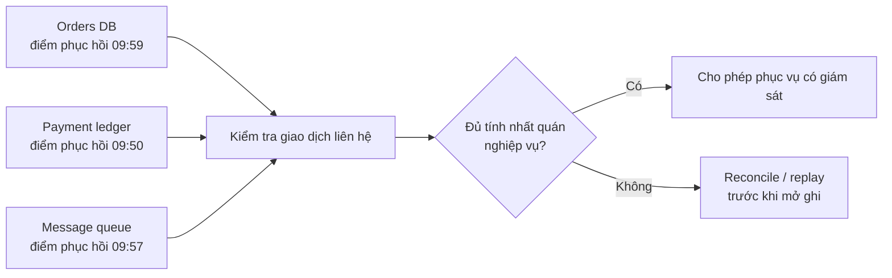
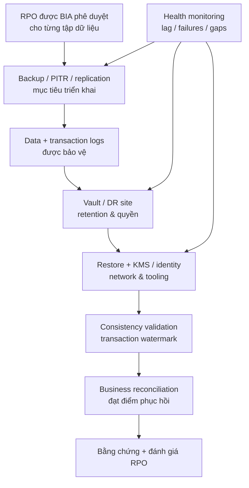

# RPO trong Business Continuity: mục tiêu mất dữ liệu và bằng chứng khôi phục

## 1. RPO giải quyết bài toán gì?

Một hệ thống có thể khởi động lại nhanh sau sự cố nhưng vẫn làm mất các giao dịch vừa được khách hàng xác nhận. Ví dụ, ứng dụng bán hàng chuyển sang vùng dự phòng trong 15 phút; tuy nhiên bản dữ liệu được phục hồi chỉ bao gồm các đơn hàng trước khi sự cố xảy ra một giờ. Về **thời gian phục hồi**, hệ thống có thể đạt yêu cầu; về **khả năng bảo toàn dữ liệu**, hệ thống vẫn có thể thất bại nghiêm trọng.

**Recovery Point Objective (RPO)** là **mục tiêu về mức mất dữ liệu tối đa có thể chấp nhận, thường biểu diễn bằng khoảng thời gian**, khi cần khôi phục hoạt động sau gián đoạn. RPO trả lời câu hỏi:

> “Nếu phải khôi phục dữ liệu sau sự cố, tổ chức chấp nhận phải quay về điểm dữ liệu cũ tối đa bao lâu?”

Trong chương **Business continuity** của module **SECURITY_SECURITY_ASSURANCE**, RPO không chỉ là con số cấu hình cho database hoặc backup. RPO phải được chủ quy trình kinh doanh phê duyệt dựa trên rủi ro và tác động, được chuyển thành các security controls có thể kiểm chứng, rồi **đánh giá bằng bằng chứng** qua backup/replication, khôi phục, kiểm tra tính nhất quán, audit và khắc phục sai lệch. Đây là một phần của chương trình security assurance liên tục trong phát triển và vận hành.

Ví dụ, một cơ sở dữ liệu nhận giao dịch mỗi giây được sao lưu mỗi 15 phút chưa chắc đã đáp ứng **RPO 15 phút**: backup có thể hỏng, thiếu quyền đọc, không có khóa giải mã, chứa dữ liệu chưa được checkpoint nhất quán hoặc không thể phục hồi trong phạm vi đã thử.

### Kết quả học tập

Sau bài này, người học có thể:

- Định nghĩa RPO và phân biệt với RTO, MTPD, thời gian chạy backup, replication lag và dữ liệu thực sự mất.
- Đề xuất RPO theo **Business Impact Analysis (BIA)**, phân loại dữ liệu và mức mất mát được chấp nhận.
- So sánh backup định kỳ, point-in-time recovery (PITR), replication và các cơ chế bảo toàn giao dịch.
- Xác định **điểm khôi phục cuối cùng có thể sử dụng** thay vì chỉ nhìn timestamp của file backup.
- Thiết kế diễn tập RPO có mốc thời gian, dữ liệu thử, phép kiểm tính nhất quán và bằng chứng có thể kiểm toán.
- Kết luận PASS/FAIL/INCONCLUSIVE đúng phạm vi và theo dõi finding đến khi retest.

## 2. Thuật ngữ cốt lõi: RPO, RTO và các điểm dữ liệu

| Thuật ngữ | Ý nghĩa | Câu hỏi thực tế |
|---|---|---|
| **RPO** | Mức mất dữ liệu mục tiêu có thể chấp nhận, thường tính bằng thời gian | Dữ liệu có thể lùi tối đa bao nhiêu? |
| **RTO** – Recovery Time Objective | Thời gian mục tiêu để khôi phục dịch vụ tới mức hoạt động đã định | Dịch vụ phải hoạt động lại trong bao lâu? |
| **MTPD** – Maximum Tolerable Period of Disruption | Thời gian gián đoạn tối đa trước khi tác động kinh doanh trở nên không thể chấp nhận | Có thể chịu gián đoạn bao lâu? |
| **Recovery point** | Mốc trạng thái dữ liệu có thể thực sự khôi phục một cách hợp lệ và nhất quán | Đã phục hồi được trạng thái tại mốc nào? |
| **Backup interval** | Khoảng cách giữa hai lần tạo backup theo lịch | Hệ thống cố gắng tạo backup bao lâu một lần? |
| **Replication lag** | Độ trễ dữ liệu của replica so với nguồn theo cách đo được định nghĩa | Replica chậm hơn nguồn bao nhiêu? |
| **PITR** | Khôi phục về một thời điểm hoặc điểm giao dịch trong lịch sử nhờ bản nền và nhật ký/thành phần phù hợp | Có thể phục hồi đến mốc đã chọn không? |
| **Consistency point** | Trạng thái dữ liệu hợp lệ theo quy tắc nhất quán của hệ thống | Các bảng/dịch vụ có đồng bộ về mặt nghiệp vụ không? |
| **Actual recovery data loss window** | Khoảng thời gian đo giữa mốc sự cố tham chiếu và mốc dữ liệu hợp lệ cuối cùng có thể phục hồi | Trong bài thử, cửa sổ mất dữ liệu thực tế là bao lâu? |

**RTO đo thời gian khôi phục; RPO đo mức mất dữ liệu.** Một ứng dụng đạt RTO không tự chứng minh đạt RPO; một bản backup bảo toàn dữ liệu rất tốt không bảo đảm dịch vụ khởi động trong RTO.

**RPO khác backup interval.** Lịch backup 5 phút là tham số kỹ thuật; RPO 5 phút là mục tiêu kinh doanh phải chứng minh bằng một điểm khôi phục có thể sử dụng. Sự khác biệt rõ nhất khi backup chạy trễ, không hoàn tất, bị lỗi hoặc mất các transaction logs cần thiết.

## 3. Minh họa RPO bằng trục thời gian

Giả sử hệ thống xử lý đơn hàng đang hoạt động bình thường cho tới khi gián đoạn ở **10:00 UTC**. Bản dữ liệu cuối cùng được kiểm chứng phục hồi nhất quán tại **09:48 UTC**. Sau đó dịch vụ đạt mức hoạt động tối thiểu lúc **10:45 UTC**.


Với ví dụ này:

\[
L_{\text{data}}=t_{\text{incident}}-t_{\text{last-consistent-recovered}}
=\text{12 phút}
\]

\[
T_{\text{recovery}}=t_{\text{service-restored}}-t_{\text{incident}}
=\text{45 phút}
\]

Nếu RPO đã được phê duyệt là **10 phút** và RTO là **60 phút**, ta có **RPO FAIL** (12 lớn hơn 10), **RTO PASS** (45 nhỏ hơn 60), giả sử mốc đo và điều kiện vận hành khôi phục đều được xác minh.

**Điểm mấu chốt:** mốc 09:48 phải là **dữ liệu thực tế đã phục hồi và được xác nhận hợp lệ**, không chỉ là giờ file backup được tạo. Một snapshot được gắn nhãn “09:58” nhưng chỉ chứa dữ liệu nhất quán tới 09:48 không chứng minh cửa sổ mất dữ liệu hai phút.

### Vì sao cần định nghĩa mốc bắt đầu?

Với sự cố vật lý hoặc mất kết nối đột ngột, thời điểm ngừng ghi/nhận giao dịch có thể khá rõ. Với **sai lệch logic âm thầm**, mã độc hoặc cập nhật nhầm dữ liệu, thời điểm bắt đầu hỏng và thời điểm phát hiện có thể cách nhau hàng giờ. Khi đó phải ghi riêng:

- `corruption_started_at`: khi dữ liệu bắt đầu bị hỏng, nếu xác định được.
- `last_known_good_point`: mốc dữ liệu sạch cuối cùng có thể chứng minh.
- `detected_at`: khi hệ thống/đội ngũ phát hiện vấn đề.
- `incident_declared_at`: khi tổ chức tuyên bố sự cố và bắt đầu quy trình phản ứng.
- `recovery_completed_at`: khi dữ liệu đã khôi phục đạt tiêu chí hợp lệ.

Không dùng máy móc một công thức duy nhất khi dữ liệu trong nhiều giờ đã bị sửa nhưng tiếp tục có các giao dịch mới hợp lệ. Cần mô tả **giao dịch nào được giữ, mất, phát lại hoặc đối soát**, cùng tiêu chí do kinh doanh phê duyệt.

## 4. Ai có quyền quyết định RPO và dựa trên dữ liệu nào?

**RPO là yêu cầu kinh doanh được thực hiện bằng công nghệ**, không phải một con số do người cấu hình backup tự chọn.

Business process owner xác định mức mất dữ liệu không thể chấp nhận dựa trên:

1. **Tác động tài chính:** giao dịch mất, doanh thu, bồi thường, chi phí đối soát.
2. **Tính chính xác và nghĩa vụ:** bản ghi tài chính, chứng cứ pháp lý, dữ liệu khách hàng, nghĩa vụ hợp đồng.
3. **Khả năng tái tạo:** dữ liệu có thể tạo lại từ event/ledger hay từ hệ thống đối tác đáng tin cậy không.
4. **Mức khó khôi phục thủ công:** có quy trình nhập lại có kiểm soát không; giới hạn khối lượng.
5. **Mức độ nhạy cảm:** sai lệch/lộ dữ liệu ảnh hưởng tới người dùng hoặc an toàn ra sao.
6. **Tính phụ thuộc:** các quy trình khác dựa vào dữ liệu này và có yêu cầu nhất quán tới đâu.
7. **Chi phí và khả năng kỹ thuật:** độ phức tạp, hạ tầng, nhà cung cấp, vận hành, nguồn lực khi failover.
8. **Tình huống sự cố:** mất region, lỗi ghi, ransomware, phá hỏng logic hay lỗi thao tác có rủi ro khác nhau.

Các yêu cầu này được làm rõ trong **Business Impact Analysis (BIA)**, đối chiếu với risk assessment và được ghi lại thành baseline. Đội kỹ thuật chọn phương án để đáp ứng baseline hoặc phải công bố **khoảng trống** cho người có thẩm quyền quyết định, không tự sửa yêu cầu xuống mức dễ đạt.

### Ví dụ phân tầng RPO (chỉ để thảo luận)

| Tập dữ liệu/quy trình | Mục tiêu RPO giả định | Lý do kinh doanh | Ràng buộc quan trọng |
|---|---|---|---|
| Sổ cái và trạng thái thanh toán đã xác nhận | Gần 0 hoặc 0 theo failure model đã định | Mất transaction đã commit có thể gây sai lệch tài chính | Dữ liệu đối tác, idempotency, nhất quán và đối soát |
| Đơn hàng đang xử lý | 5–15 phút | Có thể cần liên hệ khách và replay một phần | Không phát sinh đơn trùng, bảo vệ thông tin khách |
| Tiến độ học tập | 15–30 phút | Học viên có thể mất thao tác vừa làm | Phải phân biệt điểm đã nộp với tiến độ chưa xác nhận |
| Ảnh cache/thumbnail có thể tái sinh | Vài giờ hoặc dài hơn | Có thể tạo lại từ nguồn gốc | Không để lẫn với dữ liệu gốc không thể tái tạo |
| Báo cáo tổng hợp có thể dựng lại | Tùy lịch và nghĩa vụ | Có thể tái chạy batch | Phải biết nguồn dữ liệu còn đúng và đủ |

Đây **không phải chuẩn RPO chung**; tổ chức phải phê duyệt mức phù hợp. Ngay trong một ứng dụng, mỗi lớp dữ liệu có thể có RPO khác nhau. Điều quan trọng là **phân biệt dữ liệu đã được khách hàng xác nhận** với dữ liệu có thể tái tạo một cách an toàn.

## 5. Chuyển RPO thành security controls có thể đo

RPO cần được cụ thể hóa thành các điều kiện triển khai và kiểm thử để tránh câu khẳng định chung chung “có backup nên không mất dữ liệu”.

| Control ID | Yêu cầu/claim | Bằng chứng kiểm tra |
|---|---|---|
| `RPO-01 Approved objective` | Mỗi tập dữ liệu quan trọng có RPO và owner được duyệt trong BIA | BIA version, data classification, approval |
| `RPO-02 Protection mechanism` | Cơ chế lưu checkpoint/log/replica được cấu hình cho mục tiêu RPO | Backup policy, PITR, replication topology và trạng thái thực |
| `RPO-03 Recoverability` | Có thể dựng lại dữ liệu đến điểm hợp lệ theo mục tiêu | Restore test, checkpoint/LSN/transaction ID, consistency report |
| `RPO-04 Backup integrity` | Backup/log cần thiết bảo đảm khả năng truy xuất, toàn vẹn và bảo mật | Integrity check, retention, quyền truy cập, restore result |
| `RPO-05 Isolation` | Rủi ro sửa/xóa đồng thời dữ liệu gốc và bản phục hồi được kiểm soát | Account boundary, immutable/isolated copies, IAM, audit |
| `RPO-06 Cross-system consistency` | Dữ liệu nghiệp vụ liên quan phục hồi ở trạng thái có thể đối soát | End-to-end business transaction test, reconciliation report |
| `RPO-07 Monitoring` | Backup failures, replica lag, missing WAL/log, key loss được phát hiện trong thời gian phù hợp | Metrics, alerts, delivery/ack và runbook |
| `RPO-08 Retest & change` | RPO được kiểm chứng lại sau thay đổi có ảnh hưởng, finding được khắc phục | Test catalog, change history, retest evidence |

Một control tốt phải ghi **phạm vi**, **đơn vị đánh giá**, **mốc thời gian chuẩn**, **tiêu chí PASS/FAIL**, **nguồn dữ liệu**, **cơ chế xác minh** và **giới hạn của phép thử**. Không áp một RPO 10 phút cho mọi thành phần nếu business owner chưa xác định phần nào bắt buộc.

## 6. Lựa chọn công nghệ để đáp ứng RPO

Không có phương án nào tự động phù hợp mọi failure mode. Cần phối hợp bảo vệ dữ liệu, khả năng khôi phục và cách ly rủi ro.

| Phương án | Khả năng hỗ trợ RPO | Điều chưa được bảo đảm |
|---|---|---|
| **Backup định kỳ** | Khôi phục về một checkpoint từng được tạo, nếu backup hợp lệ | Không bảo đảm mọi lần backup thành công hoặc nhất quán |
| **Snapshot** | Tạo điểm lưu trữ tương đối nhanh theo khả năng storage/service | Không luôn nhất quán ở lớp ứng dụng/giao dịch nhiều service |
| **PITR + transaction/WAL logs** | Phục hồi về điểm gần sự cố theo chuỗi log được lưu đủ | Không bảo đảm log liên tục/khả dụng hoặc điểm được chọn sạch |
| **Asynchronous replication** | Giảm cửa sổ mất dữ liệu thường lệ, phục vụ failover | Replica có thể chưa nhận/applied transaction mới khi primary mất |
| **Synchronous replication** | Với điều kiện commit và quorum đúng, có thể giảm/loại mất giao dịch đã được xác nhận trong failure model xác định | Không thay backup, chống xóa logic hoặc bảo đảm an toàn trước mọi phân vùng |
| **Continuous Data Protection (CDP)** | Nhiều recovery point theo thời gian, nếu giải pháp hỗ trợ | Có thể sao chép cả trạng thái hỏng; cần kiểm tra retention và restore |
| **Event sourcing/transaction journal** | Cho phép phát lại giao dịch và dựng trạng thái theo event hợp lệ | Phải bảo vệ journal, thứ tự, idempotency và tính đúng của replay |
| **Application-level reconciliation** | Giảm ảnh hưởng của mất dữ liệu bằng cách đối chiếu với nguồn đáng tin | Không tự phục hồi thông tin không tồn tại ở bất cứ nguồn nào |

### 6.1. Backup và PITR

Giả sử có full backup lúc 00:00 và transaction logs liên tục đến 09:56. Khi primary mất lúc 10:00, có thể kỳ vọng khôi phục gần 09:56 nếu tất cả bản backup/log đều hợp lệ, đầy đủ, giải mã được và có một chuỗi phục hồi nhất quán. **Thực tế chỉ được xác nhận sau restore và kiểm tra dữ liệu**.

Nếu một đoạn log 09:40–09:50 bị thiếu, không thể tùy ý áp những đoạn log sau đó rồi kết luận đạt 4 phút. Chuỗi khôi phục có thể bị đứt; khả năng của từng database engine cần được kiểm tra theo sản phẩm và phiên bản.

### 6.2. Replication

Replication thường giúp giảm độ trễ dữ liệu ở replica, nhưng có thể mang theo:

- Lệnh xóa nhầm hoặc dữ liệu bị mã hóa bởi ransomware nếu replica vẫn nhận thay đổi.
- Sai lệch logic từ code/application deploy.
- Những giao dịch có ở primary nhưng chưa được replica xác nhận trong quá trình failover.
- Khả năng **split-brain** nếu nhiều primary được mở ghi và không có fencing/consensus phù hợp.

Cần hiểu **quy tắc xác nhận commit**: transaction “đã thành công” với client có nghĩa gì, đã được ghi bền vững ở đâu, replica nào phải xác nhận, và hệ thống ứng xử ra sao khi kết nối giữa các site bị phân vùng.

### 6.3. Chi phí và trade-off

RPO càng nhỏ thường đòi hỏi lưu log thường xuyên hơn, hạ tầng dự phòng, cơ chế quorum hoặc đồng bộ chặt, băng thông, giám sát và vận hành phức tạp hơn. Không thể chỉ tối ưu RPO mà bỏ qua **latency giao dịch, availability, tính nhất quán, chi phí và rủi ro khi mất kết nối**. Những trade-off này phải được chủ sở hữu dữ liệu và quy trình chấp nhận.

## 7. RPO bằng 0 nghĩa là gì và có thực tế không?

**RPO = 0** diễn đạt mục tiêu **không mất dữ liệu trong phạm vi đã định**. Đây là mục tiêu nghiêm ngặt, không phải tính năng có thể được chứng nhận chỉ bằng một checkbox “sync replication”.

Để nói về RPO bằng 0 một cách chính xác, phải xác định:

- **Dữ liệu nào?** Bản ghi đã commit ở database hay sự kiện client vừa gửi nhưng chưa nhận xác nhận?
- **Failure model nào?** Mất một node, mất AZ, mất cả region, bị xóa logic, compromise của administrator hay mất các bản sao cùng lúc?
- **Thế nào là thành công?** Commit được xác nhận sau khi dữ liệu bền vững ở những nơi nào?
- **Khi phân vùng mạng thì sao?** Chặn commit để bảo toàn dữ liệu hay tiếp tục nhận ghi và chấp nhận rủi ro?
- **Các phụ thuộc nào khác?** Hệ thống hàng đợi, ledger, cache, search index, đối tác và khóa mã hóa có cùng bảo đảm không?
- **Bằng chứng nào?** Kịch bản failover có kiểm soát, transaction IDs đã xác nhận và kiểm tra tất cả đều hiện diện sau phục hồi.

Hệ thống có thể chọn **đánh đổi khả năng ghi (write availability)** trong phân vùng để bảo toàn tính nhất quán. Nếu mở đường ghi ở nhiều nơi mà không có thiết kế đồng thuận/fencing thích hợp, “RPO 0” có thể là tuyên bố sai. RPO 0 **không có nghĩa không có lỗi logic**; một lệnh xóa nhầm được đồng bộ tức thì vẫn có thể hủy dữ liệu ở mọi replica.

Trong security assurance, chỉ khẳng định mục tiêu zero data loss **theo failure scenario đã kiểm thử và phạm vi dữ liệu đã xác minh**; không mở rộng ra mọi tình huống.

## 8. Consistency: một điểm dữ liệu “mới” chưa chắc dùng được

Khôi phục dữ liệu mới nhất chưa đủ nếu trạng thái ấy bị hỏng hoặc không nhất quán. Cần phân biệt:

- **Crash-consistent:** tương tự trạng thái sau mất điện; ứng dụng/database có thể cần replay log để đạt trạng thái hợp lệ.
- **Application-consistent:** dữ liệu đã được đưa về trạng thái nhất quán theo cơ chế ứng dụng/database; khả năng bảo đảm tùy kỹ thuật chụp và hệ thống.
- **Transaction-consistent:** các giao dịch được áp dụng trọn vẹn theo tính chất của hệ quản trị tương ứng.
- **Business-consistent:** các quan hệ nghiệp vụ giữa nhiều thành phần có thể xử lý/đối soát an toàn; đây không phải một thuộc tính tự động của snapshot.

Một hệ thống đặt hàng gồm **Orders DB**, **Payment Ledger**, **Message Queue** và **Inventory Service**. Nếu Orders khôi phục tới 09:59, Ledger tới 09:50 và Inventory tới 09:57, việc so sánh riêng RPO từng database **không chứng minh** một đơn thanh toán đã xuất hiện đồng thời ở tất cả dịch vụ.



Các chiến lược có thể bao gồm **transactional outbox**, event IDs, idempotency keys, replay có thứ tự, ledger bất biến và các bước đối soát. Những kỹ thuật này phải được thiết kế trước, có điểm phục hồi và hành vi lặp sự kiện rõ ràng; replay không cẩn thận có thể tạo đơn trùng hoặc ghi nhận thanh toán hai lần.

**Bằng chứng phù hợp** không chỉ là `backup_status=success`, mà còn có transaction checksums, sample business flow, sổ đối soát, số lượng bản ghi/sequence, các trường hợp pending và kết quả xử lý duplicate.

## 9. Các rủi ro an ninh khiến RPO không đạt

Trong Security Assurance, RPO cần được nhìn như một **mục tiêu của tính sẵn sàng và tính toàn vẹn dữ liệu**, được bảo vệ bởi nhiều lớp security control.

| Rủi ro | Tác động tới RPO | Kiểm soát và bằng chứng |
|---|---|---|
| Backup bị xóa bởi tài khoản quản trị bị chiếm | Không còn checkpoint phục hồi | Phân tách quyền, backup isolation, immutability/retention và restore test |
| Ransomware sửa dữ liệu nguồn và replica | Điểm dữ liệu “mới” đã bị nhiễm/hỏng | Bản sao sạch, detection, history retention, clean restore verification |
| Quyền restore hoặc KMS key không khả dụng | Có bản sao nhưng không đọc được | Kiểm thử credential/key access ở DR site |
| Replica chậm, bị pause hoặc log gap | Điểm phục hồi thực tế cũ hơn mục tiêu | Lag/health monitoring, catch-up/restore test, alert |
| Backup metadata sai hoặc incomplete | Timestamp không đại diện điểm nhất quán | Catalog verification, checksum, restore-to-point |
| Đồng hồ hệ thống lệch | Đo sai cửa sổ mất dữ liệu | Clock synchronization, logical sequence/transaction watermark |
| Snapshot đồng thời nhiều hệ thống không nhất quán | Mất tính đúng của nghiệp vụ dù data còn mới | Coordinated recovery, reconciliation test |
| Retention quá ngắn so với thời gian phát hiện lỗi | Không còn last-known-good point | BIA cho logical corruption, retention/hold phù hợp |
| Failover không có fencing | Hai primary nhận ghi, khó chọn bản đúng | Quorum, fencing, conflict resolution và thử split-brain an toàn |
| Nhập lại dữ liệu thủ công không được kiểm soát | Giao dịch mất/nhân đôi sau recovery | Audit, đối soát, maker-checker và idempotency |

**“Có bản copy bất biến” cũng chưa đủ.** Cần xác minh chính xác dữ liệu nào được copy, trong khoảng retention nào, ai có thể thay/xóa policy bảo vệ, liệu có thể restore bằng bộ khóa và quyền cần thiết hay không, và các dependency của quá trình restore có nằm ngoài vùng ảnh hưởng không.

## 10. Ransomware và lỗi logic: khác với mất máy chủ

Trong sự cố máy chủ ngừng đột ngột, bài toán RPO tương đối rõ: chọn checkpoint nhất quán gần thời điểm gián đoạn. Nhưng trong **ransomware, phá hoại có chủ đích hoặc lỗi ứng dụng**, dữ liệu có thể bị sửa nhiều giờ trước khi phát hiện.

Ví dụ:

- 08:00 UTC: bản dữ liệu sạch cuối cùng đã xác minh.
- 08:25 UTC: mã lỗi bắt đầu sửa lệch trạng thái đơn.
- 10:10 UTC: hệ thống phát hiện bất thường; một số đơn hợp lệ vẫn được tạo trong khoảng này.
- 10:30 UTC: quyết định cô lập, ngừng ghi.

Khôi phục đơn giản về 08:00 có thể đưa hệ thống về bản sạch nhưng **bỏ qua các giao dịch hợp lệ sau 08:00**. Không thể mô tả mất mát chỉ bằng “30 phút RPO” hay timestamp backup gần 10:30 vì backup mới cũng có thể chứa dữ liệu đã sai.

Cần xây dựng kế hoạch:

1. Xác định **thời điểm dữ liệu bắt đầu bị ảnh hưởng** và độ tin cậy của kết luận.
2. Tìm **clean recovery point** có thể khôi phục và nguồn log/event để phát lại.
3. Xác định transaction hợp lệ xảy ra sau điểm sạch bằng ledger/đối tác/nhật ký độc lập.
4. Phân loại transaction có thể replay an toàn, cần điều tra thủ công hoặc không thể tái tạo.
5. Đối soát tính toàn vẹn và thông báo tác động khi cần.
6. Giữ forensic evidence, thực hiện phối hợp giữa IR/BC/DR trước khi mở lại ghi.

Đối với tình huống này, RPO còn đòi hỏi mô tả **mất dữ liệu thực**, **khoảng thiếu khả năng tái tạo** và **trạng thái nghiệp vụ cuối cùng**, thay vì chọn điểm dữ liệu mới nhất bị nhiễm độc rồi đánh dấu PASS.

## 11. Thiết kế kiến trúc đạt RPO theo đường phụ thuộc

Một giải pháp đáp ứng RPO chỉ bền vững khi toàn bộ đường phục hồi khả thi.



Những yếu tố thường bị thiếu:

- **Backup window vs retention:** chạy backup thường xuyên nhưng chỉ giữ một bản mới nhất sẽ không đủ để quay về mốc trước khi phát hiện corruption.
- **Cross-account/cross-region access:** tài khoản DR cần quyền restore, định tuyến, DNS và truy cập khóa; quyền phải theo nguyên tắc tối thiểu.
- **KMS dependencies:** khóa bị xóa/disable hoặc không còn ở vùng DR khiến ciphertext vô dụng.
- **Infrastructure-as-code/configuration:** dữ liệu đã khôi phục nhưng schema, secrets hoặc ứng dụng phiên bản tương ứng không có.
- **Database + queue offsets:** phục hồi database mà không đồng bộ vị trí consumer có thể làm thiếu hoặc nhân đôi xử lý.
- **Cross-system clock/source of truth:** đồng hồ khác nhau khiến so điểm dữ liệu sai; cần LSN, transaction sequence, event ID hoặc checkpoint phù hợp.
- **Công suất restore:** phục hồi petabyte dữ liệu có thể vượt RTO dù backup đủ mới để đạt RPO.
- **Cô lập rủi ro chung:** bản sao cùng account và cùng principal với production có thể cùng bị xóa/sửa.

## 12. Đo RPO vận hành: chỉ số hỗ trợ và giới hạn của chúng

Các chỉ số thường dùng để **theo dõi nguy cơ vi phạm** chứ không thay thế kiểm thử restore.

| Chỉ số | Điều nó giúp nhận biết | Giới hạn |
|---|---|---|
| `last_successful_backup_at` | Thời điểm job báo backup thành công | Không chứng minh backup có thể restore nhất quán |
| `last_verified_restore_point` | Điểm dữ liệu đã được thử khôi phục hợp lệ | Phạm vi/tuổi test có thể không phản ánh trạng thái tức thời |
| `replica_lag_seconds` | Độ trễ có thể quan sát theo định nghĩa của nền tảng | Cần phân biệt receive, write, flush, replay/commit |
| `transaction_log_gap` | Nhật ký phục hồi bị gián đoạn | Một log gap có thể làm mất khả năng PITR qua mốc đó |
| `backup_verification_failures` | Các bản backup chưa xác minh hoặc có lỗi | Kiểm tra checksum không thay restore thực tế |
| `recovery_point_age` | Độ cũ của điểm có thể khôi phục so với mốc quan sát | Cần mốc đáng tin và điểm nhất quán, không chỉ thời gian file |
| `restore_test_pass_rate` | Tỷ lệ bài restore có kết luận đạt theo tiêu chí | Phụ thuộc loại test, dữ liệu mẫu và mẫu số |
| `data_reconciliation_errors` | Số sai lệch nghiệp vụ sau phục hồi | Cần biết dữ liệu gốc và quy tắc so sánh đáng tin |

### Lưu ý với PostgreSQL replica (ví dụ quan sát)

Một số hệ quản trị cung cấp chỉ số về trạng thái WAL và replay; việc diễn giải phụ thuộc phiên bản và kiểu replication. Với PostgreSQL, một truy vấn đọc trên **standby** có thể lấy thời điểm transaction cuối cùng được replay:

```sql
-- Ví dụ quan sát trên một PostgreSQL standby đã được ủy quyền.
-- Không thay thế restore test và không dùng trực tiếp làm "RPO".
SELECT
  pg_is_in_recovery() AS is_standby,
  pg_last_wal_receive_lsn() AS received_lsn,
  pg_last_wal_replay_lsn() AS replayed_lsn,
  pg_last_xact_replay_timestamp() AS last_replayed_commit_time;
```

Nếu workload không có giao dịch mới, `pg_last_xact_replay_timestamp()` có thể rất cũ **dù standby đã bắt kịp**; không được dùng riêng phép trừ `now() - last_replayed_commit_time` để khẳng định replication lag hay RPO. Cần xem trạng thái nguồn và replica cùng transaction/LSN watermark, health, clock và kịch bản failover thực tế. Các lệnh SQL minh họa chỉ đọc; tính khả dụng và semantics phải kiểm tra theo engine/version đang sử dụng.

Một replication dashboard báo độ trễ nhỏ cũng không chứng minh các bản sao chống được lệnh xóa nhầm, ransomware hay mất toàn region. Chỉ số health là **evidence giám sát**, khác với **evidence khôi phục thành công**.

## 13. Thiết kế bài kiểm thử RPO có thể tái lập

Bài kiểm thử cần một **tập giao dịch thử đã biết trước** và một kịch bản gián đoạn được kiểm soát. Mục tiêu không phải phá hỏng production mà là đo *latest consistent recoverable point* dưới các điều kiện đại diện.

### 13.1. Chuẩn bị trước test

1. Xác nhận **BIA/owner/control ID**, tập dữ liệu và RPO đã được phê duyệt.
2. Chọn **failure scenario**: mất node, mất AZ/region, mất primary, lỗi volume, logical corruption hoặc mất quyền truy cập backup.
3. Xác định môi trường và **mức thử**: restore backup độc lập, PITR trên test stack, DR failover có canary, hay diễn tập production đã được duyệt.
4. Chọn điểm bắt đầu đo: thời điểm gián đoạn và cơ chế xác định **last valid committed transaction**.
5. Tạo **transaction marker**/event ID liên tục với thời điểm/sequence đáng tin; không dùng dữ liệu khách hàng thật nếu không cần.
6. Kiểm tra snapshot/backup/log đã sẵn sàng và không phá hỏng dữ liệu gốc.
7. Xác định stop criteria, kế hoạch rollback và người có quyền thực hiện.
8. Dự kiến bằng chứng: source transaction ledger, backup catalog, restore logs, validation query, timestamps, monitor alerts và kết quả đối soát.

### 13.2. Chạy kịch bản một cách có kiểm soát

- Ghi nhận **test run ID**, danh tính thực thi, trạng thái hệ thống và mốc UTC.
- Tạo một chuỗi giao dịch thử được phép, mỗi giao dịch có ID/sequence và dấu commit xác nhận.
- Tại điểm sự cố mô phỏng, ghi timestamp và transaction watermark đáng tin; không xóa backup/khóa thật.
- Khôi phục bản dữ liệu được phép sang **môi trường cô lập** hoặc chạy failover theo cửa sổ đã duyệt.
- Tìm giao dịch mới nhất đã commit trước sự cố **và** xuất hiện đầy đủ, nhất quán sau phục hồi.
- Xác minh những giao dịch trước đó cũng không bị mất/ghi sai; kiểm tra khóa ngoại, tổng số, tính nhất quán các hệ liên quan.
- Tính khoảng mất dữ liệu thực theo định nghĩa đã thống nhất; ghi riêng **số transaction mất** và rủi ro nghiệp vụ.
- Chạy các giao dịch nghiệp vụ đại diện và đo RTO/MBCO nếu kịch bản còn yêu cầu.

### 13.3. Kịch bản test và loại bằng chứng

| Kịch bản | Mục tiêu | Evidence cần có |
|---|---|---|
| Restore bản backup gần nhất | Kiểm tra khả dụng và dữ liệu hợp lệ của backup | Restore job, backup ID, transaction watermark, data checks |
| PITR đến mốc được chọn | Kiểm tra log chain và khả năng phục hồi về thời điểm yêu cầu | Backup + log manifest, restore parameters, recovered watermark |
| Mất primary khi async replica còn trễ | Xác định giao dịch đã xác nhận nào không có ở replica | Primary commits, replica replay, failover/fencing và reconciliation |
| Lỗi backup job hoặc log shipping | Xác nhận phát hiện trước khi vượt RPO | Health metric, alert route, thời gian khắc phục và evidence |
| Phục hồi từ vùng/tài khoản dự phòng | Kiểm tra data, quyền, KMS, network và dependencies | KMS/identity permission test, restore log, business test |
| Phát hiện corruption trễ | Xác minh last-known-good point, khả năng replay và đối soát | Clean restore point, event ledger, replay log, data validation |

Thử trên staging chỉ chứng minh **mức độ khả thi tại staging**. Để đưa kết luận cho production, cần lập luận về tính đại diện của dữ liệu, tải, topology, quyền, kích thước và cơ chế vận hành, đồng thời công bố giới hạn.

## 14. Tính RPO thực đo: ba ví dụ

### 14.1. Ví dụ A — backup gần, điểm dữ liệu cũng gần

- Sự cố bắt đầu: **12:00 UTC**.
- Điểm dữ liệu cuối cùng đã phục hồi và xác minh: **11:54 UTC**.
- Mục tiêu RPO: **10 phút**.

\[
L = 12{:}00-11{:}54=6\text{ phút}
\]

Kết luận: **PASS cho RPO 10 phút** trong kịch bản này, nếu dữ liệu tại 11:54 đã được kiểm tra tính nhất quán và phạm vi transaction được xác định.

### 14.2. Ví dụ B — backup timestamp mới nhưng dữ liệu cũ

- Sự cố: **12:00 UTC**.
- Snapshot được tạo/lưu catalog lúc **11:57 UTC**.
- Checkpoint giao dịch nhất quán mới nhất được khôi phục: **11:42 UTC**.
- Mục tiêu RPO: **10 phút**.

\[
L = 12{:}00-11{:}42=18\text{ phút}
\]

Kết luận: **FAIL**, không phải PASS 3 phút. Mốc 11:57 chỉ chứng minh timestamp của snapshot/catalog trong giả định, không thay thế **watermark dữ liệu hợp lệ**.

### 14.3. Ví dụ C — không xác minh được điểm nhất quán

- Sự cố: **12:00 UTC**.
- Dashboard backup ghi “successful” lúc **11:55 UTC**.
- Test restore không thể hoàn tất vì thiếu KMS permission; không kiểm tra được dữ liệu.
- Mục tiêu RPO: **10 phút**.

Kết luận đối với **RPO thực đo** là **INCONCLUSIVE**, vì không có điểm dữ liệu được phục hồi và xác minh. Đồng thời, với control yêu cầu **khả năng sử dụng khóa khi restore**, bằng chứng từ chối quyền có thể cho phép kết luận **FAIL**. Phải báo hai kết luận đúng claim, không biến thiếu dữ liệu thành PASS.

### Điểm lưu ý về giao dịch

Dữ liệu 11:54 có thể đã chứa một số giao dịch commit trước đó nhưng thiếu một giao dịch ở 11:40 do lỗi replay. Khi đó watermark “mới nhất” đơn lẻ là không đủ; cần kiểm tra **tính liên tục, đầy đủ và hợp lệ của tập dữ liệu trước mốc**. RPO không biện minh cho mất ngẫu nhiên giao dịch cũ hoặc phá vỡ tính toàn vẹn.

## 15. RPO và RTO phải được kiểm tra cùng nhau nhưng kết luận riêng

Hai mục tiêu này có thể tạo trade-off. Phục hồi bản backup mới nhất có thể cần xử lý một chuỗi log dài, tốn thời gian hơn; dùng một replica gần nhưng chưa hoàn toàn đồng bộ có thể khôi phục nhanh hơn nhưng có rủi ro mất giao dịch.

Một ma trận đánh giá minh họa:

| Kịch bản | Mục tiêu RPO | RPO thực đo | Mục tiêu RTO | Thời gian thực đo | Kết luận |
|---|---:|---:|---:|---:|---|
| A: restore đủ dữ liệu, chậm | 10 phút | 5 phút | 60 phút | 85 phút | RPO PASS, RTO FAIL |
| B: failover nhanh, mất dữ liệu | 10 phút | 18 phút | 60 phút | 20 phút | RPO FAIL, RTO PASS |
| C: cả hai đạt | 10 phút | 7 phút | 60 phút | 45 phút | RPO PASS, RTO PASS |
| D: không đọc được backup | 10 phút | Chưa đo | 60 phút | Chưa khôi phục | RPO INCONCLUSIVE; khả năng restore FAIL |

Các số trong bảng là giả định. Kết luận phải nêu **mức hoạt động đã được phục hồi**: một ứng dụng trả HTTP 200 nhưng không đọc được đơn hàng sẽ chưa đáp ứng RTO của quy trình nghiệp vụ, dù hạ tầng đã chạy.

Khi hai mục tiêu xung đột trong sự cố thật, người có thẩm quyền kinh doanh cùng IR/BC/DR phải quyết định theo risk acceptance và nghĩa vụ áp dụng; không tự chọn điểm dữ liệu cũ hơn vượt RPO rồi ghi là đạt.

## 16. RPO assurance: đọc cấu hình, đo trạng thái và kiểm thử hành vi

Cần chia bằng chứng thành ba lớp để không đánh đồng “đã bật backup” với “có thể bảo toàn dữ liệu”.

| Lớp | Dữ liệu | Có thể chứng minh | Giới hạn |
|---|---|---|---|
| **Declared** | BIA, RPO approved, backup policy, IaC, DR design | Tổ chức muốn bảo vệ gì và bằng cách nào | Không biết hệ thống đã vận hành như thiết kế hay chưa |
| **Effective configuration** | Lịch/job status, retention, PITR enable, replication config, IAM, KMS, health | Cơ chế đang được cấu hình và quan sát ở thời điểm đo | Không biết restore có phục hồi nhất quán không |
| **Behavioral/verified** | Restore test, transaction IDs/LSN, data consistency, reconciliation, timeline | Điểm khôi phục thực và khoảng mất dữ liệu cho tình huống đã thử | Không đại diện mọi tình huống hoặc trạng thái trong tương lai |

Ví dụ: dashboard cloud báo backup mỗi 5 phút, PITR đang bật. Đó là **bằng chứng cấu hình** hữu ích; chưa đủ để tuyên bố đạt RPO 5 phút. Cần kiểm chứng nguồn log, log chain và restore-to-point, đặc biệt trên cùng region/account/DB engine version tương ứng.

### Phải phân biệt “hiện có bản sao” và “bản sao có thể phục hồi”

Bản sao có thể tồn tại nhưng thiếu key, bị xóa một phần, không có schema tương thích hoặc chỉ có một phần dữ liệu. Vì vậy, monitoring nên theo dõi tuổi backup và trạng thái job, còn assurance cần **recovery exercise được chấp nhận** có kiểm thử tính đúng đắn.

## 17. Thiết kế hồ sơ bằng chứng RPO

Ví dụ bản ghi YAML **mô phỏng** cho database đơn hàng; các mốc và kết luận nhất quán theo phép đo giả định:

```yaml
assessment_id: rpo-assurance-20261128-010
control_id: RPO-03
baseline_version: bc-data-protection-v4
business_process: online-ordering
dataset:
  asset_id: orders-db-prod
  environment: isolated-recovery-test
  owner: order-data-platform
  data_classification: business-critical
approved_objective:
  rpo_minutes: 10
  approval_ref: BIA-ORDERS-V4
exercise:
  exercise_id: rpo-test-20261128-01
  scenario: "Recover latest consistent state after simulated primary loss"
  authorization_ref: DR-TEST-APPROVAL-021
  incident_reference_at_utc: "2026-11-28T10:00:00Z"
observed:
  backup_catalog_timestamp_utc: "2026-11-28T09:55:00Z"
  last_consistent_recovered_transaction_at_utc: "2026-11-28T09:47:00Z"
  actual_data_loss_window_minutes: 13
  recovery_completed_at_utc: "2026-11-28T11:05:00Z"
  restored_transaction_check: passed_for_defined_sample
  cross_system_reconciliation: not_tested
assessment:
  rpo_result: FAIL
  evaluator_version: rpo-rule-v2
  reason: "Verified recovery point is 13 minutes before incident; target 10"
  limitations: "Isolated test; cross-system business consistency not verified"
collection:
  assessor_identity: dr-assurance-readonly
  collected_at_utc: "2026-11-28T11:12:00Z"
evidence_refs:
  approved_bia: "evidence/RPO-03/bia-approval.pdf"
  backup_catalog: "evidence/RPO-03/backup-catalog.json"
  restore_log: "evidence/RPO-03/restore-job.log"
  transaction_validation: "evidence/RPO-03/txn-validation.json"
  integrity_manifest: "evidence/RPO-03/checksums.sha256"
tracking:
  finding_id: RPO-FIND-023
  finding_owner: data-platform
```

**Diễn giải:** snapshot/catalog được gắn mốc 09:55 nhưng dữ liệu hợp lệ cuối cùng chỉ là 09:47, nên mất 13 phút so với sự cố 10:00: **RPO FAIL**. Không thể suy RTO đạt hay không từ `recovery_completed_at` nếu chưa định nghĩa thời điểm dịch vụ đạt mức hoạt động kinh doanh mong muốn.

### Trường bắt buộc cho audit

| Nhóm | Trường cần có |
|---|---|
| **Mục tiêu** | Control ID, BIA/baseline version, RPO được duyệt và owner |
| **Phạm vi** | Business service, dataset, instance, region/account, dependency |
| **Kịch bản** | Exercise ID, failure model, authorization, điều kiện và điểm dừng |
| **Mốc tham chiếu** | Incident reference time và lý do chọn mốc; độ tin cậy clock |
| **Điểm phục hồi** | Last valid consistent transaction/checkpoint, transaction range/sequence |
| **Tính hợp lệ** | Restore outcome, checksum, business consistency, replay/reconciliation evidence |
| **Kết luận** | PASS/FAIL/INCONCLUSIVE, evaluator version, lý do và giới hạn |
| **Truy vết** | Collector/test identity, timestamps UTC, raw references, manifest bảo vệ |
| **Khắc phục** | Finding, owner, priority, deadline, change và retest |

**Không đưa secret hoặc plaintext dữ liệu khách hàng vào evidence** để chứng minh restore. Ưu tiên transaction IDs tổng hợp, kiểm tra hash/bộ tổng được kiểm soát, mẫu dữ liệu thử và truy cập raw artifacts ở kho phân quyền; log backup có thể chứa đường dẫn, tài khoản và thông tin kiến trúc nhạy cảm.

Checksum giúp phát hiện file bị sửa nếu manifest cũng được bảo vệ; nó không xác thực nguồn gốc nếu collector đã bị chiếm quyền hoặc bản gốc đã sai. Cần bảo vệ danh tính người thu, quyền sửa, audit access, thời gian và lịch sử chuyển giao bằng chứng.

## 18. Quy tắc kết luận PASS, FAIL, INCONCLUSIVE và ngoại lệ

| Trạng thái | Khi nào dùng | Việc cần làm |
|---|---|---|
| **PASS** | RPO nằm trong mục tiêu, dữ liệu đã restore được kiểm tra đầy đủ theo tiêu chí scope và thời gian đáng tin | Lưu evidence, theo dõi và test lại theo rủi ro |
| **FAIL** | Có bằng chứng hợp lệ rằng cửa sổ mất dữ liệu vượt RPO hoặc dữ liệu bắt buộc không nhất quán | Finding, đánh giá tác động, sửa cơ chế, retest |
| **INCONCLUSIVE** | Không đo được recovery point, thiếu quyền, không có giao dịch tham chiếu tin cậy, test lỗi hoặc clock không đáng tin | Ghi giới hạn, thu bổ sung; không suy ra PASS |
| **NOT_APPLICABLE** | Control không áp dụng cho dataset theo scope và BIA được phê duyệt | Lưu lý do và approval |
| **Accepted exception** | Chấp nhận rủi ro tạm thời trong phạm vi hẹp, có owner, hạn và bù trừ | Theo dõi exception riêng; không biến FAIL thành PASS |

Pseudo-logic minh họa:

```text
if dataset not in approved_scope:
    return NOT_APPLICABLE with documented_reason

if cannot_verify_incident_reference_time:
    return INCONCLUSIVE with clock_or_scope_gap

if restore_not_executed_or_last_consistent_point_unknown:
    return INCONCLUSIVE for measured_RPO
    # Evaluate restore-readiness control separately.

if restored_dataset_has_unresolved_integrity_gaps:
    return FAIL for data_integrity_control
    # Do not claim RPO success from a recent but unusable point.

actual_loss_minutes =
    incident_reference_time - verified_consistent_recovery_point

if actual_loss_minutes > approved_rpo_minutes:
    return FAIL with actual_loss_minutes and evidence

return PASS only if consistency and scope acceptance criteria hold
```

Một điểm dữ liệu rất mới nhưng không thể đối soát thì **không phải bằng chứng PASS**. Phải xác định control data integrity tương ứng và ảnh hưởng đến đánh giá RPO. Với control end-to-end có tiêu chí “usable and consistent”, có thể **FAIL** trực tiếp; nếu chưa đủ dữ liệu để đo consistency, kết quả có thể **INCONCLUSIVE** chứ không khẳng định đạt.

## 19. Vận hành và cải tiến RPO theo chu kỳ

RPO không được xác minh chỉ một lần. Khả năng phục hồi có thể suy giảm khi:

- Thay lịch backup, retention, cấu hình WAL/log shipping hoặc policy snapshot.
- Tăng lưu lượng giao dịch làm queue/replica lag tăng vượt thiết kế.
- Thay schema, cấu trúc database, cách commit hoặc hàng đợi.
- Chuyển cloud region, vendor, storage tier hoặc tài khoản.
- Thay KMS key, IAM role, secret, backup destination hoặc quyền cross-account.
- Tăng kích thước dữ liệu đến mức restore test không còn đại diện.
- Thay logic thanh toán, order processing, idempotency hoặc yêu cầu pháp lý.
- Phát hiện lỗi backup hoặc mã độc khiến các recovery point mới không tin cậy.

### Chu kỳ kiểm soát liên tục

1. **BIA/requirement:** phê duyệt RPO theo dataset và threat model; nêu mục tiêu dữ liệu đúng đắn.
2. **Design review:** chọn backup/replication/PITR và isolation có khả năng hỗ trợ mục tiêu.
3. **Configuration verification:** đọc effective policy, retention, KMS/IAM, backup jobs, replica health.
4. **Test restore:** thực hiện theo failure model, số liệu giao dịch, thời gian và kiểm chứng consistency.
5. **Assessment:** công bố RPO thực đo, coverages, sample sizes, hạn chế test và PASS/FAIL/INCONCLUSIVE.
6. **Finding:** xác định nguyên nhân, owner, deadline, rủi ro và biện pháp bù trừ.
7. **Retest:** kiểm tra lại đúng sai lệch sau sửa, lưu bằng chứng trước/sau.
8. **Trigger reevaluation:** lặp lại khi có thay đổi kiến trúc, dữ liệu, nhà cung cấp hoặc sự cố thật.

### Chỉ số cần báo cho quản trị

| Chỉ số | Mẫu số/cách tính | Cách diễn giải |
|---|---|---|
| Dataset RPO coverage | Dataset có RPO được phê duyệt / dataset thuộc phạm vi | Đánh giá đầy đủ của BIA |
| Tested RPO coverage | Dataset có diễn tập RPO hợp lệ còn mới / dataset cần test | Phạm vi kết luận có bằng chứng |
| RPO pass rate | Bài test đạt / bài test có kết luận hợp lệ | Chỉ áp dụng trong tập đã thử |
| Worst-case verified loss window | Khoảng mất dữ liệu lớn nhất trong bài test hợp lệ | Cho thấy nguy cơ nằm ở đuôi phân phối |
| Backup/log-chain failure count | Số lỗi trong chu kỳ đo | Dấu hiệu nguy cơ, không thay actual restore |
| Stale test age | Thời gian từ lần test có kết luận gần nhất | Cảnh báo độ tin cậy bằng chứng suy giảm |
| Reconciliation defects | Giao dịch sai/lỗi đối soát trên mẫu phục hồi | Phản ánh tính đúng đắn nghiệp vụ |

Không trộn **dataset coverage** với **pass rate**: có 20 dataset quan trọng, 12 được thử hợp lệ, 10 đạt thì tested coverage là **12/20 = 60%**, pass rate của tập thử là **10/12 ≈ 83,3%**. Không thể gọi đó là “83,3% dữ liệu production được bảo vệ đạt RPO” nếu 8 dataset còn chưa thử.

## 20. Case study: backup thành công nhưng RPO thực tế thất bại

**Bối cảnh:** doanh nghiệp bán vé yêu cầu **RPO 5 phút** cho cơ sở dữ liệu đặt vé. Backup system ghi nhận cứ 5 phút tạo snapshot, tất cả job gần đây đều ở trạng thái thành công. Nhóm hạ tầng báo cơ chế sao lưu đạt chính sách.

**Diễn tập:** hệ thống mô phỏng mất primary lúc **15:00 UTC**, khôi phục vào vùng DR. Snapshot catalog mới nhất có timestamp **14:58 UTC**. Khi kiểm chứng bằng transaction ID, nhóm dữ liệu nhận thấy trạng thái nhất quán thực tế chỉ tới **14:49 UTC**; các transaction của chín phút trước sự cố không có đủ dữ liệu để dựng lại an toàn. Kết quả đo chính xác từ mốc 15:00 tới 14:49 là **11 phút**.

**Điều tra ban đầu:** snapshot job ghi “success” ở cấp storage nhưng ứng dụng/database chưa cung cấp checkpoint nhất quán theo điều kiện đề ra; thêm nữa, một đoạn transaction log cần cho PITR chưa chuyển tới DR do bộ đệm quá tải. Nêu đây là giả định của bài học; cần bằng chứng log/engine cụ thể để khẳng định nguyên nhân trong một hệ thống thật.

| Mệnh đề | Quan sát | Đánh giá |
|---|---|---|
| Backup job hoàn tất theo lịch | Job dashboard có các lần chạy thành công | Có bằng chứng hoạt động scheduler, chưa chứng minh RPO |
| Điểm dữ liệu có thể khôi phục mới nhất | 14:49 UTC, đã kiểm tra transaction watermark | Độ lùi 11 phút |
| RPO mục tiêu | 5 phút | **FAIL** |
| Dữ liệu sau phục hồi đúng | Cần kiểm tra tính liên tục, số vé, thanh toán/ledger, duplicate | Chưa thể tuyên bố toàn quy trình PASS |
| RTO dịch vụ đặt vé | Chưa có dữ liệu về mức phục vụ tối thiểu | Không đánh giá từ snapshot timestamp |

**Khắc phục:** cấu hình snapshot/backup theo cách application-consistent phù hợp với engine; theo dõi log shipping và alert khi gap vượt ngưỡng; xem kiến trúc PITR/replication; kiểm tra retention/DR access; cập nhật runbook và đánh giá thời gian khôi phục. Không tắt quyền bảo mật hoặc rút ngắn retention bừa bãi để “đạt nhanh” chỉ số.

**Retest:** khôi phục bằng kịch bản mới có transaction markers; lưu mốc gián đoạn, restored watermark, đoạn log áp dụng, kết quả data integrity và đối soát vé–thanh toán; đo kết quả so với RPO 5 phút. Chỉ đóng finding khi có bằng chứng mới đạt tiêu chí và xác nhận không gây regression.

**Bài học:** dashboard backup là một nguồn evidence quan trọng nhưng **không thay thế việc chứng minh điểm dữ liệu có thể sử dụng sau restore**.

## 21. Sai lầm thường gặp khi đánh giá RPO

| Sai lầm | Hệ quả | Cách khắc phục |
|---|---|---|
| Đồng nhất RPO với lịch backup | Kết luận đạt dù backup bị lỗi hoặc restore không dùng được | Đo actual recovered data watermark |
| Đọc giờ snapshot/catalog như điểm dữ liệu hợp lệ | Bỏ qua checkpoint/transaction consistency | Restore, kiểm chứng commit/LSN và dữ liệu |
| Đo replication lag rồi tuyên bố RPO 0 | Bỏ qua failure model, commit semantics và split-brain | Mô hình thất bại + failover test được phê duyệt |
| Chỉ khôi phục một database | Bỏ sót queue, ledger, đối tác và dữ liệu nghiệp vụ liên quan | Cross-system consistency/reconciliation |
| Không thử quyền KMS/identity ở DR | Backup có nhưng không decrypt hoặc mở quyền được | Kiểm thử restore đầy đủ đường phụ thuộc |
| Coi replica đồng bộ là backup độc lập | Corruption/xóa nhầm lan sang mọi bản sao | Immutable/isolated history và PITR |
| Chỉ đo “job success” | Không phát hiện missing log và không kiểm tra tính đúng | Log-chain validation, restore test |
| Mở nhiều primary không fencing | Ghi xung đột và khó chọn bản đúng | Quorum/fencing, recovery design và test |
| Loại bỏ test thất bại khỏi pass rate | Thổi phồng mức tuân thủ | Công bố coverage, failures, inconclusive riêng |
| Lấy thời điểm phát hiện làm thời điểm mất dữ liệu cho mọi sự cố | Sai với corruption tồn tại từ lâu | Ghi mốc onset, last-known-good và clean restore |
| Tuyên bố đạt vì “không thấy giao dịch mất” | Không có tập tham chiếu đáng tin | Transaction ledger/test IDs và đối chiếu nguồn |
| Khôi phục thật để kiểm thử khi chưa phê duyệt | Gây gián đoạn hoặc xóa dữ liệu ngoài ý muốn | Isolated test, stop criteria, rollback |
| Chấp nhận ngoại lệ rồi chuyển FAIL thành PASS | Che rủi ro chưa khắc phục | Giữ measured result và exception có hạn |
| Không retest sau thay IAM/KMS/schema | Evidence cũ không còn đại diện | Triggered test và versioned evidence |

## 22. Bài tập thực hành: chọn phương án và chứng minh RPO

**Đề bài.** Một nền tảng học trực tuyến có ba lớp dữ liệu:

- **Bài kiểm tra đã nộp:** phải bảo toàn bản ghi nộp và điểm số trong phạm vi mục tiêu được chủ sản phẩm phê duyệt.
- **Tiến độ xem bài:** có thể cho phép một mức lùi nhất định nếu người dùng được thông báo và hỗ trợ.
- **Cache gợi ý khóa học:** có thể tái sinh từ dữ liệu gốc đáng tin.

Giả sử BIA đề xuất, **chỉ cho bài tập**: RPO của kết quả kiểm tra là **5 phút**, tiến độ học tập là **30 phút**, còn cache là **24 giờ**. Đội platform đang dùng snapshot database 15 phút/lần, PITR cho một database nhưng không rõ log chain, replica bất đồng bộ ở vùng khác và một KMS key dùng chung.

### Yêu cầu học viên

1. Giải thích vì sao mỗi lớp dữ liệu có thể cần RPO khác nhau; ai phải phê duyệt và vì sao?
2. Với yêu cầu 5 phút, chỉ dùng snapshot 15 phút/lần có đủ bằng chứng đạt không? Đề xuất giải pháp và cách đo.
3. Vẽ dependency map từ database, transaction log, snapshot, replica, KMS, IAM tới ứng dụng chấm điểm.
4. Thiết kế một bài restore test có **giao dịch nộp bài giả lập**, transaction IDs và timestamp; xác định cách tính actual data loss window.
5. Xác định điều kiện kiểm thử **tính nhất quán điểm số và bản ghi nộp bài** sau phục hồi, tránh chấm trùng.
6. Đề xuất cảnh báo cho log shipping gap, backup failures, replica lag và bất thường quyền KMS.
7. Viết mẫu evidence record có BIA version, RPO từng dataset, recovery checkpoint, raw evidence, result, limitations, finding và retest.
8. Phân loại PASS, FAIL, INCONCLUSIVE khi có snapshot timestamp rất mới nhưng không giải mã được hoặc không chứng minh được dữ liệu nhất quán.

### Câu hỏi tự kiểm tra

- RPO khác RTO và MTPD như thế nào?
- Backup cứ 5 phút vì sao vẫn có thể không đạt RPO 5 phút?
- Với sự cố 10:00 và điểm dữ liệu hợp lệ cuối 09:47, RPO 10 phút có đạt không?
- Vì sao replication đồng bộ không thay thế backup có lịch sử chống xóa logic?
- Một bản snapshot chứa đầy đủ dữ liệu database nhưng thiếu event trong queue có thể gây hậu quả gì?
- RPO 0 phải có những điều kiện gì về failure model và commit acknowledgement?
- Khi ransomware được phát hiện muộn, nên xác định clean recovery point và dữ liệu phát lại như thế nào?
- Vì sao cần đo cả data consistency và transaction continuity chứ không chỉ timestamp?
- Chỉ số source/backup health và kết quả restore test chứng minh các lớp nào khác nhau?

## 23. Checklist bàn giao kết quả RPO assurance

Một lượt kiểm chứng RPO có thể bàn giao cho người đánh giá hoặc audit khi:

- **BIA có hiệu lực:** dataset/quy trình, owner, RPO phê duyệt và tình huống áp dụng được xác định rõ.
- **Failure model rõ:** sự cố nào được thử, môi trường nào, điều gì không được thử và tại sao.
- **Cơ chế bảo vệ đủ phạm vi:** backup, log chain/PITR, replica, retention, isolation, IAM/KMS và DR access đã được ghi nhận.
- **Dữ liệu đo có căn cứ:** mốc sự cố và điểm khôi phục hợp lệ được xác minh bằng transaction watermark/event ID thay vì chỉ lấy giờ backup.
- **Consistency được kiểm tra:** phục hồi trọn transaction bắt buộc, toàn vẹn và đối soát giữa các dịch vụ trong scope.
- **Kết luận có mẫu số/giới hạn:** PASS/FAIL/INCONCLUSIVE theo từng dataset/control, phạm vi thử, tuổi evidence và trường hợp chưa kiểm chứng.
- **RTO được tách riêng:** thời gian đạt mức dịch vụ đã định không bị trộn với cửa sổ mất dữ liệu.
- **Bằng chứng được bảo vệ:** raw restore logs, backup catalog, data checks, timestamps UTC, collector, manifest và quyền đọc phù hợp.
- **Finding có người chịu trách nhiệm:** mức rủi ro, deadline, phương án khắc phục, ngoại lệ có hạn, test lại và evidence trước/sau.
- **Theo dõi liên tục:** kiểm thử sau thay đổi, giám sát backup/replica/key health và đánh giá lại RPO khi BIA thay đổi.

**RPO không phải độ mới của file backup mà là mức mất dữ liệu được tổ chức chấp nhận và phải chứng minh bằng khả năng phục hồi dữ liệu đúng đắn.** Trong chương trình security assurance, chỉ một **recovery point có thể dùng, có bằng chứng tính nhất quán và được so sánh với mục tiêu đã duyệt** mới tạo nền tảng cho kết luận đạt. Mọi khoảng trống về quyền, dữ liệu, tính toàn vẹn hoặc độ phủ phải được công bố và xử lý bằng retest, thay vì suy diễn từ trạng thái “backup thành công”.
