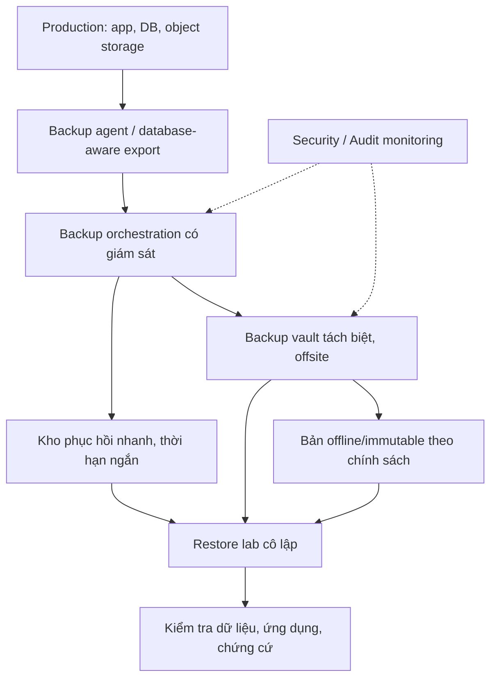
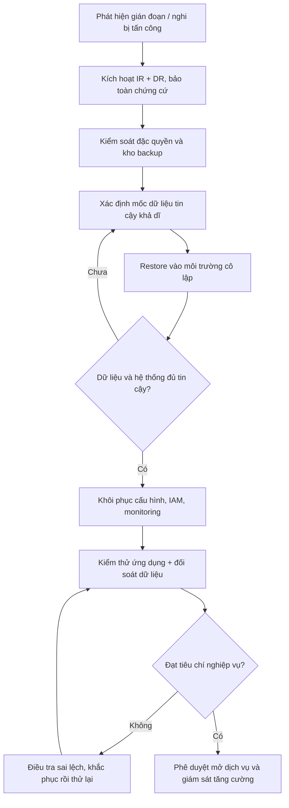
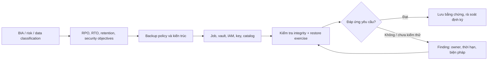

# Backup strategy: thiết kế chiến lược sao lưu có thể khôi phục và kiểm chứng

## 1. Backup strategy là gì?

**Backup strategy** (chiến lược sao lưu) là tập hợp các quyết định về **dữ liệu nào cần bảo vệ, tạo bản sao bằng cách nào, ở đâu, bao lâu, chống mất hoặc bị sửa đổi ra sao, và làm thế nào khôi phục dữ liệu phục vụ hoạt động kinh doanh trong giới hạn đã cam kết**. Một chiến lược đầy đủ bao gồm công nghệ, lịch chạy, chính sách lưu giữ, danh tính và quyền truy cập, bảo vệ khóa mã hóa, giám sát, quy trình phục hồi, kiểm thử và trách nhiệm của từng nhóm.

Trong chương **Disaster recovery** thuộc module **SECURITY_SECURITY_ASSURANCE**, backup là một nhóm kiểm soát quan trọng nhằm hỗ trợ tính sẵn sàng và toàn vẹn của dữ liệu khi xảy ra lỗi hạ tầng, thao tác nhầm, tấn công hoặc thảm họa. Học phần tập trung vào việc **đánh giá có bằng chứng rằng hệ thống đáp ứng mục tiêu bảo mật**, từ phân tích rủi ro và yêu cầu đến security controls, kiểm thử, audit và khắc phục phát hiện. Do đó, chiến lược backup phải chứng minh được **khôi phục thành công trong tình huống cần thiết**, thay vì chỉ cung cấp ảnh chụp màn hình “backup job thành công”.

Ví dụ: một ứng dụng lưu đơn hàng trong cơ sở dữ liệu PostgreSQL. Tác vụ backup hoàn tất mỗi ngày lúc 01:00. Nếu database hỏng lúc 23:50, bản backup gần nhất có thể khiến doanh nghiệp phải tái tạo gần một ngày giao dịch. Khi nghiệp vụ yêu cầu mất dữ liệu tối đa 15 phút, chỉ backup hằng ngày là chưa đủ. Chiến lược có thể cần thêm lưu trữ bản ghi giao dịch (WAL), điểm khôi phục theo thời gian, bản sao tách biệt và kiểm thử đối soát đơn hàng.

Sau bài này, người học có thể:

- Phân biệt **backup, snapshot, replication, high availability và disaster recovery**.
- Chọn phương thức sao lưu phù hợp với loại dữ liệu, RPO/RTO, đe dọa và nguồn lực.
- Thiết kế backup có khả năng chống thao tác xóa sai, chiếm quyền và ransomware.
- Thiết lập chính sách lịch chạy, retention, kiểm tra toàn vẹn, kiểm thử restore và giám sát.
- Xây dựng bằng chứng để đánh giá backup như một **security control** trong chương trình security assurance.

## 2. Đặt backup trong bức tranh khôi phục thảm họa

Một chiến lược backup là một thành phần của **disaster recovery (DR)**. DR còn bao gồm hạ tầng đích, cấu hình ứng dụng, quyền truy cập, mạng, DNS, khóa mã hóa, thứ tự khôi phục, nhân sự, giao tiếp và xác nhận hoạt động sau khôi phục.

| Khái niệm | Mục đích | Điều không tự bảo đảm |
|---|---|---|
| **Backup** | Giữ bản sao độc lập hoặc điểm khôi phục để lấy lại dữ liệu | Ứng dụng chạy trở lại đúng hạn |
| **Snapshot** | Ghi nhận trạng thái tại một thời điểm, thường hỗ trợ tạo/khôi phục nhanh | Bản sao thực sự độc lập khỏi tài khoản, thiết bị hay kho nguồn |
| **Replication** | Đồng bộ dữ liệu đến hệ thống đích để tăng khả dụng và giảm thời gian chuyển đổi | Giữ được dữ liệu tốt khi nguồn đã bị xóa hoặc mã hóa; lỗi có thể bị đồng bộ |
| **High availability (HA)** | Giảm thời gian gián đoạn khi một thành phần lỗi | Khôi phục bản dữ liệu trước thao tác xóa nhầm, hỏng logic hay mã độc |
| **Business continuity (BC)** | Duy trì hoạt động nghiệp vụ ở mức yêu cầu, kể cả cách vận hành thay thế | Tự động cung cấp backup hoặc khôi phục kỹ thuật |
| **DR plan** | Điều phối phục hồi hệ thống và dữ liệu sau gián đoạn nghiêm trọng | Đạt mục tiêu nếu chưa được thử và chưa có đủ phụ thuộc |
| **Backup verification** | Kiểm tra bản sao có tồn tại, đầy đủ và sử dụng được | Kết luận nghiệp vụ toàn hệ thống đã khôi phục an toàn |

**Replication và backup thường phải đi cùng nhau.** Nếu người dùng vô tình xóa bảng dữ liệu và lệnh xóa lập tức đồng bộ tới replica, replica vẫn có thể bị hỏng logic. Một bản sao ở mốc thời gian trước sự kiện cho phép phục hồi; khả năng đó chỉ đáng tin khi backup đã được tách khỏi những lỗi hoặc đặc quyền có thể phá hủy nguồn.

Tương tự, chức năng “snapshot” có thể được lưu nội bộ trong cùng storage array và mất theo thiết bị. Để được tính là bản bảo vệ độc lập, phải kiểm chứng **vị trí vật lý hoặc miền lỗi, quyền xóa, cách lưu metadata, khả năng xuất/khôi phục và phụ thuộc vào bản gốc**.

## 3. Bắt đầu từ Business Impact Analysis và yêu cầu dữ liệu

Chiến lược phải được xây dựng từ **Business Impact Analysis (BIA)** và đánh giá rủi ro. Đội nghiệp vụ xác định tác động gián đoạn và dữ liệu cần bảo vệ; đội kỹ thuật đánh giá các cách đáp ứng, rủi ro còn lại và khả năng phục hồi thực tế.

Những thuật ngữ chủ yếu:

- **RPO — Recovery Point Objective:** mức mục tiêu về độ lùi của điểm dữ liệu có thể phục hồi so với mốc gián đoạn. Ví dụ RPO 15 phút nghĩa là mục tiêu không phải khôi phục về trạng thái dữ liệu cũ hơn 15 phút trong kịch bản đã định.
- **RTO — Recovery Time Objective:** thời gian mục tiêu để khôi phục **năng lực hoạt động đã được định nghĩa** sau mốc gián đoạn. RTO không kết thúc đơn thuần khi máy chủ bật, nếu khách hàng vẫn không dùng được dịch vụ.
- **MTPD — Maximum Tolerable Period of Disruption:** thời gian gián đoạn tối đa mà hậu quả còn có thể chấp nhận theo đánh giá nghiệp vụ.
- **MBCO — Minimum Business Continuity Objective:** mức dịch vụ tối thiểu phải đạt được trong thời gian gián đoạn, có thể thấp hơn công suất bình thường.

Điểm cần nhớ là **RPO không bằng chu kỳ backup**. Tạo backup mỗi 15 phút nhưng mất 7 phút để truyền và kiểm tra, job đôi lúc thất bại, hoặc các thành phần dữ liệu không cùng điểm nhất quán thì chưa chứng minh được RPO 15 phút. Tương tự, có bản sao mới nhất không chứng minh đạt RTO 2 giờ nếu việc truy cập khóa mã hóa, tải dữ liệu, khởi động hệ thống và đối soát kéo dài 5 giờ.

Ví dụ bảng yêu cầu cho **một hệ thống giả định**:

| Hoạt động / dữ liệu | RPO yêu cầu | RTO yêu cầu | Điều kiện chấp nhận nghiệp vụ |
|---|---:|---:|---|
| Đơn hàng và thanh toán | 5 phút | 2 giờ | Đơn không bị mất hoặc ghi trùng trái yêu cầu; đối soát với cổng thanh toán đạt |
| Hồ sơ khách hàng | 1 giờ | 4 giờ | Có thể truy cập và cập nhật với quyền đúng, dữ liệu không bị hỏng |
| File báo cáo nội bộ có thể tái tạo | 24 giờ | 24 giờ | Tạo lại hoặc khôi phục đúng nội dung đến điểm chấp nhận |
| Cấu hình hạ tầng/IaC và secret metadata | Theo thay đổi đã phê duyệt | Phù hợp chuỗi khôi phục hệ thống | Dựng lại được môi trường và phân quyền an toàn |
| Audit log phục vụ điều tra | Theo nghĩa vụ lưu giữ và kịch bản điều tra | Có thể truy xuất khi cần điều tra | Dữ liệu đủ, nguyên vẹn và có nguồn gốc chứng minh |

Các thời hạn chỉ minh họa, không phải yêu cầu pháp lý hay chuẩn mặc định. Mỗi loại dữ liệu phải có **business owner, technical owner, phạm vi, phiên bản yêu cầu và bằng chứng phê duyệt**.

### 3.1. Phân loại dữ liệu trước khi chọn công cụ

Những nhóm dữ liệu cần đánh giá riêng:

1. **Dữ liệu giao dịch:** quan hệ nhất quán, thứ tự sự kiện, điểm khôi phục, khả năng replay hoặc đối soát.
2. **File và object:** phiên bản, metadata, ACL, đường dẫn, trạng thái xóa và quyền truy cập.
3. **Cấu hình hạ tầng:** IaC, policy, DNS, chứng chỉ, dependencies và thông số không thể tái tạo bằng code.
4. **Bí mật và khóa mã hóa:** phương thức khôi phục quyền truy cập mà vẫn bảo vệ khóa; không nên đưa plaintext secret vào bản sao thông thường.
5. **Nhật ký và chứng cứ:** chuỗi thời gian, retention, toàn vẹn, khả năng điều tra và nghĩa vụ bảo vệ dữ liệu.
6. **Dữ liệu SaaS:** phạm vi nhà cung cấp chịu trách nhiệm, giới hạn export/restore, quota, versioning và kiểm thử phục hồi.

**“Có backup database” không đồng nghĩa “khôi phục được dịch vụ”.** Ứng dụng có thể còn cần blob/object, queue state, cấu hình, IAM, chứng chỉ, khóa và dữ liệu bên thứ ba. Danh mục backup phải liên kết từng thành phần với **quy trình nghiệp vụ và phụ thuộc**.

## 4. Các phương pháp backup và điểm đánh đổi

### 4.1. Full backup

**Full backup** tạo bản sao đầy đủ tập dữ liệu trong phạm vi. Nó thường giúp quá trình restore đơn giản hơn vì cần ít thành phần phụ thuộc để phục hồi. Đổi lại, thời gian đọc, truyền và lưu trữ có thể lớn.

Phù hợp khi dữ liệu nhỏ, ít thay đổi, có thời gian backup đủ dài hoặc cần giữ các mốc độc lập phục vụ kiểm thử. “Full” theo tên job phải được kiểm tra: một số công cụ dùng *synthetic full*, tổng hợp từ những bản sao hiện có.

### 4.2. Incremental backup

**Incremental backup** thường giữ những thay đổi kể từ điểm backup trước đó trong chuỗi. Sau một full backup, có thể tạo các incremental nhỏ, nhanh và ít tốn dung lượng.

Khi phục hồi, tùy thiết kế và sản phẩm, có thể cần full cùng các incremental liên quan hoặc công cụ tổng hợp lại chuỗi. Nếu **một thành phần bắt buộc của chuỗi bị lỗi** hoặc catalog không còn, dữ liệu đích có thể không phục hồi tới mốc cần thiết. Vì vậy, ngoài test từng file incremental, phải test cả **restore toàn chuỗi**.

### 4.3. Differential backup

**Differential backup** lưu thay đổi kể từ bản full gần nhất. Dung lượng từng bản differential có thể tăng dần cho đến lần full kế tiếp. Phục hồi thường cần bản full và một bản differential phù hợp, nên có thể đơn giản hơn incremental nhiều bước, nhưng chi phí lưu và thời gian backup có thể lớn hơn.

### 4.4. Synthetic full và incremental-forever

Một số sản phẩm tạo **synthetic full** bằng cách tổng hợp các thành phần backup đã có mà không đọc lại toàn bộ nguồn. Cách này giảm tải hệ thống nguồn nhưng cần tin cậy vào catalog, metadata, kho đích và logic ghép dữ liệu. Cơ chế không tự làm bản sao trở thành độc lập khỏi lỗi hoặc bị xóa trong kho lưu trữ.

### 4.5. Snapshot và continuous / point-in-time recovery

- **Snapshot** hữu ích để quay lại trạng thái nhanh hoặc tạo điểm nhất quán; nhưng cần xác minh giới hạn miền lỗi, phụ thuộc vào volume gốc và khả năng xuất offsite.
- **Continuous data protection (CDP)** hoặc lưu **transaction logs** cho phép chọn những điểm khôi phục gần thời điểm lỗi hơn, tùy hệ thống.
- **Point-in-time recovery (PITR)** của cơ sở dữ liệu có thể cần một base backup và chuỗi WAL/binlog/transaction log liên tục đến mốc chọn. Nếu thiếu log hoặc không tương thích với base backup, điểm khôi phục mong muốn có thể không khả thi.

| Phương thức | Lợi ích thường thấy | Rủi ro cần kiểm tra |
|---|---|---|
| Full | Phục hồi đơn giản hơn, ít phụ thuộc theo chuỗi | Tốn dung lượng, thời gian backup và lưu trữ |
| Incremental | Backup nhanh, giảm lưu trữ thay đổi | Phụ thuộc chuỗi, catalog, tính toàn vẹn từng phần |
| Differential | Khôi phục thường cần ít bước hơn incremental chuỗi | Bản sau có thể phình to theo thay đổi |
| Synthetic full | Giảm tải đọc từ hệ thống nguồn | Phụ thuộc xử lý và metadata tại kho backup |
| Snapshot | Điểm quay lại nhanh, phù hợp một số workload | Có thể cùng miền lỗi và quyền xóa với dữ liệu gốc |
| PITR / CDP | Giảm độ lùi dữ liệu, chọn thời điểm cụ thể | Phức tạp về nhật ký, tính liên tục và ứng dụng |

Không có phương thức tốt nhất cho mọi nguồn. Một chiến lược thường **kết hợp nhiều phương thức**, thậm chí theo từng loại bảng, bucket, workload hoặc nhóm nghiệp vụ.

## 5. Tính nhất quán: sao lưu được file chưa chắc sao lưu được ứng dụng

Một bản backup có thể tồn tại, checksum hợp lệ nhưng **không phục hồi được trạng thái nghiệp vụ nhất quán**. Đây là vấn đề phổ biến với cơ sở dữ liệu và hệ thống phân tán.

Các mức nhất quán cần phân biệt:

- **Crash-consistent:** phản ánh trạng thái tương tự khi máy dừng đột ngột, cần cơ chế recovery của ứng dụng/database khi khởi động.
- **Application-consistent:** có phối hợp với ứng dụng hoặc database để bảo đảm điểm khôi phục hợp lệ theo cơ chế của hệ thống.
- **Business-consistent:** nhiều thành phần liên quan có trạng thái có thể sử dụng cho nghiệp vụ, bao gồm đơn hàng, thanh toán, hàng đợi, object và dữ liệu đối soát.

Một snapshot đồng thời của nhiều volume không mặc định đạt tính nhất quán giữa **dịch vụ thanh toán, database và message queue**. Cần xác định ranh giới transaction, idempotency, khả năng replay và thứ tự khôi phục.

Ví dụ với PostgreSQL:

1. Tạo **base backup** bằng cơ chế hỗ trợ của PostgreSQL hoặc công cụ tương thích, bảo đảm metadata cần thiết được lưu.
2. Thu và lưu **WAL liên tục** nếu yêu cầu PITR; theo dõi độ trễ, thiếu đoạn, lỗi lưu và thời gian tạo checkpoint.
3. Bảo vệ bản base backup cùng WAL khỏi cùng một miền lỗi hoặc quyền xóa nguy hiểm.
4. Thử phục hồi lên một instance cô lập đến mốc thời gian cụ thể, sau đó truy vấn và kiểm tra dữ liệu nghiệp vụ.
5. Nếu ứng dụng có hệ thống liên quan bên ngoài database, đối soát các giao dịch để tránh replay sai hoặc xử lý trùng.

Ví dụ này thể hiện nguyên lý; lệnh và trình tự cụ thể phụ thuộc phiên bản PostgreSQL, công cụ backup, kiến trúc standby và chính sách vận hành. Không có lý do suy ra rằng “cứ lưu WAL là tự động đạt RPO 5 phút” nếu chưa kiểm tra chuỗi và độ trễ thực tế.

### 5.1. Catalog và metadata là một phần của khả năng phục hồi

Backup có thể cần catalog để biết mốc nào tồn tại, bản nào phụ thuộc bản nào, nơi chứa khóa, khóa phiên bản, snapshot metadata hoặc mapping object. Chiến lược phải bảo vệ và thử **khả năng dựng lại hoặc khôi phục catalog**.

Đặc biệt với hệ thống **incremental-forever**, nếu catalog hỏng hoặc bị xóa, việc ghép bản sao và tìm điểm phục hồi có thể chậm hoặc không thể thực hiện. Trong diễn tập, cần thử tình huống catalog chính không sẵn sàng, chứ không chỉ chọn nút “Restore” trong giao diện đang hoạt động.

## 6. Bảo vệ backup trước rủi ro bảo mật

Backup là mục tiêu có giá trị cao trong nhiều kịch bản tấn công. Nếu kẻ tấn công có thể xóa hoặc mã hóa mọi bản backup, chiến lược chỉ tồn tại trên giấy.

| Kịch bản | Cách backup có thể thất bại | Kiểm soát cần đánh giá |
|---|---|---|
| **Ransomware** | Mã hóa dữ liệu nguồn và xóa/mã hóa kho backup | Bản sao cô lập, immutable/offline phù hợp, giám sát xóa bất thường |
| **Chiếm tài khoản admin** | Kẻ tấn công sửa lịch, tắt job, giảm retention, xóa backup | Tách quyền, MFA, cấp quyền tối thiểu, phê duyệt thay đổi nhạy cảm |
| **Hỏng storage hoặc mất site** | Production và backup cùng vị trí cùng bị ảnh hưởng | Phân tách vùng/địa điểm hoặc miền lỗi, bản sao offsite |
| **Nhầm thao tác vận hành** | Xóa nhầm bucket, lỡ backup, overwrite backup tốt | Versioning, recycle/retention khi phù hợp, cảnh báo và quy trình khôi phục |
| **Dữ liệu nguồn hỏng âm thầm** | Bản backup mới cũng mang dữ liệu lỗi | Nhiều điểm khôi phục, kiểm tra logic, test dữ liệu sạch |
| **Mất khóa mã hóa/KMS** | Còn ciphertext nhưng không thể giải mã | Quy trình khôi phục khóa, kiểm soát quyền và test decrypt có phê duyệt |
| **Lộ bản backup** | Dữ liệu khách hàng và secret bị truy cập hoặc trích xuất | Mã hóa, giới hạn truy cập, audit và giảm dữ liệu nhạy cảm |
| **Lỗi đồng bộ dữ liệu** | Replica đồng bộ cả lệnh xóa nhầm | Retention nhiều mốc, backup độc lập, PITR |
| **Lỗi bên cung cấp dịch vụ** | Không thể tải hoặc restore từ nền tảng phụ thuộc | Export/restore kiểm thử, phương án thay thế, kiểm tra hợp đồng |

Đối với backup, phải phân biệt **tính sẵn sàng, tính toàn vẹn và tính bí mật**. Kho sao lưu giữ dữ liệu rất nhạy cảm; khôi phục được nhanh không đồng nghĩa với bảo vệ dữ liệu tốt nếu mọi quản trị viên đều có thể tải bản sao chứa thông tin khách hàng.

### 6.1. Quy tắc 3-2-1-1-0 như một cách tự kiểm tra

Một heuristic thường dùng là **3-2-1-1-0**:

- **3** bản dữ liệu theo cách đếm đã định, thường bao gồm bản sản xuất và ít nhất hai bản sao.
- **2** loại phương tiện hoặc cơ chế lưu trữ khác nhau để giảm lỗi tương quan.
- **1** bản ở địa điểm hoặc miền lỗi khác.
- **1** bản **offline hoặc immutable** đủ mạnh với mô hình đe dọa.
- **0** lỗi **chưa được phát hiện** qua kiểm tra backup và phép thử phục hồi.

Đây là **nguyên tắc định hướng**, không phải chứng nhận hệ thống an toàn hay bắt buộc pháp lý. Ba bản trong cùng tài khoản cloud do một khóa quản trị có quyền xóa hết có thể vẫn chịu một lỗi chung. Một bản được quảng cáo “immutable” cũng không tự an toàn nếu tài khoản có đặc quyền có thể đổi chính sách, xóa khóa giải mã hoặc chiếm quyền điều khiển vòng đời.

Đánh giá dựa trên **failure domain và control plane** thực tế: tài khoản, tổ chức, vùng, quyền IAM, khóa KMS, mạng, hệ thống quản lý backup, nhà cung cấp và người phê duyệt.

### 6.2. Offline, air gap và immutable

- **Offline copy:** bản sao không còn kết nối trực tiếp với hệ thống có thể bị xâm nhập trong khoảng thời gian lưu giữ. Cần quy trình kết nối lại, kiểm tra, cập nhật và phục hồi có kiểm soát.
- **Air gap:** cơ chế cách ly mạng/vận hành ở mức độ xác định; “có firewall” hoặc “ở tài khoản cloud khác” chưa tự động là air gap.
- **Immutable / WORM:** dữ liệu không được sửa/xóa trước mốc bảo vệ theo khả năng và cấu hình của nền tảng. Phải kiểm tra chế độ áp dụng, phạm vi object/version, thao tác override, retention lock và quyền quản trị.

Không hứa “không thể xóa trong mọi trường hợp”: tùy công nghệ, có thể vẫn có các rủi ro như **mất khóa**, xóa cả tài khoản sau một số điều kiện, lỗi nhà cung cấp, lộ quyền cao nhất hoặc hết hạn retention. Tài liệu assurance nên nêu **bảo vệ chống thao tác nào và điều kiện kiểm chứng nào**.

## 7. Kiến trúc mẫu: tách backup khỏi miền lỗi sản xuất



Sơ đồ là cách tổ chức khái niệm, không phải yêu cầu mọi tổ chức phải dùng đúng ba kho. Các điểm cần thiết kế rõ:

1. **Data plane:** nơi dữ liệu backup nằm, lưu bản nào, có cơ chế kiểm tra toàn vẹn và phân tầng lưu trữ ra sao.
2. **Control plane:** ai tạo job, thay lịch, xóa object, đổi retention, tắt cảnh báo hoặc thay khóa mã hóa.
3. **Identity boundary:** tài khoản production bị chiếm có tiếp tục có quyền xóa bản sao bảo vệ không? Có tài khoản backup chuyên biệt và quyền restore được kiểm soát không?
4. **Encryption boundary:** khóa KMS nằm ở đâu, có thể giải mã khi production hoặc IAM chính mất không, ai được quyền quay vòng hoặc hủy khóa?
5. **Recovery boundary:** có môi trường cô lập đủ mạng, DNS, secret, phần mềm, capacity và dữ liệu thử để phục hồi an toàn không?
6. **Evidence boundary:** ai xem được log backup, kết quả restore, lịch sử thay đổi và quyết định phê duyệt, đặc biệt khi hệ thống nguồn bị xâm nhập?

Lưu backup offsite là cần thiết với một số kịch bản, nhưng phải cân nhắc **độ trễ mạng, khả năng truy cập, quy định vị trí dữ liệu và nghĩa vụ lưu trữ**. “Offsite” chỉ có giá trị khi vị trí và quyền kiểm soát thực sự tách khỏi nguyên nhân gián đoạn đang xét.

## 8. Thiết kế lịch sao lưu theo RPO, tải hệ thống và tính nhất quán

Quy trình chọn lịch nên đi từ yêu cầu đến phương án:

1. Chọn **RPO** cho từng nhóm dữ liệu theo BIA.
2. Chọn cơ chế hỗ trợ tạo điểm khôi phục: full, incremental, log shipping, snapshot, PITR hoặc kết hợp.
3. Tính cả **độ trễ ghi backup, truyền offsite, kiểm tra, đồng bộ metadata và trạng thái job thất bại**.
4. Lập lịch có xét giờ cao điểm, giới hạn tài nguyên, bảo vệ tính nhất quán và ảnh hưởng tới ứng dụng.
5. Đặt cảnh báo khi **tuổi điểm khôi phục có thể sử dụng gần vượt RPO**, không chỉ cảnh báo job thất bại.
6. Kiểm thử restore ở đúng mốc ranh giới và thử kịch bản mất một hoặc nhiều kỳ backup.

Ví dụ, một workload cần RPO 15 phút nhưng chỉ chạy bản sao thành công mỗi 15 phút với thời gian truyền 10 phút. Nếu mất production ngay trước khi bản mới hoàn thành, **điểm khôi phục đã xác nhận** có thể cũ hơn mục tiêu. Chiến lược cần điều chỉnh cơ chế và dự phòng độ trễ, không đơn thuần đặt cron là mỗi 15 phút.

Đối với dữ liệu thay đổi liên tục, cần định nghĩa **thời điểm backup có hiệu lực** dựa trên checkpoint/transaction được phục hồi nhất quán, thay vì thời điểm job bắt đầu hoặc kết thúc. Hai timestamp này có thể chênh đáng kể.

## 9. Retention: giữ bao lâu, ở tầng nào và xử lý xóa ra sao?

Backup retention là **thời gian duy trì các điểm khôi phục**, có thể theo số ngày, tuần, tháng hoặc nhóm mốc lưu giữ; khác với thời gian giữ log phục vụ điều tra hoặc khả năng truy vấn dữ liệu trong ứng dụng.

Một số mô hình thường gặp:

- **Rolling retention:** duy trì các điểm gần nhất trong cửa sổ xác định, ví dụ 14 hoặc 30 ngày.
- **Grandfather–Father–Son (GFS):** giữ các mốc ngắn hạn, trung hạn, dài hạn (ví dụ daily/weekly/monthly) để phục vụ nhu cầu phục hồi trong những khoảng thời gian khác nhau.
- **Tiered retention:** dữ liệu phục hồi gần nằm trên kho nhanh, mốc cũ chuyển sang archive rẻ hơn nhưng phục hồi chậm hơn.
- **Exception hold:** tạm ngăn xóa mốc cụ thể phục vụ điều tra hoặc nghĩa vụ hợp lệ, với người phê duyệt và lịch rà soát.

Không được suy ra rằng mọi hệ thống “phải giữ backup 7 năm” hoặc “giữ vô hạn để chắc chắn”. Thời hạn phụ thuộc nhu cầu, rủi ro, quy định áp dụng, hợp đồng, quyền riêng tư, chi phí và khả năng truy cập. Bản sao cũ chứa dữ liệu cá nhân hoặc thông tin mật có thể tạo thêm rủi ro nếu giữ không có căn cứ.

Khi đặt retention, cần xem:

- Các mốc khôi phục có bị hỏng hoặc đã chứa dữ liệu bị nhiễm từ khi nào?
- Có cần quay lại **trước thời điểm bị tấn công nhưng chưa phát hiện** hay không?
- Dữ liệu khách hàng có quyền xóa hoặc lịch xóa theo chính sách nào? Backup có giới hạn kỹ thuật gì và quy trình nào áp dụng khi restore?
- Các bản backup phụ thuộc chuỗi incremental, dedup hoặc catalog ra sao? Xóa một thành phần có thể phá vỡ điểm khôi phục chưa hết hạn không?
- Archive đã mã hóa có thể còn giải mã được đến cuối thời gian lưu giữ không?
- Khi retention hết hạn, các replica, snapshot, tape, export và bản sao phục vụ test được xử lý ra sao?

Nếu backup không hỗ trợ xóa từng bản ghi, phải thiết kế **vòng đời backup, kiểm soát khôi phục và xử lý lại chính sách dữ liệu sau restore**. Một yêu cầu xóa bản ghi ở production không đồng nghĩa với việc đã biến mất khỏi mọi snapshot hay bản backup. Các ngoại lệ và giới hạn này phải được quản lý rõ.

## 10. Xây dựng chính sách backup theo lớp dữ liệu

Bảng sau là **ví dụ thiết kế cho môi trường giả định** để minh họa cách tổ chức, không phải cấu hình tối ưu hay thời hạn chuẩn:

| Lớp dữ liệu | Điểm khôi phục / phương pháp | Retention minh họa | Kho bảo vệ | Kiểm thử cần có |
|---|---|---|---|---|
| **Giao dịch PostgreSQL** | Full mỗi ngày + lưu WAL liên tục; hỗ trợ PITR | Điểm gần 30 ngày, mốc tháng 6 tháng | Kho phục hồi nhanh + vault tách biệt/immutable theo chính sách | Restore PITR, đối soát đơn và thanh toán |
| **Object của người dùng** | Versioning + incremental backup hằng ngày | 30 ngày, một số mốc dài hơn nếu có căn cứ | Kho khác miền lỗi, IAM riêng | Restore object, metadata, ACL, phiên bản |
| **Cấu hình hạ tầng** | Repo/IaC có version + export cấu hình quan trọng theo thay đổi | Theo vòng đời dự án, yêu cầu audit | Repo và bản sao độc lập | Dựng lại môi trường cô lập |
| **Metadata khóa và cấu hình KMS** | Phương án xuất/khôi phục theo dịch vụ và chính sách an toàn | Theo yêu cầu bảo vệ dữ liệu đã mã hóa | Kho/đường truy cập được kiểm soát riêng | Khả năng giải mã và phân quyền sau DR |
| **Audit log bảo mật** | Forwarding tập trung + lưu archive độc lập | Theo nghĩa vụ và nhu cầu điều tra | Kho bảo vệ tính toàn vẹn | Khôi phục và tra cứu sự kiện lịch sử |
| **SaaS tài liệu nhóm** | Export/API backup nếu nhà cung cấp không đáp ứng yêu cầu | Theo phân loại nội dung | Nhà cung cấp khác hoặc tài khoản tách biệt | Restore dữ liệu, quyền chia sẻ, metadata |

Bảng chính sách thực tế nên bổ sung: tên hệ thống, owner, nguồn/đích, chu kỳ chạy, RPO/RTO yêu cầu, độ trễ cho phép, bandwidth, encryption, quyền, lịch thử, kết quả test cuối, ngoại lệ và liên kết BIA.

**Thư mục dữ liệu hoặc bucket không hiện diện trong danh mục backup là một khoảng trống cần xác minh**. Đặc biệt chú ý dữ liệu mới được tạo qua autoscaling, tài nguyên theo nhãn, môi trường SaaS, account cloud mới hoặc bucket lưu file người dùng không thuộc mẫu tìm kiếm cũ.

## 11. Ước lượng dung lượng, băng thông và thời gian phục hồi

### 11.1. Dung lượng lưu trữ

Một công thức sơ bộ cho dữ liệu thay đổi là:

\[
V_{\text{logical}} \approx V_{\text{full}}
    + \sum_{i=1}^{n} V_{\text{incremental},i}
\]

Trong đó dung lượng thực tế có thể thay đổi do nén, deduplication, versioning, file thay đổi nhiều lần, metadata, replication, mã hóa và overhead. Cần khảo sát **dữ liệu đã thay đổi thực tế** thay vì lấy tỷ lệ cố định cho mọi ngày.

Ví dụ giả định: dữ liệu gốc **1 TB**, mỗi ngày có lượng thay đổi duy nhất xấp xỉ **20 GB** và giữ một full cùng 6 incremental sau đó. Trước khi xét nén và overhead, ước lượng dung lượng logic cần thiết là:

\[
1{,}000\ \text{GB} + 6 \times 20\ \text{GB}
= 1{,}120\ \text{GB}
\]

Nếu tạo thêm một bản sao độc lập với nội dung tương đương, cần dự trù dung lượng riêng của kho thứ hai; không tự giả định tỷ lệ tiết kiệm dedup giống nhau giữa hai kho. Với dữ liệu mã hóa đầu cuối hoặc file thay đổi toàn phần, khả năng nén/dedup có thể thấp hơn mong đợi.

### 11.2. Thời gian restore không chỉ là thời gian đọc dữ liệu

Có thể ước lượng **giới hạn dưới** của thời gian truyền dữ liệu:

\[
T_{\text{transfer}} \approx \frac{V_{\text{restore}}}{B_{\text{effective}}}
\]

Nếu cần tải **1 TB** ở tốc độ thực tế **200 MB/s** liên tục, thời gian truyền lý tưởng khoảng **5.000 giây**, tức khoảng **83 phút** theo đơn vị thập phân. Điều đó **chưa tính** thời gian cấp tài nguyên, duyệt quyền, tải metadata, restore database, áp dụng transaction log, khởi động ứng dụng, đối soát và xác nhận với chủ nghiệp vụ.

Băng thông thực tế có thể bị giới hạn bởi egress cloud, throttling, số file nhỏ, throughput disk, mã hóa, network, CPU và restore từ cold storage phải chờ lấy dữ liệu. Bởi vậy, sizing backup và RTO cần dựa trên **diễn tập restore toàn chuỗi** ở quy mô phù hợp.

### 11.3. Đánh giá chuỗi khôi phục theo critical path

Ví dụ một kịch bản cần khôi phục:

- 15 phút kích hoạt đội trực và xác nhận quyền phục hồi;
- 20 phút tạo môi trường cô lập, cấu hình mạng và quyền;
- 85 phút tải dữ liệu;
- 35 phút áp dụng WAL và kiểm tra cấu trúc;
- 25 phút khởi động ứng dụng, chạy kiểm thử chức năng;
- 30 phút đối soát giao dịch và chủ nghiệp vụ phê duyệt.

Nếu các bước phải diễn ra nối tiếp, tổng khoảng **210 phút (3 giờ 30 phút)**. Một RTO 2 giờ không đạt trong kịch bản này. Cần giảm thời gian trên **đường găng**, cho phép bước an toàn làm song song khi phù hợp, dự trữ hạ tầng hoặc thay phương án; không thể coi RTO đạt chỉ vì tác vụ **download** hoàn tất trong 85 phút.

## 12. Kiểm soát truy cập, mã hóa và tách nhiệm vụ

Backup chứa bản sao tài sản có giá trị cao. Thiết kế phân quyền nên tách các vai trò **tạo backup, đọc backup, restore, thay retention, thay khóa và xóa bản sao bảo vệ**.

| Vai trò ví dụ | Quyền nên có | Quyền cần hạn chế |
|---|---|---|
| **Backup operator** | Theo dõi job, chạy backup theo quy trình, kiểm tra tình trạng | Tự ý giảm retention hoặc xóa vault |
| **Recovery operator** | Khôi phục theo case đã phê duyệt vào môi trường được phép | Truy xuất bất kỳ bản sao nhạy cảm hoặc đưa dữ liệu ra ngoài |
| **Backup security administrator** | Quản lý guardrail, cấu hình bảo vệ, kiểm tra quyền | Đọc plaintext backup nếu không cần |
| **Auditor / assurance reviewer** | Đọc chính sách, logs, kết quả test và bằng chứng | Sửa/xóa bản backup hoặc cấu hình |
| **Break-glass role** | Quyền khẩn cấp trong điều kiện và thời gian cho phép | Quyền thường trực, không giám sát, không hậu kiểm |

Áp dụng nguyên tắc:

1. **Mã hóa khi truyền và khi lưu**, gắn với phân loại dữ liệu; kiểm tra khả năng giải mã khi phục hồi.
2. **Giới hạn quyền IAM** của workload và service account; tách miền quản trị kho bảo vệ khỏi production khi rủi ro đòi hỏi.
3. **Giám sát thay đổi nhạy cảm**: tắt backup, sửa lịch, đổi retention, thay key, xóa snapshot, xóa catalog, đổi policy hoặc xóa alert.
4. **Phê duyệt nhiều người khi phù hợp** với thao tác phá hủy hoặc thay đổi bảo vệ.
5. **Quản lý key lifecycle** để không hủy khóa khi vẫn còn bản sao cần khôi phục; kiểm tra kịch bản khôi phục khi IAM/KMS production lỗi.
6. **Hạn chế truy cập môi trường restore test** vì dữ liệu được phục hồi có thể chứa thông tin cá nhân thật; ưu tiên dữ liệu tổng hợp hoặc ẩn danh nếu đáp ứng mục tiêu thử.
7. **Lưu log truy cập và thay đổi** trong kho bảo vệ đủ độc lập để điều tra khi hệ thống production đã bị xâm nhập.

Một bản backup có thể được mã hóa đúng nhưng vô dụng nếu **không ai còn quyền giải mã sau sự cố**. Vì thế, kiểm thử DR phải đi qua đường truy cập và quyền thực tế, kể cả thủ tục break-glass nếu có.

## 13. Khôi phục sau ransomware và dữ liệu bị nhiễm

Sau tấn công, “restore bản mới nhất” có thể là quyết định sai: bản sao mới nhất có thể đã chứa **malware, persistence, credential bị thay đổi hoặc dữ liệu logic bị sửa**. Cần kết hợp bảo vệ backup với quy trình đánh giá tính sạch trước khi mở lại hệ thống.

Một luồng khôi phục có kiểm soát:



Trong thực tế, hoạt động **incident response và disaster recovery diễn ra phối hợp**. Không tắt hệ thống, reset credential, xóa dữ liệu hoặc cô lập mạng theo một câu lệnh chung nếu có thể gây thiệt hại hay mất chứng cứ, trừ khi playbook/thẩm quyền cho phép trong tình huống cụ thể.

Các mốc quyết định quan trọng:

- Xác định **thời điểm xâm nhập và thay đổi dữ liệu** sát thực tế nhất có thể bằng log, sự kiện, threat hunting và phân tích nguồn; có thể chưa biết đầy đủ.
- Chọn **mốc backup ứng viên** và ghi căn cứ vì sao có khả năng đáng tin; “backup thành công” chưa đủ chứng minh dữ liệu sạch.
- Khôi phục vào **môi trường cô lập** để kiểm tra, tránh kết nối lại với vùng đang bị xâm nhập.
- Rà soát **IAM, secret, key, policy, hạ tầng và tài khoản dịch vụ**, không chỉ file và database.
- Kiểm tra **tính nhất quán nghiệp vụ**, số giao dịch đang dang dở và ảnh hưởng RPO thực tế.
- Ghi **người phê duyệt, rủi ro còn lại và kết quả kiểm thử** trước khi chuyển lại traffic.
- Theo dõi sau phục hồi để phát hiện tái xâm nhập, độ lệch cấu hình và giao dịch lỗi.

Lưu ý: nếu **nguyên nhân gốc chưa được xử lý**, khôi phục nhanh có thể dẫn tới tái nhiễm. Do đó, tiêu chí phục hồi an toàn phải bao gồm các kiểm soát phục vụ phát hiện và phòng ngừa phù hợp.

## 14. Runbook khôi phục: từ backup tới dịch vụ hoạt động

Một runbook tốt cần đủ rõ để người trực khác nhau thực hiện trong kịch bản hệ thống chính không truy cập được.

| Giai đoạn | Công việc | Bằng chứng đầu ra |
|---|---|---|
| **Kích hoạt** | Xác định sự cố, phạm vi, RTO/RPO liên quan, người chỉ huy, thông báo | Case DR/IR, thời điểm bắt đầu, phê duyệt |
| **Bảo vệ hiện trạng** | Bảo vệ backup, log, key và dấu vết; chặn đường làm mất bản sao nếu có thẩm quyền | Audit thao tác, xác nhận trạng thái vault |
| **Chọn điểm khôi phục** | Tra catalog, kiểm tra tính toàn vẹn, tuổi backup, sự phù hợp với kịch bản | Backup ID, timestamp, checksum/manifest, căn cứ chọn |
| **Chuẩn bị đích** | Mạng cô lập, compute, storage, IAM, key và phiên bản ứng dụng | Configuration evidence, quyền truy cập |
| **Khôi phục dữ liệu** | Restore full/incremental/PITR theo thứ tự, kiểm tra log và lỗi | Restore job ID, log tiến độ, thời gian |
| **Xác minh dữ liệu** | Kiểm tra schema, số lượng, quan hệ, giao dịch, mã độc hoặc sai lệch liên quan | Kết quả query, đối soát, bằng chứng kiểm tra an ninh |
| **Khởi động dịch vụ** | Khôi phục secret, cấu hình, mạng, monitoring; chạy kiểm thử end-to-end | Test result, log hoạt động, trạng thái alert |
| **Phê duyệt đưa vào vận hành** | Chủ nghiệp vụ và nhóm có thẩm quyền xác nhận tiêu chí | Quyết định, timestamp, hạn chế còn lại |
| **Theo dõi và hoàn tất** | Giám sát tăng cường, xử lý backlog, kiểm tra failback và lưu hồ sơ | Báo cáo RTO/RPO thực tế, finding, hành động cải tiến |

Runbook phải có cách truy cập **ngoài hệ thống bị lỗi**, thông tin liên hệ cập nhật, phân quyền khẩn cấp và hướng dẫn vận hành khi công cụ quản lý backup chính không còn. Tài liệu không nên chứa mật khẩu hoặc secret dạng rõ.

## 15. Kiểm thử: bằng chứng trung tâm của backup assurance

Kiểm thử cần trả lời: **bản backup có phục hồi được dữ liệu đúng, ở thời điểm cần thiết, với đủ ứng dụng và quyền an toàn, trong giới hạn nghiệp vụ?**

Phân biệt các mức kiểm tra:

| Mức | Mục tiêu | Giới hạn cần nêu |
|---|---|---|
| **Job health** | Tác vụ backup hoàn tất, dữ liệu đã ghi | Chưa chứng minh phục hồi được |
| **Checksum / metadata verification** | Phát hiện bản sao hỏng hoặc thiếu theo phương pháp xác minh | Không chứng minh nghiệp vụ hợp lệ hoặc nguồn không bị nhiễm |
| **Automated sample restore** | Có thể lấy file/object/bảng mẫu trong kho đã định | Chỉ kiểm tra tập mẫu, chưa bao phủ toàn workload |
| **Database / application restore** | Database khởi động và ứng dụng chạy với dữ liệu khôi phục | Có thể chưa đo đầy đủ năng lực nghiệp vụ |
| **End-to-end DR exercise** | Hạ tầng, phụ thuộc, IAM, dữ liệu, công suất và quy trình cùng được phục hồi | Kịch bản thử giới hạn; cần ghi rõ phạm vi và giả định |
| **Security recovery exercise** | Khôi phục khi production/IAM/KMS hoặc control plane đã bị ảnh hưởng | Cần giả lập có kiểm soát và điều kiện an toàn |
| **Cross-region/account restore** | Phục hồi khi miền lỗi/vùng/tài khoản chính không dùng được | Khả năng phụ thuộc còn lại và kết nối mạng có thể khác thực tế |

### 15.1. Kiểm tra RPO bằng điểm dữ liệu thực tế

Giả sử sự cố được mô phỏng tại **10:00:00 UTC**. Mốc dữ liệu giao dịch mới nhất **có thể khôi phục nhất quán** là **09:48:00 UTC**. Khoảng lùi là 12 phút. Nếu **RPO yêu cầu = 5 phút**, kết luận là **RPO không đạt** trong kịch bản thử dù backup có trạng thái “success”.

Chú ý ba thời gian khác nhau:

- Thời điểm sự kiện nghiệp vụ được tạo;
- Thời điểm dữ liệu trở nên bền vững và đủ để khôi phục nhất quán;
- Thời điểm job nhận/gửi/đánh dấu thành công.

RPO phải dựa trên **điểm dữ liệu dùng được** theo định nghĩa, không lấy tên file backup hoặc thời gian kết thúc job làm đại diện thiếu chứng minh.

### 15.2. Kiểm tra RTO theo năng lực nghiệp vụ

Nếu kịch bản bắt đầu lúc **10:00 UTC**, database khởi động lúc **11:00**, nhưng checkout chỉ thanh toán thành công, kiểm tra đúng quyền và đối soát được giao dịch lúc **12:35**, RTO đến điểm nghiệp vụ phù hợp là **2 giờ 35 phút**. Với yêu cầu **2 giờ**, kết luận **không đạt**. Mốc khởi động database có thể là một chỉ số kỹ thuật phụ, nhưng không thay mốc chấp nhận của chủ nghiệp vụ.

### 15.3. Bộ test tối thiểu cần có

1. **Positive restore:** khôi phục file/DB và dùng được dữ liệu, schema, metadata, ACL cần thiết.
2. **PITR boundary:** phục hồi ở mốc trước/sau giao dịch cụ thể; kiểm tra không thiếu, trùng hoặc sai trạng thái theo giả thuyết.
3. **Corrupted backup:** một thành phần bị hỏng trong môi trường test; hệ thống phát hiện và chuyển sang điểm khôi phục khác theo quy trình.
4. **Missing incremental/log:** mô phỏng thiếu một phần chuỗi, xác minh cảnh báo và giới hạn restore được báo đúng.
5. **Unauthorized deletion:** vai trò production thông thường không được xóa bản bảo vệ hoặc giảm retention ngoài quy trình.
6. **Lost production environment:** diễn tập khôi phục khi tài khoản, region hoặc IAM production không dùng được trong phạm vi mô phỏng.
7. **Lost/rotated key:** kiểm tra trường hợp khóa đã thay đổi; bản sao còn trong retention vẫn giải mã đúng bằng con đường được phép.
8. **Ransomware-style clean restore:** dùng dữ liệu/thao tác giả lập để chọn điểm tin cậy, kiểm tra trước khi mở kết nối.
9. **Retention expiration / hold:** bản hết hạn được xử lý; bản trong hold hợp lệ được bảo tồn; gỡ hold dẫn đến đánh giá lại chính sách.
10. **Recovery monitoring:** sinh sự kiện kiểm thử sau restore, bảo đảm log, alert, audit và phân quyền vận hành.
11. **Large-scale restore:** kiểm tra throughput, quota, công suất và thời gian khi dữ liệu đạt quy mô thực tế.
12. **Handoff:** đội trực ca khác chạy runbook, ghi đầy đủ quyết định, phê duyệt và bằng chứng.

Không được thực hiện kiểm thử phá hoại trên dữ liệu production khi không có phạm vi được phê duyệt. Có thể dùng môi trường cô lập, dữ liệu tổng hợp, bản sao được phép và phương pháp diễn tập phù hợp, nhưng cần nêu giới hạn so với tình huống thực.

## 16. Giám sát, cảnh báo và chất lượng vận hành

Không nên chỉ theo dõi số job “success/failure”. Một chiến lược backup cần giám sát **khả năng có điểm phục hồi sử dụng được** và **tình trạng các lớp bảo vệ**.

| Chỉ số hoặc cảnh báo | Cần phát hiện gì? |
|---|---|
| **Last recoverable point age** | Điểm khôi phục mới nhất đã xác minh có đang cũ hơn mục tiêu không? |
| **Backup job completion / failures** | Job nào thất bại, bị bỏ lịch hoặc hoàn thành bất thường? |
| **Backup lag / WAL archive lag** | Dữ liệu chưa được bảo vệ, chậm chuyển sang kho dự phòng? |
| **Coverage / discovered assets** | Tài sản mới có nằm ngoài chính sách hoặc thiếu nguồn? |
| **Integrity verification failures** | Backup hỏng, checksum/manifest khác hoặc thiếu thành phần? |
| **Restore test success / elapsed time** | Bản sao có dùng được, thời gian thực tế có đạt tiêu chí? |
| **Immutable/retention drift** | Chế độ bảo vệ hoặc thời hạn bị sửa trái quy trình? |
| **Deletion / policy change events** | Ai cố xóa kho, sửa lịch, tắt job hoặc thay key? |
| **Vault capacity and cost** | Kho gần đầy, quota hoặc egress/thời gian archive cản trở restore? |
| **Recovery key health** | Khóa, chứng chỉ, break-glass và quyền restore còn hợp lệ? |
| **Unreviewed exceptions** | Job bị tạm ngừng, dữ liệu loại trừ hoặc hold không có rà soát? |

Mỗi cảnh báo cần có **owner, kênh nhận, runbook, ngưỡng xác định từ RPO/RTO và cách đo**, tránh đánh dấu xanh một dashboard nhưng không có người xử lý. Có thể đặt thêm kiểm tra theo chu kỳ rằng *mỗi workload trong catalog có ít nhất một điểm restore đã thử thành công trong kỳ áp dụng*. Chu kỳ phụ thuộc độ quan trọng và nguồn lực.

Một công việc được miễn backup vì “có thể tái tạo” cũng cần hồ sơ xác nhận **tái tạo từ nguồn nào, mất bao lâu, có phụ thuộc vào dịch vụ không còn không và ai phê duyệt ngoại lệ**.

## 17. Mẫu chính sách backup có thể truy vết

Sau đây là **schema mô tả minh họa**, không phải cấu hình dùng trực tiếp cho sản phẩm hay API của nhà cung cấp. Khi áp dụng phải chuyển từng trường thành cấu hình và phép kiểm tra thực.

```yaml
policy_id: DR-BACKUP-001
version: "1.0"
service: order-processing
environment: production
business_owner: commerce-operations
technical_owner: platform-data
security_reviewer: security-operations

requirements:
  rpo_minutes: 5
  rto_minutes: 120
  restore_acceptance:
    - "Payment and order records reconcile"
    - "Application processes priority orders"
    - "IAM and monitoring operate correctly"

datasets:
  - id: orders-postgresql
    type: postgresql
    protection:
      base_backup: daily
      transaction_log_archive: continuous
      recovery_mode: point_in_time
      destination: independent-backup-vault
    retention:
      daily_days: 30
      monthly_points: 6
      exception_hold_process: required
    security:
      encryption_in_transit: true
      encryption_at_rest: true
      delete_separation_of_duties: true
      immutable_copy: required

assurance:
  verify_backup_integrity: every_job
  sample_restore_frequency: weekly
  end_to_end_restore_frequency: quarterly
  restore_test_requires:
    - "Consistent recovery point timestamp"
    - "Application-level reconciliation"
    - "Measured RPO and RTO"
    - "Versioned evidence and approvals"
  evidence_repository: protected-dr-evidence

exceptions:
  requires_owner: true
  requires_expiration_or_review_date: true
  requires_risk_approval: true
```

Những tần suất trong ví dụ là giả định thiết kế. Không thể kết luận rằng chạy weekly restore và quarterly E2E là đủ cho mọi tổ chức. Tần suất phải dựa trên rủi ro, tốc độ thay đổi, mức tác động và nghĩa vụ của từng hệ thống.

Lưu ý thêm: trường `continuous` chỉ mô tả ý định bảo vệ transaction log, **không bảo đảm log được gửi liên tục, không mất và được kiểm chứng**. Tương tự, `immutable_copy: required` chỉ là yêu cầu, chưa phải bằng chứng vault thực sự bật cơ chế bảo vệ.

## 18. Backup strategy dưới góc nhìn security assurance

Một đánh giá backup đáng tin cậy phải bao phủ **thiết kế kiểm soát** và **hoạt động thực tế**, theo chuỗi:



### 18.1. Ma trận yêu cầu đến bằng chứng

| Yêu cầu kiểm soát | Triển khai cần kiểm tra | Bằng chứng đánh giá |
|---|---|---|
| Khôi phục dữ liệu giao dịch với RPO ≤ 5 phút | Backup, WAL/PITR, độ trễ chuyển và tính liên tục chuỗi log | Timeline checkpoint, PITR test, đối soát giao dịch |
| Phục hồi năng lực xử lý với RTO ≤ 2 giờ | Runbook, môi trường DR, phụ thuộc, quyền, capacity | E2E exercise với timestamp và kiểm thử nghiệp vụ |
| Tránh mất mọi bản do một lỗi chung | Kho tách failure domain và control plane | Sơ đồ kiến trúc, IAM, cấu hình cross-account/region, restore test |
| Chống xóa trái phép bản bảo vệ | Role separation, immutable/offline copy khi phù hợp | Cấu hình, phép thử từ chối xóa, audit admin events |
| Bảo vệ tính bí mật của backup | Encryption, IAM, hạn chế export/restore | Cấu hình mã hóa, quyền và log truy cập, test giải mã |
| Bản sao giữ đúng hạn và hold được áp dụng | Lifecycle, catalog, exception workflow | Báo cáo tuổi bản, test expiration/hold và phê duyệt |
| Bảo đảm tính toàn vẹn và có thể sử dụng | Checksum/manifest, sample restore, kiểm tra dữ liệu ứng dụng | Validation logs, restore report, test result |
| Phát hiện nguồn mới không có backup | Asset inventory đối chiếu backup policy | Báo cáo coverage, danh sách ngoại lệ và việc khắc phục |

### 18.2. Gói bằng chứng tối thiểu cho một lần đánh giá

Nên có:

1. **Nguồn yêu cầu:** BIA đã phê duyệt, phân loại dữ liệu, rủi ro, RPO/RTO, nghĩa vụ retention và bản đồ phụ thuộc.
2. **Thiết kế đã duyệt:** policy phiên bản có hiệu lực, sơ đồ miền lỗi, vai trò IAM, cơ chế mã hóa/khóa, lifecycle/immutable, phương án khôi phục.
3. **Cấu hình thực tế:** export trạng thái job, kho đích, lịch, quyền, backup catalog và bảo vệ xóa ở thời điểm đánh giá.
4. **Bằng chứng vận hành:** lịch sử job, cảnh báo lỗi, trạng thái log shipping, tuổi checkpoint và số liệu coverage.
5. **Kết quả restore:** thời gian, ID bản sao, điểm khôi phục, dữ liệu kiểm tra, RPO/RTO đã đo, phạm vi test và xác nhận nghiệp vụ.
6. **Lịch sử thay đổi:** người chỉnh policy, phê duyệt, phiên bản, ngoại lệ và tiến trình khắc phục.
7. **Finding và retest:** sai lệch, nguyên nhân, ảnh hưởng, owner, ngày hẹn, kết quả thử lại hoặc chấp nhận rủi ro đúng thẩm quyền.

Một dashboard backup xanh **chỉ hỗ trợ một phần** của kết luận. Nếu chưa từng diễn tập khôi phục với khóa được quản lý bởi tài khoản khác, không thể tự kết luận backup sẽ dùng được khi tài khoản production bị mất hoàn toàn.

## 19. Case study: ransomware và chuỗi bản sao tưởng như đầy đủ

Một công ty giả định có hai database ở production và một kho backup trong cùng tài khoản cloud. Job full mỗi đêm thành công, thêm incremental 4 giờ/lần. RPO nghiệp vụ được phê duyệt là **15 phút**, RTO là **3 giờ**.

Vào **10:00 UTC**, SOC phát hiện ransomware trên một máy quản trị và nhận thấy tài khoản này có thể sửa cấu hình backup. Kết quả triage và đánh giá khôi phục ban đầu:

| Phát hiện | Hệ quả |
|---|---|
| Full backup đêm qua thành công | Có khả năng tồn tại điểm cũ, nhưng chưa kiểm tra restore và tính sạch |
| Incremental 4 giờ/lần | Không có cơ sở đảm bảo RPO 15 phút |
| Kho backup cùng tài khoản và có quyền xóa từ admin production | Nguy cơ mất cả bản sao nếu credential bị chiếm |
| Chưa từng restore từ bản ngoài site/tài khoản | Không có bằng chứng về đường khôi phục độc lập |
| KMS/secret phục hồi phụ thuộc hoàn toàn vào IAM production | Rủi ro không giải mã hoặc khởi động được môi trường DR |
| Backup dashboard không báo lỗi | Không đủ chứng minh có thể hồi phục an toàn sau tấn công |

**Phương án cải tiến giả định:**

1. Đưa yêu cầu **RPO 15 phút** thành điều kiện chọn PITR/log shipping phù hợp thay vì chỉ tăng số incremental theo cảm tính.
2. Tách quyền quản trị vault, bổ sung bản bảo vệ immutable/offline theo mô hình đe dọa và giới hạn quyền xóa từ production.
3. Thiết kế đường khôi phục khi production IAM/KMS không sẵn sàng, có phê duyệt và kiểm thử khả năng giải mã.
4. Khởi tạo môi trường restore cô lập, chọn mốc tin cậy dựa trên điều tra, rồi kiểm tra dữ liệu/ứng dụng trước khi kết nối lại.
5. Diễn tập end-to-end trong kịch bản giả lập, đo **RPO và RTO thực tế**, ghi finding nếu không đạt và lặp lại sau khi sửa.

Giả sử một diễn tập sau cải tiến cho kết quả **RPO thực tế = 18 phút** và **RTO thực tế = 2 giờ 40 phút**. Với mục tiêu nêu trên, **RTO đạt nhưng RPO chưa đạt**; không thể ghi “đã hoàn thành DR” mà không nêu rõ giới hạn dữ liệu. Nguyên nhân cần điều tra có thể là log shipping chậm, gián đoạn WAL hoặc kiểm tra tính nhất quán mất thêm thời gian. Kết quả cải tiến phải được retest.

## 20. Các lỗi chiến lược thường gặp

| Sai lầm | Hậu quả | Cách xử lý |
|---|---|---|
| Coi job `success` là bằng chứng khôi phục được | Không phát hiện dữ liệu hỏng, thiếu khóa hoặc restore quá lâu | Thử restore dữ liệu và nghiệp vụ |
| Chỉ backup database, bỏ object/config/secret | Ứng dụng không thể khởi động hoặc dữ liệu không nhất quán | Lập inventory và dependency map |
| Đồng nhất snapshot với backup độc lập | Cùng lỗi storage hoặc quyền xóa phá cả hai | Đánh giá failure domain, export/offsite |
| Dùng replication thay mọi điểm backup | Lệnh xóa sai hoặc ransomware đồng bộ qua replica | Lưu điểm phục hồi độc lập theo thời gian |
| Đặt lịch backup bằng RPO mà không đo độ trễ | Điểm dữ liệu dùng được cũ hơn yêu cầu | Giám sát recoverable point age và test ranh giới |
| Không bảo vệ catalog/transaction log chain | Có nhiều file nhưng không dựng được bản restore | Backup metadata, test toàn chuỗi và PITR |
| Mã hóa mà thiếu đường khôi phục khóa | Dữ liệu còn nhưng không giải mã được | Quản lý key lifecycle, kiểm thử DR |
| Cho tài khoản production xóa mọi backup | Attacker/insider xóa được bản bảo vệ | Tách quyền, immutable/offline, cảnh báo |
| Giữ vô thời hạn mọi bản backup | Chi phí, rủi ro bí mật và dữ liệu cá nhân tăng | Retention có căn cứ, hold và disposal |
| Chỉ test restore file nhỏ | Không chứng minh RTO cho workload lớn | E2E và stress restore có ghi throughput |
| Khôi phục bản mới nhất sau ransomware | Mang dữ liệu bị nhiễm hoặc persistence trở lại | Kiểm tra điểm sạch, restore cô lập |
| Báo cáo RTO ở mốc server lên | Nghiệp vụ chưa hoạt động hoặc đối soát chưa xong | Đo theo tiêu chí chấp nhận nghiệp vụ |
| Không rà soát sau thay đổi schema/dịch vụ | Dữ liệu mới không được bảo vệ hoặc restore không tương thích | Trigger review khi thay đổi và test hồi quy |

## 21. Bài thực hành: thiết kế backup cho hệ thống đặt hàng

**Bối cảnh giả định:** công ty có một ứng dụng đặt hàng gồm PostgreSQL, object storage chứa hóa đơn, queue xử lý thanh toán, cấu hình triển khai bằng IaC và hệ thống IAM cloud. Chủ nghiệp vụ yêu cầu **RTO 2 giờ**, **RPO 10 phút** cho giao dịch và khả năng vận hành 30% đơn ưu tiên trong gián đoạn. Giả sử production có một region chính, một môi trường DR chưa thử, log và backup đang dùng cùng tài khoản cloud.

Hãy thiết kế chiến lược backup trong phạm vi giả định:

1. **Inventory:** liệt kê tất cả tập dữ liệu, loại backup cần thiết, chủ sở hữu, mức độ nhạy cảm, khả năng tái tạo và phụ thuộc.
2. **RPO/RTO:** xác định điểm phục hồi cho mỗi nguồn; giải thích cách xử lý khác biệt giữa database, object, queue và hệ thống thanh toán bên ngoài.
3. **Backup method:** chọn full/incremental, PITR/log shipping, versioning hoặc snapshot phù hợp; nêu lý do và các giới hạn.
4. **Failure domain:** thiết kế kho tại chỗ và kho tách biệt; mô tả ai được phép tạo, đọc, restore, thay retention, xóa và quản lý khóa.
5. **Retention:** đề xuất các cửa sổ giữ gần/dài hạn, căn cứ rủi ro và nghĩa vụ; mô tả xử lý hold, dữ liệu cá nhân và backup được khôi phục lại.
6. **Recovery workflow:** mô tả thứ tự phục hồi identity, key, database, object, queue, ứng dụng, monitoring và đối soát giao dịch.
7. **Testing:** thiết kế ít nhất hai kịch bản: xóa nhầm dữ liệu và ransomware có quyền admin bị chiếm. Ghi cách xác định điểm khôi phục tin cậy và thời gian hoàn thành nghiệp vụ.
8. **Assurance evidence:** lập bảng **yêu cầu → kiểm soát → test → kết quả → finding → người chịu trách nhiệm**; phân biệt trạng thái chưa kiểm thử, không đạt và đã đạt.
9. **Improvement:** giả sử restore mất 3 giờ nhưng RPO đạt 8 phút. Nêu phần nào không đạt, tác động, hành động cải tiến và kế hoạch kiểm thử lại.

**Tiêu chí đánh giá:** một người độc lập có thể xác định chính xác dữ liệu được bảo vệ ở đâu, kịch bản lỗi nào đã được giảm thiểu, ai quản lý bản sao, lúc nào dữ liệu phục hồi còn hợp lệ, bằng chứng nào cho thấy RPO/RTO đạt và những khoảng trống chưa được khắc phục. Không khẳng định hệ thống đáp ứng chỉ từ việc có cấu hình backup.

## 22. Ghi nhớ

Backup strategy phải trả lời đầy đủ: **cần phục hồi dữ liệu gì, tới thời điểm nào, trong bao lâu, với mức bảo vệ nào và bằng chứng nào chứng minh có thể làm được**.

Chuỗi thiết kế và kiểm chứng:

**BIA/rủi ro → yêu cầu RPO/RTO và dữ liệu → backup method + retention → tách miền lỗi, IAM, key, tính toàn vẹn → runbook restore → kiểm thử RPO/RTO và nghiệp vụ → bằng chứng → khắc phục và rà soát.**

Trong **SECURITY_SECURITY_ASSURANCE**, chỉ có thể coi backup là kiểm soát hiệu quả khi bản sao **đủ dữ liệu, bảo vệ khỏi các lỗi và hành vi nằm trong mô hình đe dọa, khôi phục được trong hoàn cảnh cần thiết và có kết quả kiểm thử đủ để người khác xác minh lại**.
