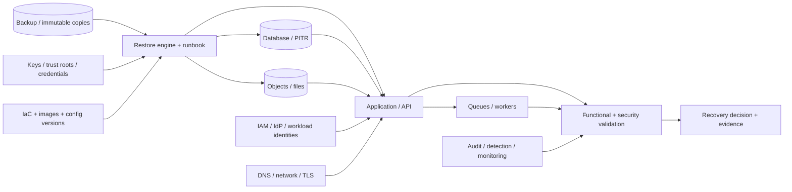
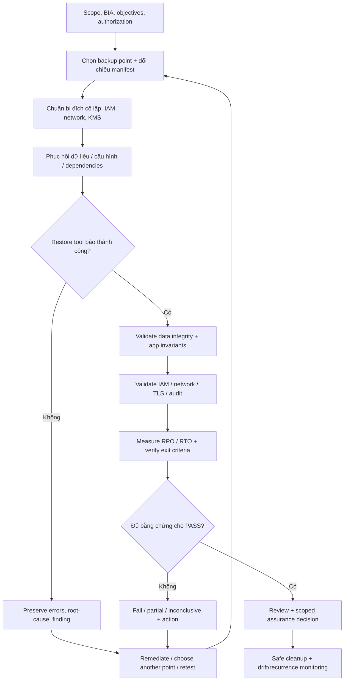
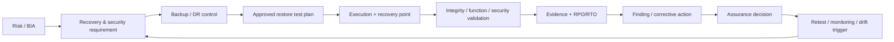

# Restore test

Một nền tảng SaaS phục vụ nhiều tenant chạy trên cloud có backup database mỗi giờ, bật versioning cho object storage và lưu bản sao ở vùng khác. Dashboard liên tục hiển thị “backup succeeded”. Đến một buổi diễn tập, nhóm vận hành phải dựng lại hệ thống tại vùng dự phòng sau giả định mất vùng chính. Database khôi phục được nhưng ứng dụng không đọc được dữ liệu vì khóa KMS của vùng cũ không còn truy cập được; một service account ở vùng dự phòng thiếu quyền; queue replay làm một số email thông báo gửi trùng; và bản backup gần nhất chưa từng được kiểm tra dữ liệu của tenant nào thực sự có thể truy xuất. Kết quả là **có backup nhưng chưa chứng minh được khả năng phục hồi an toàn**.

**Restore test (kiểm thử khôi phục)** là hoạt động **thực hiện có kiểm soát việc khôi phục hệ thống, dữ liệu hoặc cấu hình từ các bản sao/phương tiện phục hồi đã xác định**, sau đó **xác minh tính đầy đủ, đúng đắn, khả dụng và bảo mật của trạng thái khôi phục**, đo các mục tiêu recovery và ghi bằng chứng cho một quyết định có phạm vi.

Trong chương **Disaster recovery** của module **SECURITY_SECURITY_ASSURANCE**, Restore test không chỉ nhằm khởi động lại server. Nó giúp xây dựng cách đánh giá có bằng chứng rằng hệ thống đáp ứng các mục tiêu bảo mật, từ rủi ro, yêu cầu và security controls đến kiểm thử, audit và xử lý findings. Chuỗi assurance là **business impact/risk → recovery requirements → backup/DR controls → restore procedure → controlled test → integrity/security verification → evidence → remediation/risk decision → re-test và monitoring**.

Bài học này giải thích cách thiết kế, thực hiện, đo lường và đánh giá Restore test cho ứng dụng, cơ sở dữ liệu, lưu trữ, cloud, Kubernetes và hệ thống SaaS đa tenant. Mọi tên hệ thống, timestamps, số liệu và lệnh đều là **ví dụ giả định**; không phải kết quả test của một môi trường thật.

## 1. Vì sao có backup không đồng nghĩa có thể restore?

Một hệ thống có thể tạo file backup thành công nhưng vẫn không khôi phục được dịch vụ vì:

- Bản sao bị hỏng, thiếu file/log cần thiết hoặc chưa bao giờ được đọc lại.
- Công cụ restore không tương thích với phiên bản database, schema hay runtime.
- Bản backup được mã hóa nhưng mất khóa giải mã, KMS permission hoặc recovery credential.
- Chỉ có dữ liệu mà thiếu IaC, cluster config, DNS, routing, IAM, certificates và secrets để chạy ứng dụng.
- Backup nằm trong cùng trust boundary với tài khoản bị chiếm quyền, dễ bị xóa/sửa cùng production.
- Dữ liệu giữa database, object storage, queue và cache không nhất quán tại recovery point.
- Một lần khôi phục đã chạy trong lab nhưng không có evidence về môi trường, phạm vi hoặc tính đúng của dữ liệu.
- Recovery phụ thuộc duy nhất vào một người, một công cụ hoặc một nhà cung cấp không còn sẵn sàng.
- Ứng dụng chạy được nhưng security controls ở môi trường mới không đáp ứng baseline.
- Bản sao chứa malware/persistence hoặc trạng thái sai đã tồn tại trước sự cố; restore sẽ đưa nguy cơ trở lại.

Do đó, **backup job status** chỉ là một tín hiệu về việc tạo bản sao, còn **Restore test** mới là phép kiểm chứng có thể sử dụng bản sao đó để phục hồi những năng lực đã cam kết.

### 1.1. Các khái niệm phải phân biệt

| Khái niệm | Ý nghĩa | Chưa chứng minh được |
| --- | --- | --- |
| **Backup** | Tạo bản sao dữ liệu/cấu hình phục vụ phục hồi | Bản sao có thể đọc, đủ dependencies hoặc an toàn |
| **Backup verification** | Kiểm tra manifest, hash, checksum hoặc định dạng bản sao | Ứng dụng chạy đúng sau restore |
| **Restore** | Đưa dữ liệu/trạng thái từ bản sao vào đích | Nghiệp vụ và bảo mật đã đáp ứng yêu cầu |
| **Restore test** | Thực hiện và xác minh recovery có kế hoạch trong môi trường được phép | Mọi kịch bản disaster đều thành công |
| **Failover test** | Chuyển traffic/workload sang hệ thống dự phòng | Backup lịch sử có thể khôi phục |
| **Disaster recovery exercise** | Diễn tập nhiều thành phần, con người và quy trình khi xảy ra thảm họa | Mọi control được đánh giá nếu bài tập chỉ có phạm vi hẹp |
| **Cyber recovery test** | Kiểm tra khả năng phục hồi từ compromise/ransomware và chọn điểm khôi phục đáng tin | Mọi dấu vết persistence đã được loại bỏ |
| **Business continuity test** | Xác nhận hoạt động kinh doanh thiết yếu tiếp tục hoặc phục hồi | Tất cả dữ liệu số đã được restore nguyên trạng |

Restore test có thể là một phần của DR exercise hoặc cyber recovery, nhưng không nên đánh đồng chúng. Ví dụ test restore một database trên staging khác với diễn tập **mất toàn bộ cloud account điều hành**.

### 1.2. Restore ở mức nào?

Có thể kiểm thử:
- **Object/file level:** một file, object version, certificate hoặc artifact.
- **Database level:** schema, dataset, instance, transaction log và point-in-time recovery.
- **Application/service level:** database + queue + worker + API + cấu hình.
- **Infrastructure/platform level:** cluster, IAM, network, storage, secrets và workloads.
- **Region/site level:** phục hồi ở vùng/địa điểm thay thế.
- **Business capability level:** luồng nghiệp vụ end-to-end, ví dụ tạo và tải tài liệu theo đúng tenant.
- **Clean/cyber recovery level:** phục hồi từ mốc trước compromise và kiểm tra lại tính tin cậy của hệ thống.

Một test thành công ở mức file **không** là bằng chứng đủ cho claim “khôi phục toàn bộ nền tảng trong thời gian cam kết”.

## 2. Xác định recovery objectives trước khi thiết kế test

Một Restore test chỉ có ý nghĩa khi biết **“thành công” được định nghĩa bằng gì**. Những mục tiêu này thường bắt nguồn từ Business Impact Analysis (BIA), phân loại dữ liệu/tài sản, threat model và yêu cầu của chủ sở hữu nghiệp vụ.

### 2.1. RPO — Recovery Point Objective

**RPO** là mức mất dữ liệu tối đa có thể chấp nhận được, thường biểu diễn như **khoảng thời gian** giữa mốc gián đoạn/sự cố và điểm khôi phục dữ liệu đã cam kết.

Ví dụ nghiệp vụ chấp nhận RPO **15 phút**. Nếu sự cố xảy ra lúc 14:00 UTC, điểm dữ liệu khôi phục có thể kiểm chứng đến 13:47 UTC thì khoảng cách là **13 phút**, đạt RPO trong **tình huống mẫu** này. Nhưng nếu file backup có timestamp 13:47 mà không chứng minh được những transaction đã commit đến thời điểm đó, chưa đủ để kết luận mức mất dữ liệu thực là 13 phút.

**Không suy từ thời gian kết thúc backup sang thời điểm dữ liệu nhất quán đã được ghi.** Với snapshot và database log, cần hiểu semantics của backup, transaction boundary, replication lag, log archive và điểm recoverable cụ thể.

### 2.2. RTO — Recovery Time Objective

**RTO** là khoảng thời gian mục tiêu để khôi phục dịch vụ hoặc năng lực nghiệp vụ sau gián đoạn theo định nghĩa và thỏa thuận.

Ví dụ RTO **60 phút**. Nếu gián đoạn bắt đầu 14:00 và đến 14:55 UTC dịch vụ phục hồi **đầy đủ các điều kiện bắt buộc**, thời gian đo là **55 phút** và đạt mục tiêu minh họa. Nhưng nếu chỉ API health check xanh lúc 14:40, còn token validation, ghi dữ liệu và security logging chưa hoạt động đến 15:10, thời gian khôi phục **an toàn** không nên bị báo là 40 phút.

Cần ghi rõ **điểm bắt đầu** và **điểm kết thúc** đo RTO trong plan, đồng nhất với cam kết nghiệp vụ. Một số đội đo từ lúc incident được tuyên bố; nếu quy định không xét độ trễ phát hiện thì báo cáo phải nêu giới hạn đó thay vì ngầm coi toàn bộ thời gian gián đoạn đã được đo.

### 2.3. RPO/RTO không phải phép bảo đảm của backup frequency

| Cấu hình hoặc kết quả | Kết luận có thể đưa ra | Không nên kết luận |
| --- | --- | --- |
| Backup mỗi 15 phút | Hệ thống cố gắng tạo recovery points thường xuyên | RPO chắc chắn 15 phút |
| Snapshot thành công | Tạo bản sao theo cơ chế snapshot | Dữ liệu đa hệ thống nhất quán |
| Restore database mất 10 phút | Database phục hồi theo thử nghiệm đó | RTO nghiệp vụ toàn hệ thống là 10 phút |
| DR region chạy được health check | Một phần service sẵn sàng | Nghiệp vụ, IAM, audit, privacy đều đúng |
| Có immutable backup | Có thể tăng khả năng chống xóa/sửa | Backup chắc chắn sạch trước compromise |
| Test ở staging PASS | Control hoạt động trong phạm vi staging đã thử | Production và DR đạt toàn bộ |

### 2.4. Các mục tiêu khác cần bổ sung

Tùy rủi ro, cần định nghĩa:

- **Data integrity:** dữ liệu khôi phục phải nhất quán, không bị sửa ngoài ý muốn.
- **Confidentiality:** không đưa dữ liệu nhạy cảm tới môi trường/quyền trái quy định.
- **Authentication/authorization:** principals, roles, tenant isolation và secrets được kiểm chứng.
- **Observability:** audit events, logs, metrics và alerts hoạt động sau restore.
- **Functional correctness:** các giao dịch nghiệp vụ trọng yếu chạy được.
- **Recoverability of dependencies:** KMS, IdP, DNS, messaging, storage, APIs.
- **Incident-safe recovery:** không khôi phục persistence, secret hoặc đường tấn công chưa xử lý.
- **Operability:** runbook và quyền người trực đủ để thực hiện mà không dựa vào một cá nhân.
- **Evidence quality:** có thể kiểm tra lại phạm vi, timestamps, artifact/config và kết quả.

## 3. Chọn phạm vi và các kịch bản Restore test

Không có một bài test “restore toàn bộ” nào đại diện mọi nguy cơ. Nên xây dựng danh mục theo **failure scenarios** và mức quan trọng.

### 3.1. Ma trận kịch bản minh họa

| Scenario ID | Giả định sự cố | Đối tượng restore | Tiêu chí cần quan sát |
| --- | --- | --- | --- |
| `DR-T01` | Xóa nhầm một object | Object version cụ thể | Nội dung và metadata đúng, quyền không rộng hơn |
| `DR-T02` | Lỗi thao tác trên database | PITR đến mốc trước lỗi | Transaction consistency và RPO |
| `DR-T03` | Hỏng database instance | Restore instance + schema + roles | Application flow hoạt động |
| `DR-T04` | Mất node/cluster | Rebuild platform + persistent data | Deploy, network, IAM và runtime controls |
| `DR-T05` | Mất primary region | Cross-region recovery | RTO/RPO, DNS, KMS, traffic cutover |
| `DR-T06` | Bị xóa backup chính | Sử dụng immutable/offsite copy | Independence và ability to decrypt |
| `DR-T07` | Compromise/ransomware | Clean recovery point và hardened environment | Không tái mang trạng thái compromise đã biết |
| `DR-T08` | KMS/key permission lỗi | Khôi phục quyền/khóa trong phạm vi được phép | Backup giải mã được, audit đầy đủ |
| `DR-T09` | Queue có pending jobs | Restore/reconcile messaging state | Không duplicate side effects |
| `DR-T10` | Tenant yêu cầu phục hồi một phần | Phục hồi có giới hạn theo tenant | Không ảnh hưởng tenant khác |
| `DR-T11` | Bản backup gần nhất bị hỏng | Chọn điểm phục hồi thay thế | Nêu RPO thực tế và escalation |
| `DR-T12` | Backup job PASS nhưng object store thiếu bản sao | Restore dữ liệu liên quan | Gap về coverage được phát hiện |

Một test có thể bao phủ nhiều scenarios nếu plan mô tả rõ. Không gộp PASS của file restore với PASS của ransomware recovery khi chưa thử lựa chọn clean point và identity reset.

### 3.2. Xếp ưu tiên kịch bản

Các yếu tố:
1. Mức ảnh hưởng tới confidentiality, integrity, availability.
2. Critical business capabilities và data classification.
3. Single points of failure và blast radius.
4. Có khả năng cần khôi phục dưới tình huống compromise không?
5. Backup/DR architecture đã thay đổi nhiều chưa?
6. Mức tin cậy vào bằng chứng restore trước đây.
7. Thời gian hoàn thành và sự phụ thuộc giữa systems.
8. Nghĩa vụ hợp đồng, quy định, data residency được áp dụng.
9. Cost/risk của test và khả năng thiết lập môi trường cô lập.
10. Findings chưa đóng hoặc ngoại lệ đã gần hết hạn.

**Đừng chọn chỉ những kịch bản dễ pass.** Bài test phải phù hợp rủi ro thực tế và có mức tác động được kiểm soát.

## 4. Mô hình phụ thuộc của một hệ thống có thể restore

Khôi phục ứng dụng không chỉ là khôi phục dữ liệu. Có thể thiếu một dependency khiến service không đạt trạng thái an toàn.



### 4.1. Dependency inventory

| Phụ thuộc | Bằng chứng phải có | Failure mode điển hình |
| --- | --- | --- |
| Backup repository | Inventory, location, retention, access, checksum/manifest | Snapshot mất hoặc incomplete |
| Database logs | PITR range, continuity, version compatibility | Thiếu WAL/binlog/transaction logs |
| KMS/keys | Key availability, access, rotation/recovery plan | Không thể decrypt backup |
| Secrets | Phương án cấp lại/khôi phục có kiểm soát | Dùng token cũ bị lộ |
| Images/artifacts | Digest, registry/access, provenance | Không dựng đúng version ứng dụng |
| IaC / configuration | Commit và module/environment inventory | Drift, thiếu service settings |
| IAM / RBAC | Restore identities, least privilege, grants | Restored workload không chạy hoặc quá quyền |
| Network / DNS / TLS | Routes, SG, cert trust, endpoint, failover | Cổng mở rộng hay không thể kết nối |
| Storage / object refs | Version IDs, encryption metadata, lifecycle | DB trỏ tới object không tồn tại |
| Message queue | Offset, dedup, idempotency policy, DLQ | Gửi giao dịch/notification trùng |
| Observability | Audit source, sink, clock, alert routing | Khôi phục nhưng không có khả năng điều tra |
| Vendor dependencies | Hợp đồng, export, API, availability | Service phụ thuộc chưa sẵn sàng |
| Human authority | Role, emergency access, approval, on-call | Không ai có thể thực hiện restore |

**Mọi dependency bắt buộc phải có owner, recovery strategy và tiêu chí xác minh.** Nếu DR architecture dựa trên nhà cung cấp, cần biết phần nào provider đảm nhiệm và phần nào khách hàng vẫn phải cấu hình/kiểm thử.

### 4.2. Dependency ordering

Không phải lúc nào cũng khôi phục database trước ứng dụng. Có thể phải chuẩn bị network, service identities, KMS và database engine mới có thể đọc backup. Sau đó mới phục hồi dữ liệu, deploy app, reconcile queues, bật traffic và kiểm tra security controls. Quy trình cần được mô tả theo kiến trúc cụ thể, không áp một thứ tự cứng nhắc cho mọi dịch vụ.

## 5. Thiết kế môi trường kiểm thử cô lập

Restore test có thể **tạo rủi ro mới** nếu dùng dữ liệu production, credential hoặc route không được kiểm soát.

### 5.1. Nguyên tắc cô lập

- Dùng account/project/cluster/test namespace hoặc mạng phục hồi riêng khi có thể.
- Không ghi đè production database/bucket; mặc định **restore sang đích mới**.
- Tách DNS hostname và routing của môi trường thử; không để test vô tình nhận production traffic.
- Chặn outbound không cần thiết, đặc biệt email, payment, webhook và integration bên thứ ba.
- Tắt hoặc mock các side effects như thanh toán, gửi thông báo, lập hóa đơn.
- Dùng fake test identities và secret thay thế; không kích hoạt production tokens trên môi trường test.
- Giới hạn IAM, KMS grants và quyền đối với data sources/bản backup theo kế hoạch.
- Kiểm soát quyền truy cập dữ liệu nhạy cảm: masking/tokenization hoặc cách thử tương đương được chấp thuận.
- Log hoạt động của người chạy test và việc truy cập kho bản sao.
- Định nghĩa cleanup, retention và chứng minh xóa test copies sau khi hết nhu cầu.
- Cân nhắc chi phí tài nguyên, quota và blast radius của stress/restore drills.

### 5.2. “Đưa production snapshot sang staging” không tự an toàn

Một snapshot có thể chứa dữ liệu khách hàng, session tokens, API keys, PII hoặc dữ liệu regulated. Chỉ thay tên môi trường không làm dữ liệu trở thành test data. Cần data owner/privacy review và áp các biện pháp bảo vệ hoặc chọn phương pháp **synthetic recovery canary / controlled masked subset** phù hợp.

Đối với backup được mã hóa, việc cấp quyền giải mã cho môi trường DR test cũng là một quyết định an ninh cần review và audit.

### 5.3. Runbook nên có kill switch

Nếu test bất ngờ tạo email thật, kết nối vendor hoặc đẩy dữ liệu ra đích không phù hợp, nhóm cần có **stop conditions**, người ra quyết định, cách cô lập và cleanup. Không tự chạy diễn tập phá hoại trên production ngoài quyền phê duyệt.

## 6. Preflight trước một Restore test

Trước khi bắt đầu, nhóm nên xác nhận:

1. **Authorization:** ai phê duyệt, môi trường, khung giờ, phạm vi dữ liệu và mức độ tác động.
2. **Scenario:** kịch bản thất bại, nguồn backup và mục đích test.
3. **RPO/RTO:** mục tiêu, điểm bắt đầu/kết thúc và cách đo.
4. **Recovery point:** recovery timestamp, backup ID, object/database versions, log chain.
5. **Source integrity:** manifest/checksum, trạng thái bản sao và chain-of-custody phù hợp.
6. **Destination readiness:** network isolation, capacity, storage, compute, quota, IAM.
7. **Keys and secrets:** quyền giải mã được cấp theo scope, phương án key unavailable.
8. **Runbook and owners:** từng bước có người chịu trách nhiệm, backup operator, escalation.
9. **Expected invariants:** dữ liệu, quyền và nghiệp vụ nào phải đúng.
10. **Evidence plan:** timestamps, metrics, event refs và artifact/config cần ghi.
11. **Monitoring:** kiểm tra log collector, audit, alerts và test report không làm lộ dữ liệu.
12. **Safety:** suppression side effects, cleanup, stop conditions, vendor coordination.
13. **Baseline:** xác nhận tình trạng của test destination trước khôi phục.
14. **Failure handling:** nếu restore lỗi, báo trạng thái nào và cách ghi dữ liệu để điều tra.
15. **Exit criteria:** điều kiện nào để declare success, degraded success hoặc failure.

### 6.1. Recovery test ID và tính truy vết

Một đợt test nên có ID bất biến như `DR-TEST-2026-EXAMPLE-01`, liên kết:
- backup recovery point ID;
- nguồn data/system và đích restore;
- environment/region và account;
- release/config/IaC version;
- checklist/verification plan version;
- operator, approver và verifier;
- logs/metrics/evidence artifacts;
- findings và retest results.

Không lưu full secret hoặc customer data trong tracker chỉ để người khác có thể “tái chạy”.

## 7. Kế hoạch Restore test có cấu trúc

Ví dụ YAML **chỉ là mẫu học thuật**, không phải cấu hình của cloud provider hoặc một tool restore thực.

```yaml
restore_test_plan:
  id: "DR-TEST-EXAMPLE-01"
  service: "SECURITY_SECURITY_ASSURANCE"
  scenario: "Primary-region unavailable"
  version: "1.0"
  scope:
    source_environment: "production"
    destination_environment: "isolated-dr-test"
    source_region: "<primary-region>"
    destination_region: "<approved-dr-region>"
    components:
      - metadata-database
      - document-object-storage
      - application-api
      - export-queue-and-worker
      - security-audit
    excluded: ["<declared-untested-dependency>"]
  approvals:
    change_id: "<approved-change-record>"
    authorized_operator: "<operator-role>"
    data_owner: "<authorized-data-owner>"
    risk_owner: "<risk-owner>"
  objectives:
    rpo_minutes: 15
    rto_minutes: 60
    measurement_origin: "simulated-outage-start"
    recovery_complete_when:
      - "data integrity invariants pass"
      - "critical business paths pass"
      - "required security controls pass"
      - "audit and detection operational"
  recovery_point:
    backup_manifest_ref: "<protected-backup-manifest>"
    consistency_point_utc: "<UTC-timestamp>"
    log_chain_ref: "<pitr-logs-if-applicable>"
  isolation:
    network_profile_ref: "<approved-network-policy>"
    outbound_side_effects: "blocked-or-mocked"
    credentials: "test-scoped-identities"
    sensitive_data_handling_ref: "<privacy-approved-method>"
  evidence:
    timestamps: "UTC"
    output_store: "<restricted-evidence-vault>"
    use_redacted_references: true
  safety:
    stop_conditions:
      - "unexpected-production-traffic"
      - "sensitive-data-leak"
      - "unauthorized-resource-modification"
    rollback_and_cleanup_ref: "<approved-procedure>"
  validation:
    functional_test_suite: "<business-invariants>"
    data_integrity_suite: "<data-consistency-checks>"
    security_test_suite: "<iam-network-tenant-isolation>"
    logging_canary_ref: "<security-logging-test>"
  decision:
    pass_policy_ref: "<approved-recovery-gate>"
    owner: "<authorized-recovery-reviewer>"
```

**Mục tiêu 15/60 phút trong ví dụ không phải khuyến nghị chung.** Các mục tiêu phải được BIA/risk owner phê duyệt. Một test có thể có RPO/RTO khác nhau theo từng service hoặc critical business capability.

## 8. Các bước thực hiện Restore test end-to-end



### Bước 1 — Xác nhận preconditions và ghi mốc thời gian

Chụp snapshot trạng thái test environment, source backup manifest và policy version. Đánh dấu các mốc:
- simulated outage/incident time;
- approval/decision time;
- restore initiated;
- data restore completed;
- service technically started;
- functional checks completed;
- security checks completed;
- business recovery accepted.

Phân biệt **operation finished** với **service safely recovered** để tránh báo RTO thấp giả tạo.

### Bước 2 — Chọn recovery point đáng tin

Cần biết recovery point tương ứng bản snapshot, transaction log hoặc object versions nào và tính nhất quán ra sao. Với ransomware/compromise scenario, chọn snapshot “mới nhất” có thể tái tạo malware hoặc quyền xấu. Có thể phải chọn **last known good** sau khi điều tra timeline, rồi cân nhắc RPO và bảo toàn evidence.

### Bước 3 — Chuẩn bị target an toàn

Tạo môi trường cô lập với quyền tối thiểu, network policy và tài nguyên cần thiết. Khởi tạo logging, audit và theo dõi test. Không copy production DNS/secret/IAM một cách mù quáng.

### Bước 4 — Phục hồi dependencies và dữ liệu

Thực hiện runbook theo nền tảng: key/identity, storage, database engine, logs, config, application images, messaging và ingress. Mọi command/change phải có log/audit phù hợp. Nếu một bước failed, dừng hoặc chọn failure handling đã phê duyệt, không dùng “force” ngoài plan.

### Bước 5 — Kiểm tra kỹ thuật dữ liệu

Kiểm tra checksum/integrity, schema, transaction boundaries, object references, constraints, encryption/decryption và những trường hợp dữ liệu quan trọng. Cần xác định khôi phục toàn phần hay chỉ subset được test.

### Bước 6 — Kiểm tra nghiệp vụ end-to-end

Dùng test accounts và test resources:
- user thuộc tenant A tạo và tải tài liệu A thành công;
- user B bị từ chối truy cập tài liệu A nếu không được chia sẻ;
- export job hợp lệ tạo output đúng;
- idempotent retries không nhân đôi side effects;
- queue pending jobs được reconcile;
- API/worker/database/object storage hoạt động liên kết đúng.

### Bước 7 — Kiểm tra security posture

Đối chiếu IAM, network, TLS, KMS, secret lifecycle, logging, data isolation và vulnerability posture với approved recovery baseline. Một môi trường DR khởi động được nhưng bucket public hoặc audit logs tắt **chưa đạt security recovery**.

### Bước 8 — Đo mục tiêu và ghi findings

Tính RPO bằng **validated consistency point** và RTO theo mốc recovery acceptance được định nghĩa. Ghi rõ độ không chắc chắn, dependencies bị bỏ qua, dữ liệu chưa kiểm chứng và những exception có hạn.

### Bước 9 — Kết luận, cleanup và follow-up

Verifier đọc evidence, quyết định trạng thái, giao corrective actions và retest. Cuối cùng dọn bản sao test/secret/temporary permissions theo policy, xác nhận không còn traffic ra ngoài và cập nhật runbook.

## 9. Đo RPO/RTO chính xác bằng timeline

Giả định test khôi phục service A với RPO mục tiêu 15 phút và RTO mục tiêu 60 phút.

| Mốc UTC | Ý nghĩa | Nguồn chứng cứ |
| --- | --- | --- |
| 14:00 | Mất primary giả lập, bắt đầu đo theo plan | Exercise coordinator record |
| 14:03 | Incident declared, người trực nhận | On-call log |
| 14:08 | Operator được cấp quyền phục hồi | IAM audit/change record |
| 14:14 | Restore job bắt đầu | Restore API/job ID |
| 14:29 | Database restore completed | Engine logs, không phải end-state |
| 14:36 | API và worker khởi động | Deployment state |
| 14:43 | Kiểm tra data integrity và object refs đạt | Verification run |
| 14:48 | Positive/negative business/security tests đạt | Test run + audit |
| 14:55 | Reviewer xác nhận năng lực phục hồi theo exit criteria | Decision record |
| 13:47 | Dữ liệu nhất quán mới nhất khôi phục được | Validated recovery point |

RPO đo: 14:00 trừ 13:47 = **13 phút**; RTO theo plan: 14:55 trừ 14:00 = **55 phút**. Trên những điều kiện đã kiểm tra, kết quả minh họa đạt hai mục tiêu. Nhưng nếu không biết dữ liệu committed sau 13:47 được ghi ở đâu, chỉ được kết luận theo **điểm nhất quán đã kiểm chứng**, không suy ra mọi loại dữ liệu đều có đúng RPO.

### 9.1. Đo per-component và end-to-end

| Thành phần | Recovery point | Restore completion | Verification status |
| --- | --- | --- | --- |
| DB metadata | 13:47 | 14:29 | Logical checks pass |
| Object storage | 13:44 | 14:31 | Referenced objects available trong test scope |
| Queue state | 13:50 | 14:37 | Pending/retry reconciliation pass |
| API/worker | Gắn artifact digest | 14:36 | Security + functional tests pass |
| Audit/detection | Source/stream state | 14:48 | Canary observable |

Bảng này cho thấy **recovery points không nhất thiết đồng thời**. Nếu metadata DB nói object tạo lúc 13:46 nhưng object store chỉ có nội dung đến 13:44, khôi phục độc lập từng thành phần có thể tạo dữ liệu không nhất quán. Phải có **application-consistent recovery plan** và kiểm thử đối chiếu liên hệ giữa các hệ thống.

### 9.2. Không lấy giá trị trung bình che thất bại

Nếu 9 trong 10 services đạt RTO nhưng service chứa chức năng thanh toán trọng yếu không đạt, không thể dùng “90% success” để chứng minh business capability hoàn chỉnh. Đánh giá theo **critical service/dependency**, không chỉ tỷ lệ jobs.

## 10. Database restore: consistency và point-in-time recovery

Database thường là thành phần khó do yêu cầu transaction consistency, schema/version compatibility và log continuity.

### 10.1. Physical backup, logical backup và snapshot

| Loại | Đặc điểm thường gặp | Điều cần thử |
| --- | --- | --- |
| **Physical/base backup** | Sao lưu file/trạng thái DB engine theo cơ chế hỗ trợ | Recovery tool, engine version, log/manifest, recovery startup |
| **Logical dump** | Xuất schema và dữ liệu theo định dạng logic | Import, roles/extensions, constraints, compatibility |
| **Storage snapshot** | Bản chụp block/volume/object tại thời điểm | Crash/application consistency và snapshot coordination |
| **Incremental/differential** | Chỉ lưu phần thay đổi so với mốc | Đủ chain/metadata, không thiếu base |
| **PITR** | Dùng base/snapshot cộng transaction logs đến mốc | Log continuity, target time, transaction boundaries |
| **Managed backup service** | Provider quản lý một phần thao tác | Cấu hình, eligibility, IAM/KMS, restored instance và data tests |

Không nên nhầm **snapshot completion timestamp** với một logical consistent transaction point có thể dùng an toàn, đặc biệt khi một ứng dụng lưu dữ liệu ở nhiều dịch vụ.

### 10.2. PostgreSQL: ví dụ minh họa, không phải lệnh production

Với PostgreSQL, cơ chế **logical dump** có thể tạo định dạng custom để phục hồi bằng `pg_restore`. Những lệnh dưới đây chỉ mang tính minh họa trên **test database do tổ chức kiểm soát**; bài học này không thực thi chúng.

```bash
# Trên máy thử được phép: liệt kê nội dung archive custom/directory/tar
# được pg_restore hỗ trợ. Không ghi password vào command line hoặc log.
pg_restore --list /approved-test-backups/documents.dump

# Ví dụ restore một archive phù hợp vào database TEST đã chuẩn bị,
# KHÔNG dùng production connection string.
pg_restore \
  --dbname=documents_restore_test \
  --no-owner \
  --no-privileges \
  --verbose \
  /approved-test-backups/documents.dump

# Chỉ thực hiện sau khi đã có chính sách database user, extension,
# schema compatibility, migration và kiểm tra kết quả được phê duyệt.
```

**Giới hạn quan trọng:**
- `pg_restore` phù hợp với những format do `pg_dump` hỗ trợ cho `pg_restore`, **không dùng nguyên lệnh này cho plain SQL dump**; plain SQL thường được nạp bằng công cụ SQL thích hợp.
- `--no-owner` và `--no-privileges` làm thay đổi việc khôi phục ownership/grants; cần **thiết lập và xác minh roles/permissions của môi trường test**, không xem bản restore này là bằng chứng kiểm tra đầy đủ IAM/DB grants.
- Tệp dump có thể chứa dữ liệu nhạy cảm; không phát tán hoặc dùng trên lab chưa được phê duyệt.
- Logical restore không tự bảo đảm tương đương với PITR tới một mốc cụ thể.
- Nếu backup là **physical backup** từ cơ chế như `pg_basebackup`, phương pháp restore, transaction log và cách kiểm tra phải theo đúng loại backup đó; không sử dụng `pg_restore` như thể một công cụ chung cho tất cả backup.
- Thành công của command không thay thế kiểm tra schema, tenant data, object reference và tính đúng nghiệp vụ.

### 10.3. PITR cần kiểm tra chuỗi recovery log

Khi có base backup và WAL/transaction logs, test cần:
- Chọn base phù hợp và đủ log segments đến target.
- Xác minh không thiếu đoạn log, không bị retention xóa.
- Kiểm tra quyền đọc backup/log và keys.
- Xác nhận recovery target timestamp/transaction được hỗ trợ.
- Phân biệt transaction committed và chưa committed theo engine.
- Kiểm tra schema migrations và compatibility với app version.
- Đối chiếu records tại mốc đã biết bằng trusted test transactions.
- Ghi recovery point đạt được và phần dữ liệu sau mốc có thể mất.

Không tuyên bố PITR hỗ trợ mọi mốc chỉ vì provider có tên tính năng đó; cần xem **retention window, log continuity và restore test**.

### 10.4. Integrity verification nhiều mức

1. **Byte/integrity level:** checksum/manifest khớp khi có cơ chế.
2. **Engine level:** database mở được, metadata/system catalog đúng, không báo corruption đã biết.
3. **Schema level:** migration version, tables, constraints, indexes và extensions.
4. **Logical level:** quan hệ dữ liệu, foreign keys và business invariants.
5. **Application level:** các API nghiệp vụ đọc/ghi đúng.
6. **Security level:** roles, row-level security (nếu dùng), tenant authorization, audit và encryption.
7. **Historical point level:** recovery có thật sự dừng ở mốc yêu cầu, không replay thêm transaction ngoài kế hoạch?

Một checksum hợp lệ **không chứng minh nội dung nghiệp vụ đã đúng ngay từ lúc backup**. Dữ liệu sai đã được ghi vào backup vẫn có thể vượt qua mọi kiểm tra hash.

## 11. Object storage, files và versioned objects

Một ứng dụng lưu metadata vào database và nội dung file ở object storage cần phục hồi **cả nội dung lẫn liên kết**.

### 11.1. Những thuộc tính thường cần kiểm tra

- Object IDs/keys và versions cần thiết còn tồn tại.
- Metadata: content type, size, retention tags, custom attributes khi có.
- Checksum/hashes theo cơ chế đáng tin, không chỉ nhìn ETag rồi tự gọi nó là checksum nội dung trong mọi trường hợp.
- Object encryption/KMS permissions sau restore.
- Bucket/container policy, public-access restrictions và access logging.
- Lifecycle/retention/deletion/immutability policies không bị nới rộng.
- Event notifications không phát side effects bất ngờ khi tạo lại objects.
- Database references trỏ đến đúng object versions và tenant.
- Signed download links cũ có còn hiệu lực ngoài policy không?
- Backup/replication của deleted markers và previous versions có semantics phù hợp.

### 11.2. Versioning không tự là immutable backup

Bật versioning có thể giúp khôi phục phiên bản cũ, nhưng còn phụ thuộc quyền xóa version, retention/lock, replication, access, encryption và compromised-account blast radius. Nếu threat model gồm ransomware hoặc admin compromise, cần đánh giá **separation of duties, cross-account/offsite/immutable copy theo khả năng nền tảng**.

### 11.3. Partial restore theo tenant

Một tenant có thể yêu cầu phục hồi một subset dữ liệu. Cần thiết kế:
- tenant/resource ownership và scope được xác minh;
- những bảng/index/object liên quan;
- mốc nhất quán giữa metadata và files;
- tác động tới các tenant khác;
- quyền truy cập và audit của dữ liệu được phục hồi;
- xử lý object version và conflict với dữ liệu hiện tại;
- cách hoàn tác nếu merge restore lỗi.

**Không mặc định copy mọi dữ liệu về chung production rồi lọc sau.** Phục hồi từng phần đặc biệt dễ tạo rò rỉ cross-tenant nếu object IDs và authorization mappings không được kiểm tra.

## 12. Queue, event streams và workflow bất đồng bộ

Một điểm khôi phục an toàn phải xét các tác vụ pending/in-flight, idempotency và external side effects.

### 12.1. Rủi ro phổ biến

- Restore DB về 13:47 trong khi queue giữ message đã phát lúc 13:55.
- Worker replay một job đã tạo output hoặc gửi email trước sự cố.
- Consumer offset được rollback nhưng external payment đã hoàn tất.
- Dead-letter queue chứa jobs chưa được xử lý.
- Message schema mới không tương thích với worker image cũ.
- Queue metadata còn nhưng payload/object tham chiếu đã bị mất.
- Credential/authorization context trong job hết hạn hoặc bị thu hồi.

### 12.2. Những câu hỏi cần trả lời

1. Queue là **source of truth** hay chỉ là bản sao của job state trong DB?
2. Producer/consumer tạo side effect nào có thể không rollback?
3. Tái gửi có idempotency keys không, và keys được lưu ở đâu?
4. Nếu restore lùi thời gian, events sau mốc có được đối chiếu không?
5. Jobs chứa quyền/tenant context được xác minh lại khi xử lý không?
6. Khi test, external integrations có bị mock/sandbox để tránh gửi thật?
7. Có monitoring cho retries, DLQ, missing output và duplicate processing?
8. Có manual reconciliation/approval cho các giao dịch không thể replay an toàn?

### 12.3. Không hứa “exactly once” chỉ vì queue báo đã nhận

Nhiều messaging systems có at-least-once semantics, và sự kiện gửi lại có thể tạo double processing nếu không có idempotent design. Một test nên chủ động replay test job đã xử lý để kiểm chứng **không có duplicate business side effects ngoài giới hạn**.

### 12.4. Ví dụ bất biến nghiệp vụ

| Flow | Positive test | Negative / failure test |
| --- | --- | --- |
| Export tài liệu | Job hợp lệ tạo đúng một output | Retry không tạo output trái quyền hoặc trùng |
| Notification | Một thông báo được ghi nhận đúng | Replay không gửi email thật khi sandbox test |
| Billing | Trạng thái invoice tương ứng ledger | Duplicate event không tạo khoản thu thứ hai |
| Document upload | Object và metadata liên kết đúng | Missing object được phát hiện, không trả dữ liệu tenant khác |
| Policy update | Quyền mới được áp đúng | Restore không hồi sinh token/role đã thu hồi ngoài policy |

## 13. Kiểm thử security posture sau restore

Phần security là đặc điểm quan trọng của **security assurance**. Nếu chỉ kiểm API health check, ta có thể khôi phục **tính sẵn sàng** nhưng làm suy yếu **tính bí mật và toàn vẹn**.

### 13.1. IAM và privileged access

Kiểm tra:
- Role/permission bindings của human, service và break-glass accounts.
- Quyền cloud/resource policy trên database, object storage, KMS.
- Kubernetes RBAC, service accounts và workload identity.
- Temporary permissions được cấp trong quá trình DR đã được thu hồi.
- Các identity bị vô hiệu hóa/compromised trước disaster không được khôi phục sai cách.
- Kênh audit cho privileged operations hoạt động.
- Positive access cho service hợp lệ và negative test cho identity không có quyền.

**Khôi phục file IAM policy cũ có thể vô tình phục hồi quyền đã bị thu hồi**; cần có nguồn sự thật đáng tin về trạng thái quyền mà tổ chức muốn sau recovery.

### 13.2. Network và routing

Kiểm tra:
- Database, admin APIs và secret stores không bị lộ public ngoài thiết kế.
- DNS failover, ingress/egress, proxy/NAT và private endpoints.
- Security groups/ACL/NetworkPolicy chọn đúng tài nguyên trong DR.
- Dual-stack IPv4/IPv6 nếu môi trường hỗ trợ.
- WAF/API gateway không bị bypass qua origin public.
- Kết nối cần thiết hoạt động và đường không được phép bị chặn.
- Recovery/test environment không có đường ra ngoài làm rò dữ liệu.

### 13.3. Encryption, secrets và certificates

Cần bảo đảm:
- Backup được decrypt hợp lệ bằng key đúng trong phạm vi.
- Chứng chỉ/TLS trust, mTLS và KMS grants tương thích vùng mới.
- Key/secret bị compromise được thay/thu hồi theo incident response.
- Không hardcode secrets vào runbook hoặc test results.
- Rotation/expiration không làm dịch vụ ngừng ngay sau restore.
- Audit key access và secret read đã hoạt động.

### 13.4. Logging và detection

- Cloud/cluster/application audit event vẫn được tạo.
- Event canary đến được sink/SIEM/archive trong phạm vi DR.
- Incident responders có thể truy vấn đúng dữ liệu.
- Log không chứa customer data hoặc credential không cần thiết.
- Alert routing hoạt động khi workload chạy ở DR region.
- Detection/source health báo thiếu dữ liệu thay vì im lặng.

### 13.5. Vulnerabilities và image provenance

Khôi phục image đã được sao lưu có thể tái đưa phiên bản OS/library có CVE hoặc image chưa được kiểm chứng. Cần đối chiếu artifact digest, patch baseline, dependency/OS version, security scans và policy ngoại lệ trong phạm vi.

**Recovery không nhất thiết là deploy nguyên trạng mọi cấu hình cũ.** Khi incident gồm compromise hoặc lỗ hổng đã biết, cần chọn recovery state an toàn theo runbook và xác minh lại các controls.

## 14. Cyber recovery: restore từ một điểm đáng tin

Khôi phục sau ransomware hoặc cloud-account compromise khó hơn lỗi hạ tầng thuần túy: backups, IAM, runners, audit logs và quản trị kho backup **cũng có thể nằm trong phạm vi bị xâm phạm**.

### 14.1. “Last backup” khác “last known good”

Bản backup mới nhất có thể đã chứa:
- malware/persistence trong image, startup scripts hoặc database fields;
- privileged identity/ACL không còn hợp lệ;
- encrypted/corrupted files do ransomware;
- automation hoặc CI/CD cấu hình có chủ đích xấu;
- dữ liệu bị sửa sai từ trước khi bị phát hiện.

Cần lập timeline compromise với **mức tin cậy** rõ ràng, đánh giá candidate recovery points và khả năng đối chiếu với nguồn độc lập.

### 14.2. Mô hình clean recovery có kiểm soát

1. **Preserve evidence:** bảo toàn bản gốc và logs cần cho điều tra; không phá vật chứng vì muốn restore nhanh.
2. **Assess trust boundary:** control plane, KMS, IdP, backup repo hoặc build pipeline nào có thể bị ảnh hưởng?
3. **Select candidate point:** chọn mốc dựa trên timeline, malware/IOC evidence và business RPO trade-off.
4. **Build clean environment:** dùng known-good infrastructure images/config, identities và kiểm soát riêng.
5. **Restore only needed data:** kiểm tra trước khi đưa lại executable/config/script.
6. **Rotate/revoke compromised credentials:** theo response procedure có thẩm quyền.
7. **Verify containment and hardening:** không để đường tấn công cũ mở.
8. **Validate business data and security:** positive/negative checks, logging, backup health.
9. **Monitor for recurrence:** detect post-restore compromise indicators, drift và anomalies.
10. **Document residual risk:** điểm chưa thể kiểm chứng, thời gian và hạn chế.

Không có một scan antivirus hoặc checksum đơn lẻ nào chứng minh toàn bộ bản backup “sạch”. Cyber recovery cần nhiều nguồn evidence, incident scope và các quyết định rủi ro.

### 14.3. Immutable/offsite/air-gapped: hiểu đúng giới hạn

- **Immutable backup** có thể giảm khả năng xóa/sửa trong khoảng retention được bảo vệ, nhưng key/admin risk và mô hình provider vẫn cần xem.
- **Cross-region** có thể chịu ảnh hưởng bởi cùng IAM hoặc compromise của organization.
- **Cross-account** có thể giảm blast radius nếu thiết kế quyền tách biệt thực sự.
- **Air-gapped/offline** tăng khả năng độc lập nhưng có yêu cầu vận hành, cập nhật và thử đọc dữ liệu.
- **Encryption** bảo vệ tính bí mật nhưng không tự chứng minh data integrity, malware-free hoặc recoverability.

## 15. Runbook phục hồi và trách nhiệm thực hiện

### 15.1. Mỗi bước cần có điều kiện vào/ra

Một runbook đủ dùng nên nêu:
- Preconditions, approvals, identities và môi trường.
- Input backup IDs/manifests/key references.
- Command/tool theo phiên bản và cách xử lý lỗi.
- Expected output và cách verify.
- Người chịu trách nhiệm từng bước, escalations.
- Quota/capacity/network requirements.
- Side effects và stop conditions.
- Hành vi rollback/cleanup sau khi thử.
- Evidence capture có kiểm soát.
- Recovery completion/acceptance criteria.

### 15.2. Đừng lưu credential trong runbook

Không đưa password, API keys, token, private key vào tài liệu/CLI command line để “dễ làm”. Dùng cơ chế access tạm thời, secret manager, role assumption hoặc workflow được kiểm soát. Nếu user đang bị compromise, quy trình cấp lại quyền phải đánh giá trust trước khi khôi phục.

### 15.3. Test yếu tố con người

Có thể cho operator khác với tác giả runbook thực hiện trong môi trường được phép để phát hiện:
- Bước thiếu thông số hoặc điều kiện.
- Quyền access thực tế không phù hợp.
- Tài liệu phụ thuộc một người hoặc kênh liên lạc.
- Thiếu runbook nếu primary region/network không hoạt động.
- Chưa có thứ tự phụ thuộc hoặc escalation.
- Quy trình kiểm chứng security chưa có người chịu trách nhiệm.
- Áp lực thời gian khiến bỏ qua data integrity tests.

**Một runbook chỉ được đọc qua chưa chứng minh có thể thực thi khi disaster**.

### 15.4. Có thể tự động hóa nhưng phải kiểm soát

Automation giảm thao tác thủ công, nhưng một script restore sai target có thể ghi đè dữ liệu production. Cần:
- hard-coded guardrails hoặc destination allowlist được review;
- tách tài khoản/credentials test và production;
- require approval cho destructive steps;
- idempotency/rollback ở những nơi hỗ trợ;
- dry-run/plan phù hợp;
- structured logs;
- test automation version và integrity/provenance;
- stop conditions và post-run cleanup verification.

Không dùng `--force` hoặc disable security controls theo thói quen để test PASS.

## 16. Positive, negative và failure-path tests

Một Restore test muốn hỗ trợ assurance phải có kiểm thử **trạng thái được phép**, **trạng thái phải bị ngăn** và **điều kiện thiếu/hỏng**.

### 16.1. Ma trận security và nghiệp vụ

| Test ID | Kiểm tra | Kết quả mong đợi | Ý nghĩa |
| --- | --- | --- | --- |
| `RT-01` | User A tải test document thuộc A | ALLOW | Dữ liệu và app còn hoạt động |
| `RT-02` | User B tải document A không chia sẻ | DENY | Tenant isolation được giữ |
| `RT-03` | Worker đọc object được cấp quyền | ALLOW | IAM và object refs đúng |
| `RT-04` | Worker đọc bucket ngoài nhiệm vụ | DENY | Least privilege |
| `RT-05` | Internet truy cập DB private | DENY | Network baseline |
| `RT-06` | App đọc DB đúng credential | ALLOW | Dependency hoạt động |
| `RT-07` | Restore canary log đến archive | PRESENT | Auditability |
| `RT-08` | Identity không có quyền cố xóa backup | DENY | Backup protection |
| `RT-09` | Retry export test job đã xử lý | NO DUPLICATE | Idempotency |
| `RT-10` | So khớp DB object refs với storage | CONSISTENT | Cross-system integrity |
| `RT-11` | Client xác minh TLS hostname/cert | VALID | Channel security |
| `RT-12` | Operator phục hồi bằng runbook trong scope | SUCCESS OR DOCUMENTED FAILURE | Operability |
| `RT-13` | Restore với một backup bị hỏng trong lab | FAIL SAFELY + ALERT | Failure handling |
| `RT-14` | Backup được mã hóa nhưng key unavailable trong sandbox | FAIL + REPORT GAP | Key dependency |
| `RT-15` | Khôi phục region phụ | MEETS APPROVED EXIT CRITERIA | DR scope |
| `RT-16` | Test environment cố gửi webhook thật | BLOCKED | Isolation |

Đây là **test plan minh họa**. Không được thực hiện test phá hoại hay thử xóa backup ở production nếu chưa có ủy quyền. Negative tests nên dùng test identities và backup fixtures được thiết kế để không ảnh hưởng tài nguyên thực.

### 16.2. Phân biệt kết quả

| Status | Ý nghĩa |
| --- | --- |
| `PASS` | Tất cả acceptance criteria đã thử đạt trong scope |
| `FAIL` | Có điều kiện đã xác minh không đạt |
| `PARTIAL` | Một số mục tiêu đạt, một số chưa đạt |
| `INCONCLUSIVE` | Evidence/preconditions chưa đủ để kết luận |
| `NOT_RUN` | Chưa thực hiện phép thử |
| `BLOCKED` | Có điều kiện/an toàn/quyền làm test không thể tiếp tục |
| `EXCEPTION_APPROVED` | Risk owner chấp nhận thiếu control có hạn, **không** là PASS |

**Một bước command exit 0 không tự chuyển toàn bài Restore test sang PASS.**

### 16.3. Positive control giúp diễn giải negative test

Nếu user B không tải được object A, cần đảm bảo user A tải được object đó, API/DB/object store đang hoạt động và token B hợp lệ. Nếu mọi request đều timeout vì database down, không thể nói authorization đã từ chối đúng.

Tương tự, nếu test identity không thể xóa backup, phải biết identity đang xác thực đúng, endpoint sẵn sàng và policy là nguyên nhân từ chối — không dùng lỗi DNS như bằng chứng bảo vệ IAM.

## 17. Data integrity: hơn cả checksum

Một hash/checksum có thể chứng minh **bytes của một object khớp một manifest đáng tin**. Nó không chứng minh business transaction đúng hoặc mọi dữ liệu liên quan tồn tại.

### 17.1. Bốn lớp integrity

1. **Physical:** file/blocks có thể đọc, backup manifest hợp lệ, không có corruption đã biết.
2. **Database/logical:** tables/constraints/indexes, row counts, critical relations, schema version.
3. **Cross-system:** DB records ↔ objects ↔ events/queues ↔ derived data có tương quan.
4. **Business invariants:** các thuộc tính nghiệp vụ không bị phá: owner, balance, document version, authorization, job state.

Ví dụ:
- Một metadata record chỉ tham chiếu object version đang tồn tại.
- Một transaction đã commit trước recovery point được hiện diện theo engine semantics.
- Một job canceled không tạo output sau restore.
- Một document thuộc tenant A không xuất hiện trong danh sách kết quả của tenant B.
- Một invoice không bị tạo hai lần do event replay.

### 17.2. Data validation không cần đọc dữ liệu khách hàng trực tiếp

Ưu tiên synthetic canaries, counts có phân quyền, keyed checksums, reconciliation và approved queries theo data classification. Nếu phải xử lý dữ liệu production nhạy cảm để xác minh, cần quyền/phạm vi và bảo vệ tương ứng; **không xuất raw customer rows hoặc object content vào báo cáo test**.

### 17.3. Chọn dữ liệu test đại diện

Một vài records mới tạo có thể không đại diện:
- dữ liệu lớn và các object versions cũ;
- schema migrations lịch sử;
- Unicode/file encoding;
- expired/soft-deleted records;
- cross-tenant sharing hợp lệ;
- queue retry và failure states;
- encryption key rotations;
- secondary regions.

Thiết kế coverage theo risk và mô tả giới hạn. Không tự gọi “đã kiểm chứng toàn bộ dữ liệu” nếu chỉ lấy mẫu.

## 18. Recovery của cloud và Kubernetes platform

Một hệ thống containerized còn cần phục hồi **hạ tầng, policy, workload identity và vận hành**.

### 18.1. Các control cần xác minh

| Lớp | Điều cần phục hồi | Bài test cần thực hiện |
| --- | --- | --- |
| Cloud account/organization | Guardrails, IAM, audit và service policies | Privileged access negative test |
| Network | VPC/subnets/routes/SG/DNS/ingress | Allowed/denied connectivity |
| Kubernetes control plane | API config, RBAC/admission, CNI assumptions | Policy enforcement và audit |
| Nodes/runtime | Supported images, patching, resource/OS baseline | Pod runtime restrictions |
| Workloads | Images by digest, configs, service accounts | Service startup + integrity/provenance |
| Secrets/KMS | Trusted keys, secret delivery, certs | TLS/secret access/rotation |
| Data services | DB, storage, queues | Recover point + business invariants |
| Logging | Source/sinks, archives, alerts | End-to-end canary |
| Backup/DR | Policy, schedule, retention, next backup | Backup after restore, restore readiness |

### 18.2. YAML object tồn tại không phải control có hiệu lực

Kubernetes NetworkPolicy có thể đã được restore như object nhưng CNI ở cluster DR không enforcement; Pod Security policy có thể ở mode `warn` thay vì `enforce`; service account có thể trỏ tới cloud role sai. Cần **readback runtime** và positive/negative tests.

### 18.3. DR region có thể khác production

Khác biệt có thể nằm ở supported managed services, capacity quotas, key regions, identity federation, TLS certificate, outbound IP, data residency, availability zone topology hoặc node images. Không tự coi hai regions tương đương vì dùng chung một Terraform module.

## 19. Evidence và chain of custody trong Restore test

Một báo cáo thành công có giá trị khi người reviewer có thể **xác minh nó đề cập đúng nguồn backup, target, phiên bản, thời điểm và kết quả**.

### 19.1. Evidence cần có

- Approved test plan/runbook và revision.
- Incident/exercise scenario, scope, backup IDs/manifests.
- Timestamp nguồn, thời điểm thực hiện, timezone và người thao tác.
- Destination environment/account/region IDs.
- IAM role/credential metadata không nhạy cảm.
- Restore job records và error logs được redact.
- Database/object integrity reports.
- Functional positive/negative test outputs.
- Security baseline/effective config snapshots.
- Logging canary và alert verification.
- Recovery point chứng minh được, RPO/RTO calculations.
- Failures, deviations, unknowns và excluded resources.
- Risk acceptance/approvals nếu kết quả có điều kiện.
- Cleanup evidence về temporary resources/permissions/data.
- Reviewer sign-off, action register và retest link.

### 19.2. Ghi confidence và giới hạn

Một số recovery points chỉ được suy luận từ snapshot timestamps; source logs có thể không bao phủ mọi transaction; một số vendor APIs không cung cấp đầy đủ bằng chứng. Cần phân biệt:
- **VERIFIED:** có test/evidence đủ cho tiêu chí.
- **SUPPORTED WITH LIMITATIONS:** có evidence nhưng scope/độ chính xác bị hạn chế.
- **INFERRED:** suy từ chỉ báo nhưng chưa có behavior verification.
- **UNKNOWN:** thiếu nguồn hoặc không thể kiểm.
- **CONTRADICTORY:** hai evidence sources chưa thống nhất.

**Không ghi UNKNOWN thành PASS.** Một bài test có thể thành công về availability nhưng chưa chứng minh integrity hoặc confidentiality; báo cáo phải nêu riêng.

### 19.3. Evidence protection

Log restore đôi khi chứa đường dẫn object, usernames, connection strings hoặc tên tenant. Cần redaction, encryption, access controls, retention và tham chiếu tới kho evidence hạn chế. Không sao chép production backup vào chat/tài liệu mở chỉ để minh họa.

## 20. Mẫu Restore test result record

```yaml
restore_test_result:
  test_id: "DR-TEST-EXAMPLE-01"
  service: "SECURITY_SECURITY_ASSURANCE"
  performed_at: "<UTC-timestamp>"
  operator: "<authorized-operator>"
  reviewer: "<authorized-verifier>"
  test_plan_ref: "<approved-plan-version>"

  scope:
    source_environment: "production"
    recovery_environment: "isolated-dr-test"
    source_region: "<source-region>"
    destination_region: "<target-region>"
    components:
      - "metadata-db"
      - "object-storage"
      - "document-api"
      - "export-worker"
      - "audit-logging"
    exclusions: ["<explicitly-untested-component>"]

  recovery_point:
    source_backup_ids: ["<backup-id>"]
    manifest_and_integrity_ref: "<manifest-evidence>"
    selected_consistency_point: "<UTC-timestamp>"
    transaction_log_ref: "<if-applicable>"
    known_good_assessment_ref: "<cyber-recovery-if-applicable>"

  objectives:
    rpo_minutes: 15
    rto_minutes: 60
    timing_definition_ref: "<approved-sla-or-bia>"
    simulated_disruption_at: "<UTC-timestamp>"
    validated_recovery_point_at: "<UTC-timestamp>"
    recovery_accepted_at: "<UTC-timestamp>"
    measured_rpo_minutes: "<derived-measurement>"
    measured_rto_minutes: "<derived-measurement>"

  restore_execution:
    job_refs: ["<restricted-job-log-reference>"]
    infrastructure_config_ref: "<iac-commit>"
    application_digest_ref: "<release-digest>"
    destination_effective_state_ref: "<runtime-snapshot>"
    errors_and_deviations: ["<error-ref-or-none>"]

  validation:
    physical_integrity_ref: "<checksum-and-manifest>"
    logical_integrity_ref: "<database-validation-run>"
    cross_system_consistency_ref: "<db-object-queue-reconciliation>"
    business_function_tests_ref: "<positive-test-results>"
    security_negative_tests_ref: "<tenant-iam-network-results>"
    tls_kms_secret_tests_ref: "<security-dependency-results>"
    logging_canary_ref: "<audit-alert-results>"
    side_effect_safety_ref: "<test-isolation-verification>"

  findings:
    open: ["<finding-id>"]
    fixed_and_retested: ["<finding-id>"]
    accepted_exceptions: ["<exception-id>"]
    untested_risks: ["<risk-or-coverage-gap>"]

  cleanup:
    temporary_data_deletion_ref: "<cleanup-verification>"
    temporary_permissions_revoked_ref: "<iam-audit>"
    outbound_routes_reset_ref: "<network-verification>"

  decision:
    status: "<pass|partial|fail|inconclusive|conditional>"
    reviewed_at: "<UTC-timestamp>"
    approved_by: "<authorized-risk-or-dr-owner>"
    claims_supported: ["CLM-DR-RESTORE-01"]
    limitations: ["<evidence-and-scope-limits>"]
    next_test_trigger: "<schedule-or-change>"
```

**Mẫu YAML là ví dụ học thuật, không phải kết quả đã chạy.** Các giá trị placeholder phải được thay bằng evidence thật. Không thêm dữ liệu khách hàng, secret hoặc key vật lý vào result record.

## 21. Findings và kế hoạch cải thiện

Nếu test không đạt, cần tạo finding có thể xử lý thay vì ghi “test failed” chung.

### 21.1. Ví dụ finding: thiếu quyền giải mã bản backup

**Finding ID:** `DR-FIND-004`

**Observed:** restore job trên DR region không giải mã được backup với identity hiện có; việc cấp quyền khẩn cần thao tác ngoài runbook.

**Expected:** operator được phép có thể kích hoạt quy trình giải mã/khôi phục theo key policy được phê duyệt, có audit và điều kiện phân quyền.

**Risk:** RTO có thể vượt mục tiêu; dữ liệu và dịch vụ không thể phục hồi khi primary region không còn khả dụng.

**Possible contributing factors:** key replication/recovery design, IAM grants, policy drift, test coverage hoặc phụ thuộc key admin ở primary region.

**Remediation:** thiết kế/triển khai key access thích hợp tại destination, hạn chế quyền, bổ sung alternate authority và cập nhật runbook; không đưa plaintext key vào ticket.

**Verification:** chạy lại bằng test identity được phép; giải mã test backup, chạy integrity/business tests, đo RTO, thu hồi temporary access và xác nhận audit event.

**Closure:** chỉ đóng khi **retest có bằng chứng** trên destination scope đã thống nhất, không chỉ vì có ticket hoặc PR sửa KMS policy.

### 21.2. Mẫu finding tối thiểu

| Trường | Ý nghĩa |
| --- | --- |
| Finding ID/requirement ID | Traceability tới control |
| Scenario + tested scope | Trường hợp gây lỗi |
| Expected/observed state | Sai lệch |
| Evidence/ref + timestamps | Có thể kiểm tra |
| Impact/RPO/RTO/security effects | Rủi ro |
| Owner/priority/due | Trách nhiệm |
| Temporary mitigation | Giảm nguy cơ trong lúc chờ sửa |
| Corrective action | Thay đổi cần làm |
| Retest criteria | Tiêu chí đóng |
| Residual risk/exception | Phần chưa đạt |

### 21.3. Không đóng finding bằng một bản vá chưa kiểm chứng

Với Restore test, một sửa đổi IaC, KMS grant, runbook hoặc key policy mới chỉ là **declared/intended state**. Cần thử lại đường restore hoặc phần affected path, đọc effective runtime và cập nhật test evidence.

## 22. Tích hợp Restore test vào CI/CD và thay đổi hệ thống

Không cần chạy full-region DR drill sau mỗi code commit, nhưng những thay đổi có thể phá khả năng restore cần có **verification tương xứng với rủi ro**.

### 22.1. Trigger đánh giá lại

- Thay database engine/version, schema migration hoặc PITR policy.
- Thay backup agent, schedule, retention, storage destination.
- KMS key rotation, key policy, trust root hoặc IAM role.
- Chuyển region, cloud account, vendor hoặc object storage class.
- Thay Terraform modules, Kubernetes admission, service networking.
- Thay queue schema, retry/idempotency hoặc event retention.
- Thay container image/registry/artifact provenance.
- Đổi DNS, TLS, IdP hoặc workload identities.
- Thay data classification, tenant model, retention hoặc legal constraints.
- Phát hiện vulnerability/ransomware scenario ảnh hưởng bản backup.
- Phát hiện restore test fail, DR incident hoặc backup corruption.
- Temporary exception sắp hết hạn.

### 22.2. Pipeline có thể kiểm tra gì tự động?

- Backup manifest existence/continuity theo policy.
- IaC policy cho retention, isolation, encryption và IAM.
- Schema migration rollback/restore compatibility trong test.
- Synthetic data restore trong ephemeral environment.
- Application invariants, positive/negative authorization tests.
- Config drift và destination security baseline.
- Restore script lints, runbook version và provenance.
- Log canary và evidence artifact creation.
- Kiểm tra những test bắt buộc không bị skip âm thầm.

### 22.3. Những việc thường cần diễn tập định kỳ riêng

- Full application restore với real dependencies.
- DR region failover và DNS/traffic cutover.
- Manual break-glass/offline access.
- Khôi phục sau mất KMS/source account có kiểm soát.
- Cyber clean-room recovery.
- Runbook cho nhiều team và vendor.
- Restore ở tải/data volume đại diện production.

Không chuyển “unit test synthetic restore PASS” thành claim “full DR RTO đạt” nếu chưa có end-to-end timing và security validation.

## 23. Chọn tần suất Restore test

Không có một tần suất toàn cầu phù hợp mọi nền tảng. Lịch nên căn cứ:
- Criticality và BIA/RPO/RTO.
- Backup/data change rate.
- Hạ tầng và ứng dụng thay đổi bao nhiêu.
- Loại dữ liệu và nghĩa vụ hợp đồng/ngành/vùng.
- Lịch sử test failures và findings chưa đóng.
- Khả năng tự động hóa test cô lập.
- Sự phụ thuộc vào KMS/identity/vendor.
- Thay đổi ownership/on-call hoặc tool.
- Incidents, gần sự cố hoặc threat model mới.
- Phần nào chưa được kiểm chứng từ lần test trước.

Một tổ chức có thể dùng **automated small-scope restores thường xuyên** và **full-scale DR exercises ít thường xuyên hơn**, với trigger theo thay đổi rủi ro. Báo cáo phải ghi thời điểm cuối cùng từng loại test, không chỉ “DR tested recently”.

### 23.1. Evidence freshness

Một restore PASS từ bản image, schema và key policy của sáu tháng trước có thể không chứng minh kiến trúc hiện tại. Cần liên kết result với config snapshot và so sánh những thay đổi khiến evidence không còn đại diện.

## 24. Quy trình release/assurance gate cho Restore test

Một recovery test có thể đóng góp vào release decision khi release thay đổi dữ liệu, schema, backup/recovery mechanism hoặc control plane.

| Tình trạng | Kết luận minh họa |
| --- | --- |
| Required restore paths, RPO/RTO, integrity và security criteria đạt | `PASS` cho phạm vi test |
| Backup tồn tại nhưng chưa có restore evidence bắt buộc | `INCOMPLETE / NEEDS_REVIEW` |
| RPO hoặc RTO vượt mục tiêu đã phê duyệt | `FAIL` hoặc `BLOCK` theo risk policy |
| Restore đạt availability nhưng tenant isolation lỗi | Security recovery FAIL |
| Không thể giải mã backup bằng key còn hiệu lực | Restore FAIL |
| Chỉ một subset đạt và một component bị loại | `PARTIAL`, công khai exclusion |
| Vendor/region chưa test nhưng có exception có hạn | `CONDITIONAL` nếu risk owner cho phép |
| Tool test lỗi, environment unavailable hoặc không có quyền | `INCONCLUSIVE/NOT_RUN`, không thành PASS |
| Fix đã deploy nhưng chưa retest | Finding vẫn mở hoặc chờ verification |

**Gate phải phân biệt các controls bắt buộc**, không dùng trung bình phần trăm bài test đạt để che lỗi nghiêm trọng.

## 25. Claim – Argument – Evidence cho Restore test

### 25.1. Assurance claim đúng phạm vi

> **CLM-DR-RESTORE-01:** Đối với dữ liệu, thành phần và môi trường DR trong phạm vi đã định, các recovery procedures và bản sao được chọn đã khôi phục được năng lực nghiệp vụ thiết yếu trong giới hạn RPO/RTO được phê duyệt ở tình huống kiểm thử; dữ liệu, quyền và security controls bắt buộc đã được xác minh; những giới hạn và rủi ro còn lại được ghi nhận.

Claim này **không** khẳng định mọi loại thảm họa, mọi backup lịch sử, mọi vùng hoặc mọi trường hợp compromise đều có thể khôi phục tương tự.

### 25.2. Argument

1. Business impact, critical assets và recovery requirements được phê duyệt.
2. Test scenario/scope đại diện cho một risk được chọn.
3. Backup và dependency inventory có owner và recovery point.
4. Restore environment và quá trình kiểm thử được cấp quyền/cô lập.
5. Backup được đọc/decrypt và ứng dụng/dependencies được dựng thành công.
6. Data integrity và transaction/application invariants được kiểm chứng.
7. Recovery measurements dùng đúng mốc và semantics của RPO/RTO.
8. IAM/network/TLS/secrets/logging và tenant isolation được đánh giá.
9. Các tác động phụ, queue replay và data protection được kiểm soát.
10. Evidence đủ xác minh bằng timestamps, phiên bản và artifact/config references.
11. Missing checks, failed cases, exceptions và residual risks được nêu.
12. Có remediation và retest cho findings; drift/change trigger revalidate.

### 25.3. Evidence matrix

| Evidence ID | Hiện vật | Hỗ trợ | Giới hạn |
| --- | --- | --- | --- |
| `EV-REST-01` | BIA, recovery objectives, test scope | Mục tiêu cần đạt | Chưa chứng minh đã restore |
| `EV-REST-02` | Backup inventory, manifests, recovery point | Chọn được bản sao có căn cứ | Checksum không thay logical integrity |
| `EV-REST-03` | Restore plan/authorization | Hoạt động có kiểm soát | Kế hoạch chưa là kết quả |
| `EV-REST-04` | Target/IaC/IAM/KMS readiness | Dependencies đã chuẩn bị | Effective permissions cần test |
| `EV-REST-05` | Restore job logs và timestamps | Thực thi/công cụ hoàn tất | Exit 0 chưa là business recovery |
| `EV-REST-06` | Database/object/queue consistency tests | Dữ liệu đúng trong scope | Không bao phủ mọi record nếu lấy mẫu |
| `EV-REST-07` | Business positive tests | Chức năng trọng yếu hoạt động | Không chứng minh trái quyền bị chặn |
| `EV-REST-08` | Security negative tests | IAM/tenant/network restrictions | Phải có positive controls |
| `EV-REST-09` | TLS/KMS/secret checks | Khả năng bảo vệ kênh và dữ liệu | Không chứng minh mọi key |
| `EV-REST-10` | Logging/detection canary | Khả năng điều tra còn hoạt động | Chỉ test path đã chọn |
| `EV-REST-11` | RPO/RTO calculation/timeline | Mục tiêu recovery được đo | Phụ thuộc mốc/time accuracy |
| `EV-REST-12` | Findings, exception, cleanup và retest | Rủi ro được quản trị | Không đồng nghĩa mọi gap đã đóng |

### 25.4. Cấu trúc traceability



**Claim không được rộng hơn test.** Nếu chỉ restore một database ở lab, không kết luận full application/region DR. Nếu chưa thử malware-free recovery, không tuyên bố ransomware resilience đã được chứng minh.

## 26. Metrics quản trị chương trình Restore test

| Metric | Câu hỏi trả lời | Điều cần tránh |
| --- | --- | --- |
| **Restore coverage** | Những critical services/backup types nào đã được thử? | Đếm số backup jobs thay cho test |
| **Verified recovery point age** | Khôi phục được đến mốc nào? | Dùng backup completion time thay consistency point |
| **Measured RPO/RTO** | Thực tế so với mục tiêu trong scenario? | Bỏ thời gian quyết định/kiểm chứng khi plan có tính |
| **Restore success rate by scenario** | Loại failure nào có thể xử lý? | Gộp file test vào region DR |
| **Integrity check pass rate** | Data/relations/invariants nào đã qua? | Hash pass = business consistency |
| **Security recovery pass rate** | IAM/network/logging/tenant isolation đạt? | Health check = security pass |
| **Time to get credentials/keys** | Phụ thuộc quyền và KMS làm chậm bao lâu? | Chỉ tính compute restore time |
| **Runbook execution error rate** | Bước nào dễ thao tác sai? | Đổ lỗi cá nhân, bỏ qua tool/process |
| **Unresolved restore findings** | Các gap có owner/risk bao nhiêu? | Đóng khi PR merged |
| **Restore evidence freshness** | Result còn đại diện version/config hiện tại? | Một lần PASS dùng vĩnh viễn |
| **Backup isolation/immutability coverage** | Những bản sao nào chịu boundary riêng? | Versioning = immutable |
| **DR environment drift age** | Baseline khác production trong bao lâu? | Không kiểm DR region |
| **Recovery cleanup compliance** | Test data/permissions đã thu hồi đúng? | Bỏ rủi ro thứ cấp của test |
| **Restore drill recurrence failures** | Lỗi đã sửa có xuất hiện lại? | Chỉ đếm số test run |
| **Cross-team readiness** | Operator được cấp quyền có chạy được runbook? | Chỉ tác giả runbook test |

Không nên đặt một KPI “100% restore success” mà thiếu mẫu số và phạm vi: nếu chỉ test backup nhỏ, tỷ lệ cao không phản ánh khả năng khôi phục production.

## 27. Những sai lầm thường gặp

| Sai lầm | Vì sao nguy hiểm | Cách khắc phục |
| --- | --- | --- |
| Backup dashboard xanh nên bỏ Restore test | Không kiểm tra decrypt/rebuild/consistency | Controlled restores có evidence |
| Chỉ chạy `pg_restore` và xem exit code | Chưa xác minh logic/permissions | Data + business + security tests |
| Chỉ restore một file rồi tuyên bố full DR | Scope quá hẹp | Claim theo mức phục hồi |
| Chỉ đo DB restore duration | Bỏ IAM/network/app verification | End-to-end RTO theo plan |
| Backup mỗi 15 phút thì chắc RPO 15 phút | Thiếu log, consistency lag | Proven recovery point test |
| Không kiểm KMS/credentials | Backup không giải mã được | Key/identity dependency drills |
| Copy production snapshot vào staging mở | Lộ dữ liệu/secrets | Isolation/privacy review |
| Quên tắt webhook/email | Test gây business side effects | Mock/egress controls |
| Chỉ positive test | Tenant B có thể đọc dữ liệu A | Positive + negative authz tests |
| Restore DB mà quên object storage | Broken references | Cross-system consistency |
| Re-play queue không kiểm idempotency | Gửi email/thanh toán trùng | Controlled replay tests |
| Khôi phục IAM policy cũ | Hồi sinh quyền đã thu hồi | Reconcile trusted current identity |
| DR VPC mở firewall hơn production | Tăng attack surface | Effective network readback |
| NetworkPolicy có YAML nên tin đã chặn | CNI/admission có thể khác | Enforcement + connectivity tests |
| Chỉ test latest backup | Backup mới có thể hỏng/đã compromise | Alternate/known-good point tests |
| Cross-region nhưng chung compromised key/admin | Không độc lập trước compromise | Threat-model backup boundary |
| Chỉ kiểm checksum | Không phát hiện business logic errors | Semantic invariants |
| Không log test error | Khó tìm nguyên nhân, retest | Structured run/evidence log |
| Chạy restore test rồi quên dọn dữ liệu | Rủi ro thứ cấp | Verified cleanup |
| Test ở staging khác version production | Evidence không đại diện | Artifact/config matching |
| Đóng finding vì runbook đã sửa | Chưa chứng minh thực thi | Retest với operator và môi trường |
| Dựa vào nhà cung cấp mà không kiểm phạm vi | Shared responsibility gap | Provider evidence + customer tests |
| Không ghi NOT_RUN/INCONCLUSIVE | Báo sai mức tin cậy | Trạng thái riêng |
| Quên DR khi sửa schema/app | Restore tương thích bị phá | Change-triggered revalidation |

## 28. Checklist thực hiện Restore test

- [ ] Business impact/risk và critical recovery capabilities đã được xác định.
- [ ] RPO/RTO có định nghĩa mốc đo và phê duyệt theo service/scenario.
- [ ] Test scenario, environment/account/region và exclusions rõ.
- [ ] Có authorization, operator, verifier, data/privacy owner và change record.
- [ ] Backup manifest, recovery points và transaction log continuity được xác minh.
- [ ] Đã đánh giá khả năng decrypt qua KMS và quyền/secret cần thiết.
- [ ] Có network isolation và kiểm soát production side effects khi test.
- [ ] Dữ liệu nhạy cảm/test copy có quyền, masking/retention/cleanup phù hợp.
- [ ] Có dependency map cho DB, object store, queue, IdP, DNS, network, CI/artifact, logging.
- [ ] Runbook có preconditions, stop conditions, failure handling và escalation.
- [ ] Đã ghi chính xác timestamp UTC cho từng giai đoạn.
- [ ] Recovery point là consistency point đã kiểm chứng, không chỉ file creation time.
- [ ] Restore tool và database engine tương thích với backup format/version.
- [ ] Có integrity checks vật lý, logic, cross-system và business invariants.
- [ ] Có positive functional tests cho các luồng thiết yếu.
- [ ] Có negative tests cho IAM, tenant access, network và quyền backup.
- [ ] Có reconciliation cho pending queues, retries và side effects.
- [ ] Đã đối chiếu data classification, encryption, KMS và certificates.
- [ ] Đã kiểm tra security baseline của platform/DR, không chỉ service health.
- [ ] Logging/audit/detection canary đến được destination và alert đúng nơi.
- [ ] Với cyber recovery, có đánh giá last-known-good và compromised credentials.
- [ ] Với cross-region test, có xác minh DNS/route/capacity/quotas/data residency.
- [ ] RPO/RTO được đo từ đúng mốc và ghi limitations.
- [ ] Test results phân biệt PASS/FAIL/PARTIAL/INCONCLUSIVE/NOT_RUN.
- [ ] Backup/source/test environment/restore artifacts được gắn version và IDs.
- [ ] Evidence được bảo vệ quyền và không chứa token/customer data không cần thiết.
- [ ] Có finding, owner, ưu tiên, remediation và acceptance criteria.
- [ ] Risk exceptions có approver, thời hạn, control bù và residual risk.
- [ ] Có retest trước khi xác nhận verified fixed.
- [ ] Temporary resources, data, IAM, DNS và network changes đã được cleanup/verify.
- [ ] DR runbook và assurance case được cập nhật theo lessons learned.
- [ ] Có lịch test hoặc trigger đánh giá lại khi infrastructure/schema/keys thay đổi.
- [ ] Claim được giới hạn đúng scenario, scope, thời điểm và test evidence.

## 29. Tình huống thực hành và hướng giải

### Tình huống A — “Backup succeeded” nhưng ứng dụng không mở được

Backup job hoàn tất mỗi ngày. Khi khôi phục, ứng dụng lỗi vì database extension không có ở server đích. Có được coi backup control đạt không?

**Chỉ có bằng chứng job tạo backup, chưa đạt application recoverability.** Cần bổ sung dependency/extension vào runbook/IaC, test tương thích, restore lại và kiểm chứng nghiệp vụ. Nếu RTO/RPO bị ảnh hưởng, ghi finding và risk.

### Tình huống B — Mốc backup không bằng mốc dữ liệu

Backup file được tạo lúc 13:59, gián đoạn lúc 14:00, nhưng transaction logs chỉ đủ đến 13:42. RPO được tính một phút?

**Không.** Cần dùng recovery consistency point thực tế, có thể là 13:42 trong tình huống này, tương ứng 18 phút. Nếu mục tiêu RPO 15 phút, đó là vượt mục tiêu trong phạm vi test.

### Tình huống C — RTO đo khi HTTP 200

API khởi động sau 20 phút, nhưng IdP/TLS và audit logs chưa hoạt động sau 70 phút. Mục tiêu RTO 60 phút bao gồm phục hồi nghiệp vụ an toàn. Có thể báo RTO=20 phút không?

**Không.** Mốc hoàn thành theo exit criteria chưa đạt ở phút 20. Phải đo khi capability đạt các yêu cầu bắt buộc, báo riêng thời gian khởi động API và security recovery.

### Tình huống D — Cross-region backup dùng KMS key của primary

DR region có data copy nhưng KMS key ở primary không truy cập được trong mô phỏng mất vùng. Có thể chọn phương án decrypt backup bằng cách xuất raw key sang laptop?

**Không nên và không ngoài thẩm quyền.** Cần thiết kế KMS/key resilience phù hợp, identity grants và recovery procedure được phê duyệt, bảo vệ key material, test lại. Đưa raw key vào laptop có thể tạo rủi ro mới và vi phạm policy.

### Tình huống E — Restore database nhưng thiếu objects

Các bảng metadata có đủ, nhưng một phần objects không tồn tại ở recovery point của storage. Database engine báo healthy. Pass được không?

**Không nếu mục tiêu là phục hồi khả năng truy cập tài liệu.** Cần kiểm tra cross-system consistency, chọn recovery plan/mốc phù hợp và ghi dữ liệu chưa phục hồi được.

### Tình huống F — User B đọc được tài liệu của tenant A sau restore

Application chạy, backup đã decrypt và database query đúng. Tuy nhiên policy IAM/cache trong DR khiến user B lấy được object A. Restore test đạt availability nhưng security requirement không đạt. Kết luận?

**Security recovery FAIL.** Cần containment, fix authorization/config và negative regression test trên môi trường DR đã sửa, đồng thời đánh giá phạm vi ảnh hưởng.

### Tình huống G — Backup được mã hóa và checksum pass nhưng chứa malware

Một bản sao có checksum khớp manifest nhưng được tạo sau khi attacker chèn persistence. Có thể kết luận an toàn không?

**Không.** Checksum chứng minh tính toàn vẹn so với manifest, không chứng minh sạch mã độc hoặc không có trạng thái xấu. Cyber recovery cần timeline, last-known-good assessment, trusted configuration và monitoring.

### Tình huống H — Queue replay gửi email thật

Sau restore, worker đọc lại message và gửi email thông báo đến khách hàng thật. Mục tiêu kiểm thử là môi trường DR lab. Sai ở đâu?

**Thiếu isolation/side-effect guardrails.** Cần mock integration hoặc chặn outbound theo destination, có stop conditions, idempotency và safe cleanup. Đánh giá sự kiện gây ảnh hưởng ngoài ý muốn theo incident process.

### Tình huống I — Một developer là người duy nhất biết restore

Một kỹ sư khôi phục thành công trong 25 phút, nhưng backup on-call không có quyền truy cập hoặc không hiểu bước KMS. Có thể nói runbook sẵn sàng ứng cứu không?

**Chưa.** Có dependency vào cá nhân. Cần runbook đầy đủ, quyền phân vai và diễn tập bởi operator khác trong môi trường được phép.

### Tình huống J — Test dữ liệu production trên sandbox mở Internet

Nhóm copy snapshot khách hàng sang account test cho nhanh, mở inbound SSH và không có cleanup plan. Có thể chấp nhận vì đây chỉ là DR test không?

**Không.** Restore test phải kiểm soát data privacy, IAM, network, logging và vòng đời test copy. Cần dùng môi trường cô lập và quyền/biện pháp bảo vệ được phê duyệt.

### Tình huống K — Tỷ lệ restore thành công 98%

Chín mươi tám backup nhỏ phục hồi được, nhưng hai hệ thống thanh toán và identity quan trọng chưa test. Dashboard báo 98% thành công. Có đủ làm assurance claim về toàn bộ business continuity không?

**Không.** Cần coverage theo criticality và dependencies. Mẫu số test dễ không đại diện toàn bộ business capabilities; hai hệ thống trọng yếu có thể là gap chặn quyết định.

### Tình huống L — Restore IAM cũ làm sống lại tài khoản đã thu hồi

Khôi phục cấu hình từ snapshot cũ khiến một service account trước đó đã bị vô hiệu hóa có quyền trở lại. Có vi phạm không?

**Có thể vi phạm least privilege và incident containment.** Cần reconcile với authoritative current identity state và revocation decisions, verify effective permissions và audit. Không restore access policies mù quáng.

### Tình huống M — DR region chưa bật audit

Các service chạy, data consistency đạt, nhưng cloud audit/detector ở DR không có event. Có thể PASS security assurance không?

**Chưa.** Nếu audit/detection là requirement bắt buộc, phải sửa logging pipeline và canary; ghi trạng thái FAIL/PARTIAL hoặc CONDITIONAL theo risk policy, không coi hoàn toàn đạt.

### Tình huống N — PITR mất log segment

Base backup và các log gần cuối đều còn, nhưng thiếu một segment ở giữa. Tool không thể phục hồi đến mốc mục tiêu. Có thể nhảy qua segment mà vẫn coi point-in-time recovery đầy đủ?

**Không.** Cần đánh giá log continuity và hỗ trợ chính thức của engine. Chọn mốc/bản sao khác theo plan, tính RPO thực tế, làm finding về retention/replication và test lại.

### Tình huống O — Recovery chạy nhanh nhưng dữ liệu không nhất quán

DB ở 13:50, storage ở 13:40, queue ở 13:55. Một giao dịch bắt đầu 13:45 có metadata nhưng không có object. Có nên tối ưu tốc độ restore trước?

**Ưu tiên khắc phục consistency strategy.** Có thể cần coordinated snapshots, event reconciliation, idempotent recovery hoặc application repair; RTO đạt nhưng dữ liệu sai không phải phục hồi thành công.

### Tình huống P — Test restore đóng khi ticket “Done”

Finding KMS được sửa trong Terraform, người duyệt đóng action mà chưa chạy restore. Có đủ chưa?

**Chưa.** Source change chưa chứng minh effective key grants ở DR hoặc khả năng decrypt. Cần retest recovery path và bảo vệ evidence.

### Tình huống Q — Khi restore xong đã không cleanup

Test snapshot và temporary IAM roles tồn tại thêm nhiều tháng, chứa dữ liệu nhạy cảm. Điều gì nên thay đổi?

Cần cleanup runbook, expiry, owner, inventory và verification evidence. Bản thân Restore test phải có **security acceptance criteria cho cleanup**, không chỉ việc khôi phục.

### Tình huống R — Một test staging PASS được dùng cho production sau migration

Từng test restore ở staging 6 tháng trước. Production vừa chuyển database version và cloud account; vẫn báo recovery ready. Hợp lệ không?

**Không tự động.** Evidence không còn đại diện nếu dependencies/config thay đổi. Cần change-impact assessment và restore test đúng phiên bản/phạm vi.

### Tình huống S — Restore object theo tenant nhưng làm ảnh hưởng tenant khác

Một thao tác khôi phục riêng tenant A ghi đè shared index phục vụ mọi tenant. Dữ liệu A có vẻ đúng, B bị lỗi. Bài học?

Cần đánh giá **multi-tenant dependencies và restore isolation**, tránh merge vào shared resources chưa được kiểm soát; có backup/rollback và tests cho cả tenant không thuộc yêu cầu.

### Tình huống T — Không có sự cố sau test nên coi DR chắc chắn đạt

Sau một bài test thành công, trong một tháng không có incident. Nhóm tuyên bố recovery control bảo đảm mọi disaster. Đúng không?

**Không.** Một bài test chứng minh kịch bản trong phạm vi và thời điểm tương ứng. Cần coverage, controlled re-tests, monitoring/drift và scenario expansion theo threat model.

## 30. Tổng kết

**Restore test** là hoạt động chứng minh **bản backup và kế hoạch phục hồi thực sự đưa hệ thống trở về một trạng thái vận hành an toàn, có dữ liệu nhất quán và đáp ứng những mục tiêu đã cam kết trong phạm vi cụ thể**. Nó phải vượt qua việc xem backup thành công hoặc một lệnh restore hoàn tất: cần đo **RPO/RTO**, kiểm tra **database/object/queue consistency**, thực thi **business invariants**, xác minh **IAM, network, TLS, KMS, secrets, audit và tenant isolation**, đồng thời kiểm soát rủi ro của chính môi trường kiểm thử.

Trong **SECURITY_SECURITY_ASSURANCE**, kết quả Restore test là bằng chứng cho assurance case: có mục tiêu từ BIA/risk, kế hoạch và quyền phê duyệt, recovery point được chứng minh, timestamps, execution logs, positive/negative tests, findings, remediation và retest. Mọi kết luận phải **rõ môi trường, thành phần, version, điều kiện test và giới hạn**; thiếu evidence hoặc một control bắt buộc thất bại không được đổi thành PASS.

Một chương trình disaster recovery trưởng thành duy trì runbook có thể thực thi, backup/key isolation phù hợp threat model, kiểm thử theo thay đổi và theo rủi ro, quản trị exceptions, và diễn tập những tình huống mà backup có thể hỏng hoặc không còn đáng tin. Restore không chỉ dành cho ngày xảy ra thảm họa; nó là một năng lực phải **được kiểm chứng và duy trì liên tục**.

**Restore test chỉ tạo được niềm tin có căn cứ khi tổ chức có thể chứng minh không chỉ “đã lấy lại dữ liệu”, mà còn “đã lấy lại đúng dữ liệu, đúng thời điểm, trong đúng phạm vi quyền, với các security controls còn hiệu lực và với khả năng vận hành đã được kiểm tra”.**
