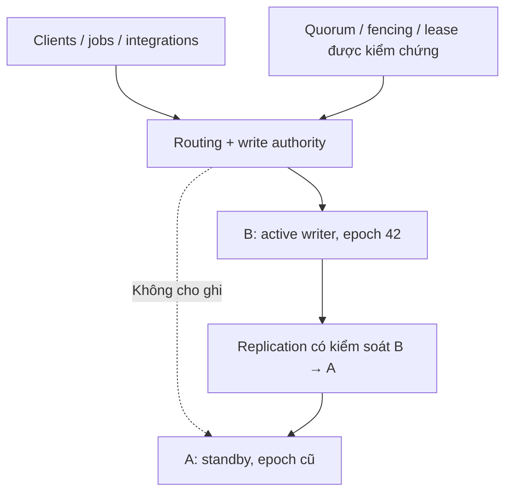
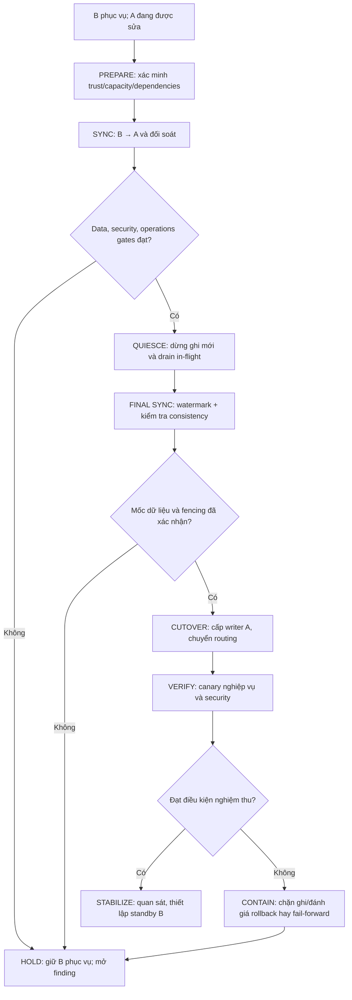
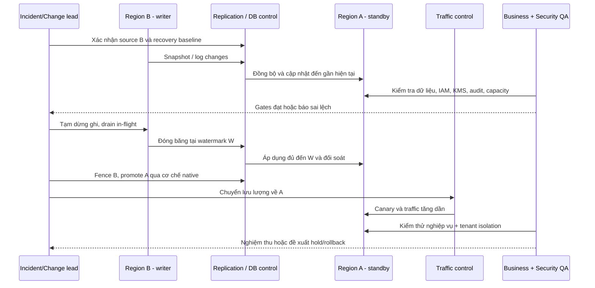

# Failback: chuyển dịch vụ trở lại môi trường mục tiêu một cách an toàn và có bằng chứng

## 1. Failback là gì?

**Failback** là quá trình chuyển hoạt động của một dịch vụ từ môi trường đang phục vụ sau khi failover (hoặc sau một sự kiện khôi phục) về **môi trường mục tiêu** đã được sửa chữa, đồng bộ và xác minh đủ điều kiện tiếp nhận. Môi trường mục tiêu thường là site/region chính ban đầu, nhưng cũng có thể là một môi trường đích mới do kiến trúc hoặc quyết định kinh doanh thay đổi.

Điểm khó của failback không phải là bật lại máy chủ cũ. Trong lúc chạy ở môi trường dự phòng, người dùng và hệ thống có thể đã tạo **giao dịch mới, thay đổi trạng thái, phát hành token, ghi file, cập nhật hàng đợi và thay đổi quyền**. Nếu chuyển traffic về môi trường cũ mà chưa xử lý các thay đổi đó, hệ thống có thể mất dữ liệu, ghi đè cập nhật hợp lệ, phục vụ kết quả cũ, xử lý giao dịch hai lần hoặc phá vỡ phân quyền.

Trong chương **Disaster recovery** thuộc module **SECURITY_SECURITY_ASSURANCE**, failback là hoạt động phải được đánh giá bằng **bằng chứng**: rủi ro, yêu cầu bảo mật, security controls, tiêu chí phục hồi, kiểm thử, audit và kết quả khắc phục. Một quy trình failback tốt chứng minh dịch vụ sau chuyển đổi **đúng về dữ liệu, đủ về chức năng, an toàn về quyền truy cập và quan sát được**, trong phạm vi kịch bản đã kiểm chứng.

### Ví dụ mở đầu

Nền tảng thanh toán có vùng chính A và vùng dự phòng B. Sau sự cố tại A, đội vận hành chuyển sang B. Trong 10 giờ tiếp theo, khách hàng hoàn thành 35.000 giao dịch tại B. A được sửa chữa và hoạt động trở lại.

Nếu chỉ đổi DNS trỏ về A, bản ghi tại A có thể thiếu 35.000 giao dịch; một số đơn hàng đã thu tiền sẽ hiển thị chưa thanh toán. Nếu cho A và B cùng nhận ghi mà không có cơ chế đồng bộ nhiều writer được thiết kế phù hợp, hai trạng thái có thể mâu thuẫn. **Failback an toàn** cần xác lập B đang là nguồn dữ liệu có thẩm quyền, chuyển các cập nhật đã xác nhận từ B về A, kiểm tra tính nhất quán, ngăn tình trạng đồng thời có hai nơi ghi trái phép, sau đó mới chuyển lưu lượng.

### Kết quả học tập

Sau bài học, người học có thể:

1. Phân biệt failover, failback, rollback, restore, switchover và fail-forward.
2. Nhận diện các nguồn dữ liệu có thẩm quyền sau failover và những thay đổi phải đồng bộ ngược.
3. Thiết kế kế hoạch failback với điều kiện tiền đề, bước chuyển dữ liệu, fencing, traffic cutover, security gates và rollback.
4. Đo ảnh hưởng tới RTO, RPO, dữ liệu đã xác nhận và thời gian gián đoạn được cho phép.
5. Kiểm thử các tình huống split-brain, replication lag, thao tác retry, schema drift, quyền truy cập và lỗi trong lúc chuyển.
6. Lưu evidence đủ để reviewer độc lập đánh giá những gì đã chứng minh và các rủi ro còn lại.

## 2. Thuật ngữ và vị trí của failback trong vòng đời DR

| Thuật ngữ | Mục đích | Điều kiện cần lưu ý |
| --- | --- | --- |
| **Failover** | Chuyển hoạt động sang môi trường dự phòng khi nơi phục vụ ban đầu không còn đáp ứng yêu cầu | Dự phòng phải đủ dữ liệu, năng lực và quyền để chạy an toàn |
| **Failback** | Chuyển hoạt động từ nơi đang chạy sau failover về môi trường mục tiêu đã sẵn sàng | Cần đối soát thay đổi trong thời gian dự phòng và cutover có kiểm soát |
| **Planned switchover** | Chuyển vai trò phục vụ theo kế hoạch khi cả hai bên còn hoạt động | Có thể dùng kỹ thuật tương tự failback, thường chủ động điều phối |
| **Rollback** | Quay lại một phiên bản cấu hình hoặc trạng thái trước khi đổi | Rollback ứng dụng không đồng nghĩa đảo ngược an toàn mọi giao dịch dữ liệu |
| **Restore** | Khôi phục dữ liệu/hệ thống từ bản sao hoặc log | Restore không tự biến nơi khôi phục thành nguồn có thẩm quyền |
| **Fail-forward** | Ổn định hoạt động lâu dài ở site mới thay vì trở lại site cũ | Có thể là lựa chọn phù hợp nếu site cũ không còn đáng tin hoặc không cần thiết |

Một chu trình tham khảo:


**Failback không phải lúc nào cũng là bước bắt buộc.** Khi môi trường dự phòng đã đáp ứng lâu dài các yêu cầu nghiệp vụ, hoặc A vẫn có rủi ro chưa được xử lý, tổ chức có thể chọn B làm môi trường chính mới. Quyết định thuộc business/technical owner và các bên chịu trách nhiệm rủi ro theo chính sách, dựa trên chi phí, tính an toàn, khả năng phục hồi và phụ thuộc.

Điểm nhấn của failback: môi trường đang phục vụ **B** tiếp tục là nguồn sự thật trong khi chuẩn bị A. A không tự trở thành primary chỉ vì đã khởi động trở lại.

## 3. Xác định trạng thái hiện tại trước khi lập kế hoạch

Cùng một tên “failback” nhưng điều kiện khởi điểm có thể khác rất xa:

| Tình huống | Trạng thái thực tế | Hệ quả với kế hoạch |
| --- | --- | --- |
| A mất hoàn toàn rồi khôi phục từ backup | A có dữ liệu cũ hoặc chưa đầy đủ | Phải đồng bộ/rebuild từ nguồn hợp lệ tại B hoặc nhật ký giao dịch |
| A còn chạy nhưng từng bị cô lập mạng | Có nguy cơ A vẫn nhận ghi qua đường cũ | Kiểm chứng fencing và phát hiện split-brain |
| B nhận ghi trong nhiều giờ | Giao dịch mới chỉ có ở B | Thiết kế reverse replication và cutover tới recovery point hợp lệ |
| B chỉ chạy read-only | Không có dữ liệu nghiệp vụ mới tại B, nhưng có thể vẫn có state khác | Đơn giản hơn, song vẫn cần kiểm tra cấu hình, phiên và log |
| A bị ransomware hoặc kẻ tấn công chiếm quyền | Tính tin cậy của A và bản sao liên quan chưa được xác minh | Phải làm sạch/khôi phục môi trường tin cậy trước khi chuyển |
| A thay kiến trúc trong thời gian B phục vụ | Schema, runtime, policy hoặc key khác nhau | Cần migration và kiểm tra tương thích hai chiều |

### 3.1. Inventory tại thời điểm bắt đầu

Một bảng hiện trạng cần ít nhất:

- **Nơi đang nhận lưu lượng:** các endpoint, load balancer, DNS, CDN, queue consumer, service mesh route và job scheduler thực tế.
- **Nơi nhận ghi:** database leader, object store, key-value store, event broker, idempotency store, hệ thống quản trị user/role.
- **Nguồn chân lý:** site nào chứa những cập nhật đã xác nhận mới nhất, cách xác minh và những nguồn độc lập để đối soát.
- **Trạng thái bảo mật:** mức tin cậy của A, B; IAM, KMS, certificate, secrets, audit và EDR; lý do sự cố đã được xử lý tới đâu.
- **Nguồn lực:** capacity ở A, giới hạn quota, tính sẵn sàng của nhà cung cấp, người trực và kênh liên lạc.
- **Mốc đo:** thời điểm bắt đầu, RTO/RPO theo kịch bản, maintenance window, sự cố hiện hữu và lượng giao dịch đang xử lý.
- **Giới hạn:** những nguồn log bị mất, thành phần chưa kiểm chứng, phiên bản không tương thích hoặc nợ kỹ thuật đang chấp nhận.

Đối chiếu inventory với control plane và telemetry hiện tại; không chỉ dựa trên sơ đồ kiến trúc có thể đã lỗi thời.

## 4. Các mục tiêu phục hồi liên quan failback

**RTO** (Recovery Time Objective) là mục tiêu khôi phục khả năng nghiệp vụ đến mức chấp nhận được sau gián đoạn. **RPO** (Recovery Point Objective) biểu thị giới hạn chênh lệch dữ liệu có thể chấp nhận khi phục hồi. Các mục tiêu này cần xuất phát từ BIA, mức quan trọng của dịch vụ và phê duyệt nghiệp vụ.

Một failover đầu tiên có thể đã đạt RTO. Khi sau đó chuyển từ B về A, đội ngũ vẫn cần đặt **mục tiêu thời gian gián đoạn cho planned failback** (cutover outage budget) và **mục tiêu mất dữ liệu cho đợt chuyển**. Không tự động sử dụng lại hoặc diễn giải RTO của sự cố ban đầu thành một cam kết cho tất cả thao tác failback.

| Chỉ tiêu | Câu hỏi trong failback |
| --- | --- |
| **RPO theo dữ liệu** | Có cập nhật đã được xác nhận tại B nào bị thiếu ở A sau cutover không? |
| **Cutover downtime budget** | Người dùng có thể chịu tạm dừng ghi/truy cập bao lâu trong khi đồng bộ cuối cùng? |
| **Business recovery objective** | Mức chức năng tối thiểu và năng lực giao dịch nào phải hoạt động tại A trước khi công bố hoàn tất? |
| **Data integrity objective** | Ledger, phiên giao dịch, quan hệ dữ liệu và thứ tự sự kiện có nhất quán? |
| **Security acceptance criteria** | IAM, mã hóa, audit, network policy và phân tách tenant có hoạt động tương đương hoặc an toàn hơn? |
| **Rollback window** | Trong điều kiện nào có thể quay lại B và cần xử lý những ghi mới tại A ra sao? |

### 4.1. Ví dụ về RPO thực chất

Hệ thống thanh toán yêu cầu **không mất giao dịch đã xác nhận**. Nếu trong 10 giờ tại B có 35.000 thanh toán thành công, việc A còn thiếu bất kỳ giao dịch đã được khách hàng nhận xác nhận đều vi phạm điều kiện đó, dù RPO tính theo “số phút” trông có vẻ nhỏ.

Đối với báo cáo phân tích có thể tính lại, chấp nhận chậm 15 phút dữ liệu có thể là hợp lý nếu BIA cho phép. Nhưng **một RPO chung** không thay thế cam kết về tính đúng đắn của từng loại dữ liệu. Phân nhóm dữ liệu trước khi kiểm thử.

### 4.2. Downtime khác với dữ liệu bị mất

Một kế hoạch có thể tạm ngừng ghi 5 phút để bảo đảm không mất giao dịch, hoặc dùng replication và cutover gần như liên tục. Hai phương án có trade-off khác nhau về độ phức tạp và rủi ro. Không chọn tự động “zero downtime” nếu nó khiến hai nơi ghi đồng thời mà không có consistency model được thiết kế, kiểm chứng và chấp nhận.

## 5. Nguồn dữ liệu có thẩm quyền và nguyên tắc tránh split-brain

Trong khi B đang là nơi phục vụ, B hoặc **nguồn nghiệp vụ độc lập được chỉ định** phải được dùng làm tham chiếu cho các cập nhật hợp lệ. A sau khi khởi động trở lại có thể chứa dữ liệu đúng **ở quá khứ**, nhưng đã lỗi thời so với giao dịch mới tại B.

### 5.1. Split-brain là gì?

**Split-brain** xảy ra khi hai thành phần cùng tin mình có quyền ghi/điều phối độc quyền, tạo ra những quyết định hoặc dữ liệu mâu thuẫn. Ví dụ A trở lại sau network partition, tự kích hoạt leader cũ, trong khi B vẫn xử lý giao dịch.



Sơ đồ minh họa **kiến trúc một writer có fencing**. Số `epoch` chỉ là ví dụ; triển khai thật cần cơ chế bền vững từ database/consensus/control plane. Chỉ lưu giá trị `is_primary=true` trong memory hoặc gọi script đổi DNS không đủ chống split-brain khi có partition.

### 5.2. Các biện pháp phòng tránh

1. **Single-writer invariant:** tại một thời điểm, chỉ writer có thẩm quyền được xác nhận commit các giao dịch thuộc phạm vi được bảo vệ, trừ khi hệ thống có mô hình multi-writer được thiết kế riêng.
2. **Fencing:** vô hiệu đường ghi hoặc quyền truy cập của leader cũ trước khi cấp quyền writer mới; có thể dùng fencing token/epoch, storage lease, quorum hoặc cơ chế native của hệ thống.
3. **Leader election/quorum:** chỉ node giành quyền theo giao thức được kiểm chứng mới thực hiện thao tác cần tính nhất quán.
4. **Storage-level checks:** nơi nhận ghi phải kiểm chứng token/epoch hoặc quyền được cấp; chỉ chặn request tại load balancer có thể không ngăn background job, cron hay worker cũ.
5. **Traffic ownership:** client, API gateway, service mesh, queue consumer, scheduler và integration phải chuyển theo cùng quyết định nguồn có thẩm quyền.
6. **Thử partition:** test A bất ngờ trở lại giữa failback, mất kết nối tới bộ điều phối, hoặc client giữ kết nối cũ để xác minh không phát sinh double writer.

Đừng coi replication hai chiều là cách sửa split-brain tự động. Khi cùng đối tượng bị sửa tại A và B, “last write wins” có thể âm thầm xóa giao dịch hợp lệ; đồng hồ sai hoặc thứ tự event không rõ làm vấn đề nghiêm trọng hơn. Cần consistency/conflict model theo nghiệp vụ.

## 6. Lập bản đồ trạng thái cần đồng bộ ngược

Một failback chỉ đồng bộ database chính rất dễ bỏ qua trạng thái nằm ở thành phần khác:

| Loại trạng thái | Ví dụ phát sinh khi B active | Yêu cầu khi failback |
| --- | --- | --- |
| **Transactional database** | Đơn hàng, ledger, quyền người dùng | Đồng bộ những commit hợp lệ và đối soát nhất quán |
| **Event log / outbox** | Event `payment_confirmed` chưa gửi | Giữ thứ tự, idempotency và mốc đã xử lý |
| **Queue/stream** | Message chờ, consumer offset, dead-letter | Phân biệt message đã xử lý, đang xử lý, có thể replay |
| **Idempotency store** | Token chống ghi giao dịch trùng | Di chuyển hoặc tái tạo theo hợp đồng ứng dụng |
| **Object storage** | Tài liệu mới, file upload, artifact | Kiểm tra phiên bản, checksum, metadata và quyền |
| **Session/identity state** | Session/token, revoke list, thay đổi role | Tránh mở lại phiên đã bị thu hồi hoặc quyền cũ |
| **Configuration/feature flags** | Policy mới, cấu hình endpoints, certificate | Quản lý cấu hình có phê duyệt và kiểm tra drift |
| **Secrets/KMS** | Key rotation, key version, encryption context | Đảm bảo giải mã được dữ liệu và quyền không mở rộng |
| **Scheduler/worker state** | Job đã chạy, lịch thanh toán, notification gửi | Tránh chạy lại công việc đã hoàn tất |
| **Cache/search index** | Cache nóng, kết quả tìm kiếm và analytics | Xác định có thể rebuild hay cần đồng bộ; invalidate dữ liệu cũ |
| **Audit/security telemetry** | Log truy cập dữ liệu, IAM, thay đổi trong B | Giữ timeline, retention và evidence điều tra |

### 6.1. Snapshot + change data capture (CDC)

Một chiến lược thường gặp là:

1. Lấy snapshot nền từ nguồn có thẩm quyền ở B và ghi mốc nhất quán.
2. Chuyển snapshot/restore sang A theo công cụ phù hợp.
3. Dùng database log hoặc CDC để phát các cập nhật tiếp sau snapshot từ B sang A.
4. Theo dõi replication lag, sai lệch schema, dữ liệu bị từ chối và những thay đổi không thể áp dụng.
5. Ở cutover, tạo hàng rào ghi, đợi A bắt kịp tới một mốc commit có thể kiểm chứng, sau đó mới chuyển vai trò.

Không phải database nào cũng hỗ trợ reverse replication trực tiếp hoặc chạy CDC với cùng tính chất. Cần nghiên cứu cơ chế **của hệ thống đang dùng**, compatibility của schema và tiêu chí snapshot consistency; không tự viết script sao chép từng hàng rồi giả định sẽ không mất cập nhật đồng thời.

### 6.2. Backup, replication và reconciliation có vai trò khác nhau

- **Backup/restore:** dựng lại trạng thái đã lưu; hữu ích khi A hỏng nhưng có thể chậm hơn dữ liệu tại B.
- **Replication/CDC:** di chuyển cập nhật giữa các điểm lưu trữ; cần đo lag, bảo đảm thứ tự và tính hợp lệ.
- **Reconciliation:** so sánh trạng thái với nguồn độc lập hoặc invariant nghiệp vụ; phát hiện transaction missing/duplicate, inconsistency.
- **Business replay:** tái dựng kết quả từ event đáng tin cậy và quy tắc idempotency; cần bảo đảm event đầy đủ và có thể tái thực hiện an toàn.

Chỉ thấy hai row count bằng nhau **không chứng minh** dữ liệu giống nhau: một bản ghi bị mất và một bản ghi bị nhân đôi có thể làm tổng bằng nhau. Dùng khóa nghiệp vụ, checksum ở phạm vi phù hợp, mốc commit, tổng số tiền theo ledger, đối soát với đối tác và test trường hợp bất thường.

## 7. Ba chiến lược failback thường gặp

### 7.1. Planned cutover với tạm ngừng ghi ngắn

**Phù hợp:** dịch vụ cho phép thời gian bảo trì nhỏ, dữ liệu cần một writer và đội ngũ có thể điều phối đồng bộ cuối cùng.

1. B tiếp tục xử lý bình thường; A được build sạch và nhận replication.
2. Xác minh A theo chế độ read-only và test nghiệp vụ giới hạn.
3. Công bố maintenance/đóng nhận ghi mới tại B; drain request và worker.
4. Xác nhận mọi giao dịch trước hàng rào ghi đã commit/abort rõ trạng thái.
5. Chờ A bắt kịp watermark cuối và đối soát dữ liệu.
6. Fencing B khỏi quyền writer; promote A theo công cụ native.
7. Chuyển traffic và chạy canary; mở ghi có kiểm soát.
8. Theo dõi, xử lý lỗi và quyết định khi nào B trở lại trạng thái standby.

Ưu điểm là dễ chứng minh single-writer hơn. Nhược điểm là có thể gây tạm dừng ghi; thời gian này cần được đo từ góc nhìn người dùng.

### 7.2. Near-zero interruption cutover

**Phù hợp:** hệ thống được thiết kế, kiểm thử để giữ luồng giao dịch khi chuyển. Có thể cần dual-read, queue buffering, service-level idempotency, log replication nhanh và chuyển leader nguyên tử theo cơ chế datastore.

Đổi traffic trong vài giây chỉ thành công khi **nguồn dữ liệu và write authority** cũng được chuyển nhất quán. Không tự tạo dual-write tùy tiện chỉ để đạt “zero downtime”; các vấn đề write ordering, conflict resolution, retry và lỗi mạng có thể khiến rủi ro dữ liệu lớn hơn thời gian bảo trì dự kiến.

### 7.3. Rebuild/reseed rồi failback

**Phù hợp:** A từng bị xâm nhập, hỏng dữ liệu, cấu hình không còn tin cậy hoặc quá lệch phiên bản.

Tạo A từ image/IaC/baseline đáng tin, kiểm tra root of trust và secret, restore/reseed dữ liệu từ nguồn được xác nhận, sau đó mới đồng bộ các cập nhật. Nếu B cũng từng chịu tác động an ninh, cần điều tra xem đâu là **điểm sạch**; không sao chép malware và policy yếu từ B về A.

| Tiêu chí lựa chọn | Planned pause | Near-zero | Rebuild/reseed |
| --- | --- | --- | --- |
| Khả năng chấp nhận dừng ghi | Có | Rất hạn chế | Phụ thuộc thời điểm cutover |
| Độ phức tạp dữ liệu | Thường dễ kiểm soát hơn | Cao: handoff, consistency, retry | Cao ở restore và xác nhận nguồn sạch |
| Rủi ro phổ biến | Pause kéo dài vì replication lag | Split-brain, lost/duplicate writes | Khôi phục trạng thái hoặc cấu hình không đúng |
| Bằng chứng then chốt | Fence + watermark + reconciliation | Atomic authority switch + transaction tests | Provenance, restore validation, security checks |

Chiến lược có thể kết hợp: rebuild A, sync B→A, rồi planned cutover với pause ngắn.

## 8. Điều kiện phải đạt trước khi cho phép failback

Có thể dùng **gates** thay vì dựa vào cảm giác “A có vẻ ổn”. Owner từng gate phải xác nhận và giữ bằng chứng.

| Gate | Câu hỏi bắt buộc | Bằng chứng |
| --- | --- | --- |
| **G1 — Root cause** | Sự cố làm A mất khả năng phục vụ đã được xử lý hoặc còn rủi ro nào được chấp nhận? | Incident finding, remediation, quyết định có thẩm quyền |
| **G2 — Trust** | Hạ tầng A đủ tin cậy, không chứa mã độc/cấu hình bị chiếm quyền? | Build provenance, image scan, IAM diff, forensic kết luận phù hợp |
| **G3 — Capacity** | A có đủ năng lực cho tải hiện tại và tăng đột biến? | Load/performance tests, quota, autoscaling checks |
| **G4 — Data authority** | Đã nhận diện rõ nguồn commit hợp lệ và trạng thái đang đồng bộ? | Replication topology, commit watermark, source inventory |
| **G5 — Data integrity** | Không mất/trùng dữ liệu đã xác nhận vượt mức được phê duyệt? | Reconciliation theo đối tượng/giao dịch, exception list |
| **G6 — Write fencing** | A/B có khả năng duy trì một writer có thẩm quyền? | Lease/epoch logs, partition test, ACL và job gating |
| **G7 — Security** | Xác thực, phân quyền, mã hóa, khóa, audit và tenant isolation còn hoạt động? | Security regression tests, audit queries, policy snapshots |
| **G8 — Operations** | Có runbook, owner, đường rollback/fail-forward và liên lạc ngoài băng? | Change record, dry run, on-call, rollback rehearsal |
| **G9 — Observability** | Có quan sát được transaction success, lag, queue, dữ liệu và dấu hiệu tấn công? | Dashboard, synthetic tests, log health |
| **G10 — Approval** | Business/incident/security owner có chấp nhận thời điểm và rủi ro còn lại? | Decision record và trạng thái từng gate |

Nếu một gate không đạt, lựa chọn có thể là **chưa failback**, giữ B phục vụ, tiếp tục read-only tại A hoặc lựa chọn fail-forward. Nếu phải chấp nhận một ngoại lệ, người phê duyệt, phạm vi, thời hạn và biện pháp bù trừ phải được ghi rõ; không gắn nhãn PASS cho test chưa đạt.

## 9. Runbook failback theo trạng thái

Một runbook an toàn cần có **đầu vào, hành động, điều kiện dừng, kiểm tra, người chịu trách nhiệm và hồ sơ bằng chứng** cho từng bước. Ví dụ state machine:



Ở đây mũi tên từ `CONTAIN` về `HOLD` là bước **tái đánh giá**, không phải lệnh tự động chuyển mọi giao dịch về B. Sau khi A đã nhận ghi, rollback phải xử lý cập nhật mới ở A; thao tác đơn giản đảo DNS có thể gây mất dữ liệu. Phải có thủ tục riêng và kiểm chứng tính khả thi tại thời điểm đó.

### 9.1. Giai đoạn chuẩn bị

- Đánh giá B đang phục vụ: mức tải, độ ổn định, trạng thái commit và nguồn log; nếu B không ổn định, điều chỉnh chiến lược theo rủi ro.
- Khóa/phê duyệt các thay đổi không cần thiết đối với schema, IAM, network, secrets và deployment trong maintenance window.
- Kiểm tra A: phiên bản ứng dụng, cấu hình, schema, trust, KMS, certificate, storage, backup/restore và kết nối tới các bên thứ ba.
- Đồng bộ thời gian, xác định transaction watermark hoặc log position, chọn nguồn dữ liệu đối soát; thống nhất đơn vị đo.
- Chuẩn bị thông báo người dùng, runbook, incident/change ID, kênh chỉ huy, người ra quyết định Go/No-Go.

### 9.2. Giai đoạn đồng bộ và kiểm thử trước cutover

- Chuyển snapshot nền hoặc dựng lại A khi cần; chỉ cho phép những quyền truy cập tối thiểu.
- Bật replication/CDC B→A theo cách hỗ trợ của datastore, đo lượng thay đổi chưa chuyển và lỗi áp dụng.
- Đối soát theo nhóm dữ liệu (ledger, outbox, role binding, session/revoke, object); tách những record chưa quyết định.
- Kiểm tra ứng dụng trên A ở chế độ **không tạo tác dụng phụ không mong muốn**; không gửi email/charge thật khi chạy canary.
- Thử phân quyền, key decryption, log delivery, network segmentation và truy cập trái phép bị từ chối.

### 9.3. Giai đoạn cutover

1. Incident/change lead xác nhận Go dựa trên gate và rủi ro hiện tại.
2. Tạm dừng ghi mới ở gateway/ứng dụng và các background worker; để các in-flight transaction hoàn tất hoặc ghi lại trạng thái pending một cách có thể đối soát.
3. Ghi `cutover_barrier` với mốc commit cuối có thẩm quyền tại B; đợi A áp dụng đầy đủ tới mốc này.
4. Thực thi **fencing** đối với quyền ghi tại B và kiểm tra hiệu lực ở đường ghi dữ liệu, không chỉ ở routing.
5. Promote A theo giao thức native của datastore. Xác minh leader/epoch/quorum và khả năng ghi hợp lệ bằng test kiểm soát.
6. Chuyển traffic từng phần hoặc toàn phần theo thiết kế (LB, service mesh, DNS, workers, scheduler, ingress, partner callback).
7. Chạy synthetic business transaction và security canary, theo dõi lỗi, độ trễ, duplicate, authorization, audit.
8. Chỉ công bố hoàn tất khi đạt tiêu chí chức năng tối thiểu và người có thẩm quyền chấp thuận.

Nếu dùng DNS, TTL và cache phía client có thể khiến lưu lượng còn đến B sau khi đổi bản ghi; hệ thống phải xử lý dứt khoát (redirect an toàn hoặc từ chối ghi tại B) và giám sát request còn sót. Cần cập nhật cấu hình các integration và callback, không giả định DNS là đường routing duy nhất.

### 9.4. Giai đoạn ổn định sau cutover

- Giữ quan sát tăng cường trong một khoảng do BIA/risk policy xác lập.
- Đối soát giao dịch được commit trong và ngay sau cutover, đặc biệt đối tượng retry, event/outbox và trạng thái giao dịch mơ hồ.
- Xác nhận B đã thành standby theo chính sách, nhận replication theo **chiều mới** và không nhận ghi trái phép.
- Đánh giá mức độ thay đổi của audit logs, IAM, secrets, performance và luồng ứng dụng.
- Khôi phục các job/feature tạm dừng theo thứ tự; chốt mốc đạt dịch vụ thông thường, khi nào kết thúc heightened monitoring.
- Ghi sai lệch, lỗi phát sinh, thời điểm hoàn thành thực tế và các finding chưa xử lý.

## 10. Khi failback gặp lỗi: rollback, hold và fail-forward

Không có kế hoạch failback an toàn nếu chỉ có một nút “switch back”. Cần quyết định trước **lỗi ở giai đoạn nào và đã có writer mới hay chưa**.

| Giai đoạn lỗi | Ví dụ | Hành động nên xem xét |
| --- | --- | --- |
| Trước quiesce | A fail security check | Dừng kế hoạch; B tiếp tục phục vụ |
| Trong sync | CDC không áp dụng được do schema drift | Giữ B làm writer, giải quyết drift, chạy lại validation |
| Sau quiesce nhưng trước promote | A không bắt kịp watermark | Nếu an toàn, mở lại B theo quy trình; ghi outage thực tế |
| Sau promote nhưng trước ghi nghiệp vụ ở A | Routing/canary lỗi | Quyết định chuyển lại B sau khi kiểm chứng A chưa có commit cần bảo toàn |
| **Sau khi A đã nhận commit mới** | Database A hỏng, B còn trạng thái cũ | Không đảo routing về B trước khi xác định/di chuyển cập nhật mới từ A |
| Phát hiện dấu hiệu A vẫn compromise | IAM/EDR báo tài khoản lạ | Cô lập A, xử lý incident và khôi phục từ nguồn tin cậy |

### 10.1. Mốc không thể đảo chiều một cách đơn giản

Trước khi A nhận ghi, quay lại B có thể tương đối đơn giản nếu đã kiểm soát traffic và hàng rào ghi. **Sau khi A xác nhận giao dịch mới**, B đã cũ. Mọi thao tác chuyển về B cần chiến lược tái đồng bộ A→B hoặc một cơ chế khôi phục khác có thể giữ được những commit cần bảo toàn.

Vì vậy, runbook nên mô tả **point of no simple rollback** và ngưỡng dừng/phê duyệt theo từng giai đoạn. Nếu một hành động dữ liệu không thể đảo ngược, cần kiểm tra điều kiện trước khi thực hiện và dự phòng hợp lệ.

### 10.2. Không lấy tính sẵn sàng để hợp lý hóa dữ liệu sai

Nếu chỉ có hai lựa chọn “mở lại thanh toán trên dữ liệu có thể sai” và “duy trì read-only tới khi đối soát”, business owner có thể phải chọn tạm dừng chức năng ghi theo các security invariants đã phê duyệt. Tình huống vượt thời gian mục tiêu phải được ghi **FAIL hoặc exception theo tiêu chí**, không thay đổi định nghĩa để biến kết quả thành PASS.

## 11. Bảo mật trong failback: trust, IAM, KMS và audit

Failback có thể tái kích hoạt những control từng lỗi hoặc bị attacker khai thác. Tính đúng đắn của dữ liệu và cấu hình bảo mật phải là điều kiện độc lập với việc máy chủ hoạt động.

### 11.1. Security gates bắt buộc cân nhắc

| Control | Nguy cơ | Kiểm tra |
| --- | --- | --- |
| **IAM/role** | A dùng quyền cũ, revive account đã thu hồi | Diff role/group, kiểm tra token/session revoke và quyền cloud |
| **Secrets/KMS** | A không có key mới hoặc dùng key bị lộ | Kiểm tra key version, rotation, decrypt authorized và deny unauthorized |
| **Network segmentation** | Mở kết nối không cần thiết khi failback | Firewall/security group/IaC diff, scan đường truy cập đã duyệt |
| **Data classification** | Dữ liệu production vào vùng không đủ kiểm soát | Region/tenant restrictions, encryption, retention, access audit |
| **Application security** | A quay về bản có lỗ hổng hoặc cấu hình yếu | Artifact provenance, version parity, security regression |
| **Logging/detection** | Audit mất trong khoảng chuyển trạng thái | Event thử, kiểm tra last-seen, correlation, retention, alert |
| **Identity continuity** | Session/token cũ sống lại sau restore | Revoke state, token lifetime, auth assurance và kiểm thử logout/revocation |
| **Supply chain** | Restore image, package hoặc backup không đáng tin | Kiểm tra checksum/signature từ nguồn tin cậy, scan và review |
| **Isolation** | Cache, session hoặc routing nhầm tenant | Negative test xuyên tenant và kiểm tra scope dữ liệu |

### 11.2. Nếu DR xuất phát từ tấn công

Sự cố do mã độc, thay đổi IAM trái phép hay lộ khóa **không giống** outage hạ tầng thông thường. Môi trường A cần được thiết lập từ nguồn đáng tin, vá nguyên nhân, vô hiệu credential có nguy cơ bị chiếm và kiểm tra các điểm persistence. Đừng dùng “replication đã hoàn tất” để kết luận hệ thống sạch: replica có thể chỉ đang chứa bản sao của dữ liệu hoặc malware đã bị thao túng.

Khi nghi ngờ B bị ảnh hưởng, đội incident response phải xác định dữ liệu/timestamp đủ sạch và kênh làm việc an toàn. Nếu không thể xác nhận trust, điều kiện failback chưa đạt; tình trạng rủi ro và người chấp thuận phải được ghi.

### 11.3. Audit chính hoạt động failback

Một quy trình kiểm chứng được phải ghi:

- Ai khởi xướng và phê duyệt change, tại sao thực hiện, thời điểm Go/No-Go.
- Ai thay quyền writer, cấu hình routing, IAM và replication; trước/sau thay đổi.
- Event ID và phiên bản tooling/runbook, mốc commit dữ liệu và kết quả đối soát.
- Cảnh báo mất nguồn log, quyền truy cập đặc quyền, thao tác break-glass.
- Ai xác nhận các security gates và business acceptance; ngoại lệ, rủi ro tồn dư.
- Các bước quay lại, hoãn hoặc chuyển hướng xử lý; lý do và bằng chứng.

Log sự kiện failback phải được chuyển tới kho có kiểm soát quyền/retention, phù hợp với việc A/B có thể không còn đáng tin trong suốt sự cố. Không ghi token/credential hay dữ liệu khách hàng nhạy cảm vào ticket vận hành.

## 12. Ví dụ xuyên suốt: SaaS thanh toán trở lại region A

### 12.1. Bối cảnh và yêu cầu

Nền tảng SaaS đa tenant có:

- **Region A:** môi trường chính trước sự cố.
- **Region B:** đã được promote thành primary trong lúc region A ngừng.
- **Database giao dịch:** chứa order/payment state, ledger và idempotency keys.
- **Queue/outbox:** truyền event sang hệ thống thông báo và đối soát với nhà cung cấp thanh toán.
- **IAM/KMS:** định danh, phân quyền, mã hóa và audit dùng chung một số thành phần.

BIA nội bộ giả định đặt yêu cầu **không làm mất giao dịch đã xác nhận**, cho phép **tạm ngừng tạo giao dịch mới tối đa 10 phút trong planned cutover** và bắt buộc đối soát với payment provider. Đây là **giả định bài học**, không phải tiêu chuẩn chung. B đang phục vụ 35.000 giao dịch mới kể từ khi failover.

### 12.2. Luồng failback dự kiến



Sơ đồ mô tả ý định và thứ tự hoạt động, không thay thế cơ chế nhất quán hoặc lựa chọn lệnh cụ thể theo loại database. Từng bước phải có mốc đo và điều kiện dừng.

### 12.3. Kiểm tra consistency của ledger

Giả sử đầu B có 35.000 giao dịch mới, nhưng **số lượng đơn thuần** không đủ. Bảng đối soát cần kiểm tra:

| Điều cần chứng minh | Nguồn đối chiếu |
| --- | --- |
| Tất cả payment đã xác nhận tại B tồn tại đúng một lần ở A | Payment IDs, ledger entries, customer confirmations |
| Không có order bị áp trạng thái sai/đảo ngược | Order state machine, audit transition history |
| Retry/callback từ payment provider không tạo charge trùng | Idempotency keys, provider reference, outbox delivery |
| Role thay đổi trong thời gian B active đã sang A | IAM audit, identity/authorization state |
| Secret/key rotation được áp dụng hợp lệ | KMS key versions, secret store audit |
| Queue consumer offset và DLQ không gây gửi lặp | Broker metrics, delivery IDs, business idempotency |
| Đúng tenant và không lộ dữ liệu ngoài phạm vi | Authorization negative tests, sample kiểm thử cách ly |

Một phép kiểm thử mã giả để đánh giá **tập ID đã xác nhận**, có thể hỗ trợ reconciliation (cần dùng snapshot nhất quán và công cụ truy vấn thật trong triển khai):

```text
confirmed_B = set(payment_ids confirmed and durable at barrier W in B)
confirmed_A = set(payment_ids confirmed and durable at W in A)

missing_in_A = confirmed_B - confirmed_A
unexpected_in_A = confirmed_A - confirmed_B

ASSERT missing_in_A is empty
REVIEW unexpected_in_A using business reconciliation rules
ASSERT no duplicate ledger entries for each business payment key
ASSERT sums and states match independent provider references
ASSERT all required authz/key/audit changes are represented
```

Đối soát cần phân biệt `pending`, `unknown`, `settled`, `refunded` hoặc trạng thái tương ứng của nghiệp vụ. Không thể đồng nhất mọi khác biệt dữ liệu thành lỗi hay tự động xóa record “unexpected” mà thiếu kiểm tra.

### 12.4. Timeline minh họa

| Mốc UTC | Việc thực hiện | Bằng chứng cần ghi |
| --- | --- | --- |
| 08:00 | B tiếp tục phục vụ, A đã sửa xong | Incident status, A trust/capacity verification |
| 08:15 | Đồng bộ B→A, bắt đầu theo dõi lag | Snapshot/checkpoint, replication metrics |
| 09:00 | Đối soát sơ bộ, security checks | Report theo payment IDs, IAM/KMS/audit tests |
| 09:20 | Go quyết định, thông báo maintenance | Approval, change ID, communications |
| 09:25 | Tạm dừng ghi B, drain request | In-flight count, barrier preparation |
| 09:27 | Chốt watermark W, đồng bộ cuối và fence B | Commit position, fencing proof |
| 09:29 | Promote A và chuyển traffic | Datastore leader/epoch, routing change audit |
| 09:32 | Canary nghiệp vụ + security đạt | Transaction IDs, authorization tests, audit log |
| 09:34 | Mở dần lưu lượng, giám sát | Error rate, latency, duplicate/missing checks |
| 10:00 | Xác nhận ổn định và standby topology | Business acceptance, B replica configuration |

Các giờ trên chỉ để minh họa. **Khoảng tạm dừng từ 09:25 đến 09:34 là 9 phút** trong kịch bản này nếu chỉ mở ghi đầy đủ lúc 09:34 và không có gián đoạn khác. Kết quả có thể đáp ứng cutover downtime budget 10 phút **nếu** nguồn đo xác nhận hành trình khách hàng và các security gates đều đạt. Điều đó **không tự chứng minh** không mất giao dịch; phải có kết quả reconciliation thực tế và việc không có giao dịch trùng.

### 12.5. Phân biệt kết quả kỹ thuật và assurance claim

**Câu chưa đủ bằng chứng:** “Failback hoàn tất vì traffic về A và dashboard xanh.”

**Câu có cấu trúc kiểm chứng:**

> Trong đợt failback thử nghiệm có ID và thời điểm xác định, dịch vụ checkout đã chuyển nguồn phục vụ từ region B về A. Tại barrier W, tất cả payment ID đã xác nhận trong tập đối soát được tìm thấy ở A mà không có ledger entry trùng; canary giao dịch và kiểm tra tenant isolation, IAM, KMS, audit đạt. Thời gian tạm dừng ghi được đo từ lúc ngừng nhận giao dịch tới khi mở lại an toàn. Bài thử chưa bao gồm trường hợp payment provider đồng thời ngừng và chưa kiểm chứng split-brain dưới network partition toàn diện.

Đây là **mẫu phát biểu**, không phải kết quả của hệ thống thật. Reviewer cần có test-run ID, nguồn đo, record gốc, phạm vi và chữ ký/approval trước khi chấp nhận claim.

## 13. Mẫu runbook và tiêu chí Go/No-Go

Một runbook có thể chứa bảng hành động để tránh bỏ sót bước khi đang xử lý áp lực. Ví dụ minh họa:

```yaml
runbook_id: DR-FAILBACK-006
service: payment-checkout
environment: production
source_active_site: region-b
target_site: region-a
strategy: planned_write_pause_with_reverse_replication
roles:
  incident_or_change_lead: required
  database_owner: required
  service_business_owner: required
  security_reviewer: required
preconditions:
  - source_of_truth_confirmed
  - root_cause_and_trust_gate_reviewed
  - target_capacity_and_dependencies_verified
  - backup_and_recovery_path_available
  - reverse_replication_healthy
  - data_and_security_baseline_passed
cutover_gates:
  - stop_new_writes_and_drain_inflight
  - capture_source_commit_watermark
  - target_caught_up_to_watermark
  - source_writer_fenced
  - target_writer_promoted_by_supported_mechanism
  - traffic_and_workers_routed_to_target
verification:
  - customer_transaction_canary_passed
  - required_business_records_reconciled
  - tenant_isolation_and_authz_passed
  - kms_and_audit_logging_active
  - replication_reestablished_in_new_direction
stop_conditions:
  - unexpected_dual_writer
  - unresolved_transaction_data_mismatch
  - missing_security_audit
  - target_compromise_or_critical_capacity_failure
post_cutover:
  - heightened_monitoring
  - rollback_feasibility_reassessed_after_new_writes
  - handover_and_business_signoff
```

Các tên trường và giá trị trên chỉ là **đặc tả quy trình**, không phải cấu hình thực thi. Đặc biệt, `source_writer_fenced` phải được **kiểm chứng bằng cơ chế thật**; chỉ đánh dấu checkbox không tạo ra hàng rào dữ liệu.

### Mẫu bằng chứng cho mỗi gate

| Gate | Giải thích PASS | Evidence cụ thể |
| --- | --- | --- |
| Replication | A áp dụng tới watermark W, không còn unapplied change liên quan | Replication position, lag, apply-error metrics |
| Reconciliation | Không thiếu giao dịch đã xác nhận và không vi phạm invariant | Danh sách mẫu/IDs đã bảo vệ, báo cáo đối soát |
| Fencing | B không commit được giao dịch mới sau chuyển writer | Epoch/lease log, test ghi bị từ chối tại B |
| Traffic | Tỷ lệ chuyển về A đạt mục tiêu; đường cũ không còn writer | LB/DNS/service mesh metrics, callback/job audit |
| Security | Tất cả security invariants trong phạm vi đạt | IAM negative tests, secret access, audit log IDs |
| Business | Chức năng tối thiểu an toàn dùng được | Synthetic transaction và business owner approval |
| Operations | Có owner, rollback plan và monitoring hoạt động | Change record, alert tests, review status |

## 14. Kiểm thử failback: phải có ca thành công và ca thất bại

Một bài diễn tập chỉ kiểm tra “trả trang web thành công” không chứng minh failback. Cần test cả dữ liệu, đường ghi, lỗi mạng, IAM và hành vi khi kế hoạch bị dừng giữa chừng.

### 14.1. Ma trận test có mục tiêu assurance

| Test ID | Kịch bản | Kỳ vọng | Bằng chứng |
| --- | --- | --- | --- |
| **FB-01** | B có giao dịch mới sau failover; đồng bộ về A | Mọi commit được xác nhận đều được chuyển/đối soát theo policy | Watermark, IDs, ledger diff |
| **FB-02** | In-flight request tại thời điểm pause | Commit/abort có thể xác minh; retry không tạo duplicate | Traces, idempotency keys, provider references |
| **FB-03** | A tái gia nhập mạng khi B còn writer | A không tự phục hồi quyền ghi cũ | Fencing/epoch logs, negative write test |
| **FB-04** | Reverse replication chậm hoặc lỗi | Dừng trước cutover, B tiếp tục phục vụ hoặc hành động theo runbook | Lag/error alert, decision record |
| **FB-05** | Schema A/B không tương thích | Gate từ chối, không tự động bỏ bản ghi lỗi | Compatibility test, apply-error samples |
| **FB-06** | IAM A còn quyền cũ đã bị thu hồi trên B | Từ chối truy cập trái phép sau chuyển | IAM diff, authz negative tests |
| **FB-07** | Secret đã rotate khi B phục vụ | A dùng key version hợp lệ và không hồi sinh secret cũ | KMS/secret audit, decrypt/deny checks |
| **FB-08** | DNS cache giữ client ở B sau cutover | Không phát sinh commit trái phép tại B | Routing logs, rejected-write records |
| **FB-09** | A hỏng ngay sau khi nhận giao dịch mới | Không đảo traffic về B khi chưa xử lý những commit mới | Hold/escalation log, recovery design assessment |
| **FB-10** | Audit collector ngừng trong cutover | Không tuyên bố PASS; có cảnh báo suy giảm và xử lý | Collector health, sample event ID, incident record |
| **FB-11** | Data reconciliation phát hiện missing IDs | Không mở ghi tại A theo kế hoạch nếu vi phạm mục tiêu | Mismatch report, Go/No-Go |
| **FB-12** | Khôi phục xong A và chuyển B thành standby | Topology chiều mới đúng, chỉ một writer | Replica status, ACL/leader, smoke test |
| **FB-13** | Cross-tenant access trong chế độ dự phòng | Mọi truy cập sai tenant bị chặn | Authorization test với dữ liệu giả |
| **FB-14** | Failback khi control plane/nhà cung cấp phụ thuộc chưa phục hồi | Không khẳng định hoàn tất nếu dependency bắt buộc chưa sẵn sàng | Dependency inventory, readiness checks |

Tùy mức trọng yếu của dịch vụ, có thể dùng simulation, staging tương đương production, chaos engineering có giới hạn, DR game day và production exercise được phê duyệt. Ghi **môi trường, phiên bản, tải, dữ liệu, phạm vi sự cố và giới hạn**; kết quả staging không tự động chứng minh chịu được outage toàn region với lưu lượng production.

### 14.2. Kiểm tra invariant thay vì chỉ so snapshot

Những invariant hữu ích với hệ thống giao dịch:

- Mỗi business transaction được xác nhận có **một** kết quả ghi sổ có thẩm quyền.
- Không có record của tenant A xuất hiện trong truy vấn được ủy quyền chỉ cho tenant B.
- Những role hoặc token đã thu hồi không sống lại sau restore/cutover.
- Không có hai writer trái phép cùng commit trong khoảng chuyển đổi.
- Sự kiện audit quan trọng từ đầu tới cuối cutover được thu thập trong phạm vi chính sách.
- Dữ liệu restore được giải mã bằng key được phê duyệt; key cũ không được kích hoạt trái phép.
- Các message phải replay được xử lý idempotent và có bằng chứng khi message bị reject.

Nếu hệ thống sử dụng mô hình multi-writer chính thức, invariant “một writer” phải được thay bằng **quy tắc consistency/conflict resolution được thiết kế** phù hợp; không áp đặt một chiến lược duy nhất cho mọi database.

## 15. Chất lượng đo lường và bằng chứng security assurance

Trong SECURITY_SECURITY_ASSURANCE, failback cần liên kết **yêu cầu → control → phép thử → kết quả → người phê duyệt → tồn tại cần sửa**.

| Yêu cầu | Control/thiết kế | Phép đo/bằng chứng | Phát hiện cần xử lý |
| --- | --- | --- | --- |
| Không mất giao dịch đã xác nhận | Reverse replication + barrier + reconciliation | Commit IDs/ledger đối chiếu giữa B và A | Missing/duplicate phải dừng Go |
| Không có split-brain | Fencing/epoch/consensus | Leader logs + thử ghi từ B bị từ chối | Dual writer là lỗi nghiêm trọng |
| Không phục hồi quyền trái phép | IAM/secret sync + negative test | Audit của revoke và access deny tại A | Quyền stale cần chặn failback |
| Không tắt audit trong chuyển đổi | Collector health + event kiểm thử | End-to-end event ID và ingest latency | Thiếu log quan trọng gây suy giảm assurance |
| Đáp ứng giới hạn gián đoạn | Cutover đo theo giao dịch người dùng | User-facing outage start/end; synthetic canary | Vượt budget cần finding/communication |
| Đúng khả năng nghiệp vụ | Business validation + owner signoff | Checkout, status, refund/reconcile test | Health 200 nhưng nghiệp vụ lỗi |
| Chuyển topology ổn định | Standby B và replication chiều mới | Replica lag, ACL, leader position | Sai topology có thể phá lần DR sau |
| Có thể điều tra và lặp lại | Versioned runbook, change record, logs | Timeline, config diff, test report, approval | Thiếu evidence → chưa đủ kết luận |

### 15.1. Metric cần theo dõi

| Metric | Cách đọc đúng |
| --- | --- |
| **Reverse replication lag** | Chênh lệch giữa commit hiện tại tại B và applied position tại A; phải theo dõi cả lỗi apply |
| **Unapplied change count/bytes** | Khối lượng dữ liệu còn cần chuyển; bằng 0 chưa chắc data integrity đã đúng |
| **In-flight writes tại barrier** | Số giao dịch đang thực thi chưa quyết định commit/abort |
| **Effective cutover downtime** | Thời gian tính từ lúc người dùng không còn thể hoàn tất chức năng cốt lõi đến khi phục vụ lại an toàn |
| **Data reconciliation mismatch** | Số/loại record thiếu, trùng, lệch trạng thái trên tập đối soát xác định |
| **Authorization regression failures** | Truy cập trái phép được phép sau restore hoặc token đã revoke được dùng lại |
| **Data-source freshness** | Độ tươi của log, IAM, KMS, payment/provider audit; thiếu nguồn có thể che giấu lỗi |
| **Post-cutover transaction error rate** | Theo tenant, request type, provider và thời gian; tránh số trung bình che nhóm lỗi |
| **New standby readiness** | B đã nhận replication chiều mới, đủ khả năng dùng cho lần failover tiếp theo |

Metric phải có nguồn, thời điểm đo, đơn vị, owner, ngưỡng đã phê duyệt và cách phản ứng khi vượt ngưỡng. **Tổng request success tăng không chứng minh consistency** nếu các giao dịch sai vẫn trả HTTP 200.

### 15.2. Mẫu báo cáo một lần failback

Một báo cáo có thể gồm:

1. **Phạm vi:** service, environment, source/target, incident/change ID, mục tiêu và nguyên nhân failback.
2. **Điều kiện ban đầu:** topology, trust status, dữ liệu/giao dịch khi B phục vụ và dependency.
3. **Kế hoạch và phê duyệt:** chiến lược, mốc thời gian, owner, Go/No-Go gates, stop/rollback conditions.
4. **Bằng chứng thực thi:** thay đổi cấu hình, leader/epoch, watermark, replication, routing, audit trail.
5. **Kiểm tra dữ liệu:** reconciliation IDs, transaction invariants, error list và cách xử lý.
6. **Kiểm tra bảo mật:** IAM, KMS, policy, tenant isolation, nguồn log và những ngoại lệ còn lại.
7. **Kết quả nghiệp vụ:** thời gian gián đoạn thực, chức năng tối thiểu, khách hàng/tenant chịu tác động.
8. **Giới hạn:** kịch bản chưa thử, tình huống không mô phỏng được hoặc dữ liệu thiếu.
9. **Kết luận và follow-up:** PASS/FAIL/CONDITIONAL theo tiêu chí đã duyệt, owner, deadline, quyết định risk acceptance và lịch re-test.

### 15.3. Mức độ khẳng định phải tương xứng bằng chứng

| Phát biểu | Có thể chứng minh bằng gì? | Điều chưa chứng minh |
| --- | --- | --- |
| “A đã online” | Host health và capacity monitor | Bất kỳ dữ liệu hoặc giao dịch nào đã đồng bộ |
| “Reverse replication bắt kịp” | Watermark/source-target positions | Không mất/trùng giao dịch ngoài phạm vi log |
| “Canary checkout thành công” | Test giao dịch mẫu và log | Mọi tenant/loại giao dịch đều chính xác |
| “Bị chặn double writer trong test” | Fence event, thử ghi từ node cũ | Tất cả kịch bản partition chưa được thử |
| “Failback đạt điều kiện trong drill” | Report đầy đủ gate, dữ liệu, security, chức năng và giới hạn | Tương lai sẽ luôn đạt dưới mọi outage |

Một kết quả **PASS có phạm vi** đáng tin hơn khẳng định tuyệt đối không thể kiểm chứng.

## 16. Bài tập thực hành

Bạn là kỹ sư tham gia chương trình security assurance của một dịch vụ thanh toán đa tenant. Sau sự cố tại region A, team đã chạy region B trong 12 giờ; B có các payment ID mới và thay đổi IAM. A đã được phục hồi từ backup trước sự cố, nhưng đội vận hành chưa kiểm chứng reverse replication. Cả hai region cùng chia sẻ một nhà cung cấp DNS. Trong thời gian hoạt động tại B, token admin từng bị thu hồi và key mã hóa đã rotate.

Business owner đưa ra các yêu cầu **giả định của bài tập**: không mất giao dịch đã xác nhận; planned cutover tối đa 10 phút; service sau failback phải cho phép thanh toán hợp lệ, kiểm tra trạng thái giao dịch và không truy cập được dữ liệu tenant khác.

Hãy thiết kế và giải thích:

1. **Nguồn có thẩm quyền:** database, idempotency, outbox, IAM và KMS ở đâu đang mang trạng thái mới? Điều nào vẫn chưa xác minh?
2. **Dependency map:** xác định hard/soft dependency và ít nhất ba rủi ro lỗi chung hoặc trạng thái bị bỏ sót.
3. **Chiến lược failback:** planned pause, near-zero hay rebuild; lý do chọn theo BIA và năng lực kỹ thuật.
4. **Watermark và fencing:** biểu diễn thứ tự bước để B ngừng nhận ghi, A bắt kịp, chuyển leader và thay routing.
5. **RPO/integrity:** đề xuất phép đối soát payment IDs, idempotency keys và provider references; giải thích vì sao row count không đủ.
6. **Security gates:** cách bảo đảm revoke token ở B được giữ trên A, key mới giải mã hợp lệ, logging còn đầy đủ, tenant isolation đúng.
7. **Test âm tính:** chứng minh B không thể commit sau fencing; test A bị network partition và A nhận callback trùng.
8. **Rollback plan:** phân biệt nếu lỗi xảy ra trước A nhận ghi với sau khi A đã tạo commit mới.
9. **Evidence/assurance:** nêu artifact, người phê duyệt, stop conditions, metric và giới hạn kết luận; mô tả trường hợp nào phải ghi FAIL dù RTO/cutover time trông đạt.

### Gợi ý đáp án khung

- Xem **B là active source** tới khi cutover được chấp thuận và commit cuối ở B đã có mốc xác minh.
- Cần reverse sync B→A cho các dữ liệu có thay đổi; dùng cơ chế nhất quán native với datastore và test tính tương thích trước chuyển.
- Sau khi dừng ghi B, cần **drain → barrier → catch-up → reconcile → fence B → promote A → switch routing → business/security verify**.
- Nếu phát hiện missing committed payment hoặc A cho phép token đã revoke, **không tuyên bố đạt** dù canary HTTP thành công.
- Sau khi A tạo commit mới, rollback về B phải xét đồng bộ dữ liệu mới; đảo DNS không còn là thao tác đủ an toàn.

Tiêu chí đạt bài: người review có thể theo bản thiết kế từ **rủi ro và business objective → dữ liệu cần bảo vệ → control → thứ tự thao tác → kiểm thử → evidence → kết luận có giới hạn**, và biết chính xác khi nào cần hoãn failback.

## 17. Ghi nhớ

**Failback là một sự kiện chuyển giao quyền phục vụ và nguồn dữ liệu có thẩm quyền**, với rủi ro lớn ở dữ liệu thay đổi sau failover. Để thực hiện an toàn, phải nhận diện source of truth, đồng bộ ngược và đối soát, tránh split-brain bằng fencing/leader control, bảo vệ IAM/KMS/audit, kiểm tra giao dịch thực và có kế hoạch dừng/khôi phục khi sai lệch. Trong module **SECURITY_SECURITY_ASSURANCE**, chất lượng failback được chứng minh bởi **test, log, commit watermark, reconciliation, security gates, quyết định có trách nhiệm và giới hạn của bằng chứng**, giúp tổ chức cải tiến disaster recovery liên tục.
