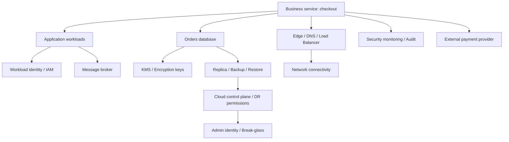
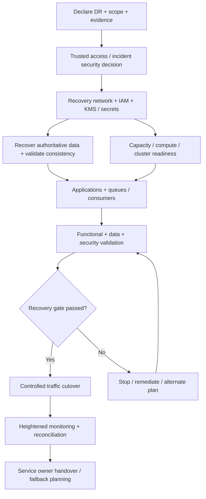

# Recovery runbook: Quy trình khôi phục có thể thực thi, đo lường và kiểm chứng

## 1. Mục tiêu học tập

Sau bài học, người học có thể:

- Giải thích **recovery runbook** trong **disaster recovery (DR)**, phân biệt nó với business continuity plan, disaster recovery plan, incident response playbook và hướng dẫn vận hành thông thường.
- Chuyển kết quả **Business Impact Analysis (BIA)**, mục tiêu **RTO/RPO** và bản đồ phụ thuộc thành các bước khôi phục có **người chịu trách nhiệm, điều kiện tiên quyết, quyền phê duyệt, tiêu chí hoàn thành và kế hoạch rẽ nhánh**.
- Thiết kế runbook cho sự cố mất vùng triển khai, hỏng cơ sở dữ liệu, ransomware hoặc không thể truy cập identity/control plane; cân nhắc failover, rebuild, restore, degraded mode và failback.
- Chứng minh dữ liệu sau phục hồi **đủ mới, nhất quán, toàn vẹn và chỉ được truy cập bởi danh tính được phép** thay vì chỉ dựa vào trạng thái “service running”.
- Xây dựng **security gates**, cơ chế bảo vệ bằng chứng, audit trail, kiểm thử định kỳ và cách xử lý tình huống thao tác thất bại hoặc điều kiện thực tế khác với giả định.
- Đánh giá kết quả diễn tập bằng các phép đo thời gian, mất dữ liệu, chức năng tối thiểu và mức bảo đảm của kiểm soát bảo mật; quản lý findings đến khi có bằng chứng kiểm tra lại.

Bài thuộc chương **Disaster recovery** trong dịch vụ `SECURITY_SECURITY_ASSURANCE`. Mục tiêu của dịch vụ là xây dựng cách đánh giá **có bằng chứng** rằng hệ thống đáp ứng các mục tiêu bảo mật, từ phân tích rủi ro, yêu cầu và security controls đến kiểm thử, audit và khắc phục phát hiện. Vì vậy, runbook không chỉ phải giúp đội vận hành “làm cho hệ thống chạy lại”, mà còn phải tạo ra dấu vết đủ để chứng minh **dịch vụ được khôi phục đúng trạng thái nghiệp vụ và các ranh giới bảo mật vẫn có hiệu lực**.

## 2. Recovery runbook là gì?

**Recovery runbook** là tài liệu vận hành có cấu trúc, thường đi kèm automation, hướng dẫn một nhóm được ủy quyền khôi phục **một hệ thống, dịch vụ hoặc chức năng nghiệp vụ xác định** khi xảy ra gián đoạn vượt quá điều kiện vận hành bình thường.

Một runbook có thể bao gồm:

1. Khi nào được kích hoạt và ai có quyền ra quyết định?
2. Kịch bản sự cố, phạm vi hệ thống và các giả định là gì?
3. Dịch vụ phải khôi phục ở mức tối thiểu nào, trước thời hạn nào?
4. Những phụ thuộc và quyền truy cập nào cần hoạt động trước?
5. Các bước khôi phục, thứ tự, điểm kiểm chứng và cách xử lý lỗi là gì?
6. Làm sao xác nhận dữ liệu, quyền truy cập, log và kết nối đã đúng?
7. Khi nào được mở lưu lượng, tiếp tục vận hành, failback hoặc kết thúc DR?
8. Những bằng chứng nào phải lưu để đánh giá sau sự cố hoặc sau diễn tập?

### 2.1. Phân biệt các tài liệu liên quan

| Tài liệu | Câu hỏi chính | Ví dụ |
|---|---|---|
| **Business Continuity Plan (BCP)** | Doanh nghiệp tiếp tục cung cấp năng lực tối thiểu ra sao khi bị gián đoạn? | Vận hành thủ công hoặc hạn chế chức năng thanh toán |
| **Business Impact Analysis (BIA)** | Gián đoạn gây ảnh hưởng gì, ưu tiên và mục tiêu thời gian nào? | Checkout RTO 60 phút, RPO 5 phút |
| **Disaster Recovery Plan (DRP)** | Chiến lược khôi phục công nghệ, tổ chức, nguồn lực và tình huống DR là gì? | Failover sang region dự phòng và restore data |
| **Recovery runbook** | Nhóm nào phải làm bước nào, theo thứ tự/điều kiện gì, kết quả được xác minh thế nào? | Quy trình chuyển traffic và đối soát order database |
| **Incident response playbook** | Làm sao phát hiện, phân tích, cô lập, loại bỏ xâm nhập và điều tra? | Thu hồi credential bị lộ, giữ bằng chứng forensic |
| **Standard operating procedure** | Công việc lặp lại trong điều kiện bình thường thực hiện thế nào? | Rolling restart khi hệ thống khỏe |
| **Architecture/dependency map** | Dịch vụ phụ thuộc tài nguyên, danh tính, dữ liệu và đối tác nào? | Checkout → database → KMS; checkout → payment gateway |

Runbook phải phù hợp DRP và BIA nhưng không nên chỉ dẫn “tham khảo DRP” ở những bước cần thao tác. Người đang trực lúc sự cố phải xác định được **đúng hành động, đúng tài sản, người duyệt và kết quả kỳ vọng** ngay cả khi hạ tầng quản trị thông thường bị gián đoạn.

### 2.2. “Khôi phục” có nhiều mức

Một runbook cần nói rõ đích phục hồi:

- **Infrastructure available:** máy, mạng, cluster hoặc database đã khởi động.
- **Application available:** endpoint hoạt động và dependency cơ bản đã nối.
- **Business function restored:** người dùng thực hiện được quy trình trọng yếu; dữ liệu đúng.
- **Minimum service restored:** mức chức năng tối thiểu đã được BIA phê duyệt, có thể vẫn hạn chế.
- **Full service restored:** trở lại năng lực và phạm vi thông thường sau khi được xác minh.

Ví dụ HTTP 200 từ health endpoint **không đủ** chứng minh đơn hàng được ghi bền vững, thanh toán không bị xử lý hai lần hoặc bảo vệ thông tin cá nhân đã được khôi phục. Runbook phải có **business verification**, không chỉ infrastructure check.

## 3. Runbook được xây dựng từ rủi ro, BIA và mục tiêu phục hồi

Một tài liệu khôi phục tốt bắt đầu bằng **dịch vụ nghiệp vụ cần bảo vệ**, không bắt đầu bằng danh sách lệnh.

### 3.1. Xác định mục tiêu có thể đo

| Chỉ tiêu | Ý nghĩa | Điều phải đo và ghi nhận |
|---|---|---|
| **RTO – Recovery Time Objective** | Mục tiêu thời gian tối đa để phục hồi chức năng ở mức định nghĩa | Mốc bắt đầu gián đoạn và mốc chức năng thực tế được xác minh |
| **RPO – Recovery Point Objective** | Mức mất dữ liệu tối đa có thể chấp nhận, tính theo thời gian | Mốc giao dịch đã được ghi nhận và điểm khôi phục nhất quán |
| **MTPD/MAO** | Ngưỡng gián đoạn tối đa tổ chức chấp nhận theo phương pháp BIA | Rủi ro khi vượt ngưỡng, tiêu chí escalation |
| **Minimum service level** | Chức năng hoặc throughput tối thiểu phải có trong DR | User journey, nghiệp vụ cho phép, capacity và giới hạn |
| **Security recovery criteria** | Các kiểm soát bắt buộc trước khi mở lại hệ thống | IAM, encryption, audit, network policy, dữ liệu sạch |
| **Reconciliation objective** | Cách đối soát các giao dịch đang dở và trạng thái không rõ | Bảng đối soát, số bản ghi, idempotency và chủ ký xác nhận |

Các con số là **mục tiêu** được phê duyệt. Không ghi “RTO đạt” chỉ vì một cuộc diễn tập chưa vượt thời hạn nếu bài thử không bao gồm thời gian quyết định, chuẩn bị danh tính, khôi phục dữ liệu và kiểm tra bảo mật.

### 3.2. Ví dụ giả định

Hệ thống đặt hàng có các mục tiêu do BIA phê duyệt:

| Dịch vụ/chức năng | RTO | RPO | Minimum service khi DR |
|---|---:|---:|---|
| Ghi nhận đơn hàng | 60 phút | 5 phút | Đơn được ghi bền vững và có ID để truy vết |
| Tra cứu trạng thái đơn | 4 giờ | 30 phút | Trả dữ liệu gần nhất có nhãn thời gian |
| Phê duyệt hoàn tiền | 2 giờ | 5 phút | Tiếp nhận yêu cầu an toàn, chưa tự chi tiền khi trạng thái thiếu chắc chắn |
| Báo cáo quản trị | 24 giờ | 24 giờ | Dùng snapshot cuối cùng đã đối soát |

**Giả định quan trọng:** nếu cổng thanh toán ngoài không khả dụng, chính sách doanh nghiệp có thể cho phép nhận **đơn chờ thanh toán** nhưng không được ghi nhận **thanh toán thành công**. Runbook cần phân biệt kết quả nghiệp vụ và bảo đảm idempotency để không thu tiền hai lần khi retry.

### 3.3. Đường găng và thời gian thực

Thời gian khôi phục có thể gồm: phát hiện, tuyên bố DR, phê duyệt, giành quyền truy cập, dựng phụ thuộc, restore dữ liệu, chuyển traffic, kiểm tra nghiệp vụ và bảo mật. Chỉ tính thời gian **restore database** là chưa đủ.

Một số bước có thể thực hiện song song nhưng phải đáp ứng **preconditions**, tránh hai nhóm cùng thay tài nguyên hoặc đưa ra quyết định bất nhất. RTO thực tế cần đo với quy ước thời điểm bắt đầu/kết thúc rõ ràng và công bố các phần nào bị loại khỏi bài test.

## 4. Phân loại tình huống: Không có một runbook cho mọi thảm họa

| Kịch bản | Tài sản có thể còn tin cậy? | Chiến lược cần xem xét | Rủi ro nếu dùng sai runbook |
|---|---|---|---|
| Mất một availability zone | Thường có thể còn tin cậy nếu không có compromise | Chuyển workload, capacity và network path | Vùng dự phòng thiếu tài nguyên |
| Mất region | Có thể phụ thuộc dịch vụ global và replication | Cross-region failover, data reconciliation | Không đạt RPO hoặc mất control plane |
| Database corruption | Tính toàn vẹn dữ liệu bị nghi ngờ | Point-in-time restore, replay an toàn | Phục hồi lại trạng thái bị sửa |
| Ransomware/compromise | Một phần hoặc toàn bộ trust boundary có thể đã mất | Cô lập, điều tra, eradication, rebuild sạch rồi recovery | Đưa mã độc/credential lộ sang DR site |
| Lộ credential cloud | Hệ thống có thể vẫn chạy nhưng quyền không tin cậy | Thu hồi quyền, rotation, kiểm audit, clean control-plane path | Attacker có thể phá cả vùng khôi phục |
| SaaS/IdP/DNS outage | Infrastructure ứng dụng có thể còn khỏe | Degraded mode, alternate provider, break-glass | Không thể đăng nhập/quản trị hoặc chuyển hướng |
| Data-center power/network outage | Hardware và đường truyền không sẵn sàng | Chuyển địa điểm, nhà mạng, alternate access | Phụ thuộc đường truyền chung không được nhận diện |

**Quy tắc quan trọng:** khi có dấu hiệu xâm nhập, **không tự động đồng bộ dữ liệu hoặc credential từ môi trường nghi ngờ sang môi trường sạch**. Phải phối hợp incident response để đánh giá thời điểm xâm nhập, phương pháp bảo toàn chứng cứ, nguồn backup tin cậy và điều kiện cho phép khôi phục.

## 5. Ranh giới tin cậy và phụ thuộc phải có trong runbook

Một kế hoạch có hai regions vẫn có thể thất bại nếu cả hai phụ thuộc vào một identity provider, key manager, DNS, artifact registry hoặc cơ chế phê duyệt.



*Đây là sơ đồ phụ thuộc minh họa*. Mũi tên nghĩa là dịch vụ hoặc bước khôi phục cần thành phần khác; không hàm ý mỗi thành phần đều phải hoạt động cho mọi request trong trạng thái bình thường.

### 5.1. Phân biệt dependency khi chạy và khi khôi phục

- **Runtime dependency:** database, service identity, network route hoặc cổng thanh toán có thể cần để phục vụ giao dịch.
- **Startup dependency:** registry, DNS, secret manager hoặc scheduler có thể cần khi workload khởi động lại.
- **Recovery-only dependency:** quyền tạo hạ tầng, KMS để giải mã snapshot, backup catalog, cloud quota, người phê duyệt failover.
- **Security gate dependency:** audit sink, network policy, signing keys, chức năng kiểm soát truy cập phải đạt trước khi mở lại traffic.
- **Human/vendor dependency:** người trực, cơ quan phê duyệt, support provider và kênh liên hệ ngoài hạ tầng bị lỗi.

Không thấy yêu cầu đến registry trong tracing khi app đang chạy **không** chứng minh registry không cần khi tạo Pod mới sau sự cố. Phân tích phải bao phủ cold start, restore, failover và failback.

### 5.2. Kiểm điểm lỗi chung

- Primary và secondary cùng dùng một quyền cloud có thể bị vô hiệu.
- KMS key chỉ tồn tại hoặc không thể được sử dụng ở vùng DR.
- Backup khác vùng nhưng người quản trị không thể đăng nhập khi IdP lỗi.
- DNS chuyển được sang nơi khác, nhưng các client cache bản ghi cũ lâu hơn dự kiến.
- Traffic chuyển được nhưng đối tác chưa allowlist IP của vùng dự phòng.
- Compute dự phòng có đủ replicas ở mức rỗi nhưng không đủ throughput.
- Logging/security monitoring hoạt động ở primary nhưng không có tại DR.
- Các service cùng dùng một CI/CD artifact chưa được kiểm provenance.

Một cạnh phụ thuộc quan trọng phải có **owner, nguồn bằng chứng, mức tin cậy và kịch bản thử tương ứng**.

## 6. Cấu trúc bắt buộc của recovery runbook

Runbook nên có các nhóm thông tin dưới đây, được version control và liên kết từ hệ thống trực sự cố.

| Nhóm | Nội dung tối thiểu |
|---|---|
| **Identity** | `runbook_id`, phiên bản, tên dịch vụ, môi trường, phạm vi tài sản, owner |
| **BIA/priority** | RTO, RPO, minimum service, mức độ ưu tiên, risk classification |
| **Activation** | Các tín hiệu/kịch bản kích hoạt, người tuyên bố DR, quyền quyết định |
| **Contacts** | Incident commander, service owner, platform, data, IAM, security, vendor, business |
| **Trusted access** | Cách có quyền khẩn cấp, break-glass procedure, kênh không phụ thuộc nơi lỗi |
| **Preconditions** | Điều kiện đã được xác minh trước khi thực hiện, dữ liệu cần đủ, security gate |
| **Dependencies** | Registry, KMS, backup, DNS, networking, IAM, cloud API, provider |
| **Actions** | ID bước, actor, công cụ, target, thời điểm, pre/post-check, expected output |
| **Decision branches** | Nếu điều kiện không đạt, dừng, fallback, rollback, escalation thế nào |
| **Evidence** | Audit trail, snapshots/screening, test logs, checksum, approvals, timestamps |
| **Validation** | Functional, data integrity, capacity, security, external integrations |
| **Exit/handback** | Cho phép mở traffic, degraded mode, owner ký xác nhận, giám sát tăng cường |
| **Failback** | Nếu và khi quay về primary, hướng đồng bộ dữ liệu, tiêu chí hoàn thành |
| **Maintenance** | Last drill, last reviewed, thay đổi kiến trúc, known gaps, next review |

Nên tách **danh sách bí mật, thông tin xác thực và chi tiết nhạy cảm** khỏi runbook phổ biến. Runbook chỉ dẫn người có quyền đến nơi quản lý credential phù hợp; không chèn API key, password hoặc recovery code vào Markdown hay ticket thông thường.

### 6.1. Mỗi bước phải có trạng thái kiểm chứng

Một bước hữu ích không chỉ là “restore database”. Nó cần:

```text
STEP ID: DR-DATA-04
Goal: Khôi phục Orders DB tại recovery region
Preconditions: KMS access READY; backup integrity VERIFIED;
               target network READY; restore approval RECORDED
Owner: Database recovery lead
Action: Dùng quy trình restore đã duyệt với backup/point-in-time ID
Expected: DB chạy, dữ liệu nhất quán, phục hồi tới mốc được chọn
Verify: Check restore job, DB readiness, log/transaction position,
        integrity checks, application-level reconciliation
Evidence: Job ID, snapshot/backup ID, timestamps, result, reviewer
Failure branch: STOP traffic cutover; mở finding, chọn restore point khác
Status: PENDING / IN_PROGRESS / VERIFIED / FAILED / BLOCKED
```

Đây là **mẫu thao tác**, không phải kết quả đã xảy ra. Chỉ được ghi `VERIFIED` khi đã xem **bằng chứng thực tế** đúng với exit criteria.

## 7. Roles, quyền ra quyết định và phối hợp trong DR

DR không nên vận hành theo giả định “người đang ở bàn phím quyết định tất cả”. Mỗi quyền cần được thiết kế trước để giảm thời gian khôi phục và tránh xung đột.

| Vai trò | Trách nhiệm chủ yếu | Quyết định được giao |
|---|---|---|
| **Incident/DR commander** | Điều phối, thứ tự ưu tiên, timeline, escalation | Tuyên bố/kết thúc DR trong phạm vi được ủy quyền |
| **Business service owner** | Xác nhận mức dịch vụ tối thiểu và ảnh hưởng | Chấp nhận chức năng suy giảm theo chính sách |
| **Platform/Cloud lead** | Hạ tầng, routing, compute, cluster, quota | Thực hiện thao tác đã phê duyệt |
| **Database/Data lead** | Backup, restore, replication, reconciliation | Đề xuất điểm phục hồi và xác minh tính toàn vẹn |
| **IAM/Security lead** | Truy cập khẩn cấp, quyền và security gates | Xác nhận điều kiện an toàn; báo cáo rủi ro còn lại lên cấp có thẩm quyền |
| **Application lead** | Triển khai và test user journey | Xác nhận chức năng ứng dụng đã khôi phục |
| **Communications lead** | Thông báo nội bộ, khách hàng, đối tác | Phát thông báo theo thẩm quyền |
| **Scribe/Evidence custodian** | Ghi timeline, quyết định, tác vụ, evidence | Bảo vệ bản ghi và chất lượng audit |
| **Vendor contact** | Liên hệ hỗ trợ ngoài doanh nghiệp | Theo hợp đồng/ủy quyền |

Một người có thể kiêm nhiệm trong tổ chức nhỏ, nhưng cần biết **ai phê duyệt** và **ai thực hiện**; với thay đổi nhạy cảm nên tách nhiệm vụ khi phù hợp.

### 7.1. Kênh liên lạc khi hệ thống thông thường bị lỗi

- Danh sách liên hệ khẩn cấp được bảo vệ và cập nhật.
- Kênh liên lạc dự phòng không phụ thuộc hoàn toàn IdP, VPN hoặc email cùng vùng bị ảnh hưởng.
- Một nơi ghi **decision log** có khả năng tiếp tục hoạt động và phân quyền.
- Quy ước timestamp UTC, số incident và mã bước để tránh nhầm lệnh.
- Quy tắc thông báo: ai phải biết, khi nào và nội dung nhạy cảm được chia sẻ đến đâu.

Thử khả năng liên hệ thật trong tabletop; không coi một danh sách số điện thoại nhiều tháng chưa kiểm là bằng chứng nhân sự sẽ sẵn sàng khi sự cố.

### 7.2. Break-glass access

Khôi phục thường cần quyền lớn hơn vận hành hằng ngày. Tài khoản và cơ chế break-glass phải:

- Được quản lý riêng, cấp quyền có mục đích và có giới hạn.
- Có cơ chế xác thực và bảo vệ credential phù hợp kịch bản IdP outage.
- Được kiểm tra định kỳ bằng thủ tục có quyền.
- Có audit trail và review sau sử dụng.
- Có cách thu hồi phiên/credential, quay về quyền tối thiểu sau DR.

Không thiết kế một “tài khoản chung không có log” làm giải pháp dự phòng.

## 8. Activation: Khi nào tuyên bố thảm họa và bắt đầu runbook?

Một runbook cần **trigger rõ ràng** và một điểm quyết định có thẩm quyền. Trigger có thể là:

- Dịch vụ nghiệp vụ trọng yếu vượt ngưỡng gián đoạn hoặc dự kiến không đạt RTO nếu chờ sửa tại chỗ.
- Region/zone/provider không thể phục hồi trong thời gian phù hợp.
- Mất dữ liệu hoặc tính toàn vẹn dữ liệu cần restore từ backup/replica.
- Security incident khiến primary không còn mức tin cậy đủ để mở lại.
- Mất hạ tầng quản lý, identity hoặc network cần cho hoạt động.
- Quyết định chủ động chuyển dịch vụ do rủi ro thảm họa dự báo.

### 8.1. Các trạng thái vận hành

| Trạng thái | Mô tả | Ai quyết định bước tiếp |
|---|---|---|
| `MONITORING` | Có cảnh báo, chưa đủ điều kiện tuyên bố DR | On-call và incident lead |
| `ASSESSING` | Đang phân tích tác động, phạm vi và thời gian dự kiến | Incident/DR commander |
| `DECLARED` | Kích hoạt DR chính thức; khóa phạm vi và điều phối | Người có thẩm quyền tuyên bố DR |
| `PREPARING` | Kiểm trust, backup, quyền, mạng, phụ thuộc trước cutover | Các technical leads |
| `RESTORING` | Rebuild, restore dữ liệu, dựng thành phần | Task owners |
| `VALIDATING` | Chạy tests chức năng, data, security, capacity | Business + technical + security reviewers |
| `ACTIVE_DR` | Đã chuyển sang DR, đang phục vụ với giám sát tăng cường | Commander + service owner |
| `FAILBACK_PLANNING` | Đang đánh giá quay về primary hoặc tiếp tục DR | Owner và change authority |
| `CLOSED` | Handover vận hành, bằng chứng và findings được ghi | Commander theo exit policy |

Không đánh đồng **DECLARED** với **service restored**. Mỗi lần chuyển trạng thái cần thời điểm và quyết định được ghi nhận.

### 8.2. Go/no-go decision

Trước những bước không thể đảo ngược như thay writer database hoặc thay route toàn bộ người dùng, cần điểm **GO/NO-GO** dựa trên các điều kiện hiện hành: dữ liệu phục hồi đáng tin, quyền, network, fencing, capacity, người thực hiện và rollback. Nếu một điều kiện không đạt, ghi quyết định STOP hoặc phương án thay thế có phê duyệt; không bỏ qua điều kiện chỉ vì áp lực thời gian.

## 9. Kiểm tra preconditions trước khi thay đổi hệ thống

Một bảng preflight giúp giảm các lần thất bại ngay trong sự cố.

| Precondition | Phương pháp xác minh | Kết quả khi thiếu |
|---|---|---|
| BIA/DR target còn hiệu lực | Kiểm service version, owner và approved objectives | Tạm dừng lựa chọn cutover hoặc yêu cầu quyết định mới |
| Primary được cô lập/đánh giá | Network/identity/state check theo kịch bản | Nguy cơ split-brain hoặc tái nhiễm |
| Recovery site có capacity | Cloud quota, compute/storage availability, load test evidence | Chọn degraded mode hoặc bổ sung tài nguyên |
| Backup/replica có sẵn và dùng được | Catalog, integrity, encryption/key access | Chọn restore point khác hoặc phương án khác |
| IAM/break-glass có hiệu lực | Quyền được cấp và thử xác thực an toàn | Escalation qua quy trình truy cập khẩn cấp |
| KMS/secrets/certificates hợp lệ | Metadata, access checks, expiry và DR scope | Chưa thể giải mã hoặc xác thực |
| DNS/network/endpoint rõ ràng | Route, firewall, allowlist vendor, name resolution | Không cutover traffic nếu sai |
| Observability/audit hoạt động | Collector health và test event | Bảo vệ lỗ hổng quan sát, quyết định rủi ro nếu cần |
| Bằng chứng forensic đã được bảo toàn | Evidence custodian sign-off theo sự cố | Ngăn thao tác xóa khi chưa có quyền |
| Stakeholders đang phối hợp | Decision log, on-call acknowledgments | Escalation, tránh các nhóm sửa chồng |

Một điều kiện `UNKNOWN` là kết quả có ý nghĩa; không nên diễn giải “không thấy báo lỗi” thành `PASS`.

## 10. Thiết kế thứ tự phục hồi và các tác vụ song song

Mối quan hệ phụ thuộc quyết định bước nào cần đi trước; thứ tự cụ thể phụ thuộc kiến trúc và trạng thái sự cố.



Một số bước có thể chạy song song: chuẩn bị network và kiểm backup, dựng compute và chuẩn bị dữ liệu, nhưng phụ thuộc KMS/identity có thể chặn cả hai. Phân tích **critical path** phải dựa vào thời gian quan sát trong diễn tập, bao gồm chờ phê duyệt và kiểm thử.

### 10.1. Phụ thuộc vòng

Nếu A chỉ khởi động khi B hoạt động và B cần A để lấy cấu hình, hệ thống có **recovery dependency cycle**. Cần thiết kế một bootstrap mode hoặc seed configuration độc lập, rồi diễn tập **cold start** từ trạng thái các thành phần cùng dừng. Khởi động lại một Pod khi toàn bộ cluster đang khỏe không kiểm chứng được trường hợp này.

### 10.2. Tài nguyên có tính bền vững và xử lý hàng đợi

Đối với database, event bus, queue và job workers cần xem:

- Writer hiện hành và phương án ngăn **split-brain**.
- Replication lag và transaction log đã được ghi bền vững.
- Consumer offsets, trạng thái xử lý dở và cơ chế replay.
- Idempotency keys cho thanh toán, xuất hóa đơn và các side effects.
- Số lượng thông điệp chưa xác nhận, poison messages và retry policy.
- Cách đối soát dữ liệu giữa database và hệ thống bên ngoài.

Nếu bật consumer trước khi database và trạng thái offset đã được xác minh, hệ thống có thể xử lý trùng, bỏ thông điệp hoặc ghi dữ liệu không nhất quán.

## 11. Dữ liệu: Chọn điểm phục hồi đáng tin và chứng minh RPO

Đối với nhiều dịch vụ, **dữ liệu** là phần khó nhất của recovery. Backup job chạy thành công không có nghĩa dữ liệu có thể được restore đúng, không bị sửa hoặc không vượt RPO.

### 11.1. Trình tự đánh giá dữ liệu

1. Xác định **source of truth** cho từng loại dữ liệu, owner và thời điểm giao dịch có hiệu lực.
2. Chọn **restore point**/replica và kiểm chứng mốc nhất quán của dữ liệu.
3. Xác minh backup catalog, quyền truy cập, encryption keys và trạng thái integrity.
4. Đánh giá khả năng backup/replica đã chứa dữ liệu bị sửa hay malware trong kịch bản compromise.
5. Phục hồi trong môi trường phù hợp, chưa mở write traffic.
6. Chạy kiểm tra cấu trúc, constraints, application invariants và đối soát nghiệp vụ.
7. Tính **khoảng mất dữ liệu** theo các giao dịch đã được xác nhận trước gián đoạn, không chỉ dựa trên timestamp của tệp backup.
8. Ghi các giao dịch thiếu, pending hoặc cần replay/đối soát; có owner xử lý.

### 11.2. Ví dụ tính RPO

Giả sử tại **10:00 UTC**, primary mất hoàn toàn. Dựa trên nguồn đáng tin, hệ thống đã xác nhận các giao dịch đến 10:00. Vùng dự phòng có trạng thái nhất quán đến **09:57 UTC**. Trong ví dụ đơn giản này, khoảng cách điểm khôi phục là **3 phút**, tức nằm trong mục tiêu RPO 5 phút.

Tuy nhiên kết luận chỉ hợp lệ khi:

- Timestamp phản ánh **mốc commit và dữ liệu thực** chứ không phải thời điểm tiến trình backup khởi động.
- Tất cả các hệ dữ liệu có liên quan tới một nghiệp vụ nhất quán tại mốc được chọn.
- Đã đối chiếu những giao dịch đã được báo thành công cho người dùng nhưng không tồn tại ở vùng DR.
- Các lệnh gửi đến provider ngoài như payment không bị giả định “đã hoàn tác” khi DB phục hồi.

Nếu hệ thống không có đủ transaction IDs, log positions hoặc nguồn đối soát để biết dữ liệu nào đã được commit, ghi **UNKNOWN** về mức mất dữ liệu thay vì tuyên bố chắc chắn đạt RPO.

### 11.3. Kiểm chứng dữ liệu ở nhiều lớp

| Lớp | Kiểm tra |
|---|---|
| **Restore operation** | Restore job thành công, đúng backup ID và target |
| **Engine consistency** | Database có thể mở, cơ chế recovery/replay hoàn tất, constraints quan trọng hợp lệ |
| **Business consistency** | Order, payment, ledger, inventory và invoices khớp theo quy tắc |
| **Security** | Dữ liệu được giải mã đúng, phân quyền và audit đúng, không chứa payload trái phép đã biết |
| **External reconciliation** | Payment provider/đối tác có giao dịch nào thành công ngoài bản ghi hệ thống? |
| **Read/write safety** | Chỉ một writer được chấp thuận, transactions mới không làm mất logic khôi phục |

Một kết quả `SELECT 1` thành công chứng minh database trả lời query, **không** chứng minh toàn vẹn nghiệp vụ.

### 11.4. Rủi ro khi restore sau ransomware

Backup có thể chứa mã độc, tài khoản hậu môn (*backdoor*), script tự khởi động hoặc dữ liệu đã bị sửa trước khi cuộc tấn công được phát hiện. Cần phối hợp với incident response để xác định **compromise window**, môi trường sạch và credential/khóa phải thay mới. Một snapshot “được tạo trước ngày phát hiện” không mặc nhiên sạch.

## 12. Chuyển đổi traffic: Failover, DNS, session và split-brain

**Failover** là chuyển phục vụ sang hệ thống hoặc vùng thay thế. Đây không chỉ là cập nhật một DNS record.

### 12.1. Những điều phải xác nhận trước cutover

- **Primary writer bị ngăn ghi** hoặc có cơ chế fencing nhất quán để không tồn tại hai nguồn có thẩm quyền.
- Hệ thống DR có đủ capacity, quota và network connectivity.
- DNS, load balancer, API gateway, CDN, private endpoints và external allowlist được xử lý.
- TLS certificates, identities, secrets và backend policies còn đúng.
- Dữ liệu đã phục hồi và đối soát theo chính sách.
- Job/queue consumers không xử lý trùng và không thực hiện side effects ngoài ý muốn.
- Health checks và monitoring có khả năng đánh giá user journey thực, không chỉ TCP port.
- Có người quyết định **GO** và một kế hoạch xử lý nếu cutover không đạt.

### 12.2. TTL và client cache

Giảm DNS TTL trước DR có thể giúp một số client chuyển nhanh nhưng **không bảo đảm mọi client lập tức đổi địa chỉ**. Resolver cache, kết nối dài, pin IP, thiết bị proxy và dịch vụ bên ngoài có hành vi khác nhau. Một runbook cần thử thực tế và có kế hoạch xử lý traffic còn đi tới primary.

### 12.3. Split-brain và double write

Tình huống nguy hiểm: primary không tiếp cận được với một phần hệ thống, đội vận hành kích hoạt secondary thành writer, nhưng primary vẫn nhận write từ một nhóm client khác. Có thể xuất hiện **hai trạng thái dữ liệu độc lập**.

Phải dùng cơ chế được thiết kế cho hệ thống cụ thể như fencing, lease/leader election, failover control của database và quy trình ngăn writer cũ. Không chỉ dựa vào quan sát “primary không trả lời từ máy tôi” để suy ra toàn bộ primary đã dừng. Nếu không chứng minh được fencing, phải báo cấp có thẩm quyền và giữ chế độ chỉ đọc/giới hạn phù hợp thay vì mở write hai nơi.

## 13. Security gates: Không đánh đổi tính liên tục lấy mất kiểm soát

Khôi phục một hệ thống mà IAM, encryption hoặc audit đã bị vô hiệu có thể tạo ra **sự cố an ninh tiếp theo**. Runbook cần nêu rõ các kiểm soát bảo mật tối thiểu phải đạt trước khi tiếp tục.

| Security gate | Trạng thái mong đợi | Bằng chứng kiểm tra |
|---|---|---|
| **Trusted infrastructure** | Image/artifact được phê duyệt, chưa nghi bị chiếm | Build provenance, digest, baseline, scan phù hợp |
| **IAM và service identity** | Quyền tối thiểu và account được phê duyệt, break-glass được quản lý | Effective permissions, session audit, IAM state |
| **Secrets/KMS/certificates** | Khóa đúng, thời hạn còn hiệu lực, quyền truy cập hẹp | Metadata, access test, TLS checks, key access |
| **Network segmentation** | Chỉ cho phép luồng đã duyệt, không mở cổng quản trị public ngoài baseline | Effective firewall/route, network path tests |
| **Audit logging** | Các event bắt buộc được tạo, đến sink và có thể truy vấn | Test event, collector health, retention config |
| **Detection/monitoring** | Rule trọng yếu và luồng alert hoạt động | Canary/simulation an toàn, test routing, data health |
| **Data integrity** | Dữ liệu phục hồi nhất quán, không đưa lại điều kiện xâm nhập | Restore/reconciliation report, security checks |
| **Change control** | Tác vụ nhạy cảm có dấu vết và quyết định có thẩm quyền | Incident log, approval refs, execution record |
| **Backup protection** | Bản sao đáng tin, quyền sửa/xóa và khóa phù hợp | Backup catalog, permissions, integrity evidence |

### 13.1. Trạng thái PASS, FAIL, UNKNOWN và ngoại lệ

- `PASS`: gate đạt trong phạm vi và thời điểm kiểm chứng, có evidence.
- `FAIL`: có bằng chứng điều kiện bắt buộc không đáp ứng.
- `UNKNOWN`: dữ liệu thiếu, collector không hoạt động hoặc không đủ quyền kiểm; không coi là PASS.
- `NOT_APPLICABLE`: gate không áp dụng cho tài sản/chức năng cụ thể, có lý do.
- `EXCEPTION_APPROVED`: rủi ro đã được chấp thuận bởi người có thẩm quyền, có thời hạn và biện pháp bù trừ.
- `PENDING_VALIDATION`: đã sửa hoặc triển khai nhưng chưa có recheck.

Một runbook có thể quy định **no-go khi gate trọng yếu FAIL/UNKNOWN**. Nếu tình huống khẩn cấp đòi hỏi phục vụ ở chế độ hạn chế, phải có **quyết định chấp nhận rủi ro riêng**, ghi thời hạn và giám sát, không thay đổi `UNKNOWN` thành `PASS`.

### 13.2. Sự cố an ninh khác mất hạ tầng

Nếu nguyên nhân là ransomware hoặc tài khoản cloud admin bị xâm nhập, việc dùng lại các credential, pipeline, image hoặc backup từ primary có thể đưa tác nhân vào môi trường DR. Cần một **clean recovery path**: bảo toàn forensic evidence, xác minh nguồn sạch, thu hồi danh tính bị lộ, phân đoạn DR environment và kiểm tra trạng thái quyền sau restore.

Đội DR không được tự tuyên bố eradication đã thành công chỉ vì khôi phục chức năng. Điều kiện trust do incident response và security owner cung cấp phải nằm trong recovery gate.

## 14. Ví dụ lệnh xác minh an toàn trong runbook

Các lệnh dưới đây chỉ **đọc trạng thái**, minh họa một số bằng chứng kỹ thuật. Chúng không thay thế các lệnh failover/restore của nhà cung cấp và **không phải checklist dùng trực tiếp cho production** nếu chưa xác định cluster/context và quyền.

```bash
# Xác minh đúng Kubernetes context và tài nguyên.
kubectl config current-context
kubectl get namespaces
kubectl -n checkout get deployments,services,pods -o wide

# Xem trạng thái rollout và tài nguyên thực chạy.
kubectl -n checkout rollout status deployment/checkout-api --timeout=30s
kubectl -n checkout get pods -l app=checkout-api -o json

# Kiểm NetworkPolicy và danh tính gắn cho workload.
kubectl -n checkout get networkpolicies
kubectl -n checkout get serviceaccounts

# Kiểm quyền của chính principal hiện tại (chỉ trong context đã chọn).
kubectl auth can-i get pods -n checkout
```

Lưu ý:

- `kubectl config current-context` quan trọng để tránh thao tác nhầm cluster. `kubectl get` chứng minh một phần desired/deployed state, chưa xác minh hết effective runtime security.
- `kubectl rollout status` chờ controller báo trạng thái rollout, **không** chứng minh đầy đủ user journey, data integrity hay encryption.
- Output `-o json` có thể chứa metadata, environment hoặc chi tiết nội bộ; chỉ giữ trường cần thiết trong kho evidence được phân quyền.
- Đừng nhầm lệnh đọc trạng thái với phép thử lỗi thật. Một test kết nối bị chặn cần thực hiện từ **nguồn và đích được phép kiểm thử**, với bằng chứng rõ.

### 14.1. Trình bày lệnh thay đổi thế nào trong runbook thực?

Với thao tác có tác dụng như restore backup, cập nhật DNS hoặc promote replica, tài liệu production nên chỉ rõ:

- **Công cụ và phiên bản** được sử dụng, môi trường, tài khoản, region, mục tiêu.
- **Điều kiện trước** phải được xác nhận và **người phê duyệt**.
- **Command/template** được lấy từ nơi quản lý cấu hình đáng tin cậy, có tham số kiểm tra và hạn chế quyền.
- **Dry-run/plan**, nếu công cụ hỗ trợ và có ý nghĩa.
- **Expected response** và cách xác nhận runtime độc lập sau API success.
- **Stop/rollback/fallback** khi câu trả lời không như dự kiến.

Không đưa một lệnh giả định với resource ID có vẻ thật vào tài liệu học rồi khuyến khích chạy trực tiếp trên hệ thống đang hoạt động.

## 15. Mẫu runbook đầy đủ ở dạng cấu trúc

Đây là **một ví dụ YAML dùng làm tài liệu**, không phải schema chuẩn của công cụ DR cụ thể, không kích hoạt tài nguyên.

```yaml
runbook_id: DR-CHECKOUT-REGION-01
version: "1.0.0"
title: "Khôi phục checkout khi primary region unavailable"
status: "DRAFT_FOR_VALIDATION"
scope:
  business_service: checkout
  environment: production
  primary_region: region-a
  recovery_region: region-b
  minimum_service: "Nhận đơn và ghi bền vững; thanh toán theo trạng thái được phép"
objectives:
  rto_minutes: 60
  rpo_minutes: 5
owners:
  commander: incident-management
  business: commerce-operations
  platform: platform-dr
  database: data-platform
  security: security-assurance
activation:
  criteria:
    - "Primary không thể đáp ứng minimum service trong ngưỡng BIA"
    - "Incident commander đã tuyên bố DR"
  requires_approval: true
preconditions:
  - id: PRE-01
    check: "Recovery-region access và quota phù hợp"
    owner: platform-dr
  - id: PRE-02
    check: "Restore point, KMS, dữ liệu nhất quán đã kiểm"
    owner: data-platform
  - id: PRE-03
    check: "Primary writer được fencing"
    owner: data-platform
  - id: PRE-04
    check: "IAM, network, audit và security gates được đánh giá"
    owner: security-assurance
steps:
  - id: DR-01
    description: "Ghi quyết định kích hoạt và khóa phạm vi"
    owner: incident-management
    depends_on: []
    evidence: "Incident log + approval"
  - id: DR-02
    description: "Kiểm KMS và chuẩn bị restore point"
    owner: data-platform
    depends_on: [DR-01]
    success: "Backup integrity và key access VERIFIED"
  - id: DR-03
    description: "Fencing writer cũ và khôi phục dữ liệu tại region-b"
    owner: data-platform
    depends_on: [DR-02]
    success: "DB nhất quán, transaction position đã xác nhận"
    on_failure: "STOP; không mở write traffic; chuyển phương án khác"
  - id: DR-04
    description: "Xác minh năng lực application và external dependencies"
    owner: platform-dr
    depends_on: [DR-01]
    success: "Cluster/capacity/network READY"
  - id: DR-05
    description: "Chạy functional, data và security validation"
    owner: commerce-operations
    depends_on: [DR-03, DR-04]
    success: "Tất cả required gates VERIFIED hoặc có quyết định rủi ro"
  - id: DR-06
    description: "Chuyển traffic có kiểm soát"
    owner: incident-management
    depends_on: [DR-05]
    requires_go_no_go: true
    on_failure: "Dừng mở traffic; kiểm lỗi và phương án xử lý"
  - id: DR-07
    description: "Tăng giám sát, đối soát và bàn giao vận hành"
    owner: commerce-operations
    depends_on: [DR-06]
    success: "Minimum service và audit hoạt động ổn định theo gate"
postconditions:
  - "RTO/RPO được đo và ghi kết quả theo định nghĩa"
  - "Có evidence và finding cho gate chưa đạt"
  - "Có kế hoạch failback hoặc tiếp tục DR"
known_gaps:
  - "Chưa chứng minh đầy đủ capacity khi traffic đạt đỉnh"
last_reviewed_at: "2026-11-28T05:00:00Z"
```

**Không được chuyển `DRAFT_FOR_VALIDATION` thành “production-ready” chỉ bằng việc hoàn thiện YAML.** Runbook phải trải qua owner review, test, đo thời gian và được gắn với tài sản/tham số vận hành có thẩm quyền.

### 15.1. Runbook con và mức phân rã

Một runbook cấp dịch vụ có thể gọi các runbook con:

- `DR-IAM-BREAKGLASS`: xác thực/quản trị khẩn cấp.
- `DR-DATA-PITR`: restore và reconciliation của database.
- `DR-CLOUD-FAILOVER`: network/routing/compute tại recovery region.
- `DR-K8S-WORKLOAD`: triển khai và kiểm workload.
- `DR-SECURITY-GATES`: IAM, logging, TLS, network, artifact và evidence.
- `DR-FAILBACK`: chuyển lại primary an toàn.

Mỗi runbook con cần version và owner; không nên dùng tham chiếu mơ hồ tới “tài liệu mới nhất” khi đang chạy một incident đã cố định phiên bản.

## 16. Execution log và cách giữ bằng chứng trong lúc phục hồi

Khi DR đang diễn ra, đội ứng phó thường tập trung sửa hệ thống và quên ghi **điều đã thay đổi**. Điều đó khiến không thể phân biệt kết luận có bằng chứng với ký ức của người vận hành.

### 16.1. Nhật ký tác vụ khôi phục

Mỗi bước cần ghi:

| Trường | Ý nghĩa |
|---|---|
| `incident_id` / `runbook_version` | Đúng sự cố và phiên bản quy trình |
| `step_id` / `attempt_no` | Bước cụ thể và số lần thử |
| `actor` / `approver` | Ai thực thi, ai cho phép |
| `started_at` / `finished_at` | Mốc thời gian UTC để tái lập |
| `resource_ids` | Tài sản, region, cluster, database |
| `precheck` | Bằng chứng điều kiện trước |
| `action_ref` | Truy vấn, template, change record hoặc job ID |
| `expected` / `observed` | Tiêu chí và kết quả thực tế |
| `status` | SUCCESS_VERIFIED / FAILED / BLOCKED / UNKNOWN |
| `evidence_refs` | Log, kiểm thử, snapshot được lưu an toàn |
| `next_action` | Nhánh tiếp, fallback, escalation hoặc rollback |

Ví dụ một bước restore có API response success nhưng integrity check chưa chạy phải ở trạng thái **PENDING_VALIDATION**, không phải `SUCCESS_VERIFIED`.

### 16.2. Chain of custody và bảo vệ dữ liệu

- Ghi nguồn, thời gian, người thu và phương thức thu thập evidence.
- Bảo vệ kết quả bằng quyền truy cập thích hợp, retention, checksum hoặc cơ chế kiểm toàn vẹn khi cần.
- Không đưa plaintext Secrets, khóa, token, dữ liệu khách hàng hay backup dump vào báo cáo chung.
- Giữ liên kết đến **bản gốc đáng tin** và mô tả phép chuẩn hóa/trích xuất để điều tra.
- Với security incident, phối hợp forensic custodian để không phá bằng chứng trước khi hủy tài nguyên.

Hash của một file log chỉ giúp kiểm một bản ghi đã thu có bị đổi không; **không tự chứng minh log đầy đủ**. Cần kết hợp kiểm data source coverage và health của audit pipeline.

## 17. Kiểm thử Recovery runbook: từ tabletop đến end-to-end

Runbook là một giả thuyết vận hành cho tới khi được diễn tập trong điều kiện đủ đại diện.

### 17.1. Các mức kiểm thử

| Mức | Phép thử | Chứng minh được | Chưa chứng minh |
|---|---|---|---|
| **Document review** | Đối chiếu owner, IDs, yêu cầu, quyền và dependencies | Tài liệu không thiếu các phần dễ thấy | Khả năng thực thi dưới áp lực |
| **Tabletop** | Mô phỏng quyết định và communications | Người tham gia hiểu vai trò và nhánh xử lý | Thời gian restore và data integrity thật |
| **Component restore** | Khôi phục một DB, backup hoặc service trong môi trường thử | Công cụ và artifact dùng được trong phạm vi | Toàn bộ business journey đạt RTO/RPO |
| **Failover rehearsal** | Chuyển ứng dụng/dữ liệu trong staging DR | Phụ thuộc và các gate kỹ thuật có thể hoạt động | Production load, supplier real behavior nếu không thử |
| **Integrated DR exercise** | Từ declaration đến business/security validation | Một phần năng lực end-to-end với timestamps | Các tình huống chưa được bao phủ |
| **Controlled production exercise** | Thử phạm vi đã duyệt trên production | Kiểm chứng sát thực tế hơn | Không đại diện cho mọi thảm họa hay attacker |

Mọi bài thử gây lỗi phải được lên kế hoạch, giới hạn blast radius, có phê duyệt, safety stop và rollback. Không tự ngắt network/KMS, tắt audit hoặc xóa tài nguyên production để “thử nhanh” một runbook.

### 17.2. Ma trận test minh họa

| ID | Kịch bản | Tiêu chí nghiệm thu |
|---|---|---|
| `DR-T01` | Primary region unavailable | Dịch vụ tối thiểu chạy ở recovery region trong RTO mục tiêu |
| `DR-T02` | Replica trễ 7 phút với RPO 5 phút | Không tự báo PASS; chọn phương án phục hồi/điều tra phù hợp |
| `DR-T03` | KMS/secret access từ DR bị từ chối | Không tiếp tục restore; chuyển cấp xử lý và ghi blocker |
| `DR-T04` | SSO chính không truy cập được | Quy trình break-glass hoạt động, có giới hạn và audit |
| `DR-T05` | Cổng thanh toán không chấp nhận IP mới | Không đánh dấu giao dịch “paid”; dùng degraded mode có kiểm soát |
| `DR-T06` | Một workload thiếu NetworkPolicy ở DR | Security gate FAIL; không mở traffic ngoài điều kiện cho phép |
| `DR-T07` | Audit collector không gửi sự kiện đến sink | Nhận trạng thái UNKNOWN/FAIL, báo health và xử lý |
| `DR-T08` | Primary bất ngờ hoạt động lại sau failover | Không có hai writers; fencing và quyết định failback được thực thi |
| `DR-T09` | Có event/queue chưa tiêu thụ tại cutover | Không xử lý trùng, idempotent reconciliation đạt |
| `DR-T10` | Hai người trong quy trình phê duyệt đều không sẵn | Escalation theo người dự phòng có quyền phù hợp |

### 17.3. Không đánh giá “đạt” chỉ bằng bước chạy xong

Mỗi bài thử phải có **expected → observed → decision**, gắn mốc thời gian, task IDs và bằng chứng truy xuất được. Nếu chức năng đạt nhưng kiểm bảo mật thất bại, báo cáo **overall FAIL hoặc không đạt gate** theo chính sách; không che kết quả bằng tỷ lệ availability.

Cần chú ý đến kiểm thử **negative path**: khóa KMS không dùng được, wrong region, thiếu quyền, backup không tin cậy, quorum không đủ và phê duyệt hết hiệu lực. Runbook hoàn chỉnh phải mô tả **dừng an toàn** thay vì chỉ “happy path”.

## 18. Đo RTO, RPO, tính nhất quán và kết quả dịch vụ

### 18.1. Tính RTO theo mốc được định nghĩa

Ví dụ bài diễn tập bắt đầu mô phỏng outage lúc **10:00 UTC**, declaration lúc 10:08, traffic cutover lúc 10:44, kiểm user journey và security gates xong lúc **11:12**.

Nếu mục tiêu là **phục hồi chức năng có kiểm chứng trong 60 phút** từ mốc outage, **observed recovery time = 72 phút**, **RTO FAIL**. Không dùng thời gian 44 phút đến cutover để báo PASS nếu checkout chưa được kiểm nghiệp vụ và bảo mật.

Nếu tổ chức sử dụng định nghĩa RTO bắt đầu tại một mốc khác, phải công bố và phê duyệt rõ; không thay mốc sau test để làm đẹp kết quả.

### 18.2. Đo RPO cần có mốc dữ liệu

Ví dụ tại outage, giao dịch cuối cùng đã được primary xác nhận là lúc 10:00; recovery dataset có điểm nhất quán tới 09:56. Khoảng mất theo thời gian là **4 phút**. Đây chỉ là số liệu có thể diễn giải khi đã đối chiếu các giao dịch đã xác nhận, transaction log, các dịch vụ dữ liệu liên quan và side effects bên ngoài.

Nếu không xác định được mốc commit có thẩm quyền hoặc có giao dịch cần manual reconciliation, kết luận phải kèm **khoảng bất định và kế hoạch đối soát**, không chỉ một số “replication lag”.

### 18.3. Báo cáo kết quả đa chiều

| Chỉ tiêu | Mục tiêu | Observed giả định | Kết luận |
|---|---:|---:|---|
| RTO checkout | ≤ 60 phút | 72 phút | FAIL |
| RPO đơn hàng | ≤ 5 phút | 4 phút có đối soát | PASS trong phạm vi thử |
| Minimum service | Ghi đơn và trả ID | Đạt sau 72 phút | Đạt chức năng nhưng trễ RTO |
| Payment integration | Không double charge | Có 2 giao dịch cần đối soát | PENDING_VALIDATION |
| IAM/security | Quyền, TLS, audit, network phù hợp | Audit sink trễ; network đạt | Overall security gate chưa đạt |
| Capacity | Phục vụ 60% tải đỉnh | Chỉ thử 30% | UNKNOWN cho mục tiêu 60% |

**Không gộp thành một “DR PASS”** khi các chỉ tiêu còn FAIL/UNKNOWN. Tổng kết phải chỉ rõ quyết định tiếp theo, owner và rủi ro còn lại.

## 19. Case study: Chuyển checkout sang region dự phòng

**Bối cảnh giả định:** một nền tảng bán hàng vận hành ở Region A, có tài nguyên DR ở Region B. BIA yêu cầu Checkout RTO 60 phút và RPO 5 phút. Lỗi tại Region A khiến hệ thống không thể ghi đơn; database replication sang Region B là bất đồng bộ.

### 19.1. Điều kiện khảo sát

- Region B có Kubernetes cluster, nhưng chưa được thử với tải tối thiểu.
- Snapshot database và replica sẵn có; KMS key policy cần xác minh ở vùng DR.
- DNS có thể chuyển đến load balancer Region B.
- Payment provider dùng allowlist địa chỉ mạng.
- Một số workload dùng IdP và secret manager chung.
- Cloud audit và application audit cần vẫn gửi về hệ thống quan sát an toàn.
- Primary có thể phục hồi bất kỳ lúc nào nên phải ngăn split-brain.

### 19.2. Trình tự công việc mẫu

| Nhóm bước | Hành động | Điểm dừng/đầu ra |
|---|---|---|
| **S0** | Tuyên bố DR, khóa scope, owner, mốc bắt đầu | Declaration và timeline có phê duyệt |
| **S1** | Đánh giá primary, fencing và trust assumptions | Không có writer trái phép hoặc có risk decision |
| **S2** | Kiểm quota, IAM, KMS, DNS, external allowlist | Preconditions đạt |
| **S3** | Chọn restore point và phục hồi dữ liệu nhất quán | Restore evidence và RPO calculation |
| **S4** | Khởi động API, queue và workers đúng dependency order | Tài nguyên và phiên bản được xác minh |
| **S5** | Kiểm order write, không double charge, audit, TLS, network, quyền | Recovery gate đạt trong phạm vi |
| **S6** | GO/NO-GO, chuyển traffic từng phần | Canary/traffic ramp-up và rollback criteria |
| **S7** | Đo lỗi, độ trễ, capacity, backlog và reconciliation | Minimum service có bằng chứng |
| **S8** | Bàn giao vận hành DR, truyền thông và kế hoạch failback | Owner ký nhận, rủi ro tồn dư |

### 19.3. Một tình huống rẽ nhánh

Ở bước S3, replica chỉ có dữ liệu nhất quán cách thời điểm outage **9 phút** trong khi RPO mục tiêu là 5 phút. Đội ứng phó **không được tự chuyển trạng thái RPO thành PASS**. Các lựa chọn có thể gồm:

- Tìm transaction logs/backup khác để rút ngắn mất dữ liệu.
- Sử dụng khả năng replay và đối soát giao dịch nếu có nguồn tin cậy.
- Tiếp tục vận hành ở chế độ giảm chức năng và chưa ghi các giao dịch có nguy cơ sai.
- Chuyển quyết định chấp nhận vượt RPO lên đúng người có thẩm quyền nếu chính sách cho phép, kèm tác động và nghĩa vụ với khách hàng.

Đối với giao dịch thanh toán đã thành công ở bên thứ ba, việc hệ thống mất bản ghi local **không** khiến thanh toán bị hủy. Phải đối soát thay vì gửi lại thanh toán không có idempotency key.

### 19.4. Bài học assurance

Tài liệu runbook có đầy đủ các bước vẫn chỉ là **design evidence**. Cần có timestamps thực, kết quả data reconciliation, IAM/TLS/audit/network checks, kiểm payment flows và người phê duyệt để kết luận. Với phần chưa kiểm như tải đỉnh hoặc IdP outage, ghi `UNKNOWN` và tạo test bổ sung.

## 20. Failback: Quay về primary an toàn

Runbook không kết thúc khi DR site đã nhận traffic. Sau một khoảng thời gian, tổ chức có thể chọn duy trì ở DR hoặc **failback** về môi trường chính.

### 20.1. Những rủi ro phải đánh giá trước failback

- Primary đã khôi phục **tính tin cậy** chưa, đặc biệt sau cyber incident?
- Dữ liệu mới phát sinh ở DR đã được đồng bộ sang primary theo hướng đúng chưa?
- Làm sao xác định **source of truth** và tránh ghi ở hai nơi?
- Có replication lag, transaction backlog, giao dịch bên thứ ba cần đối soát?
- Network, DNS, TLS, IAM, KMS, audit và security policies của primary còn hợp lệ?
- Hệ thống production có nguy cơ được tái nhiễm từ image, secret hoặc pipeline cũ không?
- Có thể đảo ngược failback nếu phát hiện lỗi; trong trường hợp nào phải STOP?

### 20.2. Quy tắc failback

1. BIA và business owner xác nhận thời điểm/khả năng chấp nhận gián đoạn.
2. Security/incident owner xác nhận môi trường primary đạt trust gate.
3. Data team xác nhận hướng đồng bộ, mốc dữ liệu và quy trình fencing.
4. Platform team kiểm network, capacity, DNS và security configurations.
5. Thực hiện test với traffic hạn chế; kiểm dữ liệu và quyền.
6. Chỉ chuyển writer/traffic theo thủ tục duy nhất có kiểm chứng.
7. Giám sát ổn định, xác nhận trạng thái của mọi hệ thống liên quan.
8. Thu hồi quyền và cấu hình khẩn cấp không còn cần, cập nhật runbook và evidence.

Không tự động “quay về primary khi primary online” nếu data divergence chưa được xử lý. Failback là **một thay đổi rủi ro riêng**, cần gate và quyền quyết định riêng.

## 21. Bằng chứng security assurance cho Recovery runbook

Runbook có thể được đánh giá qua chuỗi:

**BIA/risk → Dependency map → Runbook/version → Preconditions → Execution decisions → Observed recovery → Security/data validation → Findings → Recheck/approval.**

### 21.1. Bản ghi assessment minh họa

```yaml
assessment_id: DR-ASMT-2026-024
runbook_id: DR-CHECKOUT-REGION-01
runbook_version: "1.0.0"
exercise_id: DR-EXERCISE-2026-09
environment: staging-dr
service: checkout
scenario: primary-region-unavailable
objectives:
  rto_minutes: 60
  rpo_minutes: 5
timestamps_utc:
  outage_start: "2026-11-28T10:00:00Z"
  dr_declared: "2026-11-28T10:08:00Z"
  traffic_cutover: "2026-11-28T10:44:00Z"
  business_security_verified: "2026-11-28T11:12:00Z"
observed:
  recovery_minutes: 72
  data_loss_minutes: 4
  minimum_service: "VERIFIED"
  capacity_at_target: "NOT_TESTED"
  iam_gate: "PASS"
  network_gate: "PASS"
  audit_gate: "UNKNOWN"
results:
  rto: FAIL
  rpo: PASS
  security: "PARTIALLY_VERIFIED"
  overall: FAIL
findings:
  - DR-FINDING-2026-032
  - DR-FINDING-2026-033
evidence_refs:
  - "evidence://dr/exercise-2026-09/timeline"
  - "evidence://dr/exercise-2026-09/data-reconciliation"
  - "evidence://dr/exercise-2026-09/security-gates"
owners:
  business: commerce-operations
  technical: platform-dr
  assurance: security-assurance
```

Bản ghi và mọi mốc số liệu là **ví dụ giả lập**, không phải bằng chứng một cuộc diễn tập thực tế. Kết luận đạt/không đạt phải được tính theo chính sách và phương pháp đo đã phê duyệt trước khi thực hiện test.

### 21.2. Tiêu chí chất lượng evidence

| Tiêu chí | Câu hỏi đánh giá |
|---|---|
| **Traceability** | Runbook liên kết BIA, objective, dependency map, control và findings nào? |
| **Scope** | Đã thử đúng service, region, account, dữ liệu và minimum service? |
| **Version** | Runbook, application, image, backup, policy, công cụ và schema là phiên bản nào? |
| **Time** | Mốc bắt đầu/kết thúc và clock được ghi nhất quán không? |
| **Independent validation** | Có kiểm runtime/data/security từ nguồn khác với chỉ thị thực thi? |
| **Coverage** | Tất cả bước trọng yếu và các nhánh thất bại đã được thử hay ghi UNKNOWN? |
| **Integrity** | Evidence được bảo vệ, nguồn và người thu xác định được không? |
| **Authorization** | Các quyết định nhạy cảm có đúng quyền phê duyệt và audit không? |
| **Residual risk** | Các điều chưa khắc phục/không kiểm tra có owner và thời hạn không? |
| **Reproducibility** | Người khác có thể xác minh lại kết luận trong điều kiện tương ứng? |

Một test `PASS` tại **staging** chỉ chứng minh khả năng trong staging theo những điều kiện đã kiểm, không được tự động nâng thành bảo đảm production đạt RTO/RPO và security gates.

## 22. KPIs và quản trị vòng đời runbook

| Chỉ số | Cách dùng | Cảnh báo về diễn giải |
|---|---|---|
| **Critical-service runbook coverage** | Dịch vụ trọng yếu có runbook được phê duyệt / tổng dịch vụ trọng yếu trong BIA | Không bỏ dịch vụ chưa có owner khỏi mẫu số |
| **Runbook exercise coverage** | Runbook được thực hành trong kỳ / runbook cần thử | Đếm lần chạy không có kết quả là sai |
| **RTO attainment** | Tỷ lệ kịch bản đã thử có phục hồi trong mục tiêu | Phải dùng cùng cách đo mốc thời gian |
| **RPO attainment** | Tỷ lệ kịch bản đã thử có dữ liệu nhất quán trong ngưỡng mất cho phép | Chỉ đo replication lag là chưa đủ |
| **Security-gate completion** | Số gate bắt buộc được xác minh / tổng gate áp dụng | UNKNOWN không phải PASS |
| **Step success/retry rate** | Những bước lỗi, số lần thử lại, thời gian chờ | Retry nhiều có thể kéo dài critical path |
| **Decision latency** | Thời gian chờ tuyên bố DR, GO/NO-GO và phê duyệt | Không chỉ tối ưu thời gian chạy lệnh |
| **Map/runbook freshness** | Tuổi kiểm chứng so với thay đổi kiến trúc gần nhất | Chỉ cập nhật timestamp không đủ |
| **Failure-branch coverage** | Tỷ lệ nhánh lỗi quan trọng đã được thử | Happy-path test tạo ảo tưởng sẵn sàng |
| **Verified remediation lead time** | Từ finding đến re-test đạt | Đóng ticket không thay thế chạy lại bài thử |

Ví dụ có 20 dịch vụ trọng yếu, 16 dịch vụ có runbook, nhưng chỉ 10 runbook đã được diễn tập end-to-end trong kỳ và 3 trong số đó không đạt RTO. Báo cáo nên tách rõ **80% coverage về tài liệu**, **50% coverage về diễn tập** và **7/10 bài test đạt RTO**. Không được gọi “80% hệ thống sẵn sàng DR” vì còn khoảng trống lớn về xác minh.

### 22.1. Trigger cập nhật runbook

Cần review và thường xuyên kiểm thử lại khi:

- Thay architecture, cluster/region, database, replication, backup hoặc data flows.
- Thay IdP, KMS, secrets, certificate, network, DNS, firewall.
- Thay third-party payment provider, hợp đồng hoặc điều kiện allowlist.
- Thay owner, người phê duyệt, on-call, break-glass, kênh liên lạc.
- Thay yêu cầu RTO/RPO hoặc minimum service sau BIA.
- Có finding từ audit, sự cố, DR exercise hoặc vulnerability/threat model mới.
- Cloud provider thay API, giới hạn quota hoặc khả năng khôi phục.
- Cập nhật công cụ automation hoặc runbook con có thể đổi behavior.

Sau mỗi thay đổi, phải đánh giá **tác động đến dependency order, security gates và target times**; cập nhật tài liệu chưa đủ nếu chưa re-test giả thuyết mới.

## 23. Sai lầm thường gặp và cách tránh

1. **Runbook chỉ là danh sách lệnh:** không có preconditions, owner, quyền phê duyệt và kết quả kỳ vọng.
2. **Chỉ ghi “restore thành công”:** database lên trạng thái ready nhưng giao dịch nghiệp vụ có thể mất hoặc không nhất quán.
3. **Chỉ tính thời gian VM/DB khởi động:** bỏ thời gian declaration, IAM access, data integrity, functional/security verification.
4. **Không biết RPO được đo từ đâu:** nhầm thời gian backup job với mốc dữ liệu đã commit.
5. **Không xét dữ liệu bên thứ ba:** replay thanh toán có thể thu tiền hai lần.
6. **Không kiểm writer fencing:** failover tạo split-brain và dữ liệu khác nhau ở hai regions.
7. **Coi backup cũ là sạch tuyệt đối:** có thể đã chứa persistence hoặc dữ liệu bị thay đổi từ trước khi phát hiện.
8. **Sử dụng credential từ môi trường bị xâm nhập:** có thể mở đường tái nhiễm DR site.
9. **Chỉ thử happy path:** thiếu kịch bản không có quyền, KMS hỏng, backup lỗi, supplier chặn IP, DNS cache.
10. **Thiếu nguồn lực lúc khẩn cấp:** owner không liên lạc được, SSO lỗi, break-glass chưa thử.
11. **Giả định multi-region = đủ DR:** có thể chung IdP/KMS/control plane và thiếu capacity.
12. **Tin vào HTTP 200:** không chứng minh user journey, dữ liệu, TLS, IAM, audit, payment semantics.
13. **Coi audit collector mất dữ liệu là không có sự cố:** cần gắn UNKNOWN, sửa telemetry và đối soát.
14. **Không kiểm nguồn IaC/image:** rebuild có thể tạo lại đúng cấu hình yếu hoặc artifact bị nhiễm.
15. **Gắn kết quả test staging cho production:** không làm rõ phạm vi và điều kiện tải.
16. **Không có STOP/rollback branch:** cố tiếp tục khi một gate bắt buộc không đạt.
17. **Tự động chuyển về primary:** failback khi dữ liệu chưa đồng bộ có thể phá integrity.
18. **Chứa password và token trong runbook:** tạo rủi ro lộ credential khi tài liệu phổ biến cho nhiều người.
19. **Không ghi decision log:** mất khả năng tái lập ai đã chấp nhận rủi ro và vì sao.
20. **Đóng finding ngay khi sửa tài liệu:** cần re-test và bằng chứng runtime để chứng minh cải thiện.
21. **Không cập nhật sau release:** runbook chỉ đúng với kiến trúc và credential cũ.
22. **Chuyển UNKNOWN thành PASS:** dashboard xanh dù thiếu kiểm chứng hoặc chưa có owner.

## 24. Bài tập thực hành: Tạo runbook cho ứng dụng giao dịch

**Tình huống giả lập:** hệ thống đặt hàng chạy trên Kubernetes tại Region A và có Region B dự phòng. Orders DB sao chép bất đồng bộ, payment gateway dùng allowlist, khách hàng đăng nhập qua IdP, backup được mã hóa bằng KMS. BIA quy định: nhận đơn RTO 60 phút, RPO 5 phút; ứng dụng không được ghi nhận thanh toán thành công khi trạng thái provider chưa rõ.

Trong cuộc diễn tập:

| Mã | Quan sát |
|---|---|
| A | Region A gián đoạn lúc 10:00, DR được tuyên bố lúc 10:12 |
| B | Replica Region B có dữ liệu nhất quán đến 09:53 |
| C | KMS key tại Region B chưa có quyền cho DR identity |
| D | Payment provider chưa allowlist địa chỉ outbound của Region B |
| E | Một số Pod Region B chạy image cũ, NetworkPolicy không khớp baseline |
| F | Audit collector của Region B không gửi log trong 25 phút |
| G | Primary có thể trở lại trong khi Region B đang nhận traffic |
| H | Không biết liệu người phê duyệt failback có truy cập được SSO hay không |

### 24.1. Nhiệm vụ

1. Viết **runbook header** gồm service, owner, BIA, mục tiêu, phạm vi, kịch bản, phiên bản và activation criteria.
2. Vẽ dependency graph tối thiểu 12 node, chỉ rõ runtime, startup, recovery-only và security gate dependencies.
3. Thiết kế các **preconditions** cho identity, KMS, backup, writer fencing, network, vendor, artifact, audit và quyền phê duyệt.
4. Viết 8–12 bước với `step_id`, `owner`, `depends_on`, `action`, `expected`, `verify`, `evidence_ref`, `on_failure`.
5. Phân tích RPO từ dữ liệu 09:53 so với gián đoạn 10:00; giải thích cần bằng chứng gì trước khi kết luận mất dữ liệu thực sự.
6. Giải thích vì sao không được cutover thanh toán toàn phần nếu C, D hoặc E chưa đạt và cách đưa hệ thống về degraded mode an toàn nếu được phê duyệt.
7. Thiết kế hai nhánh **STOP/GO** và một kế hoạch xử lý nếu primary bất ngờ hoạt động lại.
8. Đề xuất các test kiểm orders, idempotent payment, data reconciliation, RBAC, TLS, NetworkPolicy, audit và alert routing.
9. Tính RTO quan sát nếu lúc 11:09 tất cả business/security checks cuối cùng mới đạt; phân biệt traffic cutover với business recovery.
10. Xây dựng assessment record, tách PASS/FAIL/UNKNOWN và owner khắc phục; nêu điều kiện re-test trước khi đóng finding.
11. Thiết kế phương án failback khi Region A ổn định và dữ liệu trong Region B đã nhận giao dịch mới.
12. Nêu các trường hợp cần Incident Response xác nhận độ tin cậy trước khi DR được phép tiếp tục.

### 24.2. Gợi ý tự đánh giá

- **A:** RTO tính theo mốc đã định nghĩa; declaration trễ ảnh hưởng thời gian có thể dùng để khôi phục.
- **B:** cách biệt thời gian giữa điểm dữ liệu 09:53 và outage 10:00 là 7 phút; vượt RPO mục tiêu 5 phút **nếu đây thật sự là dữ liệu nhất quán được khôi phục và có transaction đã được xác nhận trong khoảng đó**. Cần đối soát commit/acknowledgment để kết luận đầy đủ.
- **C:** chưa thể khôi phục dữ liệu mã hóa khi không có key access; phải STOP bước phụ thuộc KMS.
- **D:** thiếu allowlist cần sửa hoặc chọn chức năng hạn chế; không tự đánh dấu thanh toán thành công.
- **E:** image và policy drift là security gate gap; phải kiểm tất cả runtime Pod trong phạm vi.
- **F:** mất audit là thiếu bằng chứng; ghi UNKNOWN/FAIL theo control, không tự coi không có truy cập trái phép.
- **G:** dùng writer fencing và quy trình failback được phê duyệt, không chấp nhận hai nguồn ghi cùng lúc.
- **H:** tabletop break-glass và kênh phê duyệt dự phòng phải được kiểm thử.
- **Thời gian:** từ 10:00 đến 11:09 là **69 phút**, nên RTO 60 phút không đạt trong bài tập nếu 11:09 là thời điểm phục hồi nghiệp vụ đã xác minh.
- **Hoàn thành:** một bản runbook có chất lượng phải nối được **mục tiêu → phụ thuộc → quyền/điều kiện → thao tác → đo kết quả → bảo mật → bằng chứng → quyết định tiếp theo**.

## 25. Tổng kết

**Recovery runbook** là cầu nối giữa mục tiêu liên tục kinh doanh và hành động khôi phục hạ tầng. Nó phải chỉ rõ **ai được quyết định, làm gì, khi nào, theo điều kiện tiên quyết nào, dự kiến thấy gì, nếu sai thì dừng/đổi nhánh ra sao và bằng chứng nào chứng minh kết quả**.

Trong `SECURITY_SECURITY_ASSURANCE`, runbook không chỉ được đánh giá qua việc có tài liệu hoặc bước kỹ thuật đã chạy. Một năng lực DR đáng tin phải chứng minh **dịch vụ nghiệp vụ đạt mức phục hồi xác định, RTO/RPO được đo đúng, dữ liệu nhất quán, các security controls có hiệu lực, vùng thiếu bằng chứng được nêu rõ và findings được khắc phục rồi kiểm thử lại**. Khi những điều đó được version control, diễn tập và đối chiếu với thực tế liên tục, recovery runbook mới trở thành công cụ bảo đảm hoạt động và an toàn thay vì chỉ là một hướng dẫn nằm trong kho tài liệu.
