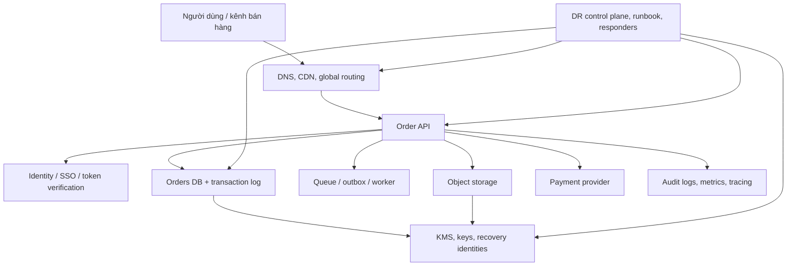
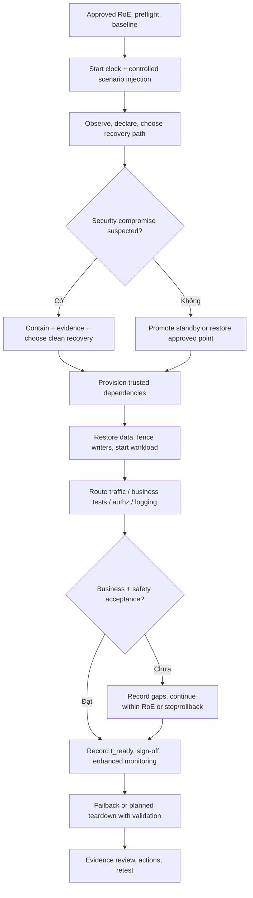
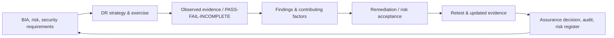

# DR Exercise: thiết kế, thực hiện và đánh giá diễn tập khôi phục thảm họa bằng bằng chứng

## 1. DR Exercise là gì và vì sao cần diễn tập?

**Disaster Recovery Exercise (DR Exercise)** là hoạt động được lên kế hoạch và có kiểm soát nhằm **thực hành, kiểm tra hoặc mô phỏng** cách tổ chức khôi phục hệ thống công nghệ, dữ liệu và các năng lực phụ thuộc sau một tình huống gián đoạn đáng kể. Diễn tập có thể bắt đầu từ thảo luận trên bàn (*tabletop*) cho tới thử khôi phục backup, chuyển lưu lượng sang site dự phòng, vận hành chế độ suy giảm hoặc tập dượt phục hồi sau tấn công mạng.

Trong chương **Disaster recovery** của module **SECURITY_SECURITY_ASSURANCE**, điều cần chứng minh không chỉ là “đã có runbook” hoặc “backup có trạng thái thành công”. Diễn tập giúp **tạo bằng chứng thực nghiệm** về việc các security controls, kiến trúc dự phòng, con người và quy trình có thực sự đạt những mục tiêu kinh doanh và bảo mật được xác định qua phân tích rủi ro, Business Impact Analysis (BIA), security requirements, kiểm thử và audit hay không.

Một tổ chức có thể sao lưu database hằng giờ nhưng chưa từng thử giải mã backup, xây lại network, cấp quyền cho recovery identity hoặc đối soát giao dịch sau khôi phục. Khi xảy ra thảm họa, có thể hệ thống hoạt động trở lại rất muộn hoặc dữ liệu khôi phục thiếu nhất quán. **DR Exercise biến các giả định về khả năng phục hồi thành kết quả có thể kiểm tra**, đồng thời nhận diện thiếu sót trước sự cố thực.

### Kết quả học tập

Sau bài học, người học có thể:

1. Phân biệt DR Exercise với kiểm tra backup, tabletop, failover drill, cyber recovery exercise và incident simulation.
2. Chuyển BIA, mục tiêu **RTO, RPO, MBCO** và risk scenarios thành tiêu chí PASS/FAIL có thể đo.
3. Lập **Rules of Engagement (RoE)**, xác định phạm vi, phê duyệt, an toàn, điểm dừng, dữ liệu thử và phương án rollback.
4. Thiết kế kịch bản diễn tập có kiểm soát, đo timeline, điểm phục hồi dữ liệu, năng lực phục vụ và trạng thái security controls.
5. Xác minh các phụ thuộc như IAM, KMS, DNS, storage, queue, secrets, nhà cung cấp bên thứ ba và khả năng failback.
6. Thu thập chứng cứ, ghi sai lệch, phân loại gap và liên kết remediation với retest.
7. Tổ chức chương trình diễn tập liên tục nhằm nâng cao mức **security assurance**, thay vì chỉ hoàn tất hoạt động mang tính hình thức.

**Giới hạn của bài:** các kịch bản, tài nguyên, thời điểm, tài khoản và chỉ tiêu số học bên dưới đều là ví dụ phục vụ học tập. Không được thực thi fault injection, ngắt mạng, revoke key, xóa dữ liệu hoặc chuyển traffic trên production ngoài phạm vi có ủy quyền và phương án an toàn.

## 2. Phân biệt kế hoạch DR, chiến lược và bài diễn tập

| Hoạt động | Câu hỏi được trả lời | Đầu ra | Giới hạn |
|---|---|---|---|
| **BIA** | Gián đoạn ảnh hưởng hoạt động kinh doanh bao nhiêu và từ khi nào không thể chấp nhận? | Business priorities, RTO/RPO/MBCO, phụ thuộc | Chưa chứng minh cách khôi phục |
| **Recovery strategy** | Chọn backup, cold/warm/hot standby, active-passive/active-active hay degraded mode? | Phương án kiến trúc, chi phí và rủi ro | Mô tả thiết kế chưa chứng minh hiệu lực |
| **DR plan/runbook** | Ai thao tác gì, theo điều kiện và thứ tự nào, khi kích hoạt? | Quy trình, sơ đồ phụ thuộc, decision gates, rollback | Lệnh/tài liệu có thể lỗi thời |
| **DR Exercise** | Khi áp dụng plan vào kịch bản cụ thể, điều gì thực sự xảy ra? | Test run, mốc thời gian, logs, kết quả, gaps | Một lần thử không chứng minh mọi kịch bản |
| **Incident Response (IR)** | Làm sao phát hiện, containment, điều tra và loại bỏ nguyên nhân tấn công? | Incident timeline, evidence, containment/eradication | Khác nhưng phối hợp chặt với DR |
| **Business Continuity Exercise** | Hoạt động kinh doanh và con người có tiếp tục ở mức tối thiểu không? | Kết quả vận hành thủ công/degraded mode, giao tiếp | Có thể không kiểm thử chi tiết restore kỹ thuật |

**Ví dụ:** tổ chức thử restore một snapshot database vào môi trường cô lập và đọc được vài bản ghi. Đây là **component restore test**, rất hữu ích nhưng **chưa phải bằng chứng** hệ thống xử lý đơn hàng khôi phục đúng RTO nếu API, IdP, DNS, queue, payment và nhân sự vận hành đều chưa được thử.

Một cuộc diễn tập DR có thể được coi là thành công về **mục tiêu học tập**, dù có control FAIL: phát hiện sớm việc recovery account thiếu quyền KMS là kết quả quan trọng. Nhưng phải tách **exercise execution success** (diễn tập có thể được thực hiện và thu kết quả) khỏi **recovery objective success** (dịch vụ thực sự đáp ứng RTO/RPO/MBCO).

## 3. Các loại DR Exercise và mức độ bằng chứng

Không cần bắt đầu bằng full-scale failover trên production. Phương án diễn tập nên tiến từ rủi ro thấp, phạm vi hẹp đến thử nghiệm tích hợp trong giới hạn tổ chức cho phép.

| Dạng diễn tập | Nội dung | Bằng chứng có thể có | Không tự chứng minh |
|---|---|---|---|
| **Document review / walkthrough** | Chủ sở hữu đọc và đi từng bước DR plan, kiểm tra thông tin liên lạc, quyền, đường dẫn | Biên bản review, điểm thiếu, phiên bản runbook | Hệ thống có thể khôi phục thực sự |
| **Tabletop** | Nhóm xử lý một kịch bản giả định và các tình tiết mới, ra quyết định tại từng mốc | Decision log, stakeholder routing, action items | Restore, DNS hay application chạy được |
| **Technical component test** | Restore database, object, volume, secret/KMS hoặc VM từ bản dự phòng | Logs, checksum, integrity, chức năng thành phần | Toàn bộ workflow và business RTO |
| **Functional recovery exercise** | Khôi phục một ứng dụng cùng các phụ thuộc quan trọng trong lab | Application smoke/security tests, dependency validation | Mọi dịch vụ/traffic thực đã được chuyển |
| **Partial failover** | Chuyển một phần traffic/site/tenant được cho phép | Routing, capacity, data consistency, failback evidence | Toàn bộ site có khả năng phục vụ đầy đủ |
| **Full failover drill** | Chuyển các năng lực đã xác định sang site DR, kiểm tra business-level acceptance | End-to-end recovery metrics, phê duyệt owner | Tự động bao phủ cyber compromise hoặc mất nhà cung cấp khác |
| **Failback exercise** | Đưa traffic và quyền ghi về site cũ theo quy trình kiểm soát | Reconciliation, fencing, routing, rollback | Failover trong mọi kịch bản khác |
| **Cyber recovery exercise** | Giả định backup/replica hoặc credential có nguy cơ bị xâm nhập; khôi phục từ nguồn đáng tin | Clean restore validation, rekey, forensic/risk decision | Mọi persistence hoặc dữ liệu bị nhiễm đều đã được phát hiện |

Một tổ chức có thể chọn **chạy component restore hằng tháng, tabletop theo quý và failover end-to-end theo chu kỳ dựa trên rủi ro**. Đây chỉ là ví dụ bố trí; tần suất thật phụ thuộc BIA, thay đổi hệ thống, nghĩa vụ hợp đồng/quy định, nguồn lực, phát hiện trước đó và mức độ rủi ro chấp nhận được.

### 3.1. Tăng dần độ hiện thực nhưng vẫn an toàn

Các bài test thường có đánh đổi giữa **mức đại diện** và **rủi ro gây ảnh hưởng**:

- **Synthetic injection:** mô phỏng tình huống qua giả định trong tabletop, không làm hỏng tài nguyên.
- **Isolated restore:** sao lưu thật hoặc fixture giả vào môi trường tách biệt, đo các bước restore.
- **Staging failover:** tái tạo topology chính và DR ở nơi thử nghiệm, dùng dữ liệu đã khử nhạy cảm.
- **Controlled production exercise:** phạm vi rất rõ, có quyền phê duyệt, quan sát và rollback; ưu tiên hành động ít rủi ro hơn khi có thể.
- **Unplanned disaster:** không phải một bài exercise; cơ chế ứng phó thật có ưu tiên và nghĩa vụ khác.

**Không lấy số liệu staging làm cam kết production** nếu dữ liệu, tải, quota, network, replication và các phụ thuộc khác nhau. Có thể dùng staging để chứng minh bước thao tác hoạt động, nhưng phải công bố giới hạn khi kết luận khả năng phục hồi business service.

## 4. BIA và mục tiêu kiểm chứng trước khi thiết kế kịch bản

Một bài DR Exercise cần bắt đầu bằng câu hỏi: **chức năng nào phải phục hồi đến mức nào, trong bao lâu, với bao nhiêu dữ liệu còn nguyên vẹn?** Những yêu cầu này phải được phê duyệt theo quy trình BIA/risk của tổ chức.

### 4.1. RTO, RPO và MBCO

| Mục tiêu | Ý nghĩa trong exercise | Cách đo minh họa |
|---|---|---|
| **RTO — Recovery Time Objective** | Mục tiêu thời gian để chức năng được khôi phục đến ngưỡng đã xác định sau mốc gián đoạn | `t_business_recovered - t_disruption` |
| **RPO — Recovery Point Objective** | Mức mất dữ liệu theo thời gian được chấp nhận cho kịch bản | `t_disruption - t_latest_consistent_recovery_point` |
| **MBCO — Minimum Business Continuity Objective** | Mức năng lực hoặc sản phẩm/dịch vụ tối thiểu phải cung cấp trong trạng thái suy giảm | Ví dụ tỷ lệ giao dịch thành công/đúng so với mức mục tiêu |
| **MTPD/MAO** | Khoảng gián đoạn tối đa trước khi tác động không thể chấp nhận | Tham chiếu để biết thời hạn cuối cùng cần bảo vệ |
| **Operational recovery prerequisites** | Điều kiện tối thiểu để tin rằng dịch vụ vừa an toàn vừa sử dụng được | IAM, keys, transaction consistency, logging, kiểm thử chức năng |

Các ký hiệu thời gian chỉ là **định nghĩa phép đo tham khảo**; tổ chức phải quy định mốc chính thức. **Bắt đầu đồng hồ RTO từ lúc chạy lệnh restore** có thể làm báo cáo quá lạc quan nếu mất nhiều thời gian phát hiện sự cố và quyết định kích hoạt.

### 4.2. Tiêu chí chấp nhận phải là hành vi nghiệp vụ

Giả sử RTO của dịch vụ đặt hàng là 120 phút. Ba điều kiện sau **không tương đương**:

1. Kubernetes Pod báo `Running`.
2. API health endpoint trả HTTP 200.
3. Người dùng đã xác thực tạo được đơn hợp lệ, dữ liệu được ghi bền vững, queue xử lý đúng và giao dịch không bị nhân đôi với mức tải MBCO.

Nếu BIA quy định chức năng đặt hàng ở mục 3, bài diễn tập chỉ PASS khi có bằng chứng cho mục 3. Các tín hiệu ở mục 1 và 2 là **prerequisite**, không phải kết quả cuối.

### 4.3. Khung testable objectives

Một mục tiêu nên mô tả:

```yaml
# Mẫu giả lập nhằm minh họa cấu trúc tiêu chí, không phải schema chuẩn
objective_id: DR-ORDER-01
business_process: order_acceptance
scenario: primary_region_unavailable
scope:
  environment: authorized_recovery_lab
  service: order-api
targets:
  rto_minutes: 120
  rpo_minutes: 15
  mbco_successful_orders_per_minute: 120
recovery_is_accepted_when:
  - "Valid user can place order and receive confirmed ID"
  - "Order is durably persisted and visible through read path"
  - "No duplicate payment/order event in test fixture"
  - "Required authentication and audit logging controls pass"
evidence:
  - "disruption and business-ready timestamps"
  - "transaction markers, restore point, consistency checks"
  - "load report, authz checks, cloud audit and application logs"
```

Giá trị `120` giao dịch/phút ở đây là giả định **khác** với tỷ lệ phần trăm MBCO; nếu BIA dùng % năng lực thì phải xác định mức baseline (ví dụ 200 giao dịch/phút) và cách đo, không tùy ý thay bằng một con số tuyệt đối.

## 5. Thiết kế kịch bản (scenario) phù hợp rủi ro

Một kịch bản DR tốt có **trigger, blast radius, giới hạn và giả định độc lập**. Không nên lấy “tắt một VM” làm đại diện cho thảm họa mất cả region nếu phương án recovery cần kiểm tra phụ thuộc ở nhiều tầng.

| Scenario ID minh họa | Tình huống | Điều cần chứng minh | Phụ thuộc dễ bị bỏ quên |
|---|---|---|---|
| `DR-AZ-01` | Mất một availability zone | Site còn lại có capacity và dữ liệu để duy trì MBCO? | Quorum, subnet, capacity/quota, load balancer |
| `DR-REG-02` | Mất vùng cloud chính | Cross-region activation, IAM/KMS, network/DNS, RTO/RPO | Registry, identity tenant, DNS và cloud control plane |
| `DR-DATA-03` | Xóa hoặc ghi đè dữ liệu quan trọng | PITR/backup/versions khôi phục đúng dữ liệu | Transaction logs, quyền restore, point-in-time consistency |
| `DR-RANSOM-04` | Nghi mã độc đã sửa dữ liệu và credentials | Khôi phục từ nguồn sạch mà không tái nhiễm | Clean recovery account, key, artifact, forensic timeline |
| `DR-IDP-05` | IdP hoặc SSO không khả dụng | Có đường quản trị/khôi phục có kiểm soát? | Break-glass, MFA, secrets, federation |
| `DR-PSP-06` | Cổng thanh toán bên thứ ba lỗi | Có degraded business mode và đối soát? | Đơn hàng pending, retry/idempotency, hợp đồng |
| `DR-CI-07` | Registry/build system không dùng được | Có thể triển khai bản được duyệt tại site DR? | Image digest, registry mirror, provenance, IaC state |

### 5.1. Injection khác với ngắt hạ tầng thật

Trong tabletop, người điều phối có thể đưa thông tin giả lập “region chính không truy cập được” mà **không** tắt resource. Trong kỹ thuật, có thể thử bằng fault injection có giới hạn hoặc chỉ chuyển các service fixture. Mức độ thử khác nhau cho kết luận khác nhau:

- **Tabletop:** chứng minh vai trò và quyết định có thể phối hợp.
- **Synthetic fault:** chứng minh một số automation hoặc routing có thể hoạt động.
- **True controlled failover:** chứng minh các thành phần đã xác định thực sự phục hồi trong điều kiện thử.

**Ghi injection point và giới hạn** trong manifest. Một test bypass các bước mất kết nối thật sẽ không tự chứng minh hệ thống phản ứng đúng khi network partition xảy ra.

### 5.2. Điều gì không nằm trong scope cũng phải được ghi

Ví dụ một bài failover vùng có thể giả định:

- IdP chung, domain DNS toàn cầu và payment provider vẫn hoạt động.
- Backup storage, key tại recovery region và registry vẫn truy cập được.
- Site primary bị đánh dấu không dùng được, nhưng không mô phỏng attacker compromise.

Những giả định này hợp lệ trong **kịch bản đã duyệt**; tuy nhiên phải ghi thành **untested dependencies**. Không được kết luận “đã sẵn sàng cho mọi disaster” từ một scenario chỉ giả lập mất compute ở vùng chính.

## 6. Phân tích phụ thuộc trước khi diễn tập

DR thường thất bại vì **một dependency không được restore hoặc kiểm tra** chứ không phải vì backup hỏng.



Khi lập sơ đồ, đặt câu hỏi:

1. **Danh tính:** ai kích hoạt DR nếu SSO bị hỏng; workload có lấy được short-lived credentials ở site DR?
2. **Mã hóa:** key dùng để giải mã backup có sống sót và được cấp đúng quyền tại recovery location?
3. **Network:** subnet, endpoint, firewall, certificate, route và DNS đã sẵn sàng?
4. **Data:** database, object, queue và search index có restore cùng trạng thái nghiệp vụ nhất quán?
5. **Runtime:** image, packages, config, CI/CD artifacts và secrets có nguồn đáng tin, có thể tải khi registry chính mất?
6. **Capacity:** site DR có quota, autoscaling, storage throughput và nhân sự đủ đạt MBCO?
7. **Observability:** các sự kiện/alert từ site DR có vào hệ thống giám sát và người trực nhận được không?
8. **Bên thứ ba:** phương thức thanh toán, email, DNS, đối tác dữ liệu có còn hoạt động không?
9. **Con người:** người phê duyệt, database specialist, network operator và business owner có mặt, có kênh liên lạc dự phòng không?

### 6.1. Thứ tự khôi phục không thể chỉ dựa vào thứ tự máy chủ

Một **dependency-aware recovery order** minh họa:

```text
0. Xác nhận kịch bản, người điều phối, quyền kích hoạt và safety stop.
1. Xác thực recovery identity, KMS, network, registry, DNS/control plane.
2. Xác định điểm dữ liệu nhất quán, backup hoặc replica hợp lệ.
3. Fencing old writers; khởi động/promote data plane.
4. Khôi phục app/worker, queue và tài nguyên cần cho chức năng tối thiểu.
5. Chuyển routing; kiểm tra chức năng nghiệp vụ và security controls.
6. Đánh giá capacity theo MBCO; ghi business-ready time.
7. Duy trì giám sát; quyết định failback khi an toàn.
```

Một số bước có thể thực hiện song song (ví dụ provisioning network và chuẩn bị artifact), nhưng phải có **decision gates** trước khi bật ghi dữ liệu hoặc đưa traffic đến nơi chưa khôi phục xong.

## 7. Rules of Engagement: phạm vi, ủy quyền và an toàn

**Rules of Engagement (RoE)** là thỏa thuận trước diễn tập về **được phép thực hiện gì, ở đâu, khi nào, bởi ai, với điều kiện dừng nào**. Nó là yêu cầu nền tảng để ngăn một bài test có mục đích tốt trở thành outage thật, làm mất dữ liệu hoặc vi phạm quyền truy cập.

### 7.1. Các nội dung tối thiểu của RoE

| Nội dung | Cần quyết định trước | Ví dụ minh họa |
|---|---|---|
| **Mục đích** | Kiểm tra control/khả năng nào, không kiểm tra gì | Đo restore database và API tới MBCO |
| **Đối tượng** | Account, cluster, region, service, dữ liệu, nhà cung cấp | Chỉ `lab-dr-region` và tài nguyên được gắn nhãn bài test |
| **Thời gian** | Cửa sổ bắt đầu/kết thúc, người trực, giờ đóng băng thay đổi | Thực hiện trong change window được duyệt |
| **Hành động được phép** | Restore, route switch, failover, disable test component | Chỉ tạo fault qua test harness đã review |
| **Hành động bị cấm** | Xóa backup thật, ngắt production chưa có ủy quyền, thu hồi key production | Không có thao tác phá hoại dữ liệu thật |
| **Dữ liệu và privacy** | Fixture/canary, khử nhạy cảm, giới hạn sao chép | Transaction markers không chứa PII |
| **Thẩm quyền** | Ai kích hoạt, ai thay đổi, ai dừng, ai phê duyệt phục hồi | Exercise lead và safety controller rõ tên vai trò |
| **Safety stop** | Điều kiện phải dừng ngay, kênh báo dừng và rollback | Test ảnh hưởng khách hàng thật, không còn quorum, log bất thường |
| **Rollback/failback** | Trạng thái cần đưa hệ thống về, phương pháp kiểm tra | Khôi phục route thử, dừng writers ở site thử, đối soát |
| **Bằng chứng** | ID chạy thử, thời gian, log, nơi lưu, quyền truy cập | Lưu manifest và timeline trong kho được phân quyền |
| **Liên lạc** | Kênh chính, kênh dự phòng, tần suất cập nhật, người bên thứ ba | Chat nội bộ riêng, hotline on-call, no customer notification nếu không cần |

**Ví dụ về điều kiện dừng:** “Dừng ngay các thao tác chuyển traffic nếu phát hiện request production bị chuyển tới vùng lab ngoài kế hoạch; giữ nguyên evidence, báo exercise lead và rollback theo bước đã xác minh.” Mỗi điều kiện cần có **người có quyền ra lệnh dừng**; không đủ nếu chỉ ghi “cẩn thận”.

### 7.2. Safety controller độc lập

Trong diễn tập có tác động, nên có một **safety controller/observer** không trực tiếp thực hiện các thao tác gây lỗi. Vai trò này theo dõi blast radius, telemetry, dấu hiệu ảnh hưởng ngoài scope và có quyền kích hoạt stop/rollback theo RoE. Với bài tabletop, một facilitator có thể kiêm nhiệm; với bài partial/full failover, cần phân tách rõ nếu rủi ro đủ cao.

### 7.3. Test data và credential

- **Ưu tiên dữ liệu synthetic** với ID và timestamp có thể đối chiếu.
- Không chuyển dữ liệu cá nhân thật sang lab nếu không có cơ sở pháp lý, bảo vệ và phê duyệt phù hợp.
- Không dùng cùng root/admin token của production cho bài lab; phục hồi bằng **identity thử nghiệm** có quyền tối thiểu.
- Nếu dùng bản sao dữ liệu production để thử restore, phải xác định phạm vi, nơi lưu, cơ chế khử nhạy cảm, key và retention, không sao chép tùy tiện.
- Không đưa secrets, session tokens, private keys hoặc signed URLs còn hiệu lực vào báo cáo chung.

**Không chạy lệnh phá hủy để “thử DR” trong lúc chưa đủ quyền**, kể cả khi hệ thống hỗ trợ khôi phục. Một bài test có kiểm soát là kết quả của phê duyệt và thiết kế, không phải hành động gây sự cố tự phát.

## 8. Phân công đội ngũ và cơ chế điều phối diễn tập

DR Exercise đòi hỏi cả **người thực hiện** và **người kiểm chứng**. Nếu chỉ một operator tự đo thời gian và tự kết luận, rủi ro bỏ qua tác động nghiệp vụ hoặc dữ liệu chưa kiểm rất cao.

| Vai trò | Quyết định/trách nhiệm | Chứng cứ hoặc sản phẩm |
|---|---|---|
| **Exercise sponsor / business owner** | Phê duyệt mục tiêu, rủi ro và tiêu chí business acceptance | BIA link, scope approval, kết luận chức năng |
| **Exercise lead / continuity coordinator** | Điều phối thời gian, scenario inject, các đội, timeline và quyết định | Exercise schedule, decision log, action list |
| **Incident/DR Commander** | Quyết định kích hoạt, failover, escalation, dừng/tiếp tục theo thẩm quyền | Decision gates, risk acceptance tạm thời |
| **Safety controller** | Giám sát tác động, quyền dừng và rollback | Stop condition checks, safety observations |
| **Platform/SRE/cloud operator** | Vận hành site DR, network, compute, routing và capacity | Change IDs, logs, trạng thái hạ tầng |
| **DB/data recovery owner** | Chọn restore point, backup/PITR, integrity, transaction reconciliation | Data validation, restore logs, cutoff timestamp |
| **Security/IR representative** | IAM/KMS, clean recovery, evidence preservation, negative tests | Security controls report, IR findings |
| **Application owner/QA** | Xác minh đường chức năng, tương thích và các trường hợp lỗi | API/business transaction tests |
| **Independent observer/timekeeper** | Ghi thời điểm và hành vi quan sát, đối chiếu mốc | Timeline, đo RTO và sự kiện bỏ lỡ |
| **Communications coordinator** | Liên lạc stakeholder và hỗ trợ khi có tác động ngoài dự kiến | Status updates, contact/escalation log |
| **Assurance reviewer** | Kiểm tra bằng chứng, scope, result và remediation | PASS/FAIL/INCONCLUSIVE, gap report |

Ở tổ chức nhỏ, một người có thể kiêm nhiều vai trò; tuy nhiên **người phê duyệt risk, người thao tác và người xác minh** nên được tách khi phù hợp với rủi ro. Khi không thể tách, cần nêu giới hạn bằng chứng và có review độc lập sau buổi diễn tập.

### 8.1. Kênh liên lạc và lịch cập nhật

Một buổi test có thể phát hiện lỗi access control hoặc gián đoạn log. Cần ít nhất:

1. Kênh phối hợp chính và kênh dự phòng không phụ thuộc hoàn toàn vào thành phần đang bị giả định hỏng.
2. Cơ chế gọi/acknowledgement khi chuyển từ kế hoạch sang hành động.
3. Cách ghi thời gian quyết định và thẩm quyền; người ghi timeline riêng.
4. Người xử lý sự cố **thật** phát sinh trong lúc diễn tập, và quy tắc ưu tiên an toàn.
5. Tiêu chí thông báo người ngoài scope nếu xuất hiện ảnh hưởng thực tế.

Nếu DR Exercise không thể phân biệt traffic thử và traffic thật, phải **giảm phạm vi hoặc thay cách thử** trước khi chạy.

## 9. Chuẩn bị kỹ thuật trước ngày diễn tập (preflight)

Trước khi tiêm lỗi, cần kiểm tra môi trường **đủ điều kiện quan sát và có đường phục hồi**. Một bài test thất bại do thiếu quyền hoặc thiếu quota vẫn là phát hiện hữu ích, nhưng không nên phát sinh từ lỗi sơ suất dễ tránh gây tác động ngoài scope.

### 9.1. Checklist readiness

| Hạng mục | Câu hỏi kiểm tra | Bằng chứng |
|---|---|---|
| **Asset inventory** | Resource IDs, owner, region, dependencies và dữ liệu phân loại đã đúng? | Inventory snapshot, topology revision |
| **Source configuration** | Site chính và site DR đang ở phiên bản nào? | IaC commit, image digest, deployment versions |
| **Backup/PITR** | Có backup/transaction logs cần thiết, trạng thái job và restore access? | Backup IDs, retention, restore points |
| **Replication** | Lag, direction, consistency, role primary/writer hiện tại? | Replication metrics, quorum/role snapshot |
| **KMS/secrets** | Recovery identity có quyền giải mã và lấy secret đúng scope? | Key access test với fixture, IAM records |
| **Network/DNS** | Có route, firewall, certificates, failover path và đường giám sát? | Config và connectivity checks |
| **Capacity/quota** | Đã có quota hoặc reserve, đủ tải MBCO? | Capacity plan, quota snapshot, load-test baseline |
| **Artifact supply** | Image/package/IaC modules có truy cập từ DR khi primary mất? | Digest, registry mirror/readiness tests |
| **Telemetry** | Logging, detection, tracing tại site DR có event mẫu? | Canary event, log destination, alert routing |
| **Runbook/rollback** | Người thao tác có hiểu steps, conditions, stop và đường quay lại? | Walkthrough approval, runbook revision |
| **Test fixture** | Có transaction markers, ID riêng và dữ liệu không nhạy cảm? | Fixture manifest và expected outcomes |
| **External systems** | IdP/PSP/DNS/partners được thông báo hoặc mô phỏng theo scope? | Test agreement, dependency exclusions |

### 9.2. Baseline snapshot và sự thay đổi trong ngày thử

Ở thời điểm `preflight_at`, thu một **snapshot trạng thái trước thử**: primary/secondary roles, healthy instances, backups, replication lag, network routes, versions, workload identities, log pipeline health và tỷ lệ giao dịch thành công. Điều này cho phép đối chiếu hậu quả bài test với trạng thái vốn có.

Không nên diễn tập cùng lúc với một deployment quan trọng hoặc sự cố đang điều tra nếu không có kế hoạch phối hợp rõ. Nếu phát hiện cấu hình đổi ngoài dự kiến, exercise lead có quyền **hoãn hoặc hủy bài thử**.

## 10. Thiết kế dữ liệu thử để đo RPO và tính nhất quán

Muốn chứng minh RPO, cần **biết chính xác dữ liệu nào được tạo trước/sau điểm lỗi và dữ liệu nào đã phục hồi**, thay vì chỉ xem giao diện nói “replica lag 5 phút”.

### 10.1. Transaction markers

Trong lab, tạo một chuỗi giao dịch không chứa dữ liệu nhạy cảm:

```text
09:45:00Z  order TEST-1001 committed, outbox event E-1001
09:48:00Z  order TEST-1002 committed, outbox event E-1002
09:50:00Z  order TEST-1003 committed, outbox event E-1003
09:52:00Z  order TEST-1004 committed, outbox event E-1004
09:56:00Z  order TEST-1005 committed, outbox event E-1005
10:00:00Z  simulated disruption starts
```

Trong mỗi marker nên lưu **server-side commit time**, mã giao dịch, ID event/outbox, hash/checksum dữ liệu đã chuẩn hóa nếu hữu ích và trạng thái xác nhận từ ứng dụng. Với thanh toán, dùng mock PSP hoặc kênh test được cấp phép; không tạo giao dịch tài chính thật nếu bài thử không có phê duyệt phù hợp.

### 10.2. Kiểm tra consistency

Một kết quả phục hồi có thể:

- Có order `TEST-1004` trong database nhưng không có event `E-1004` để worker xử lý.
- Có event nhưng order chưa commit ở data store mới.
- Replayed queue tạo hai bản ghi giao hàng từ cùng một order.
- Có payment reference ở hệ thống ngoài nhưng database restored mất trạng thái thanh toán.

Do đó cần những **business invariants**:

1. Một order ID hợp lệ không tạo nhiều giao dịch thanh toán không được mong muốn.
2. Order và outbox/event có trạng thái có thể đối soát.
3. Các hành động được thử qua API chỉ dùng principal đúng quyền.
4. Attachment trong object storage, metadata trong database và trạng thái event tương thích.
5. Chỗ thiếu dữ liệu phải được liệt kê và có phương án xử lý theo business owner.

### 10.3. Cách ghi kết quả RPO

Giả sử bài test bắt đầu gián đoạn lúc **10:00**, dữ liệu đã chứng minh phục hồi **nhất quán đến 09:52**:

\[
\text{Observed loss window}=10{:}00-09{:}52=8\ \text{phút}.
\]

Nếu RPO được phê duyệt là 15 phút, **điều kiện thời gian đạt** trong kịch bản này. Nhưng phải thêm kết quả consistency và các dữ liệu nằm ngoài tập marker: một metric 8 phút không bảo đảm tất cả queues, blob hoặc bên thứ ba đều khôi phục đúng.

Nếu thời gian server các hệ thống lệch, cần ghi mức độ skew và nguồn đồng bộ; không suy luận mất dữ liệu chính xác đến giây khi timestamps không đáng tin.

## 11. Thực thi DR Exercise: timeline, gates và rollback

Thực thi không nên là một danh sách thao tác không kiểm soát. Cần có **giai đoạn, điều kiện mở cổng và người chịu trách nhiệm**.



**Lưu ý sơ đồ:** nhánh `Chưa` không có nghĩa luôn được phép đi tới sign-off. Trong thực tế nếu mục tiêu không đạt, phải **đánh FAIL hoặc INCONCLUSIVE**; có thể quyết định dừng và rollback an toàn rồi tiến hành review. Sơ đồ chỉ mô tả đường đưa bài thử về trạng thái kết thúc có kiểm soát.

### 11.1. Cổng quyết định (gates)

| Gate | Điều kiện bắt buộc trước bước kế | Nếu không đạt |
|---|---|---|
| **G0 — Authorization** | RoE, owner, test window, safety stop, rollback được duyệt | Không bắt đầu |
| **G1 — Scenario validity** | Gián đoạn/test injection đúng kịch bản, marker và t0 rõ | Ghi lại, điều chỉnh hoặc hủy test |
| **G2 — Recovery authority** | Có quyền kích hoạt, sự cố được phân loại và phương án phục hồi được chọn | Escalate; không tự chuyển writer |
| **G3 — Data readiness** | Restore point/replica đáng tin, KMS/permissions đúng, khả năng fencing | Chưa promote hoặc chưa bật ghi |
| **G4 — Workload readiness** | App, dependencies, artifacts và IAM ở DR đã được kiểm tra | Không đưa traffic nghiệp vụ |
| **G5 — Business readiness** | Giao dịch thực nghiệm, integrity, security, MBCO đủ | Không tuyên bố RTO pass |
| **G6 — Exit/failback** | Có owner, trạng thái dữ liệu, quyết định tiếp tục/rollback/failback | Theo dõi và xử lý trước khi kết thúc |

### 11.2. Rõ ràng về mốc thời gian

Nên phân biệt:

```text
t0 = simulated disruption begins
t_detect = monitoring/observer identifies issue
t_declare = decision-maker activates DR
t_data = data plane restored and consistency checks passed
t_app = workload is reachable (technical readiness)
t_business = business process reaches MBCO and security gates
t_failback = primary site accepted again (if tested)
```

Với một RTO định nghĩa từ `t0` đến `t_business`, **thời gian restore database** hoặc **thời gian app khởi động** chỉ là các mốc phụ. Một API health endpoint trả HTTP 200 nhưng không xác thực được người dùng hoặc không ghi đơn thì chưa đủ để xác nhận business recovery.

### 11.3. Rollback và tiêu chí dừng

Rollback không nhất thiết đơn giản như “đổi DNS về site cũ”: nếu site DR đã nhận **các giao dịch ghi**, dữ liệu mới tồn tại ở DR phải được xử lý. Trước bài test cần thiết kế:

- Thời điểm và cơ chế **fencing** để không có hai primary cùng ghi.
- Cách thu thập/đối soát các request trong quá trình chuyển.
- Điều kiện quay lại site chính khi chưa có data divergence.
- Cách xử lý khi failover thành công nhưng failback không an toàn.
- Thời hạn teardown dữ liệu lab và cách bảo vệ evidence.

Nếu điều kiện dừng xuất hiện, **ưu tiên phục hồi an toàn**, không cố hoàn thành các bước thử để có thêm số liệu. Ghi rõ lý do dừng và kết quả những bước đã chạy thay vì tự động gắn PASS.

## 12. Case study: diễn tập khôi phục dịch vụ đặt hàng khi mất vùng cloud

### 12.1. Ngữ cảnh và thiết kế

Giả sử nền tảng giả lập **Order Service** gồm API, database, queue/outbox, object storage, KMS, IdP và payment provider. Thiết kế hiện tại là **warm standby tại vùng thứ hai**, database sao chép bất đồng bộ, có PITR/backup độc lập. Kịch bản test **mất vùng chính** tại môi trường staging được cấp quyền; IdP và nhà cung cấp thanh toán test vẫn hoạt động theo thỏa thuận.

Các mục tiêu được business owner phê duyệt trong ví dụ:

| Objective | Giá trị | Acceptance criteria |
|---|---:|---|
| `RTO-ORDER` | 120 phút | Từ sự cố giả lập đến khi nhận đơn hợp lệ ở site DR, đủ throughput theo MBCO |
| `RPO-ORDER` | 15 phút | Tập dữ liệu đơn/outbox được xác minh nhất quán không mất quá 15 phút |
| `MBCO-ORDER` | 60% công suất nền | Ít nhất 120 đơn thành công/phút nếu baseline 200 đơn/phút |
| `SEC-ORDER-01` | Không cấp truy cập ngoài quyền | Negative test với identity test ngoài tenant phải bị từ chối |
| `LOG-ORDER-02` | Event audit tới nơi giám sát | API/identity test event quan sát được tại log destination |

Giá trị trên là **giả lập** và chỉ có ý nghĩa khi cách đo baseline 200 đơn/phút, thời gian test tải, loại giao dịch và điều kiện nhất quán đã được định nghĩa trong RoE.

### 12.2. Timeline giả lập

| UTC | Sự kiện/quan sát | Loại mốc | Evidence dự kiến |
|---|---|---|---|
| **10:00** | Scenario injection xác nhận vùng chính không phục vụ | `t0` | Exercise marker, monitoring, facilitator log |
| 10:05 | Detection/observer xác nhận outage | `t_detect` | Alert ID, telemetry |
| 10:12 | DR Commander phê duyệt chuyển sang warm standby | `t_declare` | Decision record |
| 10:20 | Kiểm tra fencing và điểm phục hồi nhất quán | Gate G3 | Replica/transaction marker report |
| 10:35 | Promote data plane và xác minh database có thể đọc/ghi | `t_data` (sơ bộ) | Database logs, consistency tests |
| 10:55 | API/worker ở vùng DR đủ replica và health check | `t_app` | Deployment IDs, capacity snapshots |
| 11:05 | Routing chuyển traffic thử sang DR | Route switch | DNS/LB/config và request traces |
| 11:12 | Kiểm tra nghiệp vụ và authorization đạt | Business tests | Test case IDs, response, event IDs |
| **11:20** | Load test đạt 120 đơn thành công/phút, audit canary có mặt | `t_business` | Throughput, transaction và logging reports |
| 11:30 | Exercise lead ghi trạng thái recovery, tiếp tục quan sát | Decision | Sign-off note |

**RTO thực nghiệm** trong kịch bản:

\[
\text{Observed RTO}=11{:}20-10{:}00=80\ \text{phút}.
\]

80 phút **đạt ngưỡng 120 phút** nếu `t_business` thực sự là mốc đạt chức năng và mức phục vụ được phê duyệt. Nếu chỉ có API phản hồi nhưng request không ghi dữ liệu nhất quán, phải tiếp tục tính RTO tới khi nghiệp vụ đạt hoặc đánh FAIL khi vượt hạn.

### 12.3. Đo RPO qua transaction markers

Giả sử dữ liệu ở vùng DR được xác minh đầy đủ và nhất quán đến **09:52**, còn transaction sau đó cần thực hiện reconciliation:

\[
\text{Observed loss window}=10{:}00-09{:}52=8\ \text{phút}.
\]

8 phút **đạt mục tiêu RPO 15 phút về mặt thời gian**. Bằng chứng tối thiểu nên gồm:

- Danh sách transaction markers trước 09:52 được phục hồi đầy đủ; số lượng và checksum/invariants đúng.
- Các event/outbox đi kèm không bị bỏ sót hoặc duplicate không kiểm soát.
- Bản ghi sau 09:52 nằm trong phạm vi mất dữ liệu được nhận biết và có quy trình xử lý business.
- Không có dữ liệu công khai hoặc bản ghi bị lộ qua quyền sai ở site DR.
- Source time và DB commit time có độ tin cậy đủ để suy luận cửa sổ mất dữ liệu.

**Lưu ý:** replica lag quan sát 8 phút không phải bằng chứng độc lập cho RPO 8 phút nếu chưa kiểm thử dữ liệu thực và tính nhất quán. Một snapshot hoặc audit event chỉ chứng minh những thuộc tính nó thực sự ghi nhận.

### 12.4. Đánh giá kết quả riêng theo mục tiêu

| Control/objective | Expected | Observed giả lập | Kết quả theo scope |
|---|---|---|---|
| `RTO-ORDER` | Không quá 120 phút | 80 phút tới MBCO | PASS |
| `RPO-ORDER` | Không quá 15 phút | 8 phút, markers nhất quán | PASS |
| `MBCO-ORDER` | Ít nhất 120 đơn thành công/phút | 124 đơn/phút trong cửa sổ test được duyệt | PASS |
| `SEC-ORDER-01` | Tenant B không đọc đơn A | Negative control bị từ chối | PASS |
| `LOG-ORDER-02` | Audit test event có tại log destination | Event tới sau 35 giây | PASS nếu SLO được duyệt cho phép |
| `DR-FAILBACK-03` | Chuyển về site chính an toàn | Chưa thực hiện trong exercise này | UNTESTED |
| `DR-CYBER-04` | Khôi phục từ backup sạch khi admin compromise | Không thuộc kịch bản | OUT OF SCOPE, chưa xác minh |

Một exercise có thể PASS mục tiêu vùng cloud nhưng **chưa hề chứng minh** failback hoặc ransomware recovery. Báo cáo phải giữ hai mục chưa thử thay vì gộp thành kết luận chung “DR hoàn tất 100%”.

### 12.5. Thời gian và năng lực chịu tải có thể thay đổi

Kết quả 80 phút có thể bị ảnh hưởng bởi dữ liệu lab nhỏ, operator đã được hướng dẫn, quota dự phòng và pre-provisioning hơn production. Đánh giá cần ghi **độ đại diện**. Với test production có dữ liệu lớn, replication lag, storage throughput, network egress hoặc thời gian duyệt chuyển vùng có thể khác đáng kể.

## 13. DR Exercise khi nghi có tấn công mạng: Cyber Recovery

Diễn tập khôi phục sau **ransomware, credential compromise hoặc dữ liệu bị sửa có chủ đích** khác failover hạ tầng vì **site dự phòng và bản sao mới nhất có thể cũng bị ảnh hưởng**.

### 13.1. Kịch bản giả lập

Trong lab, giả sử:

- Một admin credential có quyền thay policy lưu trữ đã bị lộ.
- Một số bản ghi bị thay đổi trái phép trước thời điểm backup gần nhất.
- Bản sao bất đồng bộ đã nhận những thay đổi đó.
- Một bộ backup tách biệt có retention và quyền khôi phục riêng vẫn còn.

**Không cần chạy mã độc hay xóa dữ liệu thật**. Exercise facilitator có thể tạo fixture với trạng thái “data corrupted” trong sandbox hoặc chèn tình tiết giả vào tabletop. Mục tiêu là kiểm tra **quyết định chọn bản sạch, cách ly identity và khôi phục tính tin cậy**, không phải mô phỏng phá hoại bằng công cụ nguy hiểm.

### 13.2. Câu hỏi dành cho đội diễn tập

1. Có bằng chứng nào về thời điểm thay đổi dữ liệu sớm nhất? Mức độ tin cậy và giới hạn log?
2. Ai xác định một restore point có thể được coi là **clean enough** theo mục tiêu điều tra và rủi ro?
3. Backup, KMS key và recovery account có tách quyền khỏi credential nghi lộ không?
4. CI, registry, image, IaC và secret đã được kiểm tra tính tin cậy chưa?
5. Nếu attacker còn persistence hoặc token hợp lệ, site DR có bị xâm nhập sau khi mở traffic không?
6. Có thể đối soát giao dịch hợp lệ phát sinh sau điểm clean restore bằng nguồn độc lập nào?
7. IR, DR Commander và data owner phối hợp quyết định chuyển traffic dựa trên security gates nào?

### 13.3. Chuỗi diễn tập cyber recovery

```text
1. Incident/IR lead khai báo giả định compromise và lưu evidence nguồn.
2. Đánh giá blast radius, credential/token, quyền, backup trust boundary.
3. Chọn một hoặc nhiều candidate restore points trước dấu hiệu nhiễm.
4. Dựng môi trường phục hồi cô lập bằng identity và artifact đáng tin.
5. Restore sample dữ liệu và xác minh integrity, event/transaction history.
6. Rotate/revoke credential trong scope, kiểm tra negative controls.
7. Chạy security tests và malware/config checks theo tình huống.
8. Đối soát giao dịch, kiểm tra business acceptance và audit logging.
9. Ghi các giới hạn, quyết định phê duyệt và thời gian phục hồi.
10. Chuyển các phát hiện thành remediation, revalidation và risk owner review.
```

Một bài cyber recovery có thể có **RTO dài hơn đáng kể** vì phải điều tra và xác nhận nguồn sạch. Không dùng số RTO từ bài failover region thông thường làm bằng chứng rằng tổ chức có thể phục hồi ransomware trong cùng thời gian.

### 13.4. Security gate và bằng chứng âm tính

Ví dụ các phép thử trong môi trường có phép:

| Test | Expected |
|---|---|
| Credential cũ của admin nghi lộ | Không còn thực hiện thao tác quản trị thuộc scope |
| Recovery principal đúng quyền | Đọc được bản sao thử và giải mã bằng key hợp lệ |
| Recovery principal ngoài quyền | Không thể xóa backup hoặc đọc dữ liệu ngoài scope |
| Ứng dụng chạy từ artifact được duyệt | Image digest/provenance và cấu hình khớp phiên bản đã xác minh |
| Log của môi trường DR | Test event có mặt tại destination và được bảo vệ |
| Dữ liệu sau restore | Không chứa mẫu thay đổi độc hại trong fixture, có business consistency |
| Kết nối ra ngoài từ DR | Chỉ những đích cần thiết được phép theo policy |

**Không thể chứng minh “không còn attacker” chỉ vì test âm tính trên một identity**. Kết quả phải nêu principal, action, resource và thời gian; các đường không kiểm tra được được liệt kê như giới hạn hoặc rủi ro tồn dư.

## 14. Kiểm thử Failback và tránh split-brain

Khôi phục site DR chỉ giải quyết **nửa đầu** của vòng đời: sau đó hệ thống có thể cần đưa hoạt động về site chính đã được sửa và tin cậy. **Failback** sai có thể ghi đè dữ liệu phát sinh ở DR hoặc tạo hai writers cùng nhận đơn.

### 14.1. Các bước xác minh cốt lõi

1. Xác minh nguyên nhân mất site chính đã hết và site chính an toàn để quay lại.
2. Xác định site nào hiện là **nguồn dữ liệu chính có thẩm quyền**, từ lúc nào.
3. Thiết lập **fencing** và chuyển quyền ghi, tránh hai primary active khi không có consistency model cho multi-writer.
4. Đồng bộ hoặc reconcile dữ liệu phát sinh tại DR, kể cả queue, object và external transactions.
5. Kiểm tra IAM/KMS/network, version ứng dụng, DNS, monitoring và capacity ở site chính.
6. Dùng traffic thử hoặc canary để xác minh trước khi chuyển phần lớn lưu lượng.
7. Theo dõi lỗi/trùng giao dịch và rollback nếu có điều kiện đã định.
8. Thu bằng chứng sign-off, không tự xóa site DR hoặc backup trước khi recovery owner chấp thuận.

### 14.2. Ví dụ vấn đề split-brain

Giả sử vùng chính mất network tới control plane nhưng database vẫn nhận một số writes. Vùng DR bị promote làm primary và cũng nhận writes. Khi kết nối hồi phục, **không thể chỉ sao chép dữ liệu của site mới lên site cũ** mà không có quy trình xử lý conflict và thứ tự sự kiện.

Bài diễn tập phải xem:

- Failover controller làm sao xác định old primary đã mất quyền ghi?
- Client còn kết nối cũ được xử lý ra sao?
- Phép kiểm nào phát hiện duplicate order IDs, conflicting updates hoặc mất event?
- Ai có quyền chấp nhận dữ liệu nào là nguồn chính và phê duyệt quy trình đối soát?

Một **failback test** có thể dùng fixture đặc biệt và traffic nhỏ để mô phỏng mâu thuẫn, không được cố tình tạo split-brain trên database production.

## 15. Security controls trong bài DR Exercise

Một hệ thống phục hồi nhanh nhưng bỏ qua IAM, encryption, dữ liệu nhạy cảm hoặc logging có thể tạo rủi ro mới nghiêm trọng. Do đó DR exercise cần kiểm tra **availability cùng confidentiality và integrity**, phù hợp với mục tiêu của SECURITY_SECURITY_ASSURANCE.

| Control | Phép kiểm trong DR | Điều kiện cần quan sát |
|---|---|---|
| **Authentication** | Người dùng/worker hợp lệ truy cập được bằng identity được duyệt | Login/service tokens hoạt động, không bypass xác thực |
| **Authorization** | Principal ngoài quyền thử đọc/sửa tài nguyên canary | Bị từ chối; positive control vẫn thành công |
| **KMS/encryption** | Restore từ backup mã hóa và thử giải mã fixture | Key access đúng, không cấp quyền quá rộng |
| **Network** | Kiểm tra đường public/private và firewall khi route đổi | Không xuất hiện đường quản trị/public dữ liệu ngoài thiết kế |
| **Artifact integrity** | Kiểm tra build/image/IaC tại site DR | Digest, provenance và phiên bản đã được duyệt |
| **Logging/monitoring** | Tạo event canary và truy vết tới SIEM/alerting | Có event tại nơi lưu đúng thời hạn và fields cần thiết |
| **Data integrity** | Đối soát transaction markers, object và queue | Không mất/trùng ngoài phạm vi cho phép |
| **Backup continuity** | Sau failover, site DR còn tạo backup có thể restore | Job, retention, key và bài restore test phù hợp |
| **Privacy/data residency** | Xác định bản sao/khôi phục ở region được phép | Phù hợp phân loại dữ liệu và ràng buộc thực tế |
| **Change control** | Hành động khẩn cấp được ghi người thực hiện, lý do và revision | Audit events, ticket, post-exercise reconciliation |

### 15.1. Positive và negative control phải đi cùng nhau

**Positive control:** một ứng dụng sử dụng identity hợp lệ đọc được object canary tại vùng DR.

**Negative control:** một danh tính test không có quyền đọc cùng object bị từ chối, nhưng không phải vì object không tồn tại hoặc dịch vụ chưa sẵn sàng. Positive control chứng minh fixture hoạt động; negative control chứng minh cơ chế quyền được kiểm đúng.

### 15.2. Log từ DR không được mất khi primary ngừng hoạt động

Nếu hệ thống SIEM, log shipper hoặc network path chỉ có ở primary region, khi failover có thể mất khả năng điều tra hoạt động ở DR. Trong bài test, cần thực hiện **một sự kiện canary đã được cấp phép** và xác minh nguồn → collector → destination → alert nếu control yêu cầu.

Không tìm thấy event **không chứng minh không có hành vi**. Phải phân biệt lỗi nguồn phát, thiếu quyền đọc data events, pipeline trễ, parser sai schema, retention không đủ và lỗi truy vấn.

### 15.3. Không nới quyền vô thời hạn để khôi phục

Một số bước khôi phục cần break-glass hoặc quyền tăng tạm thời. Exercise phải kiểm tra **thời hạn, approval, audit và thu hồi quyền sau khi xong**. Nếu dùng ngoại lệ trong khẩn cấp, ghi chính xác phạm vi, người phê duyệt, thời hạn và risk acceptance; không coi việc phục hồi đã thành công là lý do giữ permission quá rộng vĩnh viễn.

## 16. Evidence package cho DR Exercise

Để hỗ trợ **Security Assurance và audit**, bằng chứng cần cho phép người khác trả lời một cách độc lập: **đã thử kịch bản nào, trên những tài sản nào, mục tiêu được duyệt là gì, hành động gì diễn ra, hệ thống phục hồi tới mức nào và các giới hạn ở đâu**.

### 16.1. Bản đồ bằng chứng

| Nhóm chứng cứ | Dữ liệu cần có | Vì sao quan trọng |
|---|---|---|
| **BIA và yêu cầu** | Process owner, RTO, RPO, MBCO, control IDs, revision | Cho biết thước đo được phê duyệt trước diễn tập |
| **Scenario/RoE** | Kịch bản, môi trường, injection point, quyền, time window, exclusions và stop conditions | Chứng minh phạm vi kiểm tra và an toàn |
| **Asset/dependency snapshot** | Resource IDs, region, network, IAM, backup IDs, KMS, replica config, artifact revisions | Đặt kết quả vào đúng phiên bản hệ thống |
| **Timeline** | t0, detect, declare, data ready, app ready, business ready, failback | Phân biệt thời gian phát hiện, xử lý và phục hồi |
| **Data recovery** | Restore point, transaction markers, PITR/replication evidence, integrity checks | Xác minh RPO và tính nhất quán |
| **Business acceptance** | Successful transactions, throughput, application test assertions | Chứng minh MBCO và RTO theo nghiệp vụ |
| **Security validation** | Authn/authz positive-negative controls, logging canary, key/registry checks | Tránh phục hồi một hệ thống thiếu an toàn |
| **Operational actions** | Change IDs, runbook revision, người thực hiện/phê duyệt, rollback/failback | Chứng minh tính lặp lại và quyền quyết định |
| **Findings and limits** | FAIL/INCONCLUSIVE, risk, owner, thiếu coverage, ngoại lệ | Không che các điểm chưa bảo đảm |
| **Retest and sign-off** | Fix revision, verification run, người xem xét và điều kiện đóng | Khép vòng remediation có bằng chứng |

**Một screenshot “Restore completed” chưa đủ.** Nó có thể chứng minh một job báo hoàn tất, nhưng chưa chứng minh ứng dụng tạo được giao dịch, dữ liệu nhất quán hay quyền đọc tại site DR đúng chính sách.

### 16.2. Ví dụ evidence manifest

```yaml
# Hoàn toàn là dữ liệu giả lập dùng cho bài học
evidence_id: DR-EV-LAB-008
service: SECURITY_SECURITY_ASSURANCE
exercise_id: DR-LAB-RUN-008
exercise_type: controlled_cross_region_failover
scenario: primary_region_unavailable
environment: authorized_staging_lab
collected_at_utc: "2026-11-28T12:00:00Z"
scope:
  business_process: order_acceptance
  application: order-api
  resources:
    - lab-orders-db
    - lab-order-events
    - lab-order-api
  exclusions:
    - "Global identity provider outage not simulated"
    - "Payment provider unavailability not simulated"
revisions:
  bia: example-bia-r3
  runbook: example-dr-runbook-r7
  iac_commit: example-commit-abc123
  detection_policy: example-security-policy-r2
targets:
  rto_minutes: 120
  rpo_minutes: 15
  mbco_successful_orders_per_minute: 120
observations:
  disruption_at_utc: "2026-11-28T10:00:00Z"
  business_ready_at_utc: "2026-11-28T11:20:00Z"
  latest_consistent_point_at_utc: "2026-11-28T09:52:00Z"
  observed_rto_minutes: 80
  observed_data_loss_window_minutes: 8
  measured_successful_orders_per_minute: 124
test_results:
  application_transaction: pass
  transaction_consistency: pass
  authorization_negative: pass
  logging_canary: pass
  failback: untested
artifacts:
  - "approvals/roe-signed.pdf"
  - "timeline/exercise-decisions.json"
  - "data/transaction-markers.json"
  - "data/recovery-integrity-report.json"
  - "application/business-throughput-report.json"
  - "security/authz-and-log-test-report.json"
  - "operations/failover-actions-redacted.json"
assessment:
  result: pass_for_tested_scope
  reviewer: example-assurance-reviewer
  limitations:
    - "Staging capacity and data volume differ from production"
    - "Cyber recovery and failback were not exercised"
```

Đây là **manifest minh họa**, không mô tả kết quả thật. Các file PDF/JSON trong `artifacts` chỉ là đường dẫn tham chiếu ví dụ và **không được tạo bởi bài học này**. Khi làm thật, cần liên kết tài liệu đã tồn tại, có người ký/phê duyệt đúng và raw observation hỗ trợ từng phép tính.

### 16.3. Dữ liệu tối thiểu cho từng kết luận

**Muốn tuyên bố RTO PASS:** cần có mục tiêu RTO được phê duyệt, mốc `t0`, mốc `t_business`, định nghĩa business-ready, kết quả kiểm thử chức năng/MBCO và scope.

**Muốn tuyên bố RPO PASS:** cần mục tiêu RPO, thời điểm gián đoạn, **latest consistent recovery point** được đối chứng bằng dữ liệu, transaction markers và giới hạn các thành phần ngoài phạm vi.

**Muốn tuyên bố recovery an toàn:** cần kiểm tra người dùng/worker hợp lệ hoạt động, principal ngoài quyền bị chặn, KMS/secrets đúng, artifact đáng tin, logs và security monitoring còn vận hành theo yêu cầu.

**Muốn tuyên bố failback PASS:** phải có dữ liệu nguồn sau DR, fencing, kiểm tra chống trùng/ghi đè, quá trình trở lại và sign-off. Một quy trình failover tốt không tự chứng minh failback.

### 16.4. Tính toàn vẹn và quyền truy cập chứng cứ

Exercise artifacts có thể chứa thông tin mạng, account IDs, danh tính đặc quyền, metadata backup và dữ liệu giao dịch. Cần:

- Giữ raw evidence trong kho được phân quyền; tạo bản **redacted** theo mục đích review.
- Ghi timestamp có múi giờ, source, người thu thập, tool version và phương pháp.
- Gắn evidence với run ID và revision; không dùng screenshot không xác định thời điểm.
- Có thể tạo checksum cho artifact và giữ manifest ở hệ thống có lịch sử hoặc cơ chế chống sửa; **hash một mình không chứng minh nguồn gốc**.
- Nếu có yêu cầu pháp lý/forensic, phối hợp người chịu trách nhiệm để thiết lập chain of custody phù hợp.
- Lưu artifacts theo retention đã phê duyệt; không giữ token hoặc secret trong log công khai.

Độ đáng tin của chứng cứ còn phụ thuộc **scope và cách thu**, không chỉ việc file tồn tại. Một test được thực hiện trên dataset 100 MB chưa chứng minh restore 20 TB cũng có thời gian tương đương.

## 17. Đánh giá kết quả và xử lý phát hiện

Một bài diễn tập có thể phát hiện nhiều loại vấn đề: recovery không đạt, thiếu dữ liệu để chứng minh, security control lỗi, dependency chưa tính hoặc quy trình/nhân sự chưa đủ khả năng. Không nên chỉ có cột “Success” chung.

### 17.1. Trạng thái đánh giá

| Trạng thái | Điều kiện | Ví dụ |
|---|---|---|
| **PASS** | Tiêu chí được áp dụng đã thử và có bằng chứng đạt trong scope | RTO 80/120 phút, dữ liệu nhất quán, MBCO đạt |
| **FAIL** | Có bằng chứng mục tiêu không đạt | Site DR khởi chạy nhưng authentication không hoạt động |
| **INCONCLUSIVE** | Không đủ evidence hoặc điều kiện thử bị lệch để kết luận | Không có transaction markers đúng, không tính được RPO |
| **UNTESTED** | Yêu cầu thuộc phạm vi chương trình nhưng chưa thực hiện test | Chưa chạy failback dù đã đặt mục tiêu |
| **NOT APPLICABLE** | Điều kiện không áp dụng trong một scope có phê duyệt | Không có thành phần thanh toán trên service thuần báo cáo |
| **ACCEPTED RISK** | Rủi ro từ FAIL/gap còn tồn tại được phê duyệt có điều kiện | Recovery thiếu capacity trong giai đoạn nâng cấp |
| **RETEST VERIFIED** | Đã sửa và kiểm tra lại đạt trên revision/điều kiện rõ | Đã sửa IAM recovery, restore + authz test pass |

**Accepted risk không phải PASS.** Phải giữ kết quả kỹ thuật gốc và hồ sơ chấp nhận rủi ro riêng: lý do, chủ sở hữu, biện pháp bù trừ, ngày hết hạn và điều kiện xem lại.

### 17.2. Phân loại gaps

| Gap | Triệu chứng | Remediation và retest |
|---|---|---|
| **BIA gap** | Không biết mốc hoặc mức phục vụ để kết luận | Business owner phê duyệt targets và acceptance test |
| **Inventory/dependency gap** | Thiếu DNS, IdP, KMS hoặc queue trong kế hoạch | Cập nhật sơ đồ, bổ sung test case |
| **Backup/integrity gap** | Có backup nhưng không restore được hoặc dữ liệu sai | Sửa backup/PITR, diễn tập restore và consistency |
| **Capacity gap** | DR hoạt động nhưng không đạt MBCO | Bổ sung quota/reservation, load test lại |
| **IAM/key gap** | Recovery identity không giải mã hoặc role quá quyền | Sửa quyền, chạy positive/negative authorization tests |
| **Network/routing gap** | DNS route sai, firewall mở quá rộng hoặc client chưa tới DR | Sửa route, kiểm tra connectivity/security |
| **Execution gap** | Runbook thiếu step, operator không có quyền, approval quá chậm | Automation, phân công, diễn tập lại timing |
| **Observability gap** | Không có log để đo mốc hoặc xác minh hành động | Bổ sung event/test canary và monitoring |
| **Scenario coverage gap** | Chỉ test lỗi VM, chưa test mất region hoặc cyber attack | Lập chương trình scenario tests ưu tiên rủi ro |
| **Failback gap** | Không có kế hoạch đưa dữ liệu site DR về site chính | Thiết kế fencing/reconciliation và kiểm tra failback |

### 17.3. Finding có thể hành động

```yaml
finding_id: DR-GAP-LAB-017
exercise_id: DR-LAB-RUN-008
control_id: DR-SEC-LOG-02
classification: observability_gap
severity: high
scope:
  environment: authorized_staging_lab
  resource: lab-dr-audit-pipeline
expected: "DR audit canary reaches monitored destination"
observed: "Canary generated, no matching event in target index"
evidence_refs:
  - "security/log-canary-source.json"
  - "security/log-destination-query.json"
owner: platform-observability-team
remediation: "Restore configured log delivery path in DR region"
retest:
  precondition: "Collector and destination reachable"
  expected: "Canary event queryable with required fields"
status: open
```

Đây là finding giả lập. Trên thực tế, việc không thấy event tại một index cần được điều tra **parser, quyền, ingestion latency, nguồn phát, scope và retention**; không vội khẳng định nguyên nhân “đứt log pipeline” khi chưa kiểm tra. Ghi **điều quan sát được** riêng với giả thuyết nguyên nhân.

### 17.4. Đóng vòng khi nào?

Một finding chỉ được coi là **verified fixed** khi có:

1. Thay đổi cụ thể (change ticket/IaC revision/runbook update).
2. Kết quả test lại trên môi trường/phiên bản đúng scope.
3. Bằng chứng sau sửa liên kết finding, điều kiện và người review.
4. Không gây regression về security hoặc business continuity ở các đường liên quan.

Việc “đã merge PR” hay “đã gửi email đào tạo” có thể là bước cải thiện cần thiết nhưng chưa tự chứng minh control kỹ thuật đã hoạt động.

## 18. Chỉ số và báo cáo chương trình DR Exercise

Metric phải phản ánh **khả năng đã kiểm chứng**, không chỉ số buổi diễn tập hoặc số trang kế hoạch.

| Chỉ số | Cách diễn giải | Rủi ro diễn giải sai |
|---|---|---|
| **Scenario coverage** | Số cặp (business process, disaster scenario) đã diễn tập / tổng số phải thử | Chạy nhiều lần một scenario nhưng bỏ các rủi ro lớn khác |
| **Validated recovery coverage** | Số cặp đã PASS có evidence còn hiệu lực / tổng cặp áp dụng | Coi INCONCLUSIVE hoặc accepted risk như PASS |
| **RTO objective attainment** | Tỷ lệ test đủ mốc và đạt business-ready time | Chỉ đo app start hoặc bỏ qua detection |
| **RPO objective attainment** | Tỷ lệ test có consistency evidence và mất dữ liệu trong ngưỡng | Dùng replica lag đơn lẻ làm RPO |
| **MBCO attainment** | Năng lực xử lý nghiệp vụ thực đo ở DR / target | Một giao dịch thành công không chứng minh capacity |
| **Restore success by type** | Test restore database/object/VM/key đạt integrity theo loại | Đếm backup job PASS thay cho restore PASS |
| **Security controls retained** | Những control quan trọng đạt ở site DR khi thử | Chỉ đo availability mà bỏ authz/logging |
| **Failback validation** | Kịch bản cần failback đã thử và không gây data loss | Giả định chuyển DNS là đủ |
| **Finding closure with retest** | Gap đã sửa và xác minh / tổng gap thuộc scope | Đóng ticket hành chính khi chưa retest |
| **Exercise evidence freshness** | Thời gian và thay đổi từ lần test đủ điều kiện gần nhất | Kết luận vẫn đúng dù data/architecture đã đổi |

### 18.1. Công thức coverage có mẫu số

Giả sử trong quý tổ chức xác định **12 cặp (dịch vụ, kịch bản DR)** phải được kiểm chứng. Có 7 cặp PASS, 2 FAIL, 1 INCONCLUSIVE và 2 UNTESTED.

\[
\text{Validated DR coverage}=\frac{7}{12}\times100\%\approx58.33\%.
\]

Kết luận đúng: “Đã có bằng chứng đạt 7/12 cặp trong kỳ; 2 FAIL, 1 INCONCLUSIVE và 2 UNTESTED.” Đây **không phải xác suất 58,33% thành công khi có disaster**, và không thay thế việc báo các gap trọng yếu.

### 18.2. Không dùng thời gian tốt nhất làm cam kết

Giả sử ba lần diễn tập cùng kịch bản có RTO 70, 85 và 118 phút so với target 120 phút. Cả ba đạt, nhưng lần 118 phút chỉ có biên an toàn 2 phút. Phải xem nguyên nhân biến động: tốc độ restore, dữ liệu tăng, quota, sự tham gia của operator, detection, approval và routing.

Tương tự, nếu test run bị dừng do lỗi an toàn hoặc môi trường không hợp lệ, phải **ghi trạng thái và nguyên nhân**. Không âm thầm bỏ run thất bại khỏi thống kê để tạo hình ảnh đáng tin hơn thực tế.

### 18.3. Báo cáo hiệu quả học tập của diễn tập

Một exercise còn tạo ra những thông tin hữu ích không thể gói vào một con số:

- Ai thiếu quyền để chạy runbook?
- Backup nào không giải mã được khi KMS primary không khả dụng?
- Thời gian quyết định failover có bị trì hoãn vì escalation mơ hồ?
- Runbook nào phụ thuộc một kỹ sư duy nhất?
- Dữ liệu business nào không thể đối soát giữa DB, queue và nhà cung cấp?
- Cấu hình bảo mật nào bị nới rộng khi phục hồi?
- Những giả định nào đã bị thực nghiệm bác bỏ?

Nên tổng hợp chúng thành **action items với owner, deadline, risk và retest criteria**, không chỉ ghi “cần cải thiện phối hợp”.

## 19. After-Action Review: biến bài diễn tập thành cải tiến có thể kiểm chứng

**After-Action Review (AAR)** là buổi và hồ sơ đánh giá sau diễn tập: đối chiếu kế hoạch với thực tế, xác định điều đã hoạt động, điều chưa đạt, nguyên nhân có bằng chứng và hành động cải tiến. Không nên chỉ gửi báo cáo “buổi DR Exercise thành công” nếu những điểm yếu đã phát hiện không được chuyển thành trách nhiệm.

### 19.1. Cấu trúc AAR

1. **Mục tiêu và scope:** BIA revision, recovery strategy, kịch bản, RoE, các giới hạn và điều bị loại trừ.
2. **Tóm tắt diễn biến:** timeline theo UTC, những quyết định lớn, test stages và safety stops nếu có.
3. **Kết quả theo mục tiêu:** RTO, RPO, MBCO, security tests, failback, pass/fail/inconclusive.
4. **Điều vận hành tốt:** automation nào thực sự hoạt động, người trực phối hợp ra sao, nguồn dự phòng nào sẵn sàng.
5. **Phát hiện và giả thuyết:** tách observed facts, chưa biết và contributing factors; không gán trách nhiệm cá nhân theo suy đoán.
6. **Rủi ro tồn dư:** common-mode dependencies, tài sản chưa thử, data volume/capacity khác production, control bị degraded.
7. **Remediation:** mỗi action item có owner, mức ưu tiên, mục tiêu, hạn xử lý và cách retest.
8. **Decision:** tiếp tục phương án, yêu cầu đầu tư/thay đổi kiến trúc hay chấp nhận rủi ro có điều kiện.
9. **Follow-up:** ngày đánh giá lại, lần diễn tập tiếp theo và điều kiện yêu cầu test bổ sung sớm.

### 19.2. Lessons learned không đồng nghĩa root-cause đã xác minh

Ví dụ bài diễn tập không truy cập được backup mã hóa ở DR. Có thể là:

- Key không có mặt tại region dự phòng.
- Recovery identity không được cấp quyền dùng key.
- Key policy cho phép nhưng network endpoint bị chặn.
- Backup tham chiếu key version hoặc account khác.
- Tool trả lỗi không đủ chi tiết, chưa thể kết luận.

Một AAR đúng ghi **“restore bị chặn do không thể dùng key; root cause đang điều tra”**, sau đó cập nhật kết luận khi có bằng chứng. Không tự khẳng định “KMS bị lỗi” chỉ vì restore API trả `AccessDenied`.

### 19.3. Gắn AAR với Security Assurance



Một DR finding về quyền KMS có thể yêu cầu **thay IAM policy, cập nhật IaC, bổ sung kiểm thử khôi phục và review control owner**; finding về độ trễ RTO có thể yêu cầu automation, tăng capacity hoặc cập nhật business target có phê duyệt. Các loại hành động khác nhau đều phải có **bằng chứng xác minh kết quả**, không chỉ ghi đã lập kế hoạch.

## 20. Bài thực hành: thiết kế một DR Exercise đầu-cuối

### 20.1. Bối cảnh lab

Bạn thuộc nhóm Security Assurance của ứng dụng quản lý đơn hàng giả lập. Hệ thống có:

- Kubernetes workload `order-api` và `order-worker`.
- Database có PITR và replica tại vùng DR.
- Queue/outbox, object storage, identity provider, KMS và log collection.
- Một payment sandbox và một bộ transaction markers được tạo trong lab.

Business owner đặt **RTO 90 phút**, **RPO 10 phút**, **MBCO 50% throughput bình thường** cho kịch bản mất region primary. Để đánh giá an toàn, lab có quyền thử **partial failover và restore** trên dữ liệu synthetic, không được phép ngắt production hoặc xoá khóa thật.

### 20.2. Yêu cầu A — Kế hoạch và RoE

1. Chuyển các mục tiêu RTO/RPO/MBCO thành **acceptance criteria** có ID, phương pháp đo, người phê duyệt.
2. Vẽ dependency graph của API → IdP → DB → queue → storage → KMS → payment sandbox.
3. Xác định **đường backup/restore**, điểm dữ liệu đáng tin và chiến lược replication.
4. Phê duyệt account, region, role, thời gian, dữ liệu synthetic, injection point và loại thao tác được phép.
5. Nêu **ít nhất ba safety stop conditions** và cách rollback/failback.
6. Phân công exercise lead, safety observer, timekeeper, data owner, security reviewer và business owner.
7. Chỉ rõ những gì **không** được thử: global IdP outage, full production traffic và cyber compromise nếu ngoài RoE.

### 20.3. Yêu cầu B — Thiết kế và thực hiện phép thử

1. **Preflight:** xác minh backup IDs, phiên bản IaC/runbook, quota, identity/KMS, telemetry.
2. **Tạo markers:** tạo order `LAB-001` tới `LAB-010` theo thời gian, đi kèm event/outbox IDs.
3. **Bắt đầu đồng hồ:** ghi `t0` khi kịch bản được phát kích hoạt theo RoE.
4. **Phục hồi dữ liệu:** thu `latest_consistent_point`, đối chiếu markers và integrity.
5. **Khởi động ứng dụng:** triển khai artifact đã duyệt, sửa routing trong lab.
6. **Business validation:** giao dịch test thành công, bền vững, không trùng event.
7. **Security validation:** principal hợp lệ được phép, principal ngoài quyền bị chặn; audit canary đến SIEM.
8. **Capacity:** kiểm tra throughput đạt ít nhất 50% baseline trong cửa sổ đã xác định.
9. **Kết thúc:** ghi `t_business`, đánh giá RTO/RPO/MBCO độc lập, đưa môi trường về trạng thái được phép.
10. **Follow-up:** ghi FAIL/INCONCLUSIVE và đề xuất retest; không giả định toàn bộ kịch bản đều PASS.

### 20.4. Worksheet nộp bài

```markdown
# DR Exercise Assurance Worksheet

Exercise ID / date / owner:
Business process / BIA revision:
Scenario, scope and exclusions:
Authorized accounts, regions, resources:
Recovery strategy and DR runbook revision:
Safety controller, stop conditions, rollback:
Participants and approvals:

RTO target and start/end definition:
RPO target and data consistency criteria:
MBCO target and baseline throughput:
Security requirements / control IDs:
Critical dependencies and common-mode risks:
Preflight inventory / backup / replica / key / quota:
Fixture IDs and transaction markers:

Injection point, t0 and detection time:
Activation/declare time and approving role:
Data restore point, restore logs and validation:
Application-ready and business-ready timestamps:
Observed RTO / observed RPO / measured MBCO:
Positive and negative authorization checks:
KMS, artifact integrity and logging canary:
Failback/teardown verification:

Per-control PASS / FAIL / INCONCLUSIVE / UNTESTED:
Evidence references and collection timestamps:
Known unknowns, excluded scenarios, residual risk:
Findings, owner, priority, remediation and target date:
Retest criteria and review approval:
Business owner sign-off:
Security Assurance reviewer:
```

### 20.5. Rubric đánh giá

| Tiêu chí | Đạt | Chưa đạt |
|---|---|---|
| **Phạm vi và an toàn** | Có RoE, authorization, stop/rollback và dữ liệu thử | Đề xuất ngắt production hoặc thao tác phá hoại thiếu quyền |
| **Mốc thời gian** | RTO tính từ t0 đến business-ready theo định nghĩa | Chỉ tính thời gian script hoặc khởi động Pod |
| **Dữ liệu** | RPO dựa trên điểm phục hồi nhất quán và markers | Chỉ dựa vào replica lag, không thử transaction |
| **Nghiệp vụ** | Kiểm tra MBCO bằng giao dịch thành công và công suất | Chỉ kiểm tra HTTP health |
| **Bảo mật** | Có IAM/KMS, positive/negative controls, logging | Mở rộng quyền và bỏ logging để “đạt RTO” |
| **Bằng chứng** | Có ID, thời gian, phiên bản, output, owner, giới hạn | Chỉ đưa screenshot không nguồn |
| **Học từ lỗi** | FAIL và gaps có owner, kế hoạch sửa và retest | Đổi FAIL thành PASS hoặc bỏ khỏi báo cáo |

### 20.6. Câu hỏi suy luận

**Câu 1.** Trong bài test, `order-api` sẵn sàng sau 22 phút, nhưng vì sai quyền KMS nên database restore mất thêm 85 phút, rồi chức năng đặt hàng đạt MBCO 10 phút sau đó. Nếu RTO là 90 phút từ lúc gián đoạn và các bước không chồng lấn, kết luận gì?

**Gợi ý:** tổng thời gian phục hồi chức năng là `22 + 85 + 10 = 117 phút`; **FAIL RTO 90 phút**. Ngoài ra, cần xem timeline thực và phụ thuộc vì trong triển khai thật các bước có thể chồng lấn; không tự cộng hoặc trừ khi chưa có mốc thực nghiệm.

**Câu 2.** Restore trả về điểm 09:55 khi sự cố bắt đầu 10:00 và RPO là 10 phút, nhưng bản ghi payment/outbox không khớp database. Có thể báo RPO PASS không?

**Gợi ý:** chưa thể kết luận PASS cho **RPO nghiệp vụ** khi dữ liệu không nhất quán dù độ lệch timestamp chỉ 5 phút; cần đối soát và đánh FAIL hoặc INCONCLUSIVE theo tiêu chí đã duyệt.

**Câu 3.** Bài failover đạt RTO và RPO trong staging, nhưng chưa có bằng chứng site DR xử lý được đủ công suất production. Nên kết luận gì?

**Gợi ý:** nêu PASS **cho thành phần/tải đã thử** và **capacity gap/untested** cho production MBCO; không tự tuyên bố toàn hệ thống đã đáp ứng.

**Câu 4.** Restore từ backup thành công nhưng credential của admin nghi lộ vẫn có thể đọc backup và thay rule network. Đã đạt cyber recovery chưa?

**Gợi ý:** chưa đủ chứng cứ khôi phục tính tin cậy, phải kiểm tra và xử lý quyền bị compromise theo IR/cyber recovery, chạy negative tests và có risk decision.

## 21. Những sai lầm phổ biến

| Sai lầm | Hậu quả | Cách cải thiện |
|---|---|---|
| Đếm số buổi tabletop là chứng minh khôi phục hệ thống | Có thể chưa restore được backup | Báo mức exercise và bằng chứng theo mục tiêu |
| Chạy failover không có RoE/stop condition | Gây outage hoặc mất dữ liệu ngoài ý muốn | Phê duyệt phạm vi, safety controller, rollback |
| Test chỉ trên dữ liệu rất nhỏ rồi cam kết RTO production | Không phản ánh restore throughput và tải thật | Ghi độ đại diện, load/capacity validation |
| Bắt đầu đồng hồ RTO từ khi chạy restore | Bỏ qua detection, decision và routing | Đặt t0 theo BIA và đo business-ready |
| Dùng replica lag làm bằng chứng RPO duy nhất | Không biết dữ liệu có thực sự nhất quán | Transaction markers, integrity và reconciliation |
| Khởi động xong Pod là coi dịch vụ đã phục hồi | Business process, IdP hoặc DB chưa hoạt động | Test giao dịch, authorization, MBCO |
| Chỉ tập trung database | Bỏ sót queue, object, payment và event history | Xác minh business invariants liên hệ nhiều store |
| Dùng cùng admin credential cho primary và backup | Attacker có thể phá cả backup | Phân tách trust boundary, quyền và retention |
| Chuyển traffic khi old primary vẫn ghi | Split-brain, dữ liệu xung đột | Fencing, decision gates và failback protocol |
| Bỏ test failback | Không biết cách về site chính mà không mất dữ liệu | Lập và diễn tập failback có kiểm soát |
| Restore bản backup mới nhất sau ransomware | Có thể khôi phục dữ liệu đã bị nhiễm | Chọn clean point từ evidence, kiểm tra artifact/identity |
| Không có người quan sát độc lập | Mốc thời gian và lỗi dễ bị bỏ qua | Timekeeper/safety controller, decision log |
| Không thử quyền hoặc audit log tại DR | Hệ thống hoạt động nhưng vi phạm security controls | Positive/negative tests, log canary |
| Dùng kết quả PASS năm trước dù kiến trúc đã đổi | Evidence không còn đại diện | Trigger retest sau thay đổi quan trọng |
| Một test FAIL nhưng ghi “exercise succeeded” mà không phân loại | Che mục tiêu chưa đạt | Tách execution outcome và control outcome |
| Không công bố các kịch bản bị loại trừ | Người xem tưởng đã có coverage toàn diện | Báo scope, exclusions, untested dependencies |
| Chỉ ghi “cần cải tiến DR” trong hậu kiểm | Không ai chịu trách nhiệm, không đo được hiệu quả | Finding, owner, deadline và retest criteria |
| Đóng finding sau khi sửa runbook mà chưa thử lại | Chưa xác minh control hoạt động | Re-exercise hoặc targeted retest có evidence |
| Để log chứa key/PII trong thư mục chung | Sinh rủi ro mới từ bài diễn tập | Redaction, storage access control và retention |
| Nhầm accepted risk với PASS | Báo cáo assurance sai | Giữ trạng thái kỹ thuật và quyết định rủi ro riêng |

## 22. Tổng kết

**DR Exercise** là hoạt động có kế hoạch nhằm **kiểm chứng bằng thực nghiệm và bằng chứng** khả năng khôi phục dữ liệu, dịch vụ và hoạt động nghiệp vụ trong một kịch bản gián đoạn cụ thể. Nó khác việc chỉ có BCP/DR plan, backup hoặc site dự phòng: những thành phần đó mới là **đầu vào** để thử nghiệm.

Một bài diễn tập có giá trị cần đi từ **BIA/rủi ro → RTO/RPO/MBCO → kịch bản và RoE → chuẩn bị tài sản/dữ liệu → thực thi có điều phối → đo mốc và kiểm tra nghiệp vụ → xác minh security controls → ghi bằng chứng → kết luận theo scope → khắc phục → retest**. Các phép thử phải được giới hạn an toàn, có cách dừng và rollback, không dùng dữ liệu/credential nhạy cảm trái quyền, không coi hạ tầng chạy lại là business đã phục hồi.

Đối với **SECURITY_SECURITY_ASSURANCE**, điều quan trọng là tính trung thực của kết luận: **PASS có phạm vi, FAIL có hướng khắc phục, INCONCLUSIVE có lý do, UNTESTED được công bố**, và evidence đủ để người khác xác minh. Một chương trình DR Exercise liên tục sẽ giúp tổ chức cải thiện không chỉ khả năng sẵn sàng mà cả **tính toàn vẹn dữ liệu, an toàn khi phục hồi sau tấn công, hiệu quả security controls và mức tin cậy của quyết định kinh doanh**.
