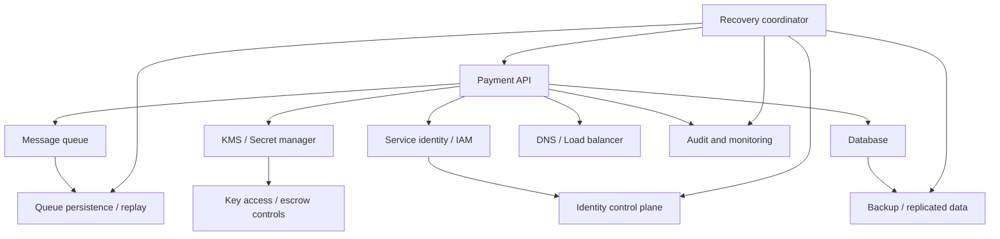
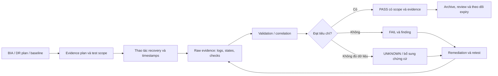

# Recovery evidence: Chứng minh khả năng khôi phục hệ thống sau thảm họa

## 1. Recovery evidence là gì?

**Recovery evidence** là tập hợp bằng chứng có thể truy vết, kiểm tra và tái đánh giá, cho thấy một hệ thống hoặc quy trình nghiệp vụ **đã có thể khôi phục hoặc thực sự khôi phục được** trong những điều kiện, phạm vi và giới hạn được xác định trước. Bằng chứng không chỉ mô tả kế hoạch disaster recovery (DR), mà còn ghi nhận **các thao tác đã thực hiện, trạng thái đạt được, dữ liệu đã khôi phục, thời gian thực tế và kiểm soát bảo mật còn hiệu lực**.

Trong module **SECURITY_SECURITY_ASSURANCE**, mục tiêu là xây dựng cách đánh giá có bằng chứng rằng hệ thống đáp ứng các mục tiêu bảo mật từ phân tích rủi ro, yêu cầu, security controls đến kiểm thử, audit, phát hiện và khắc phục. Vì thế, câu hỏi cốt lõi không phải “chúng ta có backup không?” mà là:

1. **Khôi phục cái gì?** Dịch vụ, dữ liệu, môi trường, khách hàng và dependencies nào thuộc phạm vi?
2. **Khôi phục theo mục tiêu nào?** Các yêu cầu RTO, RPO, mức dịch vụ tối thiểu và tiêu chí chấp nhận do ai phê duyệt?
3. **Đã kiểm thử hoặc thực hiện thật đến đâu?** Bài diễn tập, thử restore hay sự cố thực tế đã chứng minh điều gì?
4. **Có còn an toàn sau khôi phục không?** Danh tính, quyền, mã hóa, network, logging, secrets và integrity có đạt baseline?
5. **Ai xác nhận và bằng chứng ở đâu?** Có đủ dữ liệu độc lập, timestamp, log, kiểm tra nghiệp vụ, quyết định và retest không?

**Backup thành công không đồng nghĩa recovery thành công.** Một snapshot có trạng thái `completed` chỉ có thể chứng minh tác vụ backup theo báo cáo của hệ thống lưu trữ; nó chưa chứng minh snapshot giải mã được, dữ liệu nhất quán, ứng dụng khởi động được, các dịch vụ phụ thuộc tương thích, dữ liệu không vượt RPO hoặc khách hàng truy cập được.

### Mục tiêu học tập

Sau bài này, người học có thể:

- Xác định recovery claims và loại bằng chứng cần có để chứng minh từng claim.
- Thiết kế ma trận **yêu cầu → kiểm soát → phép thử → kết quả quan sát → hồ sơ bằng chứng**.
- Đo RTO/RPO từ mốc có ý nghĩa nghiệp vụ và nhận diện giới hạn của các con số.
- Đánh giá restore, failover, failback, tính nhất quán dữ liệu và tình trạng bảo mật sau recovery.
- Tổ chức bằng chứng với chuỗi lưu giữ, phân quyền, tính mới và khả năng tái dựng.
- Phân loại PASS/FAIL/UNKNOWN/EXCEPTION và quản lý phát hiện tới khi retest thành công.

## 2. Phân biệt kế hoạch, khả năng và bằng chứng khôi phục

| Thành phần | Chứng minh được điều gì? | Chưa tự chứng minh được điều gì? |
| --- | --- | --- |
| **DR plan / runbook** | Quy trình, thẩm quyền, thứ tự thao tác đã được mô tả | Quy trình có thực thi được hoặc đạt RTO/RPO không |
| **Backup policy** | Yêu cầu lịch backup, retention, mã hóa và nơi lưu | Backup thực sự tồn tại, đọc được, khôi phục được |
| **Backup job success** | Một lần chạy backup báo thành công theo công cụ | Dữ liệu, khóa, ứng dụng và dependency đều khôi phục đúng |
| **Restore test** | Dữ liệu hoặc service được phục hồi trong bài thử cụ thể | Tất cả production workloads hoặc mọi vùng sự cố đều khôi phục được |
| **Failover test** | Có thể chuyển dịch vụ sang môi trường dự phòng theo phạm vi thử | Failback an toàn, không split-brain hoặc không mất dữ liệu |
| **Business acceptance** | Chủ nghiệp vụ xác nhận tiêu chí chức năng và dữ liệu ở thời điểm kiểm tra | Không còn rủi ro an ninh chưa xử lý |
| **Post-recovery security check** | Những control đã kiểm tra có trạng thái phù hợp baseline | Không còn bất kỳ lỗ hổng hay hành vi xâm nhập nào ngoài phạm vi kiểm tra |
| **Recovery evidence package** | Liên kết yêu cầu, hành động, đo lường và kết luận trong phạm vi cụ thể | Một bảo đảm tuyệt đối cho các lần khôi phục tương lai |

Cần phân biệt **evidence of capability** (bằng chứng từ diễn tập và kiểm tra khả năng sẵn sàng) với **evidence of execution** (bằng chứng từ lần khôi phục cụ thể). Diễn tập thành công làm tăng độ tin cậy, nhưng thay đổi kiến trúc, con người, khóa hoặc nhà cung cấp có thể khiến kết quả cũ không còn đại diện.

## 3. Xuất phát từ Business Impact Analysis và mục tiêu phục hồi

**Business Impact Analysis (BIA)** xác định tác động gián đoạn, mức ưu tiên, dependencies, yêu cầu về tính sẵn sàng và dữ liệu. Recovery evidence phải bám vào những yêu cầu đã được phê duyệt, thay vì chọn số đo có lợi sau khi thử nghiệm.

### Khái niệm quan trọng

- **RTO (Recovery Time Objective):** khoảng thời gian mục tiêu để khôi phục một mức dịch vụ hoặc hoạt động nghiệp vụ xác định sau gián đoạn. Phải nêu rõ **điểm bắt đầu, điểm kết thúc và tiêu chí dịch vụ đã phục hồi**.
- **RPO (Recovery Point Objective):** mức mất dữ liệu tối đa có thể chấp nhận tính theo thời gian, liên quan đến thời điểm cuối cùng của dữ liệu có thể khôi phục so với một mốc gián đoạn được xác định. Một phép kiểm đòi hỏi xác định thực tế dữ liệu đã được commit và đã khôi phục đến đâu.
- **MBCO (Minimum Business Continuity Objective):** mức sản phẩm/dịch vụ hoặc công suất tối thiểu cần duy trì để chấp nhận được trong gián đoạn theo chính sách BIA.
- **MTPD/MAO:** thời gian gián đoạn tối đa nghiệp vụ có thể chịu được, theo cách tổ chức định nghĩa. Đây không đơn giản là một tên khác của RTO.
- **Recovery tier:** nhóm dịch vụ có mức độ quan trọng, yêu cầu thời gian và dữ liệu tương tự.

### Ví dụ mục tiêu được phê duyệt

| Dịch vụ | Phạm vi nghiệp vụ | RTO | RPO | Điều kiện khôi phục được chấp nhận |
| --- | --- | --- | --- | --- |
| Payment API | Thanh toán và tra cứu trạng thái | 120 phút | 5 phút | Giao dịch hợp lệ có thể thực hiện/tra cứu, không xử lý trùng, audit hoạt động |
| Order service | Nhận và theo dõi đơn | 4 giờ | 15 phút | API và dữ liệu nhất quán với tồn kho theo mức đã duyệt |
| Reporting | Báo cáo nội bộ không thời gian thực | 24 giờ | 24 giờ | Báo cáo được tạo từ snapshot hợp lệ |
| IAM/admin plane | Quản trị hệ thống và quyền khẩn cấp | Theo BIA riêng | Theo loại dữ liệu/cấu hình | Có quyền truy cập được kiểm soát và audit phù hợp |

*Số liệu trong bảng chỉ là giả định học tập.* Có những hệ thống yêu cầu gần như không mất dữ liệu, hoặc không cho phép khôi phục đến một thời điểm trước khi nghi ngờ bị xâm nhập. Nên lưu phiên bản BIA và phê duyệt của người có thẩm quyền để tránh diễn giải mục tiêu khác nhau sau sự cố.

### Định nghĩa ranh giới đo

Nếu server bật lại trong 45 phút nhưng database chưa nhất quán và người dùng chưa giao dịch được, **45 phút không phải RTO thực tế của dịch vụ thanh toán**. Phải xác định rõ mốc đạt mức dịch vụ được BIA chấp nhận; nếu yêu cầu bảo mật và kiểm tra gian lận là điều kiện bắt buộc để mở dịch vụ, thời gian hoàn thành các bước đó cũng nằm trong thời gian phục hồi.

Đối với RPO, thời điểm backup gần nhất không đủ làm kết luận. Phải xác định **recovery point thực tế có bằng chứng**: log sequence, transaction watermark, journal offset, snapshot consistency, record được khôi phục và kết quả đối chiếu nguồn có thẩm quyền.

## 4. Những recovery claims cần thiết

Một **recovery claim** là lời khẳng định đủ cụ thể để có thể kiểm thử và đưa ra kết luận.

| Recovery claim | Câu hỏi kiểm tra | Bằng chứng phù hợp |
| --- | --- | --- |
| **Recoverability** | Backup/snapshot có thể đọc và restore thành trạng thái dùng được không? | Restore job, checksum, logs, DB/app verification |
| **Time objective** | Service có khôi phục đúng RTO ở mức cam kết không? | Incident timeline, start/end events, acceptance record |
| **Data loss objective** | Dữ liệu mất có trong giới hạn RPO không? | Commit/replay watermarks, source/recovered comparison |
| **Consistency** | Các thành phần có nhìn thấy trạng thái nghiệp vụ nhất quán? | DB checks, queue offsets, transaction reconciliation |
| **Security baseline** | IAM, secrets, network, TLS, audit và encryption có còn hiệu lực? | Cấu hình runtime, negative tests, logging pipeline |
| **Dependency readiness** | DNS, IdP, KMS, registry, storage, network và đối tác có hoạt động? | Dependency checks, end-to-end business tests |
| **Failover safety** | Chuyển vùng/địa điểm có tránh xử lý đồng thời trái phép? | Fencing, routing, leader state, split-brain tests |
| **Failback safety** | Có thể trở về primary mà không mất dữ liệu hoặc ghi đè trạng thái? | Sync, change approval, checksum, failback test |
| **Operational readiness** | Owner, runbook, liên lạc và quyền khẩn cấp có sẵn? | Roster, tabletop/paging test, execution records |
| **Auditability** | Đường đi của quyết định và thay đổi có thể tái dựng? | Audit events, decision log, evidence index và access review |

Một claim thường cần nhiều nguồn bằng chứng. Ví dụ “khôi phục an toàn” không thể được chứng minh chỉ bằng HTTP status 200, vì endpoint có thể trả lời nhưng sử dụng credentials sai, cấu hình public exposure bất thường hoặc thiếu log truy cập.

## 5. Xác định phạm vi tài sản và dependencies

Trước khi kiểm tra DR, cần có **recovery inventory** liên kết tài sản và dịch vụ với đúng chiến lược khôi phục:

- **Business process:** chức năng, data owners, nhóm khách hàng, MBCO và mức độ ưu tiên.
- **Ứng dụng:** APIs, background workers, service mesh/ingress, scheduled jobs, feature flags và config.
- **Dữ liệu:** databases, object storage, block volumes, queues, event streams, caches có state, snapshots và keys.
- **Điều phối:** Kubernetes cluster, VM/host, container image registry, IaC, deployment controller, DNS/LB.
- **Danh tính:** IAM roles, IdP, workload identity federation, break-glass identities, certificates và service accounts.
- **Mạng và vùng lỗi:** region, zone, VPC/VNet, private links, firewall, routing và phụ thuộc external provider.
- **Observability:** audit logs, metrics, alerts, SIEM/detection, trace pipeline và nơi giữ bằng chứng.
- **Recovery infrastructure:** backup repository, vault, immutable copies, isolated restore environment, automation và vật tư dự phòng.

### Dependency graph



Sơ đồ chỉ là minh họa. Trong hệ thống thực, một dependency có thể vừa là công cụ phục hồi vừa là **single point of failure**. Chẳng hạn, backup được mã hóa nhưng khóa giải mã chỉ nằm trong cùng vùng gặp sự cố; đó là gap quan trọng dù backup snapshot có sẵn ở vùng khác.

Cần lưu **version của dependency graph** cùng bài thử. Kiểm thử DR năm trước không còn đủ đại diện nếu dịch vụ năm nay bổ sung queue, thay cách quản lý secret hoặc chuyển sang nền tảng mới.

## 6. Ma trận truy vết từ yêu cầu tới bằng chứng

Bằng chứng đáng tin không phải tập hợp ảnh chụp rời rạc. Nó phải nối được một yêu cầu có thẩm quyền tới phép kiểm và trạng thái quan sát.

| Rule ID | Yêu cầu | Nguồn quan sát | Phép kiểm bắt buộc | Kết luận có thể đưa ra |
| --- | --- | --- | --- | --- |
| **DR-01** | Backup nằm trong retention và phạm vi đã duyệt | Inventory, backup policy, backup records | Đối chiếu tài sản và các bản backup hiện có | Có/không có nguồn dữ liệu dự phòng đủ phạm vi |
| **DR-02** | Restore và giải mã được backup trong môi trường được duyệt | Restore event, keys, checksum | Thực hiện restore và đọc dữ liệu | Bản backup mẫu có thể khôi phục |
| **DR-03** | Service đáp ứng RTO đã phê duyệt | Incident/exercise timeline | Đo tới business acceptance | Thời gian phục hồi đo được so với RTO |
| **DR-04** | Dữ liệu đáp ứng RPO | Commit marker, replay state, reconciliation | So sánh recovery point và mốc gián đoạn | Mức mất dữ liệu đã quan sát |
| **DR-05** | Hệ thống phục hồi có dữ liệu và nghiệp vụ nhất quán | DB/queue/application checks | Thực hiện transaction và đối soát | Chức năng/consistency trong phạm vi thử |
| **DR-06** | Security controls còn đạt baseline | IAM, KMS, network, audit, config | Runtime readback và negative tests | Baseline security sau phục hồi |
| **DR-07** | Failover/failback không tạo xử lý kép | Leader/routing state, writes, reconciliation | Controlled failover/failback tests | Không thấy split-brain trong thử nghiệm |
| **DR-08** | Người có thẩm quyền phê duyệt recovery/cutover | Runbook, decision record, approvals | Review execution evidence | Quy trình điều phối được tuân thủ |
| **DR-09** | Recovery evidence đủ tin cậy và truy xuất được | Evidence store, checksum, audit | Retrieval và integrity check | Có thể kiểm toán/bảo toàn bằng chứng |
| **DR-10** | Khác biệt và ngoại lệ được khắc phục, retest | Finding register, change, retest | Xác nhận trạng thái sau sửa | Rủi ro chưa đóng/đã được xác minh |

Các điều kiện của mỗi rule phải bao gồm scope, version, tần suất kiểm thử, ngưỡng và owner. Không thể chấm DR-03 PASS nếu chưa biết RTO áp dụng cho dịch vụ nào hoặc không có mốc kết thúc có ý nghĩa nghiệp vụ.

## 7. Quy trình thu thập recovery evidence

Nên thiết kế quy trình thu thập từ **trước khi thảm họa xảy ra**; khi đang khắc phục sự cố, việc bổ sung log, quyền hoặc timestamp có thể không còn khả thi.

### Các bước

1. **Xác nhận claim/baseline:** lấy BIA, recovery tier, mục tiêu RTO/RPO và security baseline được duyệt.
2. **Khóa phạm vi thử:** dịch vụ, dependencies, region, dữ liệu, phiên bản release và điều kiện giả lập.
3. **Chỉ định evaluator/approver:** ai chạy thao tác, ai xác nhận chức năng và ai độc lập review bằng chứng.
4. **Thiết lập mốc thời gian:** phân biệt thời điểm gián đoạn, phát hiện, khai báo, quyết định, phục hồi kỹ thuật và business acceptance.
5. **Chạy theo runbook:** ghi tác vụ, inputs không nhạy cảm, owner, kết quả và deviations.
6. **Thu raw evidence:** backup/restore records, event logs, metrics, SQL kiểm tra an toàn, transaction samples, checksums, change approvals.
7. **Đối chiếu:** kiểm tra nguồn gốc dữ liệu, tính nhất quán giữa các nguồn và giới hạn do telemetry mất.
8. **Kết luận:** PASS/FAIL/UNKNOWN/EXCEPTION cho từng rule, không gộp tất cả thành một trạng thái.
9. **Khắc phục và retest:** mở finding, sửa và thu bằng chứng mới trước khi đóng.
10. **Lưu trữ:** evidence index, quyền truy cập, checksum/kiểm soát integrity, retention và khả năng retrieval.

### Evidence lifecycle



Một phần bằng chứng có thể được chuẩn bị sẵn trong thời bình (inventory, policies, backup configuration), phần còn lại chỉ xuất hiện khi **thử restore** hoặc diễn tập. Cả hai cần phiên bản và thời gian rõ để người đánh giá biết bằng chứng nào còn hợp lệ.

## 8. Bằng chứng về backup: cần những gì và giới hạn ra sao?

Backup evidence nên bao gồm:

- **Policy:** tài sản/dữ liệu nào được bảo vệ, chu kỳ, retention, vị trí, loại backup, owner và mục tiêu RPO.
- **Job history:** thời điểm bắt đầu/kết thúc, trạng thái, dung lượng, cảnh báo, lỗi retry, backup set ID.
- **Scope:** database/schema/table, volume, object prefix, cấu hình ứng dụng, secrets, certificates và metadata cần thiết.
- **Storage protection:** mã hóa at rest/in transit, phân quyền ghi/đọc/xóa, tách quyền, retention lock/immutability nếu áp dụng.
- **Off-site / fault-domain isolation:** backup có bị cùng sự cố vật lý, logical deletion hoặc credential compromise ảnh hưởng không?
- **Key availability:** khóa giải mã/khôi phục có được bảo quản, truy xuất hợp lệ khi vùng chính không khả dụng không?
- **Restore validation:** có đọc lại, verify checksums hoặc khôi phục thành hệ thống dùng được không?

### Ba cấp độ kết luận

| Bằng chứng | Kết luận có thể hỗ trợ | Giới hạn |
| --- | --- | --- |
| `backup_job.status=SUCCESS` | Tool báo đã chạy tác vụ | Chưa chứng minh dữ liệu phục hồi được |
| Backup ID có trên kho độc lập và quyền phù hợp | Có artifact dự phòng trong phạm vi lưu | Chưa chứng minh giải mã, nhất quán hay ứng dụng chạy |
| Restore hoàn thành + integrity checks + business acceptance | Bộ dữ liệu mẫu phục hồi và đáp ứng checks được thực hiện | Không tự chứng minh mọi dữ liệu, mọi kịch bản hoặc môi trường đều đạt |

Cần thử **các loại khôi phục thực tế**, không chỉ liệt kê file backup. Ví dụ, restore database từ full backup có thể thành công nhưng vẫn thiếu transaction logs cần để đáp ứng RPO; backup image máy ảo có thể boot được nhưng không chứa khóa/mật khẩu cần thiết cho ứng dụng.

### Bảo vệ trước ransomware và hành vi phá hoại

Một chiến lược DR có thể cần bản sao offline, cross-account/cross-region hoặc lưu trữ bất biến có giới hạn phù hợp. Tuy nhiên, các thuật ngữ “immutable”, “air-gapped” hay “cross-region” chỉ có ý nghĩa khi đã xác định **đối tượng có thể xóa/sửa bản sao, đường truy cập quản trị, quyền khóa, policy retention và nguồn lỗi chung**.

Khi có nghi ngờ ransomware, khôi phục phải xem xét **độ sạch của recovery point**: snapshot mới nhất có thể đã chứa mã độc, tài khoản bị chiếm hoặc cấu hình độc hại. Bằng chứng “snapshot mới” không đồng nghĩa “snapshot an toàn”.

## 9. Đo RTO có căn cứ

Để đo RTO, cần xác định **start event** và **end event** dựa trên mục tiêu nghiệp vụ. Một số mốc tham chiếu:

| Mốc | Ví dụ ý nghĩa |
| --- | --- |
| `T_impact` | Dịch vụ không còn đáp ứng điều kiện tối thiểu đã định |
| `T_detect` | Monitoring hoặc người dùng phát hiện sự cố |
| `T_declare` | Incident Commander khai báo disaster/DR |
| `T_start_restore` | Bắt đầu thao tác restore/failover |
| `T_infra_ready` | VM/cluster/network đã sẵn sàng kỹ thuật |
| `T_app_ready` | Kiểm tra ứng dụng khởi động và dependencies đạt |
| `T_business_accept` | Chủ nghiệp vụ xác nhận mức dịch vụ đúng điều kiện chấp nhận |

Nếu BIA đo từ lúc bắt đầu mất dịch vụ tới khi nghiệp vụ được phục hồi ở mức tối thiểu, thì:

\[
\text{Observed recovery duration} = T_{\text{business accept}} - T_{\text{impact}}.
\]

**Không được tự ý bắt đầu tính khi nhóm DR nhấn nút restore**, vì cách đó loại bỏ thời gian phát hiện, khai báo, ra quyết định và chờ người vận hành; con số sẽ không phản ánh tác động thực tế theo yêu cầu BIA.

### Ví dụ phép đo minh họa

- Sự cố làm Payment API không đáp ứng điều kiện chấp nhận: **09:00 UTC**.
- Monitoring phát hiện: **09:04 UTC**.
- Kích hoạt kế hoạch DR: **09:10 UTC**.
- Hạ tầng ở vùng dự phòng sẵn sàng: **10:40 UTC**.
- Ứng dụng vượt qua functional và security checks, chủ nghiệp vụ xác nhận: **11:20 UTC**.

Thời gian phục hồi thực tế theo định nghĩa trên là **140 phút**, vì 11:20 trừ 09:00 là 2 giờ 20 phút. Nếu RTO được duyệt là **120 phút**, DR-03 = **FAIL** dù hạ tầng đã hoạt động lúc 10:40 và quá trình khôi phục kỹ thuật được thực hiện đúng runbook.

Cũng cần ghi rõ chất lượng đồng hồ của các hệ thống ghi event. Nếu điểm bắt đầu không thể xác định chính xác, báo cáo khoảng tin cậy hoặc mốc gần nhất có căn cứ, không tạo sự chính xác giả tạo.

## 10. Đo RPO bằng dữ liệu thực tế

RPO nói về **mức mất dữ liệu chấp nhận được**, không đơn thuần là tần suất backup hay replication lag tại một thời điểm bất kỳ.

Giả sử hệ thống chính bị gián đoạn lúc 09:00 UTC. Bằng chứng từ transaction journal và hệ thống đã phục hồi cho thấy:

- Những giao dịch được xác nhận commit đến **08:56 UTC** đều hiện diện và có thể kiểm tra trên hệ thống phục hồi.
- Các giao dịch được commit sau 08:56 nhưng trước khi dừng hoàn toàn **không được phục hồi**, theo phép đối chiếu nguồn giao dịch đáng tin cậy.
- Không có giao dịch nào thuộc khoảng đó bị **xử lý trùng**; các giao dịch thiếu được đưa vào quy trình reconciliation phù hợp.

Khoảng mất dữ liệu theo thời gian trong ví dụ là khoảng **4 phút**, nhỏ hơn RPO giả định **5 phút**; DR-04 có thể PASS **cho dataset và phạm vi đã chứng minh**, nếu các nguồn xác nhận commit/recovery đáng tin cậy và định nghĩa BIA phù hợp.

### Những điểm cần thận trọng

1. **Thời gian backup gần nhất không đủ:** backup lúc 08:56 có thể thiếu giao dịch đã commit trước đó nếu cơ chế backup không nhất quán.
2. **Thời điểm dữ liệu cuối của bản restore cần xác minh:** dựa trên transaction log sequence, commit marker, checkpoint hoặc bằng chứng tương đương, không chỉ timestamp của file.
3. **Nhiều kho dữ liệu:** database đạt RPO nhưng queue, object storage hoặc cache chứa state không đạt thì chức năng nghiệp vụ có thể mất dữ liệu hoặc xử lý lặp.
4. **Replication không đồng nghĩa backup:** thao tác xóa hoặc mã hóa độc hại có thể được đồng bộ sang replica.
5. **Zero-data-loss claim cần chứng cứ đặc biệt:** kiểm tra toàn bộ committed writes và transactional semantics, không suy ra từ nhãn “synchronous replication”.
6. **Không có dữ liệu gốc để so:** nếu không thể xác định commit watermark, kết luận RPO nên là UNKNOWN hoặc có giới hạn, không đánh dấu PASS chỉ vì ứng dụng chạy lại.
7. **Khôi phục các thao tác thiếu:** replay hoặc xử lý thủ công có thể giảm tác động nghiệp vụ nhưng không xóa sự thật rằng recovery point ban đầu đã thiếu dữ liệu; cần ghi rõ phương pháp đo trước và sau reconciliation.

### Dữ liệu liên kết nhiều thành phần

Ví dụ đơn hàng được ghi vào database rồi đẩy sự kiện sang queue. Nếu restore chỉ đưa database về 08:56 trong khi queue còn event đến 08:59, worker có thể xử lý những message không còn bản ghi nghiệp vụ tương ứng. Cần có **recovery consistency protocol**: thứ tự khôi phục, kiểm tra offsets, idempotency, deduplication và đối soát với nguồn xác nhận có thẩm quyền.

## 11. Data integrity, consistency và kiểm tra ứng dụng

Restore thành công về mặt kỹ thuật **chưa chứng minh dữ liệu đúng**. Cần kiểm thử ở nhiều lớp:

### Lớp storage

- Kiểm tra checksum/hash của artifact và dữ liệu đã phục hồi khi định dạng/công cụ hỗ trợ.
- Xác minh dữ liệu có thể đọc được với khóa và quyền hợp lệ.
- Kiểm tra filesystem/volume health, object counts hoặc manifest theo phạm vi.

### Lớp database

- Kiểm tra schema/migration version, metadata, transaction log state và tình trạng lỗi khi mở database.
- Đối soát số lượng bản ghi, tổng kiểm soát, quan hệ tham chiếu và các bảng nghiệp vụ quan trọng.
- Xác minh role/permissions, dữ liệu nhạy cảm, mã hóa và audit logs.
- Với database phân tán, xác nhận quorum/leader, consistency và trạng thái replication tương ứng kiến trúc.

### Lớp ứng dụng

- Health check thực sự đi qua dependencies cần thiết, không chỉ trả về mã HTTP 200 từ một proxy.
- Transaction thử có kiểm soát xác minh luồng ghi/đọc theo yêu cầu.
- Các luồng nghiệp vụ quan trọng: tạo yêu cầu, xử lý, xác nhận, hoàn/đảo giao dịch nếu phù hợp.
- Đối soát dữ liệu qua API, DB, queue và bên thứ ba khi cần.
- Kiểm tra authorization và audit cho những hành động nhạy cảm.

### Ví dụ bộ dữ liệu kiểm thử

| Loại kiểm tra | Input/đối tượng | Kết quả chấp nhận |
| --- | --- | --- |
| Structural | Schema, index, sequence, version | Tương thích phiên bản ứng dụng phục hồi |
| Referential | Đơn hàng–khách hàng–line items | Không có liên kết mồ côi vượt tiêu chí |
| Financial reconciliation | Tổng giao dịch theo khoảng thời gian | Số lượng/tổng khớp hoặc ngoại lệ đã được phân loại |
| Event integrity | DB rows ↔ queue messages | Không lặp/mất ngoài mức chấp nhận, có xử lý uncertain outcome |
| Functional | Giao dịch thử không dùng dữ liệu thật nhạy cảm | Thành công và tạo audit event phù hợp |
| Authorization negative test | Principal không có quyền thử truy cập | Yêu cầu bị từ chối theo policy |

**Đếm số dòng bằng nhau chưa chứng minh dữ liệu đúng.** Hai tập dữ liệu có thể cùng số dòng nhưng giá trị khác nhau, sai quan hệ hoặc thiếu một số giao dịch đã commit. Phải chọn những phép kiểm phù hợp mô hình nghiệp vụ và độ quan trọng dữ liệu.

## 12. Security assurance sau khi khôi phục

Một môi trường phục hồi có thể tạm dùng cấu hình khác production: subnet dự phòng, role khẩn cấp, certificate mới, backup key, image khác hoặc rule network mở rộng. Vì thế, kiểm tra bảo mật sau restore là **điều kiện chấp nhận riêng**, không chỉ là phần phụ của functional test.

| Control | Rủi ro sau phục hồi | Bằng chứng cần kiểm |
| --- | --- | --- |
| **IAM / privilege** | Quyền break-glass còn hiệu lực, service account quá rộng | IAM/RBAC actual state, access review, session logs |
| **Secrets / keys** | Khóa không hợp lệ, secret lộ, dùng key từ backup cũ | KMS/secret configuration, rotation/revocation history |
| **Network isolation** | DR environment mở internet hoặc đường quản trị ngoài dự kiến | Firewall/security group, routing, reachability tests |
| **Encryption** | Data restore không được mã hóa hoặc TLS sai chứng chỉ | Encryption state, TLS config và test |
| **Audit / monitoring** | Các thao tác recovery không được log, detection bị tắt | Audit configuration, source-to-sink canary, alert delivery |
| **Patch / configuration baseline** | Restore từ image OS cũ với CVEs hoặc hardening đã lỗi thời | OS/runtime versions, vulnerability assessment, baseline diff |
| **Supply chain integrity** | Artifact restore không khớp digest hoặc không có provenance | Approved release digest, signature/provenance verification |
| **Backup protection** | Bản sao bị public hoặc quyền xóa bị mở rộng sau khôi phục | Storage permissions, retention/immutability settings |
| **Isolation from compromise** | Khôi phục chính malware, persistence hoặc credential đã bị chiếm | Threat hunting/forensics phù hợp, clean restore-point decision |
| **Logging and evidence** | Hồ sơ không thể chứng minh thao tác của người vận hành | Privileged activity logs, timeline, change approvals |

Nếu khôi phục trong bối cảnh incident do xâm nhập, cần **phân biệt restore kỹ thuật với xác nhận an toàn để mở dịch vụ**. Một bản snapshot có thể hoạt động nhưng chứa account độc hại; phục hồi lên môi trường clean room để quét/điều tra có thể cần trước khi chuyển lưu lượng production.

Không nên vô hiệu hóa MFA, network segmentation, audit hoặc TLS vĩnh viễn để đạt RTO. Nếu một ngoại lệ khẩn cấp thật sự được chấp thuận, phải giới hạn tài sản, thời gian, risk owner, biện pháp bù trừ và kiểm tra thu hồi. Một môi trường đang chạy theo ngoại lệ không đồng nghĩa mọi rule security đều PASS.

## 13. Failover, failback và bằng chứng tránh split-brain

**Failover** chuyển dịch vụ từ môi trường bị ảnh hưởng sang môi trường dự phòng. **Failback** đưa dịch vụ trở về primary hoặc một môi trường mục tiêu khác sau khi đã sẵn sàng. Hai bước có rủi ro khác nhau và cần kiểm thử riêng.

### Những điều cần chứng minh khi failover

1. Điều kiện kích hoạt và người phê duyệt đúng runbook.
2. Primary được **fence/quiesce** phù hợp, không tiếp tục xử lý ghi gây xung đột.
3. Dữ liệu dự phòng đạt recovery point có thể kiểm chứng.
4. Service discovery, DNS/load balancer, network, certificates và identity chuyển đúng.
5. Application functional checks và security baseline được xác nhận.
6. Monitoring và alerting hoạt động ở vùng dự phòng.
7. Không có hai active writers trái quy tắc hoặc xử lý giao dịch trùng.

### Những điều cần chứng minh khi failback

- Primary đã sửa nguyên nhân và có kế hoạch tái đồng bộ được phê duyệt.
- Dữ liệu từ vùng dự phòng được đưa về hoặc hòa giải, không ghi đè giao dịch mới.
- Có mốc freeze/transfer ownership rõ ràng giữa hai writers.
- Luồng mạng và quyền quản trị được trả về baseline mong đợi.
- Phép thử đọc/ghi, nghiệp vụ, audit, backup ở primary đã đạt.
- Các ngoại lệ khẩn cấp, credential tạm thời, route tạm và tài nguyên DR không còn cần thiết được kiểm tra/thu hồi.

**Không đủ để nói “DNS trỏ đúng”.** DNS có TTL, client caches, service connections lâu sống; vẫn có thể còn lưu lượng hoặc job ghi vào primary cũ. Bằng chứng cần bao gồm trạng thái writer ownership, fencing, transaction sequence và phân tích split-brain theo kiến trúc.

### Ma trận test failover/failback

| Tình huống | Test | Kết quả mong đợi |
| --- | --- | --- |
| Primary hỏng và không phản hồi | Failover theo trigger | Chỉ một môi trường ghi dữ liệu theo policy |
| Primary phục hồi một phần | Thử ngăn writer cũ hoạt động trái phép | Fencing được xác minh |
| DNS đã chuyển nhưng client giữ connection cũ | Kiểm tra traffic và session | Không ghi sai điểm đích |
| Log/queue bị trễ khi chuyển | Reconciliation và offset checks | Không mất/lặp ngoài giới hạn |
| Failback với dữ liệu mới ở DR | Đồng bộ và controlled cutover | Dữ liệu mới được giữ, chủ thể ghi duy nhất |
| Thiếu quyền/khoá ở vùng dự phòng | Kiểm thử dependency và security | Báo FAIL/UNKNOWN, không tuyên bố recovered |

Thao tác ảnh hưởng dữ liệu sản xuất cần quy trình kiểm thử an toàn và phê duyệt; có thể dùng môi trường giả lập hoặc fault injection hạn chế để xác minh từng rủi ro mà không gây hại tới khách hàng.

## 14. Thực hành thu thập bằng chứng chỉ đọc

Trong lúc thử nghiệm hoặc sự cố, nên ưu tiên **quan sát không làm thay đổi trạng thái** để tránh ảnh hưởng điều tra. Những lệnh dưới đây chỉ là ví dụ; quyền truy cập, môi trường và khả năng cung cấp thông tin phụ thuộc hệ thống.

### Kubernetes: xác minh tài nguyên ứng dụng ở môi trường khôi phục

```bash
# Đảm bảo đang đọc đúng cluster context, không dựa vào tên mặc định.
kubectl config current-context

# Xem trạng thái node, workload và dịch vụ trong namespace.
kubectl get nodes -o wide
kubectl get deployments -n payments -o wide
kubectl get pods -n payments -o wide
kubectl get services -n payments -o wide

# Xác nhận trạng thái rollout và thông tin cấu hình hiện hành.
kubectl rollout status deployment/payment-api -n payments --timeout=30s
kubectl get deployment payment-api -n payments -o yaml
```

Lệnh `kubectl rollout status` quan sát điều kiện rollout và có thể chờ một khoảng thời gian; nó **không** xác nhận transaction integrity, RPO, kiểm thử nghiệp vụ hay network policies được thực thi. Một trạng thái `Available=True` chỉ là một phần bằng chứng.

### Database: một số kiểm tra đọc an toàn mang tính minh họa

Giả sử dùng PostgreSQL, chỉ thực hiện bằng tài khoản **được phê duyệt quyền SELECT** trên hệ thống thử/DR:

```sql
-- Xem chế độ recovery của server hiện tại.
SELECT pg_is_in_recovery() AS is_standby;

-- Phiên bản server cần để đối chiếu kế hoạch phục hồi.
SHOW server_version;

-- Trạng thái và số lượng bản ghi trong bảng nghiệp vụ mẫu.
SELECT status, COUNT(*) AS records
FROM public.orders
GROUP BY status
ORDER BY status;
```

Trên standby, một số hàm có thể cung cấp thông tin thời gian hoặc LSN replay; nhưng **một timestamp replay đơn lẻ không đủ chứng minh RPO** nếu thiếu dữ liệu commit và phép đối soát đáng tin cậy. Câu SQL ví dụ giả định bảng `public.orders` tồn tại, không áp dụng nguyên dạng ở mọi database hoặc hệ thống. Trên bảng lớn, ngay cả truy vấn đọc đếm toàn bộ cũng có chi phí; cần chọn phương pháp phù hợp với yêu cầu không gây gián đoạn.

### Những nguồn bằng chứng khác

- Backup/restore task IDs và hệ thống job logs.
- Artifact checksums và repository retention reports.
- Cloud management/audit events về tạo tài nguyên, network, IAM và key access.
- Kết quả transaction canary có đánh dấu là test, không dùng dữ liệu khách hàng thật.
- Ticket approval, thay đổi IaC/release, decision log và runbook execution log.
- Kết quả truy xuất lại bằng chứng từ storage độc lập.

**Không lấy bằng chứng bằng cách chụp hoặc xuất secret thô.** Thay thế bằng references, checksums, trạng thái cấu hình, audit events và dữ liệu mẫu đã làm sạch.

## 15. Thiết kế Recovery Evidence Plan trước sự cố

Một **Recovery Evidence Plan** định nghĩa trước bằng chứng nào phải xuất hiện trong mỗi lần exercise hoặc recovery. Dưới đây là YAML **khái niệm do tổ chức tự định nghĩa**, không phải tài nguyên Kubernetes hay cấu hình nhà cung cấp dùng trực tiếp:

```yaml
recoveryEvidencePlan:
  id: DR-EVIDENCE-PAYMENTS-PROD
  version: "1.0.0"
  state: approved
  service: payment-api
  environment: production
  owners:
    recovery: Platform DR
    businessAcceptance: Payment Operations
    securityAssurance: Security Assurance
  objectives:
    rtoMinutes: 120
    rpoMinutes: 5
    recoveryLevel: "payment-and-status-query-available"
  scope:
    components:
      - payment-api
      - payment-database
      - payment-queue
      - iam-and-kms-dependencies
      - audit-log-pipeline
    recoveryScenario: primary-region-unavailable
  requiredChecks:
    - id: DR-02
      description: restore-readable
      requiredEvidence: [restore-job, checksum-and-read-check]
    - id: DR-03
      description: business-rto
      requiredEvidence: [impact-time, business-acceptance-time]
    - id: DR-04
      description: data-rpo
      requiredEvidence: [commit-watermark, recovered-watermark, reconciliation]
    - id: DR-05
      description: data-and-functional-consistency
      requiredEvidence: [transaction-tests, db-queue-reconciliation]
    - id: DR-06
      description: post-recovery-security-baseline
      requiredEvidence: [iam-review, tls-check, audit-canary]
    - id: DR-07
      description: failover-no-split-brain
      requiredEvidence: [fencing-state, writer-ownership, route-check]
  onMissingEvidence: UNKNOWN
  evidenceRetention: "according-to-approved-retention-policy"
  sourceRevision: "<approved-git-revision>"
```

Các key như `recoveryLevel`, `requiredEvidence` và `onMissingEvidence` là **quy ước học tập**, phải có evaluator và quy định đo thực tế để chạy. Việc đặt tên evidence không đồng nghĩa bằng chứng đã được tạo. Với một ứng dụng có nhiều data stores, test plan cần liệt kê từng nguồn dữ liệu chứ không chỉ ghi một trường `data-rpo` chung.

## 16. Hồ sơ bằng chứng mẫu cho một lần khôi phục

Một bản ghi nên có thể được người đánh giá dùng để tái dựng **điều kiện thử, thời điểm, kết quả từng control, ranh giới kết luận và phát hiện còn mở**.

```json
{
  "recoveryRunId": "DR-DEMO-20261128-01",
  "exerciseOrIncident": "controlled-failover-test",
  "incidentId": "INC-DEMO-058",
  "service": "payment-api",
  "scope": ["production-simulated/region-a", "dr-lab/region-b"],
  "baselineId": "DR-EVIDENCE-PAYMENTS-PROD",
  "baselineVersion": "1.0.0",
  "startedAt": "2026-11-28T09:00:00Z",
  "detectedAt": "2026-11-28T09:04:00Z",
  "declaredAt": "2026-11-28T09:10:00Z",
  "infrastructureReadyAt": "2026-11-28T10:40:00Z",
  "businessAcceptedAt": "2026-11-28T11:20:00Z",
  "observedRtoMinutes": 140,
  "rtoTargetMinutes": 120,
  "observedDataLossMinutes": 4,
  "rpoTargetMinutes": 5,
  "results": {
    "DR-02": "PASS",
    "DR-03": "FAIL",
    "DR-04": "PASS",
    "DR-05": "PASS",
    "DR-06": "PASS",
    "DR-07": "PASS"
  },
  "evidenceRefs": {
    "restoreJob": "evidence://dr-demo/restore-job",
    "rtoTimeline": "evidence://dr-demo/timeline",
    "dataWatermarks": "evidence://dr-demo/reconciliation",
    "securityCheck": "evidence://dr-demo/security",
    "businessAcceptance": "evidence://dr-demo/acceptance"
  },
  "findings": ["DR-FIND-021"],
  "review": {
    "assessor": "Security Assurance",
    "acceptedBy": "Payment Operations",
    "retestRequired": true
  }
}
```

**Đây là dữ liệu giả định** phục vụ bài học. `scope` có nhãn mô phỏng, nên không được lấy kết quả này để tuyên bố production thật đã được khôi phục trong 140 phút. RTO trong một bài diễn tập phải được diễn giải theo **giả định, quy mô và độ tương đồng với production**; bằng chứng từ một lần phục hồi thật có loại giới hạn khác.

Trong hồ sơ vận hành, nên lưu các dữ kiện gốc thay vì chỉ trường số tổng hợp: event IDs, actual commit/recovered watermarks, nguồn clock, người phê duyệt, snapshot IDs, checksums, version công cụ, môi trường, scripts, query, logs và decision timeline.

## 17. Độ tin cậy, tính nguyên vẹn và chuỗi quản lý bằng chứng

Recovery evidence có thể phục vụ hậu kiểm nội bộ, audit độc lập, điều tra an ninh và khi cần cả yêu cầu pháp lý. Vì vậy, phải quản trị nguồn gốc và quyền truy xuất.

### 17.1. Provenance và thời gian

- Mỗi artifact có **source system**, collector, người thực hiện/role, thời gian tạo, thời gian thu thập và version.
- Dùng timestamp có timezone, ưu tiên UTC khi tổng hợp; nhận diện clock skew và sự kiện đến muộn.
- Gắn vào **recovery run ID / incident ID** để tránh trộn hai lần thử với nhau.
- Giữ mối liên kết từ kết quả tổng hợp tới **raw evidence** có quyền truy cập phù hợp.
- Các nhận định “đã khôi phục” phải tham chiếu đúng checkpoint về chức năng và an toàn, không chỉ thời điểm một VM khởi động.

### 17.2. Integrity và chain of custody

Nếu cần bảo vệ tính toàn vẹn artifact, có thể sử dụng checksum, ký số, write-once/retention-lock hoặc audit trail trên kho bằng chứng, tùy rủi ro. Nhưng **hash đúng chỉ chứng minh các bytes được so sánh chưa thay đổi theo phương pháp đó; nó không tự chứng minh dữ liệu ban đầu đúng hoặc đáng tin**.

Chain of custody ghi ai thu thập, lúc nào, chuyển cho ai, làm gì với bản gốc và bản sao, trong điều kiện bảo quản nào. Khi cần trích xuất để báo cáo, sử dụng bản sao kiểm soát; tránh sửa raw artifact làm mất nguồn gốc.

### 17.3. Confidentiality và retention

Backup và restore logs có thể chứa tên người dùng, đường dẫn, internal addresses, SQL, token, dữ liệu nhạy cảm hoặc metadata có giá trị cho kẻ tấn công. Cần:

- Tách bản tổng hợp dành cho management/audit khỏi raw forensic artifacts.
- Giới hạn quyền theo nhóm; lưu logs truy cập và thao tác xóa/sửa bằng chứng.
- Làm sạch secret/token và dữ liệu cá nhân không cần thiết trước khi chia sẻ.
- Áp dụng retention theo luật, hợp đồng, loại dữ liệu, nghĩa vụ audit và legal hold khi có.
- Kiểm thử định kỳ khả năng tìm lại bằng chứng và xác nhận quyền đọc hợp lệ.

“Lưu evidence 7 năm” hay “mọi bản ghi đều bất biến” không thể tự đặt nếu chưa xem chính sách và nghĩa vụ thực tế; cũng không nên lưu vô thời hạn dữ liệu nhạy cảm chỉ vì thuận tiện cho kiểm toán.

## 18. Đánh giá kết quả PASS / FAIL / UNKNOWN / EXCEPTION

Một bảng điều khiển DR cần phân biệt **kết quả kiểm soát** với **mức độ hoàn chỉnh của bằng chứng**.

| Trạng thái | Điều kiện sử dụng | Ví dụ |
| --- | --- | --- |
| **PASS** | Rule áp dụng, bằng chứng đủ và mới chứng minh đạt mục tiêu | RTO đo theo mốc nghiệp vụ đúng bằng/nhỏ hơn ngưỡng; có acceptance |
| **FAIL** | Có bằng chứng xác nhận một yêu cầu bắt buộc không đạt | Restore vượt RTO, không khôi phục dữ liệu trong RPO, audit không hoạt động |
| **UNKNOWN** | Không đủ nguồn/permissions, mất timeline hoặc không thể đo | Không biết actual recovered transaction watermark |
| **EXCEPTION** | Sai khác được risk owner chấp nhận với phạm vi, hạn và biện pháp bù trừ | Được cho phép vận hành tạm ở DR với control hạn chế, có approval |
| **NOT_APPLICABLE** | Rule không áp dụng theo baseline và scope được phê duyệt | Failback test không áp dụng cho hệ thống được thiết kế không quay về primary cũ |

**UNKNOWN không được tính là PASS. EXCEPTION cũng không biến sai lệch thành PASS.** Ví dụ bài thử không kiểm tra failback thì không thể kết luận failback đạt; có thể ghi `NOT_TESTED/UNKNOWN` theo quy ước nội bộ hoặc N/A nếu baseline xác định một cách hợp lệ rằng không có bước failback.

### Phân biệt ba câu kết luận

- **“Có backup”**: dựa trên sự hiện diện artifact/policy.
- **“Có thể restore”**: dựa trên thử restore thành công với scope và điều kiện xác định.
- **“Có thể phục hồi hoạt động an toàn theo mục tiêu”**: đòi hỏi thêm RTO/RPO, business acceptance, data consistency, security controls, dependencies và quyết định có thẩm quyền.

Càng đưa ra claim rộng, tổ chức càng cần nhiều nguồn bằng chứng và kiểm tra hơn.

## 19. Diễn tập disaster recovery có giá trị kiểm chứng

Một test plan chỉ có câu “chuyển vùng thành công” là không đủ. Nên thiết kế **ma trận tình huống**:

| Test ID | Kịch bản | Điều cần chứng minh |
| --- | --- | --- |
| DR-T01 | Khôi phục một dataset từ backup đã chọn | Đọc được, checksum và logic integrity đạt |
| DR-T02 | Khôi phục trong isolated environment | Có key/permission, không làm ảnh hưởng production |
| DR-T03 | Mất cả primary region | Thực hiện DR với dependency graph đầy đủ |
| DR-T04 | Backup mới nhất bị hỏng hoặc nghi bị mã hóa độc hại | Chọn recovery point sạch hơn và đánh giá RPO/tác động |
| DR-T05 | KMS/IdP chính không khả dụng | Recovery access an toàn, không bỏ audit |
| DR-T06 | Failover trong khi hệ thống cũ còn writer | Fencing/no-split-brain được chứng minh |
| DR-T07 | Database và queue ở recovery points khác nhau | Reconciliation không mất/lặp nghiệp vụ ngoài ngưỡng |
| DR-T08 | Audit logging chưa chạy ở vùng DR | Security gate chặn mở production hoặc có exception hợp lệ |
| DR-T09 | Thiếu người chủ chốt, chuyển ca | Runbook, approver và backup contacts làm việc |
| DR-T10 | Failback sau khi DR có dữ liệu mới | Dữ liệu được giữ, kiểm tra đồng bộ và ownership |
| DR-T11 | Không truy xuất được evidence của lần thử | UNKNOWN hoặc FAIL rule về bằng chứng theo baseline |
| DR-T12 | Kéo dài outage vượt RTO | Escalation, communication và fallback được kích hoạt theo policy |

Các bài thử có thể gồm tabletop, walkthrough, component restore, integration test, partial failover và full-scope DR test. **Tabletop không thay thế restore thực tế**; kiểm thử một table cũng không tương đương xác minh toàn bộ service. Khi không thể diễn tập full production vì rủi ro, ghi rõ phần nào được xác nhận bằng simulation, phần nào bằng môi trường thực và residual risk.

### Trước – trong – sau bài thử

**Trước test:** phê duyệt phạm vi, phương án rollback, bản dữ liệu không nhạy cảm, tài sản thử, monitoring, người chịu trách nhiệm, tiêu chí kết thúc và nguyên tắc bảo toàn bằng chứng.

**Trong test:** ghi mốc thời gian, hành động, approval, lệnh được phép, kết quả, thay đổi ngoài kịch bản và sự kiện bất thường. Nếu cần điều chỉnh tiêu chí, không sửa ngược baseline một cách im lặng.

**Sau test:** so với RTO/RPO, security baseline và business acceptance; công bố FAIL/UNKNOWN và ngoại lệ; mở remediation tasks, kiểm thử lại; lưu evidence và cập nhật runbook.

## 20. Tình huống thực tế minh họa: Khôi phục Payment API sang vùng dự phòng

### Bối cảnh

Một công ty thương mại điện tử vận hành Payment API, database, queue, secret manager và hạ tầng cloud. BIA giả định mục tiêu **RTO 120 phút, RPO 5 phút**. Primary region gặp sự cố lúc 09:00 UTC. DR runbook dùng backup/replication tới vùng dự phòng và yêu cầu xác nhận chức năng, dữ liệu, security controls trước khi mở dịch vụ.

### Timeline và evidence

| Giờ UTC (giả định) | Hoạt động | Evidence |
| --- | --- | --- |
| 09:00 | Mất khả năng xử lý thanh toán theo điều kiện BIA | Service health/transaction failures, impact timestamp |
| 09:04 | Monitoring phát hiện, SOC/On-call nhận alert | Alert ID, delivery/ack |
| 09:10 | Incident Commander phê duyệt DR | Decision log, runbook version |
| 09:20 | Bắt đầu restore ở region dự phòng | Restore job IDs và backup selection rationale |
| 10:10 | Dữ liệu và queue sẵn sàng phục vụ consistency checks | Restore result, commit/queue watermarks |
| 10:40 | Network, compute và endpoints sẵn sàng | IaC/deploy logs, DNS/routing, health checks |
| 11:00 | Functional test đạt, nhưng audit sink ở DR chưa nhận canary | Transaction test; audit test FAIL |
| 11:15 | Sửa cấu hình audit pipeline, retest canary tới protected sink | Policy diff, event ID, receipt |
| 11:20 | Security và business acceptance hoàn thành, chuyển lưu lượng | Acceptance approval và operational checks |
| Sau đó | Đánh giá failback và dữ liệu pending | Reconciliation và follow-up decisions |

### Kết luận theo từng rule

- **DR-02 / Restore:** PASS cho datasets được kiểm tra nếu có backup/restore job, checksums và kết quả đọc dữ liệu.
- **DR-03 / RTO:** FAIL vì từ 09:00 đến 11:20 là **140 phút**, lớn hơn RTO 120 phút.
- **DR-04 / RPO:** Có thể PASS nếu transaction evidence chứng minh recovery point 08:56 và tất cả writes sau đó trước 09:00 được phân loại, suy ra mất tối đa khoảng 4 phút theo mục tiêu 5 phút. Nếu thiếu dữ liệu commit ở nguồn, phải ghi UNKNOWN.
- **DR-05 / Consistency:** PASS khi DB, queue và nghiệp vụ đã được đối chiếu trong phạm vi đã duyệt.
- **DR-06 / Security:** FAIL tại 11:00 do log sink không nhận audit; sau sửa tại 11:15 và kiểm tra toàn diện có thể đánh giá lại theo tiêu chí.
- **Business acceptance:** hoàn thành lúc 11:20, không được dùng thời điểm 10:40 “hạ tầng sẵn sàng” làm mốc kết thúc RTO.

### Bài học

Khôi phục có thể **thành công về mặt kỹ thuật nhưng không đạt cam kết RTO**. Việc giữ security gate giúp tránh mở dịch vụ khi thiếu audit, song bổ sung thời gian phục hồi; đây là trade-off cần xử lý bằng cải tiến runbook và cấu hình DR từ trước, không phải bằng cách bỏ kiểm tra an toàn.

Cần tạo finding cho việc audit pipeline ở DR chưa được cấu hình và bottleneck khiến RTO vượt ngưỡng. Khi kiểm thử lại, phải đo toàn bộ end-to-end, không chỉ thời gian sửa một thành phần.

## 21. Quy trình khắc phục phát hiện và retest

Recovery evidence giúp biến vấn đề được phát hiện trong DR thành **đầu việc có owner, mức ưu tiên và tiêu chí đóng**.

1. **Ghi finding theo rule:** DR-03 vượt RTO, DR-06 audit pipeline FAIL, DR-04 thiếu data watermark, v.v.
2. **Xác nhận bằng chứng:** nguồn timestamp, thời gian đồng hồ, version, phạm vi dữ liệu, telemetry gap và phân biệt test/production.
3. **Ưu tiên theo rủi ro:** dịch vụ và dữ liệu quan trọng, độ dài mất quan sát, ảnh hưởng tài chính, yêu cầu compliance.
4. **Tìm nguyên nhân:** phụ thuộc IdP/KMS, thao tác thủ công, kho backup chậm, DNS, data replay, quyền và key, thiếu kênh liên lạc.
5. **Chọn remediation:** tăng automation, thay backup strategy, cập nhật baseline, cải thiện failover/fencing, kiểm soát quyền, log pipeline.
6. **Phê duyệt thay đổi:** ghi rủi ro, tác động và rollback khi cập nhật DR infrastructure.
7. **Thử lại có kiểm soát:** kiểm tra đúng điều kiện từng thất bại, đồng thời không phá vỡ những chức năng đã đạt.
8. **Đóng khi có evidence:** lưu before/after, test IDs, kết quả và người xác nhận.
9. **Quản lý ngoại lệ còn lại:** định rõ scope, thời hạn, risk owner và kiểm soát bù trừ.

**Không đóng finding chỉ vì ticket “done” hoặc PR đã merge.** Nếu cấu hình DR được sửa nhưng chưa thực hiện kiểm thử tương ứng, trạng thái assurance vẫn phải chỉ ra điều kiện chưa được chứng minh.

## 22. KPI và dashboard recovery assurance

| Chỉ số | Định nghĩa gợi ý | Giới hạn cần công bố |
| --- | --- | --- |
| **Recovery test coverage** | Tỷ lệ service/scenario bắt buộc có test hợp lệ trong kỳ | Test một component không tương đương full-service test |
| **Verified restore success** | Tỷ lệ restore đã có integrity/functional checks đạt | Backup job success là chỉ số khác |
| **RTO attainment** | Tỷ lệ lần thử có observed duration ≤ objective | Chỉ có nghĩa khi start/end thống nhất |
| **RPO attainment** | Tỷ lệ recovery datasets có evidence chứng minh loss window ≤ objective | Thiếu watermark phải tách UNKNOWN |
| **Evidence completeness** | Tỷ lệ asset–rule có đủ nguồn bằng chứng bắt buộc | Không gộp tài sản không quan sát được thành PASS |
| **Security gate compliance** | Tỷ lệ recovery đủ security checks trước mở service | Ngoại lệ phải hiển thị riêng |
| **Failover/failback validation** | Tỷ lệ kịch bản đã chứng minh ownership/fencing/reconciliation | Tránh đếm một lần failover như cả failback |
| **Time to verified remediation** | Từ finding tới lần retest đạt có bằng chứng | Khác với thời gian đóng ticket |
| **Recovery evidence freshness** | Tuổi của lần test hợp lệ gần nhất | Thay đổi kiến trúc có thể làm evidence hết hiệu lực |
| **Exception aging** | Số lượng và tuổi ngoại lệ còn mở/hết hạn | Ngoại lệ không được trộn vào compliance |
| **Recovery backlog** | Hồ sơ/giao dịch chờ reconcile sau service recovery | Service lên lại không có nghĩa backlog = 0 |

### Thiết kế dashboard có ý nghĩa

Nên trình bày theo **service tier, vùng lỗi, kịch bản, baseline version và môi trường**. Một bảng tổng hợp “95% DR readiness” không đủ nếu 5% chưa kiểm thử lại thuộc hệ thống thanh toán trọng yếu. Những dữ liệu thiếu phải có trạng thái UNKNOWN, owner và kế hoạch thu thập.

Phân biệt **freshness theo thời gian** và **freshness theo thay đổi**. Bài restore test ba tháng trước có thể vẫn phù hợp nếu kiến trúc ổn định; một bài test hôm qua có thể không còn đủ đại diện nếu sáng nay thay KMS, database engine hoặc kiến trúc queue. Chính sách phải định nghĩa những thay đổi nào buộc retest.

## 23. Những sai lầm thường gặp

1. **Đánh đồng backup success với recovery success:** chưa restore, giải mã, kiểm tra dữ liệu.
2. **Lấy RTO từ lúc bấm restore:** bỏ qua thời gian phát hiện, khai báo và quyết định.
3. **Lấy “backup mới nhất” làm RPO:** chưa chứng minh commit watermark và dữ liệu phục hồi thực tế.
4. **Không thống nhất mốc nghiệp vụ:** app boot được nhưng giao dịch không chạy vẫn báo recovered.
5. **Chỉ thử một server riêng lẻ:** bỏ qua IdP, network, secrets, queue, database và đối tác.
6. **Khôi phục snapshot bị xâm nhập:** thiếu đánh giá clean recovery point và kiểm soát persistence.
7. **Bỏ qua bảo mật ở môi trường DR:** mở rộng firewall, tắt MFA/TLS hoặc audit để giảm thời gian.
8. **Không phân biệt failover với failback:** primary quay lại có thể gây split-brain và mất dữ liệu mới.
9. **Không đối soát dữ liệu nhiều nguồn:** DB, queue, object storage có recovery point khác nhau.
10. **Dùng ảnh screenshot làm bằng chứng duy nhất:** thiếu timestamp, nguồn gốc, query và version.
11. **Không có cách truy xuất bằng chứng cũ:** report tồn tại nhưng raw logs đã hết retention hoặc không có quyền đọc.
12. **Quên tác động của clock skew:** tạo RTO/RPO có vẻ chính xác nhưng mốc nguồn không đáng tin.
13. **Tính UNKNOWN thành PASS:** thiếu bằng chứng trở thành điểm số compliance giả.
14. **Nhầm test staging với production guarantee:** dữ liệu, tải, quyền và topology khác nhau.
15. **Đóng finding khi sửa cấu hình:** chưa thực hiện retest và business acceptance.
16. **Không quản lý quyền khẩn cấp sau phục hồi:** break-glass session/credential còn tồn tại.
17. **Xóa dấu vết sự cố khi dọn DR:** đánh mất bằng chứng hoạt động và quyết định.
18. **Không có phiên bản BIA/DR plan:** người đánh giá so với mục tiêu đã thay đổi hoặc chưa duyệt.
19. **Không kiểm tra integrity của backup độc lập:** kết quả từ cùng một hệ thống có thể có lỗi chung.
20. **Tuyên bố “khôi phục hoàn toàn” khi còn backlog/exception:** gây hiểu lầm về trạng thái nghiệp vụ.

## 24. Câu hỏi và bài tập tự đánh giá

1. Một backup job báo SUCCESS mỗi ngày nhưng chưa có restore test trong 12 tháng. Có thể kết luận những gì? Điều gì cần bổ sung để công nhận DR-02?
2. Hệ thống ngừng đáp ứng từ 08:00, DR được khai báo 08:25, VM khởi động 09:10, service nghiệp vụ được chấp nhận 10:30. Hãy tính thời gian khôi phục nếu RTO bắt đầu lúc gián đoạn, và giải thích vì sao không lấy mốc VM.
3. RTO là 90 phút; hai người đo khác nhau vì một người bắt đầu từ incident declaration. Bạn sẽ xác định method và bằng chứng nào để giải quyết?
4. Backup cuối cùng báo 08:55, gián đoạn lúc 09:00 và RPO 10 phút. Tại sao chưa thể ghi PASS? Những commit/replay watermark và phép đối soát nào cần?
5. Database restore đầy đủ nhưng queue có event trùng, dẫn đến gửi hai email xác nhận cho một đơn hàng. Phân loại vấn đề và đề xuất security/consistency checks.
6. Đợt failover sang region khác đạt chức năng nhưng audit sink không hoạt động. Cần kết luận DR-06 và “service recovered” như thế nào?
7. Trong thử nghiệm DR, credential khẩn cấp được dùng và chưa bị thu hồi sau đóng incident. Bằng chứng nào giúp kiểm tra vấn đề và kết luận?
8. Một backup có checksum đúng nhưng được tạo khi database đã bị chỉnh sửa trái phép. Có thể khẳng định an toàn hay không? Vì sao?
9. Tạo ma trận DR-01 đến DR-10 cho một dịch vụ chứa API, PostgreSQL, queue, storage, KMS và cloud IAM; chỉ rõ nguồn evidence cho từng rule.
10. Một region DR xử lý giao dịch trong bốn giờ rồi primary quay lại. Thiết kế điều kiện failback để không mất các writes mới.
11. Một report DR có tất cả rule PASS trừ DR-04 UNKNOWN vì không thể đọc source journal. Bạn có được báo “DR toàn bộ đạt” không? Hãy viết kết luận có giới hạn.
12. Tài liệu evidence chứa token và tên khách hàng để auditor tự tra. Hãy đề xuất cách giảm nhạy cảm nhưng vẫn đảm bảo truy vết.
13. Một test thực hiện hôm qua trên một DB nhỏ; production có 10 TB dữ liệu và workload khác hẳn. Nêu giới hạn suy rộng và bài test tiếp theo.
14. Trong case study Payment API, hãy tính RTO thực tế và đánh giá mục tiêu 120 phút; nếu RPO 5 phút và recovery point được xác nhận 08:56, kết luận điều kiện nào cần kiểm tra thêm?
15. Một nhóm đã sửa policy audit ở DR nhưng chỉ kiểm tra trong Git. Cần test nguồn–đích nào để đóng finding?
16. Hãy xác định các bước bảo vệ bằng chứng trong một vụ ransomware khi backup và log có khả năng bị đối tượng tấn công chỉnh sửa.
17. Soạn các tiêu chí PASS/FAIL/UNKNOWN cho một claim “dữ liệu đơn hàng và sự kiện thanh toán nhất quán sau recovery”.
18. Lập kế hoạch diễn tập phối hợp security, platform, DBA, ứng dụng và business owner; nêu checkpoints, artifacts và quyền phê duyệt.

**Tiêu chí câu trả lời tốt:** nối được **mục tiêu BIA → asset/dependency → recovery control → phép thử thật → mốc đo và dữ liệu gốc → security/functional acceptance → kết luận có phạm vi → remediation và retest**. Nếu thiếu dữ liệu, phải chỉ rõ phần chưa thể chứng minh thay vì giả định kết quả tốt.

## 25. Tài liệu tham khảo

- **NIST SP 800-34 Rev. 1 – Contingency Planning Guide for Federal Information Systems:** BIA, recovery strategies, plan testing, training, maintenance và contingency evidence.
- **NIST SP 800-53**, đặc biệt họ **CP** (Contingency Planning), cùng **AU**, **AC**, **SI**, **CM**, **SC** và **IR**: tham khảo yêu cầu controls, logging, thay đổi cấu hình và bảo vệ phục hồi.
- **ISO 22301 – Security and resilience — Business continuity management systems:** phương pháp tổ chức và liên tục cải tiến business continuity.
- **ISO/IEC 27031 – ICT readiness for business continuity:** kết nối khả năng sẵn sàng hạ tầng CNTT với yêu cầu duy trì hoạt động nghiệp vụ.
- **NIST Cybersecurity Framework (CSF) 2.0:** đặt hoạt động recovery trong quản trị rủi ro, bảo vệ, phát hiện, ứng phó và phục hồi.
- **NIST SP 800-61**, các hướng dẫn incident response phù hợp: xử lý, phối hợp, bảo toàn bằng chứng và xác minh sau sự cố.
- **Tài liệu database/storage/cloud provider theo phiên bản dịch vụ** về backup, restore, replication, retention, key management, audit và disaster recovery: nguồn quan trọng để xác định chính xác ngữ nghĩa công cụ và giới hạn khả năng khôi phục.
- **Tài liệu nội bộ BIA, DR plan, security baseline, data classification, runbook và hợp đồng:** là cơ sở có thẩm quyền về mục tiêu, phạm vi và điều kiện chấp nhận đối với hệ thống cụ thể.

**Recovery evidence** có giá trị khi nó chứng minh một chuỗi sự thật có thể tái dựng: **đã khôi phục cái gì, bằng dữ liệu nào, trong bao lâu, mất bao nhiêu dữ liệu, bảo mật có được duy trì và ai xác nhận kết quả**. Một chương trình disaster recovery assurance đáng tin không che giấu FAIL/UNKNOWN mà dùng các phát hiện đó để ưu tiên khắc phục, kiểm thử lại và nâng khả năng phục hồi liên tục.
