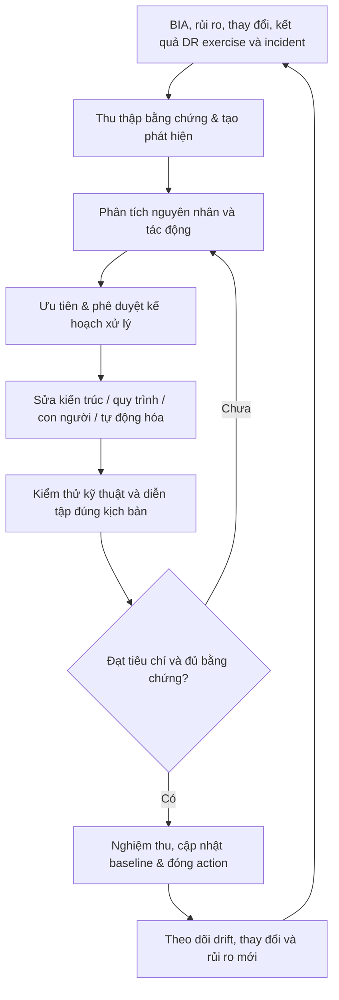

# Cải tiến Disaster Recovery (DR): từ bài học sự cố đến năng lực phục hồi có bằng chứng

**Cải tiến Disaster Recovery (DR)** là quá trình liên tục phát hiện điểm yếu của năng lực phục hồi sau thảm họa, lựa chọn thay đổi có tác động lớn nhất, thực thi thay đổi và **kiểm chứng bằng diễn tập hoặc sự cố thật** rằng hệ thống đã phục hồi tốt hơn. Một DR plan được phê duyệt hay một lần backup thành công không đủ chứng minh rằng hoạt động kinh doanh sẽ được khôi phục đúng thời hạn và trong trạng thái an toàn.

Trong chương **Disaster recovery**, trọng tâm là khôi phục hệ thống, dữ liệu và năng lực kỹ thuật hỗ trợ nghiệp vụ khi xảy ra gián đoạn nghiêm trọng. Trong module **SECURITY_SECURITY_ASSURANCE**, cải tiến DR phải gắn với mục tiêu assurance: **mỗi tuyên bố về khả năng phục hồi cần có yêu cầu, biện pháp kiểm soát, phép kiểm thử, bằng chứng, sai lệch, chủ sở hữu và lần xác minh lại**. Kết quả không chỉ là “đã sửa runbook” mà là năng lực đã được chứng minh trong điều kiện được mô tả rõ.

## Mục tiêu học tập

Sau bài học, người học có thể:

1. Thiết kế chu trình cải tiến DR liên tục từ BIA, đánh giá rủi ro, sự cố và diễn tập.
2. Phân tích nguyên nhân làm trượt mục tiêu RTO/RPO hoặc phục hồi không an toàn, tách nguyên nhân gốc khỏi triệu chứng.
3. Lập backlog cải tiến có ưu tiên, chủ sở hữu, tiêu chí nghiệm thu và thời hạn.
4. Chuyển các phát hiện thành thay đổi kỹ thuật, quy trình, con người và điều khoản phụ thuộc bên ngoài.
5. Kiểm chứng hiệu quả cải tiến bằng kịch bản end-to-end, bằng chứng có thể truy vết và chỉ số đúng phạm vi.
6. Quản lý rủi ro còn lại, thay đổi kiến trúc, vận hành liên tục và báo cáo cho chủ sở hữu nghiệp vụ.

---

## 1. Đặt cải tiến DR vào đúng hệ thống quản trị

DR là một phần của khả năng chống chịu và duy trì hoạt động của tổ chức, có quan hệ gần với những hoạt động sau:

| Hoạt động | Trọng tâm | Liên hệ với cải tiến DR |
|---|---|---|
| **Business Continuity (BC)** | Duy trì quy trình và dịch vụ nghiệp vụ ở mức chấp nhận được | BIA, mức chịu gián đoạn, mức dịch vụ tối thiểu và thứ tự ưu tiên phục hồi |
| **Disaster Recovery (DR)** | Khôi phục hạ tầng, ứng dụng, dữ liệu và các phụ thuộc kỹ thuật | Runbook, backup/restore, failover, failback, môi trường dự phòng |
| **Incident Response (IR)** | Phát hiện, điều tra, cô lập và xử lý sự cố, bao gồm tấn công | Xác định khi nào môi trường có thể tin cậy để phục hồi; bảo toàn bằng chứng |
| **Security Assurance** | Thu thập và đánh giá bằng chứng rằng yêu cầu bảo mật được đáp ứng | Xác minh quy trình phục hồi không phá vỡ IAM, mã hóa, logging, toàn vẹn dữ liệu |
| **Change/Problem Management** | Quản lý thay đổi và loại bỏ nguyên nhân tái diễn | Đưa phát hiện vào backlog có người phụ trách, kiểm thử và đánh giá tác động |

**Cải tiến DR** không đồng nghĩa với chỉ giảm thời gian dựng máy chủ. Nếu dịch vụ hoạt động sau 30 phút nhưng dùng backup sai, không giải mã được dữ liệu, mở quyền truy cập trái phép hoặc chưa chạy được giao dịch lõi thì năng lực phục hồi **chưa đạt yêu cầu**.

Một tuyên bố DR tốt có đủ năm phần:

> **Dịch vụ nào** được phục hồi, **mục tiêu gì** phải đáp ứng, **kịch bản nào** đã kiểm chứng, **bằng chứng nào** hỗ trợ kết quả, và **những giới hạn nào** còn tồn tại.

Ví dụ: “Kịch bản mất toàn bộ vùng chính của hệ thống đặt hàng được diễn tập ngày X; giao dịch cốt lõi phục hồi trong 180 phút so với RTO 240 phút, dữ liệu mất tối đa 8 phút so với RPO 15 phút, các kiểm tra IAM và toàn vẹn đều đạt; kết quả chưa chứng minh khả năng phục hồi khi cả identity provider và vùng dự phòng cùng bị ảnh hưởng.”

## 2. Xác lập đường chuẩn trước khi cải tiến

Không thể đánh giá “tốt hơn” nếu chưa có **baseline**. Đối với mỗi dịch vụ hoặc luồng nghiệp vụ, cần lưu:

- **BIA và business owner:** tác động gián đoạn theo thời gian, mức chịu đựng tối đa, mùa cao điểm và yêu cầu pháp lý/hợp đồng khi áp dụng.
- **RTO:** mục tiêu thời gian từ lúc gián đoạn nghiệp vụ bắt đầu (T0) đến khi trạng thái khôi phục tối thiểu được nghiệm thu (T1).
- **RPO:** mức mất dữ liệu tối đa được chấp nhận, đo theo chênh lệch thời gian giữa điểm dữ liệu có thể khôi phục nhất quán và mốc tham chiếu đã thống nhất.
- **Điều kiện nghiệm thu:** chức năng cốt lõi, công suất tối thiểu, tính toàn vẹn, xác thực/phân quyền, mã hóa, giám sát, nhật ký và phê duyệt nghiệp vụ.
- **Kiến trúc phục hồi:** phân vùng tin cậy, vùng dự phòng, phụ thuộc hệ thống, backup/replica, khóa, danh tính, mạng, hạ tầng cấp phát và con đường quản trị dự phòng.
- **Năng lực hiện tại:** kết quả restore/failover gần nhất, thời gian quan sát được, các bước thủ công, những ngoại lệ và giả định của phép thử.

**Phạm vi đo phải ổn định qua các lần so sánh.** Nếu lần trước chỉ đo “database khởi động” còn lần sau đo đến “khách hàng tạo đơn thành công và đã xác minh an toàn”, hai số liệu không thể dùng để tuyên bố giảm RTO nếu không giải thích khác biệt phạm vi.

Các cột thường dùng trong baseline:

| Đối tượng | Mục tiêu | Năng lực đã chứng minh | Khoảng cách |
|---|---|---|---|
| Checkout end-to-end | RTO ≤ 240 phút | 315 phút trong diễn tập mất vùng | Chậm 75 phút |
| Dữ liệu đơn hàng | RPO ≤ 15 phút | Điểm khôi phục nhất quán cũ 22 phút | Vượt 7 phút |
| Kiểm tra danh tính sau failover | AuthN/AuthZ phải đạt | Có bước cấp quyền khẩn cấp chưa được giám sát | Thiếu bằng chứng kiểm soát |
| Restore từ bản backup bất biến | Khôi phục được từ điểm tin cậy | Chỉ thử restore snapshot thông thường | Chưa chứng minh tình huống tấn công |

Bảng trên là **ví dụ giả định**, không phải các chỉ tiêu mặc định cho mọi hệ thống.

## 3. Nguồn tín hiệu để phát hiện cơ hội cải tiến

Các phát hiện chỉ dựa vào sự cố thật thường đến quá muộn. Cần một chương trình thu thập tín hiệu chủ động:

| Nguồn | Câu hỏi cần trả lời | Bằng chứng phù hợp |
|---|---|---|
| Diễn tập tabletop | Ai quyết định DR? Khi nào gọi đội bảo mật? Có thiếu số liên hệ/ủy quyền? | Kịch bản, quyết định, biên bản, khoảng trống vai trò |
| Restore drill | Có lấy, giải mã, đọc và kiểm tra backup được không? | Log restore, hash/checksum, bản kiểm thử đối soát |
| Failover drill | Có chuyển lưu lượng và phụ thuộc qua vùng dự phòng được không? | Log orchestration, metric DNS/route, lỗi giao dịch |
| End-to-end exercise | Từ T0 đến T1 có đạt RTO/RPO và tiêu chí nghiệm thu? | Timeline đồng bộ thời gian, giao dịch thử, xác nhận owner |
| Cyber recovery exercise | Có khôi phục bằng đường tin cậy khi credential/control plane bị chiếm quyền không? | Log cô lập, cấp quyền khẩn cấp, kiểm tra sạch, audit trail |
| Sự cố thật và near-miss | Điều gì đã gây chậm trễ hoặc suýt gây thất bại? | Incident report, telemetry, ticket, bằng chứng quyết định |
| Audit và đánh giá rủi ro | Kiểm soát nào không có bằng chứng hoặc tồn tại lỗ hổng? | Phát hiện audit, mapping control, risk register |
| Thay đổi kiến trúc và nhà cung cấp | Phụ thuộc mới có làm runbook mất hiệu lực không? | Sơ đồ phụ thuộc, ADR, thay đổi IAM/KMS/network, hợp đồng |

Cần lưu ý **phạm vi và độ tin cậy** của từng tín hiệu. Một bài tabletop chứng minh đội có thể thảo luận quy trình; nó **không chứng minh** hệ thống restore được trong RTO. Một job backup thành công chứng minh quá trình tạo backup theo tiêu chí được đo; nó **không chứng minh** dữ liệu đó phục hồi được, nhất quán và sạch.

## 4. Chu trình cải tiến DR: quan sát → quyết định → thay đổi → chứng minh

Có thể tổ chức theo vòng lặp PDCA (*Plan–Do–Check–Act*) với các cổng kiểm soát rõ ràng:



Cách thực hiện theo giai đoạn:

1. **Ghi nhận:** Tạo một finding duy nhất cho mỗi khoảng cách có thể xử lý; dẫn link tới kịch bản, dữ liệu đo, báo cáo sự cố hoặc kết luận audit.
2. **Phân tích:** Xác nhận lỗi quan sát được, điều kiện kích hoạt, chuỗi phụ thuộc và nguyên nhân góp phần. Phân biệt giả thuyết với kết luận đã được chứng minh.
3. **Ra quyết định:** Xác định mức rủi ro, chủ sở hữu, giải pháp tạm thời, hướng xử lý dài hạn, thời hạn và cách xác minh hiệu lực.
4. **Thực thi:** Thay đổi hạ tầng, runbook, phân quyền, backup, đào tạo, hợp đồng hoặc giám sát thông qua quy trình change management.
5. **Kiểm chứng:** Chạy lại phép thử có ý nghĩa, đánh giá RTO/RPO, tính toàn vẹn, điều kiện bảo mật và tác động tới dịch vụ khác.
6. **Đóng vòng lặp:** Chỉ đóng finding khi đạt **tiêu chí đóng được duyệt** và bằng chứng có thể kiểm tra; cập nhật baseline, runbook và risk register.

Khi một rủi ro chưa thể xử lý, cần có **chấp nhận rủi ro còn lại** bởi người đủ thẩm quyền cùng thời hạn xem xét lại. Không được đóng finding chỉ vì có kế hoạch hoặc đã sửa tài liệu nhưng chưa kiểm chứng năng lực.

## 5. Phân tích sau sự cố và diễn tập để tìm nguyên nhân

Một cuộc **post-incident review (PIR)** có ích khi phản ánh điều kiện thật của hệ thống và quyết định tổ chức, không quy lỗi cho cá nhân.

### 5.1. Ghi lại timeline từ nhiều nguồn

Thu thập T0, cảnh báo đầu tiên, phân loại, lệnh kích hoạt DR, xin quyền, bắt đầu restore, hoàn tất dữ liệu, chuyển tuyến, kiểm thử chức năng, nghiệm thu bảo mật và T1. Gắn nguồn cho mỗi mốc:

```text
09:00  Synthetic checkout thất bại; bắt đầu tác động (T0)
09:25  Trang cảnh báo đầu tiên được xác nhận
09:55  Kích hoạt runbook DR
11:10  Cấp xong quyền truy cập kho backup
13:10  Restore hoàn thành, ứng dụng trả lời health check
14:15  Giao dịch, đối soát, security checks và nghiệm thu đạt (T1)
```

Nếu các log không đồng bộ thời gian, hãy ghi khoảng không chắc chắn. Không tự di chuyển T0 về sau hoặc T1 về trước để làm kết quả đạt mục tiêu.

### 5.2. Tách triệu chứng, nguyên nhân trực tiếp và yếu tố hệ thống

Ví dụ ở mốc 11:10:

- **Triệu chứng:** công việc restore bị đình trệ 75 phút vì không có quyền đọc backup.
- **Nguyên nhân trực tiếp:** runbook dùng principal đã bị thu hồi quyền sau thay đổi IAM.
- **Yếu tố hệ thống:** kiểm thử DR chưa kiểm tra quyền của danh tính thực thi; không có quy trình đồng bộ thay đổi IAM với các dependency của DR.
- **Rủi ro còn lại:** nếu control plane hoặc IdP chính không khả dụng, bước cấp quyền thủ công tiếp tục là điểm nghẽn.

Một “5 Whys” có thể giúp khám phá cơ chế:

```text
Vì sao restore chậm?
  -> Service principal không đọc được backup.
Vì sao principal không đọc được?
  -> IAM policy vừa thay đổi.
Vì sao thay đổi không được phát hiện?
  -> Kiểm thử DR chạy bằng quyền admin của kỹ sư, không chạy bằng
     identity dự kiến của job phục hồi.
Vì sao kiểm thử không dùng identity thật?
  -> Tiêu chí kiểm thử chỉ kiểm tra file backup có tồn tại.
Điều gì phải cải tiến?
  -> Tiêu chí restore end-to-end, kiểm tra IAM sau thay đổi,
     quyền DR tách biệt, phát hiện drift và diễn tập với identity thật.
```

“5 Whys” chỉ là công cụ đặt câu hỏi; nhiều sự cố có **nhiều nguyên nhân**. Không nên ép một câu trả lời “root cause” duy nhất khi lỗi chung của identity, quy trình và con người cùng góp phần.

### 5.3. Một báo cáo PIR có thể hành động

Báo cáo nên trả lời: điều gì bị ảnh hưởng; tác động kéo dài bao lâu; giới hạn dữ liệu khôi phục; quyết định nào đúng/chậm; security controls hoạt động ra sao; các giả định nào sai; các hành động cần thực hiện; chủ sở hữu; ngày hoàn thành; phép kiểm chứng sau sửa.

Tránh kết luận mơ hồ như “cần nâng cao nhận thức” hoặc “cần diễn tập nhiều hơn”. Một finding tốt có điều kiện rõ: “Job restore phải hoạt động bằng DR identity khi IdP chính không khả dụng và mỗi lần sửa IAM policy phải kích hoạt restore smoke test”.

## 6. Ưu tiên backlog cải tiến theo rủi ro

Không phải tất cả phát hiện đều có cùng mức khẩn cấp. Ưu tiên theo **tác động thực tế nếu DR thất bại**, khả năng xảy ra, mức phơi nhiễm của dịch vụ, khả năng lỗi chung, độ chắc chắn của bằng chứng, thời gian sửa và phụ thuộc.

Có thể dùng thang định tính để ra quyết định:

| Nhóm ưu tiên | Đặc điểm | Cách xử lý |
|---|---|---|
| **Khẩn cấp** | Không thể phục hồi dịch vụ tối quan trọng; backup không đọc được; thiếu đường quản trị an toàn hoặc phục hồi làm lộ dữ liệu | Kích hoạt xử lý rủi ro ngay, bảo vệ tạm thời và báo owner; ưu tiên diễn tập sau sửa |
| **Cao** | RTO/RPO đã bị vượt; sai sót quyền/khóa có khả năng lặp lại; dependency trọng yếu chưa có phương án | Có kế hoạch, owner và thời hạn gần; theo dõi tới lúc retest đạt |
| **Trung bình** | Chậm trễ cục bộ, tài liệu hoặc giám sát thiếu nhưng còn đường phục hồi hoạt động | Xử lý trong chu kỳ nâng cấp và gắn kiểm thử phù hợp |
| **Thấp** | Tối ưu hóa không ảnh hưởng đáng kể đến rủi ro hiện tại | Gom nhóm cải tiến hiệu quả vận hành, xem lại định kỳ |

Không tự động coi mọi yếu tố “security” là cùng mức độ nghiêm trọng. Một phát hiện có thể ảnh hưởng toàn bộ khả năng khôi phục; phát hiện khác chỉ ảnh hưởng một bước không nằm trên đường găng. Tiêu chí ưu tiên phải tính tới **nghiệp vụ nào bị ảnh hưởng**.

Mẫu backlog có thể dùng các trường:

| Trường | Ý nghĩa |
|---|---|
| Finding ID | Mã duy nhất, gắn với bài diễn tập/sự cố và control |
| Problem statement | Mô tả hành vi đã quan sát, điều kiện, tác động |
| Evidence | Timestamp, log, kết quả kiểm tra, link hiện vật |
| Risk & priority | Mức độ nghiêm trọng, dịch vụ ảnh hưởng, lý do xếp hạng |
| Owner & due date | Người chịu trách nhiệm và hạn xử lý |
| Proposed action | Thay đổi cụ thể về kỹ thuật/quy trình/kiểm soát |
| Acceptance criteria | Điều kiện đo lường để được đóng |
| Retest evidence | Kịch bản, thời gian, dữ liệu và kết quả sau sửa |
| Residual risk | Hạn chế chưa xử lý, người chấp nhận và ngày rà soát |

**Ví dụ:** finding “Kho backup bị phụ thuộc vào danh tính vùng chính” chỉ được đóng khi quy trình khôi phục qua danh tính độc lập **thực sự chạy thành công** trong bài thử khi IdP chính bị vô hiệu hóa, các hành động được audit, và quyền khẩn cấp được thu hồi sau kiểm thử.

## 7. Nhóm cải tiến kỹ thuật và vận hành

### 7.1. Phát hiện và kích hoạt DR nhanh hơn

Giảm thời gian phát hiện bằng **synthetic monitoring** cho luồng nghiệp vụ, chỉ số thành công giao dịch, hàng đợi, trạng thái replication và tín hiệu từ khách hàng. Dùng alert dựa trên tác động, tránh tạo hàng loạt cảnh báo thành phần không dẫn tới quyết định.

Runbook kích hoạt phải quy định rõ: loại gián đoạn nào kích hoạt DR, ai có quyền quyết định, ai được liên hệ, ai thay thế khi người trực vắng mặt, lúc nào chuyển sang phương án khôi phục an toàn khác. Diễn tập cả ngoài giờ hành chính để đo độ trễ thực tế.

### 7.2. Bảo vệ chất lượng bản sao và khả năng restore

- Có nhiều điểm khôi phục phù hợp với rủi ro, phân tách bản sao/đường quản trị theo nguyên tắc giảm lỗi chung; cân nhắc bản sao bất biến hoặc cách ly cho kịch bản bị phá hoại.
- **Thử restore từ đầu đến cuối**, kiểm tra quyền truy cập, khóa giải mã, schema, tính nhất quán, checksum/đối soát và khả năng chạy nghiệp vụ.
- Đo thời gian restore theo **dung lượng đại diện**, vì backup 2 GB không phản ánh đầy đủ restore cơ sở dữ liệu 2 TB.
- Kiểm tra việc sao chép lỗi logic, xóa dữ liệu hoặc mã hóa trái phép qua replication; lập quy trình chọn **điểm khôi phục sạch**.
- Có quy tắc retention, rotation, truy cập tối thiểu và nhật ký thao tác; mất khóa giải mã có thể khiến backup còn tồn tại nhưng **không thể sử dụng**.

### 7.3. Giảm phụ thuộc và lỗi chung (common-mode failure)

Một môi trường active-passive ở vùng khác chưa bảo vệ được nếu cả hai cùng phụ thuộc vào IdP, DNS, KMS, kho secrets, pipeline triển khai hoặc cloud account duy nhất. Bản đồ dependency cần ghi **thành phần nào sẽ thất bại cùng nhau**.

Các cải tiến có thể là tách tài khoản/role, phục hồi khóa theo cơ chế dự phòng được kiểm soát, cache an toàn dữ liệu cấu hình cần thiết, chuẩn bị artifact/image được ký và xác minh, hoặc có quy trình thủ công giảm tải nếu nhà cung cấp ngoài không sẵn sàng.

Cần thử kịch bản **hạ tầng còn chạy nhưng control plane không truy cập được** và tình huống nhà cung cấp bên thứ ba chưa khôi phục, vì đây là các khoảng trống mà kiểm thử “tắt máy chủ và restart” không chạm tới.

### 7.4. Tự động hóa có kiểm soát

Infrastructure as Code, GitOps, automation restore và smoke test có thể rút ngắn thời gian và tránh thao tác tay sai. Tuy vậy, automation phải kiểm soát các rủi ro:

- Thực thi theo nguyên tắc quyền tối thiểu; tách cơ chế phê duyệt khi tác động nghiêm trọng.
- Có tính **idempotent** để chạy lại không tạo trạng thái trùng hoặc phá dữ liệu.
- Có **guardrail** cho thao tác xóa, ghi đè, chuyển primary, rotate keys và restore trên tài nguyên production.
- Có audit trail, version pinning, kiểm tra integrity của image/artifact, secret handling và rollback/failback.
- Không tự động failover sang môi trường nghi đã bị xâm nhập, trừ khi đã có điều kiện an toàn rõ và quyết định được ủy quyền.

**Tự động hóa thành công** có nghĩa toàn bộ chuỗi chạy được trong kịch bản thực tế và có tiêu chí nghiệm thu. “Script exit code 0” chưa đủ.

### 7.5. Cập nhật runbook thành hướng dẫn có thể thực thi

Một runbook hiệu quả nên có: phạm vi; điều kiện kích hoạt; các tiền điều kiện; sơ đồ phụ thuộc; đường truy cập tin cậy; quyền và người duyệt; bước backup/restore/failover; kiểm tra dữ liệu và bảo mật; cách ghi mốc; thông báo stakeholder; tiêu chí T1; giới hạn, cách rollback/failback và escalation.

Ví dụ một checklist rút gọn (giả định dịch vụ checkout):

```text
[ ] Định danh sự cố, impact, T0, scope và incident commander
[ ] Xác nhận lựa chọn khôi phục phù hợp với trạng thái an ninh
[ ] Chọn điểm dữ liệu nhất quán, đánh giá RPO và dấu hiệu xâm nhập
[ ] Truy cập tài nguyên DR bằng identity được ủy quyền, có ghi log
[ ] Phục hồi phụ thuộc: network -> secrets/keys -> database -> API
[ ] Chuyển tuyến an toàn; kiểm tra split-brain, ghi trùng và trạng thái queue
[ ] Kiểm thử giao dịch, dữ liệu, TLS, IAM, audit logging và telemetry
[ ] Người có thẩm quyền nghiệp vụ xác nhận trạng thái tối thiểu; ghi T1
[ ] Tiếp tục giám sát, đối soát backlog và lập kế hoạch failback
[ ] Lưu toàn bộ evidence, deviation và action item
```

Trình tự phụ thuộc ở trên là ví dụ. Một số hệ thống phải phục hồi identity, DNS hoặc IAM theo thứ tự khác; runbook phải phản ánh kiến trúc và chiến lược khôi phục của hệ thống thật.

### 7.6. Cải tiến sau khi đã phục hồi và khi failback

DR không kết thúc ở lần chuyển vùng đầu tiên. Cần xem xét đồng bộ dữ liệu ngược, chuyển primary trở lại (*failback*), loại bỏ cấu hình tạm, thu hồi quyền break-glass, đóng đường mạng khẩn cấp, kiểm tra replication hai chiều và đối soát giao dịch tồn đọng.

Chạy failback sai có thể gây **split-brain**, mất ghi gần nhất hoặc mở lại môi trường đã bị xâm nhập. Phải có kế hoạch kiểm soát rủi ro và điều kiện nghiệm thu riêng cho failback; thời gian failback có thể được theo dõi ngoài RTO ban đầu theo phạm vi chỉ tiêu được phê duyệt.

## 8. Giữ nguyên yêu cầu bảo mật khi cải tiến tốc độ DR

Đôi khi đội vận hành có xu hướng giảm kiểm tra bảo mật để đạt RTO. Đây là tín hiệu kiến trúc cần cải tiến: các kiểm soát quan trọng phải được **thiết kế để khôi phục nhanh**, không bị bỏ qua.

| Điểm dễ bị bỏ sót | Cải tiến cần thiết | Bằng chứng |
|---|---|---|
| Identity hoặc MFA không hoạt động | Break-glass độc lập được bảo vệ, kiểm tra định kỳ, thu hồi sau dùng | Log cấp/quản lý quyền, kiểm thử đăng nhập khẩn cấp |
| KMS/HSM không sẵn sàng | Kế hoạch truy xuất khóa dự phòng, xác minh khóa phiên bản, tách người phê duyệt | Test giải mã backup, audit key usage |
| DR environment mở cổng rộng | Policy mạng được quản lý bằng cấu hình khai báo và đối chiếu với baseline | Diff policy, kiểm thử đường truy cập |
| Backup bị xâm nhập hoặc mã hóa | Nguồn restore đáng tin, cách ly, kiểm tra dấu hiệu độc hại và tính toàn vẹn | Kết quả scan/đối soát, chain of custody nếu cần |
| Log không được ghi trong DR mode | Pipeline log/audit đủ độc lập, đồng bộ thời gian và retention | Sự kiện thử, log đích, xác minh timestamp |
| Secret được đặt thủ công | Secret distribution có kiểm soát, rotation sau sự cố | Bản ghi cấp phát, rotation, phát hiện secret lộ |
| Môi trường cũ chưa được vệ sinh | Quy trình ngăn tái xâm nhập, cô lập và xác minh trước kết nối lại | Biên bản IR, kiểm tra trạng thái trước failback |

Nếu một control thật sự phải được thay đổi tạm trong tình huống khẩn cấp, cần quy trình chấp thuận ngoại lệ đã định trước, mức độ giới hạn, giám sát, thời điểm hết hạn và bằng chứng phục hồi control. Không tính “PASS bảo mật” khi chưa kiểm chứng các điều kiện bắt buộc.

Đối với ransomware, không mặc định **replica mới nhất là replica sạch nhất**. Một restore nhanh nhưng đưa dữ liệu bị mã hóa hoặc mã độc trở lại hệ thống không giải quyết được mục tiêu phục hồi an toàn. Khi phải đánh đổi giữa RTO, RPO và mức tin cậy, business owner, incident commander, security và lãnh đạo có thẩm quyền cần ra quyết định dựa trên tác động và ghi nhận chênh lệch thực tế.

## 9. Thiết kế bài kiểm chứng sau cải tiến

Mỗi thay đổi nên có bài kiểm thử mà nếu thất bại sẽ **bác bỏ được tuyên bố cải tiến**. Chỉ chạy unit test cho script chưa đủ chứng minh DR end-to-end; ngược lại, không phải mỗi chỉnh sửa tài liệu đều cần một lần tắt hạ tầng production.

### 9.1. Thang mức độ kiểm thử

| Cấp | Ví dụ | Chứng minh được | Chưa chứng minh |
|---|---|---|---|
| Kiểm tra tĩnh | Lint IaC, xác minh runbook, policy as code | Cấu hình có thể được phân tích, quy trình có cấu trúc | Quy trình thật chạy đúng khi thảm họa |
| Kiểm thử thành phần | Restore backup, kiểm tra khóa, thử quyền DR | Một dependency hoặc control hoạt động | Toàn bộ chức năng đạt RTO |
| Kiểm thử tích hợp | Khôi phục DB/API với IdP, DNS, routing | Các thành phần phối hợp đúng trong phạm vi thử | Điều kiện nghiệp vụ và an toàn end-to-end |
| Diễn tập end-to-end | Từ T0 đến T1 với giao dịch và nghiệm thu | RTO/RPO và chức năng trong kịch bản/tải đã thử | Mọi kịch bản chưa được thử |
| Cyber recovery/game day | Mất credential chính, nghi compromise, mất vùng và control plane | Quy trình ra quyết định và khôi phục có kiểm soát trong điều kiện bất lợi | Kịch bản hay tài sản ngoài phạm vi diễn tập |

Diễn tập ở production cần kế hoạch kiểm soát tác động và tiêu chí dừng. Các thử nghiệm gây nguy cơ gián đoạn có thể chạy trong môi trường đại diện trước; phải ghi rõ chênh lệch dung lượng, tải, topology và quyền so với production để tránh kết luận quá rộng.

### 9.2. Ma trận kịch bản dựa trên rủi ro

| Kịch bản | Điểm nghẽn cần đo | Điều kiện không được bỏ qua |
|---|---|---|
| Mất vùng chính | Kích hoạt, chuyển tuyến, latency, thứ tự dependency | Giao dịch lõi, dữ liệu, kiểm tra network/TLS/IAM |
| Hỏng database và backup chậm | Restore time ở kích thước đại diện, recovery point | Checksum, schema, tính nhất quán, RPO |
| Ransomware | Chọn backup sạch, cô lập, đường quản trị tin cậy | Không tái nhiễm, log bảo toàn, security approval |
| Mất IdP/control plane | Đường break-glass và khôi phục khóa | Phân quyền tối thiểu, audit, thu hồi quyền |
| Nhà cung cấp thanh toán ngừng | Manual fallback/queue, đối soát sau phục hồi | Không nhân đôi đơn, kiểm soát gian lận |
| Lỗi khi failback | Đồng bộ ngược, primary election, traffic rollback | Không split-brain, không mất dữ liệu sau failover |

### 9.3. Định nghĩa PASS/FAIL minh bạch

Bài kiểm chứng cần ghi trước:

1. Đối tượng và ranh giới dịch vụ, kịch bản, phiên bản hạ tầng/ứng dụng, bộ dữ liệu.
2. **T0:** lúc tác động nghiệp vụ xuất hiện (hoặc mốc giả lập đã công bố trong diễn tập).
3. **T1:** khi đạt tiêu chí chức năng, dữ liệu, bảo mật và phê duyệt nghiệp vụ; không lấy mốc “server running”.
4. RTO, RPO và mức hoạt động tối thiểu được phê duyệt trước.
5. Bằng chứng sinh bởi monitor, log orchestration, snapshot, kết quả kiểm thử và xác nhận owner.
6. Điều kiện dừng an toàn, người có quyền dừng/thay đổi kịch bản và cách ghi deviation.
7. Quy tắc kết luận **PASS**, **FAIL** hoặc **NOT DEMONSTRATED** khi thiếu bằng chứng.

**FAIL** là kết quả có giá trị để phát hiện điểm yếu. **NOT DEMONSTRATED** cũng quan trọng khi bài test thiếu một dependency hoặc được thực hiện trong điều kiện quá nhẹ. Không nên biến chúng thành PASS chỉ vì một phần thao tác đã hoàn thành.

## 10. Đo hiệu quả cải tiến bằng chỉ số đúng

Chỉ số DR phải giúp ra quyết định, không tạo áp lực làm đẹp báo cáo.

### 10.1. Chỉ số kết quả

- **Observed recovery duration:** T1 − T0 của từng sự cố/diễn tập có phạm vi rõ; so với RTO được phê duyệt.
- **Observed data recovery loss:** độ cũ của điểm dữ liệu nhất quán theo mốc tham chiếu; so với RPO.
- **Recovery acceptance pass rate:** tỷ lệ bài diễn tập đạt **toàn bộ** tiêu chí bắt buộc; nêu mẫu số và loại kịch bản.
- **Recovery coverage:** tỷ lệ dịch vụ quan trọng đã được thử với kịch bản đủ đại diện; có thể cân trọng số theo criticality.
- **Recurrent failure rate:** tỷ lệ finding tái xuất hiện sau khi đã đóng, giúp phát hiện khắc phục chỉ xử lý triệu chứng.

### 10.2. Chỉ số năng lực và tiến độ

- Tỷ lệ backup **restore được** và được kiểm tra integrity theo chính sách; tuổi lần restore thành công gần nhất.
- Tỷ lệ runbook đã được diễn tập bằng identity/thao tác dự kiến; thời gian từ lúc thay đổi kiến trúc đến lúc cập nhật runbook.
- Số finding quá hạn theo mức rủi ro, thời gian xử lý, tỷ lệ action được retest; số ngoại lệ rủi ro còn hiệu lực.
- Thời gian phát hiện, quyết định, truy cập quyền, thực thi restore, xác minh và nghiệm thu theo **đường găng thực**.
- Tỷ lệ dependency quan trọng có phương án DR và được kiểm chứng, gồm IAM/KMS/DNS và bên thứ ba.

### 10.3. Tránh đọc nhầm số liệu

“100% backup job SUCCESS” **không chứng minh** 100% restore PASS. “Thời gian restore trung bình 20 phút” không chứng minh RTO cho giao dịch đầu cuối. “100% findings closed” có thể thiếu giá trị nếu closure chỉ dựa trên việc hoàn thành ticket.

Mỗi biểu đồ nên kèm: **phạm vi, khoảng thời gian, số mẫu, kịch bản, tải, tiêu chí T0/T1, nguồn bằng chứng và thay đổi baseline**. Với mẫu ít hoặc bài thử không đồng nhất, trình bày từng kịch bản và giới hạn kết luận trước khi so sánh trung bình/phân vị.

Một chỉ số tổng hợp có thể có lợi cho quản trị, nhưng không được che đi một dịch vụ trọng yếu vượt RTO hoặc một đường phục hồi không còn an toàn.

## 11. Tình huống thực hành: cải tiến DR cho checkout

Toàn bộ số liệu dưới đây là **giả định để học**.

**Yêu cầu nghiệp vụ:** hệ thống checkout phải phục hồi trong **RTO 240 phút (4 giờ)**, đáp ứng **RPO 15 phút**, duy trì tạo đơn/thanh toán đúng và giữ nguyên các control bảo mật bắt buộc. Phạm vi diễn tập là mất vùng chính, chuyển sang vùng DR dự phòng.

**Baseline:** một bài diễn tập ghi T0 = 09:00, T1 = 14:15, tức **315 phút**; điểm dữ liệu nhất quán sau khôi phục cũ **22 phút** so với mốc đánh giá. Như vậy **RTO FAIL (vượt 75 phút)** và **RPO FAIL (vượt 7 phút)**. Hơn nữa, quyền đọc kho backup được cấp thủ công mà chưa được kiểm thử theo tài khoản DR đã định.

### 11.1. Phân rã thời gian trước cải tiến

| Bước tuần tự | Trước cải tiến | Phát hiện |
|---|---:|---|
| Phát hiện và phân loại | 25 phút | Chỉ giám sát hạ tầng, chưa có synthetic checkout |
| Quyết định kích hoạt DR | 30 phút | Không rõ người thay quyền ngoài giờ |
| Xin quyền/khóa và xác định backup | 75 phút | Policy IAM thay đổi nhưng test DR không phát hiện |
| Khôi phục dữ liệu, ứng dụng và chuyển tuyến | 120 phút | Thao tác thủ công, dữ liệu lớn hơn mẫu test |
| Kiểm tra nghiệp vụ, dữ liệu, an toàn và nghiệm thu | 65 phút | Bộ kiểm tra phân tán, cần tập hợp kết quả thủ công |
| **Tổng T0 → T1** | **315 phút** | **Vượt RTO 75 phút** |

Nhóm PIR xác định ba yếu tố có bằng chứng: cảnh báo không phản ánh trạng thái giao dịch; runbook dùng principal DR không đủ quyền; restore automation chưa được thử với dữ liệu đủ lớn. Một yếu tố thứ tư là checklist nghiệm thu rời rạc, nhưng chưa có bằng chứng để kết luận đây là nguyên nhân chính. Tất cả được ghi thành action item riêng.

### 11.2. Action backlog sau PIR

| ID | Thay đổi | Chủ sở hữu ví dụ | Tiêu chí đóng |
|---|---|---|---|
| DR-101 | Synthetic checkout và alert tác động nghiệp vụ | SRE | Phát hiện trong cửa sổ mục tiêu đã duyệt của kịch bản |
| DR-102 | Identity DR độc lập, policy phù hợp, kiểm tra drift sau thay đổi IAM | IAM/Security | Restore thử thành công bằng principal DR; log và thu hồi quyền đạt |
| DR-103 | Tự động hóa restore và đo theo kích thước đại diện | Platform/Data | Restore đạt ngân sách mà không bỏ qua kiểm tra dữ liệu |
| DR-104 | Gộp bài test giao dịch, integrity, TLS/IAM và audit thành cổng nghiệm thu | App/Security/Business | Có một bộ bằng chứng và chữ ký chấp thuận trước T1 |
| DR-105 | Kiểm tra chất lượng replication và điểm dữ liệu nhất quán | Data team | RPO ≤ 15 phút trong kịch bản đã xác định |

Các hành động được ưu tiên theo tác động tới RTO/RPO và rủi ro không thể khôi phục an toàn. Mỗi action được linked tới kết quả baseline, mã thay đổi, người duyệt, test case và raw evidence.

### 11.3. Kết quả diễn tập lại

Sau khi triển khai và rà soát thay đổi, đội thực hiện lại **cùng kịch bản**, cùng định nghĩa T0/T1, dữ liệu và tải ở mức đại diện. Bài thử lần hai có kết quả minh họa:

| Bước tuần tự | Trước | Sau | Cải thiện |
|---|---:|---:|---:|
| Phát hiện và phân loại | 25 phút | 10 phút | 15 phút |
| Kích hoạt DR | 30 phút | 15 phút | 15 phút |
| Truy cập quyền, khóa và chọn backup | 75 phút | 20 phút | 55 phút |
| Restore và chuyển tuyến | 120 phút | 85 phút | 35 phút |
| Kiểm tra/nghiệm thu đầy đủ | 65 phút | 50 phút | 15 phút |
| **Tổng** | **315 phút** | **180 phút** | **135 phút** |

Lần hai: **RTO observed = 180 phút ≤ 240 phút**, còn **60 phút dư địa**. **RPO observed = 8 phút ≤ 15 phút**. Giả sử tất cả các kiểm tra nghiệp vụ và bảo mật đều có bằng chứng PASS, bài kiểm chứng mới đạt mục tiêu **trong phạm vi kịch bản đã thử**.

Kết quả 180 phút tốt hơn baseline 315 phút **135 phút**, tương đương giảm khoảng **42,9%** thời gian. Tuy nhiên, kết quả này chưa cho phép kết luận “mọi thảm họa đều khôi phục trong 3 giờ”. Vẫn cần kiểm thử các kịch bản có nguy cơ cao khác: ransomware, mất quyền vào IdP chính, mất backup repository hoặc lỗi đồng thời của nhiều dependency.

### 11.4. Cách diễn đạt kết quả assurance

Tuyên bố đủ điều kiện kiểm tra:

> Bằng chứng từ DR exercise phiên bản mới cho thấy checkout trong kịch bản mất vùng chính phục hồi end-to-end sau 180 phút (RTO mục tiêu 240 phút), điểm khôi phục dữ liệu cũ 8 phút (RPO mục tiêu 15 phút). Kết quả nghiệm thu chức năng, integrity, IAM, TLS và audit logging đạt. Những tình huống IdP bị compromise và mất đồng thời kho khóa chưa nằm trong phạm vi bài thử, đã được ghi trong backlog/risk register.

Không dùng kết quả này để “đóng” toàn bộ chương trình DR khi còn các phụ thuộc và kịch bản chưa có bằng chứng.

## 12. Quản lý bằng chứng: từ yêu cầu đến quyết định đóng finding

Một hệ thống evidence tốt hỗ trợ truy vết theo chuỗi:

```text
BIA / Risk Assessment
    ↓
Yêu cầu RTO, RPO, mức phục hồi an toàn
    ↓
DR design, control và runbook phiên bản cụ thể
    ↓
Kịch bản + acceptance criteria
    ↓
Exercise / incident telemetry và raw evidence
    ↓
Finding + mức rủi ro + owner
    ↓
Change / fix + kiểm thử lại
    ↓
Business & security acceptance / residual risk
    ↓
Baseline cập nhật + chu kỳ cải tiến kế tiếp
```

Mẫu record **minh họa** cho một hành động được retest:

```yaml
finding_id: DR-102
service: checkout
scenario: primary-region-down
category: identity-dependency
observed_problem: dr-principal-cannot-read-backup
baseline_exercise_id: DR-EX-2026-01
risk_priority: high
owner_team: identity-security
fix_change_id: CHG-EXAMPLE-2026-102
verification:
  test_id: DR-RETEST-2026-01
  method: restore-using-approved-dr-principal
  identity_audit: PASS
  backup_decryption: PASS
  restore_validation: PASS
  security_review: PASS
  evidence_refs:
    - "audit/identity-access"
    - "restore/job-timeline"
    - "validation/checksum-and-transactions"
result: PASS
status: verified-closed
residual_risk:
  scenario: identity-provider-and-dr-vault-fail-together
  disposition: separately-tracked
  linked_risk_id: RISK-EXAMPLE-51
```

Các chuỗi trên là placeholder; khi triển khai thật phải liên kết tới hiện vật kiểm tra được. Cần kiểm soát **phiên bản, quyền truy cập, dấu thời gian, retention, tính toàn vẹn và khả năng đối chiếu**. Tùy mức độ nhạy cảm, bằng chứng có thể cần ký số, ghi nhận hash hoặc bảo quản theo quy trình pháp chứng. Không đưa bí mật, private key hoặc dữ liệu cá nhân không cần thiết vào báo cáo assurance.

**Đóng finding** chỉ hợp lệ nếu tiêu chí đóng đạt với bằng chứng phù hợp. Có thể dùng các trạng thái:

```text
OPEN → TRIAGED → PLAN_APPROVED → IMPLEMENTED
     → RETESTING → VERIFIED_CLOSED
                     ↘ REOPENED (nếu retest fail hoặc có tái diễn)

OPEN / TRIAGED → RISK_ACCEPTED
  (có thẩm quyền, phạm vi, thời hạn và lịch xem xét lại)
```

Trạng thái **IMPLEMENTED** xác nhận có thay đổi, chưa chứng minh hiệu quả. Trạng thái **VERIFIED_CLOSED** cần kết quả retest đáp ứng điều kiện nghiệm thu và người được ủy quyền xác nhận.

## 13. RACI và cơ chế quyết định

Cải tiến DR là vấn đề liên chức năng. Một phương án phân vai tham khảo:

| Hoạt động | Business owner | SRE/Platform/DB | Security/IR | Risk/Assurance | Người điều phối DR |
|---|---|---|---|---|---|
| Phê duyệt RTO/RPO, mức phục vụ tối thiểu | **A** | C | C | C | R |
| Thiết kế và triển khai thay đổi phục hồi | C | **A/R** | C | C | R |
| Phê duyệt điều kiện khôi phục an toàn trong cyber incident | C | R | **A/R** | C | C |
| Tổ chức diễn tập, log timeline, tổng hợp kết quả | C | R | R | C | **A/R** |
| Đánh giá tính đầy đủ của bằng chứng | C | R | R | **A/R** | C |
| Chấp nhận rủi ro còn lại ảnh hưởng nghiệp vụ | **A** | C | C | R | C |

**R** = thực hiện; **A** = chịu trách nhiệm phê duyệt/quyết định; **C** = tham vấn. Bảng chỉ là mẫu; cơ cấu thật cần một **A rõ ràng cho mỗi quyết định**, quy tắc ủy quyền khi vắng mặt và cơ chế escalation nếu mục tiêu phục hồi xung đột với yêu cầu an toàn.

Không nên để đội vận hành tự ý giảm RTO/RPO hoặc chấp nhận mất dữ liệu theo ý mình trong lúc diễn tập. Khi không thể đạt mục tiêu được duyệt, cần có người chịu trách nhiệm nghiệp vụ và chủ sở hữu rủi ro chấp thuận lựa chọn, ghi lại thời điểm, tác động và hành động tiếp theo.

## 14. Duy trì cải tiến DR sau mỗi thay đổi

DR dễ “trôi” khỏi thực tế khi ứng dụng và tổ chức phát triển. Các thay đổi cần kích hoạt xem xét gồm:

- Thêm vùng/tài khoản cloud, thay đổi nhà cung cấp, dịch chuyển workload hoặc network topology.
- Thêm dependency, đặc biệt là danh tính, khóa mã hóa, DNS, dịch vụ dữ liệu hoặc cổng thanh toán.
- Tăng nhanh dung lượng database, thay backup retention, snapshot/replay strategy hoặc chính sách mã hóa.
- Thay phiên bản runtime, schema, thuật toán cấp phát khóa, phương thức triển khai hoặc quy trình release.
- Cập nhật IAM, quyền break-glass, tài khoản dịch vụ, chính sách audit log hoặc cơ chế truy cập bên thứ ba.
- Nghiệp vụ thay đổi mức chịu gián đoạn, khối lượng giao dịch hoặc nghĩa vụ pháp lý/hợp đồng.

Một **DR readiness review** có thể được tổ chức theo chu kỳ phù hợp với rủi ro, và đặc biệt sau các thay đổi lớn. Câu hỏi kiểm tra:

1. BIA, RTO/RPO và mức phục vụ tối thiểu còn đúng, có business owner phê duyệt?
2. Asset/dependency inventory và runbook phản ánh triển khai hiện tại?
3. Backup gần nhất đã được restore thử ở quy mô phù hợp, qua quyền và khóa dự kiến?
4. Các kịch bản trọng yếu đã được kiểm tra trong phạm vi và thời gian phù hợp?
5. Công cụ giám sát có phát hiện gián đoạn **nghiệp vụ** và lưu mốc T0 được không?
6. Mọi điểm chưa đạt có owner, hạn khắc phục, retest và nơi theo dõi rủi ro?
7. Có bằng chứng rằng control về identity, encryption, integrity, logging và giám sát vẫn hoạt động trong DR mode?
8. Quyền truy cập khẩn cấp và failback đã được thử, có kế hoạch dọn dẹp quyền tạm?
9. Có kịch bản lỗi chung do phụ thuộc cloud/control plane hoặc nhà cung cấp chưa được thử?
10. Phạm vi kết luận assurance có được trình bày rõ, tránh suy rộng ra kịch bản chưa có bằng chứng?

**Kết quả review** cần tạo action cụ thể nếu thiếu bằng chứng. Câu trả lời “chưa thử” phản ánh một **khoảng trống assurance**; không tự động là lỗi vận hành, nhưng cần xác định mức rủi ro và kế hoạch chứng minh.

## 15. Những sai lầm khiến cải tiến DR thiếu hiệu lực

| Sai lầm | Hệ quả | Cách sửa |
|---|---|---|
| Đóng finding sau khi cập nhật tài liệu | Không biết thay đổi có chạy được không | Retest và lưu bằng chứng thực thi |
| Chỉ tối ưu máy chủ/VM | Không đo T0–T1 và nghiệp vụ thực | Đo hành trình end-to-end, gồm dependency |
| Dùng snapshot quá nhỏ khi test | Báo cáo restore time quá lạc quan | Dữ liệu/tải đại diện và ghi giới hạn |
| Đổi chuẩn nghiệm thu sau khi FAIL | Kết quả không so sánh, khó kiểm toán | Version hóa tiêu chí; thay đổi phải có phê duyệt |
| Sửa bước cuối nhưng bỏ qua lỗi IAM/KMS chung | Sự cố khác vẫn làm DR thất bại | Phân tích dependency và common-mode failure |
| Tập trung giảm RTO bằng cách bỏ security checks | Phục hồi nhanh nhưng không an toàn | Tối ưu và tự động hóa control bắt buộc |
| Tự nhận PASS vì backup job thành công | Không chứng minh khả năng restore | Restore drill, kiểm tra integrity và RPO |
| Chỉ tổ chức tabletop | Không đo năng lực kỹ thuật | Kết hợp restore/failover/end-to-end exercise |
| Không ghi owner và deadline | Finding tái diễn, mất trách nhiệm | Backlog, phê duyệt rủi ro và theo dõi quá hạn |
| Không retest sau thay đổi kiến trúc | Bằng chứng đã lỗi thời | Trigger diễn tập theo thay đổi trọng yếu |
| Chỉ công bố tỷ lệ PASS tổng hợp | Che trường hợp dịch vụ trọng yếu FAIL | Báo cáo theo dịch vụ, kịch bản, mức độ tin cậy |
| Không dọn quyền và mạng tạm sau sự cố | Tạo lối truy cập thừa và tích lũy rủi ro | Checklist hậu phục hồi và kiểm thử failback |

## 16. Bài tập ứng dụng

**Bối cảnh:** Hệ thống hồ sơ khách hàng đặt RTO 2 giờ, RPO 10 phút. Kết quả diễn tập gần nhất phục hồi ứng dụng sau 100 phút nhưng không đăng nhập được vào màn hình quản trị DR trong 40 phút do IdP chính mất kết nối. Sau khi cấp quyền thủ công, dữ liệu restore có độ trễ 25 phút. Nhóm chỉ kiểm tra HTTP health check và chưa thử luồng nghiệp vụ chính.

**Yêu cầu thực hành:**

1. Nêu vì sao thời gian ứng dụng 100 phút chưa thể kết luận RTO đạt. Xác định các mốc còn thiếu để tính T0–T1.
2. Ghi ít nhất bốn finding độc lập, mỗi finding có tác động và bằng chứng cần thu.
3. Đề xuất hai thay đổi có ưu tiên cao nhất kèm tiêu chí đóng có thể kiểm thử.
4. Thiết kế kịch bản retest có IdP chính không khả dụng, sử dụng danh tính DR, khôi phục dữ liệu và kiểm tra nghiệp vụ, dữ liệu, IAM/logging.
5. Nêu kết luận về RPO trong kết quả hiện tại. Ai cần phê duyệt xử lý rủi ro dữ liệu còn lại?
6. Mô tả bằng chứng mà nhóm assurance phải nhận để xác minh cải tiến đã có hiệu lực.

**Gợi ý phân tích:**

- 100 phút là một mốc kỹ thuật; chưa rõ thời gian phát hiện, chờ quyền 40 phút có được tính trong đó, kiểm tra nghiệp vụ bao lâu và lúc nào nghiệm thu thành công. Vì vậy **chưa đủ dữ kiện** kết luận RTO 120 phút.
- RPO observed 25 phút so với mục tiêu 10 phút là **FAIL**, nếu phép đo độ cũ dữ liệu nhất quán được thực hiện đúng mốc tham chiếu.
- Những finding có thể gồm: IdP chính là single point of failure cho truy cập DR; thiếu kịch bản cấp quyền khẩn cấp đã thử; điểm dữ liệu khôi phục quá cũ; tiêu chí nghiệm thu chỉ kiểm tra health check; chưa có timeline nghiệp vụ T0/T1.
- Một retest đạt yêu cầu phải chứng minh phục hồi **trong 120 phút** và điểm dữ liệu **không cũ hơn 10 phút**, đồng thời thỏa tiêu chí chức năng, toàn vẹn và bảo mật đã duyệt. Nếu một điều kiện chưa được đo, kết quả tổng thể phải được ghi **NOT DEMONSTRATED** hoặc trạng thái tương ứng theo quy tắc báo cáo, không tự nhận PASS.

## 17. Ghi nhớ và đưa vào vận hành

Một chương trình cải tiến DR có giá trị khi duy trì được chuỗi liên kết:

**Yêu cầu nghiệp vụ và bảo mật → kịch bản/kiểm thử → bằng chứng → phát hiện có nguyên nhân → thay đổi được phê duyệt → diễn tập lại → nghiệm thu và cập nhật rủi ro.**

Đích đến không phải một tệp DR plan “hoàn chỉnh” hay dashboard toàn màu xanh. Đích đến là khả năng trả lời có bằng chứng: **hệ thống nào phục hồi được, trong bao lâu, mất tối đa bao nhiêu dữ liệu, bằng đường truy cập nào, với các control nào còn hiệu lực, đã thử ở điều kiện nào và còn điểm yếu gì phải xử lý**. Đó là cách cải tiến DR liên tục trở thành một phần của **security assurance** trong cả phát triển lẫn vận hành.
