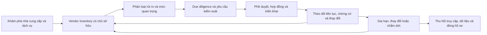
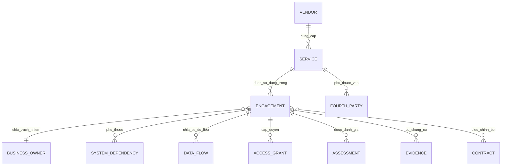
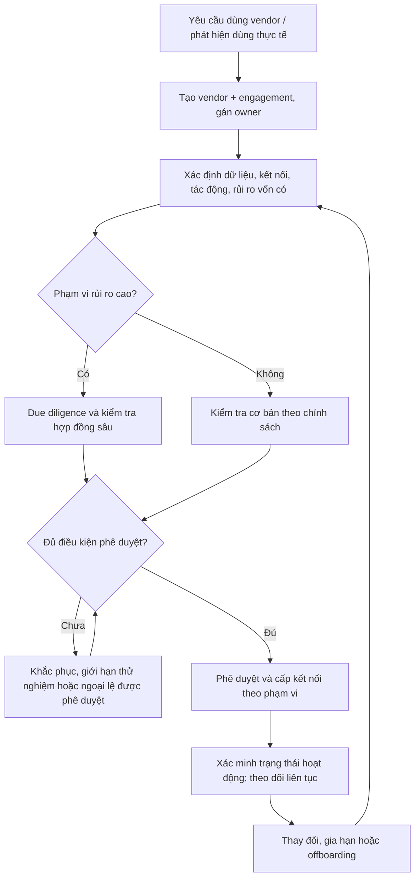

# Vendor inventory: xây dựng danh mục nhà cung cấp làm nền tảng cho third-party assurance

## 1. Vendor inventory là gì?

**Vendor inventory** là danh mục có quản trị ghi nhận **những bên thứ ba tổ chức đang sử dụng hoặc dự kiến sử dụng, dịch vụ họ cung cấp, tài sản và dữ liệu họ có thể ảnh hưởng, mức phụ thuộc, mức rủi ro, người chịu trách nhiệm và trạng thái quan hệ**. Danh mục phải đủ cập nhật, có nguồn đối chiếu và có thể kiểm chứng để hỗ trợ quyết định từ lúc đề xuất sử dụng nhà cung cấp đến khi chấm dứt dịch vụ.

Trong chương **Third-party assurance** của học phần **SECURITY_SECURITY_ASSURANCE**, mục tiêu của danh mục không dừng ở việc biết “đang mua của ai”. Học phần hướng tới **đánh giá bằng chứng rằng hệ thống đáp ứng các mục tiêu bảo mật**, từ rủi ro, yêu cầu, security controls đến kiểm thử, audit và khắc phục phát hiện. Vì thế, vendor inventory là điểm khởi đầu để trả lời: **đối tác nào nằm trong phạm vi đánh giá, tổ chức phụ thuộc vào họ ở đâu, kiểm soát nào phải được xác minh, bằng chứng nào còn hiệu lực và khoảng trống nào đang có người xử lý?**

Ví dụ, tổ chức có thể dùng một dịch vụ SaaS để hỗ trợ khách hàng. Nếu phòng tài chính có hóa đơn nhưng đội bảo mật không biết hệ thống đã đồng bộ dữ liệu khách hàng vào dịch vụ đó, nhà cung cấp có thể không được đánh giá đúng phạm vi xử lý dữ liệu. Khi xảy ra sự cố hoặc cần chấm dứt hợp đồng, tổ chức cũng có thể không biết phải thu hồi token kết nối nào, yêu cầu xóa dữ liệu gì và ai xác nhận.

Sau bài học, người học có thể:

- Phân biệt vendor inventory với sổ nhà cung cấp thanh toán, danh mục phần mềm, đánh giá rủi ro nhà cung cấp và hồ sơ hợp đồng.
- Xây dựng mô hình dữ liệu nối nhà cung cấp với dịch vụ, hợp đồng, chủ nghiệp vụ, hệ thống, dữ liệu, quyền truy cập và các bên phụ thuộc tiếp theo.
- Khám phá và đối soát các quan hệ bên thứ ba, gồm SaaS chưa qua phê duyệt và dịch vụ không có hóa đơn trực tiếp.
- Xác định mức quan trọng, độ phơi nhiễm, chủ sở hữu, trạng thái phê duyệt và lịch đánh giá theo rủi ro.
- Thiết kế kiểm soát chất lượng dữ liệu, quản trị vòng đời và bộ bằng chứng kiểm toán để chứng minh danh mục thực sự hoạt động.

## 2. Vai trò trong chu trình third-party assurance

Một tổ chức không thể khẳng định các bên thứ ba đang được kiểm soát tốt nếu **không xác định được đầy đủ các quan hệ thuộc phạm vi**. Danh mục nhà cung cấp giúp biến một tập hợp các hợp đồng và công cụ rời rạc thành phạm vi quản lý có thể truy xuất.



| Hồ sơ/hoạt động | Mục đích | Mối liên hệ với vendor inventory |
|---|---|---|
| **Procurement / Accounts Payable** | Mua hàng, đặt hàng và thanh toán | Cung cấp nguồn phát hiện quan hệ thương mại |
| **Contract register** | Quản lý hợp đồng, điều khoản, gia hạn và chấm dứt | Liên kết pháp nhân, dịch vụ và quyền/nghĩa vụ theo hợp đồng |
| **Software / SaaS inventory** | Liệt kê công cụ, ứng dụng và giấy phép | Phát hiện sản phẩm đang sử dụng và người dùng |
| **Asset inventory / CMDB** | Quản lý hạ tầng, ứng dụng và phụ thuộc | Liên kết dịch vụ bên thứ ba với hệ thống nội bộ |
| **Data inventory / data flow** | Biết dữ liệu được thu thập, chia sẻ, lưu, chuyển đến đâu | Xác định phạm vi dữ liệu mà nhà cung cấp xử lý hoặc có thể truy cập |
| **Vendor inventory** | Ghi nhận đầy đủ các quan hệ bên thứ ba và liên kết cần quản trị | Là danh mục phạm vi và trạng thái quản lý dùng chung |
| **Vendor risk assessment / due diligence** | Đánh giá rủi ro và kiểm soát của một quan hệ cụ thể | Cung cấp kết quả, bằng chứng, ngày rà soát và ngoại lệ liên kết về danh mục |
| **Third-party monitoring** | Theo dõi thay đổi, sự cố, chứng cứ hết hạn và rủi ro mới | Cập nhật trạng thái và kích hoạt đánh giá lại |

**Một vendor có tên trong hệ thống kế toán chưa chắc đã là một quan hệ đang vận hành.** Ngược lại, một dịch vụ miễn phí, phiên bản thử nghiệm, API bên thứ ba hoặc dịch vụ được thanh toán bằng thẻ doanh nghiệp có thể chưa từng xuất hiện trong danh sách mua sắm trung tâm. Việc đối soát nhiều nguồn là điều kiện để biết phạm vi thật.

## 3. Xác định đúng thực thể và phạm vi

Trước khi xây cấu trúc, phân biệt các khái niệm:

- **Vendor / supplier / third party:** tổ chức bên ngoài cung cấp dịch vụ, sản phẩm, vận hành hoặc có quan hệ làm phát sinh phụ thuộc.
- **Legal entity:** pháp nhân cụ thể ký hợp đồng, xuất hóa đơn hoặc chịu trách nhiệm theo thỏa thuận.
- **Product / service:** dịch vụ thực tế được sử dụng. Một nhà cung cấp có thể cung cấp nhiều dịch vụ với mức rủi ro rất khác nhau.
- **Business relationship / engagement:** quan hệ sử dụng một dịch vụ cho một mục đích, quy trình, nhóm hoặc môi trường cụ thể.
- **Contract / order / agreement:** bộ điều khoản áp dụng cho một hay nhiều engagement; có thể có nhiều bản sửa đổi và phụ lục.
- **Integration / connection:** đường kết nối kỹ thuật, API, SSO, token, kênh truyền dữ liệu, tài khoản quản trị, agent hoặc kết nối mạng.
- **Fourth party / subcontractor / subprocessor:** bên ngoài mà nhà cung cấp chính sử dụng để thực hiện một phần dịch vụ; loại hình và nghĩa vụ của họ phụ thuộc vai trò thực tế.
- **Business owner:** người trong tổ chức chịu trách nhiệm về nhu cầu sử dụng và tác động nghiệp vụ, có thẩm quyền xác nhận quan hệ.

Ví dụ, **Nhà cung cấp A** có thể đồng thời cung cấp công cụ họp trực tuyến và nền tảng lưu tài liệu khách hàng. Một bản ghi duy nhất với nhãn “A – mức rủi ro thấp” không thể hiện được rủi ro riêng của dịch vụ lưu dữ liệu. Trong thiết kế dữ liệu tốt, nhà cung cấp có **một định danh**, hai **service/engagement**, các **data flow**, hợp đồng và đánh giá phù hợp cho từng phạm vi.

### 3.1. Quan hệ nào cần có trong danh mục?

Phạm vi thường xét cả:

1. Dịch vụ cloud, SaaS, hosting, managed services, nền tảng xử lý dữ liệu và dịch vụ thuê ngoài.
2. Đối tác có kết nối mạng, tài khoản từ xa, quyền truy cập privileged hoặc quyền vận hành hệ thống.
3. Đối tác xử lý, lưu hoặc nhận dữ liệu nội bộ, khách hàng, nhân viên và dữ liệu nhạy cảm khác.
4. Nhà cung cấp có thể gây gián đoạn hoạt động trọng yếu, kể cả không trực tiếp thấy dữ liệu.
5. Đối tác công nghệ nhúng vào sản phẩm, thư viện/dịch vụ vận hành có quyền cập nhật hoặc cung cấp thành phần quan trọng.
6. Dịch vụ miễn phí hoặc trial đang sử dụng thực tế, nếu tạo phụ thuộc, kết nối hoặc chia sẻ dữ liệu.
7. Quan hệ đã chấm dứt nhưng còn dữ liệu, quyền truy cập, nghĩa vụ lưu giữ hoặc yêu cầu theo dõi sau chấm dứt.

Không nhất thiết đưa **mọi khoản mua hàng thông thường** vào cùng quy trình đánh giá chuyên sâu. Hãy công bố tiêu chí bao gồm/loại trừ; ví dụ một nhà cung cấp văn phòng phẩm không truy cập hệ thống hay dữ liệu có thể được quản lý ở phạm vi nhẹ hơn. Việc loại trừ phải dựa trên định nghĩa có thể kiểm chứng, tránh bỏ sót do chỉ nhìn loại hóa đơn.

### 3.2. Chuỗi cung ứng sâu hơn một tầng

Nhà cung cấp chính có thể dựa vào một đơn vị lưu trữ dữ liệu, đơn vị hỗ trợ, nhà thầu phụ xử lý nội dung, trung tâm dữ liệu hoặc dịch vụ xác thực. Đây có thể là **fourth-party dependencies** đối với tổ chức.

Với quan hệ quan trọng, cần biết ít nhất **nhóm phụ thuộc trọng yếu, vai trò xử lý dữ liệu, vị trí hoặc miền lỗi, cơ chế thông báo thay đổi và khả năng thay thế/thoát dịch vụ**. Không cần giả định tổ chức có quyền audit trực tiếp mọi nhà thầu phụ; nghĩa vụ và khả năng thu thập chứng cứ phải dựa trên hợp đồng và thực tế.

## 4. Một danh mục tốt phải “đủ” theo nghĩa nào?

Chất lượng inventory có ít nhất năm thuộc tính:

| Thuộc tính | Câu hỏi kiểm chứng |
|---|---|
| **Completeness — đầy đủ** | Có phản ánh mọi quan hệ thuộc phạm vi, kể cả shadow IT và bên thứ ba gián tiếp được xác định là quan trọng? |
| **Accuracy — chính xác** | Tên pháp nhân, dịch vụ, quyền, dữ liệu, owner và tình trạng sử dụng có đúng thực tế? |
| **Freshness — kịp thời** | Thay đổi hợp đồng, ứng dụng, kết nối và dữ liệu có cập nhật đúng hạn? |
| **Traceability — truy vết** | Có biết thông tin lấy từ đâu, ai xác nhận, phiên bản nào và liên kết tới bằng chứng không? |
| **Actionability — hành động được** | Có đủ dữ liệu để đánh giá, xử lý sự cố, gia hạn, thu hồi truy cập và chấm dứt quan hệ không? |

Một file Excel với 500 tên nhà cung cấp có thể hỗ trợ khảo sát ban đầu, nhưng không tự chứng minh 500 quan hệ đang được quản lý. Ví dụ, nếu chỉ có tên và email liên hệ, đội incident response sẽ gặp khó khăn khi cần trả lời **nhà cung cấp nào có quyền admin production, đã nhận dữ liệu gì và ai có thể ngắt kết nối**.

Inventory cũng cần phân biệt trạng thái:

- **Unknown / unverified:** có dấu hiệu sử dụng nhưng chưa xác nhận quan hệ.
- **Proposed / assessment pending:** được đề nghị, chưa đủ điều kiện sử dụng production theo chính sách.
- **Approved / active:** đã hoàn thành điều kiện phê duyệt áp dụng và đang sử dụng.
- **Exception / conditional:** được sử dụng với điều kiện, hạn rà soát và người chịu trách nhiệm.
- **Suspended / offboarding:** ngừng hoặc đang chấm dứt, vẫn còn công việc thu hồi dữ liệu/quyền.
- **Closed / archived:** đã hoàn thành các điều kiện đóng, hồ sơ còn được giữ theo chính sách.

Không dùng giá trị `active` để thay thế `approved`: dịch vụ đang sử dụng chưa chắc đã được phê duyệt, và dịch vụ được phê duyệt có thể chưa đưa vào vận hành.

## 5. Thiết kế mô hình dữ liệu: một nhà cung cấp, nhiều quan hệ

Để tránh trùng lặp và mất ngữ cảnh, tách **bản ghi nhà cung cấp** khỏi **bản ghi dịch vụ/quan hệ**. Mô hình khái niệm:



Sơ đồ mô tả quan hệ, không phải lệnh SQL hay mô hình database áp đặt. Trong triển khai, tùy khả năng hệ thống, có thể lưu dạng bảng quan hệ, CMDB, GRC hoặc cấu trúc có liên kết; các nguyên tắc quan trọng vẫn giống nhau:

- **ID ổn định và bất biến theo ý nghĩa:** `vendor_id`, `service_id`, `engagement_id`, `contract_id`. Không dùng tên hiển thị hay email làm khóa chính vì chúng thay đổi được.
- **Tách tên thương hiệu và pháp nhân:** một thương hiệu có thể nhiều công ty; một công ty có thể đổi tên, sáp nhập hoặc được mua lại.
- **Lưu lịch sử:** đổi owner, thay nhà thầu phụ, thay điểm lưu dữ liệu và trạng thái phê duyệt phải có thời điểm, nguồn và người thực hiện.
- **Hỗ trợ nhiều quan hệ:** một hệ thống có thể dùng nhiều vendor; một dịch vụ vendor có thể phục vụ nhiều quy trình.
- **Lưu bằng chứng dưới dạng tham chiếu có quyền:** tránh nhét tài liệu chứa dữ liệu nhạy cảm hoặc token vào trường ghi chú tự do.

### 5.1. Tại sao cần engagement riêng?

Ví dụ công ty dùng **Nhà cung cấp B** làm công cụ quản lý công việc:

- Bộ phận marketing chỉ chia sẻ lịch chiến dịch công khai.
- Bộ phận hỗ trợ khách hàng đính kèm file chứa thông tin khách hàng.
- Bộ phận kỹ thuật kết nối API với kho mã nguồn và quyền tạo ticket tự động.

Ba trường hợp sử dụng có **data flow, access scope, owner, mục đích và mức quan trọng khác nhau**. Nếu chỉ có một dòng tên sản phẩm, khi B thông báo lộ dữ liệu sẽ rất khó xác định chính xác phạm vi ảnh hưởng.

## 6. Trường dữ liệu tối thiểu và trường theo rủi ro

### 6.1. Metadata nhận dạng và sở hữu

| Trường | Ý nghĩa | Ví dụ minh họa |
|---|---|---|
| `vendor_id` | Mã nội bộ ổn định | `VND-0042` |
| `legal_entity_name` | Tên pháp nhân được đối chiếu | `Nha cung cap Gia Dinh A Ltd.` |
| `display_name` | Tên dùng trong trao đổi nội bộ | `Dich vu A` |
| `engagement_id` | Mã quan hệ sử dụng dịch vụ | `ENG-0126` |
| `service_name`, `service_purpose` | Tên và mục đích của dịch vụ | `Customer Support SaaS` |
| `business_owner` | Người chịu trách nhiệm nghiệp vụ | `Customer Operations` |
| `technical_owner` | Người chịu trách nhiệm tích hợp/kết nối | `Platform Engineering` |
| `security_reviewer` | Người hoặc nhóm chịu trách nhiệm đánh giá | `Security Assurance` |
| `status` | Tình trạng quan hệ đang sử dụng và phê duyệt | `active / approved` |
| `source_system` | Nguồn phát hiện hoặc xác nhận | `procurement`, `SSO` |
| `last_verified_at`, `verified_by` | Lần gần nhất kiểm chứng thông tin | Ngày UTC và người xác nhận |

Tổ chức nên quy định **định dạng chuẩn, danh mục giá trị và thời điểm cần dữ liệu**. Ví dụ, nếu chưa tìm được owner thì trạng thái phải thể hiện `owner_unknown` và có ticket xử lý; không điền một tên mặc định làm thông tin giả.

### 6.2. Phạm vi dữ liệu, công nghệ và phụ thuộc

| Trường | Mục đích assurance |
|---|---|
| `supported_business_processes` | Xác định quy trình nghiệp vụ bị ảnh hưởng khi vendor gián đoạn |
| `connected_systems` | Biết hệ thống nội bộ hoặc cloud nào phụ thuộc dịch vụ |
| `data_categories` và `classification` | Biết loại dữ liệu và độ nhạy cần kiểm soát |
| `processing_purpose` | Lý do cung cấp dữ liệu, giới hạn mục đích sử dụng |
| `data_flow_direction` | Chiều gửi/nhận dữ liệu, đường kết nối, tần suất |
| `hosting_or_processing_locations` | Vùng/khu vực xử lý và lưu trữ theo phạm vi đã xác minh |
| `access_type`, `access_scope` | VPN, API, SSO, agent, admin, read-only hoặc ghi/chỉnh sửa |
| `integration_owner` | Chủ hệ thống chịu trách nhiệm thu hồi hoặc sửa quyền |
| `criticality`, `recovery_dependency` | Hậu quả nếu vendor gián đoạn và liên kết BIA |
| `subprocessors` hoặc `critical_fourth_parties` | Phạm vi bên thứ tư theo rủi ro và nghĩa vụ |
| `data_return_or_deletion_plan` | Điều kiện xử lý dữ liệu khi chấm dứt dịch vụ |

**Không lưu trực tiếp access token, mật khẩu, thông tin xác thực hoặc khóa riêng** trong vendor inventory. Có thể lưu **tham chiếu không nhạy cảm** đến secret manager, ID tích hợp, loại quyền và người quản lý.

### 6.3. Hợp đồng, đánh giá và evidence

| Trường | Chức năng |
|---|---|
| `contract_id`, `effective_date`, `renewal_date`, `end_date` | Kích hoạt rà soát khi gia hạn, hết hạn, thay điều khoản |
| `security_requirements_ref` | Liên kết yêu cầu bảo mật theo dịch vụ |
| `data_processing_terms_ref` | Thỏa thuận/điều khoản xử lý dữ liệu nếu áp dụng |
| `incident_notification_terms_ref` | Điều kiện và đầu mối thông báo sự cố theo hợp đồng |
| `assessment_id`, `assessment_date`, `next_review` | Kết quả và lịch đánh giá theo rủi ro |
| `inherent_risk_tier`, `residual_risk_status` | Phân biệt độ phơi nhiễm vốn có với đánh giá sau kiểm soát |
| `evidence_refs` | Tham chiếu báo cáo, xác nhận, kết quả thử và tài liệu vendor |
| `evidence_valid_until` | Ngày hết hiệu lực hoặc cần đánh giá lại bằng chứng |
| `open_findings`, `exception_expiry` | Theo dõi thiếu sót và biện pháp bù |

Một chứng chỉ hoặc báo cáo kiểm toán độc lập có thể hỗ trợ due diligence, nhưng **chưa chắc bao phủ dịch vụ, thời kỳ, pháp nhân và phạm vi dữ liệu đang sử dụng**. Inventory nên lưu mối liên hệ giữa bằng chứng và engagement, không chỉ đánh dấu ô `certificate = yes`.

## 7. Khám phá vendor từ nhiều nguồn

Một inventory muốn đủ phải có quy trình **discovery và reconciliation** lặp lại. Các nguồn thường bổ sung cho nhau:

| Nguồn phát hiện | Có thể nhìn thấy | Điểm mù cần đối chiếu |
|---|---|---|
| Procurement / purchase orders | Hợp đồng đặt hàng, người yêu cầu, dịch vụ dự kiến | Dịch vụ miễn phí, thẻ cá nhân/doanh nghiệp, tích hợp tự phát |
| Finance / accounts payable | Nhà cung cấp có thanh toán, hóa đơn, đơn vị mua | Tên trên hóa đơn khác thương hiệu; vendor đang hoạt động nhưng chưa phát sinh hóa đơn |
| Hợp đồng / legal register | Pháp nhân, điều khoản, thời hạn, phụ lục | Hợp đồng có thể hết hạn sử dụng nhưng chưa được đóng hồ sơ |
| SSO / Identity provider | SaaS tích hợp SSO, số người dùng và quyền | SaaS dùng đăng nhập độc lập hoặc API key không qua SSO |
| CASB / SaaS discovery / proxy / DNS | Tín hiệu truy cập dịch vụ bên ngoài | Có truy cập không đồng nghĩa dùng cho nghiệp vụ; giới hạn quan sát |
| Cloud logs / IAM / marketplace | Tài khoản cloud, third-party role, marketplace subscription | Không thấy toàn bộ SaaS ở ngoài cloud account hoặc không có quyền audit |
| CMDB / service catalog / integration repository | Phụ thuộc ứng dụng, webhook, API, agent | Dữ liệu kê khai thủ công có thể lỗi thời |
| DLP / data catalog / network flow | Dữ liệu được gửi đến dịch vụ bên ngoài | Không thấy được ý nghĩa hợp đồng hoặc mục đích kinh doanh |
| Chủ nghiệp vụ và quản trị hệ thống | Công cụ sử dụng thực tế và phụ thuộc thủ công | Phụ thuộc vào nhận thức và tính đầy đủ của người trả lời |
| Incident, audit và ticket | Nhà cung cấp mới phát hiện khi có sự cố hoặc thay đổi | Phát hiện muộn; cần cập nhật quy trình ngăn tái diễn |

Mỗi tín hiệu đầu vào nên tạo một **discovery record** có nguồn, thời gian và mức chắc chắn. Không tự động kết luận một domain xuất hiện trong proxy log là một vendor đã được mua: có thể người dùng chỉ mở website hoặc ứng dụng tải tài nguyên từ nhiều domain.

### 7.1. Quy trình đối soát đề xuất

1. **Thu bản chụp nguồn** theo lịch phù hợp, kèm mốc thời gian/phiên bản và phạm vi truy vấn.
2. **Chuẩn hóa định danh**: tên pháp nhân, thương hiệu, domain xác nhận, ID hợp đồng, dịch vụ và đơn vị sử dụng.
3. **So khớp và phát hiện ứng viên**: quan hệ mới, quan hệ trùng, quan hệ có dấu hiệu vẫn sử dụng dù chưa được phê duyệt, nhà cung cấp đã dừng nhưng còn quyền.
4. **Giao người xác minh**: owner xác nhận mục đích sử dụng, dữ liệu, quyền kết nối và tình trạng thực tế.
5. **Cập nhật inventory có lịch sử** và mở việc xử lý nếu thiếu phê duyệt hoặc thông tin trọng yếu.
6. **Đo sai lệch**: số quan hệ phát hiện từ từng nguồn nhưng không có trong danh mục, tuổi của sai lệch và thời gian xử lý.
7. **Kiểm tra độc lập theo mẫu**: chọn vài hợp đồng, tích hợp và tài khoản truy cập rồi truy vết cả hai chiều giữa nguồn và inventory.

**Quan hệ chưa đối soát phải được coi là trạng thái cần giải quyết**, không âm thầm bỏ qua. Mục tiêu là xử lý khoảng trống đúng phạm vi, đồng thời tránh tự động thêm nhiều vendor không có căn cứ.

## 8. Đăng ký mới và kiểm soát trước khi dùng dịch vụ

Quy trình onboarding nên bắt đầu **trước khi đưa dữ liệu hoặc cấp quyền production**. Một trình tự điển hình:



**Khởi tạo inventory không đồng nghĩa với phê duyệt sử dụng.** Một bản ghi `discovered` chỉ xác nhận có tín hiệu tồn tại; một bản ghi `approved` phải có liên kết đến quyết định theo quy trình áp dụng. Nếu dịch vụ đã sử dụng trước khi được đăng ký, cần ghi nhận đó là quan hệ tồn tại cần đánh giá và xử lý theo mức độ rủi ro.

Một cổng onboarding có thể yêu cầu:

- Mục đích nghiệp vụ và người chịu trách nhiệm; dự kiến dùng ở môi trường nào.
- Dữ liệu chia sẻ và phân loại; có thể nhận/ghi dữ liệu hoặc cấp quyền privileged không.
- Quy trình nghiệp vụ/phụ thuộc và tác động nếu vendor gián đoạn.
- Pháp nhân, hợp đồng và các điều khoản bảo mật/xử lý dữ liệu tương ứng.
- Mức rủi ro vốn có, yêu cầu đánh giá chứng cứ và điều kiện phê duyệt.
- Người quản lý tích hợp, quyền truy cập và đầu mối xử lý sự cố.
- Kế hoạch khôi phục hoặc rút khỏi dịch vụ nếu quan hệ trọng yếu.

Một bước kiểm soát có thể là chặn cấp quyền OAuth hoặc kết nối production trước phê duyệt, nếu công nghệ và chính sách cho phép. Nhưng hệ thống vẫn cần quy trình xử lý trường hợp ngoài luồng như dùng SaaS qua tài khoản cá nhân hoặc chia sẻ file thủ công.

## 9. Phân loại mức quan trọng và rủi ro vốn có

Vendor inventory hỗ trợ **risk-based third-party assurance**: quan hệ có tác động lớn, dữ liệu nhạy cảm hoặc quyền truy cập cao cần được xem xét sâu và thường xuyên hơn. Phân loại nên xét cả **tác động kinh doanh** và **mức phơi nhiễm bảo mật**.

Các chiều có thể đánh giá:

1. **Business criticality:** dịch vụ có trên đường găng của BIA, ảnh hưởng RTO/MBCO hoặc nghĩa vụ trọng yếu không?
2. **Data sensitivity:** nhà cung cấp có lưu, xử lý, truyền hoặc có thể đọc dữ liệu nhạy cảm không?
3. **Access exposure:** quyền remote admin, API ghi, OAuth scope, agent/endpoint, tích hợp CI/CD, IAM cross-account?
4. **Operational concentration:** nhiều quy trình phụ thuộc cùng một vendor, vùng địa lý, cloud provider hoặc hệ thống định danh?
5. **Subcontractor dependence:** nhà cung cấp có phụ thuộc các fourth party trọng yếu, thay đổi nhanh hoặc thiếu minh bạch?
6. **Exit difficulty:** có thể chuyển đổi, lấy dữ liệu, thay dịch vụ, hoặc vận hành thủ công trong thời gian gián đoạn không?
7. **Legal/contractual importance:** cam kết với khách hàng, ràng buộc dữ liệu, thông báo sự cố, nơi lưu và nghĩa vụ có thể áp dụng.

### 9.1. Ví dụ thang phân loại, không phải tiêu chuẩn bắt buộc

| Tiêu chí minh họa | Thấp | Vừa | Cao |
|---|---|---|---|
| Dữ liệu | Không nhận dữ liệu nhạy cảm | Nhận dữ liệu nội bộ hạn chế | Nhận dữ liệu nhạy cảm hoặc dữ liệu khách hàng diện rộng |
| Quyền truy cập | Không kết nối production | Đọc dữ liệu giới hạn | Quyền ghi/admin hoặc điều khiển quy trình trọng yếu |
| Ảnh hưởng gián đoạn | Dễ thay thế, ít tác động | Ảnh hưởng một nhóm nghiệp vụ | Gián đoạn hoạt động thiết yếu hoặc ảnh hưởng lớn |
| Khả năng thay thế | Có phương án thay ngay | Cần thời gian và hỗ trợ | Không có phương án thực tế trong ngưỡng chịu đựng |
| Bên phụ thuộc khác | Ít hoặc không thiết yếu | Có một số phụ thuộc | Phụ thuộc tập trung ảnh hưởng khả năng phục hồi |

Có thể xếp `High` nếu **bất kỳ tiêu chí đặc biệt quan trọng** đạt mức cao, hoặc sử dụng mô hình điểm đã được kiểm chứng. Không mặc định lấy trung bình đơn giản khiến một quyền admin nguy hiểm bị “bù trừ” bởi các tiêu chí ít quan trọng.

**Inherent risk** là mức rủi ro trước khi xét hiệu quả kiểm soát cụ thể của vendor/engagement; **residual risk** là mức còn lại sau khi đánh giá kiểm soát và các biện pháp bù. Inventory có thể lưu cả hai, kèm link tới hồ sơ đánh giá và quyết định chấp nhận. Không hạ inherent risk chỉ vì vendor cung cấp chứng chỉ.

### 9.2. Tần suất rà soát theo rủi ro

Ví dụ một chính sách nội bộ có thể yêu cầu quan hệ **rủi ro cao** được rà soát ít nhất mỗi 12 tháng và khi có thay đổi lớn; quan hệ rủi ro thấp có chu kỳ dài hơn. Đây là ví dụ về cách thiết kế, **không phải tần suất áp dụng chung cho mọi tổ chức**. Tần suất phải xem xét nghĩa vụ hợp đồng/pháp lý, độ biến động dịch vụ, sự cố, dữ liệu và hạn hiệu lực của bằng chứng.

## 10. Liên kết inventory với dữ liệu, quyền và shared responsibility

Bản ghi vendor nên thể hiện rõ **tổ chức giao cho vendor làm gì** và **tổ chức vẫn phải tự kiểm soát gì**. Ví dụ, một nhà cung cấp SaaS có thể bảo vệ hạ tầng vận hành dịch vụ, nhưng tổ chức vẫn chịu trách nhiệm phân quyền người dùng, cấu hình SSO, danh sách file chia sẻ và dữ liệu tải lên trong phạm vi trách nhiệm của mình.

Với mỗi engagement có xử lý dữ liệu, cần xác minh:

- **Mục đích và giới hạn xử lý:** dữ liệu nào, vì lý do nào, ai được truy cập, bao lâu.
- **Data flow:** nguồn, đích, chiều, định dạng, giao diện/API, lịch đồng bộ và người cấu hình.
- **Data location:** vị trí lưu/được xử lý có liên quan đến yêu cầu nghiệp vụ và nghĩa vụ áp dụng.
- **Identity/access:** tài khoản admin, SSO, tài khoản vendor hỗ trợ, API/OAuth, service account, quyền đọc/ghi và lịch rà soát.
- **Encryption/key:** cơ chế phù hợp với kiến trúc, ai giữ hoặc dùng khóa nếu áp dụng.
- **Logging/monitoring:** có đủ audit log, cảnh báo, kết nối về SOC và khả năng truy xuất khi điều tra không.
- **Exit/data deletion:** trách nhiệm trả, chuyển, xóa dữ liệu và cung cấp xác nhận theo điều khoản áp dụng.

Độ nhạy của dữ liệu không thể chỉ dựa vào tên sản phẩm. Một hệ thống dùng cho lịch họp nội bộ có thể trở thành nơi lưu file nhạy cảm nếu người dùng được phép tải lên. Inventory phải được xem lại khi **mục đích sử dụng hoặc data flow thay đổi**.

### 10.1. Tách dữ liệu được vendor xử lý và quyền truy cập tiềm năng

Ví dụ một đối tác có tài khoản `read-only` vào dashboard production. Dù hiện chưa truy xuất bản ghi nào, đối tác vẫn có **khả năng truy cập** dữ liệu trong phạm vi dashboard. Đối với assurance, cả **dữ liệu thực tế đã chia sẻ** và **quyền có thể sử dụng** đều cần được cân nhắc.

Trường `no_data_shared` không đủ để kết luận không có rủi ro khi vendor có quyền vận hành hạ tầng, cập nhật phần mềm, sửa cấu hình hoặc làm gián đoạn dịch vụ.

## 11. Quản lý fourth-party và concentration risk

Một engagement trọng yếu có thể phụ thuộc vào nhiều nhà cung cấp gián tiếp. Để inventory có giá trị trong kế hoạch business continuity và incident response, có thể ghi:

| Thông tin | Câu hỏi |
|---|---|
| Fourth-party name/role | Bên nào lưu dữ liệu, thực hiện support, cung cấp thành phần hạ tầng? |
| Dữ liệu và phạm vi truy cập | Có loại dữ liệu nào được chuyển hoặc bên này có thể truy cập? |
| Hosting / service location | Phạm vi vị trí xử lý theo thông tin được xác minh? |
| Critical dependency | Nếu bên này ngừng hoạt động, dịch vụ chính còn hoạt động không? |
| Change notification | Nhà cung cấp chính có nghĩa vụ thông báo khi thay đổi bên xử lý/phụ thuộc không? |
| Evidence and contractual control | Có hợp đồng, xác nhận, báo cáo hoặc cơ chế giám sát phù hợp? |
| Alternate / exit approach | Có phương án giảm tập trung hoặc chuyển đổi không? |

Không suy ra rằng **mọi vendor dùng chung một cloud provider** đều tạo rủi ro ở cùng mức. Phải xác định dịch vụ, region, control plane, miền lỗi và cách phân phối workload thực tế. Nhưng nếu ba hệ thống trọng yếu đều phụ thuộc cùng một dịch vụ định danh hoặc một trung tâm dữ liệu, BIA và DR cần phản ánh điểm tập trung đó.

Inventory có thể tạo một dependency graph để tìm **một fourth party xuất hiện ở nhiều engagement**. Khi vendor chính thông báo sự cố từ nhà thầu phụ, graph giúp xác định chủ nghiệp vụ, hệ thống và dữ liệu có thể bị ảnh hưởng nhanh hơn.

## 12. Hợp đồng, nghĩa vụ và hạn bằng chứng

Vendor inventory không thay thế nội dung hợp đồng. Nó cần **liên kết đúng phiên bản và điều khoản** để đội phụ trách biết khi nào phải kiểm tra lại.

Những hạng mục có thể được quản lý bằng tham chiếu:

- Ngày hiệu lực, ngày hết hạn, thời hạn báo trước khi gia hạn/chấm dứt.
- Nghĩa vụ bảo mật và bảo vệ dữ liệu được áp dụng cho dịch vụ và loại dữ liệu sử dụng.
- Điều kiện thông báo sự cố, đầu mối liên hệ, cách nhận thông báo và nghĩa vụ phối hợp.
- Yêu cầu backup, availability, kế hoạch duy trì/khôi phục, SLA và chứng cứ thực hiện.
- Quyền yêu cầu thông tin đánh giá, báo cáo độc lập, kiểm toán hoặc xác minh (khi được thỏa thuận).
- Cơ chế chấp thuận/thông báo thay đổi subprocessor hoặc địa điểm xử lý nếu áp dụng.
- Điều kiện trả dữ liệu, xóa, hỗ trợ chuyển đổi, xử lý dữ liệu còn lưu tại backup khi chấm dứt.

Đối với bằng chứng như báo cáo SOC, chứng chỉ ISO, kết quả penetration test được nhà cung cấp chia sẻ hoặc bảng trả lời questionnaire, cần lưu **phạm vi, khoảng thời gian đánh giá, pháp nhân, dịch vụ, nguồn, hạn xem lại và giới hạn sử dụng**. Tên báo cáo không tự chứng minh kiểm soát trong sản phẩm đang dùng.

**Hết hạn chứng cứ khác với hết hạn hợp đồng.** Một engagement có hợp đồng còn 2 năm nhưng báo cáo chứng cứ được đánh giá gần nhất từ thời điểm quá xa có thể cần cập nhật ngay. Tương tự, hợp đồng tự gia hạn không đồng nghĩa kết quả risk assessment tự gia hạn.

## 13. Vòng đời và trạng thái: từ khám phá đến đóng quan hệ

Một mô hình trạng thái cần tránh ghi `terminated` khi token, dữ liệu và các quyền truy cập vẫn tồn tại.

| Trạng thái | Điều kiện điển hình | Người chịu trách nhiệm |
|---|---|---|
| `discovered` | Có tín hiệu, chưa xác minh dịch vụ/phạm vi | Nhóm discovery phối hợp chủ đơn vị |
| `proposed` | Có yêu cầu sử dụng, owner và mục đích sơ bộ | Business owner |
| `under_review` | Đang đánh giá rủi ro, hợp đồng, dữ liệu và kỹ thuật | Security/Legal/Procurement theo phạm vi |
| `approved` | Đã có quyết định áp dụng và điều kiện sử dụng | Người có thẩm quyền |
| `active` | Đang dùng; phải gắn trạng thái phê duyệt độc lập | Business/Technical owner |
| `restricted` hoặc `exception` | Hoạt động trong giới hạn, có lý do, phê duyệt và hạn rà soát | Risk owner và người phê duyệt |
| `suspended` | Tạm ngừng quyền hoặc dịch vụ, đang xử lý rủi ro | Owner và nhóm vận hành |
| `offboarding` | Dừng sử dụng, có checklist thu hồi | Business/Technical owner |
| `closed` | Hoàn tất các điều kiện đóng; giữ hồ sơ theo chính sách | Business owner và bộ phận kiểm soát |

Trên thực tế nên tách ít nhất hai trường **`usage_status`** và **`approval_status`** thay vì ép toàn bộ vào một chuỗi. Ví dụ quan hệ `active + review_overdue` là một tình huống rủi ro cụ thể cần cảnh báo, không phải dữ liệu lỗi để xóa.

### 13.1. Điều kiện offboarding

Một quan hệ chỉ nên được coi là đã đóng về mặt kiểm soát khi các mục thích hợp đã được xác minh:

1. Các bộ phận nghiệp vụ xác nhận không còn sử dụng hoặc đã chuyển đổi thành công.
2. Danh sách ứng dụng, integration, webhook, token, tài khoản SSO, quyền vendor và network access được thu hồi hoặc thay đổi theo phạm vi.
3. Dữ liệu cần chuyển giao/khôi phục đã được nhận và kiểm tra tính đầy đủ/khả dụng.
4. Yêu cầu xóa dữ liệu tại vendor và bên liên quan được thực hiện/ghi nhận theo điều khoản, có lưu giới hạn đối với backup hoặc nghĩa vụ lưu giữ.
5. Hợp đồng, gia hạn tự động, thanh toán và giấy phép được xử lý đúng thời hạn.
6. BIA, CMDB, data flow, runbook và cấu hình giám sát được cập nhật để không còn phụ thuộc ẩn.
7. Bằng chứng đóng gồm owner, ngày, checklist, kết quả xác minh, ngoại lệ còn lại và lịch hậu kiểm nếu cần.

Không xóa bản ghi inventory để “làm sạch dữ liệu” sau offboarding. Hồ sơ lịch sử có thể cần được giữ theo chính sách để giải thích quyết định, sự cố, chi phí và nghĩa vụ trong quá khứ.

## 14. Kiểm soát chất lượng: missing fields, duplicate và stale data

Một danh mục cần quy tắc kiểm tra dữ liệu vận hành:

| Quy tắc | Kiểm tra | Hành động khi sai |
|---|---|---|
| Unique ID | Không có hai vendor/engagement trùng khóa | Chặn ghi hoặc yêu cầu resolve |
| Owner bắt buộc | Engagement đang hoạt động có business owner hợp lệ | Mở việc xác minh, chuyển escalations nếu quá hạn |
| Phạm vi được ghi rõ | Có purpose, data categories và connected systems phù hợp rủi ro | Giữ trạng thái chưa hoàn tất/không cho mở thêm quyền theo chính sách |
| Contract linkage | Engagement cần hợp đồng có reference còn hiệu lực | Yêu cầu chủ mua sắm/pháp chế xử lý |
| Approval trace | Active được kiểm soát có quyết định phê duyệt tương ứng | Cảnh báo ngoài quy trình, đánh giá rủi ro |
| Evidence validity | Bằng chứng liên quan không hết kỳ đánh giá | Kích hoạt review, không tự đánh dấu compliant |
| Review dates | Có `last_verified` và `next_review` | Đưa vào hàng đợi rà soát |
| Technical access match | Danh mục khớp danh sách SSO/OAuth/IAM/VPN | Cập nhật tích hợp, thu hồi quyền thừa |
| Duplicate entities | Tên viết khác nhau nhưng cùng pháp nhân/dịch vụ | Đối chiếu thủ công, hợp nhất có lịch sử |
| Historical trace | Thay đổi mức rủi ro/owner/trạng thái có audit trail | Ghi phát hiện kiểm soát và khắc phục |

Đối với dữ liệu thiếu, hãy dùng **giá trị null hoặc trạng thái `unknown` có nghĩa rõ**. Không đặt `data_classification = public` chỉ vì chưa tìm thấy thông tin; việc mặc định dữ liệu không nhạy cảm có thể dẫn đến đánh giá thiếu rủi ro.

### 14.1. Quản lý trùng lặp

Trùng tên không nhất thiết là trùng quan hệ: một công ty có nhiều pháp nhân và dịch vụ. Ngược lại, hai tên thương hiệu khác nhau có thể thuộc cùng pháp nhân hoặc cùng nhóm công ty.

Cách hợp nhất an toàn:

- Giữ ID gốc làm **alias/merge history**, không phá liên kết tới hợp đồng và assessment.
- Xác minh pháp nhân dựa trên nguồn đã được phê duyệt, không chỉ so sánh tên gần giống.
- Chỉ hợp nhất **vendor entity** khi bằng chứng đủ; các engagement khác phạm vi vẫn phải giữ riêng.
- Rà soát ảnh hưởng tới hợp đồng, hóa đơn, security evidence, incident history và dashboard trước khi đổi ID.

## 15. Mẫu bản ghi inventory có cấu trúc

Ví dụ dưới đây là **mẫu YAML diễn giải mô hình dữ liệu**, không phải cấu hình chạy trực tiếp của GRC, CMDB hoặc ứng dụng procurement. Tên, ngày, ID và trạng thái đều là dữ liệu giả định.

```yaml
vendor:
  vendor_id: VND-0042
  display_name: "Dich vu Ho Tro Gia Dinh"
  legal_entity_name: "Example Support Services Ltd."
  entity_verified_at: "2026-10-20"
  alias_names:
    - "Support Example"
  registry_source: "procurement-approved-record"

service:
  service_id: SVC-0130
  vendor_id: VND-0042
  service_name: "Customer Support SaaS"
  service_category: "customer_operations"

engagement:
  engagement_id: ENG-0126
  service_id: SVC-0130
  business_owner: customer-operations
  technical_owner: integration-platform
  security_reviewer: security-assurance
  service_purpose: "Quan ly phieu ho tro khach hang"
  usage_status: active
  approval_status: approved
  deployment_environment: production
  supported_business_processes:
    - "Customer complaint handling"
  criticality: high
  inherent_risk_tier: high
  residual_risk_status: review_complete_with_conditions
  last_verified_at: "2026-11-20"
  next_review_at: "2027-02-20"
  verified_by: customer-operations-owner

data_and_access:
  data_categories:
    - "customer identifiers"
    - "support case messages"
  classification: confidential
  processing_purpose: "Support case resolution"
  processing_regions:
    - "Region stated in approved contract"
  connected_systems:
    - integration-ref-0091
  access_types:
    - "scoped service API"
    - "SSO for staff"
  integration_owner: integration-platform
  secret_reference: "secret-manager-item-id-only"

agreements:
  contract_refs:
    - CTR-2026-018
  security_terms_ref: "CTR-2026-018-SEC"
  data_processing_terms_ref: "CTR-2026-018-DP"
  incident_contact_ref: "approved-vendor-contact-record"
  next_renewal_review_at: "2027-05-15"

assessment_and_assurance:
  last_assessment_id: TPRM-2026-042
  evidence_refs:
    - evidence-id-109
    - evidence-id-110
  evidence_review_due_at: "2027-02-20"
  open_findings:
    - finding-id-027
  exception_refs: []
  review_status: "conditions_monitored"

offboarding:
  plan_ref: "EXIT-ENG-0126"
  data_return_format_defined: true
  access_revocation_owner: integration-platform

record_provenance:
  created_from: "purchase_request PR-2026-0150"
  last_reconciled_sources:
    - procurement
    - idp_sso
    - api_integration_register
  history_ref: "inventory-audit-ENG-0126"
```

Trong triển khai thật, cần kiểm chứng `processing_regions` bằng tài liệu hoặc cấu hình phù hợp; không dùng chuỗi mô tả chung làm bằng chứng rằng dữ liệu chắc chắn ở một vị trí nào đó. Các reference tới hợp đồng, báo cáo và secret manager phải có **quyền truy cập đúng vai trò**.

Trường `review_complete_with_conditions` cho biết vẫn có điều kiện cần theo dõi, không có nghĩa mọi yêu cầu đã được đáp ứng. Mỗi finding cần owner, ngày hẹn, mức tác động và kết quả retest.

## 16. Ví dụ bảng inventory dùng để rà soát

Các nhà cung cấp dưới đây hoàn toàn giả định:

| Vendor / service | Nghiệp vụ | Dữ liệu / quyền | Mức vốn có | Trạng thái và việc tiếp theo |
|---|---|---|---|---|
| **A / Cloud Hosting** | Hạ tầng ứng dụng đặt hàng | Lưu data production, quyền cloud theo vai trò | Cao | Active + approved; kiểm tra DR và subprocessor |
| **B / Customer Support SaaS** | Tiếp nhận phản hồi khách hàng | Dữ liệu khách hàng, SSO và API | Cao | Active + approved có điều kiện; review finding đúng hạn |
| **C / Survey Tool** | Khảo sát nội bộ | Thông tin nhân viên giới hạn | Vừa | Đã phát hiện qua SSO, chưa đủ chứng cứ phê duyệt |
| **D / Marketing Images** | Lưu asset quảng cáo công khai | Public files, không có tích hợp privileged | Thấp | Active; owner xác nhận định kỳ |
| **E / Legacy Analytics** | Phân tích sử dụng sản phẩm cũ | Token API có khả năng còn hoạt động | Vừa | Offboarding; cần kiểm chứng thu hồi token và dữ liệu |

Bảng nhìn nhanh chỉ giúp ra quyết định sơ bộ. Mỗi dòng phải liên kết tới **ID và hồ sơ chi tiết** để xác định đúng legal entity, bằng chứng, hợp đồng, phụ thuộc và lịch sử thay đổi. Nếu vendor A có ba engagement khác nhau, bảng tổng hợp cần hỗ trợ xem sâu từng engagement, tránh một nhãn chung che khuất rủi ro.

## 17. Quản trị và phân chia trách nhiệm

Inventory thất bại thường do **không ai sở hữu bản ghi** hoặc các nhóm nghĩ một nhóm khác đã cập nhật. Cần quy định ai chịu trách nhiệm từng loại thông tin.

| Vai trò | Trách nhiệm đối với inventory |
|---|---|
| **Business owner** | Khai báo mục đích, tính quan trọng, mức ảnh hưởng, tình trạng sử dụng và nhu cầu gia hạn/thoát dịch vụ |
| **Procurement / Vendor management** | Đối chiếu pháp nhân, hợp đồng thương mại, lịch gia hạn, danh mục nhà cung cấp mua sắm |
| **Legal / Privacy / Compliance** | Xác định nghĩa vụ áp dụng, điều khoản dữ liệu, quyền/nghĩa vụ thông báo, địa điểm xử lý theo phạm vi |
| **Security / Third-party risk** | Quy tắc phân loại rủi ro, due diligence, evidence, findings, ngoại lệ và lịch đánh giá |
| **IT / IAM / Integration owner** | Xác nhận dịch vụ đang kết nối, quyền, SSO, API, CMDB, phụ thuộc và thu hồi khi offboarding |
| **Finance** | Phát hiện quan hệ thanh toán không nằm trong inventory và xác minh kết thúc chi phí |
| **BCM / Resilience owner** | Đánh giá criticality, concentration và phương án thay thế theo BIA/DR |
| **Internal assurance / Audit** | Kiểm tra thiết kế, tính đầy đủ, độ chính xác, hoạt động của kiểm soát và việc khắc phục phát hiện |

Nên có **người sở hữu mô hình dữ liệu toàn tổ chức** quy định source of truth cho từng trường, xử lý xung đột, kiểm tra chất lượng và publish chỉ số. Một trường owner có thể thay đổi theo thời gian, nhưng phải có đường chuyển giao để bản ghi không bị bỏ trống khi nhân sự nghỉ việc.

### 17.1. Phân quyền và bảo vệ chính inventory

Vendor inventory cũng có thể chứa thông tin nhạy cảm: sơ đồ phụ thuộc, quyền privileged, vị trí dữ liệu, người liên hệ sự cố, nội dung hợp đồng và điểm yếu chưa khắc phục. Cần áp dụng:

- Phân quyền đọc/ghi theo vai trò; nội dung hợp đồng và bằng chứng nhạy cảm có thể nằm trong kho riêng.
- Audit trail cho việc thêm/sửa/xóa bản ghi, thay đổi mức rủi ro, trạng thái phê duyệt và chấp nhận ngoại lệ.
- Phê duyệt với thay đổi trọng yếu như giảm mức rủi ro, chuyển `unapproved` thành `approved`, đóng finding hay sửa ngày đánh giá.
- Backup và khả năng xuất danh mục trong tình huống GRC/SSO chính không truy cập được, phục vụ incident response/DR.
- Lưu giữ hồ sơ lịch sử theo yêu cầu thực tế; kiểm soát việc xóa các bản ghi chứa dữ liệu cá nhân.

Không đặt mật khẩu, token hoặc thông tin bí mật vào trường note để “tiện tìm”. Nếu cần tra cứu, chỉ lưu reference tới hệ thống quản lý bí mật được kiểm soát.

## 18. Kích hoạt cập nhật khi hệ thống và quan hệ thay đổi

Danh mục nên được cập nhật theo **sự kiện phát sinh** bên cạnh lịch rà soát:

- Yêu cầu mua sắm mới, hợp đồng hoặc PO mới, gia hạn, hủy tự gia hạn.
- Tích hợp SSO/OAuth, API, webhook, tài khoản privileged hoặc kết nối mạng mới.
- Chuyển dữ liệu mới sang vendor hoặc thay đổi phân loại, quy mô, mục đích xử lý.
- Đưa quy trình nghiệp vụ quan trọng mới lên dịch vụ đã có.
- Vendor đổi pháp nhân, bị mua lại, thay nền tảng, thay vùng dữ liệu hoặc subprocessor trọng yếu.
- Xuất hiện security incident, sự cố availability, finding nghiêm trọng hoặc bằng chứng kiểm soát không còn phù hợp.
- Thay hợp đồng, SLA, yêu cầu DR, thẩm quyền kiểm toán hoặc quy trình xử lý dữ liệu.
- Offboarding, thu hồi tài khoản, thay chủ nghiệp vụ, vendor không còn được thanh toán nhưng tích hợp vẫn tồn tại.

Mỗi trigger cần xác định **nguồn sự kiện, người nhận, hạn cập nhật, mức ưu tiên và bằng chứng hoàn tất**. Ví dụ, khi thêm một OAuth integration mới, quy trình có thể tạo discovery record và yêu cầu owner xác minh scopes. Nếu có quyền đọc dữ liệu confidential, có thể kích hoạt review theo chính sách trước khi cấp quyền thật.

## 19. Kiểm thử vendor inventory: không chỉ kiểm đếm số dòng

Một bài kiểm thử inventory tốt phải đánh giá cả **completeness**, **accuracy**, **freshness** và **khả năng ra quyết định**.

| Test | Dữ liệu hoặc thao tác | Kết quả kỳ vọng |
|---|---|---|
| **Procurement-to-inventory** | Chọn mẫu PO/hợp đồng mới thuộc phạm vi | Có vendor/engagement tương ứng, owner và trạng thái đánh giá phù hợp |
| **Inventory-to-procurement** | Chọn mẫu active vendor có hợp đồng | Liên kết đúng pháp nhân, contract/ref và thời hạn |
| **SSO-to-inventory** | Chọn SaaS tích hợp SSO và scope OAuth | Có engagement và access owner, hoặc discovery case chưa giải quyết |
| **Cloud-to-inventory** | Chọn IAM third-party role, marketplace subscription | Có bản ghi liên kết hoặc ngoại lệ đã ghi nhận |
| **Data-flow-to-inventory** | Chọn hệ thống xuất dữ liệu khách hàng đến bên ngoài | Xác định được bên nhận, mục đích, owner, phân loại và bằng chứng |
| **Owner completeness** | Lọc engagement active thiếu owner hợp lệ | Bị cảnh báo và có người chịu trách nhiệm xử lý |
| **Evidence expiration** | Một report đánh giá đã đến hạn cập nhật | Tạo review task, trạng thái không bị tự mặc định đạt |
| **Vendor merge** | Hai thương hiệu cùng pháp nhân nhưng hai dịch vụ khác nhau | Giữ service/engagement riêng, alias và lịch sử |
| **Fourth-party change** | Vendor thông báo thêm đơn vị xử lý dữ liệu trọng yếu | Kích hoạt đánh giá phạm vi, nghĩa vụ và rủi ro |
| **Offboarding** | Dừng hợp đồng nhưng token/API và dữ liệu vẫn còn | Không đánh dấu hoàn tất, sinh finding/việc thu hồi |
| **Incident scope lookup** | Tìm tất cả vendor có quyền production hoặc chứa dữ liệu phân loại cao | Truy vấn được danh sách và người chịu trách nhiệm trong thời gian yêu cầu |
| **Unknown vendor** | Phát hiện SaaS qua proxy nhưng chưa có hợp đồng | Ghi discovery chưa xác minh, không kết luận đã được phê duyệt |

Lưu bộ test gồm **phạm vi, dữ liệu thử hoặc mẫu kiểm tra, snapshot nguồn, điều kiện kỳ vọng, kết quả thực tế, người kiểm tra, thời điểm UTC và hồ sơ sai lệch**. Dùng dữ liệu giả hoặc được cho phép; không phải xuất toàn bộ log truy cập hoặc tài liệu hợp đồng nhạy cảm vào hồ sơ test.

### 19.1. Đối soát hai chiều và chỉ số độ phủ

Ví dụ có **120 quan hệ được xác nhận thuộc phạm vi** từ tập nguồn đối soát đã chọn; trong đó **108 quan hệ** có bản ghi inventory và liên kết đủ để nhận dạng. **Độ phủ quan sát được trên phạm vi đối soát này** là:

\[
\mathrm{Coverage_{observed}} = \frac{108}{120} \times 100\% = 90\%
\]

Cần nêu rõ **mẫu số đến từ đâu**. Nếu 120 chỉ là các vendor có hóa đơn, không thể suy rằng 90% là độ phủ của toàn bộ SaaS hay bên thứ ba thực sự được dùng. Các kênh không quan sát được, shadow IT và dịch vụ miễn phí vẫn có thể gây thiếu.

Tương tự, nếu có 10 phát hiện trùng, phải phân biệt **pháp nhân trùng** và **engagement riêng hợp lệ** trước khi coi đó là lỗi.

## 20. Chỉ số vận hành danh mục

| Chỉ số | Giá trị quản trị |
|---|---|
| **Observed coverage by source** | Tỷ lệ quan hệ từ procurement, SSO, IAM, CMDB... có inventory hoặc case xác minh |
| **Active engagements without owner** | Phát hiện quan hệ không ai nhận trách nhiệm |
| **Unapproved active engagements** | Dịch vụ đang sử dụng nhưng chưa hoàn tất phê duyệt hoặc ngoại lệ |
| **Data/access mapping completeness** | Bản ghi có loại dữ liệu, systems, scopes, chủ tích hợp theo yêu cầu |
| **Stale / overdue review rate** | Hồ sơ quá hạn xác minh hoặc đánh giá theo rủi ro |
| **Evidence expiry backlog** | Bằng chứng đã hết kỳ đánh giá chưa được thay/kiểm tra |
| **Open critical findings by vendor** | Phát hiện ảnh hưởng lớn chưa khắc phục hoặc chấp nhận đúng thẩm quyền |
| **Fourth-party dependency coverage** | Quan hệ trọng yếu có danh mục bên phụ thuộc cần thiết |
| **Offboarding completion time** | Từ khi quyết định ngừng đến khi đóng đầy đủ quyền, dữ liệu, hợp đồng |
| **Discovery-to-registration delay** | Độ trễ từ tín hiệu phát hiện đến lúc có bản ghi và owner |
| **Change-to-update delay** | Thời gian từ thay đổi hệ thống/hợp đồng đến lúc inventory cập nhật |
| **Owner attestation completion** | Tỷ lệ owner đã xác nhận dữ liệu trong kỳ rà soát |

Không đặt KPI “càng ít vendor càng tốt” hoặc “càng ít finding càng tốt” một cách máy móc. Số vendor giảm có thể do bỏ sót; số finding giảm có thể do hạ tiêu chí, đóng sớm hoặc không còn đánh giá. Chất lượng cần được xem cùng **độ phủ, dữ liệu nguồn, kết quả test và khoảng trống chưa xử lý**.

Chỉ số nên được phân tách theo risk tier và đơn vị nghiệp vụ. Một vendor rủi ro cao thiếu owner có thể cần xử lý ngay, trong khi một vendor ít ảnh hưởng đang chờ xác nhận tên pháp nhân có thể được phân công theo lịch thông thường.

## 21. Inventory giúp xử lý sự cố và duy trì hoạt động như thế nào?

Trong một vụ việc có nghi ngờ rò rỉ dữ liệu tại vendor, đội phản ứng cần xác định nhanh:

- Dịch vụ nào đang sử dụng vendor; pháp nhân/đầu mối liên hệ nào phù hợp?
- Những hệ thống, tenant, tài khoản hoặc API nào đang kết nối?
- Loại dữ liệu nào được gửi hoặc vendor có thể truy cập; có bên phụ thuộc khác không?
- Chủ nghiệp vụ và chủ kỹ thuật nào có thẩm quyền đánh giá tác động và thu hồi quyền?
- Điều khoản thông báo sự cố, phạm vi trách nhiệm và cách yêu cầu chứng cứ?
- Quy trình nào sẽ bị gián đoạn nếu phải ngắt vendor; phương án thay thế có tồn tại không?
- Có những bản ghi log, kết quả review, security finding hoặc cam kết đã được lưu trước đó?

Một danh mục còn cập nhật có thể giúp hình thành **impact assessment ban đầu** và điều phối nhanh. Nhưng inventory không thay thế điều tra sự cố: hồ sơ phải được đối chiếu với **telemetry, cấu hình IAM thực, data flow hiện tại và thông tin vendor** vì phạm vi thực tế có thể đã thay đổi.

Trong business continuity, inventory cùng BIA hỗ trợ phát hiện **single points of failure** như một nhà cung cấp định danh phục vụ nhiều ứng dụng trọng yếu. Trong disaster recovery, thông tin về vùng dịch vụ, điểm liên hệ, yêu cầu khôi phục dữ liệu và điều kiện chuyển đổi giúp đội DR xây được kịch bản kiểm thử sát thực tế.

## 22. Bằng chứng third-party assurance xuất phát từ vendor inventory

Để chứng minh kiểm soát đang hoạt động, có thể dùng ma trận:

| Mục tiêu assurance | Kiểm soát thiết kế | Bằng chứng hoạt động |
|---|---|---|
| Không bỏ sót quan hệ thuộc phạm vi | Policy về scope và nhiều nguồn discovery | Snapshot các nguồn, reconciliation log, case xử lý chênh lệch |
| Quan hệ có người chịu trách nhiệm | Owner bắt buộc và quy trình chuyển giao | Inventory export, danh sách orphan, xác nhận owner |
| Quan hệ rủi ro cao được đánh giá phù hợp | Risk-tier policy và phê duyệt onboarding | Assessment ID, bằng chứng, quyết định/phê duyệt |
| Dữ liệu/quyền được quản lý | Schema data flow, IAM integration, review | Data inventory liên kết, SSO/IAM export, kết quả xác minh scope |
| Vendor thay đổi được phát hiện | Trigger từ hợp đồng, tích hợp, sự cố và bên phụ thuộc | Change events, review task, kết quả xử lý |
| Bằng chứng bảo mật còn phù hợp | Lịch review, validity/scope checks | Chứng cứ với ngày, phạm vi, owner và review record |
| Ngoại lệ được quản lý | Quy trình accept/compensate có hạn | Risk acceptance ID, người duyệt, hạn, biện pháp bù, retest |
| Chấm dứt không để lại quyền/dữ liệu ngoài kiểm soát | Offboarding checklist theo engagement | Log thu hồi SSO/API, xác nhận dữ liệu, hồ sơ hợp đồng |
| Danh mục dùng được khi IR/DR | Truy vấn incident scope, BIA, dependency | Kết quả diễn tập tra cứu, timeline và nhận xét người xử lý |

Nên thiết lập **gói evidence tối thiểu** cho một kỳ đánh giá:

1. Phiên bản chính sách inventory: phạm vi, tiêu chí risk tier, vai trò, lịch đối soát và tiêu chí hoàn tất.
2. Snapshot inventory có timestamp, bộ lọc nguồn và chỉ số chất lượng dữ liệu.
3. Danh sách các nguồn discovery đã đối soát, bản ghi sai lệch và kết quả đóng từng sai lệch.
4. Mẫu hồ sơ vendor/engagement với hợp đồng, data flow, quyền, assessment và approval.
5. Log thay đổi quan trọng, finding/exception và bằng chứng khắc phục hoặc kiểm tra lại.
6. Kết quả test onboarding, thay đổi phạm vi, expiry, incident lookup và offboarding.

**Bằng chứng thiết kế** cho thấy tổ chức đã có quy tắc; **bằng chứng vận hành** cho thấy quy tắc thực sự được áp dụng với vendor đã tồn tại. Một inventory tự khai đầy đủ mà không có đối chiếu với nguồn độc lập có thể chưa đủ để khẳng định độ phủ.

## 23. Case study: phát hiện một SaaS chưa đăng ký

Giả sử đội bảo mật phát hiện qua log SSO rằng một nhóm đã dùng **Công cụ khảo sát C** trong ba tháng. Trong procurement không có PO, nhưng một API integration cho thấy dịch vụ nhận định danh nhân viên và câu trả lời khảo sát. Inventory hiện không có bản ghi tương ứng.

Quy trình xử lý:

1. **Ghi nhận tín hiệu:** lưu discovery ID, nguồn SSO/API, thời điểm quan sát và mức chắc chắn; không tự coi đây là sự cố rò rỉ dữ liệu đã xác nhận.
2. **Xác định chủ nghiệp vụ:** hỏi nhóm nào dùng dịch vụ, mục đích, quy mô, loại dữ liệu và tài khoản có quyền cấu hình.
3. **Xác minh data flow:** đối chiếu dữ liệu thực sự trao đổi, quyền OAuth/API, vùng xử lý theo nguồn phù hợp, phạm vi tài khoản và bên phụ thuộc nếu biết.
4. **Tạo vendor/service/engagement:** gán ID, trạng thái `active + review_pending`, owner và ticket xử lý ngoài quy trình.
5. **Phân loại rủi ro:** đánh giá tác động dữ liệu nhân viên, quyền truy cập, tính quan trọng, các yêu cầu hợp đồng và phương án thay thế.
6. **Quyết định có thẩm quyền:** nếu tiếp tục sử dụng, thực hiện due diligence, điều khoản và giới hạn truy cập; nếu phải dừng, lập kế hoạch chuyển dữ liệu và thu hồi quyền.
7. **Đối chiếu và đóng sai lệch:** cập nhật các nguồn liên quan, lưu phê duyệt hoặc kết quả offboarding và kiểm tra quyền thực sự được thay đổi.
8. **Cải tiến phòng ngừa:** xem vì sao quy trình mua sắm không phát hiện, kênh đăng ký SaaS có rõ ràng và cảnh báo tích hợp mới có hoạt động.

Nếu chỉ thêm một dòng “Công cụ khảo sát C” vào bảng, tổ chức chưa giải quyết được vấn đề. Kết quả đạt yêu cầu cần thể hiện **ngữ cảnh, quyết định, kiểm soát dữ liệu/quyền và bằng chứng đối soát**.

## 24. Những lỗi thiết kế thường gặp

| Sai lầm | Hậu quả | Cách khắc phục |
|---|---|---|
| Chỉ lấy vendor từ danh sách hóa đơn | Bỏ sót SaaS miễn phí, tích hợp tự phát, API bên thứ ba | Đối soát procurement với SSO, IAM, CMDB, data flow và chủ đơn vị |
| Một vendor chỉ có một risk score | Bỏ qua dịch vụ/engagement khác loại dữ liệu và quyền | Tách vendor, service và engagement |
| Không phân biệt `active` và `approved` | Dịch vụ ngoài quy trình được coi như hợp lệ | Theo dõi usage và approval độc lập |
| Dùng tên nhà cung cấp làm khóa | Sai liên kết khi đổi tên/merge | ID ổn định, alias và lịch sử |
| Không kiểm chứng owner | Không ai nhận cảnh báo, rà soát hay offboarding | Owner attestation và escalation khi bỏ trống |
| Chỉ lưu hợp đồng, không lưu integration | Không biết thu hồi token hoặc quyền production nào | Liên kết IAM, SSO, API, CMDB và technical owner |
| Mặc định thiếu dữ liệu nghĩa là không nhạy cảm | Đánh giá thấp rủi ro | Trạng thái unknown và nhiệm vụ xác minh |
| Xem chứng chỉ là bằng chứng cho mọi dịch vụ | Kết luận sai phạm vi, thời gian và pháp nhân | Kiểm tra scope, kỳ đánh giá, gap và ngày hết hiệu lực |
| Bỏ qua fourth party quan trọng | Không biết phụ thuộc tập trung và đường ảnh hưởng | Ghi nhà thầu phụ/phụ thuộc theo risk tier |
| Không cập nhật sau thay đổi dữ liệu | Risk tier không phản ánh phạm vi mới | Trigger từ data flow, access và thay đổi nghiệp vụ |
| Đánh dấu `closed` ngay khi hết hợp đồng | Token, dữ liệu, integration hoặc phí vẫn còn | Checklist offboarding có bằng chứng |
| Xóa bản ghi lịch sử để giảm số vendor | Mất audit trail và khả năng điều tra quá khứ | Lưu archive theo retention phù hợp |
| Dùng dashboard tỷ lệ cao làm kết luận toàn diện | Mẫu nguồn có thể thiếu hoặc số liệu không chính xác | Nêu mẫu số, hạn chế và kiểm tra theo mẫu độc lập |

## 25. Bài thực hành: kiểm kê dịch vụ bên thứ ba cho nền tảng học tập

Một tổ chức giả định triển khai nền tảng học trực tuyến với các thành phần: dịch vụ cloud lưu nội dung khóa học, email gửi thông báo, dịch vụ phân tích hành vi học tập, cổng thanh toán và nhà cung cấp hỗ trợ khách hàng. Một số tích hợp có hợp đồng chính thức; một công cụ phân tích mới đang dùng trial và chưa có PO.

Thực hiện các yêu cầu:

1. **Thiết kế phạm vi:** xác định quan hệ nào phải có trong inventory, tiêu chí bao gồm/loại trừ và nguyên nhân. Phân biệt vendor, service, engagement, contract và integration.
2. **Xây danh mục mẫu:** mỗi engagement ghi ID, owner, mục đích, dữ liệu/quyền, hệ thống liên quan, trạng thái hoạt động/phê duyệt, mức rủi ro vốn có và nguồn phát hiện.
3. **Bản đồ dữ liệu:** vẽ luồng từ nền tảng học tập đến email, analytics, thanh toán và hỗ trợ; xác định dữ liệu học viên nào được chia sẻ và mục đích.
4. **Khám phá:** nêu ít nhất bốn nguồn độc lập (procurement, IAM/SSO, cloud logs, data inventory...) và mô tả cách xác minh trial analytics.
5. **Phân loại:** đề xuất criticality/risk tier cho từng engagement, giải thích nếu một quyền admin hay dữ liệu nhạy cảm làm tăng mức rủi ro.
6. **Fourth party:** xác định một phụ thuộc tiềm năng có thể gây gián đoạn diện rộng; nêu cách xác minh trước khi ghi vào hồ sơ.
7. **Evidence:** liệt kê chứng cứ cần để phê duyệt engagement thanh toán và một engagement chỉ đọc dữ liệu công khai; giải thích tại sao độ sâu khác nhau.
8. **Tình huống thay đổi:** công cụ analytics được cấp thêm quyền xuất danh sách email học viên. Xác định trường inventory, risk assessment, hợp đồng và kiểm tra nào cần cập nhật.
9. **Offboarding:** công cụ analytics trial bị hủy. Viết checklist thu hồi token, kiểm tra dữ liệu xuất/đã chia sẻ, hủy gia hạn, cập nhật CMDB và xác nhận người chịu trách nhiệm.
10. **Assurance test:** chọn một integration active và một dịch vụ có hóa đơn, thực hiện đối soát hai chiều và thiết kế cách báo cáo phát hiện còn tồn tại.

**Tiêu chí đạt:** mỗi kết luận quan trọng đều có nguồn dữ liệu, chủ sở hữu và trạng thái; không đánh đồng “đã phát hiện” với “đã phê duyệt”; có thể tra cứu đường ảnh hưởng tới dữ liệu, quyền truy cập, hợp đồng và quy trình ứng phó; những điều chưa biết được ghi rõ để theo dõi.

## 26. Ghi nhớ

**Vendor inventory là bản đồ quan hệ và phụ thuộc bên thứ ba có thể kiểm chứng**, bao gồm cả các bên đã được phê duyệt, đang sử dụng ngoài quy trình, đang đánh giá và đang chấm dứt. Nền tảng dữ liệu của nó nên phản ánh:

**Vendor/pháp nhân → dịch vụ → engagement/owner → hệ thống và dữ liệu → quyền truy cập/phụ thuộc → mức rủi ro → hợp đồng, đánh giá và bằng chứng → thay đổi, gia hạn và offboarding.**

Trong chương trình **SECURITY_SECURITY_ASSURANCE**, chất lượng vendor inventory quyết định phạm vi của nhiều hoạt động assurance tiếp theo. Chỉ khi danh mục **được phát hiện từ nhiều nguồn, có owner, đủ ngữ cảnh, cập nhật theo thay đổi và có bằng chứng đối soát**, tổ chức mới có cơ sở đáng tin để tuyên bố các quan hệ third-party thuộc phạm vi đang được quản lý và các khoảng trống còn lại đang được xử lý.
