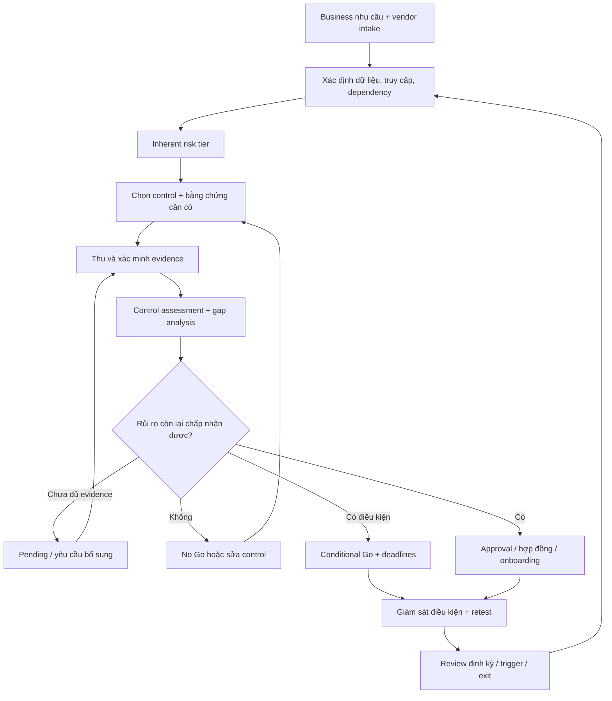
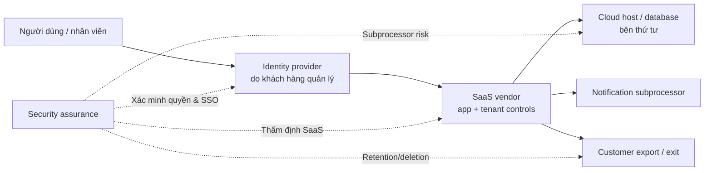

# Due diligence trong Third-party Assurance: thẩm định nhà cung cấp dựa trên rủi ro và bằng chứng

## 1. Due diligence là gì và vì sao cần trong Security Assurance?

Doanh nghiệp ngày càng dựa vào dịch vụ bên thứ ba: cloud, SaaS, bộ xử lý thanh toán, đối tác hỗ trợ, thư viện phần mềm, nhà cung cấp API và đơn vị vận hành hệ thống. Nhà cung cấp có thể không sở hữu sản phẩm của doanh nghiệp, nhưng lại nắm dữ liệu khách hàng, kết nối mạng, quyền truy cập, mã nguồn hoặc một mắt xích thiết yếu trong quá trình vận hành. Khi bên thứ ba bị tấn công, mất dịch vụ, dùng sai dữ liệu hoặc thay đổi nhà thầu phụ, rủi ro có thể truyền trực tiếp sang tổ chức sử dụng dịch vụ.

**Third-party due diligence** là quá trình **thu thập, xác minh và đánh giá có hệ thống thông tin về một đối tác/nhà cung cấp** nhằm ra quyết định có căn cứ trước khi hợp tác và tại các mốc quan trọng trong quan hệ hợp tác. Trong **third-party security assurance**, due diligence tập trung vào mức độ mà bên thứ ba có thể bảo vệ dữ liệu, truy cập, tính toàn vẹn, tính sẵn sàng và nghĩa vụ bảo mật trong **phạm vi dịch vụ thực tế** được thuê.

Trong module **SECURITY_SECURITY_ASSURANCE**, mục tiêu không phải chỉ hỏi “nhà cung cấp có ISO 27001/SOC 2 không?”. Người học phải xây dựng **chuỗi chứng cứ** từ phân tích rủi ro, yêu cầu và security controls, đến kiểm tra bằng chứng, đánh giá khoảng trống, quyết định chấp nhận rủi ro, ký kết, thử nghiệm/giám sát và khắc phục phát hiện. Đó là cách chứng minh một chương trình assurance liên tục trong phát triển và vận hành.

**Ví dụ:** doanh nghiệp lựa chọn SaaS quản lý nhân sự lưu hồ sơ nhân viên và tích hợp SSO. Nhà cung cấp gửi một giấy chứng nhận ISO 27001 còn hiệu lực. Đây là thông tin tích cực, nhưng người đánh giá vẫn phải hỏi: phạm vi chứng nhận có bao gồm dịch vụ SaaS đang mua, vùng xử lý dữ liệu và đơn vị pháp lý ký hợp đồng không? Ai có quyền truy cập production? Bên thứ tư nào vận hành hạ tầng? Khi sự cố xảy ra, ai thông báo, trong thời hạn nào? Dữ liệu có thể xuất và xóa được không?

### Kết quả học tập

Sau bài này, người học có thể:

1. Phân biệt due diligence, risk assessment, onboarding approval, third-party monitoring và audit.
2. Thiết kế **risk-based due diligence** theo mức nhạy cảm dữ liệu, quyền truy cập và độ trọng yếu dịch vụ.
3. Đọc và đánh giá giới hạn của questionnaire, SOC report, ISO certificate, penetration-test summary và bằng chứng kỹ thuật.
4. Nhận diện rủi ro bên thứ tư, shared responsibility, dữ liệu xuyên biên giới, software supply chain và khả năng exit.
5. Tạo assessment record có control ID, evidence, kết luận, limitation, finding, owner và quyết định có thẩm quyền.
6. Lập kế hoạch theo dõi liên tục và retest khi nhà cung cấp hoặc cách sử dụng dịch vụ thay đổi.

## 2. Due diligence khác gì với các hoạt động liên quan?

| Hoạt động | Câu hỏi chính | Đầu ra tiêu biểu |
|---|---|---|
| **Due diligence** | Trước/đang trong hợp tác, bằng chứng nào cho thấy bên thứ ba phù hợp với mức rủi ro? | Hồ sơ kiểm tra, khoảng trống, đề xuất quyết định |
| **Inherent risk assessment** | Nếu chưa tính các biện pháp bảo vệ, quan hệ này có thể gây tác động đến đâu? | Mức rủi ro ban đầu, mức kiểm tra cần thực hiện |
| **Control assessment** | Những kiểm soát cần thiết có hiện diện và hoạt động trong đúng phạm vi không? | Control-by-control findings, đánh giá chất lượng bằng chứng |
| **Residual risk assessment** | Sau khi xét những kiểm soát được chứng minh, rủi ro còn lại là gì? | Residual risk, biện pháp bổ sung, risk owner |
| **Procurement/contract approval** | Tổ chức có được phép ký, tích hợp, chia sẻ dữ liệu hoặc đưa dịch vụ vào production không? | Go/Conditional Go/No Go theo thẩm quyền |
| **Continuous monitoring** | Trong quá trình hợp tác, rủi ro và mức bảo đảm có thay đổi không? | Review định kỳ, trigger-based reassessment, alert/finding |
| **Audit độc lập** | Quy trình và chứng cứ có phù hợp yêu cầu được kiểm toán không? | Audit workpapers, finding, ý kiến hoặc báo cáo kiểm toán |

Due diligence **không đồng nghĩa** với việc nhà cung cấp hoàn thành questionnaire; **không thay thế** kiểm thử tích hợp, xác minh cấu hình tenant, review hợp đồng hoặc giám sát sau ký kết. Một báo cáo độc lập hữu ích cũng chỉ có giá trị trong phạm vi, kỳ và control đã kiểm tra.

**Trọng tâm:** đánh giá **mối quan hệ sử dụng dịch vụ cụ thể**, không phán xét chung rằng “nhà cung cấp X an toàn” hoặc “không an toàn” trong mọi trường hợp.

## 3. Đối tượng, phạm vi và thời điểm thực hiện

Third party có thể là tổ chức cung ứng hạ tầng, sản phẩm SaaS, dịch vụ chuyên môn, hoạt động gia công hoặc phần mềm tích hợp. Một công ty lớn có thể có nhiều sản phẩm, pháp nhân và môi trường; kiểm tra một sản phẩm không tự động chứng minh tất cả sản phẩm của họ đều đạt.

| Giai đoạn | Vì sao cần due diligence | Câu hỏi trọng tâm |
|---|---|---|
| **Trước shortlist/ký hợp đồng** | Loại sớm rủi ro không chấp nhận được | Có quyền xử lý dữ liệu gì? Phụ thuộc nào? Chứng cứ ban đầu? |
| **Trước kết nối kỹ thuật** | Tránh mở đường truy cập chưa kiểm soát | SSO/API token/network scope được giới hạn chưa? |
| **Trước chuyển dữ liệu/production go-live** | Xác nhận control và điều kiện hợp đồng đã sẵn sàng | Evidence đủ mới? CUEC/customer controls đã thực hiện? |
| **Định kỳ theo mức rủi ro** | Control, sản phẩm, nhân sự và nhà thầu phụ có thể đổi | Báo cáo mới, sự cố, SLA, findings còn mở? |
| **Khi xảy ra thay đổi lớn** | Một đánh giá trước đây có thể hết hiệu lực | Dữ liệu/vùng xử lý/kiến trúc/subprocessor thay thế? |
| **Khi có sự cố hay vi phạm nghĩa vụ** | Cần đánh giá lại khả năng kiểm soát và quan hệ tin cậy | Tác động, containment, remedial proof, quyền chấm dứt? |
| **Trước gia hạn hoặc exit** | Đánh giá rủi ro tiếp tục sử dụng và phụ thuộc nhà cung cấp | Portability, deletion, retention, transition evidence? |

Một vendor có thể phục vụ hoạt động ít rủi ro ở phòng thử nghiệm nhưng rất trọng yếu khi được đưa vào hệ thống thanh toán production. **Tái phân loại rủi ro** cần diễn ra khi *cách sử dụng* đổi, kể cả nhà cung cấp không thay đổi.

## 4. Mô hình thẩm định dựa trên rủi ro

Không nên gửi cùng một questionnaire 300 câu cho mọi nhà cung cấp. Thẩm định cần **tương xứng với mức phơi nhiễm và hậu quả**, có cơ chế nâng độ sâu khi phát hiện rủi ro.

### 4.1. Các chiều rủi ro cần xem

| Chiều | Câu hỏi phân loại | Dấu hiệu cần kiểm tra kỹ |
|---|---|---|
| **Dữ liệu** | Bên thứ ba xử lý loại dữ liệu nào, bao nhiêu, lưu ở đâu? | PII, hồ sơ nhân sự, thông tin tài chính, bí mật kinh doanh |
| **Truy cập** | Có quyền vào network, cloud account, database, mã nguồn, key, CI/CD không? | Quyền admin, kết nối hai chiều, tài khoản máy dùng chung |
| **Tính trọng yếu** | Nếu nhà cung cấp ngừng hoạt động, hoạt động kinh doanh bị ảnh hưởng ra sao? | Dịch vụ không có phương án thay thế, RTO/RPO ngắn |
| **Exposure** | Dịch vụ có Internet-facing hoặc xử lý đầu vào không tin cậy? | API công khai, webhook, file upload, plugin chạy mã |
| **Regulatory/contractual** | Có nghĩa vụ pháp lý, hợp đồng hoặc hạn chế dữ liệu nào áp dụng? | Data residency, incident notice, quyền audit, lưu/xóa dữ liệu |
| **Subcontracting** | Có phụ thuộc cloud, support, AI API hoặc bên xử lý phụ nào? | Nhiều lớp subprocessor, thay đổi không thông báo |
| **Operational maturity** | Control có vận hành ổn định, kiểm thử và phản ứng được không? | Không có owner, control mới triển khai, chưa kiểm chứng |
| **Concentration/exit** | Có nhiều hoạt động dùng cùng một provider không; thay thế mất bao lâu? | Single point of failure, proprietary export, vendor lock-in |

### 4.2. Inherent risk, control effectiveness và residual risk

- **Inherent risk** là rủi ro xuất phát từ bản chất dịch vụ và cách sử dụng trước khi tính hiệu lực các kiểm soát cụ thể. Nó định hướng mức due diligence cần thực hiện.
- **Control effectiveness** là mức tin cậy rằng kiểm soát tồn tại, áp dụng đúng phạm vi và vận hành hiệu quả theo bằng chứng.
- **Residual risk** là rủi ro còn lại sau khi xét những kiểm soát được chứng minh và các biện pháp phía khách hàng.

Không đánh đồng “đã có chính sách” với control effectiveness cao. Không hạ residual risk chỉ vì vendor trả lời “Yes” hoặc gửi chứng chỉ không thuộc scope.

### 4.3. Ví dụ phân tầng

| Tier | Bối cảnh minh họa | Độ sâu kiểm tra |
|---|---|---|
| **Low** | Công cụ không truy cập dữ liệu/tài sản trọng yếu, dễ thay thế | Intake, kiểm tra cơ bản về phạm vi và điều kiện |
| **Medium** | SaaS xử lý dữ liệu nội bộ giới hạn, không có quyền đặc biệt | Questionnaire theo control, chính sách, mô tả vận hành, các bằng chứng thích hợp |
| **High** | Dữ liệu nhạy cảm, production integration hoặc dependency quan trọng | Đối chiếu report độc lập, architecture review, IAM/incident/DR/subprocessor, hợp đồng |
| **Critical** | Quản lý danh tính, thanh toán, key, hạ tầng trọng yếu hoặc single point of failure | Thẩm định tăng cường, kiểm chứng controls, continuity/exit exercise, risk approval cấp phù hợp |

Tier là **ví dụ phương pháp**, không phải thang điểm bắt buộc. Một vendor low-risk cũng cần chặn nếu có điều kiện bất hợp pháp hoặc rủi ro không thể chấp nhận. Mức critical không đồng nghĩa đương nhiên không được hợp tác; nó yêu cầu tiêu chí và bằng chứng nghiêm ngặt hơn.

## 5. Luồng due diligence có các cổng quyết định rõ ràng



**Không nên nhầm:** trạng thái kiểm tra control (PASS/FAIL/INCONCLUSIVE) và **quyết định kinh doanh** (Go/Conditional Go/No Go) là hai trục độc lập. Một control còn FAIL có thể được xử lý bằng risk acceptance đúng thẩm quyền hoặc yêu cầu sửa trước go-live; không được đổi FAIL thành PASS để phù hợp quyết định ký hợp đồng.

Ở cổng quyết định, phải biết **ai có quyền phê duyệt ngoại lệ**, tiêu chí *blocking finding* nào không được bỏ qua và điều kiện nào phải hoàn thành **trước khi chia sẻ dữ liệu thật**.

## 6. Vendor inventory và hồ sơ quan hệ cần có

Một chương trình không thể đánh giá bên thứ ba đúng nếu không biết mình đang sử dụng những dịch vụ nào. Vendor inventory cần kết nối hồ sơ nhà cung cấp với tài sản, chủ quy trình và luồng dữ liệu thực.

| Trường | Ý nghĩa |
|---|---|
| `vendor_id`, tên pháp nhân và contact | Tránh nhầm pháp nhân ký hợp đồng với sản phẩm hoặc reseller |
| `service_id`, product/version/tenant | Xác định đúng dịch vụ và cấu hình được đánh giá |
| `business_owner`, `technical_owner`, `security_owner` | Người chịu trách nhiệm sử dụng, tích hợp và assurance |
| `business_processes` và `criticality` | Biết tác động khi gián đoạn |
| `data_categories`, volume, lifecycle | Xác định yêu cầu confidentiality/privacy/retention |
| `access_scope`, auth model, privileges | Biết quyền trên API, cloud, network và support |
| `processing_locations`, hosting region | Đánh giá phạm vi vận hành và nghĩa vụ dữ liệu |
| `subprocessors` và supply-chain dependency | Nhận diện điểm rủi ro ở bên thứ tư |
| `contracts`, DPA/terms/SLA, renewal date | Theo dõi điều kiện và thời điểm cần đánh giá lại |
| `inherent_risk`, `residual_risk`, `assessment_date` | Định hướng kiểm tra và độ mới của chứng cứ |
| `findings`, `exceptions`, `exit_plan` | Tránh mất theo dõi rủi ro và phụ thuộc dài hạn |

### Mẫu intake record

```yaml
vendor_id: VND-023
legal_entity: "Example Supplier Ltd."
service:
  service_id: saas-hr-records
  environment: production
  tenant_id: customer-tenant-example
business:
  owner: people-operations
  criticality: high
  service_dependency: staff-record-management
data:
  categories: [employee-profile, employment-record]
  flow: "SSO + secure API integration"
  locations_under_review: [region-a, region-b]
access:
  identity: federated-sso
  privileged_support_access: "Requires scoped and approved access"
third_parties:
  subprocessors: "Requested from supplier"
assessment:
  inherent_risk_tier: high
  due_diligence_state: evidence_collection
  security_owner: third-party-risk-team
```

Đây là **hồ sơ giả định**, không thể dùng thay cho kết quả thẩm định. Các thông tin “requested” phải được theo dõi tới khi có bằng chứng hoặc chuyển thành finding; không tự điền “none” cho những mục vendor chưa cung cấp.

## 7. Data flow và shared responsibility là trọng tâm

Một câu hỏi rất quan trọng là **ai kiểm soát phần nào của đường dữ liệu**. Chẳng hạn doanh nghiệp sử dụng SaaS để lưu hồ sơ, nhà cung cấp phụ thuộc hạ tầng cloud và một subprocessor để gửi thông báo.



Cần ghi rõ:

- Dữ liệu nào rời tổ chức, thông qua API nào, được cache/sao lưu ở đâu.
- Ai sở hữu **IAM**, MFA, access reviews, API tokens, tenant policies, encryption keys, audit logs và deletion request.
- Ai phát hiện sự cố trên control plane/host và ai phát hiện sai cấu hình tenant/customer integration.
- Những biện pháp nào phụ thuộc vào khách hàng: bật SSO/MFA, giới hạn quyền, cấu hình retention, truyền sự kiện tới SIEM.
- Nhà thầu phụ nào có thể tiếp cận dữ liệu, phạm vi hỗ trợ và quyền truy cập phụ thuộc nào.
- Cơ chế export, backup, legal hold, deletion và kết thúc hợp đồng.

**Shared responsibility gap:** vendor có thể có SOC 2 cho hạ tầng ứng dụng, nhưng nếu khách hàng tắt MFA ở tenant hoặc cấp token rộng, control truy cập thực tế vẫn yếu. Các báo cáo độc lập thường có **Complementary User Entity Controls (CUECs)**: những điều kiện phía khách hàng phải thực hiện để các mô tả kiểm soát liên quan vận hành như dự kiến.

## 8. Xây dựng ma trận kiểm tra security controls

Một bộ due diligence có cấu trúc nên ánh xạ từng yêu cầu từ rủi ro sang **control**, **evidence**, **phương pháp đánh giá** và **kết luận**.

| Control ID | Mục tiêu cần chứng minh | Bằng chứng nên xem |
|---|---|---|
| `TP-01 Governance` | Có chủ sở hữu bảo mật, chính sách, kiểm tra độc lập theo phạm vi phù hợp | Policy owner, management review, report độc lập |
| `TP-02 Identity & access` | Nhân viên/vendor support dùng quyền tối thiểu, xác thực phù hợp, review định kỳ | SSO/MFA, privileged access workflow, review/sample audit |
| `TP-03 Data protection` | Dữ liệu được mã hóa, phân quyền, lưu/xóa theo cam kết | Encryption design, KMS roles, retention/deletion testing |
| `TP-04 Network & isolation` | Môi trường/tenant được cách ly và kết nối có kiểm soát | Architecture, segmentation, test summary, exception controls |
| `TP-05 Secure SDLC` | Có quản lý thay đổi, code review, dependency và bảo vệ pipeline | SDLC policy, sample workflow, SBOM/provenance theo loại sản phẩm |
| `TP-06 Vulnerability management` | Có phát hiện, phân loại và xử lý lỗ hổng theo SLA/risk | Scan coverage, triage process, remediation evidence, exception |
| `TP-07 Logging & detection` | Có audit/monitoring cho hành vi trọng yếu và review cảnh báo | Event types, retention, rule testing, alert/runbook evidence |
| `TP-08 Incident response` | Có quy trình phát hiện, xử lý, phối hợp thông báo và điều tra | IR plan, exercise, incident notification clauses |
| `TP-09 Continuity & DR` | Dịch vụ có năng lực duy trì/khôi phục theo mục tiêu kinh doanh | BIA/RTO/RPO, backup/restore exercise, continuity plan |
| `TP-10 Supply chain` | Nhà thầu phụ và thành phần ngoài được quản trị theo rủi ro | Subprocessor register, contracts, flow-down controls |
| `TP-11 Privacy & data rights` | Mục đích xử lý, dữ liệu, quyền và cơ chế export/deletion phù hợp | DPA, data map, deletion/subject-request workflow |
| `TP-12 Physical/personnel` | Có kiểm soát truy cập vật lý và nhân sự liên quan | Independent report, facility/personnel control evidence |
| `TP-13 Customer responsibilities` | Những biện pháp khách hàng phải làm được nêu rõ và thực hiện | CUECs, configuration checklist, integration test |
| `TP-14 Exit & portability` | Có thể xuất, chuyển và xóa dữ liệu khi chuyển nhà cung cấp | Data export format, exit plan, deletion evidence |

Không phải control nào cũng có cùng mức quan trọng. Với một nhà cung cấp dữ liệu đã mã hóa không có quyền giải mã, trọng tâm khác với managed service có quyền admin. Các yếu tố **in scope / out of scope** cần được business owner và security owner xác nhận.

## 9. Các loại bằng chứng và trọng lượng đánh giá

| Loại evidence | Điều có thể giúp kiểm tra | Giới hạn |
|---|---|---|
| **Vendor questionnaire** | Khảo sát rộng, tìm điểm cần follow-up | Self-attestation; câu trả lời có thể chung chung |
| **Security policy / procedure** | Thiết kế quản trị và quy trình dự kiến | Không chứng minh thực tế thực thi |
| **Independent assurance report** | Control trong phạm vi và kỳ được kiểm tra bởi bên độc lập | Có thể không bao gồm service/tenant/region đang dùng |
| **ISO/IEC 27001 certificate** | ISMS của tổ chức được chứng nhận trong phạm vi ghi trên chứng chỉ | Không phải chứng nhận rằng tất cả dữ liệu/dịch vụ đều không có rủi ro |
| **SOC 2 report** | Mô tả hệ thống, controls, thử nghiệm/kết quả theo tiêu chí và kỳ tương ứng | Phải đọc scope, exceptions, CUECs, subservice và kỳ |
| **Penetration-test executive summary** | Có thử nghiệm trên phạm vi kỹ thuật, findings và xử lý | Điểm yếu có thể bị loại trừ; report cũ không đại diện phiên bản mới |
| **Vulnerability-management evidence** | Quy trình phát hiện/sửa lỗ hổng và thời gian xử lý | KPI aggregate có thể che critical findings chưa khắc phục |
| **Configuration/export mẫu** | Xác nhận trạng thái có hiệu lực của control cụ thể | Snapshot thời điểm; quyền truy cập/giới hạn cần xác định |
| **IR/DR exercise result** | Thử khả năng phản ứng, khôi phục và liên lạc | Tabletop không chứng minh actual restore RTO/RPO |
| **Incident history và remediation** | Học hỏi từ sự cố và chất lượng xử lý sai lệch | Thiếu chi tiết công khai; không thể suy ra tương lai không có sự cố |
| **Customer-side test** | Xác minh tenant integration, SSO, RBAC, log và export | Chỉ kiểm tra phạm vi khách hàng có quyền quan sát |

**Không có một thang “bằng chứng mạnh nhất” bất biến.** Một báo cáo độc lập có chất lượng cao vẫn không chứng minh những control nằm ngoài scope; ngược lại, một phép thử kỹ thuật đúng đối tượng, có timestamp và raw evidence có thể thuyết phục hơn một câu trả lời self-attestation cho control cụ thể. Đánh giá phải căn cứ **relevance, independence, freshness, coverage, traceability và test methodology**.

## 10. Cách đọc SOC 2 và giấy chứng nhận ISO 27001

### 10.1. SOC 2: Type I và Type II

**SOC 2 Type I** đánh giá việc mô tả hệ thống và thiết kế controls ở một thời điểm nhất định theo tiêu chí áp dụng. **SOC 2 Type II** còn kiểm tra hoạt động của controls trong một khoảng thời gian. Không nên hiểu Type II nghĩa là mọi control luôn hoạt động hoàn hảo: phải đọc kết quả tests, exceptions, hệ thống thuộc phạm vi, ý kiến của kiểm toán viên và trách nhiệm các bên.

Đối với một report SOC 2 thực tế, cần kiểm tra:

1. **Tên pháp nhân và dịch vụ:** report có bao phủ đúng sản phẩm/tenant/API tích hợp đang mua không?
2. **Trust Services Criteria và mục tiêu:** nhóm tiêu chí nào nằm trong scope; đừng mặc định tất cả tiêu chí đều đã đánh giá.
3. **Report period và ngày kết thúc:** có gap đáng kể từ cuối kỳ đến lúc ra quyết định không?
4. **System description:** regions, boundaries, thay đổi hệ thống, hoạt động outsourcing.
5. **Subservice organizations:** phương pháp **carve-out** hay **inclusive**, phần nào chưa được kiểm toán trong report chính.
6. **CUECs và các điều kiện phía khách hàng:** trách nhiệm tenant config, IAM, network, monitoring.
7. **Test of controls:** nature/timing/extent, deviations, exceptions và management response.
8. **Qualified opinion/other relevant matters:** ảnh hưởng tới các mệnh đề bảo mật của bên mua.
9. **Access/confidentiality:** report có điều kiện phân phối; lưu theo NDA và chỉ chia sẻ trong phạm vi cho phép.

Một **bridge letter** (nếu nhà cung cấp cung cấp) có thể hỗ trợ giải thích giai đoạn sau kỳ báo cáo nhưng không tự thay thế một cuộc kiểm tra độc lập mới. Với gap đáng kể hoặc sự cố/đổi kiến trúc, cần bằng chứng bổ sung phù hợp.

### 10.2. ISO/IEC 27001

Chứng chỉ ISO/IEC 27001 liên quan đến **Information Security Management System (ISMS)** trong phạm vi được chứng nhận, không phải bảo đảm trực tiếp rằng mọi module phần mềm, region và nhà thầu phụ đều thỏa từng control kỳ vọng của khách hàng.

Kiểm tra tối thiểu: **tổ chức được chứng nhận, phiên bản tiêu chuẩn được ghi, phạm vi, địa điểm, ngày hiệu lực/hết hạn, tổ chức chứng nhận và khả năng xác minh tính hợp lệ**, cùng mối liên hệ với dịch vụ đang mua. Khi phù hợp, xem các phần Statement of Applicability (SoA) hoặc evidence liên quan mà vendor có thể chia sẻ theo quy trình bảo mật.

**Câu hỏi đúng không phải “có ISO không?” mà là “chứng chỉ và bằng chứng này hỗ trợ control nào, của phần dịch vụ nào, tại thời điểm nào?”**

## 11. Đánh giá data protection, privacy và luồng xử lý

Trước khi gửi dữ liệu thật cho bên thứ ba, phải hiểu rõ lifecycle của dữ liệu. Cần làm việc với privacy/legal/compliance theo nghĩa vụ và phạm vi pháp lý áp dụng; không tự mặc định một hợp đồng mẫu luôn đủ cho mọi quốc gia hay loại dữ liệu.

### Checklist data lifecycle

- **Collection/purpose:** mục đích xử lý, loại dữ liệu, dữ liệu được phép nhận, hạn chế tái sử dụng.
- **Transmission:** kết nối, auth, encryption, TLS và thiết kế webhook/API.
- **Processing/access:** data residency, role hỗ trợ, temporary access, remote support và event audit.
- **Storage/backup:** nơi lưu chính và sao lưu, retention, encryption keys, cross-region copy.
- **Sharing/subprocessor:** bên nhận tiếp theo, mục đích, địa điểm, thông báo/thay đổi.
- **Deletion/return:** export format, thời gian xóa active/copies/backup, log xác nhận.
- **Incident handling:** đầu mối, timeline, nội dung thông báo, forensic cooperation và remedial actions.
- **Training/secondary use:** nếu có tính năng AI/analytics, phải hỏi dữ liệu có được dùng cho mục đích bổ sung nào, quyền cấu hình opt-in/opt-out và phạm vi subprocessor.

Không khuyến khích thu mẫu dữ liệu cá nhân hoặc production secrets vào evidence package chỉ để chứng minh quá trình. Có thể yêu cầu bản mô tả kỹ thuật, report độc lập, ảnh có thông tin được che và bài test bằng dữ liệu giả; bản gốc nhạy cảm phải được lưu ở nơi có phân quyền phù hợp.

## 12. Access assurance: tích hợp nhà cung cấp một cách an toàn

Vendor due diligence cần đánh giá **cả năng lực vendor lẫn cấu hình tích hợp phía khách hàng**.

| Tình huống tích hợp | Câu hỏi kiểm soát | Bằng chứng phù hợp |
|---|---|---|
| SaaS đăng nhập qua SSO | Có enforce MFA ở identity provider, kiểm soát session và offboarding? | Tenant configuration, identity logs, negative test |
| Vendor support vào hệ thống nội bộ | Có just-in-time/scoped access, approval, logging, expiry? | Privileged access records, expiry/disable test |
| API service account | Scope/token lifetime/rate limit và rotation có phù hợp? | API scopes, secret store, audit, revoked-token test |
| Network integration | Có allowlist/tunnel/mTLS theo thiết kế? | Data-flow diagram, firewall/mesh policy, connection test |
| SCM/CI/CD access | Bên thứ ba có khả năng sửa mã nguồn, pipeline hoặc artifact? | Repo permissions, branch protection, signing/provenance |
| Data export/import | Có bảo toàn tính toàn vẹn, mapping và audit không? | Transfer record, checksum, import reconciliation |
| Shared admin accounts | Có khó truy trách nhiệm và cấp quyền quá rộng? | Account inventory, phân quyền cá nhân, access review |

**Dấu hiệu red flag:** nhà cung cấp yêu cầu quyền admin toàn cloud account “cho tiện”, không hỗ trợ giới hạn scope, muốn lưu credential tĩnh trong ticket, không thể liệt kê audit events hoặc không có cách thu hồi token/phiên khi chấm dứt. Những vấn đề này không nhất thiết phải dẫn đến No Go ngay lập tức, nhưng cần finding và điều kiện xử lý phù hợp trước khi mở quyền thực tế.

## 13. Software supply chain và nhà cung cấp thành phần phần mềm

Một thư viện open-source, SDK, image hoặc dịch vụ quản lý mã nguồn có thể tạo rủi ro chuỗi cung ứng dù không nhận dữ liệu cá nhân trực tiếp.

Những câu hỏi due diligence phù hợp gồm:

- Ai phát hành và bảo trì artifact, nguồn tải và phương pháp xác minh tính toàn vẹn?
- Có **SBOM** hoặc danh mục dependency đủ hữu ích cho quản lý lỗ hổng không?
- Có cơ chế provenance, ký artifact, review source, kiểm soát build pipeline hoặc release approval?
- Vendor có chính sách thông báo lỗ hổng, triage, cập nhật/cấp bản vá và vòng đời phiên bản không?
- Thành phần có chạy với quyền đặc biệt, có khả năng thực thi mã tùy ý hoặc truy cập môi trường production không?
- Nhà cung cấp có phụ thuộc các package maintainer, runner, registry, plugin hay dịch vụ bên thứ tư nào?
- Có khả năng pin phiên bản/digest, rollback và đánh giá ảnh hưởng khi dependency bị compromise?

SBOM giúp **nhận diện thành phần**, không tự chứng minh chúng an toàn hoặc không có lỗ hổng. Ký image/chứng thực provenance giúp xác minh nguồn và quy trình theo thiết kế, không tự chứng minh mã không có lỗi. Với dịch vụ chỉ bán API/SaaS, yêu cầu source code hoặc pentest exploit chi tiết có thể không phù hợp và gây rủi ro tiết lộ; ưu tiên chứng cứ có mục tiêu, report tóm tắt và cơ chế review dưới NDA.

## 14. Fourth-party và concentration risk

**Fourth party** thường chỉ các bên cung cấp dịch vụ cho third party, như hosting cloud, nhà cung cấp AI API, công ty hỗ trợ, công ty xử lý gửi email. Tổ chức sử dụng dịch vụ có thể không có quan hệ hợp đồng trực tiếp với bên thứ tư nhưng vẫn chịu tác động khi họ gián đoạn hoặc làm lộ dữ liệu.

### Các câu hỏi cần hỏi vendor

1. Những subprocessor/subservice nào truy cập dữ liệu hoặc hỗ trợ vận hành dịch vụ đã chọn?
2. Mỗi bên xử lý loại dữ liệu, tại đâu, với mục đích gì và theo hạn lưu nào?
3. Những cam kết bảo mật/riêng tư/khả năng phục hồi nào được áp dụng xuống hợp đồng bên dưới?
4. Vendor có cơ chế due diligence, monitoring và thông báo thay đổi subprocessor không?
5. Khi bên thứ tư có sự cố, ai phát hiện, ai thông báo khách hàng và ai chịu trách nhiệm khắc phục?
6. Có nhà cung cấp chung khiến **multiple vendors** của khách hàng cùng chịu ảnh hưởng một lỗi không?
7. Có chiến lược thay thế, backup, export hoặc phương án continuity nếu một nhà cung cấp chính ngừng dịch vụ?

Ví dụ, hai nhà cung cấp SaaS nhìn có vẻ độc lập nhưng đều dùng chung một nền tảng identity hoặc cloud region. Điều này tạo **concentration risk** mà điểm thẩm định từng vendor riêng lẻ có thể không thể hiện.

Khi vendor không thể công khai toàn bộ subprocessor vì bảo mật hoặc hợp đồng, cần đánh giá liệu các báo cáo độc lập, điều khoản thông báo, phân loại dữ liệu và biện pháp bù trừ có đủ theo risk tier hay chưa. Đừng tự coi “chưa được tiết lộ” là “không có”.

## 15. Xác minh quality, freshness và applicability của evidence

Một tệp được vendor gửi có thể là thật nhưng **không đủ để chứng minh control hiện hành**. Có thể đánh giá chất lượng theo các chiều:

| Chiều | Câu hỏi | Dấu hiệu không đạt |
|---|---|---|
| **Authenticity** | Ai phát hành, có thể xác minh nguồn/phiên bản không? | Screenshot không nguồn, certificate không xác minh |
| **Relevance** | Tài liệu nói tới đúng control cần đánh giá? | Chứng nhận quản trị chung dùng thay proof API auth |
| **Scope** | Đúng product, region, legal entity, tenant, môi trường? | Report chỉ bao phủ dịch vụ khác |
| **Freshness** | Kỳ báo cáo và trạng thái hiện tại còn phù hợp? | Report trước lần đổi kiến trúc lớn |
| **Depth** | Có test/observation hay chỉ policy? | Vendor trả lời “Yes” không kèm kiểm tra |
| **Independence** | Bên đánh giá có độc lập và đủ thẩm quyền? | Self-attestation bị gọi là audit độc lập |
| **Completeness** | Có exceptions, exclusions, CUECs, pending remediation? | Chỉ gửi trang chứng nhận, bỏ phần qualified opinion |
| **Traceability** | Có control mapping, timestamp, source, artifact ref? | Không thể liên hệ lại với claim |
| **Confidentiality** | Có NDA và quyền truy cập thích hợp? | Gửi report chứa bí mật vào kênh công khai |

Một **evidence gap** có thể dẫn tới `INCONCLUSIVE` cho control, đồng thời khiến residual risk chưa thể giảm. Không kết luận `PASS` dựa trên suy đoán rằng vendor “chắc có” biện pháp vì họ là công ty lớn.

Nếu báo cáo nói hệ thống có pen test nhưng không nêu scope và thời điểm, có thể yêu cầu **executive summary đã được phép chia sẻ**, remediation status, coverage của dịch vụ và ngày thử. Không yêu cầu tài liệu chứa credential, chain-of-exploitation hoặc dữ liệu nhạy cảm ngoài nhu cầu thẩm định.

## 16. Cách đọc finding và tổ chức remediation

Một kết quả due diligence thường bao gồm các điểm cần cải thiện, không phải chỉ một “điểm nhà cung cấp”. Findings cần được tách theo **control, phạm vi, bằng chứng và mức rủi ro**.

### Thông tin tối thiểu của finding

- **Finding ID**, vendor/service ID, control ID, asset/data scope.
- **Requirement:** tiêu chí có thể đánh giá, nguồn từ BIA/policy/hợp đồng.
- **Observation:** dữ liệu thực và thời điểm, nguyên nhân đã biết/chưa biết.
- **Impact:** kịch bản rủi ro, phạm vi khách hàng, xác suất/tác động được đánh giá.
- **Root cause:** khi có đủ evidence, không tự khẳng định nguyên nhân từ một dấu hiệu.
- **Remediation:** hoạt động vendor/customer phải làm, owner, deadline, mốc xác minh.
- **Compensating controls:** biện pháp bổ sung và bằng chứng hiệu lực, không chỉ lời hứa.
- **Risk decision:** người phê duyệt, thời hạn, lý do và trigger review.
- **Retest:** bằng chứng mới, kết luận sau sửa và ai xác nhận closure.

### Các lựa chọn xử lý rủi ro

| Quyết định | Khi phù hợp | Điều phải giữ rõ |
|---|---|---|
| **Remediate before go-live** | Thiếu control bắt buộc hoặc rủi ro không chấp nhận | Không cấp quyền/chuyển dữ liệu trước khi sửa |
| **Compensate** | Có thể giảm rủi ro bằng biện pháp phía khách hàng | Owner và test của biện pháp bù trừ |
| **Conditional approval** | Khoảng trống có thể xử lý theo thời hạn/điều kiện | Điều kiện binding, milestones, review trigger |
| **Formal risk acceptance** | Rủi ro trong thẩm quyền và thời hạn chấp nhận | Không đổi `FAIL` thành `PASS` |
| **Alternative supplier/design** | Không có khả năng kiểm soát đủ hoặc quá phụ thuộc | Đánh giá nhà cung cấp/phương án thay thế |
| **Reject/No Go** | Vi phạm điều kiện không thể chấp nhận hoặc không cung cấp chứng cứ bắt buộc | Nêu rõ blocking criteria, quyết định có thẩm quyền |

Không đóng finding bằng một email “fixed” nếu tiêu chí yêu cầu chứng minh hành vi. Ví dụ finding về notification quá hạn phải có lần thử phù hợp với thời hạn đã duyệt, không chỉ chính sách vendor cập nhật.

## 17. Contractual assurance: chuyển yêu cầu thành trách nhiệm có thể thực thi

Thẩm định kỹ thuật không thể tách khỏi điều khoản pháp lý/hợp đồng. Cần phối hợp người phụ trách pháp lý và mua sắm; điều khoản tùy dịch vụ, rủi ro và yêu cầu pháp luật áp dụng. Danh sách dưới đây là **các chủ đề cần xem**, không phải mẫu điều khoản pháp lý áp dụng cho mọi nơi.

| Nhóm điều khoản | Cần xác định | Ví dụ evidence/điểm kiểm tra |
|---|---|---|
| **Security requirements** | Baseline và phạm vi control mà vendor cam kết | Security schedule, service description |
| **Data processing/privacy** | Mục đích, loại dữ liệu, vai trò, subprocessor và quy định liên quan | DPA/annex, data flow và approved locations |
| **Access & confidentiality** | Bảo mật dữ liệu, support access, least privilege, thời hạn | Access policy, auditability, staff obligations |
| **Incident notice & cooperation** | Trigger, thời hạn, nội dung, đầu mối và hỗ trợ điều tra | Playbook, escalation test, contact roster |
| **Audit/assurance rights** | Quyền yêu cầu report, chứng cứ bổ sung, audit hợp lý | Contract clause, report delivery workflow |
| **Vulnerability/remediation** | Nghĩa vụ xử lý, escalation và thông báo lỗ hổng quan trọng | SLA, tickets, remediation verification |
| **Availability/BC/DR** | SLA, continuity commitments, scope RTO/RPO, sự kiện loại trừ | BIA mapping, DR summary, exercise |
| **Change/subprocessors** | Điều kiện thông báo, chấp thuận và khả năng phản đối khi có thay đổi | Subprocessor notification mechanism |
| **Exit/data return/deletion** | Format, thời hạn, backup retention, chứng nhận xóa, hỗ trợ chuyển | Exit plan, export/deletion test |
| **Liability/termination** | Hậu quả vi phạm nghĩa vụ và điều kiện chấm dứt | Legal review, risk decision |

**Không dùng SLA availability để suy ra RPO:** SLA 99,9% uptime không nói dữ liệu có bị mất hay không. “Vendor sẽ thông báo sự cố” cũng cần làm rõ **sự kiện nào kích hoạt thông báo, lúc bắt đầu tính thời gian, tuyến liên lạc và trách nhiệm hai bên**.

Đặc biệt với dữ liệu nhạy cảm, phải kiểm tra yêu cầu bảo vệ cả **backup, bản sao, log, môi trường support và dữ liệu còn lưu sau chấm dứt**.

## 18. Trách nhiệm hai bên: vendor không gánh thay cấu hình khách hàng

Ví dụ ma trận trách nhiệm khi sử dụng SaaS:

| Control | Nhà cung cấp | Khách hàng | Bằng chứng kết hợp |
|---|---|---|---|
| Bảo mật hạ tầng dịch vụ | Vận hành platform, host và patching theo cam kết | Chọn dịch vụ phù hợp và theo dõi báo cáo | Independent report, service scope |
| Tenant SSO/MFA | Cung cấp khả năng integration | Cấu hình identity, group/role, offboarding | Vendor docs + tenant configuration test |
| Logging | Sinh và cho truy cập audit events theo gói dịch vụ | Bật export, bảo vệ log, giám sát cảnh báo | Event catalog + SIEM ingestion test |
| Data encryption | Bảo vệ dữ liệu ở lớp vendor theo thiết kế | Chọn key mode và cấu hình bổ sung nếu có | Encryption design + tenant config |
| Quyền API integration | Cung cấp scopes và token lifecycle | Cấp quyền tối thiểu, rotation/revoke | API permissions + negative tests |
| Incident response | Điều tra và thông báo ảnh hưởng ở phía vendor | Triage tác động, đáp ứng thông báo cho bên liên quan | IR plans + escalation and case evidence |
| Business continuity | Khôi phục dịch vụ theo cam kết | Thiết kế phương án thủ công/exit, bảo vệ dữ liệu xuất | DR report + customer exercise |
| Data deletion | Thực hiện xóa theo điều khoản và giới hạn lưu | Gửi yêu cầu đúng quyền, kiểm chứng export và revocation | Deletion record + validation |

Mức chia sẻ trách nhiệm thay đổi theo mô hình IaaS/PaaS/SaaS và hợp đồng. Không nên “đẩy hết” trách nhiệm bảo mật cho vendor hoặc tuyên bố khách hàng không cần kiểm tra vì vendor có chứng nhận.

## 19. Giám sát liên tục và điều kiện đánh giá lại

Due diligence ban đầu là **baseline rủi ro**, không phải giấy chứng nhận vô thời hạn. Cần theo dõi các thay đổi có thể làm yếu những điều đã kiểm tra.

### Trigger-based reassessment

- Sự cố bảo mật trọng yếu hoặc sự cố availability ảnh hưởng dịch vụ thuê.
- Vendor thay pháp nhân, chủ sở hữu hoặc subprocessor có quyền truy cập dữ liệu.
- Tăng phân loại dữ liệu, volume, region hoặc quyền admin/integration.
- SOC report mới có ngoại lệ hoặc chứng chỉ không còn hiệu lực.
- Tăng critical vulnerabilities, remediation quá hạn hoặc incident communication không đúng cam kết.
- Thay dịch vụ, API, kiến trúc, crypto/key model hoặc SDLC/hosting.
- Kết quả DR/BC testing không đạt, SLA suy giảm hoặc exit risk tăng.
- Đến thời điểm gia hạn hợp đồng, review định kỳ hoặc thay đổi nghĩa vụ pháp lý.

**Monitoring không chỉ là hỏi lại questionnaire.** Cần xem các nguồn quan sát thực tế: quyền tenant, audit events, SLA, incident notices, control reports, findings, lịch thử continuity và khả năng export dữ liệu.

### Các khoảng thời gian phải tách biệt

- Ngày/kỳ của **evidence** từ vendor.
- Ngày **assessor review** và decision.
- Ngày **control được triển khai/kiểm thử**.
- Ngày **exception hết hạn**.
- Mốc **contract renewal** và trigger thay đổi.

Không dùng bằng chứng cũ để tuyên bố trạng thái hiện tại nếu sau đó nhà cung cấp đã thay kiến trúc lớn; phải đánh giá độ mới và mức ảnh hưởng.

## 20. Mô hình kết luận và coverage của due diligence

Một chương trình assurance cần tách **kết luận control** với **kết luận quan hệ hợp tác**.

| Kết quả control | Dùng khi | Hành động |
|---|---|---|
| `PASS` | Trong phạm vi, có evidence đáng tin, đủ mới và đạt tiêu chí | Lưu evidence và review trigger |
| `FAIL` | Có chứng cứ rõ ràng rằng control không đạt yêu cầu | Finding, xử lý, risk decision, retest |
| `INCONCLUSIVE` | Thiếu tài liệu, sai scope, dữ liệu hết hạn hoặc không thể xác minh | Yêu cầu evidence bổ sung, không tự ghi PASS |
| `NOT_APPLICABLE` | Không áp dụng theo dịch vụ/luồng dữ liệu đã xác định và được duyệt | Ghi lý do, scope và người duyệt khi cần |
| **Exception/risk accepted** | Có người có thẩm quyền chấp nhận rủi ro có thời hạn | Giữ nguyên measured status, theo dõi exception riêng |

| Quyết định quan hệ | Ý nghĩa |
|---|---|
| **GO** | Đủ điều kiện onboarding theo bộ requirements đã duyệt |
| **CONDITIONAL GO** | Có điều kiện cụ thể, phạm vi sử dụng giới hạn và các mốc/owner theo dõi |
| **PENDING** | Chưa đủ dữ liệu hoặc approval; chưa nên tự động tiến hành bước bị kiểm soát |
| **NO GO** | Không đáp ứng tiêu chí blocking hoặc rủi ro vượt thẩm quyền chấp nhận |

### Coverage cần mẫu số rõ

Giả sử có **20 nhà cung cấp High/Critical** cần review trong chu kỳ. Trong đó:

- 12 nhà cung cấp đã được đánh giá và có kết luận hợp lệ trong hạn.
- 8 nhà cung cấp chưa đủ review/evidence.
- Trong 12 nhà cung cấp đã review, 9 có thể được phê duyệt theo điều kiện hiện hành; 3 có findings cần quyết định tiếp.

Coverage review hợp lệ là **12/20 = 60%**. Tỷ lệ “9/12 = 75%” là phần có thể phê duyệt **trong nhóm đã được review**, không phải “75% mọi nhà cung cấp High/Critical đã an toàn”. Cần công bố riêng điều kiện Conditional Go, findings, exceptions và tuổi của bằng chứng.

## 21. Hồ sơ assessment mẫu có thể audit

Một assessment có giá trị cần liên kết **control → expectation → evidence → observation → kết luận → quyết định/risk owner**. Mẫu sau là **dữ liệu giả định**, không phản ánh đánh giá một vendor có thật.

```yaml
assessment_id: tp-assurance-20261128-003
vendor:
  vendor_id: VND-023
  legal_entity: "Example Supplier Ltd."
  service_id: saas-hr-records
  tenant_scope: customer-production
business:
  owner: people-operations
  criticality: high
  data_categories: [employee-profile, employment-record]
review:
  date_utc: "2026-11-28T05:00:00Z"
  assessor: third-party-risk-reviewer
  methodology_version: tprm-assessment-v3
  inherent_risk: high
  review_trigger: initial-onboarding
controls:
  - control_id: TP-02
    requirement: "Scoped vendor support access with MFA and audit"
    evidence:
      - ref: "secure-evidence/VND-023/access-summary.pdf"
        type: vendor_control_summary
        period_end: "2026-09-30"
    observation: "MFA and time-bound support workflow described"
    result: INCONCLUSIVE
    limitation: "Production support access evidence not yet verified"
  - control_id: TP-08
    requirement: "Incident notice and cooperation are contractually defined"
    evidence:
      - ref: "secure-evidence/VND-023/contract-security-annex.pdf"
        type: contract_draft
    observation: "Notice time and contact not yet agreed"
    result: FAIL
    remediation_owner: procurement-legal
  - control_id: TP-14
    requirement: "Customer data can be exported and deletion verified"
    evidence:
      - ref: "secure-evidence/VND-023/export-test.json"
        type: controlled_test
    observation: "Export succeeded; deletion test pending"
    result: INCONCLUSIVE
decision:
  state: PENDING
  decision_owner: business-risk-owner
  reason: "Required incident terms and deletion evidence incomplete"
  production_data_access_allowed: false
findings:
  - id: TP-FIND-041
    control_id: TP-08
    owner: procurement-legal
    due_on: "2026-12-15"
  - id: TP-FIND-042
    control_id: TP-14
    owner: vendor-integration
    due_on: "2026-12-12"
follow_up:
  reassessment_trigger: "After contract amendment and deletion test"
  evidence_manifest: "secure-evidence/VND-023/sha256-manifest.txt"
```

Không thể thay `INCONCLUSIVE` thành `PASS` chỉ vì vendor cam kết sẽ cung cấp chứng cứ sau ký. Nếu tổ chức quyết định **Conditional Go**, cần chỉ rõ control và loại dữ liệu nào được sử dụng tạm, điều kiện nào chưa được phép, ai chấp nhận rủi ro và thời điểm hết hạn.

### Evidence register riêng

| Metadata | Vì sao cần |
|---|---|
| Vendor/service/legal entity và scope | Biết đối tượng chính xác |
| Evidence ID, source, date/period, document version | Biết tài liệu từ đâu và còn mới hay không |
| Control ID và expected criterion | Dùng đúng bằng chứng cho đúng claim |
| Reviewer, reviewed_at, methodology | Cho phép tái lập đánh giá |
| Exceptions/exclusions/CUECs | Không bỏ sót phần bên mua phải thực hiện |
| Result, uncertainty và limitations | Phân biệt thiếu chứng cứ với FAIL thật |
| Raw evidence location, access classification, checksum | Truy xuất và bảo vệ tính toàn vẹn |
| Finding/decision/approval và expiry | Theo dõi rủi ro có thẩm quyền |
| Reassessment trigger và retest record | Khép vòng assurance liên tục |

**Chống lộ dữ liệu từ chính hồ sơ:** SOC reports, architecture, pentest summaries, hợp đồng, subprocessor details và chứng cứ kiểm toán có thể chứa thông tin thương mại/bảo mật nhạy cảm. Lưu trong kho phân quyền, tách bản public/redacted, tuân thủ NDA, retention và log truy cập. Hash giúp phát hiện thay đổi khi manifest được bảo vệ, không chứng minh tài liệu là xác thực nếu nguồn đã sai.

## 22. Tình huống thực tế giả định: có SOC 2 nhưng chưa đủ để GO

**Bối cảnh:** doanh nghiệp muốn ký dịch vụ SaaS làm kho hồ sơ khách hàng, đồng bộ dữ liệu qua API và cấp quyền support truy cập khi có lỗi. Dịch vụ dự kiến hoạt động trong production. Nhà cung cấp cung cấp một báo cáo SOC 2 Type II của tập đoàn và tuyên bố “compliant”, nhưng có các thông tin sau.

| Quan sát | Phân tích due diligence | Kết luận sơ bộ |
|---|---|---|
| SOC 2 Type II có kỳ kiểm tra rõ nhưng scope chỉ nêu sản phẩm A, không nêu sản phẩm B định mua | Không chứng minh trực tiếp controls của sản phẩm B | `INCONCLUSIVE` cho các control phụ thuộc report |
| API support yêu cầu token có quyền đọc/ghi toàn bộ hồ sơ, không rõ expiry | Quyền vượt mục đích; cần thu hẹp API scope và expiry | `FAIL` nếu baseline cấm credential quá rộng |
| Vendor công bố subprocessor hosting nhưng chưa cho biết subprocessor phân tích dữ liệu | Không thể hoàn thành data flow/processing assessment | `INCONCLUSIVE`; yêu cầu thông tin |
| Có mô tả backup hằng ngày, không có restore/RPO test đối với sản phẩm B | Không chứng minh đáp ứng continuity mục tiêu | `INCONCLUSIVE` cho khả năng phục hồi cụ thể |
| Hợp đồng có điều khoản bảo mật chung nhưng chưa xác định incident notice trigger và tuyến nhận | Thiếu nghĩa vụ có thể thực thi theo control đã duyệt | `FAIL` hoặc blocker tùy yêu cầu |

**Quy trình xử lý:** business owner và security owner thống nhất hệ thống thuộc tier High. Người đánh giá yêu cầu **bổ sung báo cáo/statement cho đúng sản phẩm, sơ đồ dữ liệu, subprocessor list, cơ chế token scope, incident terms, DR test summary**. Nếu vendor không hỗ trợ scope hạn chế, nhóm kiến trúc cân nhắc proxy/token broker phía khách hàng hoặc sản phẩm khác; mọi compensating control phải được kiểm thử.

**Quyết định:** `PENDING`/không kết nối production data cho tới khi các blocking criteria được giải quyết hoặc quyết định chấp nhận rủi ro thuộc thẩm quyền được ghi rõ. Một chứng nhận “đúng pháp nhân, đúng kỳ” vẫn không hỗ trợ control nằm ngoài phạm vi được mô tả.

**Retest:** sau khi sửa, xác minh token không thể truy cập hồ sơ ngoài scope, khả năng revoke, report/data-flow mới, thử export/deletion trên dữ liệu giả và kiểm tra route thông báo sự cố trong phạm vi được phép. Lưu raw evidence, người đánh giá, thời điểm và version. Không đóng finding chỉ vì vendor gửi thư xác nhận chung.

## 23. Những lỗi due diligence thường gặp

| Sai lầm | Hậu quả | Cách làm đúng |
|---|---|---|
| Đồng nhất ISO/SOC với “an toàn tuyệt đối” | Bỏ qua scope, exceptions, CUECs và thời hạn | Đối chiếu từng claim với report/control |
| Chỉ thu questionnaire | Self-attestation không có kiểm chứng | Yêu cầu evidence phù hợp mức rủi ro |
| Không hiểu service/data flow | Chọn sai baseline và không nhận diện quyền | Intake và architecture/data mapping |
| Chấm vendor chứ không chấm từng dịch vụ | Report của sản phẩm khác bị dùng để suy ra PASS | Service ID/legal entity/region/tenant scope |
| Bỏ qua fourth party | Không biết nơi dữ liệu lưu hoặc phụ thuộc hệ thống | Subprocessor/supply-chain review |
| Cho phép API admin khi chưa kiểm tra | Tạo đường lateral movement và dữ liệu lộ | Least privilege, integration test, revocation |
| Trộn inherent và residual risk | Rủi ro bị giảm vì câu trả lời “Yes” | Chỉ giảm khi có control evidence đủ tin cậy |
| Đánh `INCONCLUSIVE` thành `PASS` | Che khoảng trống bảo đảm | Pending review và explicit decision gate |
| Gộp exceptions vào score đẹp | Không thấy blocking control FAIL | Control-specific finding/decision |
| Dùng SOC report cũ sau migration lớn | Đánh giá sai trạng thái hiện hành | Review freshness và trigger reassessment |
| Không xét CUECs | Khách hàng không bật biện pháp cần thiết | Shared-responsibility matrix, tenant tests |
| Ký hợp đồng trước khi chốt incident/exit | Không có nghĩa vụ xử lý hoặc quyền lấy dữ liệu | Procurement/legal review trước go-live |
| Không thử data export/deletion | Vendor lock-in và dữ liệu còn lưu | Exit exercise và bằng chứng xóa |
| Chỉ review một lần | Control đổi mà không phát hiện | Review theo rủi ro và sự kiện kích hoạt |
| Lưu report nhạy cảm ở nơi công khai | Assurance gây lộ thông tin | Kho evidence có quyền và NDA |
| Đóng finding khi vendor nói “fixed” | Không biết biện pháp đã hoạt động | Retest với criteria và raw evidence |

## 24. Bài tập thực hành: thẩm định nhà cung cấp cho nền tảng học tập

Một công ty vận hành **nền tảng học trực tuyến** muốn dùng ba dịch vụ ngoài:

- **Nhà cung cấp A:** gửi email giao dịch, nhận địa chỉ email và một số metadata của thông báo, không có quyền truy cập production database.
- **Nhà cung cấp B:** chấm bài bằng API, nhận nội dung câu trả lời và có thể trả lại điểm; cần xem xét độ nhạy cảm dữ liệu, lưu trữ và việc sử dụng dữ liệu để cải tiến mô hình.
- **Nhà cung cấp C:** managed database có quyền vận hành hạ tầng chứa kết quả học tập và các đơn hàng; ngừng dịch vụ ảnh hưởng trực tiếp tới sản phẩm.

Doanh nghiệp có baseline yêu cầu MFA và least privilege cho tài khoản support, mã hóa dữ liệu, incident notification theo điều kiện đã duyệt, quản lý subprocessor, hỗ trợ export/delete và kiểm thử khôi phục cho dịch vụ trọng yếu.

### Yêu cầu học viên

1. Lập **vendor-service inventory** cho ba dịch vụ, xác định business owner, luồng dữ liệu, phạm vi quyền, phụ thuộc và criticality.
2. Phân tier inherent risk và giải thích vì sao một bên xử lý ít dữ liệu nhưng có quyền kỹ thuật cao vẫn có thể rủi ro lớn.
3. Lập **control-evidence matrix**: mỗi dịch vụ cần chứng cứ nào, ở mức độ nào, và control nào không áp dụng có lý do.
4. Soạn câu hỏi follow-up khi A chỉ gửi questionnaire, B cung cấp chứng nhận đúng pháp nhân nhưng chưa rõ mục đích sử dụng dữ liệu, C có report Type II nhưng DR test không bao phủ region đang dùng.
5. Đánh giá **shared responsibility**: SSO, API scopes, audit export, database encryption keys, data retention và revoke khi chấm dứt.
6. Đề xuất **Go/Conditional Go/Pending/No Go** cho từng mối quan hệ, ghi quyền quyết định và điều kiện trước khi gửi production data.
7. Xây dựng finding có owner/deadline, phương án giảm rủi ro, retest và lịch đánh giá lại theo thay đổi.
8. Thiết kế một **exit test**: xuất dữ liệu mẫu, kiểm chứng định dạng/đầy đủ, thu hồi API token và xác nhận cơ chế xóa.

### Câu hỏi tự kiểm tra

- Điều gì phân biệt inherent risk với residual risk trong một nhà cung cấp SaaS?
- Vì sao SOC 2 Type II của sản phẩm A không tự chứng minh sản phẩm B đã được kiểm tra?
- CUEC là gì và vì sao nó quan trọng đối với khách hàng?
- Một giấy chứng nhận ISO/IEC 27001 có thể chứng minh điều gì, và không thể chứng minh điều gì?
- Khi vendor trả lời “không có subprocessor” nhưng không có evidence về data flow, nên kết luận ra sao?
- Nhà cung cấp có DR plan nhưng chưa thực hiện restore test có đủ để kết luận RPO đạt không?
- Khi nào cần đánh giá lại due diligence dù hợp đồng chưa hết hạn?
- Vì sao `CONDITIONAL GO` và `PASS` của một control không đồng nghĩa?
- Có thể làm gì để kiểm tra năng lực bảo mật mà không yêu cầu vendor chia sẻ bí mật, token hoặc pentest exploit đầy đủ?
- Tại sao data portability, deletion và điều kiện rời nhà cung cấp cần được xem **trước khi ký hợp đồng**?

## 25. Checklist bàn giao một hồ sơ due diligence đáng tin cậy

Trước khi trình duyệt hoặc cho phép tích hợp production, người đánh giá phải trả lời được:

- **Đã biết đúng đối tượng chưa?** Pháp nhân, service/product, tenant, region, dữ liệu, access và quy trình kinh doanh.
- **Risk tier có căn cứ không?** Tác động, dữ liệu, quyền, availability, legal obligations, dependency và concentration risk.
- **Evidence có đúng scope/đủ mới không?** Questionnaire, SOC report, ISO certificate, technical artifacts và các exclusions.
- **Các control trọng yếu đã được đánh giá riêng chưa?** IAM, encryption, vulnerability, audit, IR, BC/DR, privacy, subprocessor, SDLC, exit.
- **CUECs và customer controls đã được thực hiện chưa?** Tenant config, SSO/MFA, API scopes, log export và incident runbooks.
- **Findings/uncertainties rõ ràng chưa?** PASS, FAIL, INCONCLUSIVE, NOT_APPLICABLE có lý do và bằng chứng phù hợp.
- **Quyết định có đúng thẩm quyền không?** Go/Conditional Go/Pending/No Go, blocking criteria, exception owner và hạn.
- **Điều khoản hợp đồng đã phản ánh rủi ro chưa?** Incident, audit, subcontractor, data rights, continuity và termination/exit.
- **Hồ sơ có thể audit lại không?** Control mapping, evidence IDs, report periods, assessor, thời điểm, raw refs và bảo vệ dữ liệu.
- **Đã lên lịch monitoring/retest chưa?** Sự cố, chuyển dữ liệu, đổi subprocessor, tăng quyền, thay kiến trúc, gia hạn và exit.

**Due diligence trong third-party assurance** không phải cuộc thi thu nhiều tài liệu hay chọn nhà cung cấp có nhiều logo chứng nhận. Đó là hoạt động **ra quyết định dựa trên rủi ro, phạm vi cụ thể và bằng chứng kiểm tra được**, nơi các khoảng trống và ngoại lệ được ghi nhận minh bạch, trách nhiệm đôi bên rõ ràng và kết quả được đánh giá lại khi điều kiện sử dụng thay đổi. Bằng cách đó, tổ chức có cơ sở chứng minh security controls của chuỗi cung ứng đóng góp vào mục tiêu bảo mật trong suốt vòng đời phát triển và vận hành.
