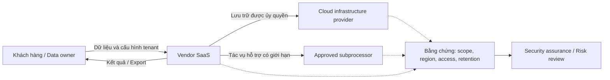
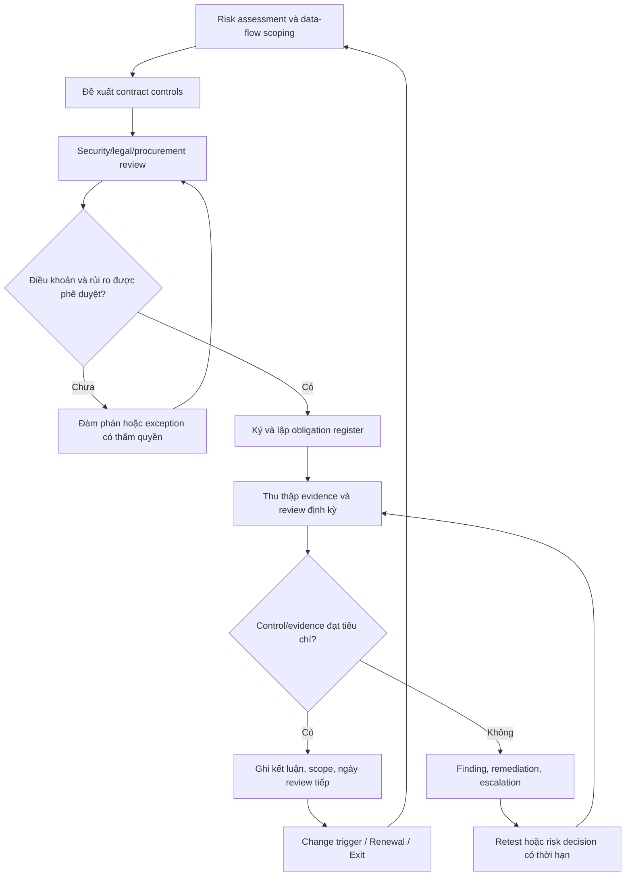

# Contract control: chuyển yêu cầu bảo mật nhà cung cấp thành cam kết có thể kiểm chứng

## 1. Contract control trong third-party assurance là gì?

**Contract control** là điều khoản, cam kết hoặc cơ chế ràng buộc trong quan hệ hợp đồng nhằm phân định trách nhiệm và xác lập các yêu cầu **có thể kiểm tra** đối với bên thứ ba. Trong lĩnh vực bảo mật, chúng thường liên quan tới truy cập dữ liệu, quyền quản trị, bảo vệ dữ liệu, xử lý sự cố, nhà thầu phụ, kiểm toán, tính liên tục dịch vụ, chuyển giao và chấm dứt hợp tác.

Ví dụ, tổ chức sử dụng một nhà cung cấp SaaS để lưu hồ sơ khách hàng. Việc nhà cung cấp nói “chúng tôi coi trọng bảo mật” chưa cho biết họ sẽ làm gì nếu tài khoản quản trị bị xâm nhập. Một **contract control** hữu ích có thể yêu cầu nhà cung cấp duy trì xác thực mạnh cho quyền đặc biệt, ghi nhận hành động quản trị, thông báo sự kiện bảo mật theo tiêu chí và thời hạn đã thỏa thuận, đồng thời cung cấp bằng chứng cho việc xử lý và khắc phục.

Trong chương **Third-party assurance** của module **SECURITY_SECURITY_ASSURANCE**, mục đích không dừng ở việc ký hợp đồng. Chương trình security assurance phải liên kết **rủi ro → yêu cầu/control → điều khoản hợp đồng → trách nhiệm thực thi → bằng chứng → kiểm thử/audit → phát hiện và khắc phục sai lệch** trong toàn bộ vòng đời nhà cung cấp.

**Điểm cần phân biệt:** hợp đồng tạo nghĩa vụ và quyền yêu cầu đối với bên thứ ba; bản thân nó **không chứng minh** biện pháp bảo mật đã được triển khai hoặc vận hành hiệu quả. “Có điều khoản mã hóa dữ liệu” và “đã kiểm tra dữ liệu thực được mã hóa đúng phạm vi” là hai mức assurance khác nhau.

### Kết quả học tập

Sau bài này, người học có thể:

1. Giải thích vai trò và giới hạn của contract control trong quản trị rủi ro bên thứ ba.
2. Chuyển yêu cầu bảo mật thành điều khoản có đối tượng, hành động, tiêu chí, thời điểm, bằng chứng và trách nhiệm rõ ràng.
3. Xác định nhóm control hợp đồng theo dữ liệu, quyền truy cập, sự cố, nhà cung cấp phụ, kiểm toán, tính liên tục và kết thúc hợp đồng.
4. Xây ma trận mapping giữa rủi ro, control hợp đồng, control kỹ thuật, bằng chứng và hoạt động đánh giá.
5. Nhận diện các điểm mơ hồ như “reasonable security”, “prompt notification”, “annual review” hoặc “industry standard” khi thiếu định nghĩa cụ thể.
6. Thiết kế quy trình theo dõi nghĩa vụ, quản lý ngoại lệ, change trigger và remediation có thể audit được.

## 2. Phạm vi: điều khoản hợp đồng và control kỹ thuật liên quan thế nào?

Không phải mọi control đều nằm trong hợp đồng; cũng không phải mọi điều khoản hợp đồng đều là kiểm soát bảo mật. Cần hiểu các lớp khác nhau:

| Lớp | Vai trò | Ví dụ |
| --- | --- | --- |
| **Business/security requirement** | Nêu mục tiêu cần đạt và hậu quả nếu không đạt | Dữ liệu khách hàng chỉ được người có quyền truy cập |
| **Contractual control** | Nghĩa vụ, thời hạn, quyền yêu cầu, chứng cứ và cách xử lý khi vi phạm | Nhà cung cấp duy trì MFA cho quản trị viên, cho phép kiểm chứng định kỳ |
| **Technical/operational control** | Biện pháp thực tế do nhà cung cấp hoặc khách hàng vận hành | MFA, RBAC, audit logs, encryption, backup |
| **Assurance activity** | Phương pháp đánh giá control đã hoạt động trong phạm vi nào | Review cấu hình, audit report, test access denial |
| **Evidence** | Hồ sơ hỗ trợ kết luận có thể xem lại | Báo cáo, event ID, kết quả kiểm thử, record phê duyệt |
| **Remediation/contract remedy** | Quy trình xử lý khi control không đạt | Kế hoạch khắc phục, hạn sửa, quyền escalation, quyền chấm dứt khi điều kiện đáp ứng |

Một điều khoản hợp đồng tốt phải **đúng người phải thực hiện**, nhưng yêu cầu quá chi tiết về giải pháp có thể gây lệch trách nhiệm. Ví dụ, nếu SaaS vận hành toàn bộ hệ thống, khách hàng thường cần cam kết kết quả kiểm soát và quyền kiểm chứng; không nhất thiết phải quy định tên công cụ nội bộ cụ thể. Ngược lại, với dịch vụ hạ tầng nơi khách hàng tự cấu hình IAM và dữ liệu, hợp đồng phải phân định rõ phần nào thuộc khách hàng.

### 2.1. Ba câu hỏi để xem một điều khoản có giá trị assurance không

1. **Obligation:** ai phải làm gì, cho những hệ thống/dữ liệu/tổ chức nào, theo mức tối thiểu nào?
2. **Verification:** bên sử dụng dịch vụ kiểm tra được bằng gì, khi nào, dưới điều kiện truy cập/bảo mật nào?
3. **Failure handling:** nếu không đáp ứng hoặc không cung cấp bằng chứng, ai xử lý, trong bao lâu và quyền của hai bên là gì?

Ví dụ: “nhà cung cấp bảo vệ dữ liệu tốt” không đủ. “Nhà cung cấp duy trì mã hóa cho dữ liệu khách hàng ở trạng thái lưu trữ theo phạm vi đã liệt kê, kiểm soát truy cập khóa, cung cấp mô tả kiến trúc và kết quả đánh giá độc lập theo lịch đã duyệt, xử lý các phát hiện nghiêm trọng theo quy trình trong phụ lục” tạo cơ sở kiểm tra cụ thể hơn. Giá trị thật còn phụ thuộc vào **phạm vi và chứng cứ**.

## 3. Từ phân tích rủi ro tới điều khoản đo được

Quá trình thiết kế contract control nên bắt đầu bằng **tài sản, luồng dữ liệu và kịch bản rủi ro**, không bắt đầu bằng việc sao chép danh sách điều khoản từ một mẫu hợp đồng khác.

Ví dụ: SaaS hỗ trợ xử lý hóa đơn cho nhiều tenant, nhận bản ghi giao dịch và được phép gọi API trong production.

| Thành phần | Thiết kế minh họa |
| --- | --- |
| Tài sản | Dữ liệu hóa đơn, định danh tenant, khóa tích hợp API, khả năng xử lý giao dịch |
| Rủi ro | Bên thứ ba lộ token, truy cập chéo tenant hoặc mất dữ liệu khi khôi phục |
| Mục tiêu bảo mật | Bảo mật thông tin, toàn vẹn giao dịch, truy cập được kiểm soát và khôi phục có thể kiểm chứng |
| Contract control | Giới hạn mục đích xử lý, quyền truy cập tối thiểu, logging, incident notification, backup/recovery và data return |
| Control vận hành | Scoped API credentials, RBAC, audit pipeline, encryption, restore testing |
| Evidence | Mẫu cấu hình đã làm sạch, báo cáo test, nhật ký truy cập đặc quyền, kết quả DR drill |
| Kiểm tra | Đối chiếu dữ liệu thực và policy; yêu cầu bằng chứng theo kỳ và khi có thay đổi |
| Sai lệch | Finding có owner/hạn xử lý, đánh giá rủi ro tồn dư và quyền xử lý theo hợp đồng |

Công thức tư duy:

```text
Risk scenario
  → Security objective
  → Contract obligation (who / what / when / scope)
  → Technical or process control
  → Evidence and verification cadence
  → Escalation / remediation / acceptance
```

Không đánh giá mọi nhà cung cấp bằng cùng mức độ. Dịch vụ chỉ gửi thông báo marketing ít nhạy cảm khác với bên xử lý lệnh thanh toán hoặc giữ khóa giải mã dữ liệu sản xuất. **Risk tier** nên dựa trên loại và lượng dữ liệu, quyền truy cập, tính thiết yếu của dịch vụ, mức độ phụ thuộc, khả năng ảnh hưởng nhiều tenant và khả năng thay thế.

## 4. Những tài liệu hợp đồng phải được đọc như một chỉnh thể

Yêu cầu bảo mật thường phân tán trong nhiều tài liệu có quan hệ hiệu lực khác nhau:

| Tài liệu | Nội dung thường gặp | Điểm cần đối chiếu |
| --- | --- | --- |
| **Master Service Agreement (MSA)** | Điều khoản chung, trách nhiệm, giới hạn, quyền chấm dứt | Điều khoản nào áp dụng cho các dịch vụ và khách hàng cụ thể |
| **Service Order / Statement of Work (SOW)** | Dịch vụ, phạm vi, môi trường, thời hạn và kết quả bàn giao | Có bao gồm toàn bộ dịch vụ và dữ liệu trong risk assessment? |
| **Security Addendum/Schedule** | Yêu cầu kiểm soát bảo mật và bằng chứng | Đủ chi tiết để đo/kiểm tra? |
| **Data Processing Agreement (DPA)** | Vai trò, phạm vi xử lý dữ liệu, yêu cầu về dữ liệu cá nhân | Phù hợp luồng dữ liệu và quy định áp dụng? |
| **SLA / Service Description** | Mức dịch vụ, cửa sổ hỗ trợ, đo lường gián đoạn | Thời gian phục hồi, loại trừ, quyền nhận báo cáo có rõ? |
| **Subprocessor schedule** | Danh sách bên xử lý phụ và cách thông báo thay đổi | Đúng phạm vi dữ liệu, khu vực và luồng? |
| **Exit/transition plan** | Xuất dữ liệu, hỗ trợ chuyển đổi, xóa và xác nhận kết thúc | Khả năng thoát khỏi phụ thuộc mà không làm lộ/mất dữ liệu |

Phải xác định **thứ tự ưu tiên văn bản, phiên bản, thời điểm có hiệu lực, cơ chế sửa đổi và người có thẩm quyền phê duyệt**. Chẳng hạn SOW ghi dữ liệu chỉ nằm ở một khu vực, nhưng DPA cho phép chuyển dữ liệu tới các địa điểm khác theo điều kiện nhất định: không thể đọc riêng một văn bản rồi kết luận vị trí dữ liệu đã được kiểm soát.

Đây là nội dung cần phối hợp giữa security, procurement và legal. Bài học cung cấp khung assurance kỹ thuật và vận hành, không tự xác định khả năng thực thi pháp lý của một điều khoản tại mọi khu vực tài phán.

## 5. Ma trận nhóm contract control cần cân nhắc

Không tồn tại “một bộ điều khoản bắt buộc” cho tất cả quan hệ nhà cung cấp. Hãy lựa chọn theo threat model, BIA, yêu cầu bảo mật và loại dịch vụ.

| Nhóm | Cam kết có thể cân nhắc | Bằng chứng/điểm kiểm tra |
| --- | --- | --- |
| **Security governance** | Chính sách, owner, đánh giá rủi ro và kiểm soát thay đổi | Bản tóm tắt chính sách, audit report, change process |
| **Identity & access** | MFA cho đặc quyền, RBAC, least privilege, thu hồi quyền | IAM design, access reviews, negative authorization tests |
| **Data confidentiality** | Mục đích xử lý, mã hóa, bảo vệ khóa, phân loại và chia sẻ dữ liệu | Data flow, encryption/key controls, access audit |
| **Data integrity** | Kiểm soát thay đổi, đối soát, chống ghi trùng và sửa trái phép | Integrity testing, change logs, reconciliation |
| **Logging/monitoring** | Ghi sự kiện quan trọng, giữ bằng chứng và thông báo dấu hiệu nghi vấn | Log schema, retention, sample events, detection coverage |
| **Vulnerability & secure development** | Quản lý lỗ hổng, cập nhật bản vá, kiểm thử trước thay đổi | Vulnerability findings, remediation records, SDLC assurance |
| **Incident response** | Thông báo, phối hợp điều tra, bảo toàn chứng cứ và khắc phục | Incident timeline, notification records, tabletop results |
| **Business continuity/DR** | BIA, RTO/RPO đã thỏa thuận, backup và kiểm thử khôi phục | DR plan, restore test, transaction/integrity checks |
| **Subcontractor/supply chain** | Thẩm định, ràng buộc yêu cầu tương ứng, quyền thông tin thay đổi | Danh sách subprocessor, flow-down obligations, review records |
| **Independent assurance/audit** | Cung cấp báo cáo độc lập, kiểm tra hiệu lực control, xử lý ngoại lệ | Audit scope, exceptions, action plans |
| **Data lifecycle and exit** | Quản lý retention, trả dữ liệu, xóa có kiểm chứng và chuyển giao | Export test, deletion certificate + giới hạn backup |
| **Change management** | Thông báo thay đổi trọng yếu ảnh hưởng dữ liệu/control | Change record, impact assessment, approval |
| **Personnel/security operations** | Kiểm soát truy cập nhân sự, đào tạo và thu hồi quyền khi rời tổ chức | Access lifecycle evidence, role-based attestations |
| **Right to remedy** | Cơ chế khắc phục, escalation, kiểm tra lại hoặc chấm dứt khi đủ điều kiện | Breach/finding register, remediation acceptance |

Những chữ như “cung cấp báo cáo” phải gắn với **loại báo cáo, phạm vi, chu kỳ, điều kiện bảo mật và phương thức xử lý khi có ngoại lệ**. Báo cáo chứng nhận không tự thay thế trách nhiệm xác minh các hệ thống cụ thể nằm trong phạm vi dịch vụ mua.

## 6. Cách viết điều khoản đủ cụ thể để kiểm chứng

Để biến mục tiêu thành điều khoản có thể vận hành, hãy kiểm tra các trường sau:

| Thành phần | Câu hỏi cần trả lời |
| --- | --- |
| **Actor/owner** | Nhà cung cấp, khách hàng hay subprocessor chịu trách nhiệm chính? |
| **Action** | Chính xác phải duy trì, ngăn chặn, báo cáo, cung cấp hay kiểm thử gì? |
| **Scope** | Áp dụng cho sản phẩm, môi trường, dữ liệu, tài khoản, nhân sự và khu vực nào? |
| **Minimum acceptance** | Khi nào coi là đáp ứng? Trường hợp nào là vi phạm? |
| **Timing** | Kích hoạt khi nào; thời hạn tính từ mốc nào; theo múi giờ/đơn vị nào? |
| **Evidence** | Loại hồ sơ, nguồn kiểm chứng, tần suất, định dạng và người được xem |
| **Exception** | Khi không thể đáp ứng, ai phê duyệt ngoại lệ, trong thời hạn nào? |
| **Escalation/remedy** | Phải thông báo cho ai, kế hoạch khắc phục và hệ quả tiếp theo ra sao? |

### 6.1. So sánh điều khoản yếu và điều khoản có khả năng kiểm tra

| Diễn đạt thiếu rõ | Vấn đề | Cách làm rõ |
| --- | --- | --- |
| “Bảo mật ở mức hợp lý” | Không biết mức nào, với loại dữ liệu nào | Nêu các nhóm security controls tối thiểu và phép đánh giá |
| “Thông báo ngay khi xảy ra sự cố” | “Ngay” và “sự cố” có nhiều cách hiểu | Định nghĩa trigger, mốc bắt đầu tính giờ, người nhận và nội dung tối thiểu |
| “Thực hiện backup thường xuyên” | Không rõ recovery point và khả năng restore | Định nghĩa RPO, backup scope và kiểm thử khôi phục |
| “Cung cấp mọi báo cáo cần thiết” | Không rõ báo cáo nào, khi nào, bảo vệ ra sao | Đặt danh mục evidence, chu kỳ, quyền che thông tin nhạy cảm có lý do |
| “Không chia sẻ dữ liệu cho bên thứ ba” | Có thể mâu thuẫn với subprocessor cần thiết | Xác định loại bên phụ, mục đích, flow-down và quy trình thay đổi |
| “Xóa dữ liệu khi kết thúc” | Không rõ backup, log và retention bắt buộc | Định nghĩa phạm vi xóa, ngoại lệ retention và xác nhận có giới hạn |

**Phép thử chất lượng:** nếu nhà cung cấp và khách hàng có thể nhìn cùng một sự kiện thực tế rồi kết luận trái ngược chỉ vì thuật ngữ không rõ, điều khoản cần được định nghĩa lại trước khi ký hoặc trước khi dùng để đánh giá.

### 6.2. Điều khoản minh họa về quyền đặc biệt

> Đối với môi trường production xử lý dữ liệu khách hàng trong phạm vi dịch vụ, nhà cung cấp duy trì cơ chế xác thực mạnh cho người dùng đặc quyền, giới hạn quyền theo vai trò và ghi lại việc cấp/thu hồi quyền. Theo lịch đánh giá đã thỏa thuận và sau sự cố liên quan, nhà cung cấp cung cấp bằng chứng phù hợp đã bảo vệ thông tin nhạy cảm về hoạt động access review, ngoại lệ và hành động khắc phục. Khi yêu cầu không được đáp ứng, các bên áp dụng quy trình escalation và remediation theo phụ lục bảo mật.

Đây là **mẫu tư duy soạn điều khoản**, chưa phải văn bản ký kết hoàn chỉnh. Khi triển khai thật cần nêu chính xác định nghĩa privileged user, phạm vi, tiêu chí kiểm chứng, tần suất, thời hạn khắc phục và thứ tự ưu tiên văn bản.

## 7. Phân định shared responsibility và quyền thực thi

Một nghĩa vụ không có owner thực hiện sẽ trở thành khoảng trống assurance. Với dịch vụ cloud, SaaS hoặc managed service, phân chia công việc theo kiến trúc thực tế.

| Control | Nhà cung cấp thường kiểm soát | Khách hàng thường kiểm soát | Cần làm rõ bằng hợp đồng và kiến trúc |
| --- | --- | --- | --- |
| Bảo vệ hạ tầng SaaS | Host, service runtime, quyền nội bộ | Cấu hình tenant được cung cấp | Ai bật và theo dõi audit log ở từng lớp? |
| Tài khoản khách hàng | SSO/MFA integration được hỗ trợ | Cấp quyền người dùng trong tenant | Ai phải revoke sau khi nhân sự rời tổ chức? |
| Kết nối API | Credential storage phía vendor | Quản lý token/khóa phát cho integration của khách hàng | Mức quyền, rotation, thu hồi, phát hiện lạm dụng |
| Mã hóa dữ liệu | Storage encryption theo sản phẩm | Quản lý khóa nếu customer-managed key | Ai giữ khóa, ai xử lý khi khóa unavailable? |
| Backup/restore | Backup dữ liệu trong phạm vi cam kết | Xuất bản sao theo chức năng được cung cấp | Dữ liệu nào và loại sự cố nào nằm trong RPO/RTO? |
| Incident | Điều tra hệ thống do vendor điều hành | Điều tra môi trường khách hàng | Ai phát hiện, ai thông báo, chia sẻ dữ liệu nào, trong khung nào? |
| Exit | Cung cấp export và hỗ trợ transition | Nhận, bảo vệ và import dữ liệu | Định dạng, chi phí, thời hạn, integrity và xác nhận xóa |

Tính chất “thường” không thể thay thế một **responsibility matrix chính thức**. SaaS có mô hình quản lý khóa/định danh khác nhau; nội dung kiểm chứng phải xuất phát từ sản phẩm được mua và cách triển khai.

### 7.1. RACI tối thiểu cho contract control

| Công việc | Procurement | Security assurance | Legal/privacy | Technical owner | Business owner |
| --- | --- | --- | --- | --- | --- |
| Xác lập phạm vi dịch vụ | Phối hợp | Tư vấn rủi ro | Tư vấn nghĩa vụ | Xác thực luồng tích hợp | **Chịu trách nhiệm** về nhu cầu |
| Xác định security requirements | Phối hợp | **Chịu trách nhiệm chuyên môn** | Kiểm tra yêu cầu liên quan | Cung cấp thông tin kiến trúc | Phê duyệt mức rủi ro theo thẩm quyền |
| Đàm phán và ký kết | Điều phối | Review technical controls | **Đánh giá pháp lý** | Xác nhận tính khả thi | Phê duyệt theo cơ chế tổ chức |
| Thu thập bằng chứng | Theo dõi mốc | **Đánh giá chất lượng** | Review khi liên quan | Xác minh các tích hợp | Theo dõi ảnh hưởng dịch vụ |
| Xử lý thiếu sót | Điều phối nhà cung cấp | Đánh giá control gap | Xem quyền hợp đồng | Triển khai giảm thiểu nội bộ | Quyết định rủi ro theo thẩm quyền |
| Chấm dứt và chuyển giao | Điều phối | Kiểm chứng xóa/bảo vệ | Xem retention/exit obligations | Kiểm tra dữ liệu sau export | Phê duyệt ngừng phụ thuộc |

Bảng chỉ là minh họa; tổ chức cần ghi rõ mỗi quyết định có **một người accountable** và phương án thay thế khi người đó vắng mặt.

## 8. Data protection: dữ liệu gì, ở đâu, ai được làm gì?

Hợp đồng cần phản ánh chính xác **data inventory** và luồng xử lý. Một nhà cung cấp có thể nhận thông tin đăng nhập giả danh, metadata giao dịch, dữ liệu cá nhân hoặc secret phục vụ tích hợp; mỗi loại dẫn tới rủi ro khác nhau.

### 8.1. Các câu hỏi cần đóng thành nghĩa vụ

- Dữ liệu nào được giao và **mục đích xử lý** có giới hạn rõ không?
- Nhà cung cấp có được dùng dữ liệu để huấn luyện, phân tích sản phẩm, chia sẻ với đối tác hay sử dụng ngoài dịch vụ đã mua không?
- Dữ liệu được lưu/truy cập/chuyển tới những khu vực nào, theo điều kiện thay đổi nào?
- Ai là data owner, ai có quyền admin/support, quyền đọc dữ liệu thật có được ghi audit?
- Dữ liệu mã hóa khi truyền/lưu, ai quản lý khóa, có cơ chế thu hồi/rotate và phục hồi khi mất khóa không?
- Khi yêu cầu chỉnh sửa, export, retention, xóa hoặc hỗ trợ yêu cầu của chủ thể dữ liệu, hai bên có vai trò và thời hạn nào?
- Dữ liệu trong log, backup, cache, disaster recovery và subprocessor có cùng phạm vi điều khoản hay được mô tả ngoại lệ riêng?
- Nếu có tranh chấp hoặc yêu cầu bảo toàn chứng cứ, thủ tục legal hold hợp lệ ảnh hưởng việc xóa thế nào?

Không thể mặc định mọi dữ liệu có cùng quy tắc. Yêu cầu về dữ liệu cá nhân, lưu trữ theo khu vực hoặc thời hạn thông báo phụ thuộc **hệ thống luật, hợp đồng, vai trò các bên và loại dữ liệu thực sự áp dụng**; người có thẩm quyền legal/privacy phải kiểm tra trước khi chốt.

### 8.2. Luồng dữ liệu và bên xử lý phụ



Sơ đồ chỉ minh họa các quan hệ xử lý. **Bên vận hành hạ tầng** không mặc nhiên có cùng quyền xem dữ liệu với **bên xử lý nghiệp vụ**. Để đánh giá flow-down obligations, cần xem quyền truy cập thực tế, loại dữ liệu, công nghệ mã hóa và nghĩa vụ của từng bên.

## 9. Identity, logging và secure operations trong hợp đồng

Những control kỹ thuật có giá trị cao khi vendor có đường truy cập production hoặc xử lý dữ liệu nhạy cảm:

| Mục tiêu | Contract obligation cần cân nhắc | Cách kiểm chứng |
| --- | --- | --- |
| Chặn truy cập trái phép | Least privilege, MFA đặc quyền, cấp/thu hồi quyền có phê duyệt | Access review, mẫu chính sách, test quyền |
| Ngăn lạm dụng tích hợp | Phân tách service account, giới hạn token scope và vòng đời | API permission inventory, rotation records |
| Truy xuất hành vi đặc quyền | Audit các thao tác quyền và cấu hình trọng yếu | Log sample đã ẩn danh, event IDs, retention |
| Phát hiện hoạt động bất thường | Monitoring đối với use case rủi ro cao, escalation | Detection coverage, alert test, incident records |
| Bảo vệ bí mật | Secrets không ghi vào log, có cơ chế rotation/revocation | Redaction tests, secret store audit |
| Kiểm soát thay đổi | Review, kiểm thử và giám sát thay đổi security-relevant | Change tickets, deployment audit |
| Quản lý cấu hình | Baseline, drift detection và remediation | Config policy, drift findings, acceptance |

Nhà cung cấp có thể giới hạn cung cấp log thô để bảo vệ khách hàng khác hoặc bí mật nội bộ. Khi đó các bên có thể thỏa thuận **bằng chứng thay thế** như báo cáo độc lập, truy vấn tại chỗ có kiểm soát, trích xuất redacted, xác nhận theo scope hoặc buổi review dưới NDA. Cần đánh giá liệu hình thức thay thế vẫn đủ giải quyết câu hỏi assurance cụ thể.

**Không đưa password, access token, private key hay dữ liệu khách hàng không cần thiết vào yêu cầu evidence.** Kho lưu hồ sơ hợp đồng/audit cũng phải được bảo vệ.

## 10. Secure development, vulnerability management và thay đổi sản phẩm

Nếu dịch vụ bao gồm phần mềm, API, agent hoặc thành phần chạy trong hạ tầng khách hàng, hợp đồng nên xác định cách vendor quản lý rủi ro từ **development tới production**.

Các nội dung có thể thương lượng:

1. Có chương trình phát triển an toàn phù hợp loại sản phẩm, kiểm soát code review và bảo vệ pipeline.
2. Theo dõi dependency, component và lỗ hổng có thể ảnh hưởng sản phẩm được cung cấp.
3. Có quy trình đánh giá **mức độ ảnh hưởng thực tế**, ưu tiên remediation và cung cấp giải pháp tạm thời khi chưa thể vá.
4. Thông báo các lỗ hổng hoặc thay đổi quan trọng ảnh hưởng đến bảo mật của khách hàng theo ngưỡng đã thỏa thuận.
5. Phối hợp xử lý lỗ hổng do khách hàng hoặc bên kiểm tra được ủy quyền báo cáo.
6. Cung cấp bằng chứng đủ mức (ví dụ tổng hợp kết quả pentest, danh sách ngoại lệ nghiêm trọng, thời điểm khắc phục) với phạm vi bảo vệ thông tin phù hợp.
7. Có kế hoạch xử lý thay đổi phá tương thích authentication, authorization, encryption, audit format hoặc luồng dữ liệu.

**Thời hạn vá** cần nêu cách tính và các trường hợp ngoại lệ: mức nghiêm trọng, có khai thác thực tế không, có biện pháp bù trừ hay không, owner và cách chứng minh hoàn tất. Không tự giả định mọi lỗ hổng được xử lý trong một con số ngày duy nhất.

Một báo cáo pentest “không có critical finding” có thể chỉ áp dụng cho một phiên bản/web interface vào một thời điểm nhất định; nó không chứng minh agent mới hoặc API khác đã được kiểm thử.

## 11. Incident notification: thiết kế nghĩa vụ có thể vận hành

Thông báo sự cố là nhóm điều khoản thường mơ hồ. Cần làm rõ **trigger, đồng hồ, đối tượng nhận, nội dung, cách cập nhật và hỗ trợ điều tra**.

### 11.1. Những yếu tố của cơ chế thông báo

| Yếu tố | Câu hỏi thỏa thuận |
| --- | --- |
| **Trigger** | Suspected event, confirmed incident, compromise of service hay data breach theo định nghĩa nào? |
| **Awareness clock** | Bắt đầu tính từ khi ai biết, hệ thống phát hiện hay khi vendor xác minh đủ điều kiện? |
| **Notification deadline** | Thời hạn nào do hai bên thỏa thuận, khác gì nghĩa vụ pháp lý bắt buộc? |
| **Recipient/channel** | Security on-call, privacy/legal, đầu mối backup; kênh dự phòng khi email chính gián đoạn? |
| **Minimum content** | Dịch vụ, nguồn phát hiện, loại dữ liệu có thể ảnh hưởng, thời gian, phạm vi và biện pháp đang làm |
| **Updates** | Tần suất và sự kiện nào yêu cầu cập nhật quan trọng? |
| **Preservation/cooperation** | Log, artifacts, timeline, forensics và khả năng trả lời yêu cầu điều tra |
| **Closure** | Root cause, phạm vi cuối, remediation, bằng chứng khắc phục và bài học |

**Định nghĩa “confirmed” cần cẩn trọng.** Nếu chỉ phải thông báo sau khi hoàn tất toàn bộ forensic, khách hàng có thể mất thời gian quan trọng để giảm tác động. Có thể thiết kế **early notice** cho sự kiện có khả năng ảnh hưởng nghiêm trọng, ghi rõ thông tin ban đầu còn chưa chắc chắn, sau đó cập nhật khi xác minh.

### 11.2. Điều khoản minh họa

> Khi vendor xác định có sự kiện bảo mật đáp ứng ngưỡng thông báo được mô tả trong phụ lục, vendor thông báo tới các đầu mối bảo mật đã đăng ký trong thời hạn được hai bên phê duyệt, tính từ mốc nhận biết được định nghĩa. Thông báo ban đầu nêu dữ kiện đã xác minh, phạm vi nghi ngờ, biện pháp containment đang thực hiện và thông tin còn thiếu; vendor gửi cập nhật khi phát hiện thay đổi có ảnh hưởng đáng kể và phối hợp bảo toàn bằng chứng theo điều kiện bảo mật đã thỏa thuận.

Bản mẫu **không tự quy định số giờ** vì thời hạn phải được thống nhất theo rủi ro, năng lực vận hành, hợp đồng và luật có liên quan. Khi ký thực tế, **thời hạn và mốc tính phải là giá trị cụ thể có thể kiểm toán**.

### 11.3. Kiểm chứng bằng tabletop

Giả lập vendor phát hiện một token tích hợp production có dấu hiệu bị dùng trái phép. Đội assurance kiểm tra: đầu mối nhận có còn hoạt động không; vendor có hiểu trigger và clock không; notice có đủ dữ kiện và phân biệt observed/potential impact không; có cách liên lạc khẩn ngoài giờ không; và hồ sơ sự cố có thể liên kết với remediation hay không.

Việc vendor có “incident policy” nhưng chưa từng thử kênh thông báo không đủ chứng minh sẽ liên lạc được khi có sự cố.

## 12. Business continuity và disaster recovery trong nghĩa vụ vendor

Với nhà cung cấp thiết yếu, điều khoản DR cần liên hệ với **mục tiêu nghiệp vụ**, không chỉ cấu hình backup.

| Vấn đề | Câu hỏi contract control |
| --- | --- |
| Critical service scope | Dịch vụ, tenant, region và API nào được coi trọng yếu? |
| RTO | Khi service gián đoạn trong kịch bản đã xác định, mốc khôi phục được đo từ đâu đến đâu? |
| RPO | Loại dữ liệu nào được bảo vệ; dữ liệu đã xác nhận có thể mất đến mức nào? |
| Minimum service | Có chế độ read-only/degraded nào an toàn và đủ cho nghiệp vụ? |
| Backup/restore | Backup được kiểm tra restore thực tế theo cách nào, tần suất ra sao? |
| Dependency | Có phụ thuộc IAM, KMS, DNS, subprocessor, cloud region hay đội trực ngoài giờ? |
| Security during recovery | Tenant isolation, quyền admin, secrets và audit có còn sau failover/failback? |
| Test reporting | Vendor cung cấp kết quả test nào, chỉ ra điều kiện, hạn chế và các failure finding? |
| Business communication | Vendor thông báo outage, thay đổi thời gian dự kiến và trạng thái khôi phục qua kênh nào? |
| Exit contingency | Khi vendor không thể khôi phục, khách hàng có cách lấy dữ liệu và chuyển nhà cung cấp? |

SLA availability 99,9% chưa tự chứng minh đạt RTO/RPO trong thảm họa. Một báo cáo backup “job success” cũng chưa chứng minh **restore được, dữ liệu đúng và không bị vượt quyền truy cập**.

Đối với managed service, khách hàng cần biết **lỗi hạ tầng nào nằm trong phạm vi RTO** và điều kiện loại trừ nào áp dụng. Nếu cần dịch vụ tiếp tục ngay cả khi mất toàn vùng, kiểm thử phải bao phủ kịch bản phù hợp; vendor không thể dùng thử restart một VM để chứng minh DR toàn region.

## 13. Subprocessor và chuỗi cung ứng: ràng buộc nghĩa vụ theo luồng

Khi vendor dùng subprocessor, cloud provider hoặc nhà thầu hỗ trợ, rủi ro có thể mở rộng ngoài nhà cung cấp ký hợp đồng trực tiếp.

### Những yêu cầu cần xác định

- Quy tắc **thông báo/phê duyệt** việc thêm, thay hoặc thay đổi phạm vi subprocessor.
- Danh sách hiện hành gồm loại hoạt động, khu vực, dữ liệu và quyền có thể truy cập.
- Điều kiện kiểm soát tương ứng được **flow down** tới subprocessor theo rủi ro.
- Chủ thể chịu trách nhiệm chính khi subprocessor gây mất dữ liệu hoặc vi phạm control.
- Cơ chế nhận thông tin sự cố và bằng chứng từ subprocessor qua vendor.
- Quyền phản đối/thay thế/giảm phạm vi khi thay đổi làm vượt mức rủi ro được phê duyệt.
- Kế hoạch khi subprocessor ngừng dịch vụ hoặc thay đổi khả năng đáp ứng.

Một subprocessor chỉ nhận dữ liệu mã hóa mà không giữ khóa có bề mặt rủi ro khác với bên có khả năng xem dữ liệu đã giải mã. Tuy nhiên, ngay cả khi không đọc được nội dung, bên đó vẫn có thể ảnh hưởng **availability, integrity, data residency** và hoạt động khôi phục.

**Không yêu cầu một cách thiếu thực tế** quyền truy cập không giới hạn tới mọi nhà thầu cấp sâu. Thay vào đó, xác định thông tin và cơ chế assurance nào bên ký hợp đồng trực tiếp có trách nhiệm cung cấp, mức độ tin cậy và cách xử lý khi không đáp ứng.

## 14. Audit rights, chứng nhận và chất lượng evidence

Quyền kiểm tra phải **thực thi được về vận hành** và phù hợp bảo mật thông tin của cả hai bên. Thỏa thuận nên nêu phạm vi, tần suất, điều kiện truy cập, hình thức báo cáo, thời hạn cung cấp, phương thức bảo vệ dữ liệu khách hàng khác và cách xử lý các phát hiện.

### 14.1. Những nguồn bằng chứng thường được yêu cầu

| Nguồn evidence | Có thể hỗ trợ kết luận gì? | Giới hạn |
| --- | --- | --- |
| **SOC 2 Type II report** | Mô tả và đánh giá kiểm soát trong phạm vi/chu kỳ báo cáo xác định | Không tự bao phủ mọi sản phẩm, region, khách hàng hoặc thời điểm sau kỳ |
| **ISO/IEC 27001 certificate** | Thông tin về hệ thống quản lý an toàn thông tin trong phạm vi chứng nhận | Không bảo đảm mọi yêu cầu cụ thể của hệ thống tích hợp đã đạt |
| **Penetration test summary** | Những mục tiêu/phương pháp/phát hiện đã được kiểm tra tại thời điểm thử | Giới hạn bởi scope, môi trường, kỹ thuật và thời gian |
| **Vulnerability/remediation summary** | Tình trạng phát hiện và khắc phục theo phạm vi đã báo cáo | Có thể thiếu chi tiết để xác nhận ứng dụng khách hàng bị ảnh hưởng |
| **Architecture/data-flow review** | Cách dữ liệu đi qua hệ thống, ai kiểm soát lớp nào | Tài liệu có thể lỗi thời nếu chưa đối chiếu runtime |
| **Access review / IAM evidence** | Quyền đặc biệt được xem xét và thu hồi theo quy trình | Review policy không nhất thiết chứng minh cấu hình hiện tại |
| **Incident/tabletop record** | Kênh thông báo và quy trình điều tra đã được diễn tập | Kịch bản diễn tập có giới hạn; chưa phải thực chiến |
| **Restore/DR test report** | Kết quả recovery theo kịch bản, RTO/RPO và kiểm tra dữ liệu | Test ở staging chưa tự chứng minh production full-scale |
| **Contract obligation register** | Ai sở hữu nghĩa vụ, mốc cần nộp và các phát hiện | Chỉ là hệ thống theo dõi, cần link tới chứng cứ gốc |

### 14.2. Cách đọc báo cáo độc lập

Hãy kiểm tra:

1. **Entity:** pháp nhân, sản phẩm, dịch vụ và region báo cáo có đúng vendor đang sử dụng không?
2. **Period:** khoảng thời gian được kiểm toán có bao phủ giai đoạn cần kết luận không?
3. **Criteria:** bộ tiêu chí nào được áp dụng; có khớp control mục tiêu không?
4. **Exceptions:** có ngoại lệ, qualified opinion, hạn chế hoặc control failure nào?
5. **Complementary user entity controls (CUECs):** khách hàng phải làm gì để kết luận bảo mật còn có nghĩa?
6. **Subservice organizations:** có dịch vụ phụ bị loại khỏi phạm vi hay dùng phương pháp loại trừ không?
7. **Bridge/updates:** có khoảng trống giữa kỳ báo cáo và ngày đánh giá hiện tại không?
8. **Action:** có bằng chứng khắc phục và chấp nhận rủi ro cho những ngoại lệ liên quan không?

Không dùng “đã có chứng nhận” làm một checkbox vĩnh viễn. Cần xem **đúng phạm vi, đúng thời kỳ, đúng yêu cầu và đúng hạn chế**.

### 14.3. Khi không thể xem hệ thống bên thứ ba trực tiếp

Có thể đàm phán cơ chế thay thế: báo cáo độc lập theo đúng scope, attestation cụ thể kèm evidence, walkthrough kiểm soát, báo cáo kiểm thử rút gọn, kiểm tra trong môi trường được bảo vệ hoặc buổi họp kiểm toán được ghi nhận. Security assurance ghi rõ **mức độ tin cậy và điểm chưa thể xác minh**.

Một vendor từ chối cung cấp bằng chứng không tự động chứng minh control thất bại; nhưng là **assurance gap** cần ghi nhận, đánh giá tác động và xác định biện pháp bù trừ hoặc quyết định rủi ro.

## 15. Theo dõi nghĩa vụ, ngoại lệ và xử lý vi phạm

Contract control cần được theo dõi **sau khi ký**, qua onboarding, vận hành, gia hạn và kết thúc. Nếu chỉ lưu bản PDF trong kho mua sắm, thời hạn báo cáo hoặc thay đổi subprocessor có thể bị bỏ qua.



### 15.1. Obligation register

Mỗi nghĩa vụ cần có một bản ghi được quản lý phiên bản:

| Trường | Ý nghĩa |
| --- | --- |
| `control_id`, `contract_ref` | Liên kết chính xác tới tài liệu/điều khoản đã ký và phiên bản |
| `vendor_id`, `service_scope` | Nhà cung cấp, sản phẩm, environment và dữ liệu áp dụng |
| `risk_id`, `security_objective` | Vì sao cần nghĩa vụ này |
| `obligation_owner` | Ai phải thực hiện (vendor/customer/shared) |
| `internal_accountable` | Ai chịu trách nhiệm kiểm tra và escalation |
| `acceptance_criteria` | Điều kiện đánh giá PASS/FAIL/UNKNOWN |
| `evidence_type`, `source`, `frequency`, `due_date` | Cần bằng chứng gì và mốc nhận |
| `control_status`, `evidence_quality` | Đang đạt, không đạt, chờ hay có ngoại lệ |
| `finding_id`, `risk_acceptance_id` | Khoảng trống, remediation hoặc chấp nhận rủi ro |
| `last_review`, `next_review`, `change_trigger` | Vòng đời và lịch đánh giá lại |

Ví dụ bản ghi minh họa:

```yaml
control_id: TPA-CONTRACT-005
vendor_id: vendor-saas-invoice
service: invoice-processing-prod
contract_reference:
  agreement: security-addendum
  version: "2026-01"
  clause: "Access-and-audit"
risk:
  id: RISK-3P-017
  scenario: "Unauthorized access to tenant financial records"
obligation:
  owner: vendor
  requirement: "Privileged access is controlled and auditable"
internal_review:
  accountable: security_assurance_team
  supporting_owner: invoice_service_owner
acceptance:
  scope: "Production access to customer invoice data"
  criteria:
    - "Privileged access authentication and authorization documented"
    - "Access review evidence is available for approved review window"
    - "Material exceptions have owners and remediation decisions"
evidence:
  source: "Approved vendor assurance package"
  cadence: "According to signed addendum"
  status: pending_review
review:
  change_triggers:
    - "New privileged integration"
    - "Material security incident"
    - "Subprocessor or data-flow change"
finding:
  status: none_identified_yet
```

**Không nhầm** YAML minh họa với hợp đồng có hiệu lực. `contract_reference` cần trỏ tới bản ký thật; `status: pending_review` nghĩa là chưa có đánh giá thực tế. `none_identified_yet` không có nghĩa đã được chứng minh không tồn tại lỗ hổng.

### 15.2. Phân biệt missing evidence và failed control

| Tình huống | Cách ghi nhận | Phản ứng phù hợp |
| --- | --- | --- |
| Vendor cung cấp bằng chứng đạt scope và tiêu chí | `verified` trong phạm vi xác định | Lưu nguồn và ngày review |
| Bằng chứng chưa đến hạn | `pending` | Theo dõi mốc, nhắc theo cơ chế hợp đồng |
| Đến hạn nhưng chưa có bằng chứng | `evidence_overdue` / assurance gap | Escalate theo quyền hợp đồng; đánh giá rủi ro |
| Bằng chứng cho thấy control không hoạt động | `control_failed` | Finding, biện pháp giảm thiểu, remediation và kiểm tra lại |
| Báo cáo có ngoại lệ thuộc hệ thống khách hàng đang dùng | `exception_under_review` | Đánh giá scope, tác động, control bù trừ |
| Vendor thỏa thuận ngoại lệ có thời hạn | `exception_approved` | Ghi owner, ngày hết hạn, residual risk và retest |
| Hợp đồng đã hết nhưng dữ liệu còn ở vendor | `exit_obligation_open` | Tiếp tục theo dõi export/deletion/retention hợp lệ |

Tình trạng “không nhận được bằng chứng” cần được báo cáo minh bạch. Không tự điền `PASS` để hoàn thành bảng compliance.

### 15.3. Remedy và giới hạn của security assurance

Quy trình remediation có thể gồm thông báo thiếu sót, thời hạn hành động, kế hoạch bù trừ, kiểm tra lại, escalation, hạn chế sử dụng dịch vụ, hoặc quyền chấm dứt khi đủ điều kiện. Hình thức hợp đồng, giới hạn trách nhiệm, mức bồi thường và khả năng thực thi cần được **legal/procurement** xác nhận, còn security assurance cung cấp đánh giá rủi ro và bằng chứng.

**Chấp nhận rủi ro** không đồng nghĩa control đã đạt; nó là quyết định cho phép tiếp tục trong điều kiện có giới hạn, người phê duyệt và ngày xem xét lại.

## 16. Tình huống xuyên suốt: vendor xử lý hóa đơn đa tenant

### 16.1. Bối cảnh

Doanh nghiệp sử dụng một vendor SaaS để đọc dữ liệu hóa đơn qua API và tạo báo cáo cho khách hàng. Vendor có quyền lấy dữ liệu trong production của nhiều tenant, lưu tạm bản sao, vận hành bộ xử lý qua cloud và một subprocessor gửi thông báo. Một đợt đánh giá phát hiện:

- Tài liệu bán hàng tuyên bố “end-to-end secure” nhưng chưa có mapping security controls.
- Vendor có báo cáo kiểm toán độc lập, song phạm vi báo cáo không đề cập tính năng export mới.
- API token cấp cho vendor có quyền đọc dữ liệu nhiều tenant, chưa rõ cơ chế thu hồi khi kết thúc.
- Chưa thống nhất thời hạn thông báo khi vendor phát hiện truy cập trái phép.
- Exit plan mới mô tả “delete on request”, chưa nói tới backup, logs hoặc bản sao subprocessor.

### 16.2. Từ rủi ro tới contract control

| Rủi ro | Đề xuất contract control | Bằng chứng/kiểm chứng |
| --- | --- | --- |
| API token bị lộ, đọc quá phạm vi | Giới hạn token scope, quyền truy cập, revocation và phối hợp khi compromise | Token permission matrix, test quyền trái tenant, rotation record |
| Dữ liệu hóa đơn được dùng sai mục đích | Chỉ xử lý cho dịch vụ đã định nghĩa, điều kiện sử dụng phụ và chia sẻ | DPA, data flow, retention và use-purpose review |
| Không biết sự cố kịp thời | Trigger và kênh thông báo có clock và nội dung tối thiểu | Tabletop, incident contacts, notification drill |
| Export feature chưa có assurance | Bổ sung scope đánh giá, rà soát thay đổi quan trọng, evidence mới | Security review của feature, test result, release notes |
| Dữ liệu còn sau termination | Export, deletion, backup retention, confirmation và subcontractor obligations | Export integrity test, deletion attestation có phạm vi |
| Vendor outage làm ngừng báo cáo quan trọng | Định nghĩa mức dịch vụ tối thiểu, continuity objectives và khôi phục | BIA, DR test trong đúng scope, service monitoring |
| Subprocessor thay đổi quyền dữ liệu | Change notice/approval, flow-down control, danh mục hiện hành | Subprocessor register, đánh giá tác động, contract mapping |

### 16.3. Trình tự xử lý khả thi

1. **Discovery:** xác nhận đường đi dữ liệu thực, loại dữ liệu, quyền token và bên nhận phụ.
2. **Triage:** business owner cùng security phân loại mức rủi ro dịch vụ, xác định yêu cầu tối thiểu phải có trước onboarding hoặc renewal.
3. **Contract review:** legal/procurement đàm phán nghĩa vụ có tiêu chí cụ thể, loại tài liệu áp dụng và thời hạn.
4. **Technical hardening:** khách hàng tự thu hẹp token, phân tách tenant và bật audit ở phần trách nhiệm của mình; vendor xác minh phần vận hành của họ.
5. **Evidence review:** kiểm tra scope báo cáo độc lập, gap của tính năng export, chứng cứ access review/DR.
6. **Acceptance:** từng control được đánh giá `verified`, `pending`, `failed` hoặc `exception`; người có thẩm quyền quyết định rủi ro.
7. **Ongoing assurance:** theo dõi nghĩa vụ, incident drill, subprocessor change, security findings và exit readiness.

Giả sử vendor cung cấp certificate còn hiệu lực nhưng không chứng minh được token bị thu hồi sau kết thúc. Kết luận đúng không phải “vendor không an toàn toàn diện”, cũng không phải “vendor đã đạt vì có chứng nhận”. Cần ghi **control gap cụ thể** về revoke/exit, tác động và kế hoạch khắc phục.

## 17. Kiểm thử hợp đồng như một control: ma trận assurance

Mỗi điều khoản quan trọng có thể được chuyển thành ca kiểm chứng có đầu vào, expected result và bằng chứng.

| ID | Assurance claim cần kiểm tra | Phương pháp | Evidence và giới hạn |
| --- | --- | --- | --- |
| **CC-01** | Tất cả dữ liệu/sản phẩm thuộc phạm vi hợp đồng | So data-flow, SOW, DPA và danh mục dịch vụ | Scope mapping có ngày cập nhật |
| **CC-02** | Nghĩa vụ access control được thực thi | Review IAM evidence và thử quyền qua integration được phép | Chính sách, test denied, owner; chỉ trong phạm vi thử |
| **CC-03** | Vendor có khả năng thông báo sự cố theo cam kết | Tabletop với đầu mối thực tế và clock đã định nghĩa | Timeline notice, danh sách liên hệ, thiếu sót |
| **CC-04** | Dịch vụ thiết yếu có khả năng phục hồi theo mục tiêu | Review BIA/DR evidence, diễn tập tích hợp nếu hợp lệ | Kịch bản, RTO/RPO measured, reconciliation |
| **CC-05** | Subprocessor có phạm vi và nghĩa vụ tương ứng | So danh sách, luồng dữ liệu và flow-down evidence | Subprocessor mapping, exception list |
| **CC-06** | Báo cáo audit hỗ trợ sản phẩm đang dùng | Kiểm tra entity, period, scope, exceptions và CUECs | Audit report scope và risk review |
| **CC-07** | Data export và deletion khi exit có thể thực hiện | Export thử dữ liệu giả hoặc sandbox, đối chiếu định dạng và kiểm tra xóa | Export test, confirmation, phạm vi backup |
| **CC-08** | Vulnerability remediation được theo dõi | Chọn mẫu finding theo mức ảnh hưởng và kiểm tra khắc phục | Ticket, fix evidence, residual risk |
| **CC-09** | Điều khoản và control tiếp tục đúng sau change | Giả lập thay subprocessor hoặc feature export | Change notice, impact assessment, phê duyệt |
| **CC-10** | Vi phạm nghĩa vụ được escalation có kiểm soát | Diễn tập evidence overdue/control failure | Finding, owner, deadline, quyết định có quyền |
| **CC-11** | Bằng chứng được bảo vệ theo quyền | Thử tài khoản không được phép truy cập hồ sơ audit | Access-control test và audit trail |
| **CC-12** | Quan hệ giữa các phiên bản hợp đồng rõ | Kiểm tra điều khoản mới với lịch sử obligations | Signed version, effective date, change log |

### 17.1. Kết quả đánh giá nên có các trạng thái rõ ràng

| Trạng thái | Khi nào dùng |
| --- | --- |
| `VERIFIED` | Có evidence hiện hành phù hợp phạm vi và phép kiểm chứng đạt tiêu chí |
| `PARTIALLY_VERIFIED` | Chỉ một phần sản phẩm, dữ liệu hoặc giai đoạn được xác nhận |
| `PENDING_EVIDENCE` | Đã xác định nghĩa vụ nhưng chưa có nguồn chứng minh đủ |
| `FAILED` | Đã quan sát vi phạm tiêu chí control |
| `EXCEPTION_ACCEPTED` | Người có quyền chấp nhận rủi ro tồn dư theo điều kiện và thời hạn |
| `NOT_APPLICABLE` | Có lập luận và phê duyệt rõ cho việc không áp dụng |
| `REQUIRES_LEGAL_REVIEW` | Cần xác định nghĩa vụ hoặc hiệu lực điều khoản theo pháp lý |

Nên phân biệt **đánh giá hợp đồng có chứa điều khoản** với **đánh giá control đang hoạt động**. Ví dụ `contract_signed=true` nhưng `control_status=PENDING_EVIDENCE` hoàn toàn có thể là trạng thái đúng.

### 17.2. Mẫu assurance claim có giới hạn

> Trong kỳ review được ghi nhận, hợp đồng ký với vendor X đã mô tả trách nhiệm quản lý truy cập đặc quyền, thông báo sự cố và hỗ trợ xuất dữ liệu cho dịch vụ Y. Kết quả review cho thấy tài liệu và thử nghiệm được cung cấp hỗ trợ kiểm soát MFA trong phạm vi tài khoản vận hành được đánh giá; bằng chứng về thu hồi token của tính năng export mới chưa đầy đủ. Vấn đề còn mở có owner, hạn khắc phục và quyền escalation theo phụ lục.

Đây là **mẫu cách viết kết luận** chứ không phải kết quả vendor thực tế. Nếu chưa có bằng chứng, phải ghi `UNKNOWN/PENDING`, không thay bằng suy đoán.

## 18. Vận hành liên tục, lỗi thường gặp và bài tập

### 18.1. Trigger phải xem lại contract control

Những thay đổi sau có thể làm bằng chứng cũ không còn phù hợp:

- Vendor bổ sung tính năng, API, AI/data-processing capability hoặc môi trường xử lý mới.
- Khách hàng cấp thêm quyền, chuyển loại dữ liệu nhạy cảm hơn hoặc tăng số tenant.
- Vendor thay đổi subprocessor, location, encryption/key management hoặc shared responsibility.
- Có security incident, data breach nghi vấn, lỗ hổng quan trọng hay audit exception.
- SLA/DR test thất bại, rủi ro đối tác mất khả năng vận hành hoặc thay đổi ownership.
- Luật, hợp đồng khách hàng hoặc yêu cầu của tổ chức thay đổi trong phạm vi liên quan.
- Renewal, scope expansion, contract assignment hoặc chuẩn bị chấm dứt/transition.

Khi trigger xuất hiện, **không tự coi mọi control lập tức thất bại**. Hãy kiểm tra tác động, phạm vi của bằng chứng cũ, sự thay đổi nghĩa vụ và nhu cầu kiểm chứng lại. Có thể yêu cầu amendment, control bù trừ hoặc hạn chế luồng dữ liệu cho đến khi rủi ro được giải quyết.

### 18.2. Sai lầm phổ biến

| Sai lầm | Hệ quả | Cách khắc phục |
| --- | --- | --- |
| Sao chép security addendum cho mọi vendor | Thiếu control quan trọng hoặc tạo nghĩa vụ không liên quan | Risk-tier và dữ liệu/phụ thuộc làm đầu vào |
| Coi chữ ký hợp đồng là bằng chứng hiệu lực | Không biết control thật đã vận hành chưa | Mapping nghĩa vụ tới evidence/test |
| Không xác định phạm vi product/region | Báo cáo chứng nhận không bao phủ tích hợp thật | Kiểm tra entity, period, scope và ngoại lệ |
| Dùng từ mơ hồ không có định nghĩa | Mỗi bên hiểu khác nhau, khó xử lý sai lệch | Acceptance criteria, trigger, clock, owner |
| Bỏ qua shared responsibility | Một control tưởng đã có nhưng không ai làm | Responsibility matrix theo kiến trúc |
| Không xét subprocessor và backup | Dữ liệu đi ra ngoài phạm vi kiểm soát | Data flow và flow-down obligations |
| Chỉ đánh giá lúc onboarding | Thay đổi mới làm assurance lỗi thời | Monitoring liên tục và change triggers |
| Đòi mọi log thô không có giới hạn | Lộ PII/bí mật và không khả thi | Evidence tối thiểu, redaction và phương thức thay thế |
| Tự suy từ ISO/SOC 2 ra toàn bộ security | Kết luận vượt phạm vi báo cáo | Đọc tiêu chí, ngoại lệ, CUECs, subservice |
| Không thử exit/export/deletion | Khó rời vendor hoặc sót dữ liệu | Diễn tập export, integrity và deletion review |
| Đồng nhất thiếu evidence với control fail | Báo cáo sai mức chắc chắn | Trạng thái evidence gap và finding riêng |
| Không đặt owner và thời hạn khắc phục | Sai lệch tồn đọng không ai xử lý | Obligation register, escalation và re-test |
| Chấp nhận rủi ro nhưng đánh dấu PASS | Che giấu residual risk | Ghi ngoại lệ có thời hạn, owner, quyết định rõ |

### 18.3. Bài tập thực hành

Một doanh nghiệp thuê vendor quản lý hồ sơ thanh toán trong production, có thể truy cập dữ liệu nhiều tenant. SOW chỉ ghi “dịch vụ xử lý dữ liệu an toàn”, vendor cung cấp bản tóm tắt SOC 2 cho sản phẩm cũ; dịch vụ vừa thêm tính năng tự động export qua API. Đội kỹ thuật chưa giới hạn token theo tenant. Vendor dựa trên một subprocessor để lưu backup; hợp đồng không nói rõ thời hạn thông báo sự cố, giới hạn retention hoặc quy trình xóa khi hết hợp đồng.

**Hãy lập một bản thiết kế assurance có thể review:**

1. Vẽ sơ đồ dữ liệu và liệt kê các business assets, threat scenarios và impact chính.
2. Phân loại vendor theo tiêu chí rủi ro do bạn đề xuất; giải thích vì sao đây là dịch vụ có quyền truy cập nhạy cảm.
3. Viết ít nhất **sáu contract controls** cho data purpose, IAM/token scope, audit, incident notification, subprocessor, continuity và exit. Mỗi control phải có owner, scope, trigger/timing, criteria và evidence.
4. Lập responsibility matrix: phần vendor thực hiện, phần khách hàng thực hiện và phần shared.
5. Kiểm tra SOC 2 summary thiếu scope nào; nêu evidence bổ sung phải có trước khi kết luận tính năng export đáp ứng yêu cầu.
6. Mô tả hai ca kiểm thử có thể tái hiện: token chỉ được đọc đúng tenant; và vendor thông báo sự cố theo clock/kênh thỏa thuận.
7. Đề xuất phương thức export/test xóa dữ liệu có xét backup, subprocessor, log và retention hợp lệ.
8. Thiết kế obligation register cho ba nghĩa vụ rủi ro cao; ghi cách theo dõi evidence overdue và finding.
9. Viết assurance claim ngắn, phân biệt **đã chứng minh**, **chưa chứng minh** và **quyết định rủi ro cần phê duyệt**.

**Gợi ý đáp án:** contract control quan trọng nhất thường là những nghĩa vụ có thể liên kết với dữ liệu và quyền thực sự đang sử dụng. Một báo cáo audit chỉ bao phủ phiên bản cũ không đủ chứng minh tính năng mới; token truy cập nhiều tenant cần được giảm scope bởi cả cấu hình của khách hàng và thiết kế vendor; quyền nhận thông báo sự cố phải có mốc đo; exit phải kiểm tra cả khả năng lấy dữ liệu đúng định dạng và dữ liệu còn trong backup.

**Tiêu chí hoàn thành:** một reviewer độc lập chỉ cần đọc tài liệu hợp đồng, mapping trách nhiệm, kết quả kiểm thử và obligation register đã có thể kết luận control nào được xác minh trong phạm vi nào, control nào còn thiếu bằng chứng và ai chịu trách nhiệm khắc phục.

## 19. Ghi nhớ

**Contract control hiệu quả là nghĩa vụ có thể vận hành và kiểm chứng**, được chọn từ rủi ro thật của dịch vụ bên thứ ba. Hãy xác định rõ scope, owner, hành động, mốc thời gian, tiêu chí, evidence và cơ chế xử lý khi không đạt; phân biệt chữ ký hợp đồng với hiệu lực của biện pháp kỹ thuật; theo dõi thay đổi, subprocessor, sự cố và exit trong suốt vòng đời. Trong chương trình **SECURITY_SECURITY_ASSURANCE**, chất lượng third-party assurance thể hiện ở khả năng nối **rủi ro – điều khoản – control vận hành – bằng chứng – kiểm thử – remediation**, để tổ chức có cơ sở đánh giá liên tục về bảo mật trong phát triển và vận hành.
