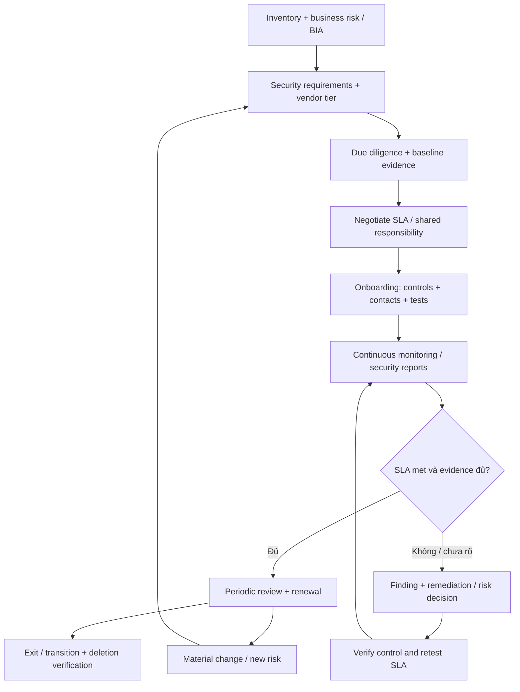
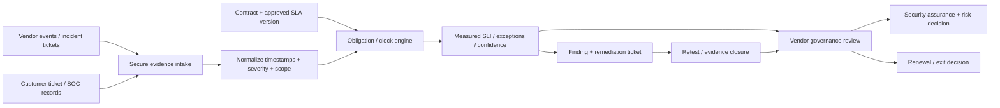
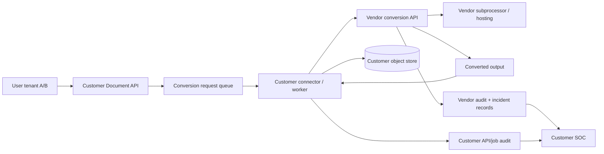

# SLA bảo mật

Một nền tảng SaaS quản lý tài liệu sử dụng nhà cung cấp dịch vụ xác thực (IdP), object storage trên cloud và một dịch vụ bên thứ ba để chuyển đổi tệp. Hợp đồng ghi rằng nhà cung cấp “cam kết bảo mật cao”, “hỗ trợ 24/7” và “duy trì uptime 99,9%”. Một ngày, nhà cung cấp chuyển đổi tệp phát hiện nghi vấn lộ access token của một tích hợp khách hàng. Đội ứng cứu của SaaS cần biết **nhà cung cấp phải thông báo trong bao lâu, tính từ thời điểm nào, nội dung tối thiểu ra sao, ai liên hệ, khi nào phải khóa token hoặc chặn xử lý, khi nào có bằng chứng khắc phục và làm gì nếu vượt hạn**.

Những câu “bảo mật cao” và “hỗ trợ 24/7” không đủ để đưa ra quyết định. **SLA bảo mật (Security Service Level Agreement)** giúp chuyển các kỳ vọng an ninh đối với bên thứ ba thành **cam kết có phạm vi, mức dịch vụ, thời điểm đo, nguồn chứng cứ, trách nhiệm, ngoại lệ và cơ chế xử lý sai lệch được xác định rõ**.

Trong chương **Third-party assurance** của module **SECURITY_SECURITY_ASSURANCE**, SLA bảo mật không chỉ là điều khoản mua sắm: đó là một phần của chuỗi **risk → security requirement → hợp đồng/control obligation → bằng chứng vận hành → kiểm thử/giám sát → finding → remediation/risk acceptance → assurance decision**. Tổ chức không thể tuyên bố “nhà cung cấp an toàn” chỉ vì hợp đồng có chữ *security*; tổ chức cần chứng minh từng cam kết liên quan đến rủi ro được thực hiện và kiểm tra ở phạm vi áp dụng.

> **Nguyên tắc cốt lõi:** SLA bảo mật hiệu quả phải trả lời rõ **ai cam kết làm gì, cho tài sản và dịch vụ nào, trong điều kiện nào, đo bằng đồng hồ và nguồn dữ liệu nào, báo cáo cho ai, bằng chứng nào chứng minh đạt, và hệ quả/đường xử lý nào xảy ra khi không đạt**.

## 1. SLA bảo mật là gì và giải quyết vấn đề nào?

**SLA bảo mật** là tập hợp những mức dịch vụ hoặc nghĩa vụ an ninh đo được, được thỏa thuận giữa bên sử dụng và nhà cung cấp, thường nằm trong hợp đồng chính, phụ lục security hoặc tài liệu được dẫn chiếu có hiệu lực. Nội dung có thể bao gồm thời gian thông báo sự cố, phản hồi sự kiện, khắc phục lỗ hổng, cung cấp audit evidence, kiểm soát truy cập, backup/recovery, hỗ trợ điều tra và xử lý thay đổi bảo mật.

Không phải mọi điều khoản bảo mật đều có thể biểu diễn tốt thành một con số. Ví dụ “không được bán dữ liệu khách hàng” là **nghĩa vụ/giới hạn hành vi**, không phải metric mà chỉ cần đạt 99%. Một thỏa thuận mạnh thường kết hợp:

- **Security requirements:** trạng thái hoặc hành vi bắt buộc.
- **Service-level commitments:** thời hạn, mức phục vụ, tính sẵn sàng hoặc chu kỳ đo.
- **Evidence/reporting obligations:** cách chứng minh thực hiện.
- **Governance/escalation:** ai đánh giá, phản hồi sai lệch, phê duyệt ngoại lệ.
- **Contractual remedies:** biện pháp khi không đáp ứng theo hợp đồng và pháp luật áp dụng.

### 1.1. Vì sao không chỉ dựa vào SLA uptime?

Uptime chủ yếu mô tả **availability của một dịch vụ theo định nghĩa và exclusions cụ thể**. Nó không tự trả lời:

1. Nhà cung cấp đã ghi log việc truy cập dữ liệu nhạy cảm chưa?
2. Một vulnerability đang bị khai thác sẽ được containment khi nào?
3. Security contact có sẵn ngoài giờ hành chính không?
4. Thay đổi quyền của nhân viên vendor có được thu hồi khi rời công ty?
5. Nhà cung cấp có báo cho khách hàng khi subprocessor bị compromise không?
6. Khách hàng có thể nhận bằng chứng forensic hoặc audit logs đủ để điều tra không?
7. Dữ liệu có được xóa/xuất an toàn khi kết thúc hợp đồng?
8. Bản backup có thật sự restore được với RPO/RTO phù hợp không?

Một dịch vụ có thể **đạt uptime 99,99%** mà vẫn bị lộ dữ liệu vì quyền cloud quá rộng hoặc thông báo incident quá muộn.

### 1.2. SLA bảo mật không thay thế toàn bộ hợp đồng

SLA là phần có thể đo/giám sát của một cấu trúc pháp lý và vận hành lớn hơn. Cần liên kết với nghĩa vụ bảo vệ dữ liệu, confidentiality, intellectual property, audit rights, incident cooperation, trách nhiệm, giới hạn trách nhiệm, xử lý tranh chấp, kết thúc và chuyển giao dịch vụ. Cách áp dụng, hiệu lực và thời hạn cụ thể phải được bộ phận pháp lý/pháp chế xác định theo hợp đồng, luật và khu vực liên quan; **không có một SLA thời gian chung bắt buộc cho mọi nhà cung cấp**.

## 2. Phân biệt SLA, SLO, SLI, OLA và các điều khoản liên quan

| Thuật ngữ | Định nghĩa ngắn | Ví dụ trong third-party security | Điểm cần chú ý |
| --- | --- | --- | --- |
| **SLA** | Cam kết mức dịch vụ được thỏa thuận giữa các bên | “Thông báo cho đầu mối được chỉ định trong X giờ sau khi nhận biết sự kiện thuộc định nghĩa” | Phải có phạm vi, trigger, đo lường và điều khoản hiệu lực |
| **SLI** | Chỉ báo/đại lượng dùng đo hành vi thực tế | Thời gian từ vendor awareness đến customer notification | Cần nguồn timestamp tin cậy |
| **SLO** | Mục tiêu mong muốn của SLI | “100% các sự cố thuộc loại A được báo trong X giờ” | SLO nội bộ không tự là cam kết hợp đồng |
| **OLA** | Thỏa thuận vận hành giữa các nhóm trong tổ chức | SOC ↔ pháp chế ↔ account owner phối hợp tiếp nhận notice | Phải hỗ trợ SLA phía ngoài |
| **Underpinning contract** | Cam kết nhà thầu phụ hỗ trợ dịch vụ | Subprocessor phải cung cấp log/điều tra đủ để prime vendor báo đúng hạn | Thiếu hợp đồng phụ có thể làm SLA đầu cuối không thực thi |
| **MSA / Master Agreement** | Hợp đồng khung về quan hệ dịch vụ | Trách nhiệm, quyền chấm dứt, biện pháp xử lý tranh chấp | Thường chứa điều khoản pháp lý nền |
| **DPA / Data Processing Agreement** | Điều khoản thỏa thuận xử lý dữ liệu cá nhân khi áp dụng | Vai trò dữ liệu, subprocessor, sự cố, xóa/trả dữ liệu | Không thể thay thế bằng SLA uptime |
| **Security addendum** | Phụ lục về security controls và nghĩa vụ | Mã hóa, IAM, audit, pentest, báo cáo thay đổi | Một phần có thể đo bằng SLA |
| **RTO/RPO** | Mục tiêu thời gian phục hồi / mốc mất dữ liệu | Dịch vụ vendor phải có DR evidence đáp ứng nhu cầu khách hàng | Cần định nghĩa recovery capability thực tế |

Ví dụ: một provider đặt SLO nội bộ là 30 phút để xác nhận ticket, nhưng hợp đồng chỉ cam kết acknowledgment 2 giờ. **Không tự suy rằng mục tiêu nội bộ có thể được thực thi như điều khoản hợp đồng**. Ngược lại, đội khách hàng có thể cần OLA tiếp nhận và phân loại sự cố trong 15 phút để đáp ứng nghĩa vụ thông báo của chính mình, dù vendor SLA là 2 giờ.

### 2.1. Security requirement và SLA có thể tồn tại song song

**Requirement:** “Nhà cung cấp không được lưu plaintext private key của khách hàng.”

**Cam kết có thể đo/kiểm chứng:** “Nhà cung cấp cung cấp kết quả rà soát quản trị khóa, chính sách truy cập, key-rotation evidence theo chu kỳ được thỏa thuận; khi phát hiện ngoại lệ phải thông báo theo escalation process.”

Không nên viết “99% private keys không bị lộ” như thể 1% còn lại là mức vi phạm được phép. Một số control là **điều kiện bắt buộc tuyệt đối**, không phù hợp với error budget.

## 3. SLA dựa trên risk và criticality, không dùng một mẫu cho tất cả

Trước khi đàm phán, cần lập **third-party inventory**: ai cung cấp thành phần nào, dữ liệu/quyền gì họ sở hữu, có thể ảnh hưởng tới business service nào và mô hình phân chia trách nhiệm ra sao.

### 3.1. Các chiều phân loại rủi ro

- **Data classification:** thông tin công khai, nội bộ, cá nhân, bí mật, regulated.
- **Access privilege:** nhà cung cấp có quyền cloud admin, CI/CD, production database, key hay chỉ API hạn chế?
- **Business dependency:** khi vendor dừng, năng lực nghiệp vụ nào dừng?
- **Exposure:** service Internet-facing hay private, có xử lý input không tin cậy?
- **Multi-tenancy:** dữ liệu nhiều tenant nằm cùng một service hoặc boundary?
- **Concentration risk:** cùng provider được dùng bởi nhiều hệ thống thiết yếu?
- **Subprocessor chain:** có những bên thứ tư nào xử lý dữ liệu hoặc quản trị hạ tầng?
- **Exit feasibility:** có chuyển dịch vụ, export dữ liệu, thu hồi credential được không?
- **Incident impact:** khả năng ảnh hưởng confidentiality, integrity, availability.
- **Assurance visibility:** có quyền audit, đọc log, evidence và kiểm chứng kết quả hay chỉ nhận tuyên bố?

Phân hạng nhà cung cấp có thể dùng `critical/high/medium/low`, nhưng phải căn cứ vào policy tổ chức. Một nhà cung cấp giá trị hợp đồng thấp vẫn có thể là **critical** nếu giữ credential hoặc xử lý dữ liệu nhạy cảm của nhiều khách hàng.

### 3.2. Ma trận bên thứ ba cho SaaS minh họa

| Vendor | Vai trò | Critical dependency | SLA bảo mật cần chú trọng |
| --- | --- | --- | --- |
| IdP bên ngoài | Authentication và federation | Rất cao | Notice/identity incident, revocation, audit export, continuity |
| Object storage | Chứa tài liệu và export files | Rất cao | Data access, IAM responsibilities, deletion/retention, availability/DR |
| File conversion API | Xử lý tệp của khách hàng | Cao | Data isolation, temporary retention, incident notice, deletion và secure processing |
| Email delivery | Gửi thông báo | Trung bình hoặc cao tùy dịch vụ | Abuse detection, access, data privacy, incident response |
| Logging/SIEM vendor | Lưu security telemetry | Cao | Data confidentiality, query/retention, log loss notice, evidence access |
| Managed CI/CD service | Build, ký và triển khai artifact | Rất cao | Credential protection, supply chain, pipeline incidents, audit |
| Support portal | Nhận ticket khách hàng | Tùy data exposure | Access logging, PII retention, support impersonation, export/delete |

Bảng trên là ví dụ; phạm vi quyền và mục tiêu SLA phải theo kiến trúc thực, không gán sẵn từ loại dịch vụ.

### 3.3. Yêu cầu nội bộ đặt ra trước khi hỏi vendor

Một requirement tốt phải nêu:
1. **Rủi ro cần quản lý.**
2. **Tài sản và luồng dữ liệu trong phạm vi.**
3. **Security property phải đạt.**
4. **Event hoặc trạng thái tạo căn cứ đo.**
5. **Bằng chứng và tần suất/trigger cần nhận.**
6. **Mức độ quan trọng khi vendor không đạt.**
7. **Control bù và kế hoạch chuyển đổi nếu chưa thể đáp ứng.**

## 4. Shared responsibility và “điểm bàn giao” giữa hai tổ chức

SLA tốt không thể sửa sự thiếu rõ ràng về trách nhiệm. Cần phân biệt **provider-operated control**, **customer-configured control**, **shared control** và **inherited control**.

### 4.1. Shared responsibility matrix

| Control | Vendor chịu trách nhiệm | Khách hàng chịu trách nhiệm | Điểm bàn giao/evidence |
| --- | --- | --- | --- |
| Managed IdP | Vận hành dịch vụ xác thực, ghi events theo tính năng | Role mapping, MFA policy, account lifecycle | Audit events, config export, notice |
| Managed storage | Hạ tầng/durability theo cam kết | Bucket policy, data classification, access grants, key selection | Provider report + effective config + test |
| File conversion API | Bảo vệ processing environment, xóa dữ liệu theo thỏa thuận | Không gửi dữ liệu trái quyền, token hạn chế, chọn region | Processing records, deletion attestations |
| SaaS logging | Lưu/thu log theo gói và chính sách | Bật sources, định nghĩa event và retention | Test event, archive/query evidence |
| Managed CI/CD | Bảo vệ runner infrastructure theo dịch vụ | Quản lý workflow, token scope, branch protection | Job audit, artifact provenance, incident notice |
| DR/recovery | Phục hồi hạ tầng mà vendor quản lý | Kiểm thử end-to-end nghiệp vụ và dependencies | Vendor DR report + customer restore drill |

Một nhà cung cấp có báo cáo kiểm toán không tự chứng minh **khách hàng đã cấu hình đúng bucket policy**. Ngược lại, khách hàng không thể kiểm tra trực tiếp security host nội bộ vendor thì cần **bằng chứng inherited control** có phạm vi, thời hạn và giới hạn rõ.

### 4.2. RACI cho vendor incident

Giả định vendor phát hiện sự cố truy cập trái phép:
- **Vendor security/on-call:** xác minh, containment trong phần họ kiểm soát, bảo toàn evidence, gửi notification.
- **Vendor account/service owner:** bảo đảm khách hàng nhận đúng kênh, phối hợp kỹ thuật.
- **Customer security/SOC:** tiếp nhận, phân loại ảnh hưởng trên hệ thống khách hàng, containment tại phía khách hàng.
- **Customer privacy/legal:** xác định nghĩa vụ xử lý dữ liệu/thông báo theo bối cảnh áp dụng.
- **Customer service owner/SRE:** đánh giá failover, disable integration, rotate credentials.
- **Risk owner/assurance:** quyết định chấp nhận rủi ro còn lại và kết luận đối với vendor.
- **Subprocessor:** cung cấp điều tra và bằng chứng theo cam kết phù hợp với vendor đầu mối.

Phải xác định **contact coverage 24/7**, kênh thứ cấp, xác thực người liên hệ và đường escalation. “Email tới account manager” không nhất thiết đảm bảo tiếp nhận incident critical vào cuối tuần.

## 5. Viết cam kết “đo được” và kiểm chứng được

Một điều khoản kiểu “nhà cung cấp xử lý các vấn đề bảo mật nhanh chóng” thường không đủ cho assurance vì không có trigger hoặc tiêu chí đạt.

### 5.1. Cấu trúc một SLA item

Mỗi mục SLA nên mô tả:

| Trường | Câu hỏi cần trả lời |
| --- | --- |
| **ID/version** | Cam kết nào, phiên bản hiệu lực nào? |
| **Service/scope** | API, account, region, dữ liệu, subprocessor nào? |
| **Obligation/control** | Vendor phải làm hành động/trạng thái gì? |
| **Trigger** | Khi nào bắt đầu đo? |
| **Severity/tier** | Incident/vulnerability được phân loại thế nào? |
| **Clock** | 24x7 hay business hours? Timezone? Tạm dừng khi nào? |
| **Threshold/target** | Hạn tối đa hoặc tỷ lệ đạt được là bao nhiêu? |
| **Completion** | Sự kiện nào kết thúc đồng hồ? |
| **Data source** | Ticket, audit API, alert, timestamp được ghi bởi ai? |
| **Evidence** | Log, notice, report, change record và retention? |
| **Owner/contacts** | Ai thực hiện, ai nhận và ai phê duyệt? |
| **Exclusions/dependencies** | Điều gì thật sự không tính và ai chứng minh? |
| **Review/remedy** | Báo cáo, dispute, breach escalation và khắc phục ra sao? |

### 5.2. Ví dụ mơ hồ và rõ ràng hơn

| Cam kết mơ hồ | Mẫu diễn đạt để đàm phán rõ hơn |
| --- | --- |
| “Thông báo nhanh khi có sự cố” | “Thông báo cho security contact được chỉ định trong X giờ 24x7 kể từ mốc awareness thuộc định nghĩa; gửi bổ sung khi biết thêm.” |
| “Vá lỗi nghiêm trọng kịp thời” | “Severity Critical theo tiêu chí phân loại đã thỏa thuận phải containment/mitigate trong X; verified remediation trong Y hoặc có ngoại lệ do bên có thẩm quyền phê duyệt.” |
| “Cung cấp log khi có yêu cầu” | “Trong X giờ sau yêu cầu hợp lệ, cung cấp log thuộc loại/retention đã mô tả qua kênh bảo mật, kèm giới hạn coverage.” |
| “Đảm bảo bảo mật dữ liệu” | “Áp các controls trong security schedule; cung cấp evidence/attestation với phạm vi và ngày hiệu lực, thông báo sự thay đổi materially adverse.” |
| “Có DR plan” | “Thực hiện restore exercise theo phạm vi/tần suất đã thỏa thuận, cung cấp kết quả đo recovery và findings, cùng phương án khắc phục.” |
| “Support 24/7” | “Kênh nhận incident hoạt động 24x7 và acknowledgment deadline cho severity được định nghĩa, không nhầm với fix deadline.” |

Các chữ `X` và `Y` là **placeholder đàm phán**, không phải con số pháp lý hoặc tiêu chuẩn áp dụng cho mọi hệ thống.

### 5.3. Không đánh đồng acknowledge, respond, contain, resolve

- **Acknowledgment:** vendor xác nhận nhận được issue và giao owner.
- **Triage:** kiểm tra sơ bộ, xác định severity/scope và hướng xử lý.
- **Initial response:** thông tin ban đầu và kế hoạch hành động.
- **Containment:** biện pháp đã có hiệu lực để giảm/khóa đường ảnh hưởng.
- **Mitigation:** giảm khả năng khai thác hoặc mức tác động nhưng có thể chưa sửa tận gốc.
- **Remediation:** triển khai bản sửa/loại bỏ nguyên nhân.
- **Verified remediation:** xác minh bằng test/evidence ở phạm vi đã định.
- **Closure:** quyết định đóng ticket theo quy tắc đã thỏa thuận.

Nếu SLA chỉ cam kết “respond within 1 hour”, điều đó **không thể được hiểu là sửa xong lỗ hổng trong 1 giờ**.

## 6. SLA thông báo security incident và phối hợp ứng cứu

Incident notification là một trong những mục quan trọng nhất khi sử dụng vendor có quyền truy cập dữ liệu, hệ thống hoặc credential nhạy cảm.

### 6.1. Định nghĩa điều kiện phải báo

Phải thống nhất các lớp event như:
- Confirmed compromise ảnh hưởng dữ liệu/khả năng hoạt động.
- Suspected security incident có căn cứ đáng tin và có thể ảnh hưởng khách hàng.
- Unauthorized access, credential compromise hoặc secret exposure.
- Exfiltration hoặc nghi lộ dữ liệu nhạy cảm.
- Ransomware, destructive activity, tamper audit/backup.
- Việc bên thứ tư/subprocessor bị ảnh hưởng trong phạm vi dịch vụ.
- Mất security logging hoặc detection coverage trong khoảng thời gian critical.
- Security misconfiguration tạo exposure đáng kể.
- Incident làm ảnh hưởng cam kết RPO/RTO hoặc khả năng đáp ứng nghĩa vụ của khách hàng.

Tổ chức cần quy định **điều kiện kích hoạt riêng cho mỗi loại**, tránh bắt vendor chỉ báo khi “đã có chứng cứ chắc chắn bị breach” dù quá trình điều tra kéo dài. Đồng thời không phải mọi scan noise hay false positive đều phải gửi thông báo critical.

### 6.2. Mốc bắt đầu đồng hồ notification

Các mốc có thể khác nhau:

- Event xảy ra.
- Vendor có tín hiệu đầu tiên từ monitoring.
- Người trực vendor nhận và xác nhận.
- Vendor có cơ sở hợp lý nhận biết một sự kiện thuộc phạm vi thỏa thuận.
- Đã xác nhận impact hoặc data breach.
- Customer gửi incident report cho vendor.

**Điểm khởi đầu phải được nêu trong SLA**, ví dụ `vendor awareness` được định nghĩa thế nào và cần cung cấp timestamp. Nếu chỉ bắt đầu khi vendor “chính thức xác nhận”, vendor có thể có khoảng trễ dài mà khách hàng không nhìn thấy.

### 6.3. Nội dung notification ban đầu

Một notification sơ bộ nên chứa những gì **đã biết ở thời điểm gửi**, không yêu cầu suy đoán:
1. Incident/event ID và thời điểm nguồn phát hiện/awareness.
2. Dịch vụ, tài sản/region hoặc nhóm dữ liệu có thể bị ảnh hưởng.
3. Hành vi/symptoms và độ tin cậy hiện tại.
4. Trạng thái containment/mitigation đã thực hiện.
5. Rủi ro khẩn đối với credentials, data flows hoặc service availability.
6. Hành động khách hàng nên thực hiện ngay nếu cần.
7. Đầu mối liên hệ và kênh escalation 24x7.
8. Thời điểm cập nhật tiếp theo.
9. Các điểm chưa biết và dự kiến điều tra.

Không nên trì hoãn thông báo ban đầu chỉ để có báo cáo RCA hoàn chỉnh. Các bản cập nhật sau có thể bổ sung impact, timeline, technical indicators, phạm vi dữ liệu và remediation evidence theo quyền/pháp luật.

### 6.4. Bảo vệ tính xác thực của thông báo

Attacker có thể giả email “security incident” để lừa người nhận mở link hoặc cung cấp credentials. Nên thống nhất kênh được xác thực, contact directory, alternate channel nếu portal không hoạt động và quy trình callback khi yêu cầu có tác động như rotate key hoặc chuyển traffic.

### 6.5. Vendor notification khác regulatory notification

Một SLA thông báo vendor→customer không tự xác định nghĩa vụ khách hàng thông báo cơ quan nhà nước, chủ thể dữ liệu hoặc đối tác. Nghĩa vụ đó phụ thuộc pháp luật, vai trò controller/processor, hợp đồng và bản chất incident. Bộ phận pháp chế/privacy phải xây **timeline nội bộ đáp ứng nghĩa vụ thực tế**, không suy rằng hạn vendor luôn đủ cho nghĩa vụ của khách hàng.

## 7. SLA về vulnerability, patching và exposure

Một nhà cung cấp có thể có nhiều nhóm vulnerability: code service, dependency, container image, VM, managed platform, API misconfiguration hoặc third-party component. SLA phải phân biệt **time to acknowledge**, **time to mitigate** và **time to verified fix**.

### 7.1. Phân loại severity có ngữ cảnh

Không nên chỉ dựa vào điểm CVSS để quyết định mọi deadline. Cần xét:
- Có khai thác trong thực tế hay threat intelligence liên quan?
- Internet/external exposure và prerequisites.
- Loại dữ liệu, quyền truy cập và business impact.
- Có active exploit hoặc compromise indicators không?
- Có control bù hiệu quả, được test?
- Asset criticality và blast radius.
- Bên nào kiểm soát remediation?
- Service version/config nào thực sự bị ảnh hưởng?

Có thể tham chiếu tiêu chí chung (CVSS, CWE, KEV khi phù hợp) nhưng SLA cần quy tắc phân loại rõ với quyền tranh luận/điều chỉnh khi có bằng chứng, tránh một vendor tự hạ severity không kiểm soát chỉ để đổi hạn.

### 7.2. Matrix minh họa, không phải chuẩn chung

| Severity / scenario | Acknowledge | Containment/mitigation | Verified remediation | Lưu ý |
| --- | --- | --- | --- | --- |
| Critical, active exploitation | 1 giờ 24x7 | 4 giờ | Theo deadline đã đàm phán hoặc emergency exception | Có thể phải cô lập/tắt tính năng ngay |
| High, exploitable exposed service | 4 giờ 24x7 | 24 giờ | 7 ngày | Có retest/control bù |
| Medium, limited exposure | 1 ngày làm việc | Theo risk review | 30 ngày | Điều chỉnh theo kiến trúc |
| Low, low impact | 3 ngày làm việc | Theo risk review | Theo chu kỳ release được duyệt | Vẫn có owner và hạn |

**Toàn bộ số trong bảng chỉ là giá trị giả định để học cách viết và đo SLA**, không phải lời khuyên chấp nhận mọi trường hợp hoặc nghĩa vụ pháp lý. Tổ chức phải điều chỉnh theo risk, hợp đồng, quy định và khả năng thực tế; với zero-day có thể chỉ có containment đáng tin trước khi có patch chính thức.

### 7.3. Trạng thái remediation cần phân biệt

| Status | Ý nghĩa |
| --- | --- |
| `REPORTED` | Issue đã được gửi và ghi nhận |
| `ACKNOWLEDGED` | Có người chịu trách nhiệm tiếp nhận |
| `TRIAGED` | Xác định impact, affected versions/assets |
| `CONTAINED` | Đường ảnh hưởng đang được giới hạn theo evidence |
| `MITIGATED` | Rủi ro giảm nhờ control bù, lỗi gốc có thể còn |
| `PATCHED/DEPLOYED` | Đã triển khai bản sửa ở phạm vi được nêu |
| `VERIFIED_FIXED` | Test/runtimes chứng minh cơ chế lỗi không còn ở scope |
| `EXCEPTION_APPROVED` | Rủi ro có thẩm quyền chấp nhận có hạn; **không** là fixed |
| `INCOMPLETE/UNKNOWN` | Thiếu dữ liệu hoặc test cần thiết |

### 7.4. Vendor advisory và customer impact

Vendor có thể công bố lỗi ở bản dịch vụ nhưng khách hàng cần biết **môi trường nào, endpoint nào, dữ liệu nào** liên quan để thực hiện response. Hợp đồng nên xác định phương thức cung cấp affected-service notice, mitigations, schedule và căn cứ verified fix mà không buộc vendor tiết lộ chi tiết kỹ thuật gây hại hoặc bí mật của khách hàng khác.

## 8. SLA về kiểm soát danh tính, quyền và secret

Với nhà cung cấp có quyền truy cập hệ thống của khách hàng, SLA/các nghĩa vụ bảo mật thường cần đề cập:

- Quy trình cấp quyền đúng người, đúng vai trò và mục đích.
- Định kỳ access review và least privilege.
- MFA hoặc cơ chế xác thực mạnh theo phân loại rủi ro.
- Thời hạn thu hồi quyền khi nhân sự/vendor rời vai trò.
- Quy trình cấp quyền khẩn (*break-glass*), logging và post-use review.
- Hạn chế shared accounts, hard-coded keys và long-lived credentials.
- Quản lý key/secret rotation và incident-driven revocation.
- Audit về privileged access hoặc impersonation support.
- Quyền của subprocessor vào production/customer data.
- Notification khi có quyền quá mức, credential lộ hoặc thất bại kiểm soát access.

### 8.1. Ví dụ cam kết offboarding

Thay vì “nhà cung cấp thu hồi quyền nhân viên kịp thời”, cần định nghĩa:
- Sự kiện kích hoạt: chấm dứt hợp đồng lao động, chuyển role, thu hồi quyền yêu cầu.
- Hệ thống: portal, API, cloud IAM, VPN, support impersonation, machine tokens.
- Hạn: tính từ thông báo HR/owner hoặc yêu cầu hợp lệ.
- Evidence: offboarding ticket, IAM audit, effective access test.
- Ngoại lệ: service identities còn phụ thuộc nghiệp vụ cần phương án rollover.
- Trách nhiệm: ai phát thông tin, ai thực hiện, ai xác minh.

Không dùng “đã disable tài khoản web” để kết luận mọi API token, SSH key hoặc federated session đều đã bị thu hồi.

### 8.2. Customer-owned credentials trong vendor integration

Nếu vendor xử lý token do khách hàng cấp, cần làm rõ quyền yêu cầu rotate/revoke, phương án phát hiện compromise, scope token, expiration và thời điểm thông báo. Không đưa token vào ticket, log hỗ trợ hoặc bằng chứng SLA; dùng credential reference hoặc test token khi xác minh.

## 9. SLA về audit logs, forensic evidence và kiểm chứng control

Một SLA bảo mật không thể được giám sát nếu thiếu **khả năng quan sát**.

### 9.1. Những điều khoản evidence hữu ích

- Các loại audit events được tạo theo từng service/plan.
- Retention hot/archive và khả năng export an toàn.
- Thời gian cung cấp log khi có incident/request hợp lệ.
- Quyền và phương thức truy vấn dữ liệu của khách hàng.
- Time synchronization, timezone và correlation IDs nếu hỗ trợ.
- Các trường có/không có trong provider logs, sampling và exclusions.
- Cách thông báo logging configuration change, log loss hoặc ingestion outage.
- Integrity controls và cách bảo vệ trước sửa/xóa trái phép.
- Hạn chế vì dữ liệu của những khách hàng khác hoặc thông tin nhạy cảm vendor.
- Bằng chứng thay thế phù hợp khi provider không thể bàn giao raw logs.

### 9.2. “Có log” không có nghĩa auditability đã đạt

Một nhà cung cấp có thể ghi API logs nhưng không ghi admin actions, data access hoặc customer-specific actor. Cần kiểm tra **source→collector→archive→query**, độ trễ, coverage, retention và quyền. Test canary trong phạm vi được phép có thể chứng minh các event được tạo và xuất theo contract.

### 9.3. Hỗ trợ điều tra và chain of custody

Hợp đồng có thể cần nghĩa vụ:
- bảo toàn evidence khi nhận preservation request hợp lệ;
- đầu mối pháp chứng/IR có sẵn;
- cung cấp timeline, event references và phạm vi ảnh hưởng;
- mô tả integrity của evidence, ai thu thập và khi nào;
- cập nhật nếu phát hiện thêm tài sản/tenant bị ảnh hưởng;
- hỗ trợ điều tra hoặc review theo điều khoản được phê duyệt.

**Không mặc định nhà cung cấp phải cung cấp raw memory image hay tất cả log nội bộ.** Quyền yêu cầu, giới hạn bảo mật, pháp lý, third-party confidentiality và chi phí phải thỏa thuận rõ. Nếu vendor không thể cung cấp chứng cứ cần thiết, tổ chức phải ghi **assurance limitation**, không lặng lẽ suy luận rằng không có sự kiện.

## 10. SLA dữ liệu, privacy và xử lý kết thúc hợp đồng

SLA bảo mật của vendor xử lý dữ liệu phải liên kết với data classification, nơi lưu/xử lý, loại dữ liệu, retention, xóa, bảo vệ truy cập và subprocessor obligations.

### 10.1. Các câu hỏi hợp đồng quan trọng

1. Dữ liệu nào vendor thu thập và vì mục đích gì?
2. Có data residency, cross-border transfer hoặc hạn chế vùng không?
3. Có subprocessor nào, họ giữ loại dữ liệu gì?
4. Có dùng dữ liệu khách hàng để training/analytics ngoài mục đích thỏa thuận không?
5. Dữ liệu in transit/at rest được bảo vệ bằng control nào?
6. Có chính sách về customer key management hoặc BYOK nếu cần?
7. Log, crash dump, support tickets có chứa dữ liệu khách hàng không?
8. Thời gian xóa bản chính, cache, backup và dữ liệu subprocessor ra sao?
9. Quy trình return/export khi kết thúc hợp đồng có định dạng và integrity check không?
10. Có bằng chứng/attestation xóa, phạm vi và ngoại lệ lưu giữ bắt buộc không?
11. Ai hỗ trợ yêu cầu liên quan dữ liệu cá nhân, và trong hạn nào khi áp dụng?
12. Khi security incident xảy ra, cách hỗ trợ impact assessment thế nào?

### 10.2. Xóa dữ liệu là một hành vi cần xác minh

Ví dụ “xóa ngay” có thể mâu thuẫn với bản backup có retention, legal hold và disaster-recovery policy. Nên phân biệt:
- ngừng xử lý/disable access;
- xóa dữ liệu hoạt động;
- xóa cache/temporary objects;
- xóa bản sao/replicas theo policy;
- backup expiry/deletion schedule;
- exceptions do luật/nghĩa vụ áp dụng;
- evidence xóa trong phạm vi có thể chứng minh.

Một xác nhận “deleted” từ API không chứng minh mọi bản sao, subprocessor và backup đã hết dữ liệu nếu không có cam kết và bằng chứng tương ứng.

### 10.3. Multi-tenant assurance

Với dịch vụ xử lý dữ liệu của nhiều khách hàng, nên yêu cầu controls phân tách quyền, dữ liệu, keys, logs và support access theo threat model. **Thông tin audit của tenant A không được tiết lộ cho tenant B** chỉ để chứng minh SLA; vendor có thể cần cung cấp báo cáo tổng hợp, redacted logs hoặc chứng nhận bên độc lập.

## 11. SLA về availability, DR, backup và cyber recovery

Availability thường được nhắc đầu tiên trong hợp đồng dịch vụ; security assurance cần đi xa hơn uptime.

### 11.1. Định nghĩa uptime

Một uptime SLA cần mô tả:
- Endpoint/business function đo.
- Vùng/tenant/plan nằm trong scope.
- Cửa sổ đo: lịch tháng, rolling period, giờ 24x7.
- Mức lỗi: HTTP timeout, request failure, latency threshold hay toàn phần.
- Sampling và test location.
- Planned maintenance, exclusions và cách thông báo.
- Các trường hợp lỗi do customer configuration hoặc force majeure theo hợp đồng.
- Cơ chế kiểm chứng độc lập/dispute khi data hai phía khác nhau.

**“99,9% availability” không tự tương ứng 99,9% của toàn bộ khả năng nghiệp vụ**. API health endpoint có thể xanh trong khi dịch vụ export hoặc xác thực không hoạt động.

### 11.2. RTO/RPO của vendor so với business recovery của khách hàng

Một nhà cung cấp có thể cam kết phục hồi hạ tầng của họ trong RTO X và dữ liệu đến RPO Y, nhưng khách hàng còn phụ thuộc IdP, DNS, network, keys, custom application config và kết nối sang vendor khác. **End-to-end customer RTO có thể dài hơn provider RTO**. Cần lập dependency map và test ở mức nghiệp vụ.

### 11.3. Bằng chứng DR nên yêu cầu

- BIA/recovery scope cho dịch vụ liên quan.
- Backup types, retention, recovery point semantics.
- Restore/DR exercise report và thời điểm gần nhất.
- Kết quả measured RPO/RTO theo scenario.
- Findings, deviations, residual risks và remediation status.
- Cách bảo vệ backup trước unauthorized delete/modify/ransomware.
- Khả năng hoạt động ở vùng DR và các giới hạn capacity.
- Dependencies KMS/IAM/network/logging và data residency.
- Kênh hỗ trợ customer trong failover/failback.
- Cơ chế notify khi vendor thay đổi khả năng DR đáng kể.

Một PDF nói “DR drill completed” mà thiếu scope, kiểm chứng dịch vụ và findings **không đủ để khẳng định mọi scenario được bảo vệ**.

## 12. SLA về supply chain và các nhà thầu phụ

Bên thứ ba có thể phụ thuộc bên thứ tư. Khi sử dụng một dịch vụ file conversion, người vận hành có thể thuê cloud hosting, OCR engine, malware scanning và helpdesk providers; chuỗi này ảnh hưởng security obligations.

### 12.1. Các nội dung nên xem xét

- Danh sách/loại subprocessor và thay đổi có ảnh hưởng trọng yếu.
- Quyền được thông báo trước hoặc phản đối thay đổi theo hợp đồng áp dụng.
- Nghĩa vụ flow-down của vendor tới subprocessor về data protection, incident notification, evidence và exit.
- Quy trình đánh giá suppliers quan trọng của vendor.
- Bằng chứng software supply chain: secure build, dependency management, artifact provenance, vulnerability disclosure khi cần.
- Cơ chế quản lý update, planned downtime và breaking security changes.
- Phương án thay thế nếu subprocessor critical không đáp ứng.
- Hạn cung cấp thông tin khi sự cố bắt đầu tại subprocessor.
- Quyền kiểm tra/attestation và giới hạn data sharing.

### 12.2. Không để contract chain phá incident deadline

Nếu vendor cam kết thông báo trong X giờ sau awareness nhưng subprocessor chỉ cam kết báo vendor sau X+Y giờ, lời hứa vendor có thể khó đáp ứng. Cần **liên kết underpinning contracts** với mục tiêu đầu cuối và xác định vendor chịu trách nhiệm phối hợp trong phạm vi thỏa thuận.

### 12.3. Báo cáo kiểm toán không phải bảo đảm tuyệt đối

Chứng nhận, audit report hoặc pentest summary có ích để đánh giá controls, nhưng cần xét:
- tổ chức và dịch vụ nào được đánh giá;
- vùng, môi trường và customer responsibilities;
- tiêu chuẩn/phạm vi/phương pháp;
- thời kỳ kiểm tra và ngày ban hành;
- exceptions, findings và remediation;
- các hệ thống/subprocessors bị loại trừ;
- thay đổi trọng yếu kể từ báo cáo;
- chính sách bảo vệ báo cáo có thông tin nhạy cảm.

**SOC 2 report, chứng nhận ISO/IEC 27001, CSA CAIQ hay pentest report không thay thế SLA cụ thể hoặc bằng chứng runtime của cấu hình khách hàng.** Không tuyên bố nhà cung cấp “được chứng nhận = không có lỗ hổng”.

## 13. SLA thay đổi bảo mật và cấu hình

Một vendor có thể thay IP ranges, TLS policies, API scopes, logging retention, data regions, encryption implementation hoặc identity integration. Các thay đổi đó có thể tạo rủi ro dù dịch vụ vẫn hoạt động.

### 13.1. Security-relevant change

Nên định nghĩa các thay đổi đòi hỏi thông báo/approval phù hợp:
- Thay loại dữ liệu xử lý hoặc mục đích sử dụng.
- Bổ sung hoặc thay subprocessor có quyền dữ liệu.
- Chuyển data residency/region/hosting topology.
- Giảm khả năng audit logs, retention hoặc evidence access.
- Thay cơ chế mã hóa/KMS/trust root theo cách tác động khách hàng.
- Thay MFA/SSO/IAM integration hoặc API permission model.
- Thay network/egress IP allowlisting và security endpoints.
- Thay API contract bắt buộc để duy trì authorization.
- Ngừng hỗ trợ phiên bản/khả năng security critical.
- Thay DR/recovery options hoặc service dependency critical.

### 13.2. Notification ≠ khách hàng phải phê duyệt mọi thay đổi

Một số dịch vụ nhiều khách hàng không thể xin phê duyệt từng customer cho từng patch bảo mật. Hợp đồng cần phân biệt **emergency fix**, **planned material change** và **backward-compatible change**. Mục tiêu là giảm surprise risk, cung cấp thời gian kiểm tra và có đường escalation khi thay đổi ảnh hưởng security requirement.

### 13.3. Test kiểm soát thay đổi

Nếu vendor đổi TLS trust root hoặc API token format, khách hàng có thể cần chạy integration tests và cập nhật config. Một SLA về thông báo thay đổi chỉ có giá trị khi khách hàng biết chính xác mốc effective date, affected service versions, tài liệu migration và nơi liên hệ khi regression.

## 14. Security support, triage và escalation

“Có support 24/7” cần làm rõ **24/7 tiếp nhận**, **24/7 có kỹ sư security**, hay **24/7 xử lý sự cố critical**.

### 14.1. Những mốc cần đo

| Mốc | Định nghĩa có thể áp dụng |
| --- | --- |
| `received_at` | Ticket được hệ thống support nhận |
| `acknowledged_at` | Vendor xác nhận và giao owner |
| `triaged_at` | Có severity/initial hypothesis và plan |
| `customer_updated_at` | Khách hàng nhận cập nhật |
| `containment_effective_at` | Biện pháp ngăn ảnh hưởng có hiệu lực |
| `remediation_deployed_at` | Fix đã triển khai ở scope được nêu |
| `verified_fixed_at` | Fix được test/đối chiếu evidence |
| `closed_at` | Ticket đóng theo quy định |
| `reopened_at` | Phát hiện fix chưa đạt hoặc lỗi tái xuất hiện |

Không lấy `closed_at` làm bằng chứng `verified_fixed_at` nếu vendor đóng ticket theo lý do “khách hàng không phản hồi” hoặc “không thể tái hiện”.

### 14.2. Escalation ladder

Ví dụ:
1. On-call support nhận event, tự động tạo ticket ID và acknowledgment.
2. Nếu quá ngưỡng, chuyển security duty manager.
3. Với critical incident, thiết lập bridge giữa vendor security và customer SOC.
4. Nếu không thể containment, kích hoạt customer mitigation/disable integration.
5. Nếu evidence thiếu hoặc nghĩa vụ không đạt, chuyển vendor governance/risk/legal theo thỏa thuận.
6. Đánh giá contractual remedies, exit/alternative service nếu rủi ro không chấp nhận được.

Cần thử kênh này trước sự cố; một danh sách email trong hợp đồng cũ có thể không còn hoạt động.

## 15. Thiết kế ma trận SLA bảo mật cho vendor quan trọng

Ma trận dưới đây là **ví dụ cấu trúc**, không phải bộ thời hạn quy định bắt buộc. Các giá trị X/Y phải được thay bằng những mức đã được phê duyệt theo rủi ro.

| Control ID | Cam kết | Trigger/mốc hoàn thành | Evidence | Customer owner |
| --- | --- | --- | --- | --- |
| `TP-SLA-01` | Nhận và xác nhận security incident critical | Report nhận được → acknowledgment trong X giờ 24x7 | Ticket timestamps và contact test | SOC |
| `TP-SLA-02` | Vendor notification khi có incident thuộc phạm vi | Awareness đã định nghĩa → notice trong Y giờ 24x7 | Initial notice và audit trail | IR/privacy |
| `TP-SLA-03` | Cập nhật incident đang diễn ra | Initial notice → cập nhật mỗi Z giờ hoặc khi thay đổi trọng yếu | Update log có timestamps | IR |
| `TP-SLA-04` | Contain actively exploited vulnerability | Trigger severity/exploit → containment hiệu lực | Config/effective-state/test evidence | Security engineering |
| `TP-SLA-05` | Khắc phục lỗ hổng có ảnh hưởng | Triage → verified remediation theo severity | Advisory, change, verification | AppSec/Vendor owner |
| `TP-SLA-06` | Export audit evidence | Request hợp lệ → evidence có scope trong X | Log archive refs/transfer receipt | SOC/audit |
| `TP-SLA-07` | Review privileged access | Mốc review hoặc role change | Access review and revocation records | IAM |
| `TP-SLA-08` | Giữ/xóa/trả dữ liệu | Termination hoặc deletion request → deadline theo nghĩa vụ | Export receipt, deletion attestation | Data owner |
| `TP-SLA-09` | Bằng chứng DR | Chu kỳ exercise hoặc material change | Restore report, measured RTO/RPO | SRE/BCP |
| `TP-SLA-10` | Thông báo subprocessor/material change | Quyết định thay đổi → notice trước effective date khi áp dụng | Change notice, risk assessment | Procurement/privacy |
| `TP-SLA-11` | Thông báo service security telemetry loss | Vendor phát hiện mất nguồn bắt buộc → notice theo hạn | Pipeline health và incident record | SOC |
| `TP-SLA-12` | Hỗ trợ exit và thu hồi credential | Chấm dứt hợp đồng → chuyển dữ liệu/khóa quyền trong scope | Export, revocation và cleanup test | Vendor owner |

Một số yêu cầu có **zero-tolerance behavior** (ví dụ không gửi secret plaintext vào log) chứ không dùng phần trăm cho phép. Các yêu cầu này nên là control obligations, có bằng chứng, incident xử lý và remedy phù hợp.

## 16. Viết điều khoản đo lường tránh tranh chấp

### 16.1. Một mốc thời gian phải có định nghĩa kỹ thuật

Ví dụ “trong 4 giờ” cần làm rõ:
- tính theo **giờ đồng hồ 24x7** hay business hours;
- timezone và đơn vị đo;
- timestamp chuẩn khi hai hệ thống lệch giờ;
- điều kiện pause/resume clock;
- nếu báo qua kênh không được nhận thì có được tính là notice;
- data nào là authoritative source;
- nếu severity được nâng từ High lên Critical thì clock tính lại hay không;
- khi có incident ảnh hưởng nhiều khách hàng, notification được ghi riêng hay chung;
- khách hàng có quyền đối chiếu bằng chứng khi dữ liệu mâu thuẫn không.

Nếu bên bán cam kết “4 business hours” và bên mua kỳ vọng “4 elapsed hours 24x7”, một incident xảy ra tối thứ Sáu có thể tạo khác biệt rất lớn.

### 16.2. Clock pause không được trở thành lối né cam kết

Một số service-level commitments cho phép tạm dừng khi chờ khách hàng cung cấp thông tin. Nếu có, cần ghi **điều kiện hợp lệ**, khi nào bắt đầu/kết thúc pause, evidence về request và ai xác nhận. Không dừng đồng hồ incident notification chỉ vì vendor đang điều tra root cause nếu notification ban đầu vẫn có thể thực hiện.

### 16.3. Severity dispute

Nếu vendor đánh giá Moderate, khách hàng đánh giá Critical vì dữ liệu nhạy cảm và exploitation thực tế, cần quy trình:
1. Nêu sự kiện, affected assets và tiêu chí severity.
2. Trao đổi evidence bảo mật qua kênh phù hợp.
3. Chỉ định người có thẩm quyền phân xử/escalation.
4. Ghi version của phân loại và thời điểm thay đổi.
5. Không để tranh luận severity làm ngừng containment khẩn cần thiết.
6. Xác định tác động tới đồng hồ SLA theo hợp đồng.

**Không tự cho phép vendor hạ severity hồi tố mà không có audit** để biến một vi phạm SLA thành đạt.

### 16.4. Contractual remedies không thay thế risk reduction

Service credits, fee reduction, audit quyền và termination có thể là biện pháp xử lý theo hợp đồng, nhưng **tiền hoàn lại không khôi phục dữ liệu đã lộ**. Risk owner cần quyết định tiếp tục, tăng control bù, hạn chế tích hợp hoặc thay vendor. Những remedies cụ thể phụ thuộc văn bản hợp đồng và luật áp dụng; phần này là kiến thức quản trị, không phải tư vấn pháp lý cụ thể.

## 17. Đo SLA: mẫu số, cửa sổ và exception

Một metric phải có cách tính rõ. Ví dụ tỷ lệ thông báo đúng hạn trong tháng:

\[
\text{Timely notification rate} =
\frac{\text{Số incident thuộc phạm vi được thông báo đúng hạn}}
{\text{Tổng số incident thuộc phạm vi với deadline đã qua}} \times 100\%
\]

Điều quan trọng hơn công thức là **tập incident được đưa vào mẫu số**. Phải xác định:
- những incidents thuộc phạm vi vendor/customer;
- các severity/tier bắt buộc báo;
- điều kiện đã vượt/đến deadline;
- dữ liệu thiếu, disputed hoặc chưa phân loại xử lý thế nào;
- duplicate incident IDs có được gộp không;
- dữ liệu nhận muộn có tính lại chu kỳ trước không;
- thay đổi scope giữa kỳ;
- trường hợp ngoại lệ đã được duyệt và cách báo cáo.

### 17.1. Không mặc định unknown = compliant

Nếu vendor báo có 8 incident nhưng chỉ cung cấp timestamps cho 5, không được tự ghi 8/8 đúng hạn. Có thể báo **5 measured, 3 unknown**, và để separate completeness metric. Nếu một sự kiện không phát hiện được vì logging chưa bật, tỷ lệ chỉ tính incident đã biết có thể đánh giá quá tốt.

### 17.2. Per-incident và aggregate metrics

- **Per-incident maximum:** từng incident critical phải báo trong X giờ; một incident chậm có thể vi phạm dù 99% còn lại đúng.
- **Aggregate monthly rate:** ≥Y% cases được xử lý trong hạn; cần nêu số lượng mẫu.
- **Percentile latency:** P95 time to acknowledge; có thể che những trường hợp cực chậm nếu chỉ dùng percentile.
- **Long-term trend:** tỷ lệ SLA misses qua nhiều kỳ; không tự loại incident nguy hiểm khỏi mẫu số.
- **Data completeness:** % records đủ timestamps và event types.
- **Evidence freshness:** số ngày kể từ audit/DR test gần nhất.

SLA critical nên cân nhắc cả **absolute cap** lẫn metric xu hướng, không chỉ trung bình. Một SLA đạt 98% với 1 event cực kỳ nghiêm trọng chưa được thông báo có thể không đáp ứng risk acceptance.

### 17.3. Ví dụ đo thời gian

Một security incident của vendor được ghi:
- `aware_at = 02:10 UTC`;
- `notice_received_at = 03:05 UTC`;
- contract yêu cầu notice trong **2 elapsed hours 24x7** sau awareness.

Elapsed time = **55 phút**, nên notification timing **đạt với dữ liệu ví dụ**. Nhưng muốn kết luận SLA item đầy đủ, còn phải kiểm nội dung notice, service scope, authoritative clock và cách gửi theo hợp đồng. Nếu chỉ có thời điểm ticket được mở ở customer 03:05 mà không có proof vendor sent, cần làm rõ semantics.

### 17.4. Mẫu monitoring dashboard

| Metric | Mục tiêu | Thực đo | Trạng thái |
| --- | --- | --- | --- |
| Critical incident notification latency | ≤2 giờ elapsed | 55 phút | Measured pass |
| Severity High containment | ≤24 giờ | 29 giờ | Miss cần triage |
| Evidence delivery | ≤2 ngày làm việc | Chưa đủ timestamp | Inconclusive |
| Required audit log coverage | 100% sources trong scope | 3/4 sources | Gap |
| Quarterly DR evidence | Đúng chu kỳ đã cam kết | Report cũ hơn kỳ đánh giá | Overdue |
| Security contact reachability | Test escalation đạt | Kênh phụ không phản hồi | Finding |

Những số trong bảng là **số liệu giả định**. Không đưa lên dashboard production nếu chưa có dữ liệu, nguồn đo và phê duyệt mục tiêu thực tế.


## 18. Vòng đời quản trị SLA bảo mật của bên thứ ba

Một SLA chỉ có giá trị nếu được thực thi xuyên suốt vòng đời vendor, không chỉ xuất hiện ở bước ký hợp đồng.



### 18.1. Pre-contract due diligence

Trước hợp đồng hoặc khi thay vendor cần:
- Xác định dữ liệu, identity, keys, environments và business capabilities vendor tác động.
- Thu thập tài liệu security posture và quy trình IR/BCP/DR.
- Kiểm tra audit report/certification theo phạm vi/period và exceptions.
- Đánh giá incident history và kết quả khắc phục nếu được cung cấp hợp lệ.
- Xác nhận khả năng thông báo incident và hỗ trợ forensic.
- Xác định subprocessor và data handling chain.
- So sánh SLA đề xuất với requirements nội bộ, nghĩa vụ pháp lý/hợp đồng của khách hàng.
- Ghi gaps, owners, control bù và điều kiện chấp thuận trước khi triển khai.

Đừng yêu cầu thông tin mà vendor không có quyền tiết lộ, như dữ liệu của customer khác; ưu tiên **bằng chứng có thể dùng hợp pháp và có giới hạn được nêu rõ**.

### 18.2. Contract approval và onboarding

Một vendor có thể ký SLA nghiêm ngặt nhưng đội vận hành không biết cách dùng. Onboarding phải thực hiện:
1. Ghi nhận bản SLA/security addendum/version đã phê duyệt.
2. Tạo danh sách service/assets trong scope.
3. Định nghĩa data sources và dashboard metrics.
4. Đăng ký contact primary/secondary 24x7 và kênh xác thực.
5. Test security incident intake và escalation.
6. Xác nhận customer IAM, integration tokens, network routing và logging.
7. Gắn obligations tới risk register, supplier record và responsible owners.
8. Định nghĩa reporting cadence, review date và material-change triggers.
9. Tạo phương án containment khi vendor mất liên lạc/không đạt SLA.
10. Xác định exit/transition plan và khả năng thu hồi quyền.

### 18.3. Continuous assurance

Theo nhịp hoạt động đã phê duyệt:
- Nhận báo cáo performance và security control evidence.
- Đối chiếu incident tickets/timestamps, không chỉ nhìn summary tự khai.
- Kiểm tra exceptions, missing data, disputed severity và SLA misses.
- Theo dõi vulnerability advisories và remediation evidence.
- Cập nhật account/region/tenant/subprocessor scopes khi thay đổi.
- Review quyền của vendor, customer-owned credentials và privileged access.
- Diễn tập hoặc test kênh incident/escalation.
- Đánh giá bằng chứng DR/audit/pentest với thời hạn và scope hiện tại.
- Đưa findings/renewal risk vào báo cáo cho governance.

### 18.4. Renewal hoặc exit

Đến kỳ gia hạn, không nên chỉ hỏi “vendor có đạt uptime năm qua không?”. Cần xem sự cố, nghĩa vụ chưa đạt, rủi ro còn mở, chất lượng thông báo, phụ thuộc vendor và khả năng thay thế. Khi kết thúc, kiểm tra **export data, xóa/revoke quyền, key/token rotation, log retention, backup expiry và subprocessor handling** theo thỏa thuận.

## 19. Mẫu đặc tả SLA bảo mật dưới dạng YAML

Mẫu sau dùng cho quản lý/kiểm chứng trong nội bộ, **không phải mẫu hợp đồng có hiệu lực pháp lý**, cũng không phải schema của một hệ thống vendor-management cụ thể. Nên liên kết tới bản hợp đồng có hiệu lực thay vì nghĩ YAML này tự tạo nghĩa vụ pháp lý.

```yaml
third_party_security_sla:
  vendor_id: "vendor-file-converter-example"
  contract_ref: "<executed-master-agreement-and-security-addendum>"
  sla_version: "1.0"
  effective_from: "<UTC-or-contract-effective-date>"
  effective_until: "<expiry-or-renewal>"
  service_name: "file-conversion-api"
  criticality: "high"
  customer_owner: "<vendor-owner>"
  security_owner: "<security-assurance-owner>"
  legal_review_ref: "<approved-contract-review>"

  scope:
    environments: ["production"]
    regions: ["<contractually-covered-regions>"]
    data_classification: ["confidential"]
    covered_service_tiers: ["<plan-and-features>"]
    exclusions_ref: "<express-written-exclusions>"
    subprocessor_register_ref: "<approved-subprocessor-list>"

  shared_responsibility:
    vendor: ["processing-security", "incident-detection", "data-deletion"]
    customer: ["request-authorization", "api-token-scoping"]
    shared: ["incident-coordination", "evidence-exchange"]
    responsibilities_matrix_ref: "<signed-matrix>"

  security_contacts:
    vendor_primary: "<verified-incident-channel>"
    vendor_secondary: "<verified-backup-channel>"
    customer_primary: "<customer-soc-channel>"
    channel_verification_method: "<approved-method>"
    escalation_runbook_ref: "<versioned-runbook>"

  obligations:
    - id: "TP-SLA-02"
      name: "Critical incident initial notification"
      trigger: "vendor-awareness-as-contract-defined"
      scope: "defined-critical-customer-impacting-security-incident"
      clock: "elapsed-time-24x7"
      target: "2h"        # Ví dụ giả định, không phải chuẩn chung.
      end_event: "customer-notice-delivered-per-contract"
      required_content_ref: "<initial-notice-template>"
      measurement_source:
        - "vendor-awareness-timestamp"
        - "signed-notice-receipt"
      evidence_required: true
      owner: "<vendor-security-lead>"

    - id: "TP-SLA-04"
      name: "Active exploitation containment"
      trigger: "qualifying-severity-and-exploit-condition"
      clock: "elapsed-time-24x7"
      target: "<negotiated-deadline>"
      end_event: "containment-effective-and-verified"
      measurement_source: ["<verified-change-or-test-refs>"]
      evidence_required: true

    - id: "TP-SLA-06"
      name: "Incident audit evidence delivery"
      trigger: "valid-customer-request-received"
      clock: "business-hours-as-contract-defined"
      target: "<negotiated-deadline>"
      end_event: "protected-evidence-accessible-to-requester"
      measurement_source: ["request-ticket", "transfer-receipt"]
      evidence_required: true

  measurement:
    timezone: "UTC"
    business_calendar_ref: "<if-applicable>"
    clock_pause_policy_ref: "<approved-and-logged-rule>"
    severity_dispute_policy_ref: "<reviewed-escalation>"
    missing_evidence_status: "INCONCLUSIVE"
    measurement_period: "calendar-month"
    source_retention_ref: "<evidence-retention-policy>"

  governance:
    report_frequency: "<contractual-period>"
    review_owner: "<vendor-governance-owner>"
    findings_register_ref: "<security-findings>"
    exceptions_require_risk_approval: true
    renewal_review_trigger: "<renewal-date-or-material-change>"
    exit_plan_ref: "<secure-offboarding-plan>"
```

### 19.1. Vì sao cần phân biệt nguồn hợp đồng và hệ thống đo?

YAML có thể ghi target “2h” nhưng nếu hợp đồng thực tế nói “2 business hours”, dashboard dùng elapsed hours sẽ báo sai. **Contract source of truth** phải được quản trị, version và được pháp chế xác nhận. Các bản dịch/metadata/biểu diễn bằng code phải có mapping tới clause/schedule version chính xác.

### 19.2. Không mã hóa ngoại lệ thành mặc định

Nếu vendor đang có ngoại lệ về data-access logs trong ba tháng, nên ghi **exception ID, approver, expiry, control bù, evidence và recheck**, không sửa âm thầm baseline thành “không yêu cầu data-access logs” rồi khiến mọi báo cáo đều xanh.

## 20. Timeline minh họa: đo và phản ứng với sự cố từ vendor

Một vendor xử lý tài liệu có incident liên quan credential. Giả sử trong thỏa thuận học thuật này, vendor phải **thông báo sơ bộ trong 2 giờ 24x7 kể từ khi nhận biết sự kiện thuộc định nghĩa**, acknowledgment customer support ticket critical trong 1 giờ, và cập nhật tình hình theo lịch riêng.

| Thời điểm UTC | Sự kiện | Ai biết gì? | Bằng chứng giả định |
| --- | --- | --- | --- |
| 01:55 | Hệ thống vendor ghi token anomaly | Vendor monitoring có tín hiệu; awareness chưa xác nhận | Source alert ref |
| 02:10 | Vendor on-call xác nhận tín hiệu thuộc phạm vi notification | Vendor biết khả năng credential exposure | Vendor awareness log |
| 02:18 | Vendor khóa affected token trong phạm vi đã xác minh | Containment đã áp ở một phần dịch vụ | Identity audit |
| 02:25 | Vendor mở critical incident | Đội ứng cứu vendor được huy động | Incident ID |
| 03:05 | Notice đầu tiên tới customer security channel | Khách hàng biết scope sơ bộ và mitigation cần làm | Signed notice receipt |
| 03:12 | Customer SOC nhận, mở case và rotate integration key của mình | Customer containment bắt đầu | Case/change logs |
| 03:30 | Khách hàng xác nhận đường tích hợp được giới hạn | Không có evidence impact cuối cùng | Effective config test |
| 04:10 | Vendor gửi cập nhật về những tenant/resources được xét | Một số giả thuyết vẫn đang điều tra | Second update |
| Ngày tiếp theo | Vendor cung cấp evidence bổ sung đã redact | Có thể review impact sâu hơn | Audit package ref |
| Sau remediation | Vendor triển khai fix và có retest evidence | Risk owner xem xét đóng finding | Change + test records |

**Phép đo notification:** 03:05 − 02:10 = **55 phút**. Nếu timestamp 02:10 là mốc awareness được định nghĩa, kênh giao nhận phù hợp và notice đạt nội dung tối thiểu, điều kiện timing **đạt** trong ví dụ. Không suy ra toàn incident SLA đạt chỉ vì notification đúng hạn.

### 20.1. Tại sao phải ghi nhận `01:55`?

Nếu vendor và customer tranh luận awareness là lúc anomaly alert lúc 01:55 hay lúc human xác nhận lúc 02:10, cần đối chiếu **định nghĩa awareness trong hợp đồng, mức tin cậy của alert và audit trail**, không chọn mốc có lợi cho bên nào theo cảm tính. Reviewer phải lưu kết quả diễn giải và evidence.

### 20.2. Containment của vendor không thay containment của customer

Vendor khóa token mà họ quản lý nhưng customer có thể vẫn phải thu hồi API keys, disable webhook, quarantine messages, kiểm soát file export links hoặc thông báo đội nghiệp vụ. **Hai bên có OLA/IR runbook tương thích với SLA** mới giảm được tổng thời gian exposure.

### 20.3. Không coi notice là RCA

Thông báo ban đầu cần kịp thời và chính xác theo thông tin sẵn có. RCA có thể hoàn thiện sau, với scope/causal confidence rõ. Quy định “phải có RCA đầy đủ mới gửi notice” có thể xung đột mục tiêu phát hiện sớm.

## 21. Kiểm chứng SLA bằng các phép thử được phê duyệt

SLA security có thể tồn tại trên giấy nhưng không hoạt động khi cần. Third-party assurance nên **kiểm thử theo đúng kịch bản**, không chỉ nhận vendor attestation.

### 21.1. Test matrix

| Test ID | Thử nghiệm | Điều kiện mong đợi | Bằng chứng |
| --- | --- | --- | --- |
| `SLA-T01` | Gửi security support ticket giả lập được đánh dấu test | Ticket nhận và acknowledgment trong scope | Ticket/receipt, timestamps |
| `SLA-T02` | Test kênh security contact phụ | Người trực xác thực và phản hồi theo runbook | Escalation log |
| `SLA-T03` | Giả lập vendor incident tabletop | Các vai trò và notice template được áp dụng | Exercise record |
| `SLA-T04` | Yêu cầu log từ tài nguyên test có quyền | Evidence được cung cấp đúng loại và an toàn | Log ref/transfer receipt |
| `SLA-T05` | Test event từ integration trong sandbox | Có audit và correlation ID | Event + search result |
| `SLA-T06` | Review vulnerability advisory giả lập | Severity, owner và triage timeline rõ | Ticket/decision log |
| `SLA-T07` | Đề xuất subprocessor/material change giả lập | Kênh review/risk owner nhận đủ thông tin | Change notice, owner approval |
| `SLA-T08` | Test thu hồi vendor support access | Effective privileges bị thu hồi theo policy | IAM readback/negative test |
| `SLA-T09` | Kiểm chứng data deletion trên test fixtures | Deletion scope/receipt và giới hạn backup rõ | Deletion attestation/test |
| `SLA-T10` | Đánh giá DR exercise report và proof of restore | Scenario/RTO/RPO và findings có scope | DR evidence |
| `SLA-T11` | Cắt một đường contact trong tabletop | Escalation path thứ cấp hoạt động | Decision log |
| `SLA-T12` | Đối chiếu hai bộ timestamp khác nguồn | Có policy giải quyết disagreement | Review record |
| `SLA-T13` | Incident false-positive giả lập | Không tạo disclosure trái quyền hoặc incident giả | Safe test receipt |
| `SLA-T14` | Khi vendor báo logging pipeline degraded | Customer biết coverage gap và containment options | Health notice/runbook |
| `SLA-T15` | Check expired SLA exceptions | Escalation/risk review được kích hoạt | Exception register |
| `SLA-T16` | Thử chuyển vendor theo sandbox | Xuất data và thu hồi credentials có kiểm chứng | Exit drill |

### 21.2. Quy tắc an toàn

- Chỉ dùng test identities, test objects và approval của vendor/customer.
- Không giả mạo một data breach thật, tấn công vendor hoặc yêu cầu cấp quyền trái thỏa thuận.
- Tách các kênh test khỏi thông báo sự cố thật; test message được đánh dấu rõ.
- Không gây chi phí phá hoại hoặc làm gián đoạn SLA của khách hàng khác.
- Không yêu cầu vendor gửi raw secret, PII hoặc log của tenant khác.
- Ghi preconditions, start/end timestamps, người thực hiện và cleanup.
- Nếu vendor chỉ cho phép tabletop/contract review thay vì active test, ghi hạn chế evidence tương ứng.

### 21.3. Positive/negative verification

**Positive:** security ticket test qua kênh chuẩn được nhận và acknowledgment; API export log test được cung cấp đúng quyền.

**Negative:** user/identity không có thẩm quyền không tải được evidence của tenant khác; account/vendor credential đã thu hồi không thể tiếp tục truy cập customer assets; unauthorized change request không được áp.

**Failure path:** vendor contact chính không phản hồi thì kênh dự phòng/escalation hoạt động; khi API export log lỗi, có status/degraded notice theo quy định.

Một negative test không chứng minh control nếu **đích hệ thống bị down**. Phải có positive control và preconditions đáng tin.

## 22. Hệ thống giám sát SLA và kiểm tra dữ liệu đo

Một dashboard đo SLA có thể lấy ticket events, webhook receipts, log archive và report của vendor. Cần hiểu **nguồn nào là authoritative** và **độ tin cậy mỗi trường**.



### 22.1. Data quality gates

Trước khi tính SLA:
1. Event IDs unique hay có duplicates/reopens?
2. Có đầy đủ incident scope/plan/region không?
3. Timestamp kèm timezone, nguồn và precision?
4. Clock của vendor và customer có đáng tin?
5. Severity history và lần nâng/hạ severity?
6. Đã xác định awareness và notification end event chưa?
7. Các khoảng clock pause có chứng cứ và hợp lệ không?
8. Có exclusions/exception được phê duyệt trước hay chỉ sau khi trễ?
9. Điều kiện hợp đồng/phiên bản áp dụng đúng giai đoạn chưa?
10. Evidence ở đâu, ai đọc được và còn được giữ không?

### 22.2. JSON đo một nghĩa vụ giả lập

```json
{
  "sla_obligation_id": "TP-SLA-02",
  "contract_version": "1.0",
  "incident_ref": "INC-VENDOR-EXAMPLE-01",
  "severity": "critical",
  "clock_type": "elapsed_24x7",
  "clock_start_event": "vendor_awareness",
  "clock_start_at": "2026-02-01T02:10:00Z",
  "clock_end_event": "customer_notice_received",
  "clock_end_at": "2026-02-01T03:05:00Z",
  "target_minutes": 120,
  "observed_minutes": 55,
  "timing_result": "PASS",
  "content_validation": "PENDING_REVIEW",
  "scope_validation": "PASS",
  "evidence_refs": ["<restricted-awareness-record>", "<notice-receipt>"],
  "reviewer": "<authorized-reviewer>"
}
```

Đoạn JSON chỉ là **dữ liệu ví dụ**, không phải incident thật. Lưu ý `timing_result=PASS` nhưng `content_validation=PENDING_REVIEW`; cả nghĩa vụ **chưa được kết luận PASS toàn diện** nếu nội dung là một điều kiện bắt buộc.

### 22.3. Độ tin cậy khi vendor tự báo cáo

Self-attested metrics có thể hữu ích nhưng chưa đủ với nghĩa vụ critical. Có thể yêu cầu ticket exports có timestamp, signed notice receipts, logs đã redact, review của kiểm toán độc lập hoặc test end-to-end. Cân bằng quyền audit với bảo mật/confidentiality của vendor; không cần mọi doanh nghiệp truy cập hệ thống nội bộ của nhau.

### 22.4. Measurement dispute

Khi hai bộ dữ liệu mâu thuẫn, reviewer ghi:
- mốc vendor báo, mốc customer quan sát;
- định nghĩa hợp đồng của trigger/end;
- độ lệch đồng hồ, routing delay và dữ liệu thiếu;
- evidence đã chia sẻ;
- người có thẩm quyền xử lý;
- status `DISPUTED/INCONCLUSIVE` nếu chưa thống nhất.

Không chuyển `DISPUTED` thành `PASS` chỉ vì kỳ báo cáo sắp đóng.

## 23. Findings, remediation và xử lý không đáp ứng SLA

Một vi phạm SLA có thể là **symptom của control gap** và cần xử lý ở nhiều lớp.

### 23.1. Ví dụ finding

**Finding ID:** `TP-FIND-007` — Vendor phản hồi security incident chậm và thiếu evidence.

**Requirement:** `SR-TP-IR-02` — Nhà cung cấp gửi notice cho critical customer-impacting security incident trong thời hạn đã thỏa thuận, với thông tin tối thiểu và khả năng xác nhận nhận được.

**Observed:** Có evidence awareness tại 02:10 UTC, notice đến 05:05 UTC trong giả định target 2 giờ elapsed; nội dung ban đầu thiếu customer-impact field.

**Measured timing:** 2 giờ 55 phút > 2 giờ, **breach của timing condition** trong phạm vi ví dụ.

**Impact:** khách hàng chậm đánh giá token rotation và phạm vi ảnh hưởng; mức tác động thực tế cần incident assessment, không tự suy từ thời gian.

**Contributing factors (hypotheses):** không có on-call security owner ở cuối tuần, portal notice queue trì hoãn, form không có required fields.

**Remediation:** security duty rota, authenticated secondary alert, required-fields validation, e2e notice test và revised escalation.

**Verification:** tabletop với incident test-only theo lịch kiểm tra, timestamps đủ và notice template đạt; reviewer đối chiếu source.

**Governance:** owner, deadline, contract remedies review nếu có, residual risk và cân nhắc customer-side containment.

### 23.2. Mỗi finding cần cấu trúc

| Field | Mục đích |
| --- | --- |
| ID + SLA clause + version | Traceability |
| Vendor/service/account/region scope | Không lan kết luận sai |
| Expected commitment | Mục tiêu cần đạt |
| Observed behavior | Sự kiện thực tế |
| Timing/calculation/data source | Có thể tái kiểm |
| Confidence / contradictions | Không đánh đồng phỏng đoán và evidence |
| Risk/business impact | Tại sao cần xử lý |
| Owner + severity + deadline | Trách nhiệm |
| Vendor/customer corrective actions | Xác định cả hai phía |
| Verification plan | Điều kiện đóng |
| Exception/contract remedy | Quản trị sai lệch |
| Reviewer + closure evidence | Assurance |

### 23.3. Phân biệt breach, gap và risk

- **SLA breach:** cam kết có hiệu lực bị vi phạm theo định nghĩa và đủ evidence.
- **Control gap:** control cần thiết thiếu hoặc không hoạt động, dù chưa có một incident tạo breach.
- **Assurance gap:** chưa có dữ liệu để chứng minh cam kết được thực hiện.
- **Residual risk:** rủi ro còn tồn tại sau remediation/control bù.
- **Contractual dispute:** hai bên chưa thống nhất cách áp nghĩa vụ hoặc evidence.

Một vendor không có audit evidence để đo có thể là **assurance gap nghiêm trọng**, dù chưa có trường hợp breach được xác minh. Đừng ghi “0 breaches” thành “100% compliant” khi thiếu khả năng quan sát.

## 24. Escalation, risk acceptance và điều kiện rời vendor

### 24.1. Ladder xử lý vi phạm

1. Triage nhanh theo mức ảnh hưởng, không đợi báo cáo tháng.
2. Vendor xác nhận finding, cung cấp dữ liệu còn thiếu.
3. Customer đánh giá ảnh hưởng tới confidentiality/integrity/availability.
4. Tạm thời giới hạn tích hợp hoặc kích hoạt control bù nếu cần.
5. Giao corrective action, deadline, owner và acceptance criteria.
6. Tăng reporting/independent assurance theo mức risk.
7. Nếu repeated/material breach, đánh giá contractual remedies và risk acceptance.
8. Nếu rủi ro không thể giảm tới mức chấp nhận, xem exit/transition plan.
9. Kiểm chứng data return/deletion, access revocation và dependency migration.
10. Cập nhật supplier risk register và assurance status.

### 24.2. Exception hợp lệ phải có giới hạn

Một ngoại lệ thường cần:
- SLA/control ID, scope asset/data và lý do.
- Risk assessment về khả năng xảy ra/tác động.
- Các biện pháp bù và evidence về hiệu lực.
- Owner, approver có thẩm quyền.
- Ngày bắt đầu/hết hạn, trigger review.
- Vendor remediation plan và alternative controls.
- Cơ chế monitoring cho phần coverage thiếu.
- Điều kiện dừng sử dụng dịch vụ nếu rủi ro tăng.

**Accepted exception không làm biến mất việc control không đạt.** Trạng thái nên thể hiện `CONDITIONAL/ACCEPTED_RISK` trong thời hạn, không gọi `VERIFIED_FIXED`.

### 24.3. Exit plan cũng là một security control

Khi vendor trở nên không đáng tin, doanh nghiệp có thể cần:
- Export dữ liệu trong định dạng và thời hạn đã thỏa thuận.
- Xác minh integrity và quyền của dữ liệu chuyển sang provider mới.
- Revoke SSO/API tokens, service principals, certificates và network access.
- Tắt webhooks/queued jobs theo thứ tự tránh side effects.
- Xử lý caches, logs, backups và subprocessor-retained data theo hợp đồng.
- Đảm bảo audit/forensic preservation khi có incident đang mở.
- Cập nhật DNS, routing, user consent/privacy notices nếu cần.
- Bằng chứng hoàn thành và những dữ liệu chưa thể xóa ngay.

Hợp đồng có thể cho phép transition assistance, data portability và termination rights. **Không chờ đến ngày sự cố lớn mới kiểm tra dữ liệu có thể rời khỏi vendor hay không.**

## 25. Assurance case: Claim – Argument – Evidence

Trong **SECURITY_SECURITY_ASSURANCE**, Security SLA là một phần của assurance case về năng lực nhà cung cấp, không phải chứng minh an toàn tuyệt đối.

### 25.1. Claim có phạm vi

> **CLM-TP-SLA-01:** Đối với các vendor, dịch vụ, dữ liệu và thời kỳ đánh giá đã định, những cam kết SLA bảo mật trọng yếu được liên kết với security requirements và hợp đồng có hiệu lực, có phương pháp đo/bằng chứng phù hợp; việc tuân thủ, vi phạm, thiếu dữ liệu và các ngoại lệ được theo dõi, xử lý với owner và quyết định rủi ro có căn cứ.

Claim này **không** khẳng định:
- không có sự cố nào tại vendor;
- mọi subprocessor đều đạt mọi control;
- vendor có chứng nhận nghĩa là không có vulnerability;
- tất cả log chưa xem đều chứng minh vendor compliant;
- khách hàng đã hoàn thành nghĩa vụ pháp lý chỉ vì vendor gửi notice đúng hạn.

### 25.2. Lập luận hỗ trợ claim

1. Asset/vendor inventory và phân loại criticality phản ánh dependency thực.
2. Security objectives và requirements được ánh xạ tới từng vendor control.
3. Shared responsibility và subprocessor chain được xác định.
4. Contract/SLA version đang có hiệu lực, scope, clock, thresholds rõ.
5. Security contacts và escalation đã được kiểm thử có thẩm quyền.
6. Data sources và evidence/retention đủ để đo các nghĩa vụ critical.
7. Incident/remediation/DR/privacy obligations có verification strategy.
8. Metric calculation và exclusions/unknowns được audit.
9. Violations/control gaps có findings, owner và corrective actions.
10. Exceptions có risk approval, expiry và monitoring.
11. Assurance report gắn kỳ, scope, evidence freshness và limitations.
12. Có trigger re-review khi vendor thay change/subprocessor/control hoặc khi incident mới xảy ra.

### 25.3. Evidence matrix

| Evidence ID | Hiện vật | Hỗ trợ kết luận | Giới hạn |
| --- | --- | --- | --- |
| `EV-TP-01` | Vendor inventory/BIA và risk tiering | Scope và criticality | Shadow vendors có thể thiếu |
| `EV-TP-02` | Hợp đồng, SLA/security addendum đã ký và version | Cam kết chính thức | Không chứng minh vendor thực hiện |
| `EV-TP-03` | Shared responsibility + subprocessor register | Ranh giới trách nhiệm | Chưa chứng minh mọi subprocessor phù hợp |
| `EV-TP-04` | Due diligence, audit reports, findings | Nền tảng đánh giá control | Scope/time limitations |
| `EV-TP-05` | Incident timestamps và signed notifications | Đo timing/content notification | Awareness có thể disputed |
| `EV-TP-06` | Vulnerability advisory + containment/fix tests | Remediation có căn cứ | Chỉ services/versions đã kiểm |
| `EV-TP-07` | Secure log/evidence export và source coverage test | Vendor hỗ trợ audit/IR | Một canary không chứng minh mọi event |
| `EV-TP-08` | IAM revocation/access review tests | Quyền được giới hạn trong scope | Session/token khác có thể còn |
| `EV-TP-09` | DR/restore report có RPO/RTO và test | Khả năng phục hồi theo scenario | Không bao phủ mọi disaster |
| `EV-TP-10` | Data deletion/return attestation | Xử lý data theo scope | Backup/subprocessor retention có thể khác |
| `EV-TP-11` | Dashboard có source IDs/clock rules | Đo liên tục và audit được | Unknowns có thể làm metric sai lệch |
| `EV-TP-12` | Findings, exceptions, retest, sign-off | Governance và cải tiến | Accepted risk không là fix |

### 25.4. Truy vết nghĩa vụ tới quyết định

```mermaid
flowchart LR
    R["Risk / business dependency"] --> SR["Security requirement"]
    SR --> SL["Vendor SLA / control obligation"]
    SL --> SRC["Data source + measurement definition"]
    SRC --> TEST["Monitoring / safe verification"]
    TEST --> EV["Evidence + freshness/confidence"]
    EV --> GAP["SLA breach / assurance gap / finding"]
    GAP --> FIX["Remediation / risk decision / retest"]
    FIX --> A["Scoped assurance conclusion"]
    A --> MON["Continuous vendor review"]
    MON --> SR
```



**Không nhảy trực tiếp từ “SLA đã ký” sang “risk được kiểm soát”.** Cần chứng minh cam kết đã được thực hiện hoặc ghi rõ ngoại lệ/rủi ro và điều gì không thể xác minh.

### 25.5. Mẫu assurance record

```yaml
third_party_sla_assurance:
  claim_id: "CLM-TP-SLA-01"
  service: "SECURITY_SECURITY_ASSURANCE"
  assessed_at: "<UTC-timestamp>"
  assessment_period:
    from: "<UTC-timestamp>"
    to: "<UTC-timestamp>"
  vendor:
    id: "<approved-vendor-id>"
    criticality: "<risk-tier>"
    services: ["<covered-service>"]
    data_scope: ["<classification-and-regions>"]
    subprocessor_scope_ref: "<register>"

  requirements:
    security_requirements_ref: "<approved-requirements>"
    sla_contract_ref: "<signed-contract-and-version>"
    responsibility_matrix_ref: "<approved-matrix>"
    operational_contacts_test_ref: "<contact-test-run>"

  controls:
    obligation_ids: ["TP-SLA-01", "TP-SLA-02", "TP-SLA-06"]
    measurement_definitions_ref: "<clock-and-threshold-spec>"
    vendor_evidence_refs: ["<restricted-audit-or-ticket-refs>"]
    customer_evidence_refs: ["<soc-logs-and-receipts>"]
    data_completeness_ref: "<coverage-report>"

  assessment:
    measured_items:
      - obligation_id: "TP-SLA-02"
        sample_count: "<number-or-unknown>"
        measured_result: "<pass|miss|inconclusive>"
        evidence_ref: "<restricted-review-record>"
    unsupported_claims: ["<gap-or-untested-control>"]
    disputed_items: ["<obligation-or-incident-id>"]

  findings:
    open: ["<finding-id>"]
    remediation_in_progress: ["<finding-id>"]
    verified_fixed: ["<finding-id>"]
    exceptions: ["<approved-exception-id>"]

  conclusion:
    status: "<pass|needs-review|block|conditional>"
    reviewer: "<authorized-reviewer>"
    review_at: "<UTC-timestamp>"
    limitations: ["<evidence-scope-limit>"]
    residual_risks: ["<risk-register-id>"]
    next_review_trigger: "<contract-change-or-review-date>"
```

Các placeholders chỉ là minh họa, **không phải bằng chứng đã tồn tại**. Assurance reviewer phải đối chiếu mỗi reference với hiện vật thật, đúng quyền truy cập và thời điểm.

## 26. Vai trò trong chương trình SLA bảo mật

| Vai trò | Trách nhiệm chính | Artifact |
| --- | --- | --- |
| **Vendor/business owner** | Inventory, dependency, business impact, engagement | Vendor register/BIA |
| **Procurement** | Negotiation process, renewal, commercially enforceable terms | Contract metadata |
| **Legal/privacy** | Điều khoản, nghĩa vụ pháp lý, dữ liệu, thông báo và remedies | MSA/DPA/security schedule |
| **Security architect/AppSec** | Chuyển threat model thành requirements và control scope | Security obligations |
| **SOC/Incident response** | Kênh nhận notice, response, evidence delivery, tests | IR case, contact drills |
| **IAM/cloud team** | Customer-side identities, keys và resource policies | IAM configs/revocation logs |
| **SRE/BCP** | Uptime, dependency recovery, DR evidence và failover | Restore drills, availability SLI |
| **Vendor security contact** | Security notices, incident updates, remediation evidence | Vendor tickets/reports |
| **Data owner** | Data classification, retention, deletion/transfer | Data flows/attestations |
| **Risk owner** | Priority và chấp nhận ngoại lệ có hạn | Risk register |
| **Assurance/audit reviewer** | Kiểm tra claim, evidence, scope và closure | Review records |

### 26.1. Trách nhiệm không nên đổ hết cho procurement

Procurement có thể thương lượng điều khoản, nhưng **SOC biết điều gì cần trong incident**, SRE biết dependencies/RTO, privacy biết data obligations, IAM biết đường quyền, assurance biết evidence. Nếu chỉ giao vendor SLA cho mua sắm, nhiều cam kết dễ trở thành chữ trên giấy.

### 26.2. Người đánh giá cần xem quyền và độc lập

Với rủi ro critical, không nên để cùng một người tự thay metric definition, tự chấp nhận ngoại lệ và tự ký kết luận PASS mà không có review phù hợp. Separation of duties có thể điều chỉnh theo quy mô tổ chức, nhưng tính độc lập của assurance cần đủ để phát hiện sai lệch.

## 27. Metrics quản trị SLA bảo mật

| Metric | Câu hỏi | Không được suy diễn |
| --- | --- | --- |
| **Critical vendor coverage** | Nhà cung cấp critical nào có SLA/evidence đầy đủ? | Có clause không bằng kiểm chứng |
| **On-time incident notification** | Thông báo đúng trigger/hạn? | Không đo được nếu awareness unknown |
| **Ack/contain/fix latency** | Mỗi giai đoạn response mất bao lâu? | Acknowledgment không bằng containment |
| **Vulnerability remediation adherence** | Issues in-scope được verified fixed đúng hạn? | Patch deployed không bằng verified |
| **Audit evidence delivery adherence** | Vendor cung cấp đúng dữ liệu/hạn? | Có file không chứng minh full coverage |
| **Missing evidence ratio** | Bao nhiêu obligation thiếu source/timestamp? | Không tính missing như compliant |
| **Expired vendor exceptions** | Những thiếu sót nào quá hạn? | Exception không là fix |
| **Incident-contact reachability** | Kênh 24x7 được test hoạt động? | Email có trong hợp đồng chưa chắc được đọc |
| **Material change notice adherence** | Thay đổi được báo trước theo policy? | Không thay requirement về security posture |
| **DR evidence freshness** | Restore report còn đại diện hệ thống hiện tại? | Có chứng nhận không bằng restore |
| **Subprocessor transparency** | Chuỗi xử lý dữ liệu có inventory? | List name không chứng minh controls |
| **Repeated SLA misses** | Loại vi phạm nào tái diễn? | Chỉ nhìn trung bình che critical event |
| **Assurance review lead time** | Từ evidence mới đến risk decision mất bao lâu? | Nhanh không có nghĩa đánh giá đủ |
| **Exit readiness** | Có thể chuyển data và thu hồi access không? | Chưa từng test không thể gọi READY |

### 27.1. Báo cáo phải đi kèm mẫu số và độ tin cậy

Ví dụ “100% critical incidents được thông báo đúng hạn” với **chỉ một incident đã ghi nhận** và hệ thống logging chưa đủ coverage không mạnh bằng kết luận có samples, sources, health checks và independent validation. Dashboard nên thể hiện **sample count, scope, confidence, missing data và periods**.

### 27.2. Tránh incentive xấu

Nếu đánh giá vendor chỉ bằng “0 security incidents”, họ có thể có động cơ chậm phân loại hoặc không báo suspected events. Tốt hơn đánh giá **transparency, detection timeliness, evidence completeness, remediation quality** cùng với sự cố và mức ảnh hưởng thực tế.

## 28. Case study: File conversion vendor trong SaaS đa tenant

Giả sử nền tảng tài liệu cho tenant A/B gửi tệp tới một file conversion API. Tệp chứa dữ liệu kinh doanh nhạy cảm; API cần temporary storage, có processing workers và trả file output. Vendor dùng một hosting provider là subprocessor. Customer có trách nhiệm xác thực user và quyết định file nào được phép chuyển đổi.

### 28.1. Data flow và security boundaries



### 28.2. Threats và SLA obligations

| Threat/risk | Phần vendor kiểm soát | Phần customer kiểm soát | SLA/evidence |
| --- | --- | --- | --- |
| Vendor token bị lộ | Detection/notice, containment token tại vendor | Scope/rotate token, disable integration | Notification timing, key rotation coordination |
| File nhạy cảm lưu quá hạn | Temporary storage, cache, subcontractor retention | Data classification/selection | Deletion lifecycle và attestations |
| Tenant B nhận output A | Vendor tenant segregation theo service contract | Authz trước request/sau output, job binding | Event refs, access logs, control test |
| Conversion service unavailable | Service availability và recovery | Queue/backoff/failover/feature policy | Uptime, RTO, service status |
| Subprocessor bị compromise | Subprocessor oversight và vendor incident response | Risk review/vendor choice | Change notice, incident flow-down |
| Audit data không đủ | Vendor log source/retention/export | Correlation ID, logging nội bộ | Evidence delivery và coverage |
| Output bị sửa trong transit | TLS/integrity ở API/vendor | Verify result/data pipeline | Protocol/control commitments |

### 28.3. Một event được phát hiện

Vào cuối tuần, vendor nghi một credential cấp quyền truy cập temporary files đã bị lộ. Vendor xác nhận impact sơ bộ chưa rõ. Customer SOC cần:
1. Nhận notice đúng kênh, xác minh danh tính gửi.
2. Xác định các transactions/tenant thuộc thời gian và scope có thể ảnh hưởng.
3. Disable/rotate token hoặc tạm ngừng tích hợp theo containment plan.
4. Xác minh queue chưa tiếp tục gửi file vào endpoint rủi ro.
5. Bảo toàn customer-side job IDs, API events và notices.
6. Đối chiếu vendor audit references được cấp trong phạm vi.
7. Hỗ trợ privacy/legal impact assessment nếu cần.
8. Tạo finding khi notice chậm hoặc evidence thiếu.
9. Kiểm chứng vendor remediation và customer-side negative tests.
10. Theo dõi residual risk, subprocessor impact, dữ liệu còn tồn tại và exit options.

### 28.4. Vì sao một SLA có thể PASS trong khi assurance vẫn NEEDS_REVIEW?

Giả sử vendor notice trong 55 phút, đúng hạn 2 giờ; nhưng:
- không thể cung cấp danh sách test-file requests từ subprocessor;
- retention claim chưa có bằng chứng;
- customer connector token có quyền quá rộng;
- chưa kiểm tra deletion của temporary files.

**Notification SLA đạt không chứng minh toàn bộ third-party assurance đã đạt.** Risk owner cần đánh giá từng nghĩa vụ, controls customer-side và gaps riêng biệt.

### 28.5. Nếu vendor không chấp nhận audit quyền truy vấn raw logs?

Có thể đàm phán phương án khác: anonymized/redacted event extracts, independent auditor report theo scope, timestamped attestations, aggregate incident metrics hoặc sandbox event tests. Nếu không biện pháp nào đáp ứng security requirement, phải ghi **assurance limitation và quyết định sử dụng/không sử dụng**, không bí mật hạ requirement xuống.

## 29. Anti-patterns thường gặp

| Anti-pattern | Hậu quả | Cách cải thiện |
| --- | --- | --- |
| Uptime 99,9% được gọi là “SLA bảo mật đầy đủ” | Bỏ mất incident/data/IAM obligations | Security addendum và risk-driven matrix |
| “Sớm nhất có thể” không có mốc đo | Không kiểm chứng/escalate được | Trigger, deadline, clock và evidence |
| Gộp ack, containment, fix thành một trường | Báo sai hiệu quả response | Milestones riêng và status rõ |
| Chỉ đo khi vendor xác nhận đã breach | Có thể chậm notice suspected incident | Định nghĩa awareness/qualifying events |
| Business hours không khớp kỳ vọng 24x7 | Chậm xử lý ngoài giờ | Clock và timezone cụ thể |
| Không có security contact thực hoạt động | Incident không tới người trực | Test verified channels |
| Chỉ đòi bản RCA cuối cùng | Mất thông báo sớm | Initial notice + periodic updates |
| CVSS thấp là luôn deadline dài | Không xét exposure/active exploit | Risk-based severity |
| Patch merged = verified fixed | Runtime có thể chưa đổi | Deployed-state retest |
| SLA đo bằng dữ liệu vendor tự tổng hợp không có source | Sai số và khó dispute | Evidence/ticket timestamps |
| Missing timestamps được tính pass | Đánh giá quá lạc quan | INCONCLUSIVE + data completeness |
| 99% compliance che một critical incident | Risk trọng yếu không được phản ánh | Per-event caps và risk review |
| Certification = tất cả controls đạt | Scope/audit exceptions bị bỏ qua | Đọc report và customer responsibility |
| Không xem subprocessor | Incident/backup/data chain bị đứt | Flow-down obligations/inventory |
| Xóa dữ liệu qua API được coi là xóa backup ngay | Sai về lifecycle/retention | Phân biệt bản chính, cache và backup |
| Hợp đồng yêu cầu raw log không thể xuất | Nghĩa vụ không thực tế | Thống nhất evidence mechanism có thể dùng |
| Customer không kiểm integration tokens | Trust boundary chưa được bảo vệ | Least privilege và revocation drill |
| Không gắn SLA với release/architecture change | Evidence lỗi thời | Event-triggered reassessment |
| Vendor exception vô thời hạn | Rủi ro bị che giấu | Owner, approval, expiry và monitoring |
| Đóng vendor finding khi có lời hứa | Chưa chứng minh remediation | Acceptance tests và reviewer |
| Dùng service credit thay phương án containment | Rủi ro dữ liệu vẫn tồn tại | Business/security response và exit |
| Không thử data export khi exit | Vendor lock-in | Exit drill và portability evidence |
| Chia sẻ raw report chứa dữ liệu khách hàng | Lộ dữ liệu thứ cấp | Data minimization + restricted vault |

## 30. Checklist đánh giá SLA bảo mật

- [ ] Vendor/service inventory và risk tier được xác định.
- [ ] Data categories, regions, accounts, tenants và business dependencies có scope.
- [ ] Có shared-responsibility matrix và owner rõ cho từng control.
- [ ] MSA/DPA/security addendum và SLA version có hiệu lực được lưu.
- [ ] Các nghĩa vụ bảo mật được ánh xạ tới risk và requirement.
- [ ] Có sự khác biệt rõ giữa SLA, SLI, SLO, OLA và contract support.
- [ ] Incident triggering conditions và các severity được định nghĩa.
- [ ] Clock start/end, timezone, 24x7/business hours được xác định.
- [ ] Các pause/exclusion/exception có policy và audit.
- [ ] Có primary/secondary authenticated security contacts.
- [ ] Kênh hỗ trợ khẩn và escalation được kiểm thử có thẩm quyền.
- [ ] Vendor initial notice yêu cầu đủ scope/impact/mitigation và unknowns.
- [ ] Có quy tắc update incident và forensic cooperation.
- [ ] Vendor notice timeline được đối chiếu với nghĩa vụ của customer khi áp dụng.
- [ ] Vulnerability SLA phân biệt ack, mitigate, deploy và verified fix.
- [ ] Severity phản ánh exposure/exploitability/asset criticality.
- [ ] Có quyền và khả năng nhận audit logs/evidence trong phạm vi.
- [ ] Source coverage, retention và data quality có được mô tả.
- [ ] Chứng chỉ/audit reports được kiểm tra service scope, period và exceptions.
- [ ] Vendor IAM/privileged access/offboarding có control/evidence.
- [ ] Customer-side integration tokens và roles tuân least privilege.
- [ ] Privacy, subprocessor, data residency và retention có nghĩa vụ rõ.
- [ ] Data return/deletion/backup expiry và exit support được làm rõ.
- [ ] Có security-relevant change notification và transition window khi phù hợp.
- [ ] Availability đo theo business function, không chỉ health URL.
- [ ] Vendor DR RTO/RPO được đối chiếu dependency và customer business RTO.
- [ ] Restore/DR evidence có scope, timestamp và findings.
- [ ] SLA dashboard cho biết denominator, data completeness và confidence.
- [ ] Missing/unknown/disputed không tự bị ghi PASS.
- [ ] Có phương án positive, negative và failure-path verification an toàn.
- [ ] Có governance cadence, periodic reviews và material-change triggers.
- [ ] Repeated/material SLA breaches có escalation và owner.
- [ ] Findings có evidence, remediation, test và residual risk.
- [ ] Exceptions có approver, hạn, control bù và risk acceptance.
- [ ] Contractual remedies không thay thế containment/risk reduction.
- [ ] Exit plan được kiểm thử về dữ liệu, secrets và quyền.
- [ ] Assurance claim gắn đúng vendor/service/time/scope và evidence.
- [ ] Các thông tin bảo mật/PII trong báo cáo được redact và phân quyền.
- [ ] Rủi ro bên thứ tư được theo dõi liên tục sau onboarding.

## 31. Tình huống vận dụng và hướng giải

### Tình huống A — Cam kết “phản hồi trong một giờ”

Vendor acknowledgment một incident critical sau 30 phút, nhưng chưa containment sau 20 giờ. Họ báo SLA đã đạt. Đúng không?

**Chỉ có thể kết luận acknowledgment condition đạt** nếu mốc đo được xác minh. Nếu SLA cũng có containment deadline thì phải đo riêng. Không gọi phản hồi ticket là khắc phục rủi ro.

### Tình huống B — Lỗi phát hiện hôm thứ Sáu

Vendor ghi support “4 business hours”; customer hiểu “4 elapsed hours 24x7”. Event đến tối thứ Sáu và thông báo thứ Hai. Giải quyết thế nào?

Cần đọc **clock/business calendar/timezone của hợp đồng có hiệu lực**; không tự suy từ mong đợi của một bên. Về assurance, gap trong cách diễn đạt nên được khắc phục để kỳ sau không xảy ra tranh chấp và không bỏ lỡ incident quan trọng.

### Tình huống C — Khác mốc awareness

Monitoring báo anomaly 01:55, vendor on-call xác nhận 02:10 và thông báo 03:05. SLA tính từ vendor awareness nhưng không định nghĩa chính xác. Có thể tự chọn mốc 02:10?

**Không nên tự chọn.** Cần đánh giá mức nhận biết từ nguồn alert, contract interpretation và evidence, ghi disagreement; nếu có thể, sửa điều khoản trước kỳ tiếp theo.

### Tình huống D — Vendor không thấy incident vì mất log

Vendor báo không có sự cố trong quý nhưng audit pipeline của region phụ ngừng một tuần. Có đủ để kết luận compliance tuyệt đối?

**Không.** Có evidence coverage gap. Báo metrics về source health/data completeness và kết luận INCONCLUSIVE cho những claims phụ thuộc nguồn thiếu.

### Tình huống E — “Đã vá” nhưng vẫn có exploit path

Vendor triển khai code fix song chưa áp trên region khách hàng dùng; ticket đóng. Trạng thái đúng?

**Chưa verified fixed.** Cần runtime deployment proof và retest theo affected service/region. Nếu deadline đã qua thì đánh giá SLA miss theo định nghĩa.

### Tình huống F — Có chứng nhận ISO, không có log truy cập

Vendor cung cấp chứng nhận ISO/IEC 27001 nhưng không thể chứng minh actor nào truy cập files theo requirement đã ký. Có thể bỏ qua gap không?

**Không.** Chứng nhận có phạm vi, không thay thế event coverage/contract-specific auditability. Cần evidence khác hoặc risk decision có giới hạn.

### Tình huống G — Credit hợp đồng nhưng dữ liệu đã lộ

Vendor chấp nhận trả service credit vì notification trễ. Customer có thể đóng security risk không?

**Không.** Credit là một cơ chế thương mại. Cần incident containment, impact assessment, key rotation, remediation và ongoing assurance độc lập với remedy.

### Tình huống H — Subprocessor thông báo muộn

Vendor cam kết báo customer trong 2 giờ sau awareness, nhưng subprocessor chỉ báo vendor sau 24 giờ. Điều gì cần xem?

Cần đánh giá **flow-down obligations** và mốc awareness của vendor theo hợp đồng, đồng thời xem customer có blind spot nào. Đàm phán underpinning commitments hoặc control bù để đáp ứng mục tiêu đầu cuối.

### Tình huống I — Xóa dữ liệu trong 24 giờ

Vendor xác nhận xóa active objects trong 24 giờ, nhưng backup chứa dữ liệu sẽ hết hạn theo retention đã thỏa thuận. Có thể tuyên bố “mọi bản sao đã xóa sau 24 giờ” không?

**Không**, trừ khi phạm vi và bằng chứng thật sự hỗ trợ. Phải ghi tách active/cache/backup/subprocessor/hold, điều kiện bảo vệ và mốc deletion.

### Tình huống J — Exit chưa từng kiểm thử

Vendor có điều khoản export data 30 ngày nhưng chưa ai thử tải toàn bộ file và metadata. Rủi ro gì?

Có thể gặp data portability failure, incomplete metadata, key compatibility hoặc downtime kéo dài khi chuyển đổi. Cần controlled exit drill, data integrity và IAM cleanup test.

### Tình huống K — Severity bị hạ hồi tố

Một vulnerability đang khai thác được vendor tự đổi từ Critical xuống Medium sau khi quá hạn containment. Dashboard chuyển từ FAIL sang PASS. Có nên chấp nhận?

Không tự động. Phải kiểm severity history, tiêu chí classification, evidence và authority. Mọi thay đổi phải audit; trong khi tranh luận không nên ngừng containment.

### Tình huống L — Notice đúng giờ nhưng không có thông tin

Vendor gửi mail “chúng tôi đang gặp vấn đề” đúng hạn nhưng không có service scope, action hoặc security contact. Có được coi nghĩa vụ hoàn thành?

Có thể **timing đạt nhưng content chưa đạt**, phụ thuộc thông tin tối thiểu thỏa thuận. Báo riêng các thành phần, yêu cầu bổ sung và remediation.

### Tình huống M — Vendor có DR report nhưng customer không thể failover

Vendor đo RTO 30 phút cho storage nền tảng; customer cần 1 giờ end-to-end, nhưng IdP/keys/DNS của customer mất hơn 2 giờ. Ai cần action?

**Cả ranh giới trách nhiệm và dependency design phải được đánh giá.** Vendor có thể đạt phần cam kết trong scope, nhưng customer business recovery chưa đạt. Cần runbook, integrations và end-to-end test.

### Tình huống N — Vendor dashboard báo 100% nhưng thiếu records

Có 8 incidents trong kỳ; 5 có timestamp đầy đủ và đúng hạn, 3 thiếu dữ liệu. Báo cáo ghi 100% SLA adherence. Hợp lý không?

**Không đủ bằng chứng.** Có thể báo 5/5 đo được đúng hạn, 3/8 chưa đánh giá với data completeness 5/8. Không ghi toàn bộ 8 events PASS.

### Tình huống O — Security contact đã rời công ty

Đội customer cần rotate token cuối tuần nhưng số hotline và contact trong hợp đồng đã ngừng hoạt động. Vendor có SLA support 24x7. Bài học?

Cần kiểm khả năng tiếp nhận thực tế, escalation backup, contact test và ownership. Tạo finding về operational readiness thay vì chỉ sửa số điện thoại trong PDF.

### Tình huống P — Audit log của tenant khác

Customer yêu cầu vendor gửi raw log toàn hệ thống để điều tra một vụ việc, trong đó có dữ liệu của tenant khác. Vendor từ chối. Đây có chắc là SLA breach không?

**Không chắc.** Phải xem hợp đồng, quyền riêng tư và loại evidence đã thỏa thuận. Vendor có thể cung cấp redacted events, references, báo cáo kiểm toán hoặc kênh pháp chứng bảo mật đúng phạm vi.

### Tình huống Q — Patch zero-day chưa có từ nhà sản xuất

Vendor chưa thể verified fix trong hạn vì chưa có patch, nhưng đã chặn đường bị khai thác, có test và cập nhật khách hàng. Có nên gọi là fixed?

**Không.** Ghi `MITIGATED/CONTAINED` theo evidence và có risk exception/escalation khi cần. Theo dõi patch và verified remediation khi khả thi; cách đánh giá SLA phải theo nghĩa vụ đã thỏa thuận.

### Tình huống R — Vendor SLA đã ký nhưng owner chưa đọc

Một hợp đồng có incident notice trong 2 giờ, nhưng SOC không biết kênh nhận và vendor gửi email cho nhân viên procurement nghỉ phép. Ai chịu trách nhiệm?

Đây là **operationalization gap giữa hợp đồng và quy trình thực thi**. Cần xác định nghĩa vụ vendor (đúng kênh được chỉ định?) và customer (duy trì contact/OLA), sửa cả hai phía, diễn tập và đo lại.

### Tình huống S — Một lần missed notification không làm tỷ lệ tháng giảm nhiều

Vendor có 200 requests bình thường đúng hạn và một incident critical trễ nghiêm trọng. Chỉ số tổng hợp là 99,5% nên vendor nói đạt. Đủ không?

Cần xem **định nghĩa mẫu số và từng nghĩa vụ**. Incident notification không được pha vào mẫu số support requests không tương đương. Nếu contract có per-critical-incident deadline, một trường hợp có thể là breach dù aggregate cao.

### Tình huống T — Renewal bỏ qua data-flow mới

SaaS ban đầu dùng vendor để chuyển file không nhạy cảm; nay gửi dữ liệu regulated và vendor thêm subprocessor mới. Có dùng nguyên security SLA cũ không?

Cần **material change/risk reclassification**, đánh giá data obligations, residency, retention, audit và incident conditions. Những điều khoản cũ có thể không đại diện data flow mới; cần phê duyệt lại trước khi mở rộng scope.

## 32. Kết luận

**SLA bảo mật** biến trách nhiệm security của bên thứ ba thành các nghĩa vụ **có phạm vi, có thể đo, kiểm chứng và quản trị**. Một security SLA đáng tin cần đi xa hơn lời hứa “an toàn, hỗ trợ 24/7 và uptime cao”: nó mô tả rõ incident notification, vulnerability handling, quyền truy cập, dữ liệu/retention, logging/evidence, subprocessor changes, DR/recovery, transition và các điều kiện escalation khi không đạt.

Trong **SECURITY_SECURITY_ASSURANCE**, mỗi cam kết phải liên kết từ **risk/security requirement tới contract clause, clock/metric, nguồn bằng chứng, kiểm thử, finding và quyết định residual risk**. Cần phân biệt đúng acknowledgment với containment, triển khai fix với verified remediation, SLA timing PASS với control effectiveness PASS, accepted exception với fixed, và missing data với compliance.

Một tổ chức có thể lựa chọn nhà cung cấp khác nhau và chấp nhận mức rủi ro khác nhau, nhưng quyết định đó phải dựa trên **shared responsibility rõ ràng, evidence có thể kiểm tra, kiểm soát bên thứ tư, khả năng ứng cứu thực tế và exit options**. Assurance là hoạt động liên tục khi vendor, data flow, subprocessor, technology và threat thay đổi.

**SLA bảo mật chỉ tạo được niềm tin có căn cứ khi những cam kết quan trọng không dừng ở chữ ký trên hợp đồng mà được thực thi, đo lường, thử nghiệm và kiểm chứng bằng bằng chứng trong đúng phạm vi dịch vụ và rủi ro mà tổ chức phụ thuộc.**
