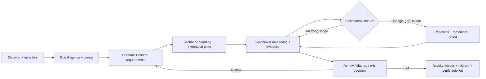
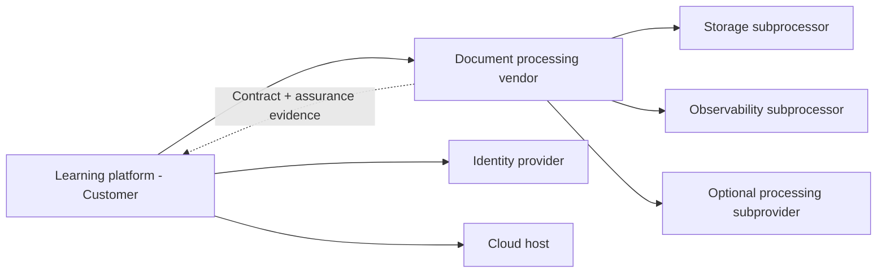
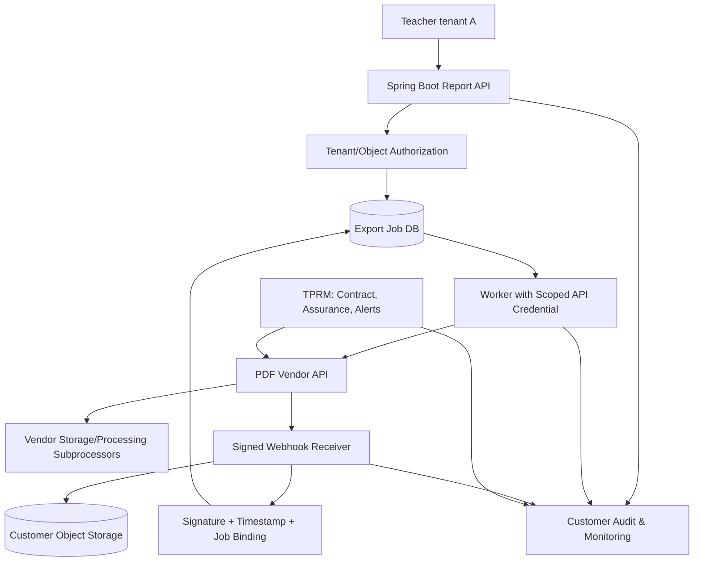
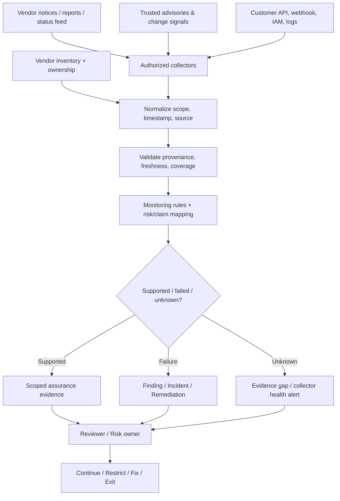
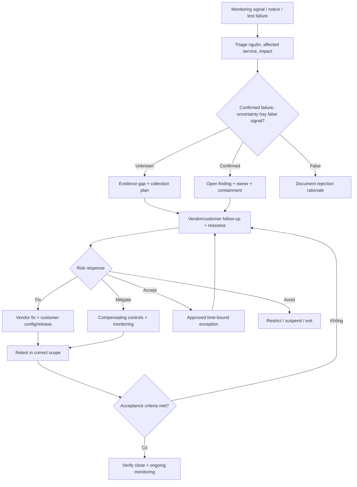

# Vendor monitoring: giám sát nhà cung cấp liên tục và xây dựng bằng chứng bảo đảm an toàn

## 1. Tình huống mở đầu: nhà cung cấp được duyệt năm ngoái có còn an toàn hôm nay?

Một nền tảng học tập Java/Spring Boot thuê các dịch vụ bên ngoài: identity provider (IdP) để đăng nhập, hệ thống gửi email, kho object storage trên cloud, dịch vụ xử lý tài liệu và công cụ phân tích mức độ tương tác. Khi ký hợp đồng, đội procurement đã thu được chứng chỉ ISO/IEC 27001, báo cáo SOC 2 của một số nhà cung cấp và bảng khảo sát bảo mật. Tất cả được đánh dấu `APPROVED`.

Sáu tháng sau, dịch vụ xử lý tài liệu thay đổi nơi lưu trữ tạm sang một khu vực mới, dùng thêm một subcontractor; token API của integration chưa được rotate; một incident khiến webhook gửi lại các event cũ; báo cáo SOC 2 đã hết thời kỳ bao phủ. Dashboard nội bộ vẫn báo “Vendor security: green” vì lần đánh giá ban đầu thành công.

Điều này cho thấy **đánh giá nhà cung cấp trước khi ký hợp đồng không đủ để đảm bảo rủi ro trong suốt thời gian sử dụng**. Scope, dữ liệu, người vận hành, phụ thuộc, cấu hình, mức bảo vệ và mối đe dọa đều có thể thay đổi.

**Vendor monitoring (giám sát nhà cung cấp)** là hoạt động có hệ thống, liên tục hoặc theo các sự kiện quan trọng để **theo dõi điều kiện rủi ro, tình trạng controls, chất lượng dịch vụ, nghĩa vụ hợp đồng, thay đổi phạm vi, incidents và khả năng phục hồi của các nhà cung cấp/bên thứ ba** mà tổ chức đang phụ thuộc, nhằm phát hiện sai lệch, yêu cầu hành động và duy trì mức assurance phù hợp.

Trong chương **Third-party assurance** thuộc module **SECURITY_SECURITY_ASSURANCE**, vendor monitoring không chỉ là một dashboard điểm số. Nó là chuỗi **risk → objective → requirement → vendor/customer control → evidence → evaluation → decision → remediation → revalidation**, giúp tổ chức đánh giá có căn cứ rằng các dịch vụ bên ngoài vẫn hỗ trợ mục tiêu bảo mật, quyền riêng tư và liên tục hoạt động của hệ thống.

### Mục tiêu học tập

Sau bài này, bạn có thể:

1. Phân biệt **vendor due diligence, onboarding, continuous monitoring, reassessment, audit, incident response và offboarding**.
2. Xây dựng inventory có owner, tier rủi ro, data flows, subcontractor/fourth-party dependency và hợp đồng liên quan.
3. Lựa chọn yêu cầu giám sát theo **criticality, data sensitivity, access level, substitutability và concentration risk**.
4. Thiết kế một **vendor monitoring plan** với claims, indicators, data sources, cadence, triggers và response thresholds.
5. Đánh giá đúng giá trị và giới hạn của SOC 2, ISO/IEC 27001, questionnaire, penetration-test summary, SLA, status page và vendor attestations.
6. Phân biệt evidence của vendor với **customer-specific configuration và effective security controls**.
7. Theo dõi thay đổi liên quan IAM, APIs/webhooks, privacy, vulnerabilities, incident notifications, subprocessors, availability và supply chain.
8. Xây scorecard/KRI có coverage, freshness, uncertainty, evidence provenance và risk decisions.
9. Kiểm chứng kỹ thuật một integration Java/Spring Boot nhiều tenant trong môi trường được phép, gồm positive/negative tests và monitoring failures.
10. Tạo findings, xử lý exceptions, escalation, exit/continuity plan và retest mà không nhầm “vendor gửi email xác nhận” với một security property đã được chứng minh.

## 2. Những khái niệm và phạm vi cần phân biệt

| Khái niệm | Câu hỏi chính | Ví dụ |
|---|---|---|
| **Third party / vendor** | Ai cung cấp dịch vụ, sản phẩm hoặc xử lý dữ liệu cho tổ chức? | IdP SaaS, cloud provider, email API |
| **Fourth party / subprocessor** | Ai là bên mà vendor phụ thuộc để cung cấp dịch vụ? | Dịch vụ lưu trữ của vendor gửi email |
| **Vendor risk** | Rủi ro nào xuất phát từ quan hệ hoặc phụ thuộc vào vendor? | Rò dữ liệu học viên, mất khả năng đăng nhập |
| **Vendor due diligence** | Trước khi sử dụng, vendor có đáp ứng tiêu chí ban đầu? | Review DPA, assurance reports và security architecture |
| **Vendor monitoring** | Trong khi sử dụng, những điều kiện nào thay đổi hoặc không đạt? | SLA degradation, incident, subprocessor change |
| **Vendor reassessment** | Có cần đánh giá lại khả năng đáp ứng và risk? | Tái xét hằng kỳ hoặc sau major change |
| **Security assurance** | Có evidence đủ cho claim về mục tiêu bảo mật cụ thể? | API token restricted; webhook signature verified |
| **Continuous monitoring** | Có theo dõi/đánh giá lại theo cadence và trigger phù hợp? | Feed health, advisory, contract expiry |
| **Vendor audit** | Có hoạt động đánh giá chính thức theo quyền/thỏa thuận? | Xem báo cáo assurance, audit được cấp phép |
| **Contractual compliance** | Vendor có thực hiện nghĩa vụ đã cam kết? | Incident notice, data deletion, SLA |
| **Residual risk decision** | Rủi ro còn lại được xử lý/chấp nhận thế nào? | Waiver có owner và expiry |
| **Exit/offboarding** | Có thể chấm dứt phụ thuộc và xử lý dữ liệu/quyền đúng không? | Thu hồi credentials, export và deletion evidence |

### 2.1. Monitoring khác việc kiểm tra hợp đồng một lần

Một nhà cung cấp có thể hoàn toàn phù hợp ở thời điểm mua dịch vụ, rồi thay đổi kiến trúc, chuyển dữ liệu sang location khác, thay nhân sự vận hành hoặc phát sinh sự cố. Vì vậy cần **cả baseline ban đầu và sự kiện tái đánh giá**.

### 2.2. Monitoring không tự động đồng nghĩa quét hệ thống vendor

Theo dõi vendor nên dùng các nguồn được phép: báo cáo, API/status feed, thông báo sự cố, hợp đồng, kiểm chứng integration của chính mình và audit theo thỏa thuận. **Không chủ động scan, pentest, khai thác hoặc truy cập hạ tầng vendor ngoài quyền** chỉ vì tổ chức là khách hàng.

### 2.3. “An toàn của vendor” không phải một Boolean

Một vendor có thể có chương trình bảo mật trưởng thành nhưng một integration của khách hàng vẫn sai cấu hình. Ngược lại điểm posture bên ngoài thấp chưa đủ chứng minh một vulnerability ảnh hưởng tới service đang dùng. Cần claim và evidence đúng **dịch vụ, phiên bản, dữ liệu, tenant/customer configuration và time window**.

## 3. Vòng đời quản lý rủi ro nhà cung cấp

Vendor monitoring nằm trong một vòng đời chứ không phải công việc tách biệt do procurement thực hiện.



### 3.1. Trước khi sử dụng

Xác định nhu cầu, dịch vụ thay thế, dữ liệu nào sẽ được gửi, quyền truy cập vendor cần, vendor có subcontractors nào và khả năng ứng phó khi vendor không khả dụng. Bắt đầu đánh giá risk/assurance trước khi integration đi vào production.

### 3.2. Trong onboarding

Ký các thỏa thuận phù hợp, thiết lập technical controls (SSO, scoped API credentials, webhook verification, data protection), kiểm tra đường dữ liệu thật trong môi trường được phép, lập owner và nghĩa vụ thông báo.

### 3.3. Trong vận hành

Theo dõi các chỉ số quan trọng, hạn của security evidence, SLA, incidents, changes, subprocessor notifications, vulnerabilities và độ hiệu lực integration. Mở findings khi evidence cho thấy vấn đề hoặc không đủ coverage.

### 3.4. Khi có sự kiện quan trọng

Reassessment cần xảy ra sau major contract/data-flow changes, vendor acquisition, severe incident, breach notification, material SLA degradation, change of subprocessor/location hoặc phát hiện quyền không cần thiết.

### 3.5. Khi gia hạn hoặc chấm dứt

Quyết định renewal phải dựa trên **risk hiện tại và history thực hiện corrective actions**, không chỉ hồ sơ đã từng duyệt. Exit gồm chuyển dữ liệu, thu hồi quyền, xử lý bí mật, kiểm tra deletion/retention và duy trì continuity.

## 4. Vendor inventory: không thể giám sát thứ mình không biết đang dùng

Một chương trình tốt cần **inventory có owner, nguồn và mức độ đầy đủ**. Nhà cung cấp có thể được đưa vào hệ thống qua procurement chính thức, đăng ký self-service, marketplace, extension, SDK, SaaS trial hoặc một developer tạo token API mà không báo procurement.

### 4.1. Những trường quan trọng

| Nhóm | Thuộc tính cần có |
|---|---|
| **Identity** | Vendor ID, pháp nhân/brand/dịch vụ, contact và contract ID |
| **Business** | Business process, service owner, criticality, BIA dependency |
| **Technical** | SaaS/API/SDK/managed service, integration endpoints, environment, region |
| **Data** | Data categories, classification, direction, location, retention, tenant boundary |
| **Access** | OAuth scopes, API keys, SSO trust, network/cloud access, service accounts |
| **Subcontractors** | Fourth-party dependencies/subprocessors và service/dữ liệu liên quan |
| **Controls** | Required security, privacy, continuity, monitoring và shared responsibilities |
| **Evidence** | Report types, coverage periods, evidence references, findings, expiry |
| **Contract** | SLA, security/DPA, notification duties, audit rights, change/exit terms |
| **Operations** | Status feeds, escalation contacts, runbooks, alternatives, owner |
| **Risk** | Tier, open findings, accepted risk, concentration và remediation |
| **Lifecycle** | Onboarded, active, restricted, suspended, exiting, retired |

### 4.2. Ví dụ record inventory (giả định)

```yaml
vendor_id: "VND-DOC-017"
vendor_name: "Example Document Processor"
service: "PDF conversion for student reports"
vendor_relationship: "direct-third-party"
business_owner: "report-service-owner"
security_owner: "third-party-risk-team"
environment: ["staging", "production"]
criticality: "HIGH"
data:
  categories: ["student-report-content"]
  classification: "sensitive"
  flow: "learning-platform -> vendor API -> temporary result"
  retention_requirement: "<approved-retention>"
  locations: ["<contracted-region>"]
access:
  integration: "scoped-service-credential"
  outbound_endpoint: "https://api.example.invalid"
  inbound_callback: "signed-webhook"
subprocessors:
  review_reference: "restricted://<supplier-subprocessor-list>"
contract:
  reference: "restricted://<contract-id>"
  notice_and_audit_terms: "reviewed"
evidence:
  last_review: "<UTC-date>"
  next_review: "<risk-based-date>"
  soc2_or_other_report: "restricted://<report-if-applicable>"
risk:
  status: "ACTIVE_UNDER_MONITORING"
  open_findings: []
  accepted_exceptions: []
```

Mẫu dùng vendor giả định và placeholders. `example.invalid` là tên miền dành cho ví dụ, không phải endpoint hoạt động.

### 4.3. Xác định shadow IT và unknown vendors

Có thể đối chiếu inventory với danh sách SaaS SSO applications, cloud marketplace purchases, egress domains, expense records, CI dependencies và developer-managed integrations **nếu được phép xử lý dữ liệu đó**. Không chỉ đếm số vendor được procurement cấp mã rồi suy ra danh mục đầy đủ.

### 4.4. Owner không chỉ là người ký hợp đồng

Procurement theo dõi terms/renewal; security team đánh giá controls; application owner hiểu data path và integration; privacy team đánh giá nghĩa vụ dữ liệu; business owner quyết định mức chấp nhận gián đoạn. Mỗi vendor cần **business owner và technical/security contact rõ ràng**.

## 5. Risk tiering: giám sát theo mức rủi ro, không giám sát mọi vendor giống nhau

Một vendor chỉ cung cấp tài liệu marketing khác với IdP có thể ảnh hưởng tất cả lượt đăng nhập, hoặc một dịch vụ xử lý kết quả thi có quyền nhận dữ liệu cá nhân.

### 5.1. Các chiều rủi ro

| Yếu tố | Câu hỏi |
|---|---|
| **Data sensitivity** | Vendor xem/nhận/lưu dữ liệu cá nhân, đề thi, bảng điểm hoặc secrets không? |
| **Access privilege** | Có quyền đọc/ghi/xóa, quản trị, giả mạo identity hoặc deploy không? |
| **Business criticality** | Outage có ngừng kỳ thi hoặc nộp bài không? |
| **Integration coupling** | Có dễ vô hiệu/thay thế vendor mà không làm hỏng workflow? |
| **Exposure surface** | Vendor có inbound webhook, public API, SDK chạy trong service? |
| **Data volume/retention** | Khối lượng và thời gian vendor giữ dữ liệu? |
| **Jurisdiction/location** | Dữ liệu đi qua nơi nào, nghĩa vụ/hợp đồng áp dụng? |
| **Subprocessor dependence** | Có bên thứ tư hoặc chuỗi cung ứng phức tạp? |
| **Concentration risk** | Nhiều dịch vụ trọng yếu cùng phụ thuộc một provider? |
| **Security maturity** | Evidence về chương trình controls và findings như thế nào? |
| **Change velocity** | Thay đổi liên tục về tính năng, API, model, region hay ownership? |
| **Exit difficulty** | Migration/portability và chứng nhận deletion có khả thi? |

### 5.2. Ví dụ phân tầng (mang tính phương pháp)

| Tier | Đặc trưng thường gặp | Monitoring trọng tâm |
|---|---|---|
| **Critical** | Không thể vận hành quy trình trọng yếu, hoặc có quyền/dữ liệu rủi ro rất cao | Continuous signals cho critical paths, frequent evidence review, incident/BCP drills |
| **High** | Xử lý dữ liệu nhạy cảm hoặc tích hợp sâu | Regular assessments, security/privacy changes, integration tests |
| **Moderate** | Tác động/độ nhạy đáng kể nhưng có controls/alternatives | Periodic monitoring và change-driven review |
| **Low** | Dữ liệu tối thiểu, ít đặc quyền, business impact thấp | Inventory, key contract/renewal checks, trigger-based reassessment |

Tầng/chu kỳ cụ thể do **risk methodology và hợp đồng của tổ chức** quy định. Không coi nhãn `Critical` là kết luận chung cho mọi SaaS IdP hay đặt ngưỡng định kỳ cố định như tiêu chuẩn bắt buộc.

### 5.3. Inherent risk và residual risk

**Inherent risk** là rủi ro xét từ use case/khả năng tác động trước khi tính controls cụ thể. **Residual risk** phản ánh đánh giá sau controls và điều kiện hiện tại. Một vendor có quyền xử lý dữ liệu lớn vẫn có inherent risk cao dù chứng chỉ tốt; controls có thể giảm residual risk nhưng không tự làm biến mất nghĩa vụ giám sát.

### 5.4. Ví dụ ba nhà cung cấp

| Vendor giả định | Tác động | Tier sơ bộ cần xác minh | Lưu ý |
|---|---|---|---|
| IdP cho mọi tenant | Không thể đăng nhập, identity compromise | Critical | Auth flow, sessions, SLA, failover, audit |
| PDF conversion | Nhận báo cáo có dữ liệu người học | High | Retention, webhook, deletion, data location, tenant scope |
| Analytics SDK cho trang marketing không nhận PII | Ít ảnh hưởng core exams | Moderate/Low tùy triển khai | SDK có chạy trên app authenticated? Dữ liệu thực gửi gì? |

Không suy tầng chỉ từ tên dịch vụ; cần đánh giá deployment và dữ liệu thực tế.

## 6. Fourth-party monitoring và concentration risk

Nhà cung cấp trực tiếp có thể dựa vào các nhà cung cấp khác để lưu dữ liệu, xác thực, gửi thông báo hoặc chạy mô hình xử lý. Đây là **fourth-party risk** theo quan hệ tương đối với khách hàng.

### 6.1. Một data flow điển hình



### 6.2. Câu hỏi cần giám sát

- Vendor dùng những subprocessors nào cho **dịch vụ và data flow cụ thể**?
- Bên thứ tư nào tiếp xúc với dữ liệu nhạy cảm? Họ xử lý ở location nào?
- Hợp đồng có yêu cầu thông báo thay đổi subprocessor không? Thông báo trước hay sau?
- Nhà cung cấp trực tiếp chịu trách nhiệm và có quyền kiểm soát subprocessor ra sao?
- Có quy trình phản đối, đánh giá lại hoặc rời dịch vụ khi subprocessor thay đổi không?
- Có dependencies dùng chung với các vendor khác làm tăng single point of failure?
- Bên thứ tư có lưu, sao chép, log hoặc huấn luyện trên dữ liệu ngoài mục đích được phê duyệt không?

### 6.3. Không thể luôn audit trực tiếp tất cả fourth parties

Tổ chức thường không có quyền truy cập kiểm toán độc lập từng subprocessor. Cần tận dụng **contractual flow-down obligations**, vendor disclosure, assurance reports có phạm vi phù hợp, điều kiện thông báo và khả năng đổi vendor. Nếu evidence thiếu, ghi **coverage gap/residual risk**, không giả định subprocessor được đảm bảo chỉ vì vendor chính có chứng nhận.

### 6.4. Concentration risk

Giả sử IdP, vendor email và PDF conversion cùng chạy trên một cloud region. Khi region đó lỗi, ba dịch vụ có thể cùng gián đoạn dù hợp đồng với ba pháp nhân khác nhau. BCP nên đánh giá **common dependencies** chứ không chỉ đếm số vendors.

### 6.5. Hệ quả của thay đổi subprocessor

Một chuyển đổi nơi lưu, service operator hoặc data-processing purpose có thể cần review privacy, data residency, authorization và contractual obligations. Monitoring nên phát hiện notification và kích hoạt reassessment trước khi luồng dữ liệu nhạy cảm thay đổi, khi hợp đồng yêu cầu.

## 7. Chuyển risk thành monitoring claim và evidence

Một vendor monitoring program đáng tin không dừng ở câu “đã kiểm vendor”. Phải nói rõ **điều gì cần tiếp tục đúng** và bằng chứng nào hỗ trợ.

### 7.1. Ví dụ chuỗi assurance

**Risk:** Vendor chuyển đổi dữ liệu báo cáo học viên sang subprocessor ngoài phạm vi chấp thuận.

**Objective:** Data handling tuân thủ mục đích, location, retention và quyền truy cập đã được duyệt.

**Requirement:** Mọi material change về subprocessor/location phải được thông báo, đánh giá và quyết định theo điều kiện hợp đồng/chính sách trước khi sử dụng theo yêu cầu.

**Controls:** Contract notice, vendor change feed, inventory, data-flow verification, security/privacy review và integration guardrail.

**Evidence:** Notice có thời điểm, danh sách subprocessors cập nhật, impact assessment, approval/objection decision, customer configuration và actual data routing checks trong phạm vi.

**Decision:** Continue, restrict, pause, accept residual risk có điều kiện hoặc execute exit.

### 7.2. Ma trận claim, controls và evidence

| Assurance claim | Controls liên quan | Evidence cần |
|---|---|---|
| Vendor chỉ nhận dữ liệu được phép | Data minimization, API client mapping, DPA | Actual request/schema review, negative tests, vendor documentation |
| Credential integration quyền tối thiểu | Scoped OAuth/API tokens, rotation, secret storage | Client scopes, effective permission tests, key lifecycle |
| Webhook đến từ vendor hợp lệ | Signature verification, timestamp, replay protection | Signed fixture tests, dedup/authorization logs |
| Vendor có quy trình bảo mật phù hợp | Governance controls, independent review | Relevant audit/assurance report và scope/period/exceptions |
| Security events được thông báo đúng điều kiện | Incident notification clause, vendor escalation | Vendor notice, delivery time, internal incident record |
| Dịch vụ đáp ứng business recovery needs | SLA/DR controls, customer fallback | SLO metrics, historical incidents, recovery exercises |
| Dữ liệu được xóa/hoàn trả khi chấm dứt | Exit/retention controls | Export validation, deletion confirmation, revoked keys |
| Thay đổi subprocessor được quản trị | Contract + notices + reassessment | Change log, updated data flow, risk owner decision |
| Residual risks được theo dõi | Findings, exception workflow | Open actions, approvals, expiry và retest |

### 7.3. Claim cần đúng phạm vi

**Quá rộng:** “Vendor X bảo vệ dữ liệu của chúng tôi.”

**Có thể kiểm chứng hơn:** “Trong integration `report-service` release R, các requests gửi tới vendor xử lý PDF chỉ chứa synthetic report fields được phê duyệt, dùng credential có scope đã ghi, callback bị từ chối khi signature sai hoặc replay, và evidence về retention/subprocessor áp dụng cho dịch vụ/khoảng thời gian được xem xét.”

Claim này vẫn **không chứng minh mọi internal control của vendor**; những phần không quan sát được cần dựa trên đánh giá bằng chứng phía vendor và ghi giả định.

## 8. Shared responsibility và hợp đồng: nghĩa vụ của vendor không loại bỏ nghĩa vụ của khách hàng

Hợp đồng, Data Processing Agreement (DPA), SLA và báo cáo assurance có thể xác định trách nhiệm, nhưng **không thay thế kiểm chứng technical integration của khách hàng**.

### 8.1. Ba nhóm controls

| Nhóm | Ví dụ | Bằng chứng nên thu |
|---|---|---|
| **Vendor-operated** | Security controls trong datacenter, nhân sự vận hành, logging nội bộ | Reports, attestations, vendor audit/incident evidence theo hợp đồng |
| **Shared** | SSO setup, customer-specific encryption options, data retention settings | Vendor documentation **và** customer config/observed behavior |
| **Customer-operated** | App authorization, outbound data minimization, secret storage, webhook validation | Application tests, IAM policies, logs và runtime observations |

### 8.2. Những điều khoản đáng theo dõi

- Scope dịch vụ, dữ liệu, purpose và data processing instructions.
- Security measures, customer configuration obligations, subcontractors.
- SLA: availability, support severity, credits (nếu có), measurement exclusions.
- Incident/breach notification thresholds, timing, format và contacts.
- Change notices cho service, API, subprocessor, data location.
- Audit rights hoặc cơ chế cung cấp independent reports.
- Data retention, return, deletion, backup residuals và verification.
- Access control, staff termination, remote support và customer support impersonation.
- Business continuity, DR, recovery requirements và cooperation.
- Termination, portability, transition assistance và dependency closure.

Hợp đồng được soạn theo jurisdiction/ngành và cần pháp chế rà soát; bài học không đặt ra thời hạn thông báo bắt buộc cho mọi vendor hoặc mọi quốc gia.

### 8.3. Không nhầm contractual commitment với thực tế vận hành

Một vendor có SLA 99,9% không đồng nghĩa đã đáp ứng SLA trong tháng hoặc tất cả business workflows của khách hàng còn hoạt động. Một hợp đồng yêu cầu xóa dữ liệu sau termination không tự chứng minh deletion đã xảy ra.

**Contractual evidence** hỗ trợ claim về nghĩa vụ; **operational/test evidence** hỗ trợ claim về việc nghĩa vụ hoặc control có được thực hiện trong scope.

### 8.4. Thực tế khi điều khoản chưa đủ

Nếu hợp đồng không có quyền audit và vendor từ chối cung cấp security evidence, cần đánh giá residual risk, phương án hạn chế data/access và khả năng chuyển sang vendor khác. Không tự mở rộng quyền kiểm tra hoặc truy cập hệ thống của họ.

## 9. Đọc và đánh giá báo cáo assurance của vendor

### 9.1. Những loại evidence hay gặp

| Loại | Giá trị | Giới hạn cần nhớ |
|---|---|---|
| **SOC 2 report** | Đánh giá theo một số Trust Services Criteria và system scope/period | Không tự chứng minh customer integration hoặc mọi subprocessors |
| **ISO/IEC 27001 certificate** | Chứng nhận ISMS trong phạm vi được cấp | Không tự chứng minh từng technical control của service |
| **ISO/IEC 27017/27018 references** | Hướng dẫn/controls cloud và bảo vệ PII trong cloud khi áp dụng | Cần xem assurance cụ thể, scope/version |
| **Penetration-test executive summary** | Một phần kết quả và remediation status của scope/test period | Không có nghĩa mọi vulnerability đã được tìm thấy |
| **Security questionnaire** | Vendor tự mô tả controls, quy trình và ownership | Self-attestation có thể chưa được xác minh |
| **External posture score** | Tín hiệu ngoài về một số assets/configurations | Có false positives, attribution/coverage limitations |
| **Privacy/DPA documentation** | Purpose, roles, locations, subprocessor và duties | Cần đối chiếu actual data flow |
| **Status page/SLA report** | Availability event history trong phương pháp của vendor | Có thể không phản ánh tenant-specific errors |
| **Vulnerability advisory** | Thông tin affected versions/services và remediation | Không tự chứng minh customer bị ảnh hưởng |
| **Incident postmortem** | Timeline, contributing factors, corrective actions | Cần kiểm applicability và completion |

### 9.2. Phương pháp đọc SOC 2/assurance report

1. **Entity và system description:** đúng pháp nhân, product và service mình mua?
2. **Report type và kỳ báo cáo:** xác định bản báo cáo và phạm vi thời gian; không gắn nhãn vô thời hạn.
3. **Controls/criteria covered:** tiêu chí nào liên quan requirement của mình?
4. **Exceptions/deviations:** có exceptions hoặc findings ảnh hưởng service/dữ liệu không?
5. **Subservice organizations:** có bên khác được dùng, phương pháp carve-out/inclusive áp dụng ra sao?
6. **Complementary user entity controls (CUECs):** khách hàng phải làm gì để giả định đánh giá còn đúng?
7. **Bridge letter/period gaps:** nếu có tài liệu bổ sung, nó giúp giải thích khoảng trống nào và giới hạn gì?
8. **Change since report:** có major architecture/subprocessor/ownership changes sau kỳ đánh giá?
9. **Applicability:** report có bao phủ tenant, hosting region, feature và service tier sử dụng?
10. **Confidentiality:** phân quyền, lưu trữ và chia sẻ báo cáo theo ràng buộc sử dụng.

### 9.3. Báo cáo được lưu đúng không đủ

Một report từ kỳ trước có thể vẫn có giá trị hỗ trợ assurance về controls nền, nhưng cần đánh giá **freshness, known changes và customer responsibilities**. Không đánh dấu green chỉ vì trường `soc2_report_url` có giá trị.

### 9.4. Không đánh đồng scope rộng và control hiệu quả

ISO certificate nói về ISMS scope không chứng minh file báo cáo của khách hàng không bị public qua signed link; SOC 2 không chứng minh webhook của chính khách hàng đã verify chữ ký. Các claims đó cần **customer-specific configuration và behavior evidence**.

## 10. Nguồn tín hiệu cho continuous vendor monitoring

Monitoring nên kết hợp **vendor-provided evidence, customer-side observations, independent evidence và internal operational records**, theo mục tiêu và quyền truy cập phù hợp.

### 10.1. Bảng nguồn tín hiệu

| Nguồn | Có thể cho biết | Giới hạn và cảnh báo |
|---|---|---|
| **Vendor status page / incident RSS/API** | Thông báo gián đoạn, thời điểm cập nhật | Không nhất thiết phản ánh service tier/tenant của mình |
| **Vendor security advisories** | Lỗ hổng, thay đổi bảo mật, khuyến nghị | Phải xác định affected service/version/config |
| **Vendor reports/attestations** | Controls được đánh giá trong scope/period | Có thể hết hiệu lực hoặc loại trừ tính năng |
| **Contract/SLA reports** | Chỉ tiêu chất lượng nhà cung cấp đã cam kết | Phương pháp đo/exclusions có thể khác end-to-end SLO |
| **Customer integration metrics** | Latency, errors, callback failures, retry rate | Không giải thích toàn bộ nguyên nhân bên vendor |
| **Customer security logs** | Token use, webhook validation, abnormal vendor permissions | Không quan sát nội bộ nhà cung cấp |
| **Identity/IAM inventory** | Active connections, scopes và service principals | Quyền thực tế có thể phụ thuộc resource policies/contexts |
| **DPA/subprocessor change notices** | Data processing chain, location và purpose changes | Phải kiểm đúng bản cập nhật và điều khoản áp dụng |
| **External threat intelligence / CVE / KEV** | Mối đe dọa, lỗ hổng đã công bố/khai thác biết đến | Không chứng minh vendor bị ảnh hưởng; cần triage |
| **Provider support tickets** | Lịch sử vấn đề, SLA escalation và hỗ trợ | Dữ liệu thiếu hoặc diễn giải chủ quan |
| **Risk/exception register** | Findings, expiry và owner | Không thay effective controls evidence |
| **Independent assessments** | Mức độ trưởng thành/biện pháp có xác minh | Scope và thời điểm giới hạn |
| **Business continuity tests** | Vendor dependency và fallback thực tế | Test mô phỏng không bao phủ outage production |
| **Media/public disclosures** | Mergers, incidents hoặc thay đổi có thể ảnh hưởng | Cần xác thực từ nguồn đáng tin, không xử lý tin đồn như fact |

### 10.2. Tín hiệu bên ngoài không giống quan sát từ integration

Status page có thể báo “operational” nhưng API của một tenant khách hàng đang trả `429` do quota hoặc lỗi policy. Ngược lại latency cao ở ứng dụng có thể do code của khách hàng. Bởi vậy cần **correlation** giữa vendor notices, customer-side request outcomes, tracing, rate limits, retry behavior và dependency metrics.

### 10.3. Mất tín hiệu cũng phải là tín hiệu

Nếu monitoring job không truy cập được vendor API, report retrieval thất bại, contact email bounce hoặc collectors không nhận được status feed, phải ghi **MONITORING_GAP**; không tự biến thành “no issues found”.

### 10.4. Không thu dữ liệu quá mức

Chỉ lấy logs, API metadata, event attributes và vendor documents cần cho claim; tránh thu thông tin nhân viên vendor, thông tin cá nhân của khách hàng hoặc credentials trong alert/ticket. Đặt controls bảo vệ evidence và căn cứ xử lý dữ liệu theo tổ chức.

## 11. Vendor monitoring plan: mỗi claim phải có owner, nguồn và trigger

Monitoring plan cần gắn với **vendor use case** chứ không phải một checklist y hệt cho tất cả các dịch vụ. Một kế hoạch đủ cụ thể phải giải thích ai giám sát, theo dõi gì, dùng nguồn nào, bao lâu, xử lý sai lệch ra sao và thế nào là đủ bằng chứng.

### 11.1. Mẫu ma trận

| Monitoring objective | Signal/evidence | Tần suất/trigger theo risk | Owner / hành động |
|---|---|---|---|
| Service availability | Synthetic transaction, API metrics, vendor incident feed | Theo SLO/độ trọng yếu; khi alert | SRE, BCP escalation |
| Vendor security assurance | SOC/ISO report, findings, CUECs | Theo reporting period, expiry/change | TPRM/Security review |
| Data handling consistency | DPA, subprocessor list, actual outbound payload/schema | Khi subprocessor/data flow đổi, periodic review | Privacy + app owner |
| Credential least privilege | OAuth scopes, IAM/client configuration, denied tests | Sau permission/integration change; scheduled | IAM/AppSec |
| Webhook authenticity | Signature/replay negative tests, parser health | Mỗi release/schema change và regression | App engineering |
| Vulnerability affectedness | Advisory/service/version inventory | Khi advisory/relevant threat change | Security/technical owner |
| Incident response | Vendor notice, timestamps, customer triage | Khi incident/notices hoặc drill | IR + vendor owner |
| Continuity readiness | SLA history, alternatives, backup/failover drills | BIA-driven schedule / outage | BCP/SRE/business owner |
| Third/fourth-party change | Subprocessor disclosure, contract updates | Material vendor change | TPRM/privacy/legal |
| Findings and exceptions | Open actions, evidence, approval expiry | Theo remediation milestone | Finding owner + risk owner |
| Exit readiness | Data portability, offboarding runbook, deletion path | Renewal, major risk or strategy change | Business/data owner |

### 11.2. Vendor monitoring plan YAML (mô tả, không thuộc một sản phẩm)

```yaml
plan_id: "VM-PLAN-DOC-017"
vendor_id: "VND-DOC-017"
scope:
  service: "synthetic-pdf-conversion"
  environments: ["staging", "production"]
  data_category: "student-report"
  allowed_regions: ["<approved-data-location>"]
  direct_integration: "report-service"
criticality: "HIGH"
ownership:
  business: "learning-reports-owner"
  technical: "report-service-team"
  security: "third-party-risk-team"
controls:
  - control_id: "VEND-DATA-01"
    claim: "Only approved data fields are sent"
    source: "customer-outbound-schema-and-test"
    cadence: "release-change-and-periodic-risk-review"
    breach_action: "stop-sensitive-export-and-investigate"
  - control_id: "VEND-SEC-02"
    claim: "Vendor security assurance remains relevant"
    source: "vendor-report-and-scope-review"
    cadence: "report-expiry-and-material-change"
    missing_evidence_action: "mark-inconclusive-and-escalate"
  - control_id: "VEND-WEBHOOK-03"
    claim: "Callbacks are authenticated and replay-protected"
    source: "signed-webhook-negative-tests"
    cadence: "per-integration-release-and-security-change"
  - control_id: "VEND-BCP-04"
    claim: "Critical workflow has defined vendor outage handling"
    source: "dependency-game-day-and-runbook"
    cadence: "business-impact-analysis-defined"
triggers:
  - "material-security-incident"
  - "vendor-service-or-subprocessor-change"
  - "unexpected-data-location"
  - "contract-renewal-or-termination"
  - "critical-control-failure-or-evidence-gap"
decision_outputs:
  - "continue"
  - "restrict"
  - "remediate-and-retest"
  - "approved-time-bounded-exception"
  - "suspend-or-exit"
```

Các values như `HIGH`, cadence và actions là ví dụ; **không thay thế risk methodology hoặc hợp đồng thực**.

### 11.3. Đừng chỉ ghi tần suất

Kế hoạch “review mỗi quý” vẫn yếu nếu không biết review những claims nào và acceptance criteria ra sao. Một control quan trọng có thể cần **event-driven re-evaluation ngay khi điều kiện thay đổi**, trong khi evidence ít thay đổi hơn có thể review theo reporting period thích hợp.

## 12. Cadence, event-driven triggers và evidence freshness

### 12.1. Ba cách lên lịch bổ sung nhau

1. **Periodic monitoring:** đánh giá các control/contract/operational indicators theo chu kỳ do risk định nghĩa.
2. **Event-driven reassessment:** kích hoạt khi có incident, advisory, subprocessor/data-location change, audit exception hoặc major vendor change.
3. **Change-driven customer verification:** chạy lại tests khi integration code, API version, scopes, data flow hoặc deployment config thay đổi.

### 12.2. Một số trigger điển hình

| Trigger | Rủi ro phát sinh | Hoạt động tiếp theo |
|---|---|---|
| Vendor báo security incident | Data/access/availability có thể bị ảnh hưởng | Incident triage + impact assessment |
| Vendor thay API auth model | Token scopes/signature assumptions có thể sai | Integration security regression tests |
| Chuyển data center/region | Data residency và service dependency thay đổi | Privacy/BCP/contract review |
| Thêm subprocessor | Fourth-party exposure tăng | Data flow và flow-down obligations review |
| Vendor được mua lại | Governance, ownership hoặc access changes | Risk reassessment |
| SOC report hết period | Assurance evidence stale | Yêu cầu bản mới/bridge/compensating evidence |
| API error/latency tăng | SLA/business impact | SRE triage, continuity plan |
| Public security advisory liên quan | Vulnerability hoặc exploitation potential | Check affectedness, mitigations, timeline |
| Privilege/scope change | Vendor/customer access có thể rộng hơn | IAM/effective access tests |
| Mất status feed/collector | Blind spot | Monitoring health finding |
| Backup/failover test không đạt | DR/continuity residual risk | Corrective action + retest |
| Contract renewal | Có tiếp tục chấp nhận risk hiện tại? | Evidence/exception/exit readiness review |

### 12.3. Freshness không có TTL chung

Bằng chứng test webhook trước khi thay shared secret có thể trở nên vô hiệu ngay sau rotation. SOC report có reporting period xác định và exclusions riêng. SLA monthly report phản ánh kỳ khác với API metrics gần thời gian thực. **Độ mới của evidence phải phù hợp control, change history, scope và quyết định**, không chỉ số ngày kể từ lần lưu PDF.

### 12.4. Monitoring trong khoảng transition

Với thay đổi subprocessor hoặc chuyển region, nên ghi **effective date**, thời điểm customer chấp thuận, thời điểm integration thực sự chuyển, song song các đường cũ/mới, dữ liệu cũ còn lưu ở đâu và ai xác minh. Một thông báo sẽ thay đổi vào tháng sau không chứng minh thay đổi đã diễn ra hoặc có thể hủy đúng hạn.

## 13. Giám sát vulnerability và security posture của vendor

### 13.1. Các loại tín hiệu

- Vendor advisory, CVE hoặc security bulletin liên quan product/service đang dùng.
- Vendor release notes về authentication, cryptography, APIs và deprecations.
- Public exploit/known exploited vulnerability catalog có căn cứ.
- Independent assurance findings/pen-test summary với scope liên quan.
- Customer-side SDK/client dependency scanning và SBOM khi có.
- Customer service observations về TLS/certificates, public exposure hoặc permission changes.
- Vendor-confirmed remediation/mitigation evidence và customer verification.

### 13.2. Từ advisory đến affectedness assessment

Không kết luận nhà cung cấp “bị khai thác” chỉ vì CVE được công bố trên một sản phẩm có tên gần giống. Một quy trình tốt:

1. Xác định vendor/service/product/version hoặc affected configuration.
2. Xác định affected component có được dùng trên đường dữ liệu hiện tại không.
3. Xem exposure, prerequisites, privileges, user interaction và impact.
4. Xem bằng chứng về known exploitation, vendor mitigation và availability của patch.
5. Kiểm tra controls do khách hàng chịu trách nhiệm (client version, feature toggle, network policy).
6. Yêu cầu vendor xác nhận affectedness và remediation trong phạm vi có thỏa thuận.
7. Ghi risk/decision, deadline, retest và evidence mới.

### 13.3. Posture score không phải phép đo tuyệt đối

Các security rating services bên ngoài có thể gán assets không đúng, không nhìn thấy internal controls hoặc tính điểm từ bề mặt không thuộc service customer sử dụng. Nên **xem chúng là signals để điều tra**, không dùng score thấp làm cáo buộc chắc chắn hoặc score cao làm bằng chứng không có vulnerability.

### 13.4. Giám sát dịch vụ SaaS khác giám sát SDK

Với một SaaS do vendor vận hành, khách hàng có thể không được biết patch-level implementation và phải dựa vào vendor disclosures/assessments trong phạm vi. Với một SDK/package nhúng vào Spring Boot, khách hàng trực tiếp quản lý version/dependency graph và có thể làm SCA, SBOM, regression tests. **Ownership và evidence khác nhau** dù tên vendor giống nhau.

### 13.5. Không tự ý thực hiện pentest bên ngoài

Nếu muốn scan API/domain của vendor, phải có authorization và tuân thủ rules of engagement, luật/hợp đồng và giới hạn tác động. Ưu tiên vendor-provided test reports, permitted testing endpoints và customer-side verification.

### 13.6. Mẫu finding cho advisory (không kết luận trước)

```yaml
finding_id: "VEND-VULN-DEMO-022"
vendor_id: "VND-DOC-017"
advisory_reference: "<verifiable-vendor-advisory>"
status: "NEEDS_AFFECTEDNESS_ASSESSMENT"
observed:
  affected_component_claimed: "<product-or-component>"
  customer_usage: "<integration-version-or-path>"
questions:
  - "Is customer tenant/service tier affected?"
  - "Which versions/configurations are impacted?"
  - "Is exploitation observed or only potential?"
  - "What mitigation and verification evidence exists?"
owner: "vendor-security-assurance"
technical_owner: "report-service-team"
next_action: "request-evidence-and-test-customer-controls"
decision: "NOT_YET_DETERMINED"
```

Không đặt `RESOLVED` chỉ vì vendor gửi “đã xử lý” nếu claim yêu cầu customer control verification hoặc version còn deployed chưa được kiểm.

## 14. Giám sát danh tính, quyền truy cập và tài khoản tích hợp

Một vendor có thể tương tác với tổ chức qua OAuth client, API key, SAML/OIDC federation, service account, cloud role, webhook hoặc remote support channel.

### 14.1. Những điều cần monitor

| Bề mặt | Điều cần kiểm tra | Evidence |
|---|---|---|
| **SSO/SAML/OIDC** | Issuer, audience, signing key, ACS/redirect, session policy | Federation config + invalid/valid token tests |
| **OAuth scopes** | Ứng dụng vendor có yêu cầu nhiều quyền hơn? | Client registration, consent, effective API tests |
| **API key** | Key được lưu, rotate, revoke và giám sát đúng? | Vault record, access log, revoked-key negative test |
| **Cloud cross-account role** | Trust relationship và resource access đúng scope? | IAM/source/resource policies + effective tests |
| **Remote support access** | Có approval, time-bound, least privilege? | Access request, session audit, termination |
| **Service account** | Workload identity chính xác và không share rộng? | Runtime identity inventory, permission tests |
| **Webhook trust** | Payload có authenticated origin, integrity và anti-replay? | Signature/timestamp/nonce negative tests |
| **Privileged activity** | Các thay đổi quản trị có audit và approval? | Admin activity reports, change records |
| **Access recertification** | Vendor access còn cần thiết? | Owner review, removal of stale privileges |

### 14.2. User lifecycle và SCIM

Với identity vendor, provisioning/deprovisioning có thể dùng SCIM hoặc API riêng. Một người dùng rời tổ chức nhưng vẫn còn session/permission ở SaaS là rủi ro. Cần kiểm việc deprovision, group mappings và time to revoke, kể cả trường hợp IdP event bị delay hoặc connector lỗi.

### 14.3. Thay đổi signing key

Với OIDC/JWKS hoặc SAML metadata, key rotation là bình thường nhưng có thể khiến validation lỗi nếu cache/trust configuration không đúng. Monitoring nên biết vendor notice, lifecycle, expiry và behavior khi gặp key mới/cũ theo policy. **Không tắt xác minh chữ ký để duy trì đăng nhập** trong lúc vendor thay khóa.

### 14.4. Token revocation không có hiệu lực giống nhau ở mọi hệ thống

Đổi mật khẩu hoặc rotate API key không tự đảm bảo access JWT đã cấp mất hiệu lực ngay nếu local verification chấp nhận tới expiry. Cần kiểm session lifetime, introspection/denylist hoặc cơ chế phù hợp với kiến trúc, không gắn nhãn `ACCESS_REVOKED_VERIFIED` chỉ từ một thao tác quản trị.

### 14.5. Hạn chế actor spoofing trong logs

Vendor IP range không phải bằng chứng người gọi được xác thực, vì IP có thể chia sẻ/đổi hoặc qua proxy. Với webhooks và các API nhạy cảm, ưu tiên cơ chế cryptographic authentication + verification phù hợp và giảm niềm tin vào các headers do client tự khai.

## 15. Giám sát quyền riêng tư và vòng đời dữ liệu

Vendor monitoring phải đánh giá **dữ liệu nào được chuyển**, mục đích sử dụng, địa điểm, thời hạn lưu, bên thứ tư và cách xử lý khi user yêu cầu/contract kết thúc.

### 15.1. Data-flow monitoring

| Câu hỏi | Evidence |
|---|---|
| Dữ liệu gửi đi có đúng tối thiểu? | Outbound request schema, approved field list, redacted tests |
| Dữ liệu có đi đúng endpoint/location? | Endpoint config, vendor disclosure, network/processing evidence |
| Vendor có dùng subprocessors mới? | Change notice, updated subprocessor list và review |
| Vendor lưu trong bao lâu? | Contract/DPA, retention settings, deletion confirmation |
| Có processing purpose mới? | Terms/change report, privacy review, business approval |
| Truy cập hỗ trợ có kiểm soát? | Access controls, support session log và owner |
| DSAR/erasure/return requests xử lý thế nào? | Procedure, ticket, response, deletion/export evidence |
| Dữ liệu sao lưu hoặc bản sao thứ cấp còn tồn tại? | Retention exceptions, backup lifecycle and constraints |
| Webhook có đưa PII vào URL/log không? | Payload and logger review, negative tests |

### 15.2. Data minimization là control của khách hàng

Nếu Spring Boot gửi toàn bộ bản ghi học viên cho vendor chỉ để chuyển một tài liệu PDF, vendor SOC 2 không giải quyết sự mở rộng dữ liệu không cần thiết này. Customer phải thiết kế payload đúng business purpose và test không rò các fields nhạy cảm.

### 15.3. Data residency và processing location

Một vendor có công ty đặt ở quốc gia A nhưng xử lý dữ liệu tại nhiều locations qua subprocessors. Cần xác định **actual processing/storage/transit** theo hợp đồng, sự lựa chọn region và evidence. Không suy location chỉ từ trụ sở doanh nghiệp hoặc tên miền.

### 15.4. Thời hạn và nghĩa vụ thông báo phụ thuộc bối cảnh

Yêu cầu pháp lý/hợp đồng về thông báo vi phạm, retention hoặc quyền xóa khác nhau theo jurisdiction, vai trò controller/processor, loại dữ liệu và thỏa thuận. Monitoring plan nên đưa chính các điều kiện đã được pháp chế/privacy xác nhận vào acceptance criteria; không tự áp một deadline cố định cho mọi vendor.

### 15.5. Dữ liệu nhạy cảm trong evidence

Security reports, audit logs và ticket có thể chứa contact details hoặc topology nhạy cảm. Chỉ cung cấp scope/result cần thiết cho reviewer, sử dụng restricted evidence store, redaction, retention và audit access phù hợp.

## 16. SLA, SLO và business continuity của nhà cung cấp

Một vendor có thể đáp ứng contractual SLA nhưng vẫn làm hỏng một business workflow vì coupling và dependency của khách hàng. Vì vậy cần đo **vendor-side commitment và customer-side business outcome**.

### 16.1. Các chỉ số vận hành

| Chỉ số | Ý nghĩa | Hạn chế |
|---|---|---|
| **SLA uptime** | Vendor cam kết/công bố availability theo hợp đồng | Có exclusions, measurement method và credits riêng |
| **Customer synthetic success** | Khả năng chạy giao dịch test từ môi trường mình | Có thể bị ảnh hưởng bởi network/app của khách hàng |
| **Latency percentile** | Độ trễ API thực nhận ở khách hàng | Đo cùng request type/traffic window |
| **HTTP/API error rate** | Failures, throttling hoặc auth errors | Cần phân biệt vendor lỗi với invalid customer requests |
| **Rate-limit/quota headroom** | Khả năng chịu peak requests/thi cử | Vendor tier và burst semantics khác nhau |
| **Webhook delivery/retry lag** | Độ trễ xử lý callbacks | Không kết luận từ queue depth riêng |
| **Support acknowledgement** | Vendor phản hồi ticket severity nhanh? | ACK khác time-to-resolution |
| **Incident duration/recurrence** | Patterns trong outages | Status page có thể không bao phủ customer-specific issue |
| **Recovery test outcome** | Khả năng xử lý vendor unavailable | Kịch bản test scope có giới hạn |
| **Concentration exposure** | Bao nhiêu critical services phụ thuộc vendor/failure domain | Cần cross-vendor inventory |

### 16.2. Ví dụ ngắt IdP trong kỳ thi

IdP vendor gặp outage. Spring Boot có thể tiếp tục xác minh access JWT hợp lệ trong một số điều kiện, nhưng token refresh/login mới có thể không hoạt động. Một BCP cần nêu rõ:

- Quy trình học/thi nào còn dùng được, trong bao lâu, với security checks nào?
- Những token nào chấp nhận, TTL/key rotation/revocation được xử lý ra sao?
- Có kênh giao tiếp/hỗ trợ thay thế không?
- Có phục hồi bằng IdP dự phòng đã thiết kế, hay phải tạm dừng đăng nhập?
- Ai quyết định thay đổi lịch thi và thông báo cho trường?

**Không tắt xác minh JWT, bỏ tenant authorization hoặc cấp token tự chế ngoài thiết kế chỉ để đạt availability.**

### 16.3. Continuity và exit readiness

Với vendor critical, nên đánh giá fallback, retry/circuit breaker, dữ liệu dự phòng, migration cost và thời gian thoát phụ thuộc. Nếu không có phương án thay thế tức thì, residual risk cần có decision và mitigation đúng phạm vi, thay vì tuyên bố “có vendor khác trên thị trường nên không có SPOF”.

### 16.4. Bài tập game day an toàn

Trong staging, mô phỏng vendor API không phản hồi bằng một mock service do tổ chức kiểm soát. Test client timeout, retry budget, circuit breaker, idempotency và degraded business flow. **Không gây gián đoạn trực tiếp hạ tầng vendor hoặc gửi traffic flood ngoài authorization**.

## 17. Incident notification và phối hợp ứng phó với vendor

### 17.1. Hai hướng thông báo

1. **Vendor → customer:** vendor phát hiện incident hoặc security event có ảnh hưởng; phải cung cấp các thông tin và update theo nghĩa vụ áp dụng.
2. **Customer → vendor:** customer phát hiện bất thường ở integration, token, dữ liệu hoặc service; cần liên hệ đúng kênh để xác minh/containment.

### 17.2. Điều kiện kích hoạt

| Sự kiện | Việc cần làm |
|---|---|
| Vendor công bố breach affecting service | Xác định customer/data affectedness, mở incident triage |
| Vendor API credential nghi lộ | Contain/revoke/rotate theo policy, xem sessions và logs |
| Thông báo incident không rõ affected scope | Yêu cầu data/service/region/time-window detail |
| Vendor status page báo outage | So customer integration metrics, BCP business impact |
| Vendor không đáp ứng contractual notice | Escalate supplier/security/legal và ghi finding |
| Customer nhận callback sai signature hoặc replay | Chặn, điều tra nguồn, kiểm secrets và logging |
| Subprocessor incident | Xác định vendor/customer responsibilities và data scope |
| Vendor đưa mitigation tạm | Kiểm integration, risk acceptance và retest |

### 17.3. Incident communication record

Một vendor incident ticket nên chứa:

- Vendor ID, service/tier, customer environments và affected locations.
- Event/notice timestamps, nguồn tin, độ xác thực và revision.
- Dữ liệu/tài sản nào có thể ảnh hưởng, exposure window.
- Vendor mitigation, remaining uncertainty, expected updates.
- Customer-side log/transaction/test observations.
- Owner, business/privacy/legal/security escalation.
- Contractual notification terms và deadlines đã được xác nhận.
- Quyết định contain/restrict/continue/exit và approval.
- Evidence links, remediation/retest/closure conditions.

### 17.4. Không coi vendor statement là kết luận cuối

Thông báo “incident resolved” có thể chỉ có nghĩa vendor đã khôi phục availability. Customer vẫn có thể cần revoke token, đối soát missing events, kiểm webhooks đã retry, dữ liệu đã xuất hoặc service vẫn dùng affected version. Phải dựa trên **customer-specific risk và verification**.

### 17.5. Diễn tập liên lạc

Trong tabletop, thử escalation contacts, giờ ngoài hành chính, vendor support tier, incident classification và communication approval. Ghi nhận thời điểm contacted/acknowledged; không cần tạo incident giả thật trên hệ thống vendor.

## 18. Monitoring supply chain, SDK và thay đổi kỹ thuật của vendor

Third-party risk không chỉ là dịch vụ SaaS: SDK, agent, package, CI action, container image, plugin hoặc IaC module từ vendor có thể chạy trực tiếp trong hệ thống của khách hàng.

### 18.1. Khác biệt giữa SaaS và package dependency

| Kiểu | Vendor chịu trách nhiệm | Customer cần kiểm chứng |
|---|---|---|
| **SaaS/API** | Hosted service/internal operations trong hợp đồng | Client auth, payload, rate limits, security configuration |
| **SDK/library** | Publish bản và advisory trong phạm vi | SBOM/SCA, version pinning, test, artifact integrity, runtime usage |
| **CI/CD action/tool** | Phần sản phẩm/phát hành | Pipeline permissions, secrets exposure, trusted versions/digests |
| **Managed agent** | Vendor software update process | Deployment approvals, agent privileges, data egress và auto-update policy |
| **Marketplace app** | App capability và support | Granted scopes, consent, tenant/data access, offboarding |
| **Infrastructure image/appliance** | Firmware/software security updates | Inventory, signed artifact verification, patch and configuration controls |

### 18.2. Theo dõi phiên bản và ảnh hưởng thật

Một SBOM hoặc SCA finding chỉ hữu ích khi có release/version/service mapping. Nếu scanner cho biết một package có CVE nhưng ứng dụng không dùng vulnerable code path, cần đánh giá affectedness; ngược lại một vendor SaaS có vulnerability chưa có CVE vẫn có thể ảnh hưởng nghiêm trọng. Không dùng CVSS Base score như toàn bộ vendor risk.

### 18.3. Release integrity và provenance

Vendor cung cấp signed artifacts/SBOM/provenance có thể hỗ trợ claim về origin/build inputs; nhưng không tự chứng minh sản phẩm không chứa lỗi logic hoặc có effective authorization đúng. Customer nên đối chiếu version/digest đã được chấp thuận với artifact **thực sự đang chạy**.

### 18.4. Auto-update là một change trigger

Một agent tự cập nhật có thể thay quyền, API schema, network destinations hoặc behavior. Monitoring plan nên biết version/deployment window, change notice, rollback/hold capability và tests sau update theo risk.

### 18.5. Khi dừng dùng vendor component

Xóa package khỏi repository chưa đủ nếu runtime, CI caches, images, container registry, old deployment hoặc secret vẫn còn. Exit verification cần inventory source và deployed artifacts, revoked credentials và dữ liệu còn lưu theo hợp đồng.

## 19. Case study: PDF vendor xử lý báo cáo điểm cho nhiều tenant

### 19.1. Kiến trúc giả định

Hệ thống `learning-platform` phục vụ tenant trường A và B. Giáo viên được phép tạo báo cáo điểm của lớp thuộc tenant mình. Một vendor bên ngoài chuyển đổi nội dung được phép thành PDF rồi gọi webhook khi hoàn tất.

Các thành phần:

- `report-api`: Java/Spring Boot API xác thực, kiểm tra tenant/object ownership.
- `report-db`: lưu export job và trạng thái, tenant, owner và idempotency key.
- `report-worker`: gửi yêu cầu tới vendor bằng scoped credential.
- `pdf-vendor`: nhận payload theo contract và thực hiện conversion.
- `vendor-callback`: webhook ingress xác minh chữ ký, timestamp và job mapping.
- `object-storage`: lưu PDF theo access controls.
- `audit/SIEM`: lưu security events và vendor monitoring evidence.
- `vendor-risk-register`: owner, controls, contract, monitoring và findings.



### 19.2. Security objectives

| Objective | Risk scenario |
|---|---|
| **Data minimization** | Worker gửi kèm email, số định danh hoặc điểm các lớp khác không cần thiết |
| **Tenant isolation** | Webhook với job ID của tenant B gắn vào user A |
| **Authentication/integrity** | Callback giả mạo hoặc sửa payload |
| **Replay resistance** | Vendor retry/event replay làm tạo file hoặc notification trùng |
| **Least privilege** | Token vendor bị lộ cho phép export/xóa tài nguyên không thuộc scope |
| **Confidentiality** | Vendor/subprocessor lưu dữ liệu quá hạn hoặc location không duyệt |
| **Continuity** | Vendor outage làm treo queue và chặn luồng nghiệp vụ khác |
| **Auditability** | Không biết file nào được xử lý, actor nào và phiên bản nào |
| **Change control** | Vendor đổi callback schema hoặc signing key làm app bỏ qua check |
| **Exit readiness** | Không thể export dữ liệu hoặc xóa hồ sơ sau khi chấm dứt |

### 19.3. Những thứ vendor có thể chứng minh và khách hàng phải tự chứng minh

**Vendor-side evidence** có thể bao gồm phạm vi data processing, retention/subprocessors, independent security assessments, service reliability/incident history, commitments về deletion.

**Customer-side evidence** cần cho request payload field allowlist, effective outbound identity/scope, local webhook verification, tenant/job authorization, storage permissions, alerting và xử lý retry.

**Điểm khác biệt:** một báo cáo SOC 2 của vendor không thể xác nhận liệu `report-api` có kiểm tra giáo viên A chỉ xuất lớp thuộc tenant A hay không.

### 19.4. Tình huống thay đổi giữa kỳ

Giả sử vendor thông báo sẽ thêm subprocessor mới và đổi webhook schema từ `eventId` thành `id`. Đồng thời khách hàng thấy tỷ lệ callback rejected tăng và một số file bị tạo trùng. Đây là **ít nhất ba vấn đề cần đánh giá riêng**:

1. Data/privacy/contract reassessment về subprocessor.
2. Integration change/schema compatibility và security verification.
3. Retry/idempotency defect ảnh hưởng business correctness và khả năng audit.

Không gom cả ba thành một thông báo “vendor uptime degraded” rồi đánh dấu resolved khi status page xanh lại.

## 20. Giám sát API integration trong Java/Spring Boot

### 20.1. Những controls ở outbound API client

- **Authentication:** scoped credentials và secret management; không nhúng token trong log.
- **Transport security:** TLS và hostname validation; không đặt trust-all manager.
- **Timeouts:** connect/read/request deadlines phù hợp business SLO.
- **Retry:** phân biệt transient errors với validation/auth errors, có backoff/jitter, retry budget.
- **Circuit breaker:** tránh vendor outage kéo sập thread pool/queue của nền tảng.
- **Idempotency:** request keys và reconciliation cho side effects.
- **Data minimization:** payload chỉ chứa approved fields/tenants.
- **Response validation:** content type, size, response schema, destination URL và job identity.
- **Observability:** vendor ID/service, operation, outcome, latency, request correlation và error category.
- **Fallback/degraded mode:** business owner định nghĩa chức năng nào tạm ngừng hoặc được queue.
- **Rate limiting:** không vượt quota hoặc tạo retry storm.

### 20.2. Ví dụ client có timeout và giới hạn payload

```java
// Fragment minh họa Spring Boot 3 / Java 17+; chưa phải ứng dụng hoàn chỉnh.
// Endpoint/credential được cung cấp từ configuration và secret manager được duyệt.
record VendorDocumentRequest(
        String exportJobId,
        String templateId,
        String approvedSyntheticContent) {}

public VendorDocumentRequest toVendorRequest(
        AuthorizedExportJob job) {
    // AuthorizedExportJob là abstraction do dự án định nghĩa.
    // Chỉ map các trường đã được duyệt; không serialize toàn bộ entity/user.
    return new VendorDocumentRequest(
        job.externalJobReference(),
        job.approvedTemplateId(),
        job.syntheticOrApprovedReportBody());
}

public RestClient buildVendorClient(
        String baseUrl,
        ClientHttpRequestFactory requestFactory) {
    return RestClient.builder()
        .baseUrl(baseUrl)
        .requestFactory(requestFactory) // Factory cấu hình connect/read timeout riêng.
        .defaultHeader("Accept", "application/json")
        .build();
}
```

Đây là **mẫu từng phần**: `AuthorizedExportJob` là kiểu giả định; request factory, auth interceptor, response handling và retries phải được cấu hình thực. Không nên copy vào production rồi coi TLS, client authentication hoặc circuit breaker đã được bảo đảm.

### 20.3. Timeout là giới hạn tài nguyên, không phải bằng chứng request chưa xử lý

Nếu HTTP request tới vendor timeout sau khi vendor đã tạo file, retry đơn giản có thể tạo file thứ hai. Cần **idempotency key và API contract** hoặc tra trạng thái job để reconcile. Monitoring phải phân biệt:

| Kết quả | Ý nghĩa |
|---|---|
| HTTP 2xx + validated vendor job ID | Đã nhận outcome theo contract, chưa chắc PDF hoàn tất |
| HTTP 4xx do invalid input | Customer payload/auth/config có thể sai |
| HTTP 429 | Rate limit/quota; retry theo policy/vendor guidance |
| HTTP 5xx | Vendor/edge error có thể tạm thời |
| Timeout/no response | Outcome có thể chưa biết; không mặc định vendor chưa xử lý |
| Webhook completed | Chỉ đáng tin sau verify identity, binding, state và artifact |
| Callback duplicate | Có thể là delivery retry hợp lệ; cần idempotency |

### 20.4. Metric labels không chứa dữ liệu nhạy cảm

Nên đo `vendor`, `operation`, `environment`, `status_class`, `error_category` với cardinality giới hạn. Không đưa email, report ID, full URL có tokens, user ID hoặc raw JWT vào metric labels. Những ID cần triage nên ở event store được phân quyền.

### 20.5. Business outcome quan trọng hơn HTTP status

Vendor API trả HTTP 200 không chứng minh báo cáo PDF đã chính xác, file đúng tenant, không nhân bản, hoặc dữ liệu đã được xóa theo retention. Cần đối chiếu **job ID → approved input → callback → artifact → access controls**, cùng các negative tests.

## 21. Webhook security và replay monitoring

Webhook là đường inbound do vendor gọi vào ứng dụng, thường chứa trạng thái xử lý và identifiers. Một callback có thể bị giả mạo, lặp lại, đến trễ, đến sai thứ tự hoặc chứa dữ liệu không hợp lệ.

### 21.1. Các control cần có

1. Xác minh authenticity/integrity theo scheme vendor ký và key management được phê duyệt.
2. Tính signature từ **raw request bytes** theo đúng specification; không verify trên JSON đã bị format/parse lại nếu scheme ký raw body.
3. Kiểm timestamp/replay window khi scheme hỗ trợ, với clock skew policy.
4. Chống replay bằng stable event ID và atomic dedup state.
5. Map event tới known job/customer account/tenant context từ server-side DB, không tin tenant ID trong payload là authority.
6. Kiểm state transitions, allowed event types và idempotency trước side effects.
7. Không fetch arbitrary URL/asset không được phê duyệt do callback chỉ định (SSRF/data exfil risk).
8. Giới hạn payload size, content type, parser depth và rate nếu relevant.
9. Audit outcome (accepted/rejected/replayed/unknown) với data minimization.
10. Giám sát sudden spikes trong validation failures, unknown jobs hoặc callback latency.

### 21.2. Ví dụ Java HMAC verification đúng bản chất nhưng chưa hoàn chỉnh

```java
import java.nio.charset.StandardCharsets;
import java.security.MessageDigest;
import javax.crypto.Mac;
import javax.crypto.spec.SecretKeySpec;

public final class VendorWebhookCrypto {
    private VendorWebhookCrypto() {}

    // Chỉ dùng nếu vendor thực sự định nghĩa HMAC-SHA256
    // trên chính xác rawBody này; không giả định mọi webhook có cùng scheme.
    public static boolean matchesHmacSha256(
            byte[] rawBody,
            byte[] signatureBytes,
            byte[] secretBytes) {
        if (rawBody == null || signatureBytes == null || secretBytes == null
                || secretBytes.length == 0) {
            return false;
        }

        try {
            Mac mac = Mac.getInstance("HmacSHA256");
            mac.init(new SecretKeySpec(secretBytes, "HmacSHA256"));
            byte[] expected = mac.doFinal(rawBody);
            return MessageDigest.isEqual(expected, signatureBytes);
        } catch (java.security.GeneralSecurityException ex) {
            throw new IllegalStateException("Webhook crypto unavailable", ex);
        }
    }
}
```

Đây là **helper minh họa**, không phải một complete webhook endpoint:

- Signature header có thể encoded Base64/hex hoặc chứa key ID/timestamp; phải parse/validate theo spec.
- Nếu vendor ký `timestamp + separator + rawBody`, chỉ ký `rawBody` như ví dụ là **không đủ**.
- HMAC shared secret phải được lấy từ secret manager, có rotation/key-version support khi vendor hỗ trợ.
- Replay verification cần durable atomic dedup key và timestamp checks ngoài helper.
- Không log `signatureBytes`/`secretBytes` và không trả thông tin quá chi tiết khi verify fail.
- `MessageDigest.isEqual` là so sánh chống timing leak tốt hơn `Arrays.equals` cho giá trị bí mật, nhưng không thay validation độ dài/header encoding.
- Không dùng “IP đến từ danh sách vendor” thay cho signature verification nếu security contract yêu cầu signature.

### 21.3. Negative test matrix

| Case | Đầu vào fixture | Expected |
|---|---|---|
| WH-01 | Hợp lệ chữ ký, đúng known job | Accept theo state machine |
| WH-02 | Payload thay một byte, chữ ký cũ | Reject |
| WH-03 | Chữ ký thiếu/sai encoding | Reject, không side effect |
| WH-04 | Timestamp ngoài replay window | Reject theo policy |
| WH-05 | Event ID lặp | No duplicate business side effect |
| WH-06 | Job ID không tồn tại | Reject/quarantine, có audit |
| WH-07 | Job tenant B trong context integration A | Reject, không cross-tenant state change |
| WH-08 | Callback completed sau canceled state | State transition theo business policy |
| WH-09 | Payload quá lớn hoặc URL không nằm trong allowlist | Reject |
| WH-10 | Key rotation dùng key cũ/mới trong policy window | Verify đúng và hết hạn key cũ đúng |
| WH-11 | Callback đến trễ hoặc out of order | Không overwrite trạng thái terminal sai |
| WH-12 | Vendor resend do timeout | Idempotent acknowledgment/reconciliation |

### 21.4. Monitoring rule phải phân biệt lỗi vendor với lỗi integration

Signature failure spike có thể do forged requests, misconfigured secret, vendor key rotation hoặc khách hàng parse raw body sai. Không tự tuyên bố “vendor bị compromise”. Ghi tín hiệu, kiểm source, schema version, release và business impact, rồi mở ticket/incident theo risk.

## 22. Pipeline thu thập bằng chứng vendor và phát hiện blind spots

### 22.1. Kiến trúc



### 22.2. Một evidence record không chỉ là URL tới một báo cáo

Cần giữ:

- Vendor/service ID, business/application owner.
- Security/risk claim và requirement liên quan.
- Original source, trust level, method thu, collector identity/version.
- Service/region/period/data flow và customer tenant/config scope.
- Observation time, collection time, report coverage period và expiry.
- Observed result/test outcome, classification và known exceptions.
- Artifact reference, integrity metadata, access/retention policy.
- Reviewer, decision, follow-up, next reassessment triggers.

### 22.3. Source health như một control

Nếu vendor status feed bị thay URL, report collector bị 401, OAuth permission thay hoặc security-mailbox forwarding lỗi, monitoring program có thể mù dù dashboard vẫn xanh. Cần đo:

| Health indicator | Hành động |
|---|---|
| Last successful fetch | Alert nếu quá thời hạn theo risk |
| HTTP/feed parse errors | Khắc phục collector hoặc vendor feed change |
| Expected report missing | Đánh dấu stale/INCONCLUSIVE, liên hệ vendor |
| Unmapped vendor ID | Cập nhật inventory, tránh bỏ lọt |
| Missing business owner | Governance finding |
| API source clock/period discrepancy | Review timestamp and event windows |
| Collector token expired | Sửa access đúng quyền, không dùng admin permanent key |
| Untrusted/duplicate notices | Verify authenticity và dedup |

### 22.4. Evidence không có nghĩa quyền xâm nhập

Một chương trình vendor monitoring thường đủ với các thông tin được phép từ service owner, vendor và customer integration. Không truy cập hệ thống của vendor để lấy logs nội bộ khi không có quyền. Nếu evidence không được cung cấp, ghi gap/contractual risk và quyết định tương ứng.

## 23. Vendor scorecard: trình bày rủi ro mà không che mất uncertainty

Scorecard hữu ích cho quản lý nhiều vendors, nhưng **một điểm tổng hợp có thể che vấn đề trọng yếu** nếu cách tính không minh bạch.

### 23.1. Scorecard theo chiều

| Dimension | Input | Cách diễn giải |
|---|---|---|
| **Security controls** | Reports, validated customer configs, findings | Scope/quality quan trọng hơn điểm cảm tính |
| **Privacy/data handling** | DPA, subprocessor, retention, location, data-flow tests | Ghi missing evidence rõ |
| **Availability/performance** | Vendor status, customer SLO, incidents | Đặt cùng business criticality |
| **Incident responsiveness** | Time to notice, quality of updates, cooperation | Phụ thuộc contractual obligations |
| **Continuity/exit** | Vendor DR, customer fallback, portability tests | Đừng dùng provider SLA thay DR |
| **Supply chain** | SDK versions, advisories, attestations | Vendor SaaS vs local packages khác nhau |
| **Governance** | Owner, approvals, contractual changes, exceptions | Không coi questionnaire đủ cho mọi control |
| **Monitoring quality** | Coverage, freshness, collector success, test status | UNKNOWN không được tính PASS |
| **Remediation performance** | Open/overdue findings, verified closure | Merge/change chưa bằng effective retest |

### 23.2. Đề xuất model trạng thái

Thay vì “green/red” duy nhất, tách:

- **Risk tier:** Critical, High, Moderate, Low theo methodology.
- **Control status:** Verified, Degraded, Failed, Inconclusive, Not assessed.
- **Evidence status:** Current, Stale, Missing, Scope mismatch.
- **Incident status:** None known, Investigating, Confirmed impact, Mitigated/Closed theo record.
- **Contract status:** In force, Renewal due, Change under review, Terminating.
- **Decision:** Continue, Restrict, Exception, Suspend, Exit.

### 23.3. Không dùng một score để phủ quyết một hard stop

Một vendor có 95/100 điểm tổng hợp nhưng webhook callback có thể bị giả mạo và ghi điểm sai tenant thì **critical control failure** không biến mất nhờ tổng điểm. Cần rule để hard stops/approval escalation cho những findings có tác động lớn, thay vì averaging.

### 23.4. Ví dụ bảng scorecard

| Vendor | Risk tier | Evidence | Customer integration | Findings | Decision minh họa |
|---|---|---|---|---|---|
| Exam IdP | Critical | Current report, CUECs reviewed | Authentication tests pass trong scope | Một DR dependency gap | Continue + corrective action |
| PDF Processor | High | Report stale, new subprocessor pending | Webhook replay test fail | Hai open findings | Restrict sensitive use pending review |
| Marketing analytics | Low/Moderate | Questionnaire current | No authenticated data observed trong test | Không có confirmed finding | Continue trong scope đã duyệt |

Đây là **ví dụ giả định**, không phải kết quả đánh giá nhà cung cấp thực.

## 24. Metrics và key risk indicators (KRI) của monitoring program

### 24.1. Chỉ số hữu ích

| Metric/KRI | Mục đích | Bẫy cần tránh |
|---|---|---|
| **Vendor inventory coverage** | Các vendor/ứng dụng đang dùng đã được nhận diện? | Shadow SaaS không có trong mẫu |
| **Critical vendor ownership coverage** | Mỗi vendor trọng yếu có owner? | Tên owner nhưng người đã chuyển team |
| **Security evidence freshness** | Reports/controls có phù hợp period/change? | Có file nhưng sai service/scope |
| **Evidence gap rate** | Bao nhiêu claims chưa đủ evidence? | Không đẩy UNKNOWN thành green |
| **Critical incident notification timeliness** | Vendor notice có đáp ứng terms? | Time of vendor discovery có thể chưa biết |
| **Vendor-related service degradation** | SLO/customer transaction impact | Customer app cũng có thể là root cause |
| **Outstanding material changes** | Subprocessor/data/terms/API changes chưa review | Không đủ nếu chỉ đếm emails |
| **Overdue remediation** | Findings quá hạn đúng risk-based SLA | Thay due date để làm đẹp số |
| **Exception expiry compliance** | Residual risk có reassessment? | Silence/waiver indefinite |
| **Access recertification coverage** | Accounts/scopes có được review? | Approved policy chưa chắc effective |
| **Security regression test coverage** | Webhook/tenant/data flows được test? | Test pass staging không chứng minh prod |
| **Third/fourth-party dependency mapping** | Common dependencies/concentration | Vendor không disclose subprocessor |
| **Exit/BCP test results** | Khả năng thoát và duy trì nghiệp vụ | Chỉ có tài liệu chưa phải test |
| **Time to evaluate material change** | Khi rủi ro mới xuất hiện, review mất bao lâu? | Nhanh nhưng thiếu căn cứ |
| **Risk decision traceability** | Mỗi continue/exception/exit có approval/evidence? | Chỉ có một email “OK” |

### 24.2. “0 incidents reported” có phải vendor an toàn?

Không. Có thể không xảy ra incident, hoặc khả năng phát hiện/nhận notice thấp, vendor không cung cấp report, hoặc customer không thuộc reporting scope. Một chương trình tốt đo **coverage và trust của nguồn** cùng số incidents.

### 24.3. Tránh metric dẫn tới hành vi sai

Nếu team được thưởng chỉ vì 100% vendors có questionnaire, họ có thể thu bảng khảo sát tự khai rồi không xem data flow, active scopes hay critical failed tests. Nếu chỉ dùng “rủi ro đỏ phải về 0”, team có thể xóa finding hoặc cấp exception không hạn.

Đo đồng thời **criticality, evidence quality/freshness, customer control effectiveness, open residual risk và tiến độ verified remediation**.

## 25. Vendor evidence record và assurance case

### 25.1. Từ danh sách tài liệu tới luận điểm có thể phản biện

Security assurance không chỉ lưu một thư mục chứa questionnaires, certificates và screenshots. Reviewer cần truy vết:

**Risk scenario → requirement → vendor/customer responsibility → control → evidence → evaluation → residual risk decision.**

Ví dụ claim “vendor xóa dữ liệu đúng hạn” không thể chỉ được hỗ trợ bằng điều khoản hợp đồng; nó cần thêm evidence thực thi (vendor confirmation, retention/exception, customer-side offboarding verification), với giới hạn những bản sao hoặc backup không thể kiểm tra độc lập.

### 25.2. Một assurance case

**Claim CLM-VEND-DATA-01:** Dữ liệu được gửi từ `report-service` tới vendor xử lý PDF được giới hạn trong approved schema, trong scope release đã kiểm thử.

**Argument:** Controller chỉ cho phép export job đã được cấp quyền, worker chuyển từ approved domain DTO sang outbound payload, API client gửi đúng endpoint, negative tests ngăn PII không cần thiết và data-flow review xác nhận đường xử lý.

**Evidence:** Code review, effective integration config, synthetic outbound request capture đã redacted, test results, service artifact digest và vendor DPA/data-flow disclosure.

**Limitation:** Customer-side tests không trực tiếp xác nhận mọi nơi vendor lưu bản sao; phần này phụ thuộc contract/vendor evidence và scope of assurance.

### 25.3. Mẫu evidence YAML

```yaml
evidence_id: "EV-VENDOR-DEMO-001"
claim_id: "CLM-VEND-DATA-01"
control_id: "VEND-DATA-MIN-01"
vendor:
  id: "VND-DOC-017"
  service: "document-conversion"
  contract_reference: "restricted://<contract-id>"
customer_scope:
  application: "report-service"
  environment: "isolated-staging"
  tenant_fixtures: ["tenant-A", "tenant-B"]
  artifact_digest: "sha256:<verified-deployed-digest>"
  integration_revision: "<configuration-or-source-revision>"
assessment:
  required_property: "No unapproved fields transmitted"
  method: "approved outbound schema test plus review"
  test_id: "VEND-DATA-T-001"
  expected: "approved fields only"
  observed: "<actual-observation>"
  result: "NOT_ASSESSED"
source:
  origin: "customer-controlled-test-harness"
  collector_identity: "<least-privilege-test-principal>"
  collected_at: "<UTC-timestamp>"
artifacts:
  - uri: "restricted://<redacted-request-record>"
    sha256: "<actual-artifact-hash>"
  - uri: "restricted://<vendor-data-processing-scope>"
    sha256: "<actual-document-hash>"
limitations:
  - "No direct access to vendor internal logs"
  - "Production retention evidence requires separate review"
owners:
  technical: "report-service-team"
  security: "third-party-risk-team"
  decision_maker: "<approved-risk-owner>"
status: "PENDING_REVIEW"
```

Đây là **mẫu thông tin**, không phải kết quả PASS. Những trường có placeholder phải lấy từ nguồn thực; không dùng giá trị giả trong audit report.

### 25.4. Phân biệt evidence của vendor và evidence của khách hàng

| Claim | Vendor evidence | Customer evidence |
|---|---|---|
| Vendor kiểm soát truy cập nội bộ | Independent reports/access policy description theo scope | Contracted requirement, review/exceptions |
| API key của customer không có quyền quá rộng | Docs về scope model | Actual key scopes, negative access tests |
| Vendor retention đáp ứng contract | Retention policy, deletion/attestation | Payload/data category map, deletion request record |
| Webhook không bị giả mạo ở customer ingress | Vendor signature specification, key rotation notice | HMAC/scheme verification tests, invalid/replay denies |
| Hệ thống phục hồi khi vendor down | Vendor continuity/SLA evidence | Customer fallback, queue behavior và business workflow drill |
| Subprocessor change được kiểm soát | Vendor notice/list và flow-down obligations | Privacy risk reassessment và approval |
| Customer tenant isolation | Vendor service scoping nếu relevant | App authorization, callback-job mapping, storage access tests |

### 25.5. Evidence quality và limitations

| Tiêu chí | Câu hỏi trọng tâm |
|---|---|
| **Relevance** | Record hỗ trợ chính xác claim nào? |
| **Provenance** | Ai cung cấp/thu record, có xác minh nguồn? |
| **Period and freshness** | Phù hợp thời điểm, changes và reporting coverage? |
| **Scope** | Đúng service, customer tier, region, feature, subprocessor? |
| **Integrity** | Artifact có bị thay đổi, có access/audit trail? |
| **Completeness** | Các dependencies và tài sản trong claim được bao phủ? |
| **Independent corroboration** | Có customer observations hoặc assessment độc lập khi cần? |
| **Reproducibility** | Có thể kiểm thử lại customer controls với fixtures? |
| **Data confidentiality** | Hạn chế chia sẻ tài liệu mật, logs/PII/tokens? |
| **Known uncertainty** | Nêu rõ những điều chưa có dữ liệu thay vì mặc định PASS? |

Một hash cho thấy bytes của báo cáo không thay đổi so với digest đã ghi; nó **không chứng minh vendor đã nói đúng sự thật hoặc controls thực sự hoạt động**. Cần xem nguồn, kỳ, scope và bằng chứng bổ sung.

## 26. Quản lý findings, SLA khắc phục và ngoại lệ

### 26.1. Không phải mọi tín hiệu là confirmed control failure

| Nhóm | Ý nghĩa | Ví dụ |
|---|---|---|
| **CONFIRMED_CONTROL_FAILURE** | Có evidence điều kiện bắt buộc bị vi phạm | Webhook signature sai vẫn được xử lý |
| **POTENTIAL_RISK** | Tín hiệu đáng điều tra, chưa đủ kết luận | External posture alert về một hostname |
| **EVIDENCE_GAP** | Chưa có record đủ cho claim | Report hết hạn, vendor không cung cấp bản mới |
| **COLLECTOR_ERROR** | Monitoring source thất bại | API status feed bị 401 |
| **CONTRACTUAL_DEVIATION** | Không thực hiện nghĩa vụ hợp đồng đã xác minh | Không thông báo change theo quy định hợp đồng |
| **APPROVED_EXCEPTION** | Rủi ro được chấp nhận có thẩm quyền và điều kiện | Tạm dùng feature thiếu control với mitigation |
| **FALSE_POSITIVE** | Tín hiệu sai, có evidence bác bỏ | Scoring service gắn nhầm asset |
| **NOT_APPLICABLE** | Control không áp dụng trong scope, có rationale | Không có data processing ở service đó |

### 26.2. Remediation workflow



### 26.3. Ownership kép

Vendor có thể phải sửa hosted service, nhưng **khách hàng vẫn cần owner** để đánh giá impact, quản lý tạm thời access, xác minh fix và đóng finding. Không để ticket nội bộ mãi ở trạng thái “waiting for vendor” mà không có monitoring, deadline hoặc risk decision.

### 26.4. Trạng thái remediation có ý nghĩa

| Trạng thái | Diễn giải |
|---|---|
| **OPEN** | Finding đã được xác nhận hoặc đang cần xử lý |
| **WAITING_VENDOR** | Vendor đang cung cấp/fix, customer có owner theo dõi |
| **WAITING_CUSTOMER_CHANGE** | Cần thay integration/config/release phía khách hàng |
| **MITIGATED_PENDING_FIX** | Controls bù đắp đã được kiểm, root cause còn |
| **FIX_CLAIMED_NOT_VERIFIED** | Vendor nói đã sửa, chưa đủ evidence |
| **RETEST_INCONCLUSIVE** | Test không kết luận do harness/coverage lỗi |
| **FIXED_VERIFIED_IN_SCOPE** | Test/evidence cho thấy acceptance criteria đạt trong scope |
| **ACCEPTED_RISK_UNTIL_DATE** | Residual risk có approval và expiry |
| **REOPENED** | Control regression, gap/assumptions thay đổi |
| **EXITED_AND_ACCESS_REVOKED** | Vendor chấm dứt, keys/data/dependencies được xử lý theo scope |

Tên status tùy chương trình, nhưng không được đồng nhất `FIX_CLAIMED` với `FIXED_VERIFIED`.

### 26.5. Ngoại lệ có điều kiện

Một risk acceptance phải ghi:

- Affected vendor/service/data/tenant/region, control requirement.
- Deviation và lý do.
- Inherent/residual risk và affected business process.
- Compensating controls **đã được test**, không chỉ lời hứa.
- Owner, approval authority, date và expiry.
- Remediation/exit path, milestones, re-review triggers.
- Điều kiện thu hồi exception khi incident/threat/data flow thay đổi.

### 26.6. Không hợp thức hóa một security-critical bypass bằng scorecard

Nếu webhook đã được xác nhận có thể bị giả mạo để ghi kết quả vào tenant sai, việc vendor có uptime cao hoặc SOC report tốt không tự bù cho lỗi. Cần containment, technical fix/verification và decision ở cấp phù hợp.

## 27. Renew, restrict, suspend và exit: quản lý quan hệ khi rủi ro thay đổi

Vendor monitoring phải hỗ trợ quyết định thực tế, không chỉ tạo reports.

### 27.1. Các lựa chọn

| Decision | Khi xem xét | Việc cần xác minh |
|---|---|---|
| **Continue** | Controls/evidence đủ trong scope, risk chấp nhận được | Review date, monitoring còn hoạt động |
| **Continue with restrictions** | Một feature/data category có rủi ro nhưng đường khác vẫn cần | Technical restrictions có hiệu lực, customer impact |
| **Remediate with deadline** | Fix có đường rõ và risk có thể kiểm soát | Owner, contractual milestone, evidence, retest |
| **Accept residual risk** | Có thẩm quyền và business justification | Conditions, compensating controls, expiry |
| **Suspend** | Rủi ro cao hoặc vendor không phối hợp, tạm ngừng | Keys/traffic/data, continuity/degraded mode |
| **Do not renew** | Vendor không còn đáp ứng yêu cầu lâu dài | Transition timeline và portability |
| **Exit/terminate** | Không thể chấp nhận rủi ro hoặc thay vendor | Data export/deletion, revocation, dependent systems |

### 27.2. Exit readiness phải có từ đầu

Nhà cung cấp critical có thể giữ định dạng dữ liệu độc quyền, identities hoặc webhook routing phức tạp. Nếu chỉ bắt đầu nghĩ tới exit khi có incident, tổ chức có thể bị buộc tiếp tục rủi ro vì không có đường thay thế.

Nên xem:

- Có thể export data/config ra định dạng dùng được?
- Vendor có hỗ trợ transition, time window, cost và data retention?
- Có thể chạy song song với nhà cung cấp mới mà không nhân đôi quyền/dữ liệu?
- User identities và external IDs được map/đối soát?
- Webhook subscriptions và API clients được disable đúng cách?
- Keys, OAuth grants, service accounts, DNS rules, firewall allowlists có được thu hồi?
- Logs, audit evidence và dữ liệu cần giữ theo retention được xử lý?
- Dữ liệu backup/subprocessor còn được lưu theo điều kiện gì?
- Đã test business functionality sau migration?

### 27.3. Offboarding evidence

| Control | Evidence |
|---|---|
| Data export | Manifest/export checksum, record count reconciliation |
| Data deletion | Vendor statement/attestation và contractual scope/exceptions |
| Credential revocation | Effective denied API tests hoặc grant review |
| Webhook shutdown | No active subscription; signed callback test theo scope |
| SSO access removal | Deprovision/consent revocation and session checks |
| Network/domain rules | Removed vendor-specific allowlists where appropriate |
| CI/SDK retirement | Dependency/source/runtime image inventory |
| Operations handover | Updated service map/runbook, ownership and monitoring |
| Contract and retention | Termination record, legal holds/remaining obligations |

**Deletion certificate chưa tự chứng minh** mọi backup hoặc subprocessor đã xóa ngay; cần đọc statement, retention exceptions và thời hạn theo hợp đồng, đồng thời không suy diễn quyền quan sát nội bộ vendor.

### 27.4. Exit có thể tạo rủi ro mới

Chuyển dữ liệu từ vendor A sang B có thể tạo duplicate storage, sai tenant mapping hoặc mất encryption policy. Migration cần threat modeling, data integrity, access tests và security monitoring, chứ không chỉ một thao tác export/import.

## 28. Runbook xử lý vendor monitoring alert

### 28.1. Khung quy trình

1. **Nhận tín hiệu:** xác nhận nguồn, authenticity, time và vendor identity.
2. **Phân loại:** service, data type, criticality, risk scenario, security/availability/privacy.
3. **Đánh giá affectedness:** customer đang dùng feature/version/region bị ảnh hưởng không?
4. **Kiểm tra customer evidence:** API metrics, authz, logs, configs, test results.
5. **Đối chiếu vendor evidence:** notice, incident, support ticket, contract, advisory.
6. **Escalate:** business owner, AppSec, privacy, legal, SRE, IR theo severity.
7. **Contain/restrict khi cần:** scoped credential/access/data-flow mitigation có approval.
8. **Quyết định:** continue, temporary controls, remediation, exception, suspend, exit.
9. **Retest:** verify vendor claim và customer integration effective behavior.
10. **Close with evidence:** reviewer, residual risk, limitations và next monitoring triggers.

### 28.2. Quy tắc khi chưa đủ bằng chứng

Nếu vendor báo `resolved` nhưng customer retries vẫn fail, đừng đóng. Nếu vendor không gửi evidence do tài liệu bảo mật, hãy cân nhắc cơ chế xem restricted report hoặc independent assessment; nếu vẫn không đủ, mở **INCONCLUSIVE** có owner/risk decision. **Không biến sự không thể quan sát thành PASS.**

### 28.3. Runbook cho vendor incident

```yaml
runbook_id: "VM-INCIDENT-DEMO-01"
title: "Evaluate external document-processing incident"
status: "DRAFT_NOT_APPROVED"
trigger:
  - "vendor-security-notice"
  - "customer-observed-unexpected-webhook-activity"
  - "vendor-service-critical-degradation"
scope:
  vendor_id: "VND-DOC-017"
  customer_services: ["report-api", "report-worker", "callback"]
roles:
  incident_lead: "<authorized-IR-coordinator>"
  vendor_contact: "<verified-contract-escalation-channel>"
  customer_technical_owner: "report-service-team"
  privacy_owner: "<data-protection-owner>"
steps:
  - "Authenticate notice and record timestamp"
  - "Establish data/service/region affectedness"
  - "Correlate customer-side metrics, logs and test results"
  - "Assess ongoing exposure and mitigation options"
  - "Escalate contractual/privacy/security obligations"
  - "Apply only approved scoped containment"
  - "Verify customer controls and remediation claim"
  - "Document residual risk and monitored revalidation"
stop_conditions:
  - "Unexpected impact on real users or data"
  - "Evidence suggests customer security incident outside exercise"
  - "Action exceeds approved access or authority"
evidence:
  storage: "restricted-third-party-assurance"
  redact_tokens_and_personal_data: true
  keep_timeline_and_verification_results: true
```

Chỉ là **runbook mẫu**, không tự cho phép điều chỉnh hệ thống thật.

## 29. End-to-end mini exercise: vendor outage và thay đổi data flow

### 29.1. Bối cảnh

Trong staging có hai tenants giả và dịch vụ PDF vendor được mô phỏng bằng mock server được phép. Người điều phối đưa vào các sự kiện:

1. Vendor status feed báo API errors tăng và throttling.
2. Worker timeout sau khi vendor có thể đã tạo một report.
3. Callback gửi lại cùng event hai lần do client timeout.
4. Vendor công bố signing-key rotation vào ngày gần tới.
5. New subprocessor nhận tài liệu báo cáo ở location chưa có approval.
6. SaaS audit report mới có một exception liên quan access review.
7. Report service trong customer app vừa rollout bản mới bỏ field `tenant_ref` trong audit event.
8. Customer business owner yêu cầu giữ chức năng nộp bài thi; report export có thể trì hoãn.

### 29.2. Mục tiêu diễn tập

| Objective | Expected observation |
|---|---|
| **Availability** | Report export chuyển degraded mode mà core exam vẫn hoạt động |
| **Idempotency** | Retry/callback replay không tạo duplicate file/business job |
| **Authentication** | Callback wrong signature/key bị từ chối |
| **Data handling** | Không gửi dữ liệu sang location/subprocessor chưa duyệt |
| **Incident response** | Có verified contact/escalation và notice timeline |
| **Assurance** | Vendor exception/subprocessor change được mở review |
| **Observability** | Audit schema regression gây finding, không báo 0 risk |
| **Recovery** | Sau khi vendor mock hồi phục, backlog được reconcile đúng |

### 29.3. Test matrix

| Test | Input / hành vi | Expected |
|---|---|---|
| VMT-01 | API 429 từ vendor mock | Rate control/retry budget, không flood |
| VMT-02 | Request timeout nhưng vendor đã tạo job | Idempotency/reconciliation, không duplicate |
| VMT-03 | Same signed event ID gửi hai lần | Không lặp side effect |
| VMT-04 | Wrong/missing signature | Deny và log outcome, không trust headers |
| VMT-05 | Stale timestamp | Reject theo replay policy |
| VMT-06 | Job event tenant B được gắn sang tenant A | Reject, không tạo file sai tenant |
| VMT-07 | New subprocessor/location | Risk/privacy review, không auto-approve |
| VMT-08 | Missing vendor report/exception | EVIDENCE_GAP/finding, có owner |
| VMT-09 | Missing `tenant_ref` audit field | Contract/telemetry test fail |
| VMT-10 | Core exam flow khi PDF API down | Vẫn hoạt động theo approved degraded mode |
| VMT-11 | Vendor support contact giả lập unavailable | Escalation path dự phòng được kiểm |
| VMT-12 | Recovered vendor mock | Backlog reconcile, owner quyết định mở lại |

### 29.4. Những kết luận cần tránh

- “Status page xanh” không chứng minh worker queue đã hồi phục.
- “HTTP 403 cho callback sai” không chứng minh không có side effects.
- “Vendor bảo đã rotate key” không chứng minh customer verifier xử lý key mới/cũ đúng.
- “Đã nhận notice” không đồng nghĩa impact assessment đã xong.
- “Vendor có SOC 2” không hợp thức hóa dữ liệu gửi tới location chưa được duyệt.
- “Tạm tắt export” không bảo đảm các jobs đang queued/in-flight không tạo file sau đó.

### 29.5. Acceptance và handoff

Để kết luận khả năng giám sát có hiệu lực, evaluator cần thấy **source notice, detection event, triage decision, scoped mitigation, actual state, negative/positive tests, owner và evidence**. Những mục không test phải ghi `NOT_TESTED`; những gì vendor chưa cung cấp bằng chứng phải có deadline và risk decision.

## 30. Vendor monitoring theo từng loại dịch vụ

Giám sát chỉ hiệu quả khi phù hợp loại dịch vụ và **đường dữ liệu/đặc quyền thực tế**. Một security questionnaire chung không phát hiện được mọi lỗi API hoặc operational dependency.

### 30.1. Identity provider (SSO, IAM federation)

**Rủi ro chính:** đăng nhập gián đoạn, token validation sai, cấp quyền quá rộng, khóa ký thay đổi, tài khoản rời tổ chức chưa bị thu hồi.

**Signals:** IdP outage notices, SAML/OIDC metadata/key rotation, login failures, provisioning connector health, group/role sync, privileged admin changes.

**Evidence:** signed-token positive/negative tests, session/deprovisioning tests, backup contact tree, IdP vendor assurance và customer SSO config.

### 30.2. Cloud infrastructure và managed database

**Rủi ro chính:** region outage, misconfigured customer IAM/network, replication/backup failures, concentration và data residency.

**Signals:** service advisories, customer cloud audit, backups/restores, cloud security posture, infrastructure drift, contract/report scope.

**Evidence:** provider-inherited assurance đúng kỳ và dịch vụ, customer effective IAM/network tests, recovery drills và workload release tracking.

### 30.3. Email/SMS/notification vendor

**Rủi ro chính:** gửi trùng, phishing/impersonation, tiết lộ thông tin nhạy cảm qua nội dung, mất thông báo quan trọng, không rõ delivery.

**Signals:** delivery receipts, bounce/complaint rates, credential access, domain authentication/approved sending configs, rate limits và vendor incidents.

**Evidence:** synthetic notifications, message templates/data minimization, delivery and retry tests, opt-out/retention controls khi có yêu cầu.

### 30.4. Payment hoặc billing provider

**Rủi ro chính:** exposure dữ liệu thanh toán, webhook giả, duplicate charge/refund, compliance responsibility mismatch.

**Signals:** account privilege changes, API/webhook signing changes, failed payments, reconciliation exceptions, vendor incident and attestations.

**Evidence:** tokenization architecture, contract/compliance scope (ví dụ PCI DSS khi áp dụng), customer-side least privilege, signed callback và idempotent reconciliation tests.

**Lưu ý:** không suy rằng toàn bộ hệ thống khách hàng tự động đạt PCI DSS chỉ vì dùng payment vendor có chứng nhận. Phạm vi/điều kiện phụ thuộc kiến trúc xử lý dữ liệu.

### 30.5. Proctoring và learning analytics vendor

**Rủi ro chính:** thông tin người học/ảnh/âm thanh và hành vi thi được thu quá mức, shared identity/consent sai, dữ liệu lưu lâu, quyết định phân tích thiếu minh bạch.

**Signals:** data collection configuration, subprocessor changes, retention settings, role/tenant access, opt-out and deletion workflow.

**Evidence:** approved data-flow diagram, privacy assessments, synthetic integration tests, access logs và contract/retention verification.

### 30.6. AI/ML model/API vendor

**Rủi ro chính:** tài liệu/PII/đề thi đi vào prompt/log ngoài mục đích, provider thay model/retention policy, xử lý tại location khác, data used for training không theo thỏa thuận, output thiếu tin cậy hoặc prompt injection làm lộ data qua tool integration.

**Signals:** product/terms/model changes, data retention/training settings, subprocessor list, actual prompt fields, tool permissions, usage/abuse logs, model output integrity tests.

**Evidence:** service-specific vendor commitments và scope, customer prompt redaction/minimization tests, tenant authorization, verified tool-use restrictions, egress controls, negative tests cho thông tin trái quyền.

**Phân biệt:** báo cáo assurance của hosting provider có thể giúp đánh giá một số controls hạ tầng, nhưng không chứng minh accuracy, fairness, output integrity hoặc business authorization của model workflow. Các claims này cần test riêng theo mục đích sử dụng.

### 30.7. Managed security provider (MSSP/SOC)

**Rủi ro chính:** detection gaps, analyst access quá rộng, incident notification chậm, log evidence thất thoát.

**Signals:** alert/detection SLAs, coverage reports, data transfer, analyst privilege review, escalation tests, vendor SOC service incidents.

**Evidence:** synthetic detection events từ môi trường có phép, routing/acknowledgement, permissions, audit logs và scope/retention policy. “MSSP giám sát 24/7” không chứng minh mọi security event cần thiết được phát và triage đúng.

### 30.8. So sánh monitoring priorities

| Vendor type | Customer verification có giá trị cao | Vendor-side evidence cần |
|---|---|---|
| IdP | Token validation, provisioning/offboarding, session policy | Security/availability, change notices, incident process |
| Cloud | IAM/storage/network state, backup/restore, multi-region | Shared responsibility, inherited controls, service incidents |
| Email/SMS | Approved payload, retries, delivery receipts | SLA, data retention, security notifications |
| Payment | Signed callbacks, idempotency, payment-scope segregation | Relevant compliance attestation, contract obligations |
| Proctoring | Data collection/access/deletion and consent workflow | Privacy posture, subprocessors, retention |
| AI API | Prompt/output data paths, tools/tenant authorization | Service-specific terms, model change/retention disclosure |
| MSSP | Log coverage, synthetic alerts, response handoff | Operations/monitoring evidence and escalation commitments |

Không cần tạo một monitoring program khác hoàn toàn cho mỗi loại vendor, nhưng **các controls và test suites phải có phần chung lẫn phần riêng**.

## 31. Sai lầm thường gặp và phương án khắc phục

| Sai lầm | Hậu quả | Thực hành phù hợp |
|---|---|---|
| Onboarding PASS rồi không bao giờ review | Không thấy changed risk, controls stale | Monitoring plan + event-driven triggers |
| Inventory chỉ có vendor do procurement mua | Shadow integrations bị bỏ lọt | Reconcile SSO, cloud, apps, expenses khi được phép |
| Mọi vendor dùng một checklist | Dùng effort sai nơi, critical controls thiếu | Risk tiering và service-specific claims |
| Điểm security rating cao = an toàn | False attribution/coverage blind spots | Corroborate bằng relevant vendor/customer evidence |
| SOC 2/ISO certificate = mọi tính năng bảo mật | Sai scope và CUEC/customer responsibility | Đọc periods, exceptions, service, CUECs |
| Status page xanh = workflow khách hàng khỏe | Quota/config/tenant errors vẫn xảy ra | Customer synthetic transactions/SLO |
| Vendor nói “fixed” = resolved | Version/behavior khách hàng chưa verify | Retest và scope-specific closure |
| Không có incident notice = không có incident | Detection hoặc communication gap | Track notice channels, testing và uncertainty |
| Lấy CVE headline rồi kết luận vendor compromised | Không đánh giá affectedness | Service/version/exposure triage |
| Tự scan vendor domain ngoài quyền | Pháp lý và tác động không mong muốn | Authorized sources/testing only |
| Không xem subcontractors | Data đi sang bên chưa được duyệt | Fourth-party map và change notices |
| Không xem common cloud dependency | Nhiều vendors cùng outage | Concentration risk và BCP |
| Dùng IP allowlist thay webhook authentication | Impersonation và replay risk | Cryptographic verification + state binding |
| Token/API key nằm trong logs hoặc metrics | Secret exposure/PII | Scoped identity, redaction, bounded labels |
| Đổi password nhưng không kiểm active tokens | Sessions cũ có thể còn | Token/session lifecycle verification |
| Timeout = request chắc chắn chưa xử lý | Retry làm duplicate business effects | Idempotency, reconciliation |
| Chỉ test 200/403 ở API | DB/queue/storage side effects vẫn có | End-to-end negative assertions |
| Chỉ dựa hợp đồng retention | Không biết thực tế dữ liệu còn lại | Vendor evidence và offboarding scope review |
| Review DPA nhưng không xem actual payload | Data minimization violation | Customer schema tests |
| Collector lỗi vẫn hiện 0 findings | False assurance | Monitoring gap alert/status |
| Tắt toàn bộ integration khi chưa đánh giá impact | Outage không cần thiết | Scoped restriction, BCP, authority |
| Ngoại lệ không owner/expiry | Residual risk kéo dài vô hạn | Approval, conditions, triggers, retest |
| Ký renewal dù findings quá hạn mà không review | Chấp nhận risk ngầm | Renewal gate và risk decision |
| Xóa SDK khỏi source coi như offboard | Runtime, tokens, stored data vẫn còn | Full dependency/access/data cleanup |
| Vendor management thuộc riêng security team | Không thấy business/data/technical consequences | Cross-functional ownership |
| Scorecard trung bình che hard-stop finding | Control nguy hiểm không được xử lý | Separate critical control decision |
| Lưu mọi report vào nơi công khai | Tiết lộ topology, dữ liệu và report hạn chế | Restricted evidence store, access logs |
| “Không biết” bị đổi thành PASS vì deadline | Sai assurance claim | INCONCLUSIVE/NOT_ASSESSED và escalation |

## 32. Checklist triển khai vendor monitoring

### 32.1. Inventory và phân tầng

- [ ] Có inventory đầy đủ cho vendor đã biết, SaaS integrations và relevant SDK/CI components?
- [ ] Vendor ID, service/tier, pháp nhân/relationship và contract owner rõ?
- [ ] Có business/technical/security/privacy owners?
- [ ] Data categories, processing purpose, ingress/egress và retention được mô tả?
- [ ] Có identities, OAuth scopes, API keys, SSO, support access và cloud trust boundaries?
- [ ] Fourth parties/subprocessors và common dependencies được ghi trong scope?
- [ ] Có inherent-risk tier phù hợp criticality và data sensitivity?
- [ ] Có exit/BCP dependency cho critical vendors?

### 32.2. Monitoring plan và evidence

- [ ] Mỗi critical requirement có claim/control/source/method?
- [ ] Vendor-operated, shared và customer-operated controls được phân biệt?
- [ ] Có cadence + triggers cho security/availability/privacy changes?
- [ ] Vendor independent reports được đọc đúng entity/service/period/exceptions?
- [ ] CUECs/customer obligations trong vendor reports đã được rà soát?
- [ ] Customer configuration có effective/negative tests khi cần?
- [ ] SLA/status feed được so với customer-side transaction outcomes?
- [ ] Có evidence freshness, provenance, integrity, completeness và limitations?
- [ ] Collector health và missing-data status không bị gắn green?
- [ ] Evidence store có access, retention, redaction và audit?

### 32.3. Security và integration

- [ ] Credentials scoped và được rotate/revoke có kiểm chứng?
- [ ] Outbound payload chỉ có fields và data purpose được duyệt?
- [ ] TLS hostname/certificate verification còn hiệu lực?
- [ ] Webhook authenticity, timestamp và replay protection đã test?
- [ ] Job/tenant/object binding được kiểm server-side?
- [ ] Timeout, retries, rate limits và idempotency phù hợp API contract?
- [ ] Vendor API errors và degraded mode không chặn core business vô lý?
- [ ] Vendor SDK/artifact versions/digests liên kết với releases?
- [ ] Known advisories được đánh giá affectedness thực tế?
- [ ] Subprocessor/data-location change có privacy review phù hợp?

### 32.4. Findings và governance

- [ ] Security incident notice channels/escalation contacts hoạt động?
- [ ] Contract terms về incident/change/data được monitor?
- [ ] Findings phân biệt confirmed failure, evidence gap và potential risk?
- [ ] Vendor và customer mỗi bên có owner cho corrective actions?
- [ ] Có risk-based priority/deadline và evidence retest?
- [ ] Approved exceptions có expiry và compensating controls đã kiểm?
- [ ] Renewal gate xét current risk, không chỉ lần approve ban đầu?
- [ ] Exit procedure kiểm data return/deletion, keys, access và dependencies?
- [ ] Scorecard không che critical failed control?
- [ ] Có review lại sau incident/change hoặc test thất bại?

## 33. Bài tập thực hành và câu hỏi tự ôn tập

### 33.1. Kịch bản

Nền tảng học trực tuyến có ba vendors:

- **V-A — Identity Provider:** xử lý SSO cho tất cả học viên/giáo viên ở hai regions.
- **V-B — Document Processor:** nhận dữ liệu báo cáo điểm từ Spring Boot API, callback bằng HMAC, dùng thêm subprocessor storage.
- **V-C — Analytics SDK:** được nhúng vào ứng dụng frontend, có khả năng thu event sử dụng.

Đội đánh giá nhận các dữ kiện giả định:

1. V-A có security report còn trong kỳ, nhưng CUEC yêu cầu khách hàng bật MFA cho admin và kiểm group provisioning; một application admin account chưa bật MFA.
2. V-A vừa thông báo lịch rotation signing key, đội app chưa có test cho key mới.
3. V-B gửi notice về subprocessor storage mới tại một region chưa nằm trong approval.
4. V-B báo uptime 99,95% nhưng customer-side API thỉnh thoảng bị `429` trong giờ thi.
5. Webhook V-B hiện chỉ lọc theo source IP; chưa xác minh signature dù vendor cung cấp HMAC specification.
6. Worker V-B có request timeout, tự retry và đôi khi tạo hai PDF cho một job.
7. Báo cáo SOC 2 của V-B đã hết kỳ, vendor trả lời “chúng tôi vẫn compliant” mà chưa đưa report mới.
8. V-C được khai báo “không nhận PII”, nhưng team quan sát event payload chứa định danh học viên giả trong staging.
9. Một critical vendor monitoring collector bị 401 trong bốn ngày; dashboard vẫn ghi “0 alerts”.
10. Business owner yêu cầu vẫn duy trì nộp bài thi nếu V-B ngừng xử lý PDF.
11. Procurement chuẩn bị renewal V-B trong khi hai security findings chưa được verified closure.
12. Chưa có runbook offboarding, vendor có bản sao báo cáo từ những job cũ.

### 33.2. Nhiệm vụ của người học

1. Lập inventory ba vendor, ghi ownership, service scope, data flow và identities.
2. Đề xuất risk tier cho từng vendor với lập luận theo BIA/data sensitivity/privilege.
3. Phân loại từng quan sát là control failure, evidence gap, potential issue, contractual change hoặc operational problem.
4. Chỉ rõ vendor-operated, customer-operated và shared controls cho V-A/V-B/V-C.
5. Đánh giá trách nhiệm của khách hàng với CUEC MFA và group provisioning.
6. Thiết kế negative test để kiểm JWT/SSO signing-key rotation mà không tắt verification.
7. Viết một monitoring plan cho V-B có ít nhất sáu claims, nguồn evidence, cadence/triggers và owner.
8. Đề xuất quy trình privacy reassessment khi V-B thay subprocessor/location.
9. Thiết kế test HMAC callback: valid, invalid, stale timestamp, replay, unknown job, cross-tenant job.
10. Giải thích vì sao IP filtering đơn lẻ không thay webhook authenticity control.
11. Đề xuất cơ chế idempotency/reconciliation cho timeout và duplicate PDF.
12. Phân tích `429`: vendor quota, customer retry storm, business SLO và BCP phải xem gì?
13. Đánh giá tại sao V-B `99,95% uptime` không chứng minh export workflow của mình đạt.
14. Mô tả cách xác nhận V-C thực gửi dữ liệu gì và các điều chỉnh data minimization.
15. Thiết kế monitoring alert cho collector 401, phân biệt “không có event” với thiếu dữ liệu.
16. Đánh giá vì sao một báo cáo SOC 2 hết kỳ và vendor self-statement chưa đủ cho claim cần review.
17. Đề xuất scorecard không để điểm trung bình che webhook signature failure.
18. Viết một finding YAML và acceptance criteria/retest cho V-B webhook.
19. Đề xuất decision trước renewal: continue/restrict/exception/suspend/exit với risk owner và evidence.
20. Lập kế hoạch BCP để giữ chức năng thi/nộp bài khi PDF vendor không khả dụng.
21. Thiết kế offboarding checklist cho report data, webhook, OAuth/key, SDK/CI và storage.
22. Viết assurance claim đúng scope cho V-B sau khi các tests được thực hiện.
23. Xây một mini tabletop với ít nhất ba injects: vendor incident, subprocessor change và unresponsive support contact.
24. Đề xuất hai KRIs giúp phát hiện monitoring program đang “xanh giả”.

### 33.3. Gợi ý tự đánh giá

Một lời giải tốt phải chỉ ra **MFA chưa bật ở customer là gap của customer dù IdP có report**, HMAC thiếu ở webhook là failure trong customer integration nếu security requirement yêu cầu authenticated callbacks, subprocessor change cần data/contract review, và collector 401 là **evidence coverage gap**, không phải “0 incidents”. Đường PDF export nên có timeout/idempotency/degraded mode mà không phá luồng nộp bài. Renewal không được tự động duyệt khi có critical findings chưa xác minh hoặc residual risk chưa phê duyệt.

### 33.4. Câu hỏi tự ôn tập

1. Vendor monitoring khác pre-contract due diligence ở yếu tố nào?
2. Vì sao báo cáo SOC 2 của vendor không tự chứng minh customer webhook an toàn?
3. CUEC là gì và khách hàng phải làm gì với nó?
4. Inherent risk khác residual risk khi vendor có nhiều controls?
5. Những trường nào thiết yếu trong vendor inventory?
6. Tại sao cần tìm shadow SaaS và developer-created API keys?
7. Fourth-party risk khác direct vendor risk thế nào?
8. Concentration risk có thể tồn tại khi dùng nhiều vendors khác nhau ra sao?
9. Monitoring plan cần những thành phần nào ngoài tần suất?
10. Điều gì khiến một evidence report trở nên stale hoặc scope mismatch?
11. Vì sao posture score cao chưa đủ kết luận vendor có controls hiệu lực?
12. Quy trình affectedness triage cho một vendor advisory gồm gì?
13. Vì sao không được tự pentest vendor mà chưa có quyền?
14. OAuth scope và JWT/session lifecycle cần kiểm chứng như thế nào?
15. Tại sao data minimization là control của khách hàng?
16. Subprocessor change nên kích hoạt review ở những vai trò nào?
17. Vendor status page khác synthetic customer transaction ở điểm nào?
18. Khi vendor API timeout, vì sao không thể mặc định request chưa xử lý?
19. Một webhook HMAC đúng cần xét những yếu tố nào ngoài chữ ký?
20. Vì sao dedup ở callback cần atomic state khi có nhiều replicas?
21. Vendor notice “incident resolved” có đủ đóng customer incident không?
22. Supplier management cần kết nối BCP và incident response như thế nào?
23. SaaS vendor khác vendor SDK về monitoring/version management ra sao?
24. Khi nào `EVIDENCE_GAP` khác `CONFIRMED_CONTROL_FAILURE`?
25. Một exception hợp lệ cần owner, approval, expiry và điều gì khác?
26. Renewal review phải kiểm tra những thông tin nào?
27. Exit evidence gồm gì ngoài “đã hủy hợp đồng”?
28. Khi nào một vendor scorecard có thể gây false assurance?
29. Bằng chứng nào cần để đóng finding về webhook replay?
30. Làm sao chứng minh monitoring program tiếp tục hoạt động khi vendor thay service/API?

## 34. Ghi nhớ và tài liệu tham khảo định hướng

### 34.1. Những điểm quan trọng

- **Vendor monitoring là hoạt động xuyên vòng đời** từ onboarding, vận hành, change/incident response tới renewal và exit, không phải một lần hỏi questionnaire rồi đánh dấu APPROVED.
- Bắt đầu bằng **inventory đủ, owner, data/access flows, criticality, dependency và subprocessor mapping**; không thể giám sát những integrations chưa nhận diện.
- Chọn intensity theo **inherent risk, business criticality, dữ liệu, quyền, concentration và exit difficulty**. Mọi vendor không cần cùng một checklist.
- Phân biệt **vendor-operated, shared và customer-operated controls**. Báo cáo SOC/ISO có scope/period, không tự thay customer API/authz/integration tests.
- **Evidence tốt phải relevant, có provenance, freshness, scope, integrity, reproducibility và honest limitations**. Một đường link tới certificate hoặc self-attestation không đủ cho mọi claim.
- Monitoring cần kết hợp **vendor notices, relevant assurance reports, customer-side API/telemetry observations, security advisories, contract triggers và technical verification**.
- **“0 alerts”, “status green” hoặc “report exists” chưa chứng minh rủi ro bằng 0**, nhất là khi collector hỏng, report stale hoặc service không nằm trong scope.
- Với APIs/webhooks phải kiểm **data minimization, scoped credentials, TLS, HMAC/signature, timestamp, replay, tenant/job binding, retries và idempotency**, không chỉ HTTP status.
- Vendor incident/major change cần **affectedness, impact, owner, escalation, mitigation, risk decision và retest**; vendor nói “fixed” không tự đóng finding phía khách hàng.
- **Critical vendors cần BCP/exit readiness** và đánh giá fourth-party/concentration risks. Việc thay thế/chấm dứt phải xử lý dữ liệu, quyền truy cập, dependencies và chứng cứ xóa theo thỏa thuận.
- Security assurance của third-party liên tục đòi hỏi **claim–evidence–decision** có giới hạn, corrective actions và xác minh lại sau thay đổi.

### 34.2. Tài liệu tham khảo

- **NIST SP 800-161 Rev. 1 — Cybersecurity Supply Chain Risk Management Practices for Systems and Organizations:** hệ thống hóa quản trị rủi ro chuỗi cung ứng và bên thứ ba.
- **NIST Cybersecurity Framework (CSF) 2.0:** quản trị rủi ro, supply chain risk management, Identify, Protect, Detect, Respond và Recover.
- **NIST SP 800-53 và SP 800-53A:** security/privacy controls và các phương pháp examine, interview, test cho assurance.
- **NIST SP 800-37 — Risk Management Framework:** bối cảnh tổ chức, controls, assessment và continuous monitoring.
- **NIST SP 800-137 — Information Security Continuous Monitoring:** chọn chỉ số, giám sát liên tục, đánh giá và cải tiến.
- **ISO/IEC 27001, ISO/IEC 27002:** ISMS và controls, gồm quản trị quan hệ nhà cung cấp theo các bản áp dụng.
- **ISO/IEC 27036 series — Information security for supplier relationships:** hướng dẫn quản trị bảo mật quan hệ giữa tổ chức và nhà cung cấp.
- **ISO/IEC 27017 và ISO/IEC 27018:** hướng dẫn cloud controls và bảo vệ PII trong cloud, khi phù hợp scope.
- **ISO 22301:** management system cho business continuity và các yêu cầu liên quan continuity.
- **AICPA SOC 2 / Trust Services Criteria guidance:** đọc report scope, period, exceptions, complementary user entity controls và subservice organizations.
- **Cloud Security Alliance Cloud Controls Matrix (CCM) và CAIQ:** tham khảo cloud assurance và supplier/cloud control responsibilities.
- **OWASP API Security Top 10 và ASVS:** kiểm tra API authentication, authorization, data protection và application security.
- **OWASP Cheat Sheet Series — REST Security, Input Validation, Logging và SSRF Prevention:** tham khảo các nguyên tắc liên quan API/webhook; cơ chế signature, timestamp và replay phải đối chiếu specification chính thức của vendor thực tế.
- **CISA Known Exploited Vulnerabilities Catalog, NVD/CVE và vendor security advisories:** triage threat/affectedness; không thay evidence về exploitability của service mình dùng.
- **Cloud provider Shared Responsibility/Service Health documentation:** đối chiếu service/account/region, inherited controls và customer configuration.
- **Hợp đồng, DPA, SLA, policies và runbooks được tổ chức phê duyệt:** nguồn ràng buộc thực tế cho notification, retention, audit rights, remediation và exit.

Các tài liệu tham khảo là định hướng, cần đối chiếu phiên bản, jurisdiction, hợp đồng và loại vendor cụ thể. **Một chương trình vendor monitoring đáng tin không chỉ biết nhà cung cấp từng đạt một chứng chỉ, mà có thể chỉ ra rủi ro và controls nào đang được giám sát, evidence nào còn hiệu lực, những điểm nào chưa kiểm chứng, ai ra quyết định và biện pháp nào đã được xác minh thực sự giảm rủi ro.**
