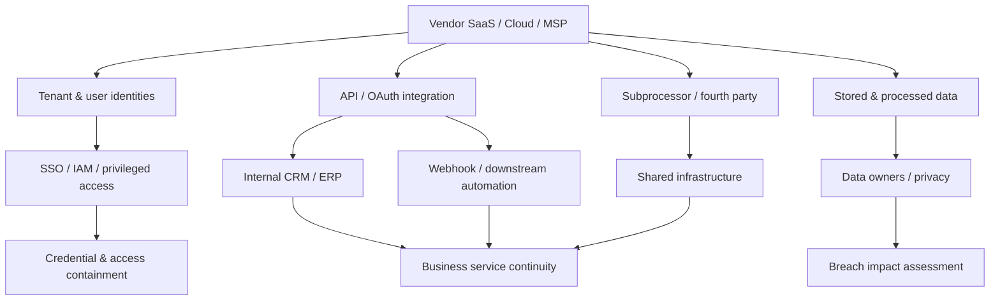
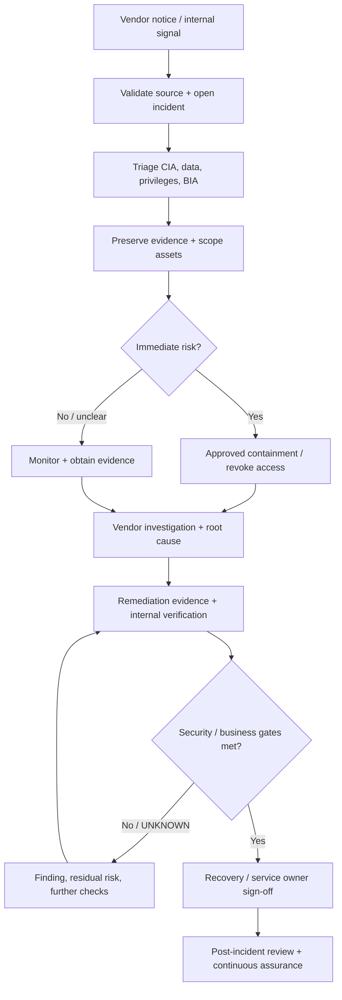

# Vendor incident: Ứng phó sự cố nhà cung cấp và bảo đảm an toàn chuỗi phụ thuộc

## 1. Mục tiêu học tập

Sau bài này, người học có thể:

- Giải thích **vendor incident** trong chương trình **third-party assurance** và phân biệt sự cố ở nhà cung cấp với lỗi dịch vụ thông thường, cảnh báo lỗ hổng, sự kiện bảo mật và sự cố đã được xác nhận.
- Xác định **ranh giới trách nhiệm**, tài sản, dịch vụ, dữ liệu, danh tính, kết nối và các bên thứ tư tiếp theo có thể bị ảnh hưởng.
- Thiết kế cơ chế tiếp nhận thông báo, phân loại mức độ nghiêm trọng, lập timeline, kích hoạt đội ứng phó và phối hợp nhà cung cấp.
- Đánh giá thông tin nhà cung cấp cung cấp bằng **bằng chứng độc lập** từ phía khách hàng: IAM, audit logs, asset inventory, data flows, cấu hình kết nối và trạng thái hệ thống.
- Lập kế hoạch **containment, eradication, recovery, business continuity**, cân bằng an toàn với khả năng duy trì nghiệp vụ và nghĩa vụ bảo toàn bằng chứng.
- Xây dựng tiêu chí **evidence-based assurance** để chứng minh những security controls có liên quan đã được khắc phục, kiểm chứng và tiếp tục vận hành.
- Quản lý việc thông báo cho các bên liên quan, bảo vệ dữ liệu cá nhân, theo dõi hành động và đóng sự cố với rủi ro còn lại được chấp thuận đúng thẩm quyền.

Bài nằm trong chương **Third-party assurance** của dịch vụ `SECURITY_SECURITY_ASSURANCE`. Phạm vi học là đánh giá **có bằng chứng** rằng hệ thống đáp ứng mục tiêu bảo mật, từ phân tích rủi ro, yêu cầu và security controls đến kiểm thử, audit, xử lý phát hiện và duy trì assurance liên tục trong phát triển, vận hành. Khi một nhà cung cấp xảy ra sự cố, tổ chức vẫn phải đánh giá rủi ro trên tài sản và dữ liệu của **chính mình**, chứ không chỉ chuyển tiếp thông cáo của vendor.

## 2. Vendor incident là gì?

**Vendor incident** là một sự kiện tại nhà cung cấp sản phẩm, dịch vụ, nền tảng hoặc hoạt động thuê ngoài có khả năng gây tác động đến **tính bí mật (confidentiality)**, **tính toàn vẹn (integrity)**, **tính sẵn có (availability)**, quyền riêng tư hoặc khả năng đáp ứng nghĩa vụ của tổ chức sử dụng dịch vụ.

Một nhà cung cấp có thể là:

- **SaaS:** CRM, ticketing, HR, email, hệ thống quản trị định danh.
- **Cloud/IaaS/PaaS:** compute, storage, database, CDN, DNS, managed Kubernetes.
- **Managed Service Provider (MSP/MSSP):** vận hành hệ thống, truy cập đặc quyền, giám sát và ứng cứu thuê ngoài.
- **Nhà cung cấp phần mềm/phát hành:** thư viện, image, agent, package registry, update channel.
- **Đối tác xử lý dữ liệu:** payment processor, phân tích dữ liệu, gửi thông báo, chăm sóc khách hàng.
- **Nhà thầu phụ của vendor:** đơn vị lưu trữ, hỗ trợ kỹ thuật hoặc subprocessors có quyền với dữ liệu/dịch vụ.

Một vendor incident có thể là **lộ thông tin xác thực**, **đọc trái phép dữ liệu tenant**, **sửa artifact cập nhật phần mềm**, **ransomware gây outage**, **mất backup**, **bị chiếm hệ thống quản trị** hoặc **mất tính toàn vẹn của kết quả xử lý**.

### 2.1. Phân biệt các tình trạng dễ nhầm

| Tình trạng | Ý nghĩa | Điều cần làm |
|---|---|---|
| **Security event** | Có tín hiệu bất thường, chưa chắc thành sự cố | Thu thông tin và xác minh |
| **Security incident của vendor** | Vendor xác nhận hoặc tổ chức có bằng chứng về hành vi gây ảnh hưởng đến an ninh | Kích hoạt đánh giá tác động và phối hợp |
| **Service outage** | Dịch vụ không sẵn có; nguyên nhân có thể không liên quan an ninh | BCP/DR và xác minh tính toàn vẹn dữ liệu |
| **Vulnerability advisory** | Có lỗ hổng ở sản phẩm/dịch vụ; chưa chắc đã bị khai thác | Asset exposure, mitigation và verification |
| **Data exposure/breach suspected** | Có dấu hiệu dữ liệu có thể bị truy cập/lộ | Xác định dữ liệu, chủ thể, phạm vi và yêu cầu xử lý |
| **Confirmed data breach** | Có bằng chứng đủ theo tiêu chí tổ chức và nghĩa vụ áp dụng | Điều tra, giảm thiểu, xem xét thông báo theo quy định |
| **Vendor assurance finding** | Kiểm soát của vendor không đáp ứng yêu cầu đã đặt | Đưa vào risk register và theo dõi remediation |

**Sự cố nhà cung cấp không tự động đồng nghĩa dữ liệu khách hàng đã bị lấy đi.** Ngược lại, vendor nói “chưa thấy bằng chứng exfiltration” cũng không chứng minh dữ liệu không hề bị truy cập nếu log thiếu, thời gian điều tra chưa đủ hoặc phạm vi chưa được xác minh.

### 2.2. Vì sao không thể chuyển toàn bộ trách nhiệm cho vendor?

Tổ chức thường vẫn chịu trách nhiệm quản lý **quyền tích hợp, danh mục dữ liệu chia sẻ, cấu hình tenant, người dùng, credential, hợp đồng, phương án dự phòng và tác động tới khách hàng**. Nhà cung cấp có thể vận hành hạ tầng, nhưng không nhất thiết biết:

- Dữ liệu nào của tổ chức thực sự được gửi tới họ.
- Token/API key nào của tổ chức đã kết nối với tài khoản vendor.
- Người dùng hoặc nhóm có quyền truy cập dữ liệu nhạy cảm.
- Những workflow downstream dùng kết quả vendor trả về.
- Nghĩa vụ thông báo, ngưỡng RTO/RPO, quy trình nội bộ và chủ rủi ro.

Do đó một thông cáo vendor chỉ là **một nguồn chứng cứ**, không thay thế hoạt động điều tra và xác minh trong phạm vi tổ chức.

## 3. Mục tiêu và nguyên tắc ứng phó vendor incident

Một quy trình ứng phó tốt nhằm đồng thời:

1. **Bảo vệ người dùng và dữ liệu:** chặn quyền truy cập trái phép, giảm tác động lộ hoặc sửa dữ liệu.
2. **Duy trì năng lực nghiệp vụ:** hiểu phụ thuộc để chuyển sang degraded mode hoặc nhà cung cấp thay thế khi được phép.
3. **Giữ bằng chứng:** không làm mất audit log, phiên bản cấu hình, artifact hoặc tài liệu vendor cần đối soát.
4. **Tuân thủ nghĩa vụ:** đánh giá hợp đồng, quy định bảo vệ dữ liệu và yêu cầu thông báo thích hợp.
5. **Quyết định dựa trên bằng chứng:** phân biệt `CONFIRMED`, `SUSPECTED`, `UNKNOWN` và `NOT_APPLICABLE`.
6. **Loại bỏ đường rủi ro:** thu hồi quyền, luân chuyển credential, vá integration, sửa cấu hình, khắc phục root cause.
7. **Khôi phục có kiểm chứng:** xác nhận dịch vụ, dữ liệu, danh tính và các security controls hoạt động trở lại.
8. **Nâng assurance lâu dài:** cập nhật risk assessment, hợp đồng, control tests, dependency map và chương trình theo dõi.

Các nguyên tắc thực hiện:

- **Bắt đầu từ phạm vi ảnh hưởng đến tổ chức**, không chỉ severity vendor tự công bố.
- **Ghi timestamp UTC**, nguồn tin, mức tin cậy và lần cập nhật cuối cho mọi nhận định quan trọng.
- **Áp dụng least privilege** và các thay đổi có phê duyệt; không mở thêm quyền truy cập để “khắc phục nhanh”.
- **Không xóa dấu vết** hoặc thực hiện kiểm thử xâm nhập vào hạ tầng vendor khi chưa có thẩm quyền.
- **Không coi sự im lặng là không có sự cố**; mất telemetry chính là một khoảng trống quan sát.
- **Công khai giới hạn kết luận** và quản trị residual risk thay vì đánh dấu PASS theo áp lực khôi phục.

## 4. Shared responsibility và mô hình nhiều bên

Trong third-party assurance, phải xác định rõ **ai sở hữu control**, **ai vận hành control**, **ai cung cấp evidence**, **ai quyết định xử lý**.

### 4.1. Ví dụ ma trận trách nhiệm

| Hoạt động | Vendor | Tổ chức sử dụng | Điểm kiểm chứng |
|---|---|---|---|
| Điều tra nền tảng vendor | Chủ trì trong hạ tầng họ quản lý | Yêu cầu kết quả và giới hạn phạm vi | Vendor incident report, technical timeline |
| Kiểm soát tenant/config phía khách | Cung cấp tính năng, hướng dẫn | Cấu hình và đối soát quyền thực | Tenant API, IAM export, audit |
| Xác định dữ liệu tổ chức bị ảnh hưởng | Cung cấp loại dữ liệu, hệ thống, tập tenant | Đối chiếu inventory và data flows | Data catalog + vendor evidence |
| Thu hồi API token / OAuth grants | Có thể vô hiệu phía vendor | Thu hồi tại nguồn do mình quản lý, sửa integration | Effective token state, access test |
| Phân loại rủi ro nghiệp vụ | Cung cấp thông tin tác động kỹ thuật | Business/security owner ra quyết định | BIA, threat model, incident log |
| Thông báo các bên | Theo hợp đồng và nghĩa vụ của mỗi bên | Xác định nghĩa vụ độc lập của mình | Legal/privacy assessment |
| Khôi phục dịch vụ | Khắc phục nền tảng vendor | Kiểm end-to-end workflow và dữ liệu của mình | Business test, reconciliation |
| Kiểm chứng và đóng finding | Nộp hành động, bằng chứng sửa lỗi | Xem xét độc lập, chấp nhận rủi ro hoặc yêu cầu thêm | Control assessment, recheck |

Bảng này là **mô hình minh họa**. Nghĩa vụ thực tế phải theo hợp đồng, loại dịch vụ, luật áp dụng và thực tế bên nào có khả năng kiểm soát.

### 4.2. Fourth-party / nth-party incident

Vendor có thể thuê bên khác lưu trữ, xử lý dữ liệu, gửi email, làm support hoặc vận hành CDN. Một sự cố ở **fourth party** có thể ảnh hưởng tới tổ chức dù vendor chính chưa bị xâm nhập trực tiếp.

Cần đặt câu hỏi:

- Vendor chính dùng nhà thầu phụ nào cho dịch vụ/dữ liệu trong phạm vi?
- Bên phụ có quyền truy cập plaintext, key, metadata, backup hoặc môi trường production không?
- Nghĩa vụ báo cáo sự cố có **truyền xuống chuỗi** và vendor chính có đầu mối chịu trách nhiệm không?
- Có thể phân biệt dữ liệu tenant của tổ chức với những tenant khác trong bằng chứng?
- Có phương án giới hạn tác động hoặc thay thế chuỗi cung ứng nếu một phụ thuộc chung mất tin cậy?

Không giả định “hai nhà cung cấp khác nhau” nghĩa là **không chung rủi ro**: cả hai có thể dùng cùng cloud, identity platform hoặc một thư viện cập nhật bị xâm nhập.

## 5. Chuẩn bị trước sự cố: Vendor inventory và risk profile

Không thể xử lý vendor incident nhanh nếu tổ chức không biết mình phụ thuộc nhà cung cấp nào và họ có quyền gì.

### 5.1. Hồ sơ nhà cung cấp cần duy trì

| Thuộc tính | Ví dụ minh họa | Vì sao cần |
|---|---|---|
| `vendor_id` / dịch vụ | `vendor-crm-01 / CRM SaaS` | Kết nối thông báo với asset chính xác |
| Business owner | Customer operations | Xác nhận tác động nghiệp vụ |
| Technical/integration owner | CRM platform team | Thu hồi credential và sửa tích hợp |
| Data owner / privacy contact | Data governance | Xác định nghĩa vụ khi dữ liệu bị ảnh hưởng |
| Risk tier / criticality | High | Ưu tiên và tần suất assurance |
| Data classification | Thông tin liên hệ khách hàng, lịch sử hỗ trợ | Xác định mức tác động lộ dữ liệu |
| Integration inventory | OAuth app, API key, webhook, SSO, file export | Truy blast radius kỹ thuật |
| Privileged access | Tài khoản support, remote admin, delegated IAM | Nguồn có thể leo thang |
| Regions / subprocessors | Khu vực lưu trữ, nhà thầu phụ được biết | Phân tích phạm vi pháp lý và kỹ thuật |
| Logging & evidence access | Vendor portal, tenant audit API | Biết dữ liệu có thể thu khi khẩn cấp |
| Notification channel | Security contact, email bảo vệ, status portal | Tránh bỏ sót thông báo |
| BCP / exit strategy | Export dữ liệu, alternate service, RTO/RPO | Khôi phục nghiệp vụ |
| Contract & DPA refs | Thỏa thuận bảo mật/xử lý dữ liệu | Cơ sở trách nhiệm và nghĩa vụ |
| Last assessment & findings | Review gần nhất, ngoại lệ mở | Đánh giá mức tin cậy trước incident |

### 5.2. Từ third-party risk đến ngưỡng xử lý

Một vendor lưu trữ dữ liệu nhạy cảm hoặc có privileged access production cần quy trình escalation và kiểm chứng chặt chẽ hơn một nhà cung cấp phần mềm không kết nối trực tiếp.

Có thể phân loại theo:

- Loại và lượng dữ liệu vendor xử lý.
- Quyền truy cập: read-only, write, admin, signing key, CI/CD hoặc remote support.
- Mức độ phụ thuộc vào sẵn có: vendor outage có dừng hoạt động trọng yếu không?
- Khả năng thay thế, xuất dữ liệu, phục hồi và mất dữ liệu.
- Đường lan truyền khi vendor bị chiếm: OAuth grants, webhooks, DNS, binary updates, SSO.
- Số lượng fourth parties và mức minh bạch của chuỗi xử lý.
- Mức đủ của audit, evidence và khả năng xác minh độc lập.

**Risk tier không thay thế triage thực tế.** Một vendor tier thấp vẫn có thể gây ảnh hưởng lớn nếu một thay đổi gần đây đã cấp thêm quyền hoặc chuyển dữ liệu mới mà inventory chưa cập nhật.

## 6. Ràng buộc hợp đồng và cơ chế thông báo sự cố

Một chương trình assurance cần thiết kế **trước** các yêu cầu và kênh xử lý vendor incident. Không nên chờ đến khi sự cố xảy ra mới tìm địa chỉ liên hệ.

### 6.1. Các điều khoản cần xem xét trong hợp đồng/DPA

- **Định nghĩa sự cố phải thông báo:** security incident, personal data breach, mất dịch vụ, thay đổi control trọng yếu.
- **Thời điểm kích hoạt thời hạn thông báo:** khi vendor phát hiện, xác nhận, hoặc có nghi ngờ hợp lý theo ngôn ngữ hợp đồng.
- **Thời hạn thông báo và cập nhật:** rõ đơn vị thời gian, múi giờ, kênh liên lạc, trường hợp chưa đủ thông tin.
- **Thông tin tối thiểu:** mô tả, thời điểm, dữ liệu/tenant/regions, tác động CIA, hành động đã làm và điểm liên hệ.
- **Thông báo bổ sung khi tình hình thay đổi:** lịch cập nhật, báo cáo nguyên nhân, kết quả khắc phục.
- **Hỗ trợ điều tra:** log, metadata, artifact phù hợp, timeline, chuyên gia liên hệ.
- **Bảo quản bằng chứng:** retention, integrity, giới hạn quyền, xử lý forensic evidence.
- **Subprocessors:** trách nhiệm truyền đạt sự cố và thông tin những bên ảnh hưởng.
- **Kiểm soát khắc phục:** kế hoạch root cause correction, test/reassessment và quyền yêu cầu xác minh phù hợp.
- **Business continuity và exit:** data export, restore, availability, hỗ trợ chuyển nhà cung cấp khi cần.
- **Phân quyền truy cập và bảo mật truyền dữ liệu:** nơi nhận báo cáo, cách tránh gửi dữ liệu nhạy cảm qua kênh không phù hợp.

**Không có một thời hạn thông báo áp dụng cho tất cả các vendor incidents.** Các ngưỡng có thể khác giữa hợp đồng, hệ thống pháp luật, vai trò của tổ chức đối với dữ liệu, loại dữ liệu và ngành nghề. Bộ phận pháp lý/privacy phải xác định nghĩa vụ thực tế, không lấy một con số mặc định từ ví dụ học tập.

### 6.2. Thông báo ban đầu có thể chưa đầy đủ

Thông báo sớm thường có nhiều trường `UNKNOWN`. Chấp nhận báo cáo ban đầu chưa hoàn chỉnh nếu nêu rõ điều đã xác minh và khi nào có bản cập nhật. **Không nên trì hoãn mọi thông báo chỉ để có root cause cuối cùng**, nếu nghĩa vụ áp dụng yêu cầu thông báo sớm.

Một thông báo tốt phân tách:

- **Confirmed facts:** những điều đã có bằng chứng.
- **Suspected impact:** giả thuyết đang điều tra.
- **Unknowns:** khoảng trống và nguồn dữ liệu còn thiếu.
- **Actions taken:** containment và bảo toàn dấu vết đã thực hiện.
- **Customer action requested:** thao tác nào vendor khuyến nghị, cơ sở và mức khẩn cấp.
- **Next update:** mốc hoặc điều kiện cập nhật và đầu mối chịu trách nhiệm.

### 6.3. Xác minh tính thật của thông báo

Kẻ xấu có thể lợi dụng một vendor incident để gửi phishing, yêu cầu chuyển credential hoặc giả danh support. Khi nhận thông báo:

- Đối chiếu qua **kênh liên hệ đã đăng ký trước**, không chỉ bấm link trong email lạ.
- Kiểm danh tính người gửi, tenant và incident reference trên cổng hỗ trợ có quyền.
- Không cung cấp password, OTP hoặc private key cho người tự xưng thuộc vendor.
- Lưu thông báo gốc cùng metadata cần thiết theo chính sách và giới hạn truy cập.
- Xác định một nguồn “single source of truth” về thông điệp được phê duyệt.

## 7. Phát hiện và tiếp nhận tín hiệu vendor incident

Vendor incident không nhất thiết được nhà cung cấp thông báo đầu tiên.

### 7.1. Các kênh phát hiện

| Nguồn | Tín hiệu | Giới hạn |
|---|---|---|
| Thông báo chính thức của vendor | Incident ID, tenant/service impacted, hướng xử lý | Có thể chậm hoặc chưa xác định toàn bộ phạm vi |
| Status page / service health API | Degradation/outage theo dịch vụ/khu vực | Không phải sự cố availability nào cũng là security incident |
| Tenant audit logs | Token/role, data export, login, admin action bất thường | Phạm vi log có thể giới hạn, retention ngắn |
| IAM/SSO logs của tổ chức | Vendor app consent, token issuance, session access | Chưa thấy vendor backend actions |
| API gateway/network logs | Outbound/inbound với endpoint vendor, webhooks | Không chứng minh nội dung dữ liệu dưới TLS |
| Data classification/transfer logs | Dataset gửi tới vendor, file/export ID | Phụ thuộc vào kiểm soát hiện hữu |
| EDR/SIEM và cloud audit | Remote support activity, agent update, API token usage | Cần correlating identity và nguồn gốc |
| Dependency/asset monitoring | Vendor service không đạt SLO, mất endpoint | Có thể không biết root cause |
| Báo cáo researcher/đối tác | Lỗ hổng hoặc bằng chứng dữ liệu lộ | Cần xác minh trước khi khẳng định |
| Fourth-party notice | Subprocessor hoặc nhà cung cấp hạ tầng công bố sự cố | Khó xác định tenant nào thực sự bị ảnh hưởng |

### 7.2. Intake record tối thiểu

Với bất kỳ nguồn nào, người trực nên ghi:

- Vendor ID, service, tenant/account và owner.
- Thời điểm **vendor nói sự cố bắt đầu**, **vendor phát hiện**, **tổ chức nhận biết**, **thời điểm thu log**: ghi riêng từng mốc.
- Source notification, event/incident reference và bản lưu thông báo gốc.
- Loại sự cố được công bố, mức độ tin cậy và các giả thuyết khác.
- Assets, user groups, data categories, regions, integrations có thể ảnh hưởng.
- Hành động được đề xuất, rủi ro khi thực hiện và người phê duyệt.
- Deadline nghĩa vụ thông báo nếu đã được xác định; nếu chưa, gắn việc làm rõ cho legal/privacy owner.
- Lịch cập nhật tiếp theo, communication owner và liên hệ vendor.

Không gộp “vendor phát hiện lúc 10:00” với “sự cố thực sự bắt đầu lúc 10:00”; ngày bắt đầu có thể được hiệu chỉnh sau điều tra.

## 8. Triage và phân loại mức độ nghiêm trọng

Mức độ nghiêm trọng **đối với tổ chức** có thể khác vendor. Một vendor thông báo ảnh hưởng “Limited” nhưng nếu tenant bị ảnh hưởng nắm quyền ghi vào hạ tầng nhạy cảm, rủi ro có thể cao.

### 8.1. Các chiều đánh giá

| Chiều | Câu hỏi |
|---|---|
| **Confidentiality** | Vendor có thể làm lộ dữ liệu, token, metadata, key hay thông tin khách hàng nào? |
| **Integrity** | Kết quả tính toán, bản ghi, cấu hình, file xuất, update agent hoặc build artifact có thể bị sửa? |
| **Availability** | Quy trình quan trọng nào mất tính sẵn có? Bao lâu thì cần kích hoạt BCP/DR? |
| **Privilege/exposure** | Vendor có quyền admin, remote support, OAuth, API token, signing key hay kết nối mạng? |
| **Scope** | Tất cả tenant, một region, một sản phẩm, một subprocessor hay chỉ một endpoint? |
| **Timing** | Bắt đầu từ khi nào, credential có thể bị dùng bao lâu, log còn bao phủ giai đoạn đó? |
| **Evidence confidence** | Vendor xác nhận hay mới nghi ngờ? Có nguồn độc lập chứng minh? |
| **Regulatory/contractual** | Có dữ liệu thuộc nghĩa vụ riêng và thời hạn cần xử lý không? |
| **Business criticality** | Có tác động tới dịch vụ trọng yếu, thanh toán, BIA hoặc các recovery objectives? |
| **Correlated exposure** | Nhiều vendor hoặc môi trường có dùng chung cùng nền tảng/credential? |

### 8.2. Ví dụ phân loại có điều kiện

- **Critical:** bằng chứng đáng tin cho thấy vendor-held privileged credential đã bị lạm dụng trong production hoặc artifact cập nhật bị thay nhằm chạy mã trái phép trên nhiều hệ thống trọng yếu.
- **High:** dữ liệu nhạy cảm có khả năng bị truy cập, vendor identity có quyền rộng, hoặc outage đe dọa mục tiêu BIA.
- **Medium:** tenant có ảnh hưởng hạn chế đã xác minh, có workaround nhưng cần theo dõi phê duyệt và hành động tiếp theo.
- **Low/Informational:** advisory được xác minh không áp dụng trong phạm vi hiện tại; vẫn ghi lý do và nguồn xác nhận.

Đây là **ví dụ**, không thay thế thang severity của tổ chức. Khi còn thiếu dữ liệu, có thể chọn mức triage tạm thời thận trọng nhưng phải phân biệt mức tác động **có khả năng** với mức **đã xác nhận**.

## 9. Lập bản đồ phạm vi ảnh hưởng và đường lan truyền

Triage tốt đòi hỏi biết vendor kết nối với hệ thống nào, xử lý dữ liệu gì và những đường tác động gián tiếp.



Sơ đồ thể hiện những quan hệ cần **điều tra và xác minh**. Không phải vendor nào cũng có tất cả quan hệ này.

### 9.1. Data-flow và data lineage

Đặt câu hỏi:

1. Tổ chức gửi **loại dữ liệu nào** cho vendor: trực tiếp, định kỳ hay theo sự kiện?
2. Vendor có giữ bản copy, backup, index, audit hoặc export hay không?
3. Có tài khoản support/subprocessor có thể đọc plaintext không?
4. Dữ liệu có chứa identifiers, danh mục nhạy cảm, dữ liệu trẻ em, giao dịch hoặc secrets không?
5. Dữ liệu đã được gửi đến **đối tác downstream** hay kết quả vendor đã được đồng bộ ngược vào hệ thống tổ chức?
6. Có bảng đối chiếu transaction IDs hoặc event IDs để xác định bản ghi trong khoảng sự cố không?
7. Data residency/retention và cam kết xóa dữ liệu có ý nghĩa gì cho điều tra?

Dữ liệu **được mã hóa khi lưu** không tự bảo đảm không lộ nếu vendor component có thể giải mã để xử lý hoặc attacker có quyền ở application plane. Cần kiểm access path thực tế, key scope và loại dữ liệu đã được truy cập.

### 9.2. Danh tính và đường tích hợp

Rà soát:

- SSO/SAML/OIDC applications, OAuth grants và scopes.
- API keys, refresh tokens, service accounts và secrets dùng cho vendor.
- Remote access VPN, privileged support accounts và cloud cross-account roles.
- Webhook endpoints, signatures, allowlists và retry semantics.
- Artifact registries, package update channels, service connectors và automations.
- Những nhóm người dùng có quyền export, impersonate hoặc admin trong tenant.

Nếu vendor có một OAuth scope chỉ đọc một bộ dữ liệu nhỏ thì blast radius khác với scope cho phép **đọc toàn bộ hộp thư hoặc chỉnh tài nguyên cloud**. Đánh giá quyền **hiệu lực**, không chỉ tên app hay role.

### 9.3. Fourth-party và correlated risk

Một nhà cung cấp bị ransomware có thể gián đoạn cả API lẫn kênh support. Một subprocessor bị xâm nhập có thể ảnh hưởng tới hai vendor mà tổ chức tưởng độc lập. Cần ghi nhận các phụ thuộc chung như cloud provider, identity, DNS, CDN, payment rails và backup service, nhưng **không suy đoán chi tiết nội bộ khi không có bằng chứng**.

## 10. Quy trình phối hợp ứng phó và decision gates

Vendor incident thường đòi hỏi hai luồng song song: vendor khắc phục hạ tầng của họ, còn tổ chức giới hạn rủi ro và xác minh phần của mình.



Các hoạt động bảo toàn bằng chứng, containment và đánh giá thông báo pháp lý có thể diễn ra **song song**, tùy mức khẩn cấp. Không chờ vendor có root cause cuối cùng nếu tổ chức đang có đường truy cập có thể bị lạm dụng cần xử lý ngay theo thẩm quyền.

### 10.1. Nhóm vai trò

| Vai trò | Trách nhiệm |
|---|---|
| **Incident commander** | Điều phối, quyết định ưu tiên và trạng thái incident |
| **Vendor management / procurement** | Xác minh đầu mối, hợp đồng, escalation và cam kết khắc phục |
| **Security operations / IR** | Triage, threat hunting, containment, evidence và kiểm chứng |
| **IAM/platform/integration owner** | Thu hồi quyền, rotation, sửa API, SSO, network và data flows |
| **Business service owner** | Xác nhận tác động BIA, degraded mode và cho phép mở lại |
| **Data owner/privacy/legal** | Xác định dữ liệu bị ảnh hưởng và nghĩa vụ thông báo |
| **BCP/DR lead** | Kích hoạt phương án thay thế hoặc restore quy trình |
| **Communications lead** | Đảm bảo thông điệp thống nhất cho nội bộ, khách hàng, đối tác |
| **Evidence custodian/reviewer** | Bảo vệ log/artifacts và xem xét độc lập kết luận |

Tổ chức nhỏ có thể cho một người kiêm nhiều vai, nhưng các **quyết định quyền cao, chấp nhận rủi ro và thông báo bên ngoài** vẫn cần thẩm quyền rõ.

### 10.2. Các điểm GO/NO-GO

- Có nên tạm dừng kết nối API hay vẫn giữ read-only?
- Có cần thu hồi toàn bộ OAuth grant/secret ngay hay chuẩn bị consumer mới trước?
- Có nên tạm dừng đồng bộ dữ liệu từ vendor để tránh đưa dữ liệu bị sửa vào hệ thống chính?
- Đã đủ thông tin để phân loại dữ liệu và kích hoạt nghĩa vụ báo cáo chưa?
- Vendor đã khắc phục nhưng **trạng thái quyền trong tenant** và dữ liệu downstream đã đúng chưa?
- Có đủ bằng chứng để chuyển từ containment sang phục hồi hay cần exception có thời hạn?

Mỗi quyết định phải ghi **ai phê duyệt, tài sản nào, kết quả mong đợi, tác động tới nghiệp vụ và điều kiện kiểm lại**.

## 11. Containment khi một vendor có thể đã bị xâm nhập

Containment nhằm giới hạn tác động trước khi có toàn bộ kết luận forensic. Không có một thao tác đúng cho mọi sự cố.

### 11.1. Các biện pháp có thể cân nhắc

| Kịch bản | Biện pháp tổ chức có thể thực hiện | Kiểm chứng cần có |
|---|---|---|
| API token của vendor có nguy cơ lộ | Revoke/rotate key, giới hạn scope, tắt integration tạm | Key cũ không được chấp nhận, consumer mới đúng quyền |
| OAuth application/vendor connector bị nghi mất tin cậy | Thu hồi grant/session theo phạm vi, đánh giá app permissions | Effective grants và token state |
| Remote support account bị xâm nhập | Vô hiệu/quarantine account, siết remote access | IAM/VPN logs, session invalidation |
| Vendor gửi dữ liệu bị sửa | Dừng ingest, đưa dữ liệu vào quarantine, đối soát source | Data integrity và pipeline state |
| SaaS bị compromise nhưng cần hoạt động tối thiểu | Chế độ read-only hoặc alternate workflow có kiểm soát | BIA minimum service, audit và exposure |
| Agent/update supply chain nghi nhiễm | Tạm dừng rollout theo chính sách, kiểm artifact provenance | Digest/version runtime và nguồn release |
| Cloud service outage | Failover/degraded mode theo DR runbook | RTO/RPO, data correctness, IAM/security gates |

**Tác động của containment phải được cân nhắc:** thu hồi một access key dùng chung có thể làm dừng hàng chục workflow; ngược lại giữ key có nguy cơ lộ sẽ kéo dài khả năng truy cập trái phép. Quyết định phụ thuộc severity, mức tin cậy, thời gian sống của credential, khả năng thay thế và thẩm quyền.

### 11.2. Không gây mất bằng chứng

Trước những thao tác xóa tenant, hủy account, thay quyền lớn hoặc xóa log, cần phối hợp người quản lý bằng chứng để lưu metadata cần thiết: grant ID, phiên, audit export, cấu hình trước/sau, message ID, tài sản và thời gian. Nếu rủi ro đang gây thiệt hại cấp bách, containment có thể phải thực hiện ngay; vẫn ghi rõ **thông tin đã mất, lý do và giới hạn kết luận**.

### 11.3. Không tự ý tấn công hệ thống vendor

Khách hàng có thể kiểm nguồn dữ liệu **thuộc tenant và hệ thống của mình** theo hợp đồng/quyền được cấp. Không tự quét sâu, thử khai thác, truy cập logs cross-tenant hoặc dùng tài khoản vendor không được ủy quyền để “xác minh” incident. Những yêu cầu điều tra hạ tầng vendor cần phối hợp qua kênh security contact và đúng thẩm quyền.

## 12. Evidence preservation và chain of custody

Bằng chứng về vendor incident thường nằm ở **nhiều chủ thể**, có vùng tổ chức tự thu và vùng chỉ vendor mới tiếp cận.

### 12.1. Nguồn chứng cứ cần lập danh mục

| Nguồn | Nội dung | Lưu ý |
|---|---|---|
| Vendor incident notice | Phạm vi, điều kiện, timeline, action, mốc cập nhật | Giữ từng phiên bản, đừng ghi đè bản cũ |
| Vendor technical report | Root cause, attack path, affected assets, remediation | Phân biệt xác nhận và nhận định dự kiến |
| Tenant audit exports | Login, admin actions, exports, token use, config | Kiểm coverage, phân quyền và retention |
| Enterprise IAM logs | SSO, OAuth consent, refresh, privileged sessions | Nối identity qua nhiều hệ thống |
| API/access/proxy logs | Endpoint, timestamp, token ID, source, response | IP có thể là proxy/shared NAT; tránh suy luận quá mức |
| Data transfer inventory | Dataset, job IDs, file hashes khi có, destination | Đối soát dữ liệu có thể bị lộ/sửa |
| Artifact/build evidence | Update digest, registry, signature, SBOM khi phù hợp | Chữ ký chưa đủ khi signing key mất tin cậy |
| Cloud/network inventory | Roles, firewall, routes, external endpoints | Kiểm trạng thái hiệu lực sau sửa |
| Internal decision log | Ai quyết định revoke, failover, notify, reopen | Phục vụ accountability |
| Recheck outcomes | Kết quả quyền, API, data, monitoring sau khắc phục | Chứng minh remediation hiệu lực |

### 12.2. Quy tắc bảo toàn

- Mỗi artifact có **source, collector, thời điểm, phạm vi, phương pháp và evidence ID**.
- Giữ bản gốc hoặc reference có thể kiểm, kèm checksum/hash khi phù hợp.
- Ghi rõ thời gian UTC và cách xử lý timezone/clock skew; timestamp vendor có thể không đồng bộ với hệ thống của tổ chức.
- Giới hạn quyền xem theo vai trò; logs có thể chứa PII, topology, email và định danh nhân viên.
- Dùng cơ chế lưu trữ hạn chế sửa/xóa, retention phù hợp với quy định và nhu cầu điều tra.
- Ghi chuỗi chuyển giao khi evidence được đưa cho bên đánh giá, pháp lý hoặc điều tra.
- Không lưu plaintext token, password, Secret hoặc dữ liệu nhạy cảm không cần thiết trong ticket/chat.
- Bản ghi thiếu hoặc retention đã hết phải được đánh dấu `UNKNOWN` thay vì bịa chuỗi sự kiện.

### 12.3. Bằng chứng vendor cung cấp có giới hạn

Một screenshot dashboard hay tuyên bố “we have fully remediated” chưa đủ để kiểm soát rủi ro của khách hàng. Cần yêu cầu **định nghĩa phạm vi**, **đường xâm nhập**, **tài sản và thời điểm**, **kết quả kiểm tra lại**, **các data gaps** và **ảnh hưởng tới tenant cụ thể**. Nếu vendor không thể cung cấp raw logs vì ràng buộc riêng tư của tenant khác, có thể yêu cầu **attestation đã được xác minh, trích xuất giới hạn, technical briefing hoặc kết quả independent assessment** phù hợp hợp đồng. Phải ghi rõ mức độ tin cậy còn lại.

## 13. Phân tích tác động dữ liệu và quyền riêng tư

Khi có khả năng dữ liệu khách hàng, nhân viên hoặc đối tác bị ảnh hưởng, cần phối hợp data owner/privacy/legal để phân loại.

### 13.1. Các câu hỏi cần trả lời

- **What:** những nhóm dữ liệu và trường nào thực sự nằm ở vendor?
- **Whose:** các chủ thể dữ liệu/tenant, số lượng có căn cứ và tính nhạy cảm?
- **Where:** region, backup, subprocessor và đường chuyển dữ liệu?
- **When:** cửa sổ khả năng truy cập, mốc phát hiện và mốc containment?
- **Who:** principal hoặc bên nào có thể truy cập dữ liệu, quyền nào được dùng?
- **How:** truy cập chỉ metadata, read plaintext, export, modify hay delete?
- **Evidence:** log nào chứng minh hoặc không chứng minh hành vi? Có gap không?
- **Obligations:** quy định/hợp đồng nào áp dụng đối với vai trò của từng bên?
- **Actions:** biện pháp giảm thiểu, nội dung thông báo, contact và thời gian cập nhật?

Đối với dữ liệu cá nhân, nghĩa vụ thông báo có thể phụ thuộc nước/khu vực, vai trò **controller/processor hoặc tương đương**, tính chất dữ liệu, mức rủi ro và thời điểm biết sự cố. **Không tự áp dụng một thời hạn phổ quát.**

### 13.2. “Dữ liệu nằm ở vendor” khác “dữ liệu bị lộ”

Một data inventory cho biết vendor **có khả năng** tiếp cận dữ liệu; nó không tự chứng minh attacker đã đọc toàn bộ dữ liệu đó. Ngược lại, khi log truy cập không đầy đủ, không thể loại trừ tác động chỉ vì vendor không tìm thấy event export.

Một assessment có trách nhiệm tách:

- **Data held/processed:** dữ liệu đã được xác nhận có tại vendor.
- **Data accessible under compromised privilege:** dữ liệu khả dĩ bị truy cập theo quyền và đường kỹ thuật.
- **Observed accessed/exported/modified:** có bằng chứng hoạt động cụ thể.
- **Impact unresolved:** dữ liệu/phạm vi chưa thể kết luận do thiếu bằng chứng.

Cấu trúc này tránh cả **phóng đại** lẫn **giảm nhẹ** rủi ro.

### 13.3. Tính toàn vẹn và kết quả vendor trả về

Không chỉ quan tâm exfiltration. Nếu vendor cung cấp kết quả chống gian lận, thanh toán, kiểm toán hoặc điểm số rủi ro, attacker có thể **sửa kết quả** mà không cần tải dữ liệu đi. Cần đối soát bản ghi ở nguồn có thẩm quyền, IDs giao dịch, checksums và quy tắc nghiệp vụ để phát hiện dữ liệu bị thay đổi.

## 14. Điều tra credential, token và quyền kết nối

Nhiều vendor incidents lan sang khách hàng nhờ **credential được cấp hợp lệ**.

### 14.1. Phân loại quyền

| Kiểu truy cập | Rủi ro | Bằng chứng cần tìm |
|---|---|---|
| API key long-lived | Key có thể dùng từ nơi khác nếu không ràng buộc | Key ID, scope, last-used, revocation state |
| OAuth delegated grants | Vendor app thay mặt người dùng đọc/ghi dữ liệu | App ID, consented scopes, user groups, token events |
| Service principal/workload identity | Vendor automation có quyền rộng hoặc cross-account | Effective IAM, trust policy, audit |
| SSO/federation | Login hoặc session do vendor hỗ trợ | Assertion/token metadata, sign-in logs |
| Remote admin/MSP | Vendor có thể thay đổi production | Privileged access logs, session recording theo chính sách |
| Webhook signed requests | Message giả có thể kích hoạt workflow | Signature validation, key rotation, replay defense |
| Code signing/update channel | Artifact có thể được xem là trusted dù nguồn bị chiếm | Signer state, artifact digest, provenance |

### 14.2. Rotation không chỉ là đổi một giá trị trong Secret Manager

Một kế hoạch cần xác minh:

1. Những hệ thống nào **sử dụng credential cũ** và token có thể được cache ở đâu?
2. Credential có phải nằm trong file backup, log, image hoặc CI variables không?
3. Có refresh token, session, API key khác hoặc delegated grant tương đương không?
4. Thao tác revoke có hiệu lực ngay hay còn TTL/propagation delay?
5. Quyền của credential mới đã giảm xuống **least privilege** chưa?
6. Consumer có chuyển sang credential mới, chạy đúng và được giám sát không?
7. Có bằng chứng token cũ không còn truy cập được tài nguyên nhạy cảm theo phạm vi thử?

**Kết quả API “revoke success” chưa đủ**, nhất là trong hệ thống có nhiều cache, môi trường và các loại credential khác. Cần kiểm **trạng thái hiệu lực** và audit event sau thay đổi.

### 14.3. Webhook và dữ liệu vendor đẩy vào hệ thống

Nếu vendor gửi callback/webhook vào hệ thống khách, rủi ro có thể xuất hiện từ message bị giả hoặc dữ liệu bị thay:

- Xác thực nguồn bằng cơ chế được thiết kế (chữ ký, mTLS, gateway) và kiểm secret/key được quản lý.
- Xử lý replay với timestamp/nonce/event ID theo contract.
- Giới hạn quyền của endpoint và scope dữ liệu được phép cập nhật.
- Kiểm trạng thái nghiệp vụ từ nguồn có thẩm quyền khi webhook chỉ là thông báo.
- Bảo đảm idempotency để retry không tạo giao dịch trùng.
- Quarantine message trong giai đoạn vendor chưa được tin cậy khi cần.

Không tự tin rằng “HTTPS” chứng minh payload đến từ vendor hợp lệ: TLS bảo vệ kênh, còn **xác thực ứng dụng và nội dung** phụ thuộc kiến trúc.

## 15. Kiểm chứng bằng truy vấn và đối soát ở phía tổ chức

Các ví dụ dưới đây chỉ minh họa phương pháp **read-only analysis** trên dữ liệu tổ chức đã được cấp quyền. Không áp dụng trực tiếp cho database chưa kiểm schema, không tự khẳng định kết quả về một vendor cụ thể.

### 15.1. Ví dụ truy vấn audit tích hợp

Giả sử hệ thống chuẩn hóa các sự kiện vào bảng `integration_audit` với các trường `event_id`, `vendor_id`, `principal_id`, `action`, `outcome`, `occurred_at`, `resource_id` và `tenant_id`.

Một truy vấn PostgreSQL minh họa liệt kê hoạt động **thành công** của vendor trong một khoảng nghi bị ảnh hưởng:

```sql
SELECT
    vendor_id,
    tenant_id,
    principal_id,
    action,
    resource_id,
    COUNT(DISTINCT event_id) AS unique_events,
    MIN(occurred_at) AS first_seen,
    MAX(occurred_at) AS last_seen
FROM integration_audit
WHERE vendor_id = 'vendor-crm-01'
  AND occurred_at >= TIMESTAMPTZ '2026-11-27T00:00:00Z'
  AND occurred_at <  TIMESTAMPTZ '2026-11-29T00:00:00Z'
  AND outcome = 'success'
GROUP BY vendor_id, tenant_id, principal_id, action, resource_id
ORDER BY unique_events DESC;
```

Ý nghĩa và giới hạn:

- Dùng **event ID** để giảm đếm trùng do pipeline retry.
- Không thấy event **không chứng minh** vendor/principal không có hoạt động nếu log thiếu, trường ID đổi schema hoặc retention quá ngắn.
- Một event `success` phải được hiểu theo contract producer, có thể chưa chứng minh dữ liệu đã được xuất ra ngoài.
- Timestamp cần xét clock skew, ingest delay và mốc xâm nhập có thể bị vendor hiệu chỉnh.
- Resource ID có thể là thông tin nhạy cảm; chỉ người được quyền mới truy vấn và lưu evidence.

### 15.2. Đối soát token và IAM

Có thể xây các phép so sánh:

```text
Vendor integration inventory (approved)
                ↕
IAM/OAuth grants & active tokens (observed)
                ↕
Enterprise sign-in/API audit logs
                ↕
Vendor tenant audit (nếu có)
                ↕
Effective permissions after remediation
                ↕
Approved exceptions / compensating controls
```

Nếu một vendor báo đã khắc phục nhưng `effective grants` vẫn rộng hơn baseline hoặc secret cũ còn được chấp nhận, finding của tổ chức **chưa được đóng**. Nếu log vendor thiếu nhưng IAM audit của tổ chức vẫn có, dùng dữ liệu bổ trợ để giới hạn đánh giá, đồng thời ghi phần chưa biết.

### 15.3. Kiểm tra data transfer

Nếu tổ chức có export jobs hoặc file transfers, có thể đối soát theo job ID, checksum do **nguồn độc lập** tạo, số bản ghi, data classification, destination và khoảng thời gian. Checksum chỉ chứng minh hai bản có cùng nội dung theo điều kiện phép đo; **không chứng minh ai đã xem nội dung** và không thay thế access audit.

## 16. Bộ câu hỏi cần gửi vendor trong thời gian điều tra

Những câu hỏi hiệu quả phải **cụ thể, trả lời được và gắn tác động tới khách hàng**.

### 16.1. Câu hỏi về timeline và root cause

1. Khi nào vendor xác định bắt đầu, phát hiện và chặn hoạt động bất thường? Những mốc nào được xác nhận bằng log?
2. Initial access hoặc failure mode là gì? Có nhiều đường vào không?
3. Principal, hệ thống, region hoặc subprocessor nào đã bị ảnh hưởng?
4. Privilege level đạt được là gì; có khả năng đọc plaintext, truy cập key, sửa dữ liệu hoặc gửi thông báo giả không?
5. Đã đánh giá persistence, lateral movement, logging impairment và artifact supply chain chưa?
6. Có khoảng thời gian hoặc hệ thống không đủ forensic telemetry không?
7. Những điều kiện nào khiến vendor tin rằng khả năng truy cập trái phép đã bị chặn?

### 16.2. Câu hỏi về tenant và dữ liệu

1. Tenant/account cụ thể của tổ chức có nằm trong phạm vi khẳng định không? Cơ sở xác minh?
2. Dữ liệu nào có thể bị truy cập: metadata, bản sao lưu, file export, plaintext, keys hoặc dữ liệu subprocessor?
3. Có bằng chứng **đã đọc, xuất, sửa hoặc xóa** dữ liệu không? Phương pháp phân biệt?
4. Có thể cung cấp event IDs, thời gian và metadata đã giảm nhạy cảm trong phạm vi tenant không?
5. Vendor đã đối soát log, DB audit, object access và network egress thế nào?
6. Có bản dữ liệu nào bị ảnh hưởng tồn tại ngoài hệ thống vendor chính không?
7. Những thông tin nào hiện chưa thể xác định và sẽ được cập nhật khi nào?

### 16.3. Câu hỏi về remediation và tương lai

1. Những quyền, credential, phiên và service accounts nào đã thu hồi?
2. Hệ thống/image/artifact nào đã rebuild, patch, rollback hoặc kiểm provenance?
3. Security controls nào đã bị lỗi và đã được chứng minh hiệu lực trở lại ra sao?
4. Có forensic/independent review và những giới hạn nào?
5. Vendor có yêu cầu khách hàng rotation, thay cấu hình, upgrade connector hay export dữ liệu không?
6. Test nào cho thấy incident path không còn tái hiện trong phạm vi?
7. Root-cause action items có owner, deadline và ngày recheck không?
8. Vendor đã cải thiện detection, logging, access segmentation và notification như thế nào?
9. Có nguy cơ tái diễn ở các tenants, versions hoặc subprocessors khác không?
10. Có thay đổi lâu dài đối với hợp đồng, data flow, service level hoặc quyền truy cập không?

Đối với thông tin vendor chưa thể chia sẻ, ghi **reason, alternative evidence, impact of unknown và next follow-up**; không tự coi từ chối cung cấp là bằng chứng vendor có hành vi xấu, nhưng cũng không coi đó là PASS.

## 17. Business continuity, disaster recovery và exit strategy

Nếu vendor cung cấp dịch vụ quan trọng, sự cố có thể đòi hỏi duy trì hoạt động hoặc chuyển sang phương án thay thế. **Business continuity** và **security containment** phải phối hợp.

### 17.1. Các lựa chọn

| Chiến lược | Khi nào cân nhắc | Điều phải kiểm |
|---|---|---|
| Tiếp tục dùng vendor trong mode hạn chế | Chức năng tối thiểu có thể duy trì an toàn | Quyền, log, dữ liệu, exception được phê duyệt |
| Tạm dừng một integration | Token/vendor backend có rủi ro cao | Business impact, transaction backlog, retry |
| Chuyển sang provider thứ hai | Có alternate provider thực sự độc lập | Data mapping, legal/privacy, capacity, credentials, test |
| Vận hành thủ công | Có quy trình nghiệp vụ được BIA cho phép | Tính toàn vẹn, danh tính phê duyệt, khả năng đối soát |
| Restore từ dữ liệu backup của tổ chức | SaaS/provider không còn dữ liệu tin cậy | Backup freshness, RPO, quyền và encryption |
| Thoát/hủy hợp đồng/vendor | Trust không thể khôi phục hoặc nghĩa vụ không đáp ứng | Data export, cleanup, continuity, exit verification |

### 17.2. Những phụ thuộc dễ bị bỏ sót

- Export dữ liệu chỉ có thể làm qua API của vendor đang outage.
- Backup nằm cùng tài khoản/subprocessor bị ảnh hưởng.
- Credential failover dùng chung IdP với vendor.
- Vendor mới chưa có quyền xử lý dữ liệu hoặc chưa tích hợp workflow.
- Chuyển provider có thể tạo **duplicate transactions**, nhất là payment hoặc messaging.
- Dữ liệu đồng bộ từ vendor có thể đã bị sửa; cần dữ liệu nguồn và reconciliation.
- Logging, audit, WAF, identity và data retention ở phương án dự phòng chưa đạt baseline.

Một alternate provider trên slide chưa phải **exit strategy đã kiểm chứng** nếu chưa thử data export, mapping, capacity, privacy, IAM và trải nghiệm nghiệp vụ.

### 17.3. Security recovery gate

Trước khi kết nối lại vendor hoặc mở tính năng từng bị vô hiệu:

1. Vendor công bố phạm vi và trạng thái xử lý có bằng chứng phù hợp.
2. Tổ chức xác minh credential, OAuth grants, remote access và network trong phạm vi.
3. Dữ liệu trao đổi hoặc phục hồi đã được kiểm tính toàn vẹn khi cần.
4. Audit pipeline và security monitoring từ cả hai phía đủ theo yêu cầu.
5. Chức năng nghiệp vụ quan trọng đã được thử, RTO/RPO hoặc mục tiêu tương ứng được ghi kết quả.
6. Có biện pháp phát hiện tái diễn, rollback và người chịu trách nhiệm giám sát.
7. Phần chưa biết/ngoại lệ có owner, thời hạn và đúng thẩm quyền chấp nhận.
8. Người ra quyết định ghi **GO/NO-GO** và chứng cứ căn cứ.

“Vendor status page đã xanh” không tự động có nghĩa **tenant của tổ chức an toàn** hoặc dữ liệu đã đối soát.

## 18. Eradication và remediation xuyên ranh giới nhà cung cấp

Nhà cung cấp sửa nền tảng của họ; tổ chức phải sửa **các điều kiện riêng phía mình** có thể bị lợi dụng.

### 18.1. Phân biệt nhiệm vụ

| Lớp | Công việc vendor | Công việc tổ chức |
|---|---|---|
| Root cause tại vendor | Vá lỗi, đóng persistence, rebuild, kiểm forensic | Yêu cầu evidence và đánh giá phù hợp |
| Credential tại vendor | Thu hồi session/token do vendor phát hành | Thu hồi grants/keys do tổ chức phát hành và kiểm hiệu lực |
| Tenant configuration | Sửa global guardrails, patch dịch vụ | Siết tenant RBAC, MFA, retention, logging |
| Data integrity | Khôi phục hoặc đối soát nguồn vendor | Kiểm dữ liệu đồng bộ/đã xuất về hệ thống tổ chức |
| Supply chain | Kiểm build, signing keys, release artifacts | Inventory deployed versions, pin approved artifact |
| Monitoring | Cải thiện logging, detection, alert | Giám sát tenant/API/identity độc lập và kiểm coverage |
| Future resilience | Sửa BCP/DR tại vendor | Kiểm exit strategy, supplier alternatives, data portability |

Một action item `FIXED` do vendor khai báo phải được chuyển thành **kết quả có thể kiểm** như “IAM scope đã giảm”, “old token bị từ chối”, “không còn các build bị ảnh hưởng”, “policy mới có hiệu lực” hoặc “sự kiện audit bắt buộc đến sink”.

### 18.2. Sửa hành vi ở nguồn, không chỉ triệu chứng

Ví dụ vendor connector gửi dữ liệu sai vì tài khoản bị chiếm: xóa một dòng dữ liệu hỏng chưa đủ nếu credential vẫn còn quyền ghi và workflow vẫn tin mọi webhook. Cần kiểm lần lượt **initial access**, **danh tính**, **lỗ hổng integration**, **quyền downstream**, **data reconciliation** và **giám sát sau khắc phục**.

## 19. Từ incident đến third-party assurance control

Mỗi yêu cầu phải liên kết được với **control objective**, **nguồn bằng chứng**, **cách kiểm thử** và **owner**.

| Control ID | Mục tiêu | Tiêu chí kiểm chứng | Evidence |
|---|---|---|---|
| TPA-INC-01 | Vendor trọng yếu có kênh báo sự cố đáng tin | Contact và notification route đã test | Vendor register, tabletop result |
| TPA-INC-02 | Định nghĩa/timing thông báo rõ theo nghĩa vụ | Contract/DPA áp dụng, escalation và owner | Contract mapping, decision record |
| TPA-INC-03 | Phạm vi dữ liệu và quyền vendor được kiểm kê | Dữ liệu, integration và principal có owner | Data flow, IAM inventory, asset IDs |
| TPA-INC-04 | Incident được đánh giá độc lập từ phía khách | Triage có local logs và impact assessment | Log refs, IAM/config snapshots |
| TPA-INC-05 | Containment có hiệu lực | Token/role/network thực đã đổi và test | Revocation state, read-only checks |
| TPA-INC-06 | Evidence được bảo vệ | Chain of custody, quyền, retention đáp ứng | Evidence register, integrity metadata |
| TPA-INC-07 | Vendor remediation được xác minh | RCA/action, re-test, phạm vi rõ | Vendor report + customer validation |
| TPA-INC-08 | Có phương án duy trì nghiệp vụ | BIA/DR/exit scenario được diễn tập | Recovery exercise, RTO/RPO |
| TPA-INC-09 | Phần UNKNOWN/rủi ro tồn dư có owner | Không còn finding quá hạn không phê duyệt | Risk register, approvals |
| TPA-INC-10 | Theo dõi sau incident có tín hiệu | Audit, detection, alert routing được thử | Health metrics, canary evidence |

### 19.1. Các lớp evidence

1. **Design evidence:** hợp đồng, chính sách, data-flow, BIA và vendor risk profile.
2. **Declared evidence:** vendor advisory, cam kết remediation, sơ đồ trách nhiệm.
3. **Observed evidence:** tenant config, IAM, audit, data transfer và trạng thái hiệu lực.
4. **Test evidence:** kiểm revoke, thử integration, đối soát dữ liệu, tabletop, DR/failover.
5. **Operational evidence:** hệ thống giám sát còn nhận event, control vẫn có hiệu lực sau sửa.
6. **Closure evidence:** finding owner, result, reviewer và residual risk đã xử lý.

**Một báo cáo SOC 2/ISO chứng minh phạm vi và thời kỳ được đánh giá theo nội dung báo cáo, không bảo đảm hệ thống chưa từng xảy ra incident hoặc remediation cho một sự cố mới đã hoàn tất.** Cần đọc scope, exceptions, thời hạn báo cáo và các thay đổi sau thời kỳ đánh giá; không lấy chứng nhận làm bằng chứng duy nhất để đóng incident.

## 20. Mẫu bản ghi vendor incident và assurance evidence

Ví dụ YAML dưới đây **hoàn toàn giả lập**, là một record nội bộ để học cách quản lý bằng chứng; không phải schema chuẩn bắt buộc của hệ thống GRC/SIEM.

```yaml
incident_id: VEND-INC-2026-042
vendor:
  vendor_id: vendor-crm-01
  service: "CRM SaaS"
  contract_ref: "CONTRACT-CRM-2025"
  tenant_id: "tenant-example"
incident:
  type: "Suspected unauthorized access to vendor integration"
  status: INVESTIGATING
  detected_by: "Internal IAM alert and vendor notice"
  vendor_reference: "VENDOR-SEC-042"
  first_known_at: "2026-11-28T02:00:00Z"
  vendor_notified_at: "2026-11-28T03:00:00Z"
  customer_received_at: "2026-11-28T03:12:00Z"
scope:
  environments: ["production"]
  integrations: ["crm-oauth", "crm-webhook"]
  data_categories: ["customer-contact", "support-case"]
  confirmed_compromised: []
  potentially_affected:
    - "Vendor integration credential under investigation"
    - "CRM records accessible under previous OAuth scopes"
  unknown:
    - "Exact data reads before vendor telemetry was preserved"
impact:
  confidentiality: "POTENTIAL"
  integrity: "UNKNOWN"
  availability: "MINOR_DEGRADATION"
actions:
  - id: VEND-ACT-01
    owner: "iam-team"
    objective: "Rotate and revoke exposed integration credentials"
    execution_status: "PENDING"
    verification: "Old grant and token no longer accepted"
  - id: VEND-ACT-02
    owner: "crm-platform"
    objective: "Reconcile affected CRM data and webhook deliveries"
    execution_status: "PENDING"
    verification: "Source-of-truth reconciliation completed"
controls:
  - id: TPA-INC-05
    status: PENDING_VALIDATION
  - id: TPA-INC-07
    status: UNKNOWN
evidence_refs:
  - "evidence://vendor-inc-042/vendor-notice-v1"
  - "evidence://vendor-inc-042/iam-audit-window"
  - "evidence://vendor-inc-042/integration-inventory"
owners:
  commander: security-incident-response
  vendor_management: procurement-security
  business: customer-operations
  privacy: privacy-office
next_review: "2026-11-29T03:00:00Z"
```

**Cẩn thận với ví dụ:** `status: INVESTIGATING` và `execution_status: PENDING` nghĩa là chưa có kết luận hoặc thực thi. Các chuỗi `evidence://` là đường dẫn minh họa, chưa chứng minh bằng chứng có tồn tại. Phải lưu evidence thực, có quyền và có thể truy lại trước khi ghi `VERIFIED`.

### 20.1. Bảng hành động before/after

| Finding | Expected | Observed trước | Action | Evidence sau | Điều kiện đóng |
|---|---|---|---|---|---|
| Vendor OAuth scope quá rộng | Chỉ phạm vi CRM đã duyệt | Grant có quyền export toàn bộ | Revoke, cấp lại scope tối thiểu | Effective grant và token test | Quyền cũ không còn và workflow đạt |
| Vendor webhook không xác thực nội dung | Signature/timestamp kiểm đúng | Chỉ dựa vào source IP | Thêm validation và key rotation | Negative/positive tests | Message giả bị từ chối, thông điệp hợp lệ chạy |
| Log thiếu event data export | Audit đủ trong phạm vi | Sink có khoảng mất | Sửa collector, bổ sung đối soát | Pipeline health, test event | Khoảng UNKNOWN được ghi, nguồn hoạt động |
| Vendor khắc phục chưa có evidence | Remediation có scope và test | Chỉ có thông cáo chung | Yêu cầu RCA, technical evidence | Report có giới hạn + local verification | Reviewer chấp nhận có căn cứ |

## 21. Tiêu chí đóng sự cố và quản trị rủi ro tồn dư

Sự cố có thể chuyển khỏi chế độ ứng phó khẩn cấp khi:

1. **Phạm vi** dữ liệu, danh tính, tích hợp và tài sản trọng yếu đã được đánh giá hoặc có ghi rõ phần chưa thể kiểm.
2. **Đường truy cập có rủi ro** đã được vô hiệu/thu hẹp hoặc có biện pháp bù trừ được phê duyệt.
3. **Vendor remediation** đã được mô tả đủ, những control liên quan có bằng chứng thực thi và kiểm tra lại.
4. **Tenant/integration state** của tổ chức được đối chiếu độc lập, không chỉ dựa vào statement của vendor.
5. **Tính toàn vẹn dữ liệu** và các giao dịch liên quan đã được kiểm hoặc có case đang theo dõi và người chịu trách nhiệm.
6. **Business service** đạt mức chức năng đã phê duyệt, có điều kiện phục hồi rõ.
7. **Nghĩa vụ thông báo** đã được bộ phận có thẩm quyền xem xét và thực hiện khi cần.
8. **Audit/detection** có dữ liệu và cơ chế giám sát tái diễn; các data gaps được công bố.
9. **Findings** có owner, mức rủi ro, deadline và bằng chứng recheck hoặc exception được phê duyệt.
10. **Incident commander/business/security reviewers** ký quyết định đóng theo quy trình.

Không cần chờ mọi cải tiến dài hạn hoàn tất để kết thúc trạng thái xử lý khẩn cấp, nhưng **các finding còn mở không được biến mất**. Chúng phải tiếp tục nằm trong risk register với người chịu trách nhiệm và thời hạn.

### 21.1. Phân biệt tình trạng

| Trạng thái | Ý nghĩa |
|---|---|
| `OPEN / INVESTIGATING` | Đang xác minh nguồn, phạm vi và tác động |
| `CONTAINED_IN_SCOPE` | Đã chặn đường rủi ro xác định trong phạm vi ghi |
| `VENDOR_REMEDIATED` | Vendor nói đã sửa; chưa mặc nhiên có customer verification |
| `VALIDATION_PENDING` | Chưa hoàn tất kiểm trạng thái hiệu lực |
| `VERIFIED_IN_SCOPE` | Kiểm chứng các mục tiêu đã xác định có evidence trong phạm vi |
| `PARTIALLY_VERIFIED` | Một số điều kiện đạt nhưng còn gap |
| `UNKNOWN` | Không đủ dữ liệu để kết luận một khía cạnh quan trọng |
| `EXCEPTION_APPROVED` | Rủi ro còn lại được chấp nhận có thời hạn, có owner |
| `CLOSED_WITH_FOLLOWUPS` | Tác động khẩn cấp đã xử lý, findings dài hạn còn theo dõi |
| `REOPENED` | Có bằng chứng mới làm thay đổi kết luận |

Các tên là gợi ý, không phải tiêu chuẩn cứng. Tổ chức có thể dùng hệ thống status riêng nhưng phải bảo toàn **ngữ nghĩa giữa hành động đã thực hiện và kết quả đã được chứng minh**.

## 22. Chỉ số đo hiệu quả chương trình vendor incident

| Chỉ số | Ý nghĩa | Điều dễ hiểu sai |
|---|---|---|
| **Critical vendor coverage** | Vendor trọng yếu có inventory, owner, contact và incident plan / tổng vendor trọng yếu | Bỏ shadow SaaS khỏi mẫu số |
| **Notification timeliness** | Thời gian từ mốc contract-defined trigger đến vendor notice | Dùng giờ tổ chức đọc email thay trigger |
| **Customer awareness latency** | Thời gian từ vendor notice hoặc tín hiệu đầu tiên đến khi có incident nội bộ | Thiếu một kênh nhận thông báo |
| **Impact assessment latency** | Thời gian từ nhận biết đến đánh giá tài sản/dữ liệu ban đầu | Đánh giá sơ bộ không phải final root cause |
| **Credential containment time** | Từ quyết định cần thu hồi đến khi quyền hiệu lực bị chặn | Chỉ đo thời gian nhấn nút revoke |
| **Evidence completeness** | Bản ghi có nguồn, timeline, scope, owner, before/after và review | Đếm tài liệu vendor mà không đọc giới hạn |
| **Vendor remediation verification** | Findings vendor có recheck được / tổng findings cần kiểm | Vendor báo FIXED không phải VERIFIED |
| **Fourth-party visibility** | Phụ thuộc phụ quan trọng đã được nhận diện và đánh giá | Đòi dữ liệu vendor không thể có mà không ghi UNKNOWN |
| **BCP/exit readiness** | Kịch bản alternative/degraded mode đã diễn tập có kết quả | SLA hoặc hợp đồng không chứng minh failover |
| **Residual risk aging** | Findings/exception quá hạn, phân theo mức rủi ro | Ngoại lệ có phê duyệt bị tính như PASS |
| **Post-incident recurrence** | Sự cố/rủi ro quay lại sau khắc phục | Phụ thuộc độ bao phủ của detection |
| **Telemetry blind-spot duration** | Khoảng thời gian thiếu log có thể ảnh hưởng kết luận | Không có alert không có nghĩa không có sự cố |

Ví dụ tổ chức có 80 vendors, 20 được xác định critical; mới có 16/20 có vendor incident contact và integration inventory được kiểm chứng. Trong số 16, 5 nhà cung cấp chưa có bài tabletop thông báo. Báo cáo nên tách **80% coverage thông tin liên hệ/inventory** và **5 vendor chưa kiểm tabletop**, không kết luận 80% toàn bộ chuỗi cung ứng đã sẵn sàng ứng phó.

## 23. Case study: Sự cố tích hợp CRM SaaS với quyền OAuth rộng

**Bối cảnh giả lập:** doanh nghiệp kết nối CRM SaaS với email, ticketing và kho dữ liệu khách hàng. Ứng dụng tích hợp `crm-oauth` từng được cấp quyền đọc hồ sơ khách, tạo activity logs và export báo cáo. Vendor thông báo đã phát hiện một tài khoản hỗ trợ bị chiếm quyền; họ đang điều tra liệu các token hoặc tenant metadata có bị truy cập.

### 23.1. Các tín hiệu ban đầu

- Vendor xác nhận tài khoản support đã bị truy cập trái phép trong một khoảng thời gian.
- Chưa có kết luận vendor support account có quyền tới tenant của doanh nghiệp hay không.
- IAM log của tổ chức ghi thay đổi grant cho `crm-oauth` trước khi vendor thông báo.
- Export jobs ở CRM tăng bất thường nhưng chưa đối soát với business owner.
- Dữ liệu CRM chứa thông tin liên hệ và lịch sử yêu cầu hỗ trợ; chưa biết có tải xuống hay không.
- Webhook vẫn gửi sự kiện tới hệ thống nội bộ, nhưng một số message bị retry nhiều lần.
- Vendor audit log có khoảng retention thiếu 6 giờ trong cửa sổ điều tra.

### 23.2. Những giả thuyết cần kiểm

| Giả thuyết | Nguồn kiểm | Điều chưa thể suy ra |
|---|---|---|
| Support account có quyền vào tenant | Vendor audit, quyền hỗ trợ, tenant settings | Không suy ra từ việc vendor bị xâm nhập chung |
| OAuth grant bị dùng ngoài mục đích | IAM OAuth events, API audit, effective scope | Một thay đổi grant chưa chứng minh data exfiltration |
| Dữ liệu đã bị export | Export job ID, vendor access log, data transfer audit | Job started không đồng nghĩa export completed |
| CRM data bị sửa | Data snapshot, change history, local source-of-truth | Sự kiện update có thể là workflow hợp lệ |
| Webhook bị làm giả | Signature validation, source, event IDs, business state | Retry nhiều không tự chứng minh giả mạo |
| Khả năng mất quan sát 6 giờ | Vendor logging incident, nguồn độc lập | Không được tuyên bố không có hành vi trong khoảng mất |

### 23.3. Kế hoạch ứng phó mẫu

1. **Mở incident nội bộ và giữ vendor notice:** ghi mốc nguồn, incident ID, đầu mối vendor và sự kiện còn thiếu.
2. **Xác minh rủi ro IAM:** lấy OAuth grant hiện hành, scope, principal, các phiên/tokens và nguồn event độc lập.
3. **Containment có phê duyệt:** xem xét revoke grant quá rộng, rotate secrets, tạm ngừng export hoặc đưa webhook vào quarantine theo tác động nghiệp vụ.
4. **Preserve evidence:** lưu event IDs, job IDs, dữ liệu kiểm quyền trước/sau, cấu hình webhook, các phiên bản vendor notice và quyết định.
5. **Assess data:** data catalog cho biết loại dữ liệu accessible; chỉ đánh dấu accessed/exported khi có bằng chứng tương ứng.
6. **Vendor Q&A:** yêu cầu tenant-specific scope, quyền support account, thời gian, log coverage, remediation và next update.
7. **Reconciliation:** đối chiếu những export jobs, hoạt động CRM, tình trạng downstream và bản ghi hỗ trợ.
8. **Recovery:** kiểm grant mới, webhook signatures, integration health, data integrity và audit/detection khi mở lại.
9. **Closure:** ghi những phần không biết vì khoảng retention mất, owner theo dõi và hành động điều tra bổ sung.

### 23.4. Kết luận assurance có điều kiện

> Trong phạm vi tenant CRM và các integration được đánh giá, tổ chức đã kiểm tra quyền OAuth và hành động quản trị, thu hẹp những grant vượt baseline, kiểm trạng thái token sau thay đổi, đồng thời đối soát các export jobs có dữ liệu từ nguồn tin cậy. Chưa đủ bằng chứng kết luận toàn bộ dữ liệu trong khoảng sáu giờ thiếu vendor audit không bị truy cập; phần này tiếp tục được ghi UNKNOWN và theo dõi với vendor. Việc mở lại integration tuân theo quyết định có phê duyệt cùng monitoring tăng cường.

Đây chỉ là **mẫu cách diễn đạt**, không xác nhận incident thật hoặc action đã hoàn thành. Kết luận tốt phải nêu cả phạm vi, bằng chứng và độ bất định còn lại.

## 24. Bài tập vận dụng: Vendor incident ảnh hưởng nhiều dịch vụ

Một doanh nghiệp dùng nhà cung cấp SaaS quản lý khách hàng (`CRM-V`), một MSP có quyền hỗ trợ production (`MSP-A`) và một dịch vụ cloud managed database (`DB-P`). Vendor `CRM-V` thông báo một subprocessor có thể đã bị lộ credential. Cùng ngày:

| Mã | Quan sát |
|---|---|
| A | SaaS CRM lưu dữ liệu liên hệ, lịch sử chăm sóc và file đính kèm ở nhiều tenant |
| B | OAuth app của CRM có quyền đọc rộng vào hệ thống ticketing nội bộ |
| C | Vendor thông báo sau khi phát hiện nhưng chưa rõ thời điểm sự cố bắt đầu |
| D | Một support token của MSP-A dùng chung cho nhiều môi trường |
| E | Số job export CRM tăng, một phần là batch định kỳ được duyệt |
| F | Audit collector SaaS thiếu dữ liệu trong một khoảng thời gian |
| G | CRM outage khiến đội chăm sóc khách hàng không tra cứu được lịch sử |
| H | Vendor nói đã “fully remediated” nhưng chưa cung cấp tenant-specific scope |
| I | Một luồng đồng bộ có thể đã ghi dữ liệu CRM bị sửa vào hệ thống nội bộ |
| J | Contract yêu cầu cơ chế cập nhật thông tin, nhưng đầu mối dự phòng đã nghỉ việc |

### 24.1. Yêu cầu bài làm

1. Lập **vendor incident record** với source, mốc thời gian, owner, suspected/confirmed/unknown và lịch cập nhật.
2. Vẽ **dependency graph** có SaaS, subprocessor, ticketing, MSP, cloud DB, SSO, OAuth, data store và business service; nêu shared dependencies.
3. Phân loại tác động **confidentiality/integrity/availability** cho A–J; phân biệt risk tier vendor với incident severity.
4. Liệt kê những câu hỏi cần gửi CRM vendor để xác định tenant-specific scope, log gap, root cause và remediation.
5. Đề xuất phương pháp thu bằng chứng **không truy cập hệ thống vendor trái phép**.
6. Thiết kế kế hoạch containment cho OAuth grants, MSP shared token, webhook/data sync và cân nhắc gián đoạn business.
7. Xây dựng **quy tắc đối soát export jobs** để phân biệt hoạt động được phê duyệt với hoạt động bất thường.
8. Thiết kế BCP tối thiểu cho đội chăm sóc khách hàng khi CRM outage, không tự hạ yêu cầu riêng tư.
9. Xác định nghĩa vụ/thời hạn cần làm rõ từ legal/privacy và contract owner, tránh áp dụng một hạn thông báo chung.
10. Tạo ma trận **control → expected → observed → evidence → PASS/FAIL/UNKNOWN → owner** cho ít nhất sáu controls.
11. Viết recovery gate để mở lại CRM integration và test webhook, grant scope, data integrity, logging.
12. Viết kết luận assurance khoảng 150–250 từ, nêu rõ điều đã chứng minh, điều chưa thể chứng minh và next review.

### 24.2. Gợi ý đánh giá

- **A:** dữ liệu vendor có không đồng nghĩa đã bị exfiltrate, nhưng data classification làm tăng trọng số triage.
- **B:** đánh giá OAuth scope và principal hiệu lực; thu hồi/quản lý tokens theo phương án có phê duyệt.
- **C:** thời điểm phát hiện khác thời điểm bắt đầu incident; cần timeline và contract-defined trigger.
- **D:** quyền vendor ngoài CRM có thể là **correlated risk** nếu token hoặc trust boundary dùng chung; không suy ra đã compromise khi chưa có bằng chứng.
- **E:** so export job ID, actor, approval và dữ liệu; một spike đơn lẻ chưa đủ kết luận ác ý.
- **F:** log gap tạo `UNKNOWN`, không được biểu diễn như không có sự cố.
- **G:** mở degraded mode/BCP theo BIA, bảo vệ PII và tiếp tục audit các thao tác thủ công.
- **H:** vendor statement chưa đủ closure; cần recheck hoặc evidence phù hợp cho control của khách hàng.
- **I:** incident có thể ảnh hưởng **integrity**; quarantine/compare dữ liệu, tránh tự tin vì không thấy exfiltration.
- **J:** contact stale là finding trong chương trình third-party assurance và phải được khắc phục, kiểm kênh dự phòng.

Bài làm đạt yêu cầu phải liên kết **vendor risk → thông báo → tài sản và dữ liệu → containment → evidence → remediation/recovery → kiểm chứng → residual risk**, thay vì chỉ lập danh sách các khuyến nghị chung.

## 25. Sai lầm thường gặp và cách tránh

1. **Chờ vendor xác nhận toàn bộ trước khi xử lý nguy cơ:** tổ chức có thể cần thu hồi credential hoặc bảo vệ dữ liệu ngay theo quyền và bằng chứng hiện có.
2. **Coi vendor severity là severity nội bộ:** bỏ qua dữ liệu nhạy cảm, tài sản trọng yếu và quyền integration.
3. **Không có vendor/integration inventory:** không biết tenant, token, OAuth app, data flow hoặc chủ sở hữu.
4. **Không phân biệt incident và outage:** lỗi availability chưa chắc có compromise nhưng vẫn cần BCP.
5. **Coi advisory là đã bị tấn công:** phải kiểm product/version/asset exposure và bằng chứng khai thác.
6. **Coi không thấy log là không có truy cập:** log gap, parser lỗi hoặc retention có thể tạo vùng mù.
7. **Tự tin vào một thông cáo ngắn:** thiếu tenant scope, timeline, evidence và remediation checks.
8. **Không điều tra fourth parties:** một subprocessor có thể nắm dữ liệu hoặc quyền quan trọng.
9. **Chỉ sửa kết nối mà không kiểm dữ liệu:** kết quả vendor gửi tới hệ thống có thể bị sửa hoặc mất.
10. **Chỉ rotate một API key:** refresh token, session, grants và credential ở môi trường khác vẫn có thể tồn tại.
11. **Thu hồi bừa mọi tích hợp:** gián đoạn nghiệp vụ lớn và có thể làm mất bằng chứng khi không có kế hoạch.
12. **Không biết vendor có quyền admin:** remote support hoặc cross-account role có thể là đường lan truyền.
13. **Không xác minh notification authenticity:** phishing lợi dụng thông tin sự cố để đánh cắp credential.
14. **Dùng một hạn thông báo pháp lý mặc định:** nghĩa vụ phải xét luật, vai trò, dữ liệu và hợp đồng.
15. **Gửi raw logs chứa PII/Secrets qua email không bảo vệ:** làm tăng tác động của chính sự cố.
16. **Tự quét/khai thác hạ tầng vendor:** có thể vượt thẩm quyền, gây ảnh hưởng và làm mất evidence.
17. **Tin certificate/compliance report là đủ:** phạm vi/thời kỳ đánh giá có thể không bao phủ sự cố mới.
18. **Đóng finding khi vendor nói “fixed”:** cần trạng thái hiệu lực và phép kiểm phía khách.
19. **Không thử alternative provider/exit:** có hợp đồng dự phòng nhưng không thể thực sự chuyển dữ liệu.
20. **Không đo thời điểm sự cố/nhận thông báo riêng:** đánh giá SLA sai và timeline điều tra thiếu.
21. **Không có decision log:** không rõ ai chấp nhận rủi ro khi giữ integration hoạt động.
22. **Không re-test audit/monitoring:** mở lại service nhưng không quan sát được hành vi tái diễn.
23. **Xếp UNKNOWN thành PASS:** dashboard xanh giả khi những giả thuyết quan trọng chưa chứng minh.
24. **Không cập nhật chương trình vendor risk sau incident:** nguyên nhân và rủi ro lặp lại ở vendor khác.
25. **Không theo dõi ngoại lệ:** rủi ro tồn dư tồn tại lâu hơn thời hạn được chấp nhận mà không được báo cáo.

## 26. Tổng kết

**Vendor incident** đòi hỏi tổ chức phản ứng **xuyên ranh giới pháp lý, kỹ thuật và vận hành**. Nhà cung cấp có thể điều tra và khắc phục nền tảng của họ, nhưng tổ chức vẫn phải xác định **dữ liệu và tài sản của mình bị ảnh hưởng thế nào, các integration và quyền có thể bị lạm dụng ra sao, nghiệp vụ cần duy trì ở mức nào và cần bằng chứng nào để chứng minh remediation có hiệu lực**.

Trong dịch vụ `SECURITY_SECURITY_ASSURANCE`, kết quả tốt không đơn thuần là nhận email “incident resolved”. Nó là chuỗi có thể kiểm chứng: **threat/risk → phạm vi vendor và fourth party → thông báo và quyết định → audit/IAM/data evidence → containment → vendor remediation → local verification → recovery gate → residual risk và cải tiến dài hạn**. Mọi kết luận phải ghi rõ **phạm vi, thời điểm, phương pháp, mức độ tin cậy, khoảng trống dữ liệu và chủ sở hữu**; chỉ khi đó chương trình third-party assurance mới hỗ trợ việc duy trì bảo mật và liên tục hoạt động một cách có trách nhiệm.
