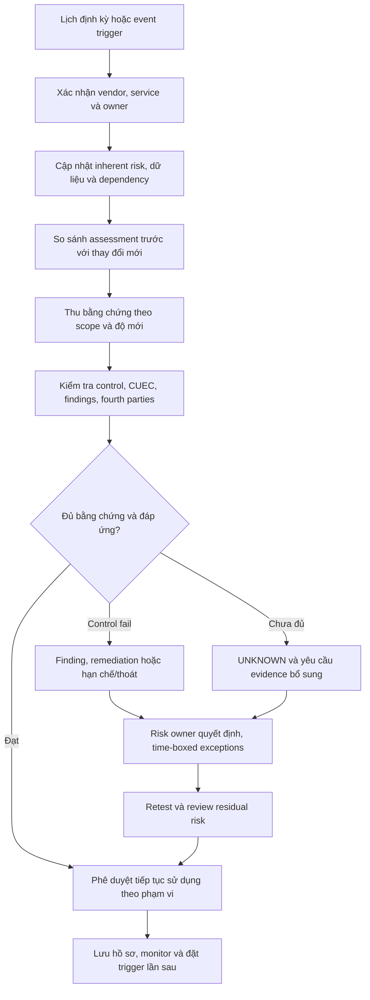

# Đánh giá lại nhà cung cấp: Third-party reassessment dựa trên rủi ro và bằng chứng

## 1. Đánh giá lại nhà cung cấp là gì?

**Đánh giá lại nhà cung cấp** (*third-party reassessment* hoặc *vendor reassessment*) là quá trình xem xét có hệ thống **mức rủi ro, khả năng đáp ứng security controls và điều kiện hợp tác của một bên thứ ba sau khi đã bắt đầu sử dụng dịch vụ**. Mục tiêu là xác định liệu những giả định và bằng chứng dùng khi phê duyệt nhà cung cấp trước đây có còn đúng, những thay đổi nào tạo ra rủi ro mới, và tổ chức nên tiếp tục sử dụng, yêu cầu khắc phục, hạn chế phạm vi hay chấm dứt hợp tác.

Trong chương **Third-party assurance** của module **SECURITY_SECURITY_ASSURANCE**, đánh giá lại là một hoạt động của **security assurance liên tục**: xây dựng kết luận có bằng chứng rằng các yêu cầu bảo mật, quyền riêng tư, khả năng phục hồi và quản trị nhà cung cấp còn đáp ứng mục tiêu đã được phê duyệt.

Ví dụ, một SaaS đang xử lý dữ liệu khách hàng từng có báo cáo kiểm toán độc lập phù hợp. Sáu tháng sau nhà cung cấp bổ sung đơn vị xử lý dữ liệu phụ, thay khu vực lưu trữ, thay kiến trúc IAM và công bố một sự cố. Nếu tổ chức chỉ lưu tài liệu đánh giá ban đầu mà không kiểm tra những thay đổi này, kết luận “nhà cung cấp được phê duyệt” có thể không còn đáng tin.

Câu hỏi của một lần reassessment:

1. Nhà cung cấp hiện cung cấp **dịch vụ nào, cho những hệ thống và dữ liệu nào**, so với lần đánh giá trước?
2. Rủi ro vốn có (*inherent risk*) đã thay đổi do dữ liệu, quyền truy cập, phạm vi địa lý hay độ phụ thuộc chưa?
3. Bằng chứng kiểm soát có **phù hợp đúng dịch vụ, khoảng thời gian và ranh giới trách nhiệm** không?
4. Những findings và ngoại lệ kỳ trước đã được xử lý và **kiểm thử lại** chưa?
5. Có sự cố, thay đổi subprocessor/fourth party, vấn đề tài chính hoặc điểm yếu khả năng phục hồi mới nào không?
6. Ai có thẩm quyền chấp nhận **rủi ro còn lại** (*residual risk*), và việc tiếp tục hợp tác cần điều kiện gì?

**Reassessment không đồng nghĩa gửi lại cùng một bảng câu hỏi hằng năm.** Bảng câu hỏi chỉ là một nguồn dữ liệu. Đánh giá có giá trị khi tập trung vào thay đổi, kiểm chứng bằng chứng, xác định gap và đưa ra quyết định được ủy quyền.

## 2. Phân biệt onboarding, reassessment và continuous monitoring

| Hoạt động | Thời điểm và mục đích | Kết quả cần có |
| --- | --- | --- |
| **Initial due diligence / onboarding** | Trước hợp đồng hoặc trước cấp quyền; kiểm tra rủi ro và điều kiện cho phép sử dụng | Quyết định phê duyệt có điều kiện hoặc từ chối, phạm vi, baseline và owner |
| **Periodic reassessment** | Theo chu kỳ do rủi ro quyết định; đánh giá lại sự phù hợp của bằng chứng, kiểm soát và điều kiện hợp tác | Hồ sơ đối chiếu kỳ trước–kỳ này, findings, residual risk, quyết định |
| **Event-driven reassessment** | Khi có sự cố hoặc thay đổi có ảnh hưởng đáng kể | Đánh giá lại tập trung vào thay đổi/rủi ro, có thể mở rộng phạm vi |
| **Continuous monitoring** | Theo dõi liên tục hoặc thường xuyên tín hiệu thay đổi từ nhiều nguồn | Phát hiện sớm, trigger, bằng chứng mới và cảnh báo cần review |
| **Contract / service review** | Xem hiệu năng, điều khoản và nghĩa vụ của dịch vụ | Đầu vào cho assurance, nhưng không thay thế kiểm tra security controls |
| **Offboarding / exit assurance** | Khi ngừng hoặc chuyển nhà cung cấp | Thu hồi quyền, di chuyển/xóa dữ liệu, kiểm chứng giữ/xóa theo hợp đồng và nghĩa vụ pháp lý |

Continuous monitoring tạo tín hiệu, còn **reassessment đưa ra quyết định đánh giá**. Một cảnh báo về sự cố của nhà cung cấp chưa đủ kết luận vi phạm hợp đồng; cần xác nhận nguồn, mức tác động lên dịch vụ đang sử dụng, biện pháp khắc phục, điều kiện thông báo và bằng chứng.

## 3. Ranh giới trách nhiệm: đánh giá nhà cung cấp không chuyển giao trách nhiệm của khách hàng

Doanh nghiệp có thể thuê bên thứ ba vận hành hạ tầng, ứng dụng, xử lý dữ liệu hoặc giám sát an ninh. Tuy nhiên, việc thuê ngoài **không tự động xóa trách nhiệm quản trị rủi ro và nghĩa vụ của doanh nghiệp đối với dữ liệu/dịch vụ của mình**.

Cần phân định:

- **Provider controls:** điều bên cung cấp vận hành, như bảo vệ trung tâm dữ liệu, quản lý nền tảng SaaS, quản lý nhân sự, backup hoặc xử lý sự cố ở lớp của họ.
- **Customer controls:** điều doanh nghiệp phải tự làm, như cấu hình MFA, provisioning SSO, phân quyền tài khoản, chính sách chia sẻ dữ liệu, cấu hình retention, log export và quản lý khóa theo mô hình dịch vụ.
- **Shared controls:** nơi hai bên phối hợp, như khôi phục dữ liệu, xử lý sự cố, audit, quản lý subprocessor, thay đổi cấu hình và quy trình thông báo.
- **Fourth-party dependencies:** nhà cung cấp của chính bên thứ ba, bao gồm cloud hosting, CDN, payment processor, email service hoặc vendor hỗ trợ; rủi ro có thể ảnh hưởng chuỗi cung ứng ngay cả khi không có hợp đồng trực tiếp với doanh nghiệp.

Ví dụ, nhà cung cấp SaaS có chứng nhận quản lý an ninh không chứng minh doanh nghiệp đã bật MFA cho tài khoản admin SaaS, đã tắt quyền chia sẻ công khai hoặc đang xuất audit logs theo yêu cầu. **Bằng chứng của provider và bằng chứng cấu hình của khách hàng phải được đánh giá riêng.**

## 4. Phân loại nhà cung cấp theo inherent risk

Trước khi yêu cầu bằng chứng mới, hãy cập nhật **risk tier** dựa trên cách sử dụng thực tế. Mức rủi ro vốn có phản ánh mức tổn thất tiềm năng **trước khi tính hiệu lực các biện pháp giảm thiểu**, không phải ấn tượng về thương hiệu hoặc điểm số chứng chỉ.

| Yếu tố | Câu hỏi | Ví dụ làm tăng mức quan trọng |
| --- | --- | --- |
| **Dữ liệu** | Nhà cung cấp đọc/lưu/xử lý loại dữ liệu gì? | Dữ liệu cá nhân nhạy cảm, thông tin tài chính, bí mật kinh doanh |
| **Quyền hệ thống** | Có tài khoản admin, API tokens hoặc truy cập mạng nội bộ không? | Quyền sửa cloud IAM, CI/CD secrets, production database |
| **Khả năng gián đoạn** | Nếu dịch vụ ngừng, nghiệp vụ chịu ảnh hưởng đến đâu? | Một dependency làm ngưng mọi giao dịch thanh toán |
| **Phạm vi khách hàng** | Bao nhiêu người dùng hoặc nhóm dữ liệu bị tác động? | Dịch vụ xử lý dữ liệu toàn bộ khách hàng |
| **Tập trung phụ thuộc** | Có phương án thay thế/exit hợp lệ không? | Single provider, công nghệ khó di chuyển |
| **Địa lý/pháp lý** | Dữ liệu và hoạt động xử lý diễn ra ở đâu? | Chuyển dữ liệu xuyên biên giới cần đánh giá bổ sung |
| **Subprocessors** | Bên thứ ba phụ thuộc những ai? | Dịch vụ phân tích mới có quyền truy cập dữ liệu sản xuất |
| **Change velocity** | Kiến trúc, API, dữ liệu và quyền thay đổi nhanh thế nào? | Thường xuyên đổi dịch vụ, phiên bản hoặc deployment model |
| **Lịch sử rủi ro** | Có incidents, phát hiện audit, vi phạm SLA hay tồn đọng kéo dài? | Lặp lại lỗi logging hoặc khôi phục thất bại |

### Ví dụ thang phân loại nội bộ

- **Critical:** sự cố có thể gây gián đoạn nghiêm trọng, thiệt hại lớn hoặc truy cập vào tài sản nhạy cảm và đặc quyền.
- **High:** xử lý dữ liệu quan trọng hoặc là dependency đáng kể; ảnh hưởng lớn nhưng có một số kiểm soát thay thế.
- **Moderate:** phạm vi dữ liệu/quyền và tác động nghiệp vụ hạn chế.
- **Low:** không có dữ liệu/quyền nhạy cảm, khả năng ảnh hưởng nhỏ và dễ thay thế.

Các mô tả là **ví dụ**, không phải phân loại pháp lý hay chuẩn bắt buộc. Đánh giá có thể dùng trọng số theo ngành, dữ liệu, hệ thống và nghĩa vụ hợp đồng. Phải phê duyệt cách chấm trước khi áp dụng, tránh tùy chỉnh điểm để tạo kết quả đẹp.

## 5. Lập inventory và ranh giới đánh giá

Không thể đánh giá lại đúng nếu chỉ có tên pháp nhân và hợp đồng cũ. Mỗi **vendor–service relationship** nên được định danh độc lập: cùng một công ty có thể cung cấp hai dịch vụ với rủi ro và bằng chứng khác nhau.

### Trường dữ liệu cần thiết

| Thuộc tính | Ví dụ | Mục đích |
| --- | --- | --- |
| Vendor ID / Service ID | VND-024 / customer-analytics | Liên kết hợp đồng, hệ thống và kết quả kiểm tra |
| Legal entity / contracting party | Pháp nhân ký hợp đồng thực tế | Xác định nghĩa vụ và phạm vi bằng chứng |
| Business owner / technical owner | Customer Operations / Platform | Người quyết định sử dụng và người vận hành tích hợp |
| Processing purpose | Phân tích yêu cầu hỗ trợ | Đối chiếu data minimization |
| Data categories | Pseudonymous customer IDs, support content | Xác định rủi ro riêng tư và retention |
| Access and integrations | SSO, SCIM, API, webhook, data export | Đo bề mặt tấn công và shared controls |
| Hosting/location | Các vùng xử lý/lưu trữ đã xác nhận | Kiểm tra nghĩa vụ địa lý/dữ liệu |
| Fourth parties | Subprocessor list và chức năng | Xác định phụ thuộc chuỗi |
| Recovery dependencies | RTO/RPO, khả năng export, exit strategy | Xác định concentration/continuity risk |
| Contractual controls | DPA, notification, audit right, SLA | Đánh giá nghĩa vụ đã cam kết |
| Last assessment | Version, ngày, người duyệt và evidence refs | So sánh kỳ trước và độ mới |
| Findings/exceptions | ID, owner, deadline, trạng thái retest | Không bỏ quên rủi ro đã biết |

Inventory nên được đối chiếu giữa **procurement/contract registry, finance/payment records, SSO app inventory, cloud IAM, egress integrations, DNS, secrets và các catalog dịch vụ** trong phạm vi tổ chức cho phép. Nhà cung cấp thực tế có thể được mua bằng thẻ công ty, cài qua marketplace hoặc kết nối qua OAuth mà chưa xuất hiện trong hệ thống procurement: đó là **shadow third-party risk**.

Không được tính độ phủ reassessment chỉ trên số nhà cung cấp đã được đăng ký; nguồn quan hệ sử dụng thực tế bị thiếu phải được đưa vào mẫu số hoặc ghi rõ unknown.

## 6. Khi nào phải đánh giá lại? Chu kỳ và trigger

Chu kỳ reassessment phải dựa trên **mức rủi ro, loại dịch vụ, yêu cầu hợp đồng/pháp lý và tốc độ thay đổi**, kết hợp với các sự kiện phát sinh. Không có một mốc “12 tháng” mặc định phù hợp mọi nhà cung cấp và mọi control.

### Lịch ví dụ để thiết kế chính sách

| Risk tier | Nhịp đánh giá tổng thể minh họa | Các theo dõi bổ sung |
| --- | --- | --- |
| Critical | Ít nhất định kỳ theo lịch phê duyệt, ví dụ mỗi 6 tháng | Continuous/event-driven triggers, review findings và dịch vụ quan trọng |
| High | Ví dụ hằng năm | Kiểm tra report mới, incidents và thay đổi vật chất |
| Moderate | Ví dụ 12–24 tháng | Đối chiếu hợp đồng, thay đổi và bằng chứng còn hạn |
| Low | Theo mức rủi ro và thay đổi | Inventory/contract refresh, kiểm tra sự kiện liên quan |

**Đây là lịch minh họa**, không phải quy tắc chuẩn; tổ chức phải xác định lịch riêng và các trường hợp buộc tăng tần suất. Một vendor Critical có thể cần đánh giá tập trung ngay sau một sự cố, không đợi đến kỳ tiếp theo.

### Event-driven reassessment triggers

1. **Security incident hoặc breach đáng kể** tại nhà cung cấp/subprocessor có khả năng liên quan dữ liệu hoặc dịch vụ đang dùng.
2. **Thay đổi phạm vi xử lý dữ liệu:** loại dữ liệu mới, mục đích sử dụng mới, dữ liệu cá nhân nhạy cảm hoặc dùng dữ liệu cho hệ thống AI mới.
3. **Chuyển vùng lưu trữ/xử lý**, thay data residency hoặc điều khoản subprocessor.
4. **Thay đổi quan trọng về quyền:** thêm tích hợp production, OAuth scopes, API token, remote access, admin role hoặc federation trust.
5. **Thay đổi kiến trúc và bảo mật:** đổi nền tảng hosting, cloud region, identity, mã hóa, recovery model hoặc log retention.
6. **Phát hiện kiểm toán mới:** SOC report có qualified/adverse opinion, ngoại lệ quan trọng, chứng nhận bị đình chỉ/hết hiệu lực hoặc thay đổi phạm vi.
7. **Service availability/DR incident:** không đáp ứng khôi phục, downtime lặp lại, data loss hoặc phát hiện concentration risk.
8. **Mua bán/sáp nhập, thay đổi chủ sở hữu, tài chính bất ổn** có thể ảnh hưởng cam kết cung cấp dịch vụ.
9. **Thay đổi hợp đồng/luật áp dụng** hoặc yêu cầu khách hàng đòi hỏi kiểm soát mới.
10. **Finding quá hạn hoặc remediation không chứng minh hiệu lực** ở lần đánh giá trước.

Mỗi trigger cần có **nguồn tin, thời điểm, người xác minh, ngưỡng ảnh hưởng và hành động**. Không phải mọi tin tức tiêu cực đều đồng nghĩa vendor fail; phải xác định có tác động tới **dịch vụ và phạm vi đang sử dụng** không.

## 7. Quy trình reassessment dựa trên thay đổi và bằng chứng

Một quy trình có thể tổ chức thành tám bước:



### Các bước triển khai

1. **Khởi tạo assessment:** lưu lý do, trigger, service scope, reviewer, due date, version baseline.
2. **Xác nhận trạng thái sử dụng thật:** business owner cập nhật data flows, identities, service features, volumes và dependencies.
3. **Đối chiếu kỳ trước:** risk tier, findings, exceptions, thay đổi kiến trúc, controls và bằng chứng đã hết hạn.
4. **Thiết kế evidence request có mục tiêu:** ưu tiên nguồn bên thứ ba độc lập và kết quả thử nghiệm cho vùng rủi ro trọng yếu.
5. **Đánh giá theo control:** liên kết bằng chứng với yêu cầu và ranh giới phạm vi; tìm lỗ hổng.
6. **Ra quyết định có điều kiện:** tiếp tục, giới hạn dữ liệu/quyền, yêu cầu remediation, thay đổi điều khoản hoặc exit.
7. **Retest:** xác minh thay đổi có hiệu lực, không chỉ nhận câu trả lời “đã sửa”.
8. **Kết thúc và theo dõi:** cập nhật inventory, finding register, next review trigger và hồ sơ phê duyệt.

Cần ghi **điều gì thay đổi so với kỳ trước**. Bản reassessment chỉ lặp lại câu “ISO 27001 valid” mà không kiểm tra dịch vụ mới hoặc sự cố mới là thiếu chiều sâu.

## 8. Vai trò và RACI cho việc đánh giá lại

| Vai trò | Trách nhiệm chính | Bằng chứng |
| --- | --- | --- |
| **Third-party risk / vendor assurance** | Quản lý methodology, assessment plan, findings và tập hồ sơ | Assessment ID, baseline version, control mapping |
| **Business owner** | Xác nhận mục đích sử dụng, tác động và nhu cầu tiếp tục dịch vụ | Business criticality, change approval, residual risk decision |
| **Security / Architecture** | Đánh giá IAM, dữ liệu, logging, pen test và integration security | Technical assessment, test/evidence refs |
| **Privacy / Legal** | Đánh giá xử lý dữ liệu, nghĩa vụ thông báo, hợp đồng, subprocessor | Legal/privacy review, DPA, approval |
| **Procurement / Vendor management** | Điều phối bằng chứng và cam kết từ nhà cung cấp | Contract/renewal record, evidence request history |
| **BC/DR team** | Xem năng lực recovery và dependencies | DR test evidence, exit readiness |
| **Vendor owner / vendor security team** | Cung cấp thông tin đáng tin và kế hoạch khắc phục | Reports, attestation, remediation plan, responses |
| **Risk acceptance authority** | Phê duyệt hoặc từ chối residual risk theo thẩm quyền | Decision record, điều kiện và expiry |
| **Assurance / Audit reviewer** | Kiểm tra đủ bằng chứng, tính nhất quán và khả năng truy vết | QA/assessment outcome và test of controls |

Một cá nhân có thể giữ nhiều nhiệm vụ trong tổ chức nhỏ nhưng cần kiểm soát xung đột lợi ích. Người muốn gia hạn hợp đồng nhanh có thể không phù hợp để **tự chấp nhận một finding Critical mà không có phê duyệt độc lập**.

### Ví dụ RACI

| Hoạt động | Vendor Risk | Business Owner | Security | Legal/Privacy | Vendor Manager |
| --- | --- | --- | --- | --- | --- |
| Phê duyệt phạm vi reassessment | A/R | C | C | C | I |
| Xác nhận dữ liệu và tích hợp thực tế | C | A/R | R | C | I |
| Đánh giá security evidence | A | I | R | C | C |
| Đánh giá DPA và nghĩa vụ dữ liệu | C | C | C | A/R | R |
| Yêu cầu remediation và theo dõi | A | C | R | C | R |
| Chấp nhận residual risk | C | R (khi đúng thẩm quyền) | C | C | I |
| Kết thúc assessment và lên lịch review | A/R | I | C | C | R |

**RACI là ví dụ**, không tự thay chính sách ra quyết định của doanh nghiệp.

## 9. Xây ma trận controls trước khi yêu cầu tài liệu

Một chương trình đánh giá không nên gửi bảng câu hỏi dài hàng trăm câu mà không xác định **mỗi câu trả lời dùng để chứng minh control nào**.

| Control ID | Mục tiêu | Evidence cần xét | Điểm mù thường gặp |
| --- | --- | --- | --- |
| **TP-01** | Inventory và data flow chính xác | Service inventory, architecture, API scopes | Dịch vụ mới không nằm trong phạm vi đánh giá |
| **TP-02** | IAM/MFA/privileged access được kiểm soát | Access policy, review results, customer tenant config | Báo cáo provider không bao phủ quyền phía khách hàng |
| **TP-03** | Dữ liệu được phân loại, bảo vệ và giới hạn mục đích | DPA, encryption controls, retention, deletion test | Chưa rõ subprocessor hoặc dữ liệu thực tế |
| **TP-04** | Vulnerability và change management hoạt động | Independent report, remediation trends, sample evidence | Scanner report cũ, chỉ có policy không có kết quả |
| **TP-05** | Logging, detection và incident handling phù hợp | Audit coverage, sample alert/incident test, notification runbook | Không biết khách hàng có nhận log/notification không |
| **TP-06** | BC/DR có thể đạt mục tiêu | Restore test, recovery evidence, RTO/RPO contract | Backup success bị coi là restore success |
| **TP-07** | Fourth-party risks được quản trị | Subprocessor register, material change notifications | Subprocessor carve-out không được kiểm tra |
| **TP-08** | Quyền audit/contract và nghĩa vụ thông báo phù hợp | Signed contract, DPA, SLA, audit clause | Cam kết marketing không được đưa vào hợp đồng |
| **TP-09** | Findings và exceptions được xử lý | Gap register, plan, before/after retest | “Đã đóng” trên ticket mà không có test |
| **TP-10** | Exit và trả/xóa dữ liệu có thể thực hiện | Data export test, deletion evidence, revocation plan | Dữ liệu bị giữ ở backup/subprocessor không rõ |
| **TP-11** | Bằng chứng được đánh giá đúng scope và thời gian | SOC/ISO report review, evidence index | Chứng chỉ của pháp nhân khác hoặc scope khác |
| **TP-12** | Vận hành integration thuộc trách nhiệm khách hàng | SSO/SCIM, logging export, token scopes, IAM review | Bỏ qua complementary customer controls |

Ma trận nên khác nhau theo **dịch vụ**. Vendor chỉ cung cấp tài liệu marketing không cần các phép kiểm production API access như MSSP có quyền admin; ngược lại, vendor quản trị cloud IAM cần mức assurance cao hơn.

## 10. Chất lượng bằng chứng: scope, thời gian, tính độc lập và khả năng tái dựng

Mọi bằng chứng cần kiểm tra ít nhất năm khía cạnh:

1. **Scope:** có áp dụng đúng pháp nhân, dịch vụ, môi trường, vùng địa lý và control liên quan không?
2. **Period / freshness:** kết quả thuộc thời điểm hay khoảng thời gian nào? Có gap kể từ kỳ đánh giá cuối?
3. **Reliability:** tự khai, kiểm toán độc lập, kiểm thử trực tiếp hay log hệ thống? Nguồn đã được xác minh chưa?
4. **Exception coverage:** có lỗ hổng, qualifications, exclusions, remediation chưa hoàn tất không?
5. **Reproducibility / traceability:** reviewer có tái dựng được kết luận từ evidence ref, version và tiêu chí kiểm tra không?

### Thang bằng chứng minh họa

| Bằng chứng | Mức độ đóng góp | Cẩn trọng |
| --- | --- | --- |
| Marketing brochure | Mô tả tính năng được công bố | Không phải chứng minh cấu hình/hiệu lực thực tế |
| Vendor questionnaire có người xác nhận | Cung cấp lời khai có thể yêu cầu giải thích | Tự khai chưa được kiểm chứng; có thể hết hạn |
| Approved policies / system design | Cho thấy ý định và thiết kế kiểm soát | Không chứng minh control được thực thi liên tục |
| Configuration screenshot / readback | Quan sát trạng thái cấu hình ở một thời điểm | Có thể thiếu tính liên tục và phạm vi |
| Independent audit report | Đánh giá kiểm soát theo phạm vi và thời kỳ báo cáo | Không bao phủ ngoài scope, chưa chắc mọi exceptions đều không quan trọng |
| Controlled test / sample operation | Cho thấy control hoạt động trong điều kiện thử | Không tự suy ra mọi môi trường hoặc thời gian đều được bảo vệ |
| Independent corroboration + ongoing monitoring | Tăng độ tin cậy khi có nhiều nguồn phù hợp | Vẫn phải xác định nguồn lỗi chung và phạm vi |

**Không coi một file PDF có logo kiểm toán là bằng chứng đầy đủ** nếu không kiểm tra đúng phiên bản, đối tượng được kiểm toán, thời kỳ, ý kiến kiểm toán và các điều kiện khách hàng phải tự thực hiện.

### Hạn chế về khả năng truy cập

Một số nhà cung cấp chỉ chia sẻ SOC report qua NDA hoặc trust portal. Bộ phận đánh giá phải tuân thủ điều kiện truy cập và sử dụng, giới hạn người được xem, không sao chép công khai. Nếu không được cung cấp bằng chứng cần thiết, đánh giá phải ghi **UNKNOWN/gap** theo policy, cùng phương án thay thế hoặc quyết định chấp nhận rủi ro, thay vì suy ra PASS.

## 11. Đọc SOC 2 đúng cách trong reassessment

**SOC 2** là báo cáo theo phạm vi về kiểm soát của một tổ chức dịch vụ đối với các tiêu chí Trust Services được xét. Cần đọc toàn bộ các phần liên quan, không chỉ trang đầu hoặc kết luận tổng thể.

### Type 1 và Type 2

- **SOC 2 Type 1:** xem thiết kế và việc triển khai controls tại **một thời điểm xác định**, theo phạm vi báo cáo.
- **SOC 2 Type 2:** bao gồm đánh giá thiết kế và **hiệu quả vận hành** của controls trong **một khoảng thời gian được xác định**, theo phạm vi và phương pháp của kiểm toán viên.

Type 2 không mặc nhiên “chứng minh nhà cung cấp an toàn mãi mãi”; một thay đổi sau kỳ báo cáo có thể tạo ra gap cần đánh giá lại. Cũng không được giả định báo cáo có đủ các tiêu chí Trust Services cho mọi nghĩa vụ: phạm vi báo cáo phải được đọc cụ thể.

### Checklist đọc SOC report

| Thành phần | Câu hỏi reviewer phải trả lời |
| --- | --- |
| Organization/service scope | Dịch vụ và pháp nhân đang sử dụng có nằm trong system description? |
| Report type & period | Type nào, thời kỳ nào; có khoảng trống tới hiện tại không? |
| Auditor opinion | Ý kiến kiểm toán; có qualified/adverse/disclaimer hoặc giới hạn quan trọng nào? |
| Control tests | Những control nào được thử, thủ tục nào, kết quả và deviations? |
| Exceptions | Ngoại lệ nào ảnh hưởng mục tiêu bảo mật và mức rủi ro của khách hàng? |
| **CUECs** | *Complementary User Entity Controls*: khách hàng phải tự triển khai controls nào? |
| Subservice organizations | Có subservice được xử lý bằng **inclusive** hay **carve-out** method? |
| Subsequent events | Có sự kiện quan trọng sau kỳ báo cáo cần xem bổ sung? |
| Gap / bridge period | Có thư cập nhật hoặc bằng chứng khác đủ phù hợp cho khoảng chưa được báo cáo? |

**Carve-out** có nghĩa các controls tại tổ chức phụ được loại khỏi phạm vi đánh giá tương ứng; không nên tự cho rằng kiểm toán của nhà cung cấp chính đã bao phủ toàn bộ fourth parties. Một **bridge letter** thường do nhà cung cấp phát hành để mô tả một số thay đổi/sự kiện giữa các kỳ; nó không tương đương một báo cáo kiểm toán Type 2 mới và phải được đánh giá về nguồn, độ tin cậy và phạm vi.

### Ví dụ nhận định đúng

*“SOC 2 Type 2 kỳ 01/01–30/09 đánh giá các control được mô tả cho dịch vụ SaaS A. Báo cáo không kiểm toán hoạt động của subservice B theo phương pháp carve-out; nhà cung cấp nêu các CUECs về MFA và review users. Tổ chức đã kiểm tra MFA/review ở tenant mình nhưng chưa có bằng chứng về B và thay đổi tháng 10, nên TP-07 vẫn UNKNOWN.”*

Kết luận như trên **cụ thể và có giới hạn** hơn “SOC 2 = đạt 100%”.

## 12. ISO 27001, pentest, chứng nhận và questionnaires

**Chứng nhận ISO/IEC 27001** hỗ trợ đánh giá hệ thống quản lý an toàn thông tin (ISMS) trong **phạm vi chứng nhận**, không chứng minh từng chức năng SaaS hoặc endpoint đang an toàn tuyệt đối. Khi sử dụng:

- Xác minh tổ chức được chứng nhận, scope, địa điểm, ngày hiệu lực, đơn vị chứng nhận và trạng thái có căn cứ.
- Xem phạm vi ISMS có bao gồm dịch vụ/dữ liệu đang xử lý không, hay chỉ một văn phòng/phòng ban.
- Đánh giá yêu cầu riêng không được chứng nhận trực tiếp: logging export, subprocessor, data residency, customer tenant config.
- Không tự suy đoán từ một chứng nhận ISMS rằng mọi kiểm soát kỹ thuật sản phẩm đã được kiểm thử.

**Pentest summary** hỗ trợ phát hiện các vấn đề trong scope, phiên bản và thời gian kiểm thử. Nó không chứng minh không còn lỗ hổng, đặc biệt nếu nhà cung cấp đã thay kiến trúc, endpoint hoặc code. Reviewer nên kiểm tra thời điểm, đối tượng, mức độ rủi ro, phương pháp, findings mở, remediation và retest. Không cần yêu cầu raw exploit details nếu chúng làm lộ thông tin nhạy cảm và không phục vụ quyết định.

**Security questionnaires** như những bảng hỏi do doanh nghiệp hoặc ngành sử dụng có giá trị làm đầu vào và giải thích khác biệt; câu trả lời “Yes” không chứng minh control hoạt động. Với vendor Critical, nên yêu cầu **evidence-based follow-up** đối với các claims nhạy cảm hoặc chưa nhất quán.

## 13. Đánh giá lại data protection và privacy

Khi vendor xử lý dữ liệu, reassessment phải đối chiếu **mục đích sử dụng, loại dữ liệu, nơi xử lý, retention, các bên được chia sẻ và khả năng xóa/trả dữ liệu** với hợp đồng và nghĩa vụ áp dụng.

### Ma trận dữ liệu cần duy trì

| Hạng mục | Cần xác minh | Bằng chứng phù hợp |
| --- | --- | --- |
| Data categories | Loại dữ liệu thực sự gửi tới provider | Data mapping, sample schema đã làm sạch, integration review |
| Purpose limitation | Có mục đích mới hoặc AI/training use không? | DPA, product terms, config và dữ liệu sử dụng thực |
| Data location | Lưu, truy cập, hỗ trợ và backup ở đâu? | Subprocessor list, architecture, residency terms |
| Encryption | Mã hóa vận chuyển/lưu và key access thế nào? | Control description, config và key ownership |
| Access governance | Nhân viên/subprocessor nào có quyền trên dữ liệu? | RBAC, access review, support access procedure |
| Retention | Sau kết thúc hợp đồng hoặc hết hạn dữ liệu ra sao? | Policy, deletion procedure, test/certificate theo thỏa thuận |
| Incident notification | Trigger, nội dung và thời hạn theo hợp đồng/pháp luật | DPA/contract, incident runbook, test/records |
| Data subject requests | Có khả năng hỗ trợ yêu cầu liên quan dữ liệu khi áp dụng? | Workflow, SLA và bằng chứng xử lý mẫu phù hợp |
| Fourth-party disclosure | Dữ liệu được truyền cho ai, ở chức năng nào? | Danh sách subprocessor và change notice |

Đối với chuyển dữ liệu xuyên biên giới, quy định có thể khác theo quốc gia, loại dữ liệu và vai trò các bên. **Không áp dụng một cơ chế hoặc thời hạn thông báo chung cho mọi tổ chức.** Legal/Privacy cần xác định yêu cầu thực tế theo pháp luật và hợp đồng hiện hành.

### Một ví dụ thay đổi đáng kể

Nhà cung cấp SaaS bổ sung tính năng “tự động tóm tắt hội thoại bằng AI” và công bố sử dụng đối tác mô hình bên ngoài. Dù tính năng có thể hữu ích, tổ chức phải kiểm tra nó có **tự bật**, có đưa nội dung khách hàng ra hệ thống khác, có retention/training use mới, có data residency khác và có lựa chọn tắt hoặc giới hạn không. Đây là **trigger reassessment**, không phải chỉ là feature update.

## 14. IAM, remote access và security controls phía khách hàng

Những nhà cung cấp có quyền truy cập vào hệ thống của doanh nghiệp cần được đánh giá ở **hai mặt: kiểm soát vendor và cấu hình/hoạt động của khách hàng**.

Các yêu cầu đáng chú ý:

1. Danh tính cá nhân hay workload identity nào đang truy cập? Có dùng shared accounts không?
2. MFA/SSO/federation được áp dụng trên các tài khoản có quyền cao chưa?
3. Quyền OAuth/API scopes, service principal, IAM role/trust policy còn theo nguyên tắc tối thiểu chưa?
4. Access được cấp theo thời hạn, môi trường, network path và lý do nghiệp vụ nào?
5. Có review và thu hồi khi hợp đồng, nhân sự hoặc phạm vi dịch vụ thay đổi không?
6. Vendor support access có được log, phê duyệt, kiểm tra và có thể revoke không?
7. Các secret/certificates/token do vendor sở hữu và phía khách hàng quản lý được bảo vệ/rotate ra sao?

Ví dụ vendor cung cấp báo cáo SOC 2 Type 2, nhưng tích hợp của khách hàng cho phép OAuth app đọc **toàn bộ dữ liệu** trong khi chức năng chỉ cần đọc một thư mục. Đây có thể là **customer-side control failure**, phải tạo finding tại phía doanh nghiệp chứ không xem như lỗi được SOC report của vendor bao phủ.

## 15. Fourth parties, supply chain và concentration risk

**Fourth-party risk** là rủi ro phát sinh từ nhà cung cấp của nhà cung cấp. Đánh giá lại phải xác định các phụ thuộc có tác động trọng yếu dù doanh nghiệp không có hợp đồng trực tiếp.

### Những trường hợp cần xem xét

- Cloud hosting hoặc DNS/CDN của nhà cung cấp SaaS có thể tạo **common-mode failure** với hạ tầng của doanh nghiệp.
- Subprocessor xử lý dữ liệu khách hàng có thể đổi khu vực hoặc bổ sung loại dữ liệu.
- Công cụ CI/CD, artifact registry, thư viện phần mềm của provider có thể ảnh hưởng integrity của bản phát hành.
- Nhà cung cấp phụ giữ khóa, backup, logging hoặc hệ thống hỗ trợ có thể là điểm yếu tập trung.
- Nhiều vendors độc lập về pháp nhân nhưng cùng phụ thuộc một khu vực cloud có thể gặp sự cố đồng thời.

### Ma trận minh họa

| Vendor | Fourth party | Vai trò | Tác động nếu lỗi | Điều cần xác minh |
| --- | --- | --- | --- | --- |
| SaaS CRM | Cloud provider X | Hosting + backup | Không truy cập CRM, có thể gián đoạn toàn vùng | DR scope, location, recovery proof |
| SaaS CRM | Email provider Y | Gửi email thông báo | Chậm xử lý khách hàng | SLA, failover của notifications |
| CI vendor | Artifact registry Z | Lưu package và image | Build/deploy bị chặn hoặc artifact bị thay | Integrity, provenance, revocation |
| Customer support SaaS | AI subprocessor Q | Tóm tắt nội dung yêu cầu | Rủi ro chia sẻ dữ liệu ngoài mục đích | Processing scope, retention, residency, opt-out |

Đừng biến sơ đồ fourth parties thành danh sách vô hạn. Ưu tiên **những quan hệ có quyền với dữ liệu/tài sản quan trọng hoặc là dependency khó thay thế**. Ghi rõ phần chưa có bằng chứng và dựa vào điều khoản thông báo thay đổi để cập nhật.

## 16. Security incident, notification và khả năng phối hợp

Một sự cố của nhà cung cấp **không tự động có cùng tác động** lên mọi khách hàng. Cần xác định hệ thống nào bị ảnh hưởng, dữ liệu nào có thể bị lộ, đường tích hợp nào có thể bị lạm dụng và kết quả khắc phục.

### Reassessment sau incident

| Câu hỏi | Bằng chứng cần có |
| --- | --- |
| Incident liên quan dịch vụ/scope của chúng ta không? | Affected service statement và kiểm tra asset/integration thực tế |
| Bắt đầu từ khi nào, được phát hiện lúc nào? | Timeline của vendor, thông tin đã xác minh và unknowns |
| Loại dữ liệu hoặc quyền nào có thể bị ảnh hưởng? | Data flow, access inventory, logs khả dụng |
| Vendor đã containment/eradication/recovery thế nào? | Incident summary, controls changed, test/remediation evidence |
| Có ảnh hưởng phía khách hàng cần xử lý? | Key rotation, OAuth revoke, forensic review, log checks |
| Các biện pháp mới đã được retest chưa? | Follow-up report, technical verification khi được phép |
| Có nghĩa vụ hợp đồng/pháp lý nào phải hành động? | Legal/Privacy review, notification record theo quy định áp dụng |
| Rủi ro còn lại và kế hoạch theo dõi? | Risk decision, expiration, action owners |

Tránh chỉ nhận thông cáo báo chí và ghi “issue resolved”. Có thể cần minh chứng về **nguyên nhân, phạm vi, controls sửa đổi và các biện pháp phía khách hàng**. Nếu vendor từ chối cung cấp chi tiết vì bảo mật điều tra, có thể chấp nhận báo cáo tổng hợp/attestation thích hợp, nhưng phải ghi rõ giới hạn assurance.

## 17. Business continuity, disaster recovery và exit strategy

Rủi ro bên thứ ba không chỉ là lộ dữ liệu. Một dịch vụ có thể an toàn về confidentiality nhưng trở thành điểm nghẽn nghiêm trọng về availability và recoverability.

Một reassessment nên yêu cầu:

- **RTO/RPO** có ý nghĩa với nghiệp vụ và điều khoản dịch vụ; phân biệt cam kết của vendor với mục tiêu BIA phía khách hàng.
- **Bằng chứng restore/failover** theo phạm vi dịch vụ và thời kỳ phù hợp; backup success không đồng nghĩa khôi phục end-to-end.
- **Subservice dependencies** của DR, bao gồm IdP, DNS, KMS, queue và nguồn telemetry.
- **Khả năng dữ liệu có thể export:** định dạng, tính đầy đủ, phân quyền, thời gian thực hiện, giá/giới hạn API và kiểm tra dữ liệu xuất.
- **Exit plan:** chuyển đổi nhà cung cấp, song song vận hành nếu cần, thu hồi quyền, chuyển khóa/certificates và xác minh xóa/retention.
- **Concentration risk:** một cloud region hoặc vendor chung cho nhiều quy trình quan trọng.
- **Khả năng thông báo/cộng tác khi incident:** đầu mối 24/7 nếu nghiệp vụ đòi hỏi, escalation và bằng chứng test liên lạc.

Một lời cam kết “99,9% uptime” không tự chứng minh dữ liệu có thể chuyển sang provider khác, hay việc restore sẽ đạt RTO/RPO nội bộ. Cần các phép thử và điều kiện chấp nhận riêng.

## 18. Hợp đồng là security control nhưng cần kiểm chứng hiệu lực

Một điều khoản hợp đồng chỉ có giá trị assurance khi được nối với cách vận hành và bằng chứng áp dụng. Các hạng mục thường cần review:

| Điều khoản / quyền | Câu hỏi reassessment | Evidence |
| --- | --- | --- |
| Confidentiality & data use | Vendor có dùng dữ liệu ngoài mục đích không? | Signed DPA/contract, terms change, config review |
| Security measures | Biện pháp bảo vệ và scope có thay đổi không? | Security schedule, updated control evidence |
| Incident notification | Ai liên hệ, trigger/format/hạn theo hợp đồng? | Signed clause, runbook, incident/test records |
| Subprocessor approval/notice | Có cơ chế thông báo thay đổi và objection khi áp dụng? | Subprocessor list, change notices, acceptance records |
| Audit & assurance rights | Doanh nghiệp có thể nhận evidence hay kiểm toán theo điều kiện nào? | Contract clause, report access và thực hành |
| Business continuity | Cam kết về availability, recovery và hỗ trợ sự cố? | SLA, recovery report, service credits khi liên quan |
| Exit/deletion | Dữ liệu được trả/xóa và backup còn lại thế nào? | Exit clause, retention policy, deletion evidence |
| Material changes | Vendor phải thông báo thay đổi gì? | Change clause và change notice log |
| Liability/insurance | Rủi ro tài chính còn lại được xử lý theo hợp đồng? | Legal/commercial review, không dùng làm bằng chứng kỹ thuật |

Báo cáo chứng nhận và hợp đồng là hai lớp khác nhau. Một dịch vụ có security marketing mạnh nhưng hợp đồng **không có quyền lấy evidence tối thiểu** có thể gây rủi ro quản trị; một hợp đồng có quyền audit nhưng doanh nghiệp chưa từng sử dụng nó khi có trigger cũng chưa chứng minh quy trình assurance hoạt động.

## 19. Chấm điểm rủi ro có kiểm soát và giới hạn kết luận

Có thể dùng risk score để **ưu tiên**, nhưng không nên biến điểm tổng thành sự thật tuyệt đối. Mỗi tổ chức phải định nghĩa tiêu chí, trọng số, phê duyệt và cách xử lý UNKNOWN.

### Mô hình minh họa

Giả sử điểm rủi ro vốn có được xác định theo **Impact (I)** và **Likelihood (L)**, mỗi yếu tố từ 1 đến 5 theo tiêu chí đã được duyệt:

\[
\text{Inherent risk score}=I \times L.
\]

Sau khi đánh giá controls, có thể tính một **ước lượng** rủi ro còn lại để ưu tiên, nhưng không nên đơn giản coi chứng chỉ như “trừ 10 điểm” nếu chưa có phương pháp xác định hiệu lực. Ví dụ một ma trận **không có ý nghĩa chuẩn hóa**:

| Vendor–service | I | L | Inherent score | Tình trạng control | Quyết định |
| --- | ---: | ---: | ---: | --- | --- |
| Managed CI/CD có quyền deploy production | 5 | 4 | 20 | CUEC chưa đạt; token quá rộng | Hạn chế quyền và yêu cầu khắc phục trước mở rộng |
| SaaS analytics xử lý dữ liệu pseudonymized | 3 | 3 | 9 | Report phù hợp nhưng subprocessor mới UNKNOWN | Tạm giới hạn dữ liệu, điều tra thay đổi |
| Tool nội bộ chỉ tạo tài liệu public | 1 | 2 | 2 | Scope đơn giản, evidence phù hợp | Duy trì theo lịch thấp rủi ro |

**Các số này chỉ minh họa**. Một vendor có impact cao và thiếu bằng chứng không được tự nhận rủi ro thấp vì provider “nổi tiếng”. UNKNOWN phải được ghi riêng với residual risk và quyết định hạn chế hoặc chấp nhận tạm thời.

### Tách ba trạng thái

- **Inherent risk tier:** độ quan trọng trước các controls.
- **Control assessment result:** PASS / FAIL / UNKNOWN / EXCEPTION / NOT_APPLICABLE theo từng control.
- **Residual risk decision:** chấp nhận, chấp nhận có điều kiện, không chấp nhận, tạm dừng/chấm dứt hoặc cần bổ sung bằng chứng.

Không nên dùng một score duy nhất thay thế ba lớp. Điều này đặc biệt quan trọng khi provider có chứng chỉ còn hiệu lực nhưng có một finding nghiêm trọng về data deletion hoặc incident notification.

## 20. Phân loại PASS, FAIL, UNKNOWN và ngoại lệ

| Trạng thái | Khi áp dụng | Ví dụ |
| --- | --- | --- |
| **PASS** | Control áp dụng, có evidence phù hợp scope/thời kỳ và đáp ứng điều kiện | Kiểm chứng MFA cho privileged accounts thuộc phạm vi đã duyệt |
| **FAIL** | Có evidence một điều kiện bắt buộc không đạt | Audit report nêu control test failure liên quan dịch vụ Critical và chưa được khắc phục |
| **UNKNOWN** | Thiếu dữ liệu/không có quyền/không đủ độ mới để kết luận | Subprocessor mới chưa cung cấp thông tin cần thiết |
| **EXCEPTION** | Sai khác đã được risk owner chấp nhận với scope, điều kiện, hết hạn và kiểm soát bù trừ | Gia hạn sử dụng có hạn khi nhà cung cấp đang khắc phục finding |
| **NOT_APPLICABLE** | Control không áp dụng theo mô hình dịch vụ và baseline đã phê duyệt | Yêu cầu truy cập production network không áp dụng cho vendor không có integration |

Khi một bằng chứng cũ hết hạn, đánh giá **không nhất thiết là FAIL** về hoạt động của control; có thể là **UNKNOWN** cho đến khi có dữ liệu đủ mới. Ngược lại, nếu điều khoản bắt buộc phải có báo cáo hằng kỳ và vendor không cung cấp đúng hạn, **chính nghĩa vụ cung cấp report** có thể là FAIL. Cần tách **điều chưa chứng minh được** và **điều đã chứng minh không đạt**.

## 21. Mẫu baseline cho vendor reassessment

Dưới đây là một schema YAML **khái niệm của hệ thống đánh giá giả định**, không phải cấu hình sẵn cho GRC hay tiêu chuẩn quốc tế:

```yaml
vendorReassessment:
  id: TPA-REASSESS-PROD
  version: "1.0.0"
  state: approved
  owner: Third Party Risk Management
  scope:
    criticality: [critical, high]
    environments: [production]
  triggers:
    periodic: risk-based
    eventDriven:
      - material-security-incident
      - new-subprocessor
      - data-purpose-or-residency-change
      - privilege-scope-expansion
      - audit-opinion-or-certificate-change
      - repeated-sla-or-recovery-failure
  evidenceRequirements:
    maxAgePolicy: "defined-per-control-and-risk-tier"
    serviceScopeMustMatch: true
    sourceAndVersionRequired: true
    noAutoPassOnMissingEvidence: true
  checks:
    - id: TP-01
      requirement: "Service usage, integration and data flow are current"
      requiredEvidence:
        - authoritative-vendor-service-inventory
        - actual-integration-review
        - business-owner-approval
      onMissingEvidence: UNKNOWN
    - id: TP-07
      requirement: "Material subprocessors are identified and reviewed"
      requiredEvidence:
        - current-subprocessor-register
        - material-change-notification
        - assessment-of-relevant-fourth-parties
      onMissingEvidence: UNKNOWN
    - id: TP-09
      requirement: "Previous material findings have verified remediation"
      requiredEvidence:
        - previous-finding-register
        - approved-remediation
        - post-change-retest
      onMissingEvidence: UNKNOWN
    - id: TP-10
      requirement: "Exit and deletion obligations are testable"
      requiredEvidence:
        - signed-exit-and-deletion-terms
        - export-procedure
        - completed-exit-or-test-record
      onMissingEvidence: UNKNOWN
  decision:
    authorizedByRole: Business Risk Owner
    requireSecurityReviewForCritical: true
    requirePrivacyReviewForPersonalData: true
    exceptionRequiresExpiry: true
```

Các tên khóa như `onMissingEvidence` hay `authorizedByRole` cần được hiện thực bằng rules/evaluator trước khi dùng. **Có baseline** không tự chứng minh vendor đạt; phải liên kết evidence thực tế và quyết định review cho mỗi vendor–service.

## 22. Mẫu hồ sơ reassessment có thể kiểm toán

Một hồ sơ cần lưu được **scope, changes since last review, từng control, bằng chứng, quyết định và residual risk**.

```json
{
  "assessmentId": "TPA-2026-011",
  "vendorId": "VND-024",
  "serviceId": "customer-analytics",
  "assessmentReason": "material-subprocessor-change",
  "scope": {
    "environment": "production",
    "dataCategories": ["pseudonymous-customer-id", "support-metadata"],
    "processingRegions": ["region-a"],
    "criticality": "high"
  },
  "baselineId": "TPA-REASSESS-PROD",
  "baselineVersion": "1.0.0",
  "previousAssessmentRef": "evidence://tpa/VND-024/2026-q1",
  "assessedAt": "2026-11-28T08:00:00Z",
  "materialChanges": [
    "new-analytics-subprocessor",
    "new-data-export-api"
  ],
  "evidenceRefs": [
    "evidence://tpa/VND-024/report-review",
    "evidence://tpa/VND-024/subprocessor-list",
    "evidence://tpa/VND-024/data-flow-map"
  ],
  "controlResults": {
    "TP-01": "PASS",
    "TP-03": "UNKNOWN",
    "TP-07": "UNKNOWN",
    "TP-09": "PASS",
    "TP-10": "FAIL"
  },
  "findings": ["TPA-FIND-031", "TPA-FIND-032"],
  "decision": {
    "status": "CONTINUE_WITH_CONDITIONS",
    "approvedByRole": "Business Risk Owner",
    "restrictions": [
      "no-sensitive-data-export",
      "new-subprocessor-feature-disabled"
    ],
    "expiry": "2026-12-31T23:59:59Z",
    "nextReviewTrigger": "evidence-received-or-expiry"
  }
}
```

**Đây là ví dụ giả định**, không phải kết quả kiểm toán hay quyết định hợp đồng thật. Một hồ sơ thực tế cần đính kèm người đã phê duyệt cụ thể theo hệ thống tổ chức, timestamp và thay đổi condition rõ. Các đường `evidence://` chỉ biểu đạt references; bằng chứng cần được lưu trong kho phù hợp, có kiểm soát truy cập và retention.

### Nguyên tắc không được bỏ qua

*“CONTINUE_WITH_CONDITIONS” không đồng nghĩa tất cả controls đã PASS.* Cần ghi rõ trạng thái UNKNOWN/FAIL, lý do sử dụng có điều kiện, giới hạn dữ liệu/quyền, thời hạn và người chịu trách nhiệm kiểm tra lại. Nếu điều kiện hết hạn mà không được phê duyệt lại, quy trình phải escalation hoặc thực hiện hạn chế/exit theo chính sách.

## 23. Case study: SaaS mới bổ sung subprocessor phân tích dữ liệu

### Bối cảnh

Một công ty dùng SaaS hỗ trợ khách hàng. Dịch vụ nhận email, định danh khách hàng và nội dung trao đổi. Reassessment định kỳ trước đây ghi vendor High và kết luận tương đối tốt dựa trên hợp đồng, SOC report và các technical controls. Đầu tháng này, nhà cung cấp công bố **subprocessor mới** cho chức năng phân tích và đồng thời bổ sung khả năng export dữ liệu qua API.

Business owner đề xuất gia hạn ngay vì SLA hoạt động tốt; security team nhận thấy **phạm vi xử lý dữ liệu và quyền truy cập đã thay đổi**.

### Phân tích có chứng cứ

| Bước | Câu hỏi/hành động | Bằng chứng |
| --- | --- | --- |
| 1. Xác nhận trigger | Subprocessor có xử lý nội dung khách hàng của tenant này không? Feature mặc định bật hay tắt? | Change notice, tenant config, data-flow review |
| 2. Kiểm tra pháp lý/privacy | DPA có bao phủ mục đích, dữ liệu, nơi xử lý và bên mới? | Signed DPA, subprocessor terms, legal assessment |
| 3. Xác định scope SOC | Report hiện hành có đánh giá subservice mới không? Có carve-out không? | Report scope, period, subservice method, CUECs |
| 4. Kiểm tra integration | Data export API mới có quyền gì và ai sử dụng? | OAuth scopes/API key inventory, access log |
| 5. Kiểm tra controls dữ liệu | Encryption, retention, delete/export khi dùng feature mới | Config, documentation, test/attestation |
| 6. Review findings | Các lỗ hổng cũ còn mở? Đã retest? | Gap register, vendor action plan, test record |
| 7. Đánh giá rủi ro | Nếu thiếu evidence, khách hàng/dữ liệu nào có thể ảnh hưởng? | Risk analysis, data categories, dependencies |
| 8. Quyết định có điều kiện | Có thể tắt feature và giới hạn dữ liệu cho tới khi kiểm tra xong? | Configuration readback, approval, expiry |
| 9. Retest và kết thúc | Có đủ bằng chứng và đáp ứng security/privacy controls? | Follow-up review và assessment decision |

### Kết luận cần phân biệt

- **TP-01 PASS** nếu inventory, data-flow, API scopes và phạm vi sử dụng đã được cập nhật/kiểm tra.
- **TP-03 UNKNOWN** nếu chưa rõ dữ liệu nào gửi cho subprocessor và retention nào áp dụng.
- **TP-07 UNKNOWN** nếu mới có thông báo nhưng thiếu đánh giá subprocessor liên quan; không nên mặc định là FAIL cho mọi control.
- **TP-10 FAIL** nếu hợp đồng yêu cầu cơ chế export/xóa đã thỏa thuận nhưng bài test chứng minh vendor không hỗ trợ theo điều kiện bắt buộc.
- **Risk decision:** có thể tạm giữ dịch vụ trong phạm vi cũ, tắt tính năng mới và hạn chế export theo approval, **nếu** rủi ro còn lại chấp nhận được và không vi phạm yêu cầu bắt buộc.

Điểm học thuật quan trọng là **một thay đổi có thể không phủ định tất cả bằng chứng cũ**, nhưng có thể khiến một số claims mất giá trị hoặc cần dữ liệu bổ sung. Reassessment có chất lượng xác định đúng controls bị ảnh hưởng thay vì kết luận trắng đen “vendor có SOC 2 thì an toàn” hoặc “có subprocessor mới là phải dừng ngay”.

## 24. Case study thứ hai: MSP có quyền quản trị cloud production

Một nhà cung cấp dịch vụ quản trị (MSP) có tài khoản kỹ thuật hỗ trợ cloud production. Đợt reassessment phát hiện:

- Nhà cung cấp vẫn có SOC report phù hợp với tổ chức dịch vụ.
- Hai service principals của họ đang có quyền rộng hơn phạm vi công việc.
- Một tài khoản khẩn cấp cũ không còn owner nhưng vẫn hoạt động.
- Hợp đồng có điều khoản review truy cập, nhưng hồ sơ review gần nhất đã quá kỳ.
- Vendor đề nghị hoãn khắc phục đến kỳ gia hạn hợp đồng.

### Không đánh giá bằng chứng đơn nguồn

SOC report là đầu vào đánh giá controls tại vendor; **quyền hiệu lực trong cloud tenant của khách hàng là bằng chứng trực tiếp về customer-side security posture**. Không thể coi account cũ và token rộng là PASS chỉ vì vendor có báo cáo kiểm toán.

| Finding | Rủi ro | Hành động/điều kiện |
| --- | --- | --- |
| Privileged access quá rộng | Bị lạm dụng quyền production hoặc thay đổi cấu hình không được phép | Review effective permissions, giảm scope theo least privilege |
| Break-glass account không có owner | Không thể quy trách nhiệm, có khả năng duy trì quyền lâu dài | Xác nhận nhu cầu, vô hiệu hóa/thu hồi theo change process |
| Access review thiếu bằng chứng | Không thể chứng minh kiểm soát định kỳ | Thực hiện review, log approver và quyết định từng access |
| Vendor trì hoãn remediation | Residual risk tiếp tục trong giai đoạn hợp tác | Risk owner quyết định thời hạn, hạn chế quyền hoặc thay provider |

Sau khắc phục, phải kiểm tra **quyền hiệu lực tại cloud IAM và các phiên/token còn hoạt động**, không chỉ nhận email “đã cập nhật chính sách”. Nếu thực hiện revocation có thể làm gián đoạn dịch vụ, cần phối hợp thay đổi có kiểm soát và rollback an toàn, không bỏ qua retest.

## 25. Evidence chain, bảo mật tài liệu và truy xuất audit

Hồ sơ vendor thường chứa thông tin nhạy cảm: kiến trúc, findings pentest, SOC reports dưới NDA, danh sách subprocessor, dữ liệu hợp đồng, kế hoạch khôi phục và thậm chí điều tra sự cố. Chương trình assurance phải bảo vệ chính kho bằng chứng của mình.

### Evidence chain

```text
Vendor-service inventory và risk tier
    -> Baseline/control áp dụng
    -> Evidence request và nguồn gốc tài liệu
    -> Scope/period/exception review
    -> Control test và kết quả PASS/FAIL/UNKNOWN
    -> Finding, owner và residual risk decision
    -> Remediation và retest
    -> Approval tiếp tục/hạn chế/exit
    -> Monitoring triggers và review tiếp theo
```

### Điều kiện quản trị

1. **Provenance:** nhà cung cấp, tên pháp nhân, service, ngày nhận, phiên bản và nguồn tải được xác minh.
2. **Access controls:** người có quyền xem theo vai trò; tuân thủ NDA và điều kiện truy cập trust portal.
3. **Integrity:** giữ bản gốc và hash/kiểm soát version nếu yêu cầu, cùng audit trail cho sửa/xóa.
4. **Data minimization:** không copy raw pentest exploit, credentials hoặc dữ liệu cá nhân không cần thiết vào ticket.
5. **Retention:** theo chính sách và nghĩa vụ thực tế, không lưu vô thời hạn chỉ để có điểm audit cao.
6. **Decision traceability:** lý do đánh giá, ý kiến reviewer, người chấp thuận, các hạn chế và hạn hiệu lực.
7. **Evidence retrieval:** thử tìm lại hồ sơ để xác nhận chứng chỉ/report có thể được review khi audit, kể cả khi vendor portal thay đổi.

**Hash đúng không chứng minh một báo cáo có nội dung chính xác**; nó chỉ giúp xác nhận file đang đối chiếu là cùng dữ liệu ở lớp integrity thích hợp. Một report từ scope không phù hợp vẫn là bằng chứng không đủ, dù hash và chữ ký đều hợp lệ.

## 26. Continuous monitoring và chỉ số hiệu quả

Một dashboard nên cho thấy **rủi ro còn lại và khả năng tái đánh giá kịp thời**, không chỉ số lượng questionnaire đã gửi.

| Chỉ số | Định nghĩa gợi ý | Cảnh báo diễn giải |
| --- | --- | --- |
| **Assessment coverage** | Vendor–service relationships thuộc phạm vi có reassessment hợp lệ / tổng quan hệ yêu cầu | Đừng chỉ tính những vendors đã được đăng ký |
| **Risk-tier coverage** | Tỷ lệ Critical/High được đánh giá theo baseline đang áp dụng | Tránh che vendor Critical bằng nhiều vendor Low đạt |
| **Evidence freshness** | Tuổi bằng chứng theo control, period và thay đổi liên quan | Chứng chỉ còn hạn chưa chắc cover feature mới |
| **Event trigger response time** | Từ lúc trigger được xác minh đến lúc assessment được mở | Tin tức chưa xác minh không nhất thiết là trigger |
| **Open material findings** | Số findings High/Critical chưa được xử lý, theo owner | Quan trọng hơn tổng số điểm câu hỏi |
| **Remediation overdue rate** | Findings quá hạn theo cam kết đã duyệt | Chỉ đóng khi có retest |
| **Exception aging** | Ngoại lệ sắp hoặc đã hết hạn | Không tính exception thành PASS |
| **Fourth-party visibility** | Các subservice dependencies quan trọng đã xác nhận / tập cần biết | Không thể tuyên bố 100% nếu inventory thiếu |
| **Customer control completion** | CUECs/shared controls phía khách hàng đã kiểm chứng | Vendor audit tốt không bù control phía khách hàng |
| **Exit readiness** | Dịch vụ Critical đã thử export/revoke/deletion theo phạm vi | Điều khoản trên hợp đồng chưa chứng minh exit khả thi |
| **Evidence retrieval pass rate** | Hồ sơ bắt buộc truy xuất được / số mẫu đã thử | Lưu link tới portal không bảo đảm truy cập được lâu dài |
| **Decision quality** | Các decisions có owner, scope, rationale, expiry và follow-up | Không chỉ đếm các approval |

### Ví dụ coverage

Có **40 quan hệ vendor–service** phải reassess trong kỳ, gồm 8 Critical, 12 High và 20 Moderate. Có 30 assessment đủ bằng chứng, trong đó 5 Critical, 10 High, 15 Moderate.

- **Overall coverage = 30/40 = 75%.**
- **Critical coverage = 5/8 = 62,5%.**
- **High coverage = 10/12 ≈ 83,3%.**
- **Moderate coverage = 15/20 = 75%.**

Một báo cáo chỉ nêu 75% che việc **3/8 quan hệ Critical chưa có reassessment hợp lệ**. Cần hiển thị danh sách, chủ sở hữu, lý do thiếu và kế hoạch xử lý. Các assessment có kết quả FAIL nhưng đủ bằng chứng vẫn là **đã được đánh giá**, không được lẫn với tỷ lệ PASS security controls.

## 27. Tự động hóa hỗ trợ, không tự động kết luận

Có thể dùng một pipeline để tạo trigger, phát hiện report đã cũ, đối chiếu danh sách vendors và mở ticket. Tuy nhiên, đánh giá scope, CUECs, materiality và residual risk thường cần reviewer có thẩm quyền.

Ví dụ **pseudocode** cho workflow:

```text
for each relationship in authoritative_vendor_service_inventory:
    policy = select_assessment_policy(relationship.inherent_risk_tier)
    changes = get_verified_material_changes(relationship)
    last = get_last_completed_reassessment(relationship)

    if policy.periodic_due(last) or changes.has_applicable_trigger():
        assessment = create_reassessment(
            relationship_id = relationship.id,
            reason = changes.trigger_ids or "periodic",
            baseline_version = policy.version,
            owner = relationship.assurance_owner
        )

        required_controls = policy.controls_for(relationship)
        for control in required_controls:
            evidence = get_scope_matched_fresh_evidence(
                relationship, control
            )
            if evidence is missing or unverifiable:
                assessment.record(control, "UNKNOWN")
            else:
                assessment.queue_for_control_review(control, evidence)

        assessment.require_authorized_risk_decision()
        assessment.schedule_retest_for_open_material_findings()
```

Quan trọng: `periodic_due` và `has_applicable_trigger` phải được hiện thực theo chính sách và **không** dựa vào email từ vendor một cách mù quáng. Kết quả `UNKNOWN` cũng không phải chấp nhận risk; nó là tín hiệu để reviewer bổ sung dữ liệu hoặc trình risk owner quyết định có điều kiện.

### SQL minh họa cho reassessment backlog

Giả sử tổ chức có bảng `vendor_service_inventory` và `vendor_assessments` với ngày đến hạn đã được **tính trước theo chính sách**:

```sql
SELECT
    v.relationship_id,
    v.vendor_name,
    v.service_name,
    v.risk_tier,
    v.assurance_owner,
    v.next_review_due_at,
    MAX(a.completed_at) AS last_completed_at
FROM vendor_service_inventory AS v
LEFT JOIN vendor_assessments AS a
    ON a.relationship_id = v.relationship_id
   AND a.status = 'COMPLETED'
WHERE v.in_scope = TRUE
GROUP BY
    v.relationship_id,
    v.vendor_name,
    v.service_name,
    v.risk_tier,
    v.assurance_owner,
    v.next_review_due_at
HAVING
    v.next_review_due_at <= CURRENT_TIMESTAMP
    OR MAX(a.completed_at) IS NULL;
```

Đây là **schema giả định**, không phải SQL chạy trực tiếp trên hệ thống GRC cụ thể. Báo cáo periodic overdue không thay thế event-driven triggers; cần bổ sung nguồn incident/change/subprocessor alerts. Với cùng một vendor có nhiều services, phải ghép theo **relationship ID** chứ không chỉ vendor name.

## 28. Test plan cho chương trình vendor reassessment

Một chương trình đánh giá lại muốn được coi là capability assurance cần được **kiểm tra cả quy trình**, không chỉ kiểm tra controls của nhà cung cấp.

| Test ID | Tình huống | Kết quả phải chứng minh |
| --- | --- | --- |
| TPA-T01 | Vendor Critical đến hạn định kỳ | Assessment được tạo, owner đúng, baseline hiện hành |
| TPA-T02 | Vendor bổ sung subprocessor xử lý dữ liệu nhạy cảm | Trigger được nhận, privacy/security review và risk decision |
| TPA-T03 | SOC Type 2 có carve-out liên quan dữ liệu | Reviewer ghi scope gap, yêu cầu chứng cứ thay thế |
| TPA-T04 | Chứng chỉ hợp lệ nhưng áp dụng pháp nhân/dịch vụ khác | Không tự ghi PASS cho service đang dùng |
| TPA-T05 | Vendor incident ảnh hưởng integration | Mở reassessment và customer-side containment khi cần |
| TPA-T06 | Finding High quá hạn, vendor nói “đã sửa” | Chỉ đóng sau retest hoặc review evidence hợp lệ |
| TPA-T07 | Risk owner không phản hồi hoặc đã chuyển vị trí | Escalation tới approver thay thế được ủy quyền |
| TPA-T08 | Bộ phận kinh doanh thêm OAuth integration ngoài procurement | Inventory reconciliation phát hiện third party mới |
| TPA-T09 | Vendor từ chối cung cấp report cần thiết | UNKNOWN, đánh giá giải pháp thay thế và residual risk |
| TPA-T10 | Vendor không hỗ trợ data export/deletion theo yêu cầu | Exit finding được tạo, điều kiện hạn chế/đổi provider |
| TPA-T11 | Kỳ reassessment đã có approval nhưng exception hết hạn | Hệ thống nhắc và chặn silent renewal theo policy |
| TPA-T12 | Evidence nằm trên trust portal bị thu hồi quyền | Evidence retrieval test phát hiện, xử lý NDA/storage |
 
### Bước chạy tabletop hoặc kiểm thử quy trình

1. Chọn kịch bản có rủi ro thật đối với loại dịch vụ đang dùng; mô phỏng dữ liệu nhạy cảm bằng dữ liệu giả.
2. Xác định trigger, expected owner, deadline và các control phải đánh giá.
3. Đưa tài liệu mẫu gồm report phù hợp/không phù hợp, findings và subprocessor changes.
4. Cho reviewer tạo assessment, phân loại scope, đánh giá CUECs và đưa ra status theo tiêu chí.
5. Yêu cầu risk owner xử lý trường hợp UNKNOWN, FAIL và ngoại lệ; kiểm tra decision trail.
6. Kiểm tra workflow retest, nhắc expiry, communication và evidence retrieval.
7. Mở action items và thử lại các bước không đạt sau khắc phục.

**Tabletop không chứng minh vendor thực sự an toàn.** Nó kiểm tra năng lực của tổ chức nhận diện và phản ứng với rủi ro nhà cung cấp. Đánh giá control của vendor vẫn cần evidence thực phù hợp.

## 29. Những sai lầm thường gặp

1. **Đánh giá lại chỉ để hoàn thành số lượng:** làm lại bảng hỏi cũ, không nhìn thay đổi rủi ro.
2. **Dùng một tần suất cho mọi vendors:** Critical và Low có cùng độ sâu và nhịp kiểm tra.
3. **Chỉ đếm hợp đồng trong procurement:** bỏ qua SaaS/OAuth/shadow vendors đang dùng thật.
4. **Coi SOC/ISO certificate là vé PASS tuyệt đối:** không kiểm tra scope, period, opinion, exceptions.
5. **Bỏ qua CUECs:** provider có controls tốt nhưng tenant phía khách hàng cấu hình sai.
6. **Không xem carve-out subservice:** suy rằng báo cáo nhà cung cấp chính bao phủ mọi fourth parties.
7. **Chỉ kiểm tra ngày hết hạn chứng chỉ:** bỏ qua feature, incident hoặc kiến trúc mới phát sinh sau báo cáo.
8. **Lấy email “đã fix” làm retest:** không yêu cầu kết quả kiểm tra hoặc bằng chứng mới.
9. **Loại UNKNOWN khỏi mẫu số:** làm báo cáo risk coverage đẹp nhưng thiếu thực chất.
10. **Chấp nhận rủi ro vô thời hạn:** ngoại lệ không có owner, hạn hoặc điều kiện bù trừ.
11. **Đánh giá nhà cung cấp như một khối:** dịch vụ marketing khác hẳn dịch vụ có quyền admin production.
12. **Không cập nhật data flow:** phụ thuộc bên mới được sử dụng mà DPA và assessment chưa theo kịp.
13. **Xem uptime SLA là DR proof:** chưa kiểm tra RTO/RPO, restore hoặc exit.
14. **Không thử export/xóa dữ liệu:** chấm dứt hợp đồng rồi mới phát hiện khó di chuyển dữ liệu.
15. **Xem score là kết luận pháp lý:** dùng trọng số tự thiết kế mà không định nghĩa scope/risk appetite.
16. **Không quản lý evidence NDA:** phát tán pentest/SOC report hoặc giữ link công khai.
17. **Không kiểm tra phiên/token phía khách hàng:** vendor bị thu hồi hợp đồng nhưng API access còn hoạt động.
18. **Bỏ qua tập trung chuỗi cung ứng:** nhiều vendors phụ thuộc cùng region/service.
19. **Chấm PASS dựa trên policy** mà không có test vận hành khi yêu cầu cần chứng minh hiệu lực.
20. **Không theo dõi hiệu lực của quyết định:** vendor gia hạn sau khi conditional approval đã hết hạn.

## 30. Bài tập thực hành và câu hỏi tự đánh giá

1. Một vendor từng được xếp Moderate, hiện nhận thêm dữ liệu nhạy cảm và quyền API ghi. Những yếu tố nào thay đổi inherent risk và evidence nào cần yêu cầu trước khi mở rộng?
2. Vendor gửi ISO 27001 certificate còn hạn nhưng scope chỉ cho văn phòng phát triển, trong khi dịch vụ đang dùng được vận hành bởi pháp nhân khác. Nên phân loại TP-11 như thế nào?
3. SOC 2 Type 2 có kỳ kết thúc sáu tháng trước, subprocessor quan trọng theo carve-out và CUEC yêu cầu khách hàng bật MFA. Đề xuất bộ kiểm tra tại vendor và tenant khách hàng.
4. Một vendor High công bố sự cố nhưng chưa có danh sách affected services. Hãy viết các câu hỏi ưu tiên, phạm vi tạm thời và điều kiện để không suy đoán sai về dữ liệu khách hàng.
5. Có 40 vendor–service relationships, 8 Critical và chỉ 5 Critical được reassess đầy đủ. Hãy tính tổng coverage trong ví dụ bài học và giải thích vì sao một score chung gây hiểu nhầm.
6. Vendor thông báo dùng nhà cung cấp AI mới cho dữ liệu hỗ trợ khách hàng. Phân tích purpose limitation, subprocessor approval, data location, retention và customer controls.
7. Nhà cung cấp có SOC report tốt nhưng OAuth app trong tenant công ty có quyền đọc toàn bộ dữ liệu. Ai sở hữu finding? Bằng chứng trước/sau khắc phục là gì?
8. Một MSP đề xuất quyền cloud admin lâu dài thay vì access theo phiên. Xây ma trận IAM controls, phương án quyền tối thiểu và retest.
9. Một vendor không chứng minh được data deletion sau kết thúc hợp đồng. Đề xuất exit plan và cách đánh giá residual risk.
10. Bộ phận procurement đã đóng assessment, nhưng incident response team phát hiện một third-party integration chưa có vendor ID. Thiết kế quy trình inventory reconciliation.
11. Một vendor có finding Critical quá hạn nhưng business owner muốn gia hạn. Xác định thẩm quyền risk acceptance, thời hạn và các điều kiện không thể bỏ qua.
12. Hãy tạo JSON assessment theo mẫu bài học với ba control PASS, một control FAIL và hai control UNKNOWN; đưa ra quyết định không trộn các trạng thái.
13. Đối chiếu vendor Critical xử lý dữ liệu quan trọng với vendor Low chỉ cung cấp tài liệu public: chọn evidence depth và nhịp review dựa trên rủi ro.
14. Giả sử trust portal đã thu hồi link report cũ. Phân tích bằng chứng nào vẫn có thể sử dụng hợp pháp, gap nào phải mở và cách khắc phục.
15. Vẽ sơ đồ fourth-party dependencies cho ba SaaS cùng dùng một cloud region, nêu concentration risk và kịch bản DR cần kiểm tra.
16. Thiết kế test case cho trigger “audit opinion thay đổi” để bảo đảm hệ thống không tự đánh dấu PASS khi vendor có qualified opinion.
17. Tại sao một questionnaire có 95% câu trả lời “Yes” không thể đại diện 95% security compliance? Đề xuất phương pháp control-level scoring.
18. Một vendor chuyển dữ liệu sang vùng mới sau ký DPA. Những câu hỏi nào cần Legal/Privacy xác minh theo quy định thực tế?
19. Thiết kế workflow khi vendor không phản hồi yêu cầu evidence: deadline, owner, UNKNOWN, risk decision và exit/escalation.
20. Hãy xây ma trận TP-01 đến TP-12 cho một nhà cung cấp CI/CD có quyền deploy production và nhà cung cấp phân tích dữ liệu; so sánh những controls ưu tiên.

**Tiêu chí bài làm:** phải liên kết **dịch vụ và dữ liệu thực dùng → inherent risk → trigger và scope reassessment → controls/bằng chứng đúng phạm vi → kết quả PASS/FAIL/UNKNOWN → residual risk decision → remediation/retest → giám sát tiếp theo**. Khi không có bằng chứng, cần nói rõ giới hạn thay vì suy ra nhà cung cấp an toàn.

## 31. Tài liệu tham khảo

- **NIST SP 800-161 Rev. 1 – Cybersecurity Supply Chain Risk Management Practices for Systems and Organizations:** cách tiếp cận quản trị rủi ro chuỗi cung ứng, thẩm định và giám sát nhà cung cấp.
- **NIST SP 800-53**, đặc biệt các họ **SR** (Supply Chain Risk Management), **SA** (System and Services Acquisition), **AC** (Access Control), **AU** (Audit and Accountability), **CP** (Contingency Planning), **IR** (Incident Response), **CA** (Assessment, Authorization, and Monitoring): các mục tiêu control liên quan vendor assurance.
- **NIST Cybersecurity Framework 2.0:** tham khảo chức năng Govern và nhóm nội dung về cybersecurity supply chain risk management, liên kết quản trị rủi ro và monitoring.
- **ISO/IEC 27036 series – Information security for supplier relationships:** khung tham khảo trong quản lý quan hệ bên cung cấp và các yêu cầu bảo mật.
- **ISO/IEC 27001 và 27002:** quản lý an toàn thông tin, các yêu cầu và hướng dẫn controls trong phạm vi ISMS áp dụng.
- **AICPA SOC 2 reporting guidance / Trust Services Criteria:** cách hiểu phạm vi, report Type 1/Type 2, exceptions, CUECs, subservice organizations và cách đọc báo cáo.
- **CSA Cloud Controls Matrix (CCM) và CAIQ:** tham khảo phân vùng cloud security controls và nguồn câu hỏi, không thay thế evidence đối với tenant thực tế.
- **Tài liệu tổ chức về third-party risk management, BIA, data processing, procurement, incident response, privacy, legal và hợp đồng:** nguồn có thẩm quyền cho risk appetite, due dates, escalation, thỏa thuận dữ liệu và trách nhiệm được phân công.

**Đánh giá lại nhà cung cấp là một quyết định quản trị rủi ro được hỗ trợ bằng bằng chứng mới và đúng phạm vi**, không phải thao tác gia hạn chứng chỉ hoặc gửi lại bảng hỏi. Một chương trình third-party assurance trưởng thành phải nhận ra thay đổi trong suốt vòng đời dịch vụ, đánh giá các shared controls và fourth parties, phân biệt những điều đã chứng minh với điều chưa rõ, rồi theo dõi mọi quyết định cho tới khi khắc phục và kiểm thử lại thành công.
