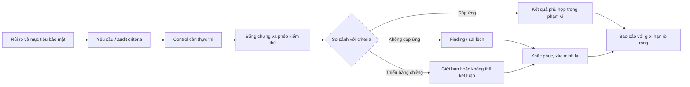
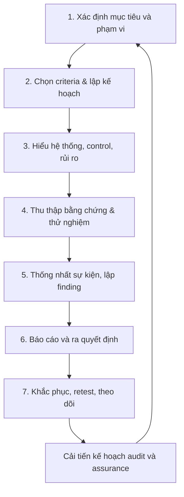
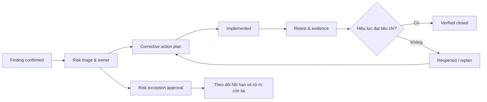

# Audit là gì? Kiểm toán trong Security Assurance và vai trò của bằng chứng

**Audit (kiểm toán/đánh giá kiểm toán)** là một quá trình có kế hoạch, có phương pháp và được thực hiện với mức độ độc lập phù hợp nhằm **thu thập, kiểm tra và đánh giá bằng chứng một cách khách quan** để xác định đối tượng được đánh giá **đáp ứng những tiêu chí đã xác lập đến mức nào**. Kết quả audit phải nêu rõ phạm vi, thời kỳ được xem xét, tiêu chí, phát hiện, bằng chứng và giới hạn của kết luận.

Trong chủ đề **Audit và evidence** của module **SECURITY_SECURITY_ASSURANCE**, audit là một cơ chế quan trọng để tạo ra **sự bảo đảm có căn cứ** rằng hệ thống và tổ chức đã xác định, triển khai và vận hành các biện pháp kiểm soát bảo mật theo mục tiêu được phê duyệt. Audit kết nối phân tích rủi ro, yêu cầu bảo mật, *security controls*, kiểm thử, giám sát và hành động khắc phục bằng những lập luận có thể truy vết đến bằng chứng.

Một câu hỏi điển hình của audit bảo mật là:

> “Chính sách yêu cầu mọi tài khoản quản trị dùng MFA và được rà soát quyền định kỳ. Trong **phạm vi và thời gian kiểm toán**, chúng ta có bằng chứng đủ tin cậy để kết luận các yêu cầu đó được thực hiện hay không?”

Audit không dừng ở câu trả lời của người vận hành, cũng không tự động xem “có chính sách” là “đã tuân thủ”. Auditor cần kiểm chứng những gì đã được thiết kế, cấu hình, thực thi và vận hành thực tế.

## 1. Mục tiêu học tập

Sau bài học, người học có thể:

- Giải thích audit là gì, phân biệt audit với kiểm tra vận hành, giám sát, penetration testing, đánh giá rủi ro và chứng nhận.
- Xác định **audit objective**, **scope**, **criteria**, **period**, **evidence**, **finding** và **conclusion** cho một cuộc kiểm toán bảo mật.
- Mô tả quy trình từ lập kế hoạch, khảo sát, thử nghiệm kiểm soát, ghi nhận phát hiện đến báo cáo và theo dõi khắc phục.
- Đánh giá chất lượng bằng chứng qua tính liên quan, đầy đủ, tin cậy, tính toàn vẹn và khả năng truy xuất.
- Thiết kế kiểm thử kiểm soát ở mức cơ bản; hiểu giới hạn của lấy mẫu và sự khác biệt giữa thiết kế kiểm soát với hiệu quả vận hành.
- Chuyển phát hiện audit thành hành động có chủ sở hữu, hạn xử lý và phép kiểm tra lại để phục vụ chương trình security assurance liên tục.

---

## 2. Bản chất của audit: đánh giá theo tiêu chí và bằng chứng

Để hiểu audit, hãy tách ba yếu tố:

1. **Audit criteria — tiêu chí:** yêu cầu hoặc chuẩn mực dùng làm căn cứ đánh giá. Đó có thể là chính sách đã được phê duyệt, điều khoản hợp đồng, tiêu chuẩn đã lựa chọn, yêu cầu bảo mật nội bộ, quy định áp dụng, hoặc bộ control được xác định trong chương trình assurance.
2. **Audit evidence — bằng chứng kiểm toán:** thông tin có thể xác minh, phù hợp với tiêu chí và phạm vi, ví dụ cấu hình hệ thống, bản ghi truy cập, kết quả thử nghiệm, tài liệu phê duyệt, lịch sử thay đổi hoặc quan sát trực tiếp.
3. **Audit finding / conclusion — phát hiện và kết luận:** kết quả đánh giá bằng chứng so với tiêu chí; thể hiện điểm đáp ứng, điểm không đáp ứng, hạn chế bằng chứng và các vấn đề cần xử lý.

**Ví dụ cơ bản:** Một tổ chức yêu cầu tài khoản đặc quyền phải có xác thực đa yếu tố (MFA).

| Thành phần | Ví dụ kiểm toán |
|---|---|
| Đối tượng | Tài khoản quản trị trên nền tảng điện toán đám mây |
| Tiêu chí | Chính sách IAM phiên bản được phê duyệt yêu cầu MFA cho tất cả tài khoản quản trị người dùng |
| Phạm vi | Các tài khoản thuộc ba môi trường sản xuất trong quý được xem xét |
| Bằng chứng | Danh sách tài khoản/role, cấu hình MFA, log xác thực, danh mục ngoại lệ đã phê duyệt |
| Thử nghiệm | Đối chiếu tập tài khoản đặc quyền với trạng thái thực thi MFA, xác minh ngoại lệ và tính bao phủ |
| Phát hiện | Có ba tài khoản đặc quyền chưa bắt buộc MFA trong thời kỳ đánh giá |
| Kết luận có giới hạn | Control MFA chưa đáp ứng đầy đủ tiêu chí trong phạm vi đã kiểm tra |

Điểm mấu chốt: **auditor phải có cơ sở để giải thích vì sao bằng chứng dẫn đến kết luận**. Câu “quản trị viên nói rằng MFA đã bật” là một đầu mối để kiểm tra, nhưng thường chưa đủ làm bằng chứng duy nhất cho một kết luận về thực thi.

Có thể nhìn audit như một chuỗi truy vết:



Audit đưa ra **sự bảo đảm có giới hạn theo phạm vi và chất lượng bằng chứng**. Nó không chứng minh rằng hệ thống tuyệt đối không có lỗ hổng, không thể bị tấn công hoặc sẽ luôn tuân thủ trong tương lai.

## 3. Vì sao Security Assurance cần audit?

Một chương trình security assurance phải trả lời được hai nhóm câu hỏi: **yêu cầu và control có phù hợp với rủi ro không?** Và **control đó thực sự hoạt động ra sao?** Audit giúp đưa ra câu trả lời dựa trên bằng chứng được xem xét có hệ thống.

### 3.1. Xác nhận sự phù hợp với yêu cầu

Ví dụ doanh nghiệp có các quy tắc:

- Nhân viên chỉ truy cập dữ liệu khách hàng theo quyền được cấp và nhu cầu công việc.
- Quyền đặc biệt được phê duyệt, ghi nhận và định kỳ xem xét.
- Dữ liệu nhạy cảm được mã hóa khi truyền và lưu trữ theo chính sách.
- Hoạt động đáng ngờ phải được ghi log, giám sát và có quy trình phản ứng.
- Backup phải được kiểm thử khôi phục theo RTO/RPO đã phê duyệt.

Audit tìm hiểu tổ chức có thể **chứng minh** việc thực hiện các yêu cầu đó không, trong những hệ thống, nhóm người dùng và giai đoạn nào.

### 3.2. Phát hiện khoảng trống giữa tài liệu và thực tiễn

Hai tình huống thường gặp:

- Chính sách yêu cầu rà soát quyền hàng quý; hồ sơ cho thấy có lịch họp, nhưng không có danh sách tài khoản được rà soát, quyết định giữ/thu hồi quyền hoặc bằng chứng hành động sau rà soát.
- Runbook mô tả việc khôi phục backup; job backup báo thành công, nhưng chưa từng thử restore ở quy mô dữ liệu thực tế hoặc qua đường truy cập dự phòng.

Trong cả hai trường hợp, tổ chức có thể sở hữu tài liệu **đầy đủ về hình thức** nhưng chưa có bằng chứng cho thấy control hoạt động hiệu quả.

### 3.3. Cung cấp thông tin cho quyết định rủi ro

Kết quả audit giúp lãnh đạo và chủ sở hữu dịch vụ quyết định: điểm yếu nào cần xử lý trước, nguồn lực ở đâu, mức rủi ro nào phải chấp nhận có thời hạn, và hoạt động nào cần kiểm tra lại. Để hữu ích, báo cáo cần phân biệt **sự kiện quan sát được**, **tác động/rủi ro suy luận từ sự kiện** và **khuyến nghị xử lý**.

### 3.4. Thúc đẩy cải tiến liên tục

Audit có giá trị nhất khi tạo được vòng lặp:

**Yêu cầu → kiểm thử → phát hiện → khắc phục → xác minh hiệu lực → cập nhật thiết kế/giám sát.**

Nếu chỉ dừng tại phát hành báo cáo mà không theo dõi việc khắc phục thì audit chưa hoàn thành vai trò cải tiến trong security assurance.

## 4. Các thuật ngữ cốt lõi trong một cuộc audit

| Thuật ngữ | Ý nghĩa | Ví dụ |
|---|---|---|
| **Auditee** | Cá nhân, nhóm, đơn vị hoặc tổ chức có hoạt động nằm trong phạm vi được kiểm toán | Đội vận hành dịch vụ thanh toán |
| **Auditor** | Người thực hiện đánh giá, thu thập và xem xét bằng chứng | Nhân sự kiểm toán nội bộ độc lập với vận hành |
| **Audit objective** | Mục đích audit cần trả lời | Xác minh quản lý tài khoản đặc quyền đáp ứng chính sách |
| **Audit scope** | Ranh giới về tổ chức, hệ thống, quy trình, địa điểm, thời gian | Cloud production và IAM trong quý III |
| **Audit criteria** | Tiêu chí dùng để đánh giá | Chính sách IAM v3.2, các control được phê duyệt |
| **Audit program** | Cách tổ chức và quản lý tập hợp các cuộc audit trong một thời kỳ | Kế hoạch kiểm toán bảo mật năm |
| **Audit plan** | Kế hoạch thực hiện một cuộc audit cụ thể | Phạm vi, lịch, kỹ thuật, nguồn lực, người tham gia |
| **Working paper** | Hồ sơ làm việc ghi phương pháp, mẫu, thử nghiệm và lập luận | Bảng kiểm tra 25 tài khoản quản trị |
| **Audit evidence** | Thông tin liên quan, có thể xác minh được | Log, cấu hình, ticket, phê duyệt, kết quả kiểm thử |
| **Audit finding** | Kết quả đánh giá bằng chứng so với tiêu chí | Hai tài khoản thiếu phê duyệt quyền |
| **Nonconformity** | Sự không phù hợp với một yêu cầu được xác định | Không thực hiện rà soát quyền theo chu kỳ đã quy định |
| **Audit conclusion** | Kết luận tổng hợp theo mục tiêu, phạm vi và giới hạn audit | Kiểm soát quyền nhìn chung triển khai nhưng thiếu bằng chứng rà soát định kỳ |
| **Corrective action** | Hành động loại bỏ nguyên nhân của điểm không phù hợp, hạn chế tái diễn | Tích hợp quy trình cấp quyền với hệ thống phê duyệt và giám sát |

Các tổ chức có thể sử dụng từ ngữ, biểu mẫu và thang đánh giá khác nhau. Điều quan trọng là giữ rõ **định nghĩa được dùng trong cuộc audit**, tránh kết luận “PASS” khi tiêu chí hoặc phép thử chưa được mô tả.

### 4.1. Audit trail có phải là audit?

**Audit trail** là dấu vết của sự kiện, quyết định hoặc thay đổi trong hệ thống, chẳng hạn ai đăng nhập, ai sửa policy, lúc nào một giao dịch được duyệt. Nó có thể là **nguồn bằng chứng của audit**, nhưng không phải chính cuộc audit.

Ví dụ, việc bật logging không chứng minh toàn bộ các quyền truy cập đã hợp lệ; auditor còn cần đối chiếu log với danh sách quyền, quyết định phê duyệt và chính sách. Ngược lại, không tìm thấy sự kiện trong log không đủ để khẳng định sự kiện chưa xảy ra nếu chưa xác minh logging bao phủ đúng nguồn, đúng khoảng thời gian và không bị thất lạc.

## 5. Các loại audit thường gặp

Có nhiều cách phân loại. Các nhóm dưới đây giúp xác định **ai kiểm tra, kiểm tra theo gì và để làm gì**.

### 5.1. Phân theo quan hệ với đối tượng kiểm toán

| Loại | Người thực hiện | Ứng dụng | Điểm cần chú ý |
|---|---|---|---|
| **First-party / internal audit** | Bên trong tổ chức, cần độc lập khách quan với hoạt động đang đánh giá | Kiểm soát nội bộ, tuân thủ chính sách, hiệu quả vận hành | Độc lập về đánh giá dù cùng tổ chức |
| **Second-party audit** | Khách hàng hoặc bên đại diện kiểm tra nhà cung cấp/đối tác | Kiểm toán điều khoản bảo mật đối tác | Quyền tiếp cận, phạm vi và bảo mật thông tin cần thỏa thuận |
| **Third-party audit** | Tổ chức kiểm toán độc lập bên ngoài | Đánh giá độc lập hoặc phục vụ cơ chế chứng nhận theo chương trình phù hợp | Mức độ bảo đảm, tiêu chí và quyền hạn tùy mục đích hợp đồng/chương trình |

**Kiểm toán độc lập** không đồng nghĩa “luôn phát hành chứng nhận”. Một báo cáo của bên thứ ba, một kết quả đánh giá hợp đồng và một chứng chỉ theo chương trình chứng nhận có mục tiêu và quy tắc khác nhau.

### 5.2. Phân theo mục tiêu đánh giá

- **Compliance audit:** xem xét sự phù hợp với các yêu cầu áp dụng, chính sách, hợp đồng hoặc bộ kiểm soát cụ thể.
- **Operational audit:** xem xét tính hiệu quả, tính nhất quán và khả năng vận hành của quy trình, trong đó có kiểm soát bảo mật.
- **Security / IT audit:** xem xét quản trị công nghệ, truy cập, thay đổi, logging, bảo vệ dữ liệu, khôi phục và các rủi ro liên quan.
- **Supplier audit:** kiểm tra bên cung cấp dịch vụ và các kiểm soát nằm trong quan hệ phụ thuộc, dựa trên quyền tiếp cận đã thỏa thuận.
- **Certification / surveillance audit:** thực hiện trong bối cảnh một chương trình chứng nhận có yêu cầu và quy trình đánh giá riêng.

Một cuộc audit có thể đồng thời thuộc nhiều nhóm: kiểm toán nội bộ về tuân thủ IAM và hiệu quả vận hành tài khoản đặc quyền.

### 5.3. Tiêu chuẩn và framework có vai trò gì?

Các bộ tài liệu như **ISO/IEC 27001**, **ISO 19011**, **NIST Cybersecurity Framework**, **NIST SP 800-53** hoặc các yêu cầu hợp đồng có thể hỗ trợ lập tiêu chí, phương pháp hoặc phân loại control tùy mục đích. Tuy nhiên:

- **ISO 19011** cung cấp hướng dẫn về kiểm toán hệ thống quản lý; không tự động là checklist bắt buộc cho mọi cuộc kiểm toán bảo mật.
- Framework hoặc danh mục control là nguồn hỗ trợ lựa chọn và ánh xạ yêu cầu; phải xác định phiên bản, phạm vi áp dụng và tiêu chí cụ thể.
- Việc “dùng framework” không có nghĩa tổ chức đã được chứng nhận hay đáp ứng tất cả các mục của framework đó.

Khi viết báo cáo, nên ghi rõ **tiêu chí nào được chọn** và **vì sao áp dụng** cho dịch vụ trong phạm vi.

## 6. Audit khác gì với kiểm tra, đánh giá rủi ro và kiểm thử xâm nhập?

| Hoạt động | Câu hỏi chính | Kết quả điển hình | Giới hạn |
|---|---|---|---|
| **Audit** | Kiểm soát/hoạt động có đáp ứng tiêu chí trong phạm vi và thời kỳ không? | Bằng chứng, finding, kết luận, khuyến nghị | Phụ thuộc phạm vi, lấy mẫu và bằng chứng |
| **Risk assessment** | Rủi ro nào tồn tại, xác suất/tác động ra sao, cần xử lý thế nào? | Risk register, ưu tiên rủi ro, phương án xử lý | Không tự chứng minh control đang hoạt động |
| **Vulnerability assessment** | Có điểm yếu kỹ thuật nào được công cụ/quy trình phát hiện? | Danh sách lỗ hổng, mức ưu tiên | Không bao quát tất cả rủi ro quản trị và quy trình |
| **Penetration testing** | Có thể khai thác lỗ hổng để đạt mục tiêu tấn công trong phạm vi cho phép không? | Chuỗi khai thác, tác động đã minh chứng | Không là phép thử toàn diện mọi control hoặc mọi thời điểm |
| **Continuous monitoring** | Những tín hiệu sức khỏe và an ninh đang thay đổi thế nào? | Alerts, dashboards, logs, metrics | Dữ liệu thô cần đối chiếu tiêu chí mới thành kết luận |
| **Control self-assessment** | Chủ sở hữu tự đánh giá kiểm soát họ vận hành | Tự khai báo, bằng chứng do đội cung cấp | Có rủi ro thiên lệch, cần xác minh độc lập tùy yêu cầu |

Audit có thể **sử dụng** kết quả penetration test, scan, monitoring hoặc risk assessment như một phần bằng chứng, nhưng phải kiểm tra chất lượng, thời điểm, phạm vi và ý nghĩa của kết quả đó.

**Ví dụ:** Vulnerability scanner thông báo không tìm thấy CVE nghiêm trọng trên 20 máy chủ được quét. Điều đó có thể hỗ trợ kiểm toán quản lý lỗ hổng, nhưng để kết luận quy trình quản lý lỗ hổng có hiệu lực, auditor còn cần biết 20 máy có bao phủ tài sản quan trọng không, tiêu chí phân loại, SLA khắc phục, ngoại lệ và bằng chứng xử lý trong toàn bộ thời kỳ được audit.

## 7. Nguyên tắc để audit đáng tin cậy

Audit phục vụ ra quyết định chỉ khi phương pháp làm việc đáng tin:

1. **Chính trực và đạo đức nghề nghiệp.** Ghi nhận sự thật, không sửa kết quả theo mong muốn của người được audit hoặc của quản lý.
2. **Khách quan và độc lập phù hợp.** Người đánh giá phải kiểm soát xung đột lợi ích; không tự xác nhận công việc do chính mình thiết kế/vận hành mà không có cơ chế rà soát độc lập.
3. **Năng lực chuyên môn.** Hiểu hệ thống, control, rủi ro, phương pháp audit và giới hạn công cụ. Nếu cần chuyên môn mật mã, cloud hoặc pháp lý, phải phối hợp chuyên gia phù hợp.
4. **Dựa trên bằng chứng.** Kết luận phải tương xứng với số lượng, chất lượng, độ bao phủ và độ tin cậy của bằng chứng.
5. **Dựa trên rủi ro.** Tập trung hơn vào chức năng, tài sản, account, dữ liệu, dependency và quy trình có tác động cao.
6. **Bảo mật thông tin.** Audit thường tiếp xúc với danh sách quyền, cấu hình, log nhạy cảm, dữ liệu khách hàng. Thu thập tối thiểu, quản lý truy cập và tránh đưa secret vào hồ sơ kiểm toán.
7. **Báo cáo trung thực và rõ giới hạn.** Phân biệt phát hiện, giả thuyết, kiến nghị; nêu trường hợp không có đủ bằng chứng hoặc không kiểm tra được.
8. **Cẩn trọng và có thể truy vết.** Có hồ sơ về tiêu chí, phương pháp, mẫu, thao tác, người kiểm tra, thời gian, dữ liệu nguồn và quyết định.

Độc lập không nhất thiết có nghĩa auditor phải từ một công ty khác. Một bộ phận kiểm toán nội bộ có thể độc lập về vị trí và quyết định với đội sở hữu hệ thống. Vấn đề cần kiểm soát là **đánh giá công việc của chính mình, áp lực lợi ích và khả năng tiếp cận dữ liệu một cách không bị can thiệp**.

## 8. Chu trình thực hiện một cuộc audit bảo mật

Một quy trình thực dụng gồm bảy giai đoạn. Tên gọi và thứ tự chi tiết có thể khác nhau theo loại audit.



### 8.1. Xác định objective, scope và audit period

Ví dụ:

```text
Objective:
  Đánh giá control cấp quyền và rà soát quyền đặc quyền.

Scope:
  Nền tảng cloud production, tài khoản quản trị tương tác,
  service principal có quyền nhạy cảm, quy trình phê duyệt,
  thu hồi quyền và ghi log.

Period:
  01/07 đến 30/09 của năm kiểm toán được xác định.

Out of scope:
  Tài khoản thử nghiệm không kết nối production, trừ khi phát hiện
  quyền chéo làm ảnh hưởng tới production.

Criteria:
  Chính sách IAM được phê duyệt; quy trình cấp/thu hồi quyền;
  yêu cầu logging áp dụng cho các hệ thống trong phạm vi.
```

Phạm vi phải chỉ rõ **đơn vị/tài sản**, **quy trình**, **hệ thống**, **ranh giới trách nhiệm bên thứ ba**, **thời kỳ**, và **loại kiểm soát**. Câu “audit cloud security” quá rộng để lựa chọn bằng chứng và đưa ra kết luận cụ thể.

Nếu một ứng dụng mới chỉ hoạt động trong 10 ngày cuối quý, cần chỉ ra giai đoạn nó tồn tại. Không dùng thiếu dữ liệu của những ngày trước khi triển khai làm bằng chứng vi phạm; cũng không bỏ qua rủi ro vì ứng dụng quá mới.

### 8.2. Xác định criteria và rủi ro quan trọng

Auditor đọc yêu cầu áp dụng để lập bản đồ:

```text
Mục tiêu bảo mật
  -> rủi ro cần kiểm soát
  -> chính sách/yêu cầu
  -> control cụ thể
  -> bằng chứng dự kiến
  -> kỹ thuật kiểm thử
  -> quy tắc đánh giá kết quả
```

Ví dụ: rủi ro tài khoản nghỉ việc vẫn có quyền → chính sách thu hồi quyền trong thời hạn xác định → quy trình liên kết HR với IAM → đối chiếu danh sách nhân sự nghỉ việc, ticket thu hồi và trạng thái tài khoản.

**Không tự tạo tiêu chí trong lúc đánh giá.** Nếu tổ chức chưa có thời hạn thu hồi quyền rõ ràng, auditor có thể ghi nhận thiếu yêu cầu và rủi ro quản trị, nhưng không được tự khẳng định vi phạm “24 giờ” nếu không có căn cứ áp dụng.

### 8.3. Lập kế hoạch và yêu cầu bằng chứng

Kế hoạch cần nêu người phụ trách, lịch, hệ thống cần tiếp cận, danh mục tài liệu, quy tắc lấy mẫu, cách bảo vệ dữ liệu, phương pháp kiểm thử và kênh trao đổi phát hiện.

Một *prepared-by-client (PBC) list* hoặc yêu cầu bằng chứng có thể bao gồm: danh mục tài sản, sơ đồ kiến trúc, version chính sách, export tài khoản và role, log hoạt động, danh sách change request, kết quả security test và risk exceptions.

Cần thống nhất **cách trích xuất dữ liệu** để bảo toàn ngữ nghĩa: nguồn hệ thống, câu truy vấn, người trích xuất, thời gian, timezone, bộ lọc và số bản ghi. File CSV thiếu thông tin “lấy từ đâu, lúc nào, lọc thế nào” có thể gây sai phạm vi mà auditor khó nhận ra.

### 8.4. Khảo sát và kiểm thử

Các cách tiếp cận phổ biến:

| Kỹ thuật | Thao tác | Tình huống thích hợp |
|---|---|---|
| **Inquiry** (phỏng vấn) | Hỏi chủ control về quy trình và ngoại lệ | Hiểu thiết kế, xác định nguồn bằng chứng cần xác minh |
| **Observation** (quan sát) | Quan sát một lần thực thi quy trình hoặc thao tác | Hiểu workflow, cách thực hiện thực tế |
| **Inspection** (xem xét hồ sơ) | Đọc log, cấu hình, ticket, quyết định phê duyệt | Xác minh dấu vết và bằng chứng lịch sử |
| **Reperformance** (thực hiện kiểm tra lại) | Auditor thực hiện lại phép đối chiếu hoặc test được phép | Xác thực tính đúng của kết quả và việc control có hoạt động |
| **Data analysis** | Phân tích dữ liệu về tài khoản, events, exceptions | Kiểm thử tập lớn và tìm ngoại lệ theo quy tắc |

Phỏng vấn giúp hiểu cách hệ thống *được kỳ vọng* hoạt động; kiểm tra cấu hình và lịch sử sự kiện giúp xác nhận *điều đã xảy ra*. Kết hợp các phương pháp khi rủi ro cao hoặc một nguồn có thể bị sai lệch.

### 8.5. Tổng hợp finding và trao đổi sự kiện

Khi phát hiện một vấn đề, auditor phải kiểm chứng với chủ control để phân biệt:

- Sự kiện được ghi nhận chính xác hay do export/chuẩn hóa dữ liệu sai?
- Yêu cầu nào thực sự áp dụng tại thời điểm đó?
- Có ngoại lệ được phê duyệt, còn hiệu lực và có biện pháp bù trừ không?
- Tác động nghiệp vụ và an ninh là gì?
- Có bằng chứng khác làm thay đổi kết luận không?

Quy trình trao đổi tạo cơ hội sửa **sai sót thực tế**, không có nghĩa chủ control được quyền xóa phát hiện có bằng chứng vì không muốn bị nêu tên.

### 8.6. Báo cáo

Báo cáo cần nêu rõ: mục tiêu, thời kỳ, phạm vi, tiêu chí, phương pháp, mẫu, các giới hạn, đánh giá tổng thể theo phạm vi, các phát hiện, mức rủi ro, bằng chứng, phản hồi của chủ sở hữu, hành động và hạn xử lý.

### 8.7. Theo dõi và xác minh khắc phục

Một action chỉ nên được coi là **đã kiểm chứng hiệu lực** khi điều kiện đóng đã thỏa bằng phép kiểm tra tương ứng. Việc nộp ảnh cấu hình sau khi sửa có thể chứng minh cấu hình tại một thời điểm; đối với lỗi rà soát quyền định kỳ, cần kiểm tra cả những kỳ vận hành tiếp theo.

---

## 9. Thiết kế một kiểm thử control có thể lặp lại

Một kiểm thử tốt mô tả đầy đủ điều gì cần xảy ra, dữ liệu đầu vào, cách xử lý và quy tắc PASS/FAIL. Ví dụ:

| Thuộc tính | Kiểm thử IAM quản trị |
|---|---|
| Control objective | Truy cập đặc quyền chỉ dành cho người được phê duyệt và phải có MFA |
| Risk | Chiếm dụng tài khoản hoặc đặc quyền quá mức gây lộ/sửa dữ liệu |
| Criteria | Chính sách yêu cầu phê duyệt trước cấp quyền và MFA cho tài khoản đặc quyền |
| Population | Toàn bộ tài khoản quản trị thuộc cloud production trong audit period |
| Evidence | Export account/role theo mốc, request phê duyệt, cấu hình enforcement, log đăng nhập |
| Method | Đối chiếu danh sách role với tài khoản, phê duyệt, cấu hình MFA và ngoại lệ |
| Expected | Không có tài khoản trái yêu cầu; mọi ngoại lệ có căn cứ và được duyệt |
| Finding | Mô tả từng đối tượng, thời điểm và tiêu chí không thỏa |
| Limitation | Những account ngoài hệ thống nguồn hoặc thời kỳ chưa được thu thập |

Audit có thể cần kiểm tra cả việc **control được thiết kế đúng** (*design effectiveness*) và **control vận hành hiệu quả trong giai đoạn kiểm toán** (*operating effectiveness*).

- **Thiết kế:** nếu quy trình được thực hiện đúng như tài liệu, nó có đủ ngăn ngừa hoặc phát hiện rủi ro mục tiêu không? Ví dụ, cơ chế cấp quyền yêu cầu phê duyệt từ cấp quản lý phù hợp.
- **Triển khai tại thời điểm kiểm tra:** control hiện có trong hệ thống hay mới chỉ được mô tả trong tài liệu? Ví dụ, policy MFA thực sự được gán cho nhóm tài khoản quản trị.
- **Vận hành trong thời kỳ:** control có hoạt động liên tục/đúng tần suất khi có sự kiện cần xử lý không? Ví dụ, các lần cấp quyền trong quý đều qua phê duyệt, các lần thu hồi được xử lý trong hạn.

Không thể kết luận hiệu quả vận hành cả quý từ một screenshot chụp cấu hình cuối quý nếu chính sách có thể đã bị tắt vào thời điểm khác. Cần log thay đổi, cấu hình theo thời gian hoặc bằng chứng tương ứng với rủi ro và cách control vận hành.

## 10. Audit evidence: bằng chứng tốt có đặc điểm gì?

Chất lượng bằng chứng quyết định mức độ tin cậy của kết luận. Khi tiếp nhận, auditor nên hỏi:

1. **Liên quan (relevance):** dữ liệu này trả lời được tiêu chí cụ thể nào? Log đăng nhập không tự chứng minh có phê duyệt quyền truy cập.
2. **Đầy đủ/đủ lượng (sufficiency):** số lượng và độ bao phủ có phù hợp với rủi ro, thời kỳ, loại control và phương pháp lấy mẫu?
3. **Tin cậy (reliability):** nguồn nào tạo ra, ai có thể sửa, dữ liệu có thể bị lọc hoặc giả mạo không? Có thể kiểm tra độc lập không?
4. **Chính xác (accuracy):** bản ghi có đúng đối tượng, thời gian, trạng thái, điều kiện và định nghĩa trường không?
5. **Toàn vẹn (integrity):** dữ liệu có bị cắt bớt, sửa hoặc mất dấu trong quá trình trích xuất/lưu trữ không?
6. **Kịp thời (timeliness):** bằng chứng thuộc đúng giai đoạn, không phải bản chụp cũ hoặc trạng thái tương lai?
7. **Truy xuất được (traceability):** người khác có thể theo dấu từ kết luận đến hồ sơ gốc, truy vấn, phiên bản và phép thử không?

| Bằng chứng | Giá trị | Điều cần xác minh |
|---|---|---|
| **Policy bản đã phê duyệt** | Chứng minh criteria được xác lập | Hiệu lực, phiên bản, phạm vi áp dụng |
| **Configuration export** | Cho biết cấu hình tại một hoặc nhiều mốc | Nguồn, môi trường, bộ lọc, quyền đọc và thời gian |
| **Audit log từ hệ thống** | Ghi lại sự kiện và thay đổi trong phạm vi logging | Logging có bao phủ, đồng bộ thời gian, retention và chống sửa đổi |
| **Ticket phê duyệt** | Chứng minh quyết định và người duyệt | Liên kết tới tài khoản/role thực tế, thứ tự trước-sau |
| **Kết quả scan hoặc automated test** | Cung cấp phép kiểm tra lặp lại được | Phạm vi quét, phiên bản rule/tool, dữ liệu đầu vào, false negative |
| **Biên bản phỏng vấn** | Giúp hiểu hoạt động quy trình | Cần đối chiếu với hồ sơ/thực thi khi kết luận quan trọng |
| **Screenshot** | Minh họa nhanh trạng thái một màn hình | Môi trường, thời gian, tính xác thực, thiếu lịch sử và toàn bộ population |

Bằng chứng mạnh thường cho phép **đối chiếu từ nhiều nguồn**. Chẳng hạn export role cloud, ticket phê duyệt và log IAM cùng trỏ về một thay đổi quyền; nếu không khớp, sự khác biệt chính là vấn đề cần điều tra.

### 10.1. Chuỗi bảo quản bằng chứng

Một bằng chứng kỹ thuật có thể được ghi lại với metadata như sau:

```yaml
evidence_id: EVD-IAM-EXAMPLE-001
criterion_id: IAM-PRIV-01
asset: cloud-production
period_start_utc: "2026-07-01T00:00:00Z"
period_end_utc: "2026-10-01T00:00:00Z"
source_system: identity-and-access-platform
collected_at_utc: "2026-10-03T08:15:00Z"
collected_by_role: audit-readonly
collection_method: privileged-role-export
filters: "include all interactive privileged identities"
source_record_count: 120
artifact_ref: "evidence/restricted/iam-privileged-export"
integrity:
  algorithm: sha256
  digest_ref: "evidence/restricted/iam-privileged-export.sha256"
handling:
  classification: confidential
  allowed_readers: [audit-team, designated-control-owner]
  retention_policy_ref: "organization-approved-policy"
```

Đây chỉ là **mẫu minh họa**. Hash có thể giúp phát hiện thay đổi của một tệp đã được ghi nhận; **hash không tự chứng minh dữ liệu nguồn là đúng, đủ hoặc không bị thao túng trước lúc lấy**. Đối với bằng chứng nhạy cảm, nên lưu kho được phân quyền, có ghi log truy cập, phiên bản và cơ chế bảo quản theo chính sách; không nhúng mật khẩu, token, private key hay dữ liệu cá nhân không cần thiết vào báo cáo.

### 10.2. Bằng chứng thiếu không luôn đồng nghĩa control thất bại

Cần phân biệt ba tình huống:

- **Có bằng chứng cho thấy không đáp ứng tiêu chí:** ví dụ log và cấu hình xác nhận MFA không áp dụng cho tài khoản đặc quyền khi chính sách bắt buộc.
- **Không cung cấp được bằng chứng đủ:** ví dụ hệ thống đã xóa log nên auditor không biết có hoàn thành rà soát quyền đúng hạn hay không.
- **Bằng chứng xác nhận đáp ứng trong phạm vi thử:** ví dụ tất cả mẫu được chọn có phê duyệt hợp lệ, phù hợp với kết luận theo phương pháp đã áp dụng.

Tình huống thiếu bằng chứng có thể dẫn tới *scope limitation*, *not demonstrated*, hoặc một finding liên quan nghĩa vụ lưu giữ hồ sơ nếu chính tiêu chí quy định phải giữ bằng chứng. **Không tự biến thiếu chứng cứ thành khẳng định chắc chắn rằng một sự kiện đã vi phạm**, đồng thời cũng không tuyên bố PASS khi không thể xác minh.

## 11. Lấy mẫu kiểm toán: suy luận đúng theo phạm vi

Không phải lúc nào auditor cũng kiểm tra toàn bộ sự kiện. Với hàng triệu bản ghi, có thể cần kết hợp phân tích toàn bộ dữ liệu có cấu trúc và lấy mẫu một tập con để xác minh sâu.

### 11.1. Những quyết định cần ghi rõ

- **Population:** toàn bộ đối tượng đủ điều kiện thuộc phạm vi và thời kỳ kiểm toán là gì? Có đủ và chính xác không?
- **Sampling unit:** một tài khoản, một lần cấp quyền, một ticket, một thay đổi, một ngày vận hành hay một giao dịch?
- **Sampling approach:** chọn theo rủi ro, ngẫu nhiên, phân tầng theo độ nhạy cảm hoặc kiểm tra 100% đối với nhóm đặc quyền trọng yếu.
- **Sample size:** căn cứ vào mục đích, rủi ro, độ biến thiên và mức độ bảo đảm mong muốn; không dùng một cỡ mẫu cố định cho mọi cuộc audit.
- **Exception handling:** ngoại lệ được ghi ra sao, kiểm tra nguyên nhân, mở rộng mẫu khi thấy sai lệch thế nào?
- **Conclusion boundary:** kết quả hỗ trợ khẳng định nào, có được khái quát về toàn bộ population hay không?

Ví dụ chọn **25/120** tài khoản để kiểm tra phê duyệt theo phương pháp ưu tiên rủi ro, trong đó 3 tài khoản không có phê duyệt hợp lệ. Kết luận có thể khẳng định **3 ngoại lệ trong 25 tài khoản đã thử** và cần điều tra phạm vi tác động. Không được tự diễn giải thành “12% của toàn bộ 120 tài khoản đều vi phạm” nếu phương pháp lấy mẫu không cho phép suy luận thống kê như vậy.

Nếu đã dùng truy vấn để kiểm tra 100% tài khoản thì vẫn cần xác minh **tính đầy đủ của danh sách đầu vào, độ đúng của quy tắc và dữ liệu nguồn**. Việc quét 100% của một danh sách thiếu một cloud account vẫn để lại khoảng trống lớn.

### 11.2. Khi nào nên mở rộng phép thử?

Mở rộng khi phát hiện lỗi có thể mang tính hệ thống: quyền cấp từ workflow bỏ phê duyệt, nguồn inventory thiếu tài sản, logging bị tắt định kỳ, hoặc một pipeline triển khai cấp role quá rộng cho nhiều dịch vụ.

Một ngoại lệ có thể phản ánh sai sót cá biệt hoặc lỗ hổng quy trình rộng hơn. Đánh giá nguyên nhân, tác động và thêm mẫu có mục đích giúp phân biệt, nhưng cần **trình bày rõ phép thử mở rộng và kết quả**, không chỉ cộng số liệu rồi bỏ qua thay đổi phương pháp.

## 12. Từ evidence đến audit finding

Một phát hiện có sức thuyết phục khi trả lời đầy đủ:

- **Criteria:** yêu cầu áp dụng là gì?
- **Condition:** hiện trạng thực tế được quan sát ra sao?
- **Evidence:** nguồn nào, mẫu nào, thời điểm nào chứng minh hiện trạng?
- **Cause (nếu đủ bằng chứng):** vì sao tình trạng xảy ra? Đâu là nguyên nhân đã xác minh, đâu chỉ là giả thuyết?
- **Effect / risk:** hậu quả thực tế hoặc khả năng tác động, có phù hợp phạm vi phát hiện không?
- **Recommendation / corrective action:** cần làm gì để sửa và ngăn tái diễn?
- **Owner, due date, verification:** ai chịu trách nhiệm, khi nào và kiểm chứng thế nào?

Một bảng ghi finding:

| Trường | Ví dụ |
|---|---|
| ID | IAM-AUD-007 |
| Criteria | Chính sách yêu cầu quyền quản trị phải được phê duyệt trước khi cấp |
| Condition | 3/25 tài khoản quản trị được chọn không có hồ sơ phê duyệt hợp lệ theo dữ liệu cung cấp |
| Evidence | Export role, ticket registry, truy vấn đối chiếu và hồ sơ kiểm tra lại |
| Risk | Quyền đặc biệt có thể bị cấp ngoài quy trình, làm tăng nguy cơ thao tác trái phép |
| Root cause | Chưa kết luận; điều tra thấy hệ thống tạo tài khoản dịch vụ có đường cấp quyền ngoài workflow chuẩn |
| Recommendation | Đưa mọi đường cấp quyền vào cơ chế phê duyệt/kiểm soát, kiểm tra tài khoản hiện có |
| Owner & due | Chủ dịch vụ IAM, theo hạn do tổ chức phê duyệt |
| Closure test | Kiểm tra các đường cấp quyền, tập account sau sửa và log phê duyệt trong một chu kỳ phù hợp |

**Mức độ nghiêm trọng** không dựa duy nhất vào số lượng ngoại lệ: một tài khoản quản trị toàn bộ production không có MFA có thể nghiêm trọng hơn nhiều tài khoản thử nghiệm có phạm vi bị giới hạn. Đánh giá cần cân nhắc tài sản, quyền thực tế, khả năng khai thác, biện pháp bù trừ, mức phơi nhiễm và hậu quả.

Không dùng lời khuyên mơ hồ như “nâng cao ý thức” khi nguyên nhân có thể là một đường cấp quyền tự động không kiểm tra phê duyệt. Hành động hữu ích phải khắc phục được cơ chế lỗi và **đo được kết quả**.

## 13. Ví dụ xuyên suốt: audit quy trình truy cập đặc quyền

Giả sử một nền tảng bán hàng có ba cloud account production và 120 tài khoản/tác nhân danh tính mang quyền cao; các con số dùng để minh họa.

**Đề bài:** Kiểm tra trong quý III xem quyền đặc biệt có được phê duyệt, có MFA phù hợp và được rà soát định kỳ hay không.

### Bước 1 — Lập phạm vi và tiêu chí

Auditor chốt các nguồn danh tính, nhóm role được xem là đặc quyền, chính sách có hiệu lực, thời kỳ kiểm tra và những chủ thể tự động nào có thể không dùng MFA tương tác nhưng phải đáp ứng control tương ứng dành cho workload identity. Không áp đặt tiêu chí MFA của người dùng trực tiếp lên service principal nếu chính sách phân biệt hai loại.

### Bước 2 — Kiểm tra tính đầy đủ của danh sách

Thu thập inventory cloud account, export role, danh sách tài khoản và service principal. Đối chiếu từ các nguồn để tránh bỏ sót account, tài khoản không còn chủ sở hữu và quyền kế thừa qua nhóm.

### Bước 3 — Kiểm thử phân tầng

- **Nhóm tương tác:** đối chiếu tình trạng MFA thực thi, bản ghi đăng nhập và ngoại lệ được phê duyệt.
- **Nhóm workload identity:** kiểm tra secret/key rotation, phạm vi quyền, chứng cứ quản lý danh tính máy theo tiêu chí áp dụng.
- **Cấp quyền mới:** kiểm tra hồ sơ đề nghị và người duyệt trước khi policy/role được áp dụng.
- **Rà soát định kỳ:** kiểm tra danh sách được rà soát, quyết định của người có trách nhiệm và việc thu hồi quyền không còn phù hợp.

### Bước 4 — Ghi nhận các kết quả giả định

| Thử nghiệm | Kết quả minh họa | Ý nghĩa |
|---|---|---|
| So khớp inventory với danh sách role | 120 đối tượng được nhận diện trong phạm vi | Có cơ sở xác định population; vẫn cần ghi giới hạn nguồn |
| Kiểm tra phê duyệt 25 tài khoản được chọn | 22 có hồ sơ; 3 chưa chứng minh được phê duyệt | Finding về dấu vết phê duyệt, cần kiểm tra căn cứ và nguyên nhân |
| Kiểm tra enforcement MFA với nhóm người dùng tương tác | 2 tài khoản còn có đường đăng nhập không bắt buộc MFA | Có căn cứ về sai lệch cấu hình theo tiêu chí đã áp dụng |
| Rà soát quyền hàng quý | Có bảng xác nhận nhưng thiếu bằng chứng thu hồi 4 quyền bị đánh dấu không cần thiết | Quy trình chưa chứng minh vòng xử lý sau review khép kín |
| Logging IAM | Đã có log, nhưng thiếu sự kiện từ một account mới bổ sung | Giới hạn khả năng giám sát và xác minh hoạt động của account đó |

Không cộng các con số này thành “tổng số vi phạm” vì một tài khoản có thể thuộc nhiều thử nghiệm, các phát hiện có tiêu chí khác nhau và một số trường hợp chỉ là **chưa chứng minh đủ**.

### Bước 5 — Kết luận và khắc phục

Một kết luận có phạm vi phù hợp:

> Trong phạm vi IAM production và kỳ kiểm toán xác định, một số cơ chế cấp quyền, MFA và rà soát đã có bằng chứng vận hành. Tuy nhiên, những ngoại lệ được mô tả trong các finding cho thấy việc thực thi và giám sát chưa nhất quán. Kết luận áp dụng cho các hệ thống, thời kỳ và phép thử đã nêu; chưa mở rộng cho các môi trường ngoài phạm vi.

Sau khi audit, chủ sở hữu IAM triển khai thay đổi: đóng đường cấp quyền ngoài workflow, khắc phục MFA, tích hợp log của account mới và thêm đối soát tự động quyền không còn cần thiết. Auditor retest theo tiêu chí đóng: thử tình huống cấp quyền mới, kiểm tra các account bị ảnh hưởng, xem log giám sát và quan sát một chu kỳ review phù hợp.

Một tấm ảnh chứng minh cấu hình MFA đã đổi **chưa đủ** để đóng finding về hiệu quả vận hành nhiều tháng nếu root cause là quy trình cấp quyền có đường đi bỏ sót policy.

## 14. Báo cáo audit và cách phát biểu kết luận đúng

Báo cáo có thể gồm các phần:

1. Mục đích, đối tượng sử dụng và đơn vị thực hiện.
2. Phạm vi, thời kỳ, tiêu chí/phiên bản áp dụng và các ngoại lệ về phạm vi.
3. Phương pháp thu thập bằng chứng, population, lấy mẫu và kiểm thử.
4. Tóm tắt kết luận theo từng mục tiêu kiểm toán, mức độ tin cậy và giới hạn.
5. Finding theo tiêu chí, bằng chứng, rủi ro, mức độ ưu tiên và nguyên nhân nếu xác định được.
6. Phản hồi của control owner, kế hoạch khắc phục, người phụ trách, thời hạn.
7. Những vấn đề cần theo dõi, rủi ro còn lại, lịch xác minh lại hoặc đưa vào kế hoạch audit kỳ sau.

Một phần kết quả dạng có cấu trúc:

```yaml
audit_id: SEC-AUD-EXAMPLE-2026
service: order-platform
objective: privileged-access-governance
scope:
  environments: [production]
  period: "2026-Q3"
criteria:
  - "approved-iam-policy-version"
  - "approved-access-review-procedure"
tests:
  - id: ACCESS-APPROVAL
    population: 120
    sample_checked: 25
    exceptions_observed: 3
    result: FINDING
  - id: MFA-ENFORCEMENT
    result: FINDING
  - id: ACCESS-REVIEW-FOLLOWUP
    result: FINDING
limitations:
  - "non-production accounts were not examined"
findings:
  - "IAM-AUD-007"
  - "IAM-AUD-008"
  - "IAM-AUD-009"
overall_conclusion: "gaps identified within defined scope"
evidence_index: "restricted-audit-evidence-index"
```

Mẫu này chỉ minh họa cách tổ chức thông tin. **Không dùng chuỗi FINDING/PASS hoặc số liệu tự khai làm bằng chứng độc lập**; phải truy được đến tài liệu, log, phép thử và người chịu trách nhiệm đánh giá.

### 14.1. Không suy rộng ra ngoài phạm vi

Đúng: “Các giao dịch được chọn trong phạm vi kiểm tra có hồ sơ phê duyệt đầy đủ.”

Dễ gây hiểu nhầm: “Toàn bộ giao dịch của công ty luôn được phê duyệt đúng.”

Đúng: “Không tìm thấy sự kiện truy cập trái phép trong nguồn log được đánh giá, trong giai đoạn có dữ liệu và theo quy tắc phân tích đã mô tả.”

Dễ gây hiểu nhầm: “Công ty không hề có truy cập trái phép.”

**Absence of evidence** có thể xuất phát từ nguồn log thiếu, retention ngắn, quy tắc tìm kiếm chưa bao phủ hoặc đối tượng ngoài phạm vi. Vì vậy mức độ bảo đảm phải gắn với điều kiện cụ thể.

## 15. Sau audit: corrective action và theo dõi hiệu lực

Một finding không tự hết rủi ro khi báo cáo được phát hành. Trong chương trình security assurance, chủ sở hữu control phải xử lý theo vòng đời:



Mỗi finding nên có:

- **Mã và liên kết bằng chứng** để giải thích chính xác điều đã xảy ra.
- **Owner** chịu trách nhiệm xử lý, cấp quyết định và đơn vị phối hợp.
- **Action plan** khắc phục nguyên nhân; nêu rõ cách giảm rủi ro trong khi chờ xử lý.
- **Due date** và mức ưu tiên dựa trên tác động bảo mật/nghiệp vụ.
- **Acceptance criteria** đo được và cách kiểm tra lại.
- **Retest result** có dữ liệu mới, thời gian và người kiểm chứng.
- **Residual risk** còn lại và quyết định chấp thuận bởi người có thẩm quyền khi cần.

Các trạng thái thường phân biệt: *OPEN*, *ACTION IN PROGRESS*, *IMPLEMENTED*, *RETEST FAILED*, *VERIFIED CLOSED*, *RISK ACCEPTED WITH EXPIRY*. Đây là ví dụ, không bắt buộc mọi tổ chức dùng cùng tên.

**Lưu ý:** “Đã triển khai” không có nghĩa “đã có hiệu lực”. Nếu nguyên nhân là kiểm soát rà soát quyền hàng quý không hoạt động, cần quan sát ít nhất một kỳ thích hợp hoặc xây dựng phép thử đại diện có thể chứng minh luồng mới hoạt động. Nếu một thay đổi cấp bách không đủ thời gian để chờ kỳ mới, có thể đóng một phần kỹ thuật và để mở phần bằng chứng vận hành theo cách đã phê duyệt, tránh báo cáo vượt quá dữ liệu.

## 16. Audit readiness và continuous assurance

Thay vì gom tài liệu khi gần đến kỳ audit, tổ chức có thể xây dựng khả năng **luôn sẵn sàng cung cấp bằng chứng**:

- Gắn mỗi control với **chủ sở hữu, criteria, nguồn evidence, tần suất, nơi lưu và chính sách retention**.
- Thu thập có kiểm soát từ IAM, SIEM, cloud configuration, CI/CD, change management và hệ thống phê duyệt.
- Chuẩn hóa timestamp, định danh tài sản, version policy, kết quả kiểm thử và liên kết ticket.
- Đặt cảnh báo cho **drift**: role mới quá rộng, log bị tắt, backup chưa restore test, quyền quá hạn chưa thu hồi.
- Kiểm tra **chất lượng và độ bao phủ của telemetry** trước khi sử dụng làm bằng chứng audit.
- Theo dõi tỷ lệ finding quá hạn, retest thất bại, ngoại lệ hết hạn và control thiếu bằng chứng.
- Rà soát độc lập theo rủi ro, đặc biệt các vấn đề mà đội vận hành không thể tự xác nhận.

**Automated evidence collection** có thể giảm công sức, nhưng không thay thế đánh giá chuyên môn. Một công cụ có thể tải cấu hình MFA mỗi ngày; auditor vẫn phải xem xét mapping tài khoản, ngoại lệ, quyền kế thừa, quãng thời gian mất dữ liệu và liệu cơ chế MFA thực sự được cưỡng chế cho đường đăng nhập cần kiểm tra hay không.

### 16.1. Những ranh giới bảo mật của kho evidence

Kho bằng chứng thường chứa thông tin nhạy cảm về hệ thống nên chính nó phải được bảo vệ: phân quyền theo vai trò, ghi log truy cập, giảm thiểu dữ liệu, làm mờ thông tin không cần thiết, mã hóa phù hợp, lưu giữ và xóa theo chính sách. Trong các tình huống liên quan điều tra sự cố, có thể cần quy trình bảo toàn bằng chứng riêng theo yêu cầu pháp lý và tổ chức.

Không nên sao chép hàng loạt tài khoản, token, dữ liệu khách hàng hay cấu hình bí mật vào một file báo cáo chia sẻ rộng. Có thể dùng **mã tham chiếu** và một kho bằng chứng hạn chế truy cập để người được ủy quyền kiểm chứng khi cần.

## 17. Các sai lầm thường gặp khi hiểu và thực hiện audit

| Sai lầm | Vì sao sai | Hướng xử lý |
|---|---|---|
| Xem audit là việc điền checklist | Checklist có thể thiếu ngữ cảnh rủi ro và không thử hiệu lực | Luôn nối criteria với risk, control và evidence |
| Có policy là kết luận compliant | Policy chưa chứng minh control được thực thi | Kiểm tra cấu hình, sự kiện và mẫu vận hành |
| Lấy screenshot duy nhất làm chứng cứ lịch sử | Chỉ phản ánh một trạng thái thiếu nguồn và thời kỳ | Dùng export/log lịch sử, kiểm tra nguồn và timestamp |
| Không định nghĩa rõ audit period | Không biết dữ liệu có bao phủ thời gian cần đánh giá | Khóa phạm vi và thời kỳ từ đầu |
| Không xác minh population | Có thể bỏ sót account, workload hoặc nhà cung cấp | Đối chiếu inventory với nguồn độc lập |
| Coi kết quả mẫu là toàn bộ population | Suy luận thống kê sai | Nêu rõ phương pháp và giới hạn lấy mẫu |
| Coi thiếu bằng chứng là chắc chắn vi phạm | Có thể là lỗi retention, truy cập hoặc nguồn dữ liệu | Phân loại evidence gap và tìm căn cứ phù hợp |
| Coi thiếu phát hiện là tuyệt đối an toàn | Audit không bao quát mọi kịch bản hay tương lai | Kết luận theo phạm vi, phương pháp và giới hạn |
| Chọn auditor tự đánh giá control của mình | Dễ thiên lệch và xung đột lợi ích | Áp dụng kiểm tra chéo/đánh giá độc lập |
| Chỉ giao finding mà không theo dõi | Nguy cơ tồn tại dai dẳng | Owner, hạn, closure criteria và retest |
| Đóng finding ngay khi có ticket “Done” | Chưa chứng minh hành động hiệu quả | Kiểm tra lại trên dữ liệu thực thi |
| Tập trung mọi nguồn bằng chứng vào nơi không kiểm soát | Tăng nguy cơ lộ thông tin và bị sửa dữ liệu | Kho hạn chế quyền, audit log, retention rõ |

## 18. Bài tập thực hành

**Tình huống:** Công ty cung cấp dịch vụ thanh toán trực tuyến đặt yêu cầu: (a) mọi quyền production phải được phê duyệt trước khi cấp; (b) tài khoản đặc quyền người dùng phải dùng MFA; (c) quyền truy cập phải được rà soát mỗi quý và những quyền không còn cần thiết phải bị thu hồi.

Auditor được cung cấp: một policy được phê duyệt; bảng Excel liệt kê 40 tài khoản quản trị nhưng không có thông tin nguồn; screenshot cho thấy MFA bật ở một tài khoản; năm ticket cấp quyền; một biên bản họp rà soát quyền; và log IAM bị thiếu 20 ngày do cấu hình retention.

**Câu hỏi:**

1. Hãy xác định **audit objective, scope, period, criteria** cần chốt trước khi kiểm thử.
2. Vì sao các tài liệu đã cung cấp **chưa đủ** để kết luận cả ba yêu cầu đều đáp ứng?
3. Cần yêu cầu thêm những nguồn bằng chứng nào để kiểm tra tính đầy đủ của population và hiệu quả vận hành?
4. Với việc log thiếu 20 ngày, khi nào đó là finding vi phạm retention, khi nào là **hạn chế phạm vi bằng chứng**, và khi nào có thể là cả hai?
5. Nếu chọn 10/40 tài khoản và thấy 2 tài khoản thiếu phê duyệt, có thể kết luận chính xác điều gì? Cần làm gì để hiểu mức ảnh hưởng của vấn đề?
6. Hãy viết một finding có các trường **criteria, condition, evidence, risk, recommended action, owner, verification**.
7. Khi đội IAM gửi ảnh chụp “MFA đã bật” sau sửa, cần kiểm tra thêm gì để được đóng finding liên quan MFA?

**Gợi ý tự đối chiếu:**

- Nguồn cần bổ sung có thể là inventory IAM/cloud production, role membership, access request, phê duyệt có thời gian, trạng thái MFA enforcement, log cấu hình và lịch sử điều chỉnh quyền.
- Thiếu log có thể vi phạm yêu cầu lưu giữ nếu policy quy định retention tương ứng; đồng thời khiến auditor không kiểm chứng được một số kỳ vận hành. Hai kết luận này phải được ghi **riêng với căn cứ riêng**.
- Hai ngoại lệ trong mẫu 10 cho biết **ít nhất hai trường hợp trong tập đã thử có vấn đề theo bằng chứng hiện có**. Không tự kết luận 20% toàn bộ tài khoản vi phạm khi phương pháp chọn mẫu chưa hỗ trợ suy luận đó.
- Screenshot sau sửa hữu ích để xác minh một cấu hình tại thời điểm chụp. Muốn đóng finding rộng về MFA cần đánh giá tập tài khoản liên quan, đường đăng nhập thực tế, quyền kế thừa, ngoại lệ và dữ liệu vận hành theo criteria đã đặt.

## 19. Ghi nhớ

**Audit** là quá trình đánh giá khách quan một đối tượng **so với tiêu chí xác định**, dựa trên **bằng chứng có thể xác minh**, để đưa ra phát hiện và kết luận **trong phạm vi và thời kỳ rõ ràng**. Trong security assurance, giá trị của audit nằm ở khả năng biến các yêu cầu bảo mật thành câu hỏi có thể kiểm tra, nhận diện thiếu sót giữa thiết kế và vận hành, và theo dõi việc khắc phục đến khi có bằng chứng hiệu lực.

Một câu kết luận audit đáng tin phải trả lời được: **Kiểm tra cái gì? Theo tiêu chí nào? Trong khoảng thời gian nào? Bằng phép thử và bằng chứng nào? Kết quả thực tế ra sao? Kết luận áp dụng đến đâu và còn giới hạn gì?** Nếu chưa trả lời đủ, đó là nơi chương trình audit cần tiếp tục thu thập bằng chứng hoặc làm rõ phạm vi trước khi ra quyết định.
