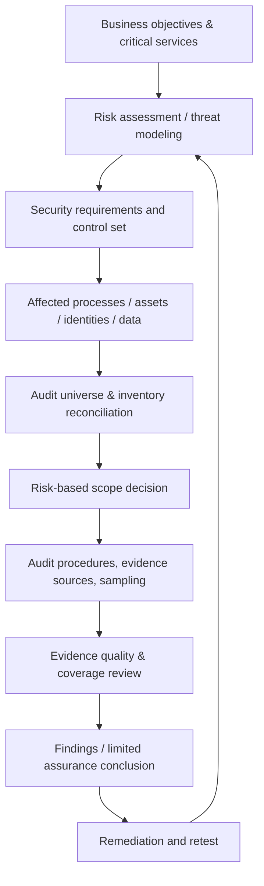
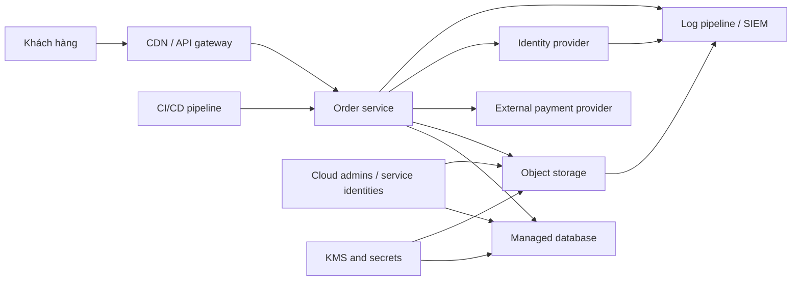
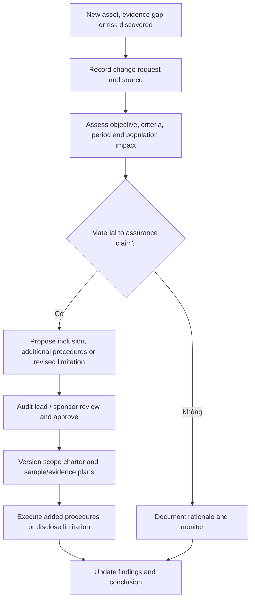

# Audit Scope: xác định phạm vi kiểm toán bảo mật để kết luận có bằng chứng

## 1. Audit Scope là gì?

**Audit scope (phạm vi kiểm toán)** là bản mô tả **những đối tượng, hoạt động, địa điểm, khoảng thời gian và kiểm soát nào sẽ được đánh giá**, cùng **ranh giới, điều kiện áp dụng và các phần không thuộc phạm vi**. Nó là cơ sở để người thực hiện kiểm toán xác định cần thu bằng chứng gì, kiểm tra ở đâu, chọn mẫu thế nào và có thể đưa ra kết luận đến mức nào.

Trong chương **Audit và evidence** của module **SECURITY_SECURITY_ASSURANCE**, mục tiêu không chỉ là có một cuộc audit diễn ra đúng lịch. Ta cần xây dựng cách đánh giá **có bằng chứng** rằng hệ thống đáp ứng mục tiêu bảo mật: từ phân tích rủi ro, yêu cầu và security controls đến kiểm thử, audit, khắc phục phát hiện và theo dõi assurance liên tục trong phát triển, vận hành.

Một báo cáo ghi “hệ thống đạt yêu cầu bảo mật” nhưng chỉ kiểm tra một môi trường staging hoặc một vài cloud accounts sẽ dễ gây hiểu lầm. Ngược lại, một scope diễn đạt chính xác giúp tạo tuyên bố hữu ích:

> “Trong kỳ đánh giá đã xác định, các control về quản lý quyền truy cập và ghi log của dịch vụ Order API trên ba tài khoản cloud production được liệt kê đã được kiểm tra theo các thủ tục và mẫu nêu trong hồ sơ; kết luận không bao phủ tài khoản sandbox, dịch vụ thanh toán do đối tác vận hành hoặc các tài nguyên chưa được kiểm kê.”

Đoạn này không khẳng định toàn bộ hệ thống an toàn tuyệt đối. Nó xác định **đối tượng, thời gian, control, giới hạn** và để người đọc tìm lại bằng chứng.

### Sau bài học, người học có thể

1. Phân biệt **audit scope**, audit objectives, audit criteria, audit universe, audit period, evidence coverage và mẫu kiểm toán.
2. Xác định ranh giới tổ chức, quy trình nghiệp vụ, tài sản, identity, dữ liệu, môi trường, địa lý và bên thứ ba.
3. Dùng risk assessment và security requirements để chọn phạm vi có ý nghĩa, thay vì chỉ chọn tài sản dễ kiểm.
4. Ánh xạ **risk → control → asset/process → test procedure → evidence** trong một scope matrix.
5. Xử lý time period, point-in-time review, design effectiveness và operating effectiveness mà không suy rộng.
6. Đề xuất sampling plan, ghi số lượng tổng thể, ngoại lệ, giới hạn bằng chứng và các khoảng trống.
7. Tạo audit scope charter có owner, reviewer, phê duyệt, change control và tiêu chí báo cáo.
8. Áp dụng vào một hệ thống cloud nhiều dịch vụ và kết luận assurance đúng mức bằng chứng.

**Phạm vi bài học:** tập trung vào xác định và quản trị scope của một cuộc kiểm toán/đánh giá kiểm soát bảo mật. Đây không phải hướng dẫn thay thế cho một chuẩn kiểm toán, chứng nhận, ý kiến pháp lý hoặc điều khoản hợp đồng cụ thể. Từng cuộc đánh giá phải tuân theo tiêu chí và yêu cầu độc lập đã được các bên phê duyệt.

## 2. Phân biệt scope, objectives, criteria và evidence

Những thuật ngữ này thường xuất hiện cùng nhau nhưng có nhiệm vụ khác nhau.

| Khái niệm | Câu hỏi phải trả lời | Ví dụ |
|---|---|---|
| **Audit universe** | Tất cả đối tượng *có thể* được xem xét trong chương trình kiểm toán là gì? | Các ứng dụng, cloud accounts, nhân sự, nhà cung cấp, dữ liệu và quy trình quan trọng của tổ chức |
| **Audit scope** | Cuộc đánh giá **này** bao gồm chính xác những phần nào của universe? | Order API và các tài nguyên hỗ trợ tại production của hai khu vực |
| **Audit objective** | Cuộc đánh giá nhằm xác nhận điều gì? | Xác định các quyền truy cập đặc biệt được cấp/phê duyệt và rà soát phù hợp |
| **Audit criteria** | Dựa trên tiêu chí nào để quyết định phù hợp hay sai lệch? | Chính sách IAM nội bộ phiên bản X; điều khoản được áp dụng trong hợp đồng/chuẩn liên quan |
| **Audit period** | Điều kiện và hoạt động trong khoảng thời gian nào được đánh giá? | 01/07 đến 30/09/2026, hoặc trạng thái tại một thời điểm xác định |
| **Population** | Tập đầy đủ các đơn vị có thể chọn kiểm tra trong scope là gì? | 450 sự kiện cấp quyền đặc biệt trong kỳ tại tài khoản được chọn |
| **Sample** | Những đơn vị nào thực sự được kiểm và chọn theo phương pháp nào? | 45 sự kiện theo phương pháp lấy mẫu đã công bố |
| **Audit procedure/test** | Người đánh giá sẽ làm gì để thu và kiểm chứng bằng chứng? | Đối chiếu sự kiện cấp quyền, người yêu cầu, người phê duyệt và policy có hiệu lực |
| **Evidence** | Dữ kiện nào hỗ trợ hoặc giới hạn kết luận? | Change ticket, cloud audit event, policy snapshot, review record |
| **Finding** | Quan sát sai lệch, thiếu sót hoặc không đủ bằng chứng được ghi thế nào? | 4 sự kiện thiếu approval hoặc 1 account chưa có audit data |

**Audit objective không thay thế scope:** “đánh giá IAM” vẫn quá rộng vì chưa biết của ai, tài khoản nào, khoảng thời gian nào và quyền gì. **Scope không thay thế criteria:** “toàn bộ production IAM” chưa nêu điều kiện PASS/FAIL. **Evidence không tự quyết định scope:** chỉ vì nhóm hiện có log của một account không có nghĩa có quyền ngầm loại các account khác cần đánh giá.

### 2.1. Một công thức tư duy ngắn

```text
Audit universe: Những gì tồn tại hoặc có thể thuộc trách nhiệm bảo mật?
       ↓
Risk and business objectives: Điều nào có tác động đáng kể?
       ↓
Scope: Chúng ta sẽ đánh giá những phần nào, trong thời kỳ nào?
       ↓
Criteria: Kiểm soát nào và điều kiện phù hợp là gì?
       ↓
Procedure and sampling: Chúng ta sẽ quan sát, chọn mẫu, xác minh thế nào?
       ↓
Evidence: Dữ kiện nào được thu, có đáng tin và đầy đủ không?
       ↓
Conclusion: Chỉ phát biểu trong giới hạn đã kiểm chứng.
```

Điều quan trọng không chỉ là làm theo thứ tự: nếu phát hiện một dịch vụ phụ thuộc chưa từng được đưa vào inventory, cần **quay lại xem phạm vi** trước khi tiếp tục kết luận.

## 3. Vì sao xác định sai scope làm hỏng một cuộc audit?

Xác định phạm vi sai có thể gây hai loại thất bại đối nghịch:

- **Quá hẹp so với rủi ro:** chọn một dịch vụ đơn giản nhưng bỏ qua hệ thống quan trọng, quyền quản trị, bản sao dữ liệu hoặc tài khoản bên thứ ba; báo cáo thiếu khả năng đại diện.
- **Quá rộng so với khả năng kiểm toán:** ghi “toàn bộ cloud” nhưng thiếu inventory, thẩm quyền truy cập, thời gian, dữ liệu và thủ tục; người đánh giá buộc phải dùng mẫu tùy tiện và không thể tạo bằng chứng đúng cam kết.

Một số hậu quả:

| Lỗi scoping | Nguy cơ |
|---|---|
| Chỉ chọn tài sản đã có log đầy đủ | Tạo **selection bias**, che hệ thống chưa có telemetry |
| Không ghi môi trường | Kết quả staging bị hiểu nhầm là production |
| Không ghi khoảng thời gian | Một snapshot hôm nay bị dùng chứng minh control vận hành trong sáu tháng |
| Không xét service dependencies | API được kiểm nhưng datastore, IdP hoặc CI/CD có đặc quyền không được kiểm |
| Không xét cloud account/region mới | Chương trình báo “100%” trong khi inventory đã lỗi thời |
| Không có mẫu số/sampling method | Kết quả của 10 mẫu bị suy rộng không có cơ sở cho hàng nghìn sự kiện |
| Không phân biệt scope với exclusions | Tài sản bị loại vô thời hạn mà business/risk owner không biết |
| Không biết ai phê duyệt | Scope bị sửa sau khi thấy finding bất lợi |
| Không mô tả evidence limitations | Auditor không thể đánh giá mức tin cậy hoặc tính lặp lại |

Một scope tốt **đủ rõ để người khác tái tạo danh sách đối tượng và kỳ đánh giá**, nhưng đủ linh hoạt để ghi thay đổi được kiểm soát khi rủi ro, dữ liệu hay hệ thống phát sinh.

## 4. Các loại audit và ảnh hưởng đến phạm vi

**Cùng một hệ thống có thể được kiểm tra dưới nhiều mục tiêu khác nhau.** Không dùng tên loại audit để tự suy ra đầy đủ scope.

| Kiểu đánh giá | Trọng tâm thường gặp | Cần nêu rõ trong scope |
|---|---|---|
| **Internal security control audit** | Thiết kế và vận hành các kiểm soát theo yêu cầu nội bộ | Đơn vị tổ chức, quy trình, control set, kỳ hoạt động, mẫu và evidence |
| **Compliance/contract assessment** | Điều khoản tiêu chuẩn, hợp đồng hoặc quy định được áp dụng | Phiên bản, phạm vi pháp nhân/dịch vụ, hệ thống và thời kỳ liên quan |
| **Technical configuration review** | Trạng thái cấu hình cloud, OS, IAM, encryption, network | Accounts, subscriptions, projects, tài nguyên, thời điểm snapshot và rule versions |
| **Application security assessment** | Authentication, authorization, data flow, logging, secure SDLC | Ứng dụng, API, phiên bản, môi trường, data class, trust boundaries |
| **Cloud provider / third-party assurance review** | Kiểm soát do nhà cung cấp thực hiện và phụ thuộc của khách hàng | Service đã mua, địa điểm, thời kỳ, báo cáo bên thứ ba và gap khách hàng |
| **Incident-driven review** | Control không hoạt động hoặc nghi bị vượt qua trong incident | Incident scope, time window, affected identity/assets, evidence gaps |
| **Continuous controls monitoring** | Kiểm soát được kiểm định/giám sát nhiều lần trong thời kỳ | Asset universe, detection rules, frequency, drift, validation và coverage gaps |

**Audit không đồng nghĩa penetration test.** Kiểm thử xâm nhập tập trung đánh giá khả năng khai thác trên mục tiêu được phép; audit có thể kiểm tra thiết kế, bằng chứng vận hành và quản trị của nhiều loại control. Kết quả pentest có thể là một **nguồn evidence**, nhưng không tự thay toàn bộ các tiêu chí về approval, retention, review hay continuity.

**Audit không đồng nghĩa chứng nhận.** Một cuộc đánh giá nội bộ với phạm vi đã duyệt không thể tự phát hành tuyên bố có chứng nhận chính thức hoặc phạm vi tuân thủ của một tổ chức chứng nhận độc lập.

## 5. Những chiều bắt buộc xem xét khi lập Audit Scope

Thay vì viết một câu “audit hệ thống bảo mật”, hãy đi qua nhiều chiều:

| Chiều | Câu hỏi scoping | Ví dụ tài sản/đơn vị |
|---|---|---|
| **Organizational boundary** | Pháp nhân, bộ phận, nhóm sản phẩm, đơn vị vận hành nào? | Công ty A, đơn vị thương mại điện tử, đội vận hành platform |
| **Business process** | Quy trình nghiệp vụ/hoạt động được kiểm có phạm vi nào? | Nhận đơn, cấp quyền, triển khai ứng dụng, xử lý yêu cầu dữ liệu |
| **Service/system** | Ứng dụng, API, cơ sở dữ liệu, hệ thống hạ tầng và integration nào? | Order API, IdP, KMS, storage, CI/CD, SIEM |
| **Environment** | Production, staging, development, DR site hoặc sandbox nào? | Production cloud account, recovery staging |
| **Identity/role** | Người dùng, nhân viên, service accounts, admin và third-party identities nào? | Platform admin, workload role, CI deploy identity |
| **Information/data** | Dữ liệu nào, mức phân loại, luồng đi và bản sao nào? | PII, giao dịch, object attachments, backup, audit logs |
| **Technical location** | Cloud account/project/subscription, region, cluster, tenant, network segment nào? | Accounts A/B, regions X/Y, namespace orders |
| **Control domain** | Security objectives và controls nào cần đánh giá? | Access control, logging, encryption, vulnerability response |
| **Time** | Giai đoạn hoạt động nào và thời điểm snapshot nào? | Quý III/2026, cấu hình tại ngày khóa sổ |
| **Third parties** | Provider, SaaS, subprocessor, outsource hoặc đối tác nào ảnh hưởng? | Payment provider, cloud storage vendor, SOC ngoài |
| **Assets and population** | Danh sách đầy đủ các đối tượng thuộc scope có thể tái tạo không? | 50 buckets, 200 privileged grants, 18 build pipelines |
| **Procedures and evidence** | Phương pháp đánh giá, nguồn dữ liệu và giới hạn nào? | IAM policy snapshots, PR reviews, logs, sample tests |

Mỗi chiều có thể có **included, excluded, conditional, pending identification**. Ví dụ “chỉ production” không giải thích CI pipeline staging có quyền deploy production hay không: nếu nó là một đường cấp đặc quyền đến production, cần xem như **supporting dependency** và quyết định kiểm tới đâu.

### 5.1. Không nhầm phạm vi mạng với phạm vi kiểm soát

Một dải IP hoặc một cluster có thể là ranh giới kỹ thuật, nhưng không thể hiện đầy đủ:

- API được gọi qua SaaS identity provider và reverse proxy.
- CI/CD có quyền thay infrastructure của cluster.
- Dữ liệu được export sang object storage, analytics hoặc backup ở account khác.
- Một admin có quyền cấp role trên nhiều vùng.

Để đánh giá một control, cần xác định **đường đi quyền và dữ liệu** chứ không chỉ địa chỉ mạng hoặc tên server.

### 5.2. Scope theo process và scope theo asset phải liên kết

Quy trình “joiner/mover/leaver” có thể dùng IdP, HR system, ticket approvals, applications và log. Nếu audit chỉ xem IdP hiện tại, có thể kiểm được **quyền còn hiệu lực tại một thời điểm**, nhưng không đủ kết luận toàn bộ quy trình cấp/thu hồi quyền đã hoạt động đúng trong kỳ. Ngược lại, chỉ xem approval tickets mà không đối chiếu quyền có hiệu lực cũng chưa chứng minh thực thi.

## 6. Bắt đầu từ rủi ro và security objectives

Một **risk-based audit scope** xem trọng tài sản/quy trình có tác động lớn, các threat scenario có khả năng xảy ra, lịch sử sự cố, thay đổi gần đây và tình trạng control còn nghi ngờ. Đây là quá trình lựa chọn có lý do, không phải cảm tính “kiểm nơi dễ nhất”.

### 6.1. Lộ trình từ rủi ro đến đối tượng cần kiểm



Ví dụ, rủi ro **truy cập trái phép dữ liệu đơn hàng** dẫn đến yêu cầu kiểm tra ít nhất:

1. Identity và authorization trên API.
2. Quyền database, object storage, export và service accounts liên quan.
3. Các thủ tục cấp/thu hồi/đánh giá lại quyền trong kỳ.
4. Audit logging đủ truy vết truy cập và thay đổi quyền.
5. Các đường từ CI/CD, admin và nhà cung cấp có thể sửa policy.

**Không nhất thiết đưa tất cả vào một engagement** nếu nguồn lực hoặc mục tiêu đánh giá giới hạn; nhưng phải nêu dependencies, lý do chọn, rủi ro của những phần ngoài scope và ai quyết định.

### 6.2. Ma trận ưu tiên scoping

| Yếu tố | Dấu hiệu ưu tiên cao | Nguồn xác minh |
|---|---|---|
| **Business criticality** | Dịch vụ ngừng gây tác động lớn hoặc có nghĩa vụ hợp đồng nghiêm ngặt | BIA, business owner |
| **Data sensitivity** | Có thông tin cá nhân, bí mật kinh doanh, credentials, audit evidence | Data classification, inventory |
| **Threat exposure** | Internet-facing, external integrations, broad admin access | Architecture, IAM, vulnerability/threat data |
| **Control uncertainty** | Chưa kiểm tra lâu, nhiều ngoại lệ, drift, coverage gaps | Prior audit, change logs, telemetry |
| **Change intensity** | Mới migration, refactor IAM, cloud region, vendor hoặc CI | Change records, deployment history |
| **Incident history** | Có compromise, near miss hoặc control fail | IR findings, postmortem |
| **Assurance obligations** | Yêu cầu từ hợp đồng/khung pháp lý/ban quản trị áp dụng | Approved obligation mapping |

Tổ chức có thể gán trọng số để hỗ trợ phân bổ nguồn lực, nhưng phải **công bố giả định và quyền phê duyệt**. Không suy luận “rủi ro thấp” cho tài sản chỉ vì không có alert: có thể hệ thống chưa thu log, tức chưa có bằng chứng để đánh giá.

### 6.3. Không lựa chọn scope để né finding

Nếu một account production thiếu quyền scanner, cần ghi **evidence access limitation** và khắc phục truy cập hoặc sửa scope có phê duyệt. Không tự đưa account đó ra khỏi phạm vi rồi báo tỷ lệ đạt 100%. Tương tự, nếu phát hiện ứng dụng quan trọng mới trong kỳ, phải đánh giá tác động tới scope và assurance claim thay vì bỏ qua vì không có trong danh sách ban đầu.

## 7. Audit Universe và kiểm kê đối tượng đúng

**Audit universe** là tập các đối tượng có thể phải kiểm toán trong chương trình. Với audit security controls, nó cần được liên kết với **asset inventory, service catalog, process inventory và data flow**, không chỉ một danh sách máy chủ.

### 7.1. Một số nguồn inventory hữu ích

- Service catalog / CMDB: dịch vụ, business owner, system owner, criticality.
- Cloud inventories theo organization/account/subscription/project và region.
- IAM/IdP directories: nhân sự, service principals, privileged roles, trust relationships.
- Source control và CI/CD pipelines: những pipeline nào có thể build/deploy production.
- Kubernetes namespaces, clusters, node pools, managed services, storage/backups.
- Data catalog, retention policy, data-flow mapping và phân loại dữ liệu.
- Third-party register: SaaS, vendor, processor, các hợp đồng và người quản lý.
- Prior audit, incident, vulnerability, exception và remediation tracker.

Đây là **nguồn đối chiếu**, không phải chỉ dẫn đọc bất kỳ tệp nào ngoài quyền; auditor cần quyền truy cập và tiêu chí bảo mật phù hợp.

### 7.2. Reconciliation giúp phát hiện phần thiếu

Giả sử service catalog ghi 8 production services, cloud inventory có 11 workload groups, CI/CD ghi 2 pipeline mới, nhưng tài liệu scope chỉ liệt kê 7 services. Không được mặc định số 7 là universe chính xác. Cần:

1. Xác định đơn vị đếm (service, workload, account hay pipeline).
2. Tìm owner, môi trường, dữ liệu, quyền và liên hệ giữa các thực thể.
3. Giải thích các mục mới, duplicate, ngừng hoạt động hoặc ngoài pháp nhân.
4. Chốt **population/scope snapshot** có timestamp và version.
5. Ghi những đối tượng chưa xác định được hoặc thiếu quyền kiểm tra thành **coverage gaps**.

Trong cloud, asset inventory thay đổi nhanh. Một audit period kéo dài ba tháng cần xác định **newly created/decommissioned assets** có được đưa vào population hay không, tránh chỉ lấy danh sách còn tồn tại tại ngày audit và bỏ mất tài sản đã bị xóa trong kỳ.

### 7.3. Mẫu inventory trích theo scope

| ID | Loại đối tượng | Môi trường | Owner | Control liên quan | Quyết định scope |
|---|---|---|---|---|---|
| `SVC-ORDER` | Order API | Production | Order team | Access, logging, change control | Included |
| `DB-ORDER` | Managed database | Production | Data platform | Access, encryption, backup | Included |
| `CI-DEPLOY` | Build/deploy pipeline | Shared, có quyền production | Platform | Privileged access, artifact integrity | Included dependency |
| `IDP-CORP` | Identity provider tenant | Shared | Identity team | User lifecycle, MFA, privileged roles | Included relevant controls |
| `PSP-EXT` | External payment SaaS | Third-party | Vendor owner | Supplier assurance, data flow | Boundary / indirect evidence |
| `LAB-SANDBOX` | Data synthetic | Development | Developer | Không thuộc objective lần này | Excluded with rationale |

**Chú ý:** một tài nguyên “Shared” có thể nằm ngoài nhóm sản phẩm nhưng vẫn **trong scope** nếu nó ảnh hưởng trực tiếp đến control được đánh giá. Không loại identity, backup hoặc pipeline chỉ vì không nằm trong repository ứng dụng.

## 8. Từ audit objectives đến criteria và control matrix

Định nghĩa được tài sản nhưng **không có tiêu chí đánh giá** sẽ khiến kết quả mang tính cảm nhận. Một cuộc audit về Security Assurance cần có cơ sở để đối chiếu quan sát với **security requirements và controls**.

### 8.1. Định nghĩa criteria

**Audit criteria** có thể đến từ:

- Security policies, control standards và risk appetite đã được tổ chức phê duyệt.
- Các điều khoản trong hợp đồng, customer assurance requirements hoặc quy định áp dụng.
- Baseline và technical standards: IAM, encryption, logging, configuration, patching, backup, monitoring.
- Nghĩa vụ trong chương trình bảo đảm hoặc quy trình phát triển/vận hành đã chấp thuận.
- Những yêu cầu kỹ thuật cụ thể được suy ra từ threat model và security objectives.

Nếu có sử dụng **ISO/IEC 27001, SOC 2 Trust Services Criteria, NIST SP 800-53 hoặc một framework khác**, phải xác định **phiên bản và control/criteria cụ thể thực sự áp dụng** trong engagement. Không nên viết “theo NIST/ISO” chung chung rồi giả định tất cả control trong framework đều nằm trong scope. Một tổ chức có thể dùng framework làm **nguồn tham khảo** mà không hề được chứng nhận hoặc có quyền phát hành báo cáo tuân thủ chính thức.

### 8.2. Ví dụ control mapping

Các ID bên dưới **do bài học đặt ra**, không phải mã điều khoản chính thức:

| Risk | Control ID | Audit objective | Population/asset | Procedure | Evidence |
|---|---|---|---|---|---|
| Cấp quyền cao ngoài quy trình | `AUD-IAM-01` | Kiểm tra quyền admin có approval, được review và thu hồi đúng | IAM identities và grants trong production | Reconcile role snapshot và grant events với change approvals; sample theo kỳ | IAM export, audit events, approval tickets, review records |
| Data storage bị public | `AUD-DATA-02` | Kiểm tra không có public access ngoài ngoại lệ | Buckets chứa internal data | Effective policy review, test canary theo quyền | Cloud config, resource policies, classification, test results |
| CI/CD đẩy artifact không đáng tin | `AUD-SDLC-03` | Kiểm tra build/deploy có review và artifact provenance | Pipelines có quyền production | Chọn samples deployments, trace commit → build → image digest → runtime | PR approvals, build log, signatures, deployed digests |
| Log thiếu/không dùng được | `AUD-LOG-04` | Kiểm tra event quan trọng được thu và có retention phù hợp | IAM and data access sources thuộc scope | Source config, sample event canary, pipeline query | Event IDs, parser status, destination/retention |
| Khôi phục không đạt mục tiêu | `AUD-DR-05` | Kiểm tra kế hoạch DR và bài restore/failover đã được xác minh | Critical business process | Review BIA, exercise runs, RTO/RPO evidence, gap remediation | BIA, exercise evidence, transaction markers, sign-off |

Không phải mọi control cần cùng loại bằng chứng. Một **quy trình phê duyệt quyền** thường cần mẫu từ cả kỳ; một **snapshot cấu hình public access** chủ yếu nói về thời điểm hiện tại; muốn kết luận nó được duy trì cả kỳ, cần thêm log thay đổi hoặc kiểm tra định kỳ có chất lượng đủ.

### 8.3. Một control có thể cắt qua nhiều hệ thống

**Control `AUD-IAM-01`** có thể bao gồm:

1. Quy trình business xác định người yêu cầu/quyền cần cấp.
2. Ticket/approval workflow và separation of duties.
3. IAM API thay đổi quyền trên cloud.
4. Periodic access review và thu hồi quyền.
5. Audit logs để truy vết ai đã cấp, thay, xóa quyền.

Nếu chỉ kiểm tra IAM hiện có, auditor đánh giá được **quyền tại thời điểm snapshot**, nhưng chưa có cơ sở xác định tất cả grants trong kỳ có approval đúng. Nếu chỉ xem ticket, chưa biết quyền đã thực thi đúng. Scope phải xác định cả **control process và technical implementation** cần thiết cho objective.

## 9. Ranh giới cloud, microservices và shared responsibility

Hệ thống hiện đại hiếm khi nằm trên một server và một đội duy nhất. Cùng một business function có thể sử dụng API, managed database, cloud IAM, KMS, container platform, CI/CD, edge CDN và SaaS.

### 9.1. Vẽ trust boundary để không bỏ sót



Một audit về **quyền truy cập dữ liệu đơn hàng** không nhất thiết phải kiểm toán toàn bộ cloud provider, nhưng phải quyết định:

- Các cloud identities, service roles, IAM policies, network paths và key access nào có thể tác động dữ liệu?
- CI/CD có khả năng triển khai code hoặc thay policy nên cần kiểm tra phần control nào?
- Bản sao backup, export, data lake và analytics có nằm trong data protection objective không?
- Các kiểm soát của provider được chứng minh bằng tài liệu nào và các kiểm soát khách hàng vẫn phải thực hiện là gì?
- Nếu API gateway hoặc IdP là dịch vụ SaaS, boundary giữa kết quả audit nội bộ và bằng chứng assurance bên thứ ba nằm ở đâu?

### 9.2. Shared responsibility không có nghĩa bỏ provider khỏi scope

Đối với managed service, một số kiểm soát do provider vận hành (hạ tầng vật lý, hardware, một phần availability). Các kiểm soát khác thuộc khách hàng: **account access, resource policy, encryption choices, retention, audit configuration, application access logic**.

Scope cần phân biệt:

| Control area | Responsibility có thể thuộc | Phương pháp audit |
|---|---|---|
| Tính bảo mật hạ tầng vật lý của datacenter | Provider | Review report/attestation được phép truy cập và phạm vi phù hợp |
| Bucket visibility và IAM | Customer | Inspect actual cloud resource configs, policy và behavior |
| Key service underlying infrastructure | Provider | Review service documentation/assurance trong phạm vi |
| Ai được quyền decrypt customer key | Customer/shared | IAM/key policy, test principal, audit trail |
| Managed database patching | Provider/customer tùy mô hình | Xem nghĩa vụ của dịch vụ cụ thể, patch settings/release evidence |
| Application authorization | Customer | Source/design review, API authorization tests, logs |

**Báo cáo bên thứ ba không tự chuyển toàn bộ control sang trạng thái PASS.** Cần kiểm tra report có bao phủ **dịch vụ, địa điểm, thời kỳ, tiêu chí** liên quan và có yêu cầu **complementary user entity controls** hay không; các kiểm soát khách hàng phải được kiểm bằng bằng chứng riêng.

### 9.3. Service account và shared platform

Một cluster dùng chung có thể được nhiều service sử dụng. Nếu audit chỉ kiểm quyền namespace `orders`, có thể chưa kiểm:

- Cluster-level admins thay đổi RBAC và admission policy.
- CI deploy identity có quyền nhiều namespaces.
- Node identity truy cập cloud storage hoặc secret manager.
- Central logging service thiếu quyền lấy event từ một account.

Scope có thể chỉ đưa **các control tác động trực tiếp đến dịch vụ** vào đánh giá, thay vì kiểm toàn bộ platform. Nhưng quyết định đó cần được diễn giải bằng dependency graph và control mapping.

## 10. Time boundary: điểm thời gian và kỳ vận hành

**Audit period** quyết định loại bằng chứng cần thiết. Đây là nơi thường xảy ra lỗi suy luận: **cấu hình hiện tại không chứng minh hành vi trong quá khứ**.

### 10.1. Point-in-time versus period-of-time

| Kiểu đánh giá | Hỏi điều gì | Ví dụ bằng chứng | Hạn chế |
|---|---|---|---|
| **Point-in-time** | Tại thời điểm xác định, thiết kế/cấu hình/control có trạng thái nào? | IAM policy snapshot lúc `2026-09-30T23:59Z` | Không chứng minh liên tục suốt ba tháng trước |
| **Period-of-time** | Trong khoảng được chọn, control có được vận hành theo yêu cầu không? | Grant events, approvals, periodic reviews và change/audit logs suốt kỳ | Cần population đầy đủ, retention, mẫu và phương pháp đánh giá |
| **Continuous monitoring window** | Rule/config/event được quan sát qua chu kỳ nào và độ đầy đủ ra sao? | Scan runs, coverage records, drift events, exceptions | Tự động hóa có thể mất coverage hoặc tạo false positives |
| **Event-driven review** | Khi sự kiện cụ thể xảy ra, control đã thực hiện thế nào? | Incident logs, decision records, containment test | Chỉ hỗ trợ kết luận trên tình huống đã quan sát |

Nếu audit objective là **“quy trình thu hồi quyền khi nhân viên rời tổ chức hoạt động đúng trong Quý III”**, việc xem IdP snapshot cuối quý không đủ: người đã rời từ tháng 7 và được thu hồi tháng 8 không còn xuất hiện trong danh sách cuối quý, nhưng vẫn có thể vi phạm SLA thu hồi.

### 10.2. Design effectiveness và operating effectiveness

**Design effectiveness** xem control, nếu được thực hiện như thiết kế, có hợp lý để đáp ứng mục tiêu hay không: quyền và trách nhiệm, chính sách, approval path, detection rule, technical configuration.

**Operating effectiveness** xem control có **được thực hiện thực tế** theo thiết kế trong kỳ hay không: quyền được review đủ chu kỳ, sự kiện cấp admin có approval, backup restore diễn tập, lỗ hổng được khắc phục đúng hạn.

Một policy ghi “mọi privileged grant cần review” có thể **hợp lý về thiết kế** nhưng **không hoạt động** nếu 20% grants không qua approval. Ngược lại, một sample grants được phê duyệt đúng chưa chứng minh thiết kế bao phủ service identities hoặc quyền cấp qua đường API khác.

### 10.3. Chốt mốc và thay đổi tài sản trong kỳ

Tối thiểu cần xác định:

- `period_start`, `period_end` và timezone.
- Mốc chốt cấu hình khi dùng point-in-time.
- Tài sản được tạo mới, ngừng hoạt động hoặc chuyển owner trong kỳ.
- Chính sách thay đổi phiên bản giữa kỳ: tiêu chí nào áp dụng cho giai đoạn nào?
- Thời hạn log retention và khả năng xem dữ liệu lịch sử.
- Ngày bắt đầu kiểm toán, ngày thu bằng chứng và thời điểm chấp thuận conclusion.

Không nên dùng một policy revision vừa được sửa tháng 10 để đánh giá tất cả hành vi tháng 7 mà không nêu tiêu chí lúc đó. Nếu policy thay đổi hợp lệ, có thể phải **chia subperiod** và áp dụng đúng baseline cho từng đoạn.

## 11. Sampling: tập tổng thể, phương pháp và giới hạn suy rộng

Một cuộc audit hiếm khi kiểm tra toàn bộ 100% events, tài sản và tickets. **Lấy mẫu** giúp sử dụng nguồn lực hợp lý, nhưng phải biết tập tổng thể đầy đủ và phương pháp chọn. Sampling không thể chữa lỗi inventory thiếu tài sản hoặc dữ liệu nguồn bị loại khỏi population.

### 11.1. Định nghĩa population trước khi chọn sample

Ví dụ control `AUD-IAM-01`:

> “Kiểm tra mọi sự kiện cấp quyền admin có hiệu lực trong production cloud accounts A và B từ 01/07/2026 00:00 UTC tới 30/09/2026 23:59:59 UTC.”

Population có thể bao gồm:

- Grant trực tiếp cho user/service principal.
- Add group membership tạo effective privileged access.
- Role assignment hoặc policy update nâng quyền.
- Changes bị rollback trong kỳ (vẫn là event cần đánh giá).
- Các grants từ automation và break-glass khi thỏa định nghĩa.

Nếu chỉ lấy những ticket có trạng thái “Approved”, đây là **biased population**: có thể bỏ qua grant không có ticket — chính là sai lệch mà audit cần phát hiện. Nên lấy **source-of-truth events hoặc effective access change history** rồi đối chiếu approval.

### 11.2. Các kiểu chọn mẫu

| Phương pháp | Cách chọn | Khi hữu ích | Giới hạn |
|---|---|---|---|
| **Full population testing** | Kiểm toàn bộ phần tử trong phạm vi | Rule tự động, population không lớn, control trọng yếu | Chất lượng nguồn/tool vẫn phải xác minh |
| **Random sampling** | Chọn ngẫu nhiên từ population đã chốt | Muốn giảm bias và có cơ sở thống kê khi thiết kế đúng | Cần phương pháp, kích thước, assumptions và xác suất rõ |
| **Stratified sampling** | Chia theo mức rủi ro/thời kỳ/nhóm rồi chọn trong từng tầng | Account/role/tháng có tính chất khác nhau | Phải biết tỷ trọng và tránh báo cáo cộng gộp sai |
| **Judgmental/risk-based sampling** | Ưu tiên các grants nhạy cảm hoặc bất thường | Đi sâu vào vấn đề rủi ro cao, tìm control failures | Không suy rộng tỷ lệ lỗi có tính thống kê ra toàn population |
| **Systematic sampling** | Chọn định kỳ theo thứ tự rõ | Population lớn, quy tắc lặp được | Có thể bias nếu dữ liệu có tính chu kỳ |
| **Targeted exception testing** | Kiểm toàn bộ các ngoại lệ, admin đặc biệt hoặc event flagged | Đánh giá khả năng phát hiện/giải quyết vấn đề | Không thay random sample của phần còn lại |

Một thiết kế thực tế có thể kết hợp **kiểm toàn bộ các grants break-glass** + **lấy mẫu từ grants thông thường**, nhưng phải trình bày hai nguồn kết quả tách biệt nếu phương pháp suy luận khác nhau.

### 11.3. Kích thước mẫu không có công thức phổ quát

Không có câu “chọn 10% là đủ” cho mọi audit. Kích thước phụ thuộc:

- Objective và tiêu chí compliance/assurance cụ thể.
- Quy mô population và tần suất control thực thi.
- Mức rủi ro hoặc materiality của một deviation.
- Mức bảo đảm và phương pháp thống kê hoặc phán đoán chuyên môn.
- Độ tin cậy của source inventory/evidence và kết quả các kỳ trước.
- Tính không đồng nhất theo account, thời điểm, quyền và người phê duyệt.

Nếu nhiệm vụ yêu cầu **ước lượng tỷ lệ sai lệch ở một confidence level**, cần người có phương pháp sampling phù hợp xác định cách chọn và tính toán; **không thể lấy tỷ lệ finding trong judgmental sample để kết luận tỷ lệ toàn bộ population**.

### 11.4. Ví dụ: 500 grants và 50 samples

Giả sử hai account trong scope có **500 privileged grant events trong kỳ**; auditor chọn:

- 20 grants được xem là đặc biệt rủi ro: break-glass, thay quyền production ngoài giờ hoặc quyền vượt baseline.
- 30 grants được chọn ngẫu nhiên có lưu seed/method từ 480 grants còn lại.

Kết quả phát hiện **3 grants thiếu approval trong 20 mẫu có chủ đích** và **1 grant thiếu approval trong 30 mẫu ngẫu nhiên**. Báo cáo cần ghi rõ: **4 phát hiện trên 50 mẫu đã kiểm**, phân tách hai tầng. Không được khẳng định “8% của tất cả 500 grants không được phê duyệt”: hai phần có xác suất chọn khác nhau, mẫu có chủ đích và mục tiêu đánh giá không cho phép suy rộng giản đơn.

### 11.5. Chọn mẫu phải có khả năng tái lập

Mỗi sample nên ghi:

```yaml
sample_id: IAM-GRANT-EXAMPLE-021
population_id: PROD-PRIV-GRANTS-Q3-2026
selection_method: stratified_risk_based
stratum: break_glass
source_event_id: evt-example-7819
account: example-production-a
event_time_utc: "2026-08-13T10:20:00Z"
control_id: AUD-IAM-01
test_status: pending
evidence_refs: []
```

Ví dụ trên dùng dữ liệu giả. Với kết quả thực, bản ghi cần có nguồn từ population snapshot đã chốt, phương pháp lựa chọn, event ID, test ID, kết quả và evidence sau khi kiểm. Nếu thuật toán chọn ngẫu nhiên có seed, lưu seed cùng mã/phiên bản phương pháp để người khác kiểm tra lại.

## 12. Scope và quyền truy cập bằng chứng

Một audit scope có thể đúng về lý thuyết nhưng **không thực hiện được** vì thiếu quyền thu chứng cứ, log hết hạn, dữ liệu quá nhạy cảm hoặc nhà cung cấp không cho phép truy cập. Cần đánh giá **evidence feasibility** trước khi chốt cam kết kiểm toán.

### 12.1. Evidence source matrix

| Control | Nguồn bằng chứng | Quyền cần có | Giới hạn cần xét |
|---|---|---|---|
| IAM approvals | Ticketing + IAM audit + access reviews | Read-only access theo owner | Ticket có thể bị sửa, event thiếu hoặc identity mapping sai |
| Cloud exposure | Resource policies, IAM policy, cloud posture + canary | Read config và test role có phép | Scanner không thấy account, policy có điều kiện phức tạp |
| SDLC change control | Git, CI runs, deployment inventory, artifact registry | Read repo/release metadata | Tag mutable; build logs/attestation có thể hết hạn |
| Logging | Source config, raw events, normalized events, SIEM | Query theo source và thời kỳ | Sampling, missing data events, ingestion delay |
| Encryption/KMS | Key/resource policies, backup restore records | Read-only KMS configs, quyền test giới hạn | Key ID không chứng minh decrypt hiệu lực |
| Recovery | BIA, backup IDs, restore drills, security checks | Owner-approved evidence access | Backup job success không chứng minh restore |
| Third party | Provider reports/attestations, contracts, service configs | Rights of review theo hợp đồng | Provider report có khác scope, period hoặc criteria |

### 12.2. Bằng chứng có đủ tin cậy không?

Nên xem:

1. **Nguồn:** raw cloud event hay screenshot đã chọn lọc? Có thể đối chiếu với system of record?
2. **Độ đầy đủ:** tập sự kiện từ account/region/period nào, có missing events hoặc log retention gaps?
3. **Tính xác thực và toàn vẹn:** ID, timestamp, source, collector identity, audit history, hashes khi phù hợp.
4. **Độ liên quan:** artifact có gắn đúng asset, control, policy revision, thời kỳ và sample?
5. **Tính nhất quán:** ticket approval, cloud effective policy và event outcome có tương ứng không?
6. **Độc lập:** bằng chứng do bên được audit tự tuyên bố hay được xác minh từ nguồn có thể kiểm tra?
7. **Độ mới:** evidence còn đại diện cấu hình đã đánh giá hay đã có thay đổi đáng kể?

**Một file JSON hoặc screenshot không tự là bằng chứng đủ mạnh** chỉ vì nó có tên đúng. Phải biết nó đến từ đâu, thu khi nào, scope nào và điều kiện truy vấn nào.

### 12.3. Quyền truy cập tối thiểu cho auditor

Ưu tiên read-only roles được phê duyệt, phân tách người thu và người review nếu phù hợp. Nếu cần **behavior test**, phải có RoE và dữ liệu canary: không đọc tài liệu khách hàng thật, không tự nâng quyền, không tắt monitoring hay xóa backup chỉ vì muốn thử. Những thao tác phá hoại/khả năng gây gián đoạn cần quyết định và kế hoạch an toàn riêng.

Khi không có quyền, kết quả phải ghi **scope limitation hoặc insufficient evidence**, không đánh dấu PASS chỉ vì command trả `AccessDenied`.

## 13. Inclusion, exclusion, limitations và assumptions

Một scope có trách nhiệm không chỉ nói **cái gì được kiểm** mà còn phải nói **cái gì không được kiểm và tại sao**.

### 13.1. Bốn trạng thái khác nhau

| Trạng thái | Ý nghĩa | Ví dụ |
|---|---|---|
| **Included** | Nằm trong cam kết kiểm tra; cần procedure/evidence tương ứng | Production storage của Order API |
| **Excluded** | Được loại khỏi scope có lý do và phê duyệt | Sandbox chứa dữ liệu giả, không ảnh hưởng prod |
| **Not applicable** | Control/criterion không áp dụng cho tài sản theo logic đã xác định | Control về DB encryption trên service không sử dụng DB |
| **Scope limitation** | Đối tượng đáng lẽ cần xem nhưng không thể kiểm đủ | Thiếu quyền xem audit events tại một cloud account |

Đôi khi còn có **pending scoping decision** khi chưa xác minh asset owner hoặc dependency. Không nên tự coi pending là excluded.

**Excluded khác not applicable:** một system có thể vẫn thuộc tổ chức nhưng được loại khỏi engagement; một control có thể không áp dụng cho loại system đó. **Excluded khác limitation:** một tài sản bị loại vì quyết định có thẩm quyền không giống việc auditor muốn kiểm nhưng bị chặn quyền hoặc thiếu bằng chứng.

### 13.2. Mẫu exclusion record

```yaml
exclusion_id: AUD-SCOPE-EX-004
candidate_asset: legacy-reporting-sandbox
environment: sandbox
scope_status: excluded
reason: "Synthetic dataset; no access to production identities or data"
related_controls: [AUD-IAM-01, AUD-DATA-02]
dependency_review:
  production_access: none_verified_for_scoping
  shared_identity: not_applicable_for_this_asset
owner: example-platform-owner
approved_by: example-audit-sponsor
review_trigger:
  - "Sandbox receives production data or privileged access"
  - "System changes owner or integration"
```

Đây là ví dụ ghi nhận phạm vi, không phải xác nhận thực tế rằng tài sản đã được cách ly. Lý do “sandbox” tự nó **không đủ**: nếu có quyền CI/CD production hoặc dữ liệu thật, có thể cần kiểm soát nằm trong scope.

### 13.3. Xử lý giới hạn ảnh hưởng kết luận

Giả sử audit objective yêu cầu kiểm chứng logging trên **10 production accounts**, nhưng chỉ 8 account có quyền đọc events. Không được đổi mẫu số thành 8 rồi báo 100%:

- Ghi **8/10 tài khoản có thể kiểm**, 2 tài khoản thiếu evidence.
- Đánh giá rủi ro và ảnh hưởng của hai tài khoản đó đến mục tiêu.
- Yêu cầu owner khắc phục quyền/logging hoặc điều chỉnh engagement có phê duyệt.
- Kết luận giới hạn: “control được kiểm ở 8 accounts; không có kết luận về 2 accounts còn lại.”

Nếu limitation nghiêm trọng, kết luận chung có thể cần được hạn chế hoặc **không thể phát hành theo mức bảo đảm dự kiến**. Quyết định này phải tuân theo phương pháp/chuẩn/hợp đồng áp dụng, không tự chọn cách diễn đạt để làm giảm finding.

## 14. Third-party scope và control phụ thuộc nhà cung cấp

Hầu hết hệ thống phụ thuộc SaaS, cloud providers, managed services hoặc outsourcers. Bằng chứng audit có thể gồm report từ bên thứ ba, nhưng cần tránh hai cực đoan: **bỏ qua provider hoàn toàn** hoặc **cam kết kiểm trực tiếp toàn bộ hạ tầng provider mà không có quyền**.

### 14.1. Bước xác định boundary

1. Xác định **dịch vụ của nhà cung cấp** mà hệ thống sử dụng và dữ liệu/hoạt động bị ảnh hưởng.
2. Ghi **người chịu trách nhiệm nội bộ** quản lý hợp đồng và rủi ro bên thứ ba.
3. Xác định **quyền audit/evidence** thực tế: báo cáo chứng nhận, điều khoản hợp đồng, security questionnaire, API configuration, test do khách hàng vận hành.
4. Đối chiếu report của nhà cung cấp với **dịch vụ, hệ thống, địa điểm, thời gian và control criteria** của engagement.
5. Xác định **complementary controls** khách hàng phải vận hành và cách kiểm.
6. Ghi thiếu evidence, carve-outs, subservice organizations hoặc scope khác nhau khi có.

### 14.2. Ví dụ đối tác thanh toán

Nếu Order API chuyển thông tin giao dịch tới Payment Service Provider (PSP):

- Audit nội bộ có thể kiểm **authentication, API credential management, request signing, error handling, logging và quy trình reconcile** của Order API.
- Kiểm soát thuộc PSP có thể được xem qua **báo cáo assurance được cung cấp theo hợp đồng** và điều khoản dịch vụ, thay vì auditor tự vào hạ tầng PSP.
- Phải xác nhận liệu PSP lưu dữ liệu gì, ở đâu, dùng subprocessor nào, và báo cáo của họ có bao phủ đúng dịch vụ đang dùng không.
- Nếu provider report có khoảng thời gian khác kỳ audit nội bộ, nêu khoảng trống và bằng chứng bổ sung nếu có.

Kết luận “PSP đã được chứng nhận, nên mọi giao dịch của chúng ta an toàn” là quá mức. Quyền tích hợp, logging và business logic phía khách hàng vẫn có thể sai, dù provider có assurance về control của họ.

### 14.3. Bên thứ ba chưa cung cấp evidence

Khi provider không cung cấp report cần thiết, có thể thực hiện các hoạt động hợp lệ như contract review, control questionnaire, risk assessment hoặc đánh giá khả năng thay thế/giảm thiểu. Nhưng nếu bằng chứng không đáp ứng mục tiêu cuộc audit, phải ghi **scope limitation, risk hoặc không đủ kết luận**, không mặc định provider compliant.

## 15. Audit Scope Charter: tài liệu thống nhất trước khi thu chứng cứ

**Audit Scope Charter** là văn bản mô tả cam kết của cuộc đánh giá: vì sao kiểm, kiểm gì, theo criteria nào, kỳ nào, các đối tượng và vùng loại trừ, quyền truy cập, phương pháp, người chịu trách nhiệm và quy tắc thay đổi. Charter giúp audit sponsor, control owners và assessor **thống nhất kỳ vọng trước khi biết kết quả**.

### 15.1. Các thành phần tối thiểu

| Trường | Nội dung cần khai báo | Câu hỏi reviewer có thể kiểm lại |
|---|---|---|
| **Engagement ID và loại audit** | ID, internal/external, assurance objective | Có nhầm cuộc review cấu hình với chứng nhận chính thức? |
| **Sponsor, lead, reviewer** | Người phê duyệt, người kiểm toán, người sở hữu findings | Có độc lập phù hợp và tránh conflict of interest? |
| **Business objectives** | Quy trình/dữ liệu nào ảnh hưởng đáng kể | BIA và risk assessment có liên quan? |
| **Audit objectives** | Những kết luận cụ thể muốn đưa ra | Có kiểm chứng được bằng các thủ tục dự kiến không? |
| **Criteria/control set** | Policy/standard/contract và phiên bản | Control nào áp dụng, điều kiện PASS/FAIL là gì? |
| **Scope boundaries** | Pháp nhân, quy trình, hệ thống, account, region, env, data, identity | Người khác có tái tạo được danh sách đối tượng? |
| **Time period** | Kỳ hoạt động, ngày snapshot và timezone | Có phân biệt design/operating effectiveness? |
| **Population và sampling** | Source of truth, mẫu số, cách chọn, giới hạn suy rộng | Sample có thiên lệch hoặc thiếu đối tượng? |
| **Procedures và evidence** | Loại test, nguồn dữ liệu, quyền truy cập và confidentiality | Có đủ evidence để hỗ trợ objective? |
| **Inclusions/exclusions** | Danh sách và lý do/owner/phê duyệt | Có rủi ro đáng kể bị loại ngoài ý muốn? |
| **Third-party boundary** | Các hệ thống phụ thuộc và nguồn assurance | Report của provider có đúng scope/time/control? |
| **Deliverables** | Scope matrix, findings, report, remediation follow-up | Có tiêu chí khi nào audit hoàn tất? |
| **Risks/limitations** | Điểm chưa có evidence, giả định, access gaps | Có làm thay đổi giá trị kết luận không? |
| **Change control** | Ai đề xuất, đánh giá tác động và chấp thuận scope change | Có thể loại tài sản sau khi thấy finding mà không review? |

Một Charter chỉ có tên hệ thống và ngày đánh giá là **chưa đủ để bảo vệ kết luận assurance**. Cần đặc biệt chú ý phạm vi thời gian, control criteria và giới hạn do nhà cung cấp/nguồn log.

### 15.2. Charter dạng YAML minh họa

```yaml
# Mẫu học tập, không phải schema của chuẩn chứng nhận nào
audit_id: AUD-SCOPE-EXAMPLE-002
engagement_type: internal_security_controls_audit
title: "Production order service access and auditability"
service: SECURITY_SECURITY_ASSURANCE
objectives:
  - "Evaluate privileged-access approval and review controls"
  - "Evaluate private-data access restrictions"
  - "Evaluate security audit-event availability for investigation"
criteria:
  security_policy_revision: "example-security-policy-v4"
  iam_standard_revision: "example-iam-baseline-v2"
  logging_standard_revision: "example-logging-baseline-v3"
period:
  from_utc: "2026-07-01T00:00:00Z"
  to_utc: "2026-09-30T23:59:59Z"
  point_in_time_snapshot_utc: "2026-09-30T23:59:59Z"
boundaries:
  organizational_unit: order-platform
  environments: [production]
  cloud_accounts: [prod-orders-a, prod-orders-b]
  regions: [example-region-1, example-region-2]
  services: [order-api, orders-database, order-attachments]
  supporting_dependencies:
    - "production IAM and CI/CD deploy identity controls"
    - "central security logging pipeline for included resources"
  data_classes: [internal, confidential]
controls:
  - AUD-IAM-01
  - AUD-DATA-02
  - AUD-LOG-04
population:
  source: "cloud audit inventory and IAM change events"
  snapshot_id: "AUD-INVENTORY-EXAMPLE-2026Q3"
sampling:
  method: "risk-based plus documented random selection"
  selection_plan: "AUD-SAMPLE-PLAN-EXAMPLE-01"
exclusions:
  - resource: dev-sandbox
    reason: "No production data or permissions after verified dependency review"
third_party:
  - provider: example-payment-provider
    included_boundary: "Customer-side integration only"
    indirect_evidence: "Contractual assurance report if relevant"
evidence_handling:
  classification: restricted
  storage: "approved-audit-evidence-repository"
  redaction_required: true
scope_change:
  approval_required_by: "audit-sponsor-and-lead"
status: proposed
```

**Mọi tài khoản, vùng, kỳ, tiêu chí và owner đều giả lập.** Trong audit thật phải ghi IDs chính xác, link tới các policy đã được phê duyệt, tên đơn vị chịu trách nhiệm và phương pháp chọn mẫu thực tế. Đừng nhầm `status: proposed` trong ví dụ Charter với trường trạng thái bài học hoặc một audit đã được ký duyệt.

### 15.3. Nên phê duyệt Charter khi nào?

Thường sau khi đã **reconcile population sơ bộ và xác nhận tính khả thi của evidence**, trước khi thực hiện phần kiểm tra chính. Nếu phát hiện inventory thiếu hoặc nghĩa vụ mới ngay sau kickoff, cần sửa Charter qua change control thay vì âm thầm điều chỉnh một bản không có version.

## 16. Vai trò, độc lập và quyền phê duyệt Scope

Việc xác định phạm vi cần nhiều nhóm nhưng trách nhiệm không giống nhau:

| Vai trò | Trách nhiệm trong scoping | Tránh nhầm lẫn |
|---|---|---|
| **Audit sponsor / governance** | Phê duyệt mục tiêu, phạm vi, nguồn lực và thay đổi quan trọng | Sponsor không được tự viết lại finding để tạo PASS |
| **Audit lead** | Thiết kế scope, kiểm tra risk/control mapping, phương pháp và giới hạn | Không mặc định có quyền truy cập mọi hệ thống |
| **Assessor / auditor** | Xác minh population, thực hiện procedure, đánh giá sufficiency và reporting | Phải phân biệt evidence do management cung cấp với kiểm chứng độc lập |
| **Risk owner** | Xác định materiality, mức chấp nhận và rủi ro tồn dư | Risk acceptance không chuyển FAIL thành PASS |
| **Business/process owner** | Xác định process boundaries, data, criticality và workflow | Không chỉ khai ứng dụng dễ cho reviewer kiểm |
| **Service/platform owner** | Cung cấp inventory, architecture, configs, logs và quyền đọc | Không tự quyết định bỏ shared dependencies khỏi scope |
| **Security Assurance/AppSec** | Mapping security objectives, control validation, findings và retest | Kết quả quét tự động chỉ là một phần evidence |
| **Third-party/vendor owner** | Quản lý hợp đồng, vendor reports, integration responsibilities | Báo cáo provider cần được rà scope/time/criteria |
| **Privacy/legal/compliance** | Đánh giá hạn chế xử lý dữ liệu và nghĩa vụ thực tế | Không cho phép auditor đọc PII/secret vô giới hạn |
| **Evidence custodian** | Phân quyền, log truy cập, retention và integrity của hồ sơ | Custody không chứng minh nội dung evidence đúng |

### 16.1. Độc lập và separation of duties

Tùy phương pháp audit, cần bảo đảm mức **độc lập khách quan** phù hợp. Người trực tiếp thiết kế và vận hành control có thể hỗ trợ kiểm tra nhưng không nên là **nguồn xác nhận duy nhất** cho kết luận quan trọng mà không có review độc lập.

Ví dụ platform team tự xuất file “all accounts compliant”. Auditor có thể cần đối chiếu số lượng account với organization inventory, xác minh scanner coverage, kiểm tra sample cloud APIs hoặc thu dữ liệu read-only. Đây không phải nghi ngờ cá nhân mà là cách giảm **self-reporting bias**.

### 16.2. RACI minh họa

| Hoạt động | Audit lead | Business owner | Platform owner | Risk owner | Sponsor |
|---|---|---|---|---|---|
| Đề xuất audit objectives/criteria | **R** | C | C | C | **A** |
| Xác định assets/data/process boundary | **R** | **R** | **R** | C | A |
| Chốt population/sampling | **R/A** | C | C | C | I |
| Cấp evidence read access | C | C | **R/A** theo thẩm quyền | I | I |
| Thay đổi scope quan trọng | **R** | C | C | C | **A** |
| Review kết luận, giới hạn và findings | **R** | C | C | C | **A** theo governance |
| Phê duyệt accepted risk | C | C | C | **A** | I |

Chú thích: **R** = Responsible, **A** = Accountable, **C** = Consulted, **I** = Informed. Bảng là cách phân công giả định; tổ chức phải điều chỉnh theo quyền thực tế. Việc sponsor phê duyệt scope không có nghĩa được thay đổi kết luận chuyên môn của người kiểm toán trái bằng chứng.

## 17. Case study: audit scope cho hệ thống Order API trên cloud

### 17.1. Kiến trúc và risk context

Một hệ thống giả lập `Order Service` phục vụ khách hàng, có:

- `order-api` chạy container tại production ở hai cloud accounts.
- Database lưu đơn, object storage giữ tệp đính kèm, KMS quản lý key.
- IdP cấp quyền người dùng, admin và workload identities.
- CI/CD có quyền triển khai image và thay một số runtime configurations.
- Central security log pipeline nhận audit events.
- Payment provider bên ngoài thực hiện thanh toán qua API.

Risk assessment xác định ba rủi ro nổi bật:

1. **Privilege misuse:** admin/service identities được cấp quyền rộng ngoài quy trình.
2. **Customer-data exposure:** application, cloud storage hoặc export path cho truy cập ngoài quyền.
3. **Loss of auditability:** thay đổi quyền, đọc dữ liệu nhạy cảm hoặc log manipulation không thể truy vết.

Business owner muốn có một cuộc audit trong **Q3/2026** về access control và auditability của production. Điều quan trọng là **không mở scope sang toàn bộ hệ thống của tổ chức** nếu không cần; nhưng các đường có thể tác động trực tiếp đến controls đó phải được xem xét.

### 17.2. Bước 1 — Chốt objectives và criteria

| Objective | Control | Câu hỏi phải chứng minh |
|---|---|---|
| O1: Privileged access governed | `AUD-IAM-01` | Grants đúng approval/least privilege và periodic review trong kỳ? |
| O2: Private data protected | `AUD-DATA-02` | Các đường đọc dữ liệu đã được giới hạn theo principal/tenant? |
| O3: Changes and access traceable | `AUD-LOG-04` | Event cần thiết được ghi, lưu và có thể truy vấn đúng phạm vi/thời gian? |

Chọn policy revisions có hiệu lực trong Q3; nếu có bản sửa giữa kỳ, chia và ghi rõ thời kỳ áp dụng từng phiên bản. Các control IDs trong bài là ví dụ, không thay thế baseline tổ chức.

### 17.3. Bước 2 — Xác định ranh giới tài sản

| Thành phần | Quyết định | Rationale |
|---|---|---|
| Production Order API tại accounts A và B | Included | Application authorization và access events |
| Managed database và object storage có dữ liệu đơn | Included | Data protection, IAM/KMS, audit |
| IdP roles và cloud privileged access liên quan | Included control subset | Cấp/quản lý quyền có thể tác động production |
| CI/CD deploy identities có quyền sửa production | Included dependency | Có thể thay code/policy và ghi log |
| Central log pipeline cho nguồn thuộc scope | Included relevant controls | Không thể kết luận auditability nếu pipeline mất dữ liệu |
| PSP externally operated systems | Third-party boundary | Kiểm integration phía khách hàng; provider control qua report phù hợp |
| Development sandbox không có dữ liệu/quyền production | Proposed exclusion | Chỉ loại sau khi xác minh độc lập ranh giới quyền và dữ liệu |
| HR system làm nguồn joiner/leaver | Conditional inclusion | Cần nếu O1 yêu cầu đánh giá provisioning/deprovisioning lifecycle |

**Điểm đáng học:** nếu O1 chỉ đánh giá **grants được phê duyệt đúng** trong Q3, có thể cần đối chiếu HR/ticket source để kiểm lý do cấp quyền. Nếu O1 còn bao phủ **offboarding**, nên đưa các dữ liệu HR/IdP phù hợp vào scope, hoặc ghi đây là objective riêng chưa được kiểm.

### 17.4. Bước 3 — Chốt population

Giả sử qua reconciliation:

- 2 production accounts được liệt kê và kiểm tra với organization inventory.
- 38 IAM principals có privileged access trong hoặc cuối kỳ (cần phân biệt snapshot với change population).
- 410 events thay đổi quyền qua IAM API, cộng 35 events group membership liên quan.
- 24 storage buckets, trong đó 8 chứa thông tin internal/confidential thuộc Order Service.
- 14 build/deploy pipelines, trong đó 3 có quyền tác động production của Order Service.
- 4 audit event sources cần kiểm: cloud IAM management, object data access, IdP và CI/CD deployments.

Số liệu trên hoàn toàn **giả định**. Cần lưu population IDs, nguyên tắc gộp/deduplicate và snapshot; **38 principals không phải mẫu số thay thế cho 445 quyền thay đổi**, vì chúng đo các đơn vị khác nhau.

### 17.5. Bước 4 — Chọn thủ tục và mẫu kiểm tra

| Control | Population/đối tượng | Procedure | Test/sample minh họa |
|---|---|---|---|
| `AUD-IAM-01` | 445 privilege-related changes | Đối chiếu action/actor/target/ticket/review; tìm grants không approval | Test toàn bộ admin cấp cực cao; chọn mẫu trong phần còn lại |
| `AUD-DATA-02` | 8 buckets chứa private data + API access paths | Inspect effective resource/IAM policy, app authz và test canary | Full policy scan các buckets, behavior test trên fixture theo tenant |
| `AUD-LOG-04` | 4 required event sources và 2 accounts | Source config, field mapping, pipeline coverage và event canary | Kiểm từng nguồn trên mỗi account/môi trường có áp dụng |

Với grants, lấy population **từ sự kiện quyền thực tế**, không chỉ từ approved tickets. Với data access, **negative test phải có positive control** để biết fixture và tài nguyên hoạt động. Với logging, scanner báo enabled chưa đủ nếu raw event không đến SIEM.

### 17.6. Bước 5 — Ví dụ kết quả và giới hạn

Giả sử auditor ghi nhận:

- `AUD-IAM-01`: một số grants thiếu approval trong sample có chủ đích; cần finding và mở rộng kiểm tra nếu rủi ro yêu cầu.
- `AUD-DATA-02`: các đường canary đã thử không cho principal ngoài quyền đọc; chưa thử tất cả API variations hoặc archived backups.
- `AUD-LOG-04`: một account không có data access events trong nửa đầu kỳ; đây là **logging coverage gap** và không thể kết luận không có truy cập trái phép trong khoảng trống.

**Kết luận có trách nhiệm:** 

> “Đánh giá đã bao phủ các controls access và auditability được mô tả cho Order Service production accounts A/B trong Q3/2026. Có phát hiện liên quan approval, và hạn chế bằng chứng ở data-access logs của một account. Các kết quả test authorization chỉ hỗ trợ những principals, API paths và resource fixtures đã kiểm; không đại diện toàn bộ dịch vụ thanh toán bên thứ ba hoặc các môi trường ngoài phạm vi.”

Không nên báo “Order Service compliant 100%” khi còn findings và evidence gaps. Kết quả từng control cần có test IDs, owner và tài liệu được phép tham chiếu.

### 17.7. Điều gì làm scope phải thay đổi?

Trong quá trình audit, giả sử phát hiện object attachments còn được replica sang **account C** mà inventory ban đầu không liệt kê. Khi đó:

1. Xác minh account C có dữ liệu trong kỳ hay chỉ được tạo sau kỳ.
2. Xác định impact với `AUD-DATA-02` và `AUD-LOG-04`.
3. Đề xuất scope change, cập nhật population/evidence plan và nguồn lực.
4. Xin phê duyệt trước khi điều chỉnh cam kết; nếu không thể kiểm, ghi limitation và risk.
5. Đánh giá ảnh hưởng tới kết luận đang soạn và các samples đã chọn.

Không được tự loại account C chỉ vì vừa phát hiện muộn và báo cáo sắp đến hạn.

## 18. Change Control: giữ phạm vi có phiên bản và theo kịp rủi ro

Trong chương trình hiện đại, tài sản, quyền, dữ liệu và các nhà cung cấp thay đổi liên tục. Vì vậy **scope là quyết định có quản trị**, không phải một tệp cố định được viết xong là bỏ qua.

### 18.1. Những tình huống kích hoạt xem lại

- Xuất hiện account, region, cluster, database, storage bucket hoặc tenant mới liên quan business process.
- Ứng dụng chuyển sang cloud provider, SaaS hoặc CI/CD khác, thay trust boundary.
- Thêm nguồn dữ liệu nhạy cảm, backup/export, replication hoặc thay retention.
- Có incident, data breach, audit finding hoặc threat model cho thấy đường tấn công mới.
- Một control không thể thu evidence vì collector mất quyền hoặc log đã hết retention.
- Chính sách/standard thay phiên bản trong kỳ; phạm vi nghĩa vụ thay đổi.
- Nhà cung cấp thay đổi subprocessor, report coverage hoặc điều khoản audit.
- Một số tài sản rời tổ chức, chuyển owner, decommission trong audit period.

Không phải mọi thay đổi phải mở thêm scope vô hạn. Audit lead cần xem **mức độ ảnh hưởng tới objectives, tính đại diện của population, quyền và thời gian kiểm toán**, sau đó quyết định thay đổi scope, thêm test hoặc ghi limitation với phê duyệt phù hợp.

### 18.2. Quy trình scope change



**Không sửa bản báo cáo chỉ để duy trì trạng thái PASS.** Nếu data mới phát hiện liên quan kết luận trọng yếu, giới hạn nguồn lực có thể dẫn đến **qualified/limited conclusion hoặc không đủ cơ sở**, tùy phương pháp audit. Đây là kết quả trung thực hơn việc loại hệ thống ra khỏi population mà không có rationale.

### 18.3. Ví dụ change record

```yaml
scope_change_id: AUD-SCOPE-CHANGE-EXAMPLE-03
audit_id: AUD-SCOPE-EXAMPLE-002
discovered_at: "2026-10-12T08:30:00Z"
trigger: "Replicated customer attachments found in third production account"
asset: prod-orders-replica-c
affected_controls: [AUD-DATA-02, AUD-LOG-04]
period_impact:
  relates_to_audit_period: true
  evidence_availability: under_review
risk: "Potential untested data access and logging controls"
decision_requested: include_resource_and_expand_tests
proposed_procedures:
  - "Reconcile object inventory and permissions"
  - "Review data access events and retention"
  - "Test authorized/unauthorized access with canary"
approved_by: pending
scope_revision: pending
status: awaiting_decision
```

Mẫu là giả lập. Trong hồ sơ thật, lưu liên kết tới inventory finding, quyết định, điều chỉnh sample plan, evidence và kết luận thay đổi. Không ghi kết quả `approved` trước khi người có quyền thực sự phê duyệt.

## 19. Đánh giá completeness của scope và audit coverage

Một cuộc audit có thể có nhiều mẫu và findings nhưng vẫn **không bao phủ đúng các đơn vị phải kiểm**. Vì vậy cần đo hai thứ tách biệt:

1. **Scope completeness:** các đối tượng dự kiến có được nhận diện đúng và gắn vào audit plan?
2. **Evidence/testing completeness:** các control procedures cho đối tượng trong scope có bằng chứng đủ để kết luận?

### 19.1. Scope matrix theo tài sản và control

| Asset/process | `AUD-IAM-01` | `AUD-DATA-02` | `AUD-LOG-04` | Ghi chú |
|---|---|---|---|---|
| Order API production account A | Applicable | Applicable | Applicable | Phạm vi chính |
| Order API production account B | Applicable | Applicable | Applicable | Phạm vi chính |
| Orders database | Applicable | Applicable | Applicable | Data role/backup path |
| Order attachments buckets | Applicable | Applicable | Applicable | Object data events |
| CI deployment pipeline | Applicable | N/A theo control này | Applicable | Privileged deployment actions |
| PSP bên thứ ba | Indirect customer-side control | Boundary-specific | Relevant integration logs | Không có quyền audit trực tiếp provider |

Để tính coverage, mỗi ô **applicable** là một cặp (asset/process, control) cần thủ tục và evidence phù hợp. Ô N/A chỉ được loại khỏi mẫu số khi có rationale. Một ô “indirect” cần mô tả cách bằng chứng bên thứ ba hoặc các control phía khách hàng hỗ trợ kết luận.

### 19.2. Một tỷ lệ minh bạch

Giả sử audit plan xác định **30 cặp asset-control áp dụng** sau reconciliation và loại N/A có phê duyệt:

- 21 cặp có đủ bằng chứng kiểm tra để đưa ra kết luận.
- 4 cặp được kiểm nhưng evidence **inconclusive**.
- 3 cặp **không có quyền thu evidence**.
- 2 cặp **chưa test**.

Tỷ lệ **cặp đủ bằng chứng để kết luận** là:

\[
\text{Evidence decision coverage}=\frac{21}{30}\times100\%=70\%.
\]

**70% không phải compliance score và không phải tỷ lệ control PASS**. Trong 21 cặp đủ evidence, có thể có FAIL và findings cần khắc phục; báo riêng kết quả đạt/không đạt. Các ô inconclusive, access gap và untested vẫn nằm trong mẫu số coverage, không tự biến thành pass.

### 19.3. Khi nào cần dùng phân tầng hoặc trọng số?

Có thể đánh giá coverage theo:

- Business criticality: Tier-1 systems, Tier-2 systems.
- Dữ liệu: confidential, internal, public.
- Actor: human admin, service identity, third-party.
- Hạ tầng: cloud account, region, namespace, workload, data store.
- Control priority: security-critical controls so với các control hỗ trợ.
- Thời kỳ: từng tháng/quý nếu control hoạt động định kỳ.

Trọng số rủi ro có thể phục vụ quản trị nhưng **không che lấp control có tác động lớn chưa kiểm**. Nếu tất cả controls quan trọng về privileged access chưa có data trong một account, việc nhiều control phụ đã PASS không khiến toàn bộ assurance claim đáng tin.

### 19.4. Coverage theo thời gian

Một bản scanner kết quả tại 30/09 có thể kiểm 100% buckets đang tồn tại hôm đó, nhưng bỏ qua buckets được tạo rồi xóa hồi tháng 7. Nếu objective là **operating effectiveness suốt Q3**, cần mô tả population **active at any time in period** hoặc sự kiện create/change/decommission theo cách phù hợp. Cách tính “số bucket hiện có” khác “số bucket từng tồn tại trong kỳ”, nên không đổi mẫu số mà không ghi rõ.

## 20. Scope review checklist trước, trong và sau audit

Để giảm tranh cãi khi báo cáo, có thể dùng checklist ba thời điểm:

### 20.1. Trước khi chốt Charter

- [ ] Audit objectives đủ cụ thể, có liên hệ business risk và security objectives.
- [ ] Criteria/control IDs có phiên bản, người phê duyệt và điều kiện đánh giá.
- [ ] Pháp nhân/process/system/env/account/region/data/identity boundaries xác định được.
- [ ] Audit period và timestamp conventions rõ, phân biệt snapshot với period control.
- [ ] Có inventory đối chiếu từ nhiều nguồn; biết tài sản mới và decommissioned.
- [ ] Third-party và shared platform dependencies đã được xem xét.
- [ ] Inclusion/exclusion/N/A và limitations có lý do, owner, approval.
- [ ] Có population definition và sampling rationale; không chỉ dựa vào approved records.
- [ ] Evidence source/permissions có thể đáp ứng procedures, bảo vệ dữ liệu và quyền riêng tư.
- [ ] Phân công audit lead, sponsor, control owners, reviewer và change authority.

### 20.2. Trong quá trình thực hiện

- [ ] Scope được phiên bản hóa; thay đổi có change record và quyết định phù hợp.
- [ ] Không lấy tài sản thiếu log ra khỏi scope để tăng coverage.
- [ ] Các sample có ID, nguồn population và phương pháp tái lập.
- [ ] Thủ tục kiểm tra thực tế khớp objective/control đã được phê duyệt.
- [ ] Evidence có nguồn, thời gian, asset, criteria, tính nhất quán và các giới hạn.
- [ ] Nếu control không vận hành hoặc thiếu evidence, ghi finding/limitation đúng trạng thái.
- [ ] Dữ liệu cá nhân, secret và artifacts nhạy cảm được tối thiểu hóa và phân quyền.
- [ ] Có peer review cho những kết luận có tác động lớn hoặc sử dụng dữ liệu phức tạp.

### 20.3. Trước khi phát hành kết luận

- [ ] Scope thực hiện thực tế khớp Charter hoặc có bản change được phê duyệt.
- [ ] Đối chiếu **planned population vs tested population** và giải thích chênh lệch.
- [ ] Thống kê PASS/FAIL/INCONCLUSIVE/UNTESTED/N/A có ý nghĩa và không bị gộp sai.
- [ ] Kết luận chỉ áp dụng vào thời kỳ, đối tượng, criteria và các hành vi đã kiểm.
- [ ] Mọi material limitation được báo với người sử dụng kết quả, không giấu trong phụ lục.
- [ ] Third-party reports có thời kỳ, dịch vụ, locations và complementary controls phù hợp.
- [ ] Findings có owner, điều kiện sửa và retest; accepted risk được quản lý riêng.
- [ ] Evidence package được lưu đúng retention và có khả năng truy vết cho review sau.

### 20.4. Nếu câu trả lời là “không biết”

Đừng ép “không biết” thành **không áp dụng** hoặc **đã đạt**. Có thể cần lập **scope discovery task** để tìm owner, inventory hoặc data flow; nếu không đủ thời gian, ghi đây là **limitation** và đánh giá tác động tới assurance. Tính trung thực về lỗ hổng thông tin là một phần chất lượng audit.

## 21. Mẫu báo cáo Audit Scope và cách viết kết luận

Một báo cáo có thể trình bày kết quả theo thứ tự:

1. **Objectives, criteria, period** — đánh giá câu hỏi gì, theo phiên bản control nào, thời gian nào.
2. **Boundaries** — entities, processes, services, accounts, regions, data, identities, provider responsibilities.
3. **Method** — population source, reconciliation, sampling, procedures, evidence handling.
4. **Coverage** — planned vs observed, cặp control-asset, test status và completeness.
5. **Findings** — sai lệch so với criteria, severity theo risk, evidence và owner.
6. **Limitations/exclusions** — phần chưa kiểm, tại sao, ảnh hưởng tới kết luận.
7. **Assurance conclusion** — phát biểu chỉ trong phạm vi đã kiểm và đủ evidence.
8. **Follow-up** — remediation, risk acceptance, retest, trigger review scope.

### 21.1. Ví dụ diễn đạt kết luận đúng mức

**Quá rộng, không được hỗ trợ:**

> “Tất cả IAM và cloud storage của doanh nghiệp đều an toàn vì không phát hiện lỗi nghiêm trọng.”

**Có phạm vi và giới hạn:**

> “Cuộc đánh giá áp dụng cho các quyền đặc biệt và data-access controls của Order Service trong hai production accounts được xác định, trong kỳ Q3/2026. Các kiểm tra dựa trên population và mẫu được mô tả cho thấy những sai lệch về approval và một giới hạn nguồn audit event. Kết quả kiểm tra dữ liệu chỉ hỗ trợ những resource/actor/test paths đã xác minh; các dịch vụ ngoài scope và khoảng thời gian không có log chưa có kết luận.”

**Point-in-time phải nói rõ thời điểm:**

> “Tại thời điểm snapshot đã ghi, các bucket nằm trong phạm vi có cấu hình không công khai theo tiêu chí kiểm; kết luận này không tự chứng minh rằng cùng cấu hình được duy trì liên tục suốt kỳ trước đó.”

**Operating effectiveness cần bằng chứng trong kỳ:**

> “Trong kỳ, samples của các thay đổi quyền được chọn từ population sự kiện có lưu phương pháp lựa chọn, được đối chiếu với approvals; các trường hợp thiếu hồ sơ phê duyệt được báo thành findings. Mức suy rộng phụ thuộc cách lấy mẫu và tính đầy đủ của population.”

### 21.2. Kết luận không thể phát hành ở mức dự định

Nếu mục tiêu trọng yếu yêu cầu auditability của một account nhưng không có log từ nửa kỳ, auditor không nên “điều chỉnh câu chữ” thành PASS. Có thể cần **báo limitation nghiêm trọng, đề nghị audit bổ sung, hoặc không đưa ra kết luận cho control đó**, tùy khuôn khổ đánh giá. Mỗi lựa chọn phải được ghi lại theo chính sách kiểm toán phù hợp.

### 21.3. Assurance liên tục không có nghĩa mọi scope sẽ giống nhau

Quarterly access audit, annual supplier review và continuous cloud posture checks có thể dùng **phạm vi và thời gian khác nhau**. Chương trình tổng hợp cần tránh cộng các kết luận không đồng nhất thành “toàn bộ hệ thống được audit”. Thay vào đó, giữ **traceability theo control, asset, period, evidence revision và gaps**, rồi tổng hợp trên đơn vị so sánh được.

## 22. Bài thực hành: lập Audit Scope cho nền tảng cloud

### 22.1. Đề bài

Bạn thuộc nhóm **Security Assurance** của một hệ thống `Customer Portal` với các thành phần giả lập:

- Hai cloud accounts production `prod-customer-a` và `prod-customer-b` ở hai regions.
- Ứng dụng API chạy trong Kubernetes, database managed và object storage cho tài liệu khách hàng.
- CI/CD pipeline có quyền deploy production; IdP và cloud IAM cấp danh tính.
- Central SIEM nhận cloud audit events và application security logs.
- Một SaaS hỗ trợ gửi thông báo khách hàng.
- Một account sandbox mới được tạo trong quý; người sở hữu nói “chỉ để thử”, nhưng chưa xác minh quyền truy cập data hoặc production.

Ban quản trị yêu cầu đánh giá **access control, logging và kiểm soát triển khai** trong **Quý III/2026**. Bằng chứng bước đầu cho thấy pipeline logging thiếu quyền đọc của một account trong **15 ngày**, và một số sự kiện cấp quyền admin không có ticket ID.

Nhiệm vụ là viết **Audit Scope Charter**, lập population/control matrix và đề xuất phương pháp thu bằng chứng có giới hạn rõ, **không thực thi lệnh phá hoại hoặc truy cập dữ liệu khách hàng thật**.

### 22.2. Phần A — Chốt objectives, criteria và period

1. Nêu ba audit objectives, mỗi mục có security risk hoặc requirement liên quan.
2. Định nghĩa criteria cần thiết (phiên bản policy, quyền phê duyệt, yêu cầu logging, deployment integrity); nêu phần chưa biết cần hỏi owner.
3. Phân biệt **point-in-time configuration tests** với **operating effectiveness** cho privileged grants và change approvals trong kỳ.
4. Chốt thời điểm bắt đầu/kết thúc, timezone, cách xử lý policy thay đổi giữa kỳ.
5. Xác định ai phê duyệt scope và ai thực hiện independent review.

### 22.3. Phần B — Vẽ ranh giới và tập tổng thể

1. Liệt kê các accounts, Kubernetes namespaces, service roles, IAM grants, database/storage và CI/CD identities liên quan.
2. Phân tích sandbox mới có đường vào production hoặc dữ liệu thật không; **chưa được loại ngay khi chưa có bằng chứng**.
3. Xác định service SaaS nào kiểm phía khách hàng, phần nào dùng vendor assurance reports và giới hạn.
4. Lập inventory reconciliation giữa cloud accounts, service catalog, CI/CD và privileged identities.
5. Nêu đơn vị population cho từng control: **IAM change events**, **deployments**, **storage resources**, **required log sources** — không dùng chung một mẫu số.
6. Ghi những tài sản decommissioned trong kỳ nếu có.

### 22.4. Phần C — Thiết kế evidence và sampling

Với mỗi objective:

1. Xác định **population source of truth** và cách kiểm tính đầy đủ.
2. Chọn phương pháp **full coverage, random, stratified hoặc risk-based** và lý do.
3. Lập test procedure đủ rõ expected vs observed.
4. Liên kết một **sample ID → asset/event → control → evidence source → kết quả**.
5. Xác định thiếu quyền/logging gây limitation như thế nào.
6. Xác định cách giữ log, ticket, IAM policies, build IDs, image digests mà không để lộ secret.

Đặc biệt, thử tự trả lời: “Nếu trong 15 ngày có **0 events trong SIEM**, đó là không có hành vi rủi ro hay không đủ bằng chứng?” Câu trả lời đúng thường cần điều tra **log source/pipeline coverage** trước; không được tự suy ra không có hành vi hoặc không có quyền bị cấp.

### 22.5. Worksheet nộp bài

```markdown
# Audit Scope Assessment Worksheet

Engagement ID / audit type / sponsor / audit lead:
Business objectives and critical processes:
Relevant risks and security objectives:
Audit objectives:
Criteria and policy/framework revisions:
Audit period (UTC) and snapshot date:

Legal/organizational entities:
Business processes / owners:
Applications, platforms and environments:
Accounts, regions, clusters and namespaces:
Data classes and data flows:
Privileged identities, service accounts, CI/CD:
Third parties and complementary controls:

Included assets/controls with rationale:
Excluded assets with rationale and approver:
Not-applicable controls and rationale:
Known limitations and pending scoping questions:
Audit universe/inventory sources:
Population definition per control:
Population snapshot date/revision:

Testing method per control:
Sampling method, strata and limitations:
Evidence sources, required access and retention:
Evidence quality and privacy handling:
Coverage metrics and denominators:
Change-control triggers and approvers:

Findings/insufficient evidence/untested items:
Conclusions restricted to actual scope:
Risks and required remediation:
Retest and future scope review conditions:
Audit sponsor approval:
Independent reviewer:
```

### 22.6. Tiêu chí đánh giá bài thực hành

| Tiêu chí | Đạt | Chưa đạt |
|---|---|---|
| **Objectives** | Mục tiêu, criteria và security risks kiểm chứng được | “Đánh giá toàn bộ bảo mật” không có tiêu chí |
| **Boundaries** | Định danh cụ thể tài sản, identities, dữ liệu, environments, kỳ | Chỉ ghi “cloud production” |
| **Inventory** | Có reconciliation và ghi tài sản mới/đã bỏ | Chỉ dùng một danh sách thiếu owner |
| **Sampling** | Có population, phương pháp và giới hạn suy rộng | Chọn mẫu tùy tiện hoặc chỉ từ approved tickets |
| **Evidence** | Mỗi procedure có nguồn, kiểm đủ chất lượng và quyền truy cập | Screenshot không thời gian/nguồn |
| **Exclusions** | Có rationale, thẩm quyền và review trigger | Loại tài sản vì khó thu chứng cứ |
| **Limitations** | Ghi rõ account thiếu log, tác động tới conclusion | Chuyển limitation thành PASS |
| **Reporting** | Chỉ kết luận theo scope, thời gian và test evidence | Khẳng định toàn bộ công ty compliant |

### 22.7. Câu hỏi suy luận

**Tình huống 1.** Cuộc audit đánh giá access controls suốt Q3. Auditor chỉ có snapshot IAM ngày 30/09. Có thể kết luận mọi privileged grant trong quý đều được phê duyệt không?

**Đáp án hướng dẫn:** Không. Snapshot hỗ trợ quyền hiện tại; cần population grant events và approval evidence cho cả kỳ. Nếu không có log lịch sử, phải báo limitation/insufficient evidence.

**Tình huống 2.** Nhóm chọn 25 grants đáng ngờ, phát hiện 5 grants sai. Có thể nói tỷ lệ grants sai của toàn tổ chức là 20%?

**Đáp án hướng dẫn:** Không. Đây là **judgmental/risk-based sample** có chủ đích; 5/25 chỉ là tỷ lệ sai trên mẫu đã chọn, không phải ước lượng thống kê cho toàn population.

**Tình huống 3.** Một CI pipeline ở shared account có quyền triển khai production, nhưng application owner nói nó “không thuộc dịch vụ của chúng tôi”. Có loại ngay được không?

**Đáp án hướng dẫn:** Không nên. Phải xem pipeline có tác động tới control objective hay không; nếu có thể sửa code/config production, nó là supporting dependency quan trọng.

**Tình huống 4.** Provider gửi một security report nhưng thời kỳ kiểm tra kết thúc trước kỳ audit của bạn 8 tháng, và report không liệt kê managed database đang dùng. Có thể ghi “provider control PASS” không?

**Đáp án hướng dẫn:** Không đủ. Phải kiểm scope/time/service và complementary controls, xác định khoảng trống bằng chứng hoặc tài liệu bổ sung có thể được phép yêu cầu.

**Tình huống 5.** Scan 10/10 accounts có quyền và 100% policy rules PASS, nhưng account mới bị thiếu trong danh sách gốc. Có thể báo 100% organization coverage không?

**Đáp án hướng dẫn:** Không. Phải reconcile account inventory và xét account mới, báo denominator đúng, phạm vi/giới hạn kiểm chứng và change control.

## 23. Sai lầm phổ biến khi xác định Audit Scope

| Sai lầm | Hậu quả đối với Security Assurance | Cách cải thiện |
|---|---|---|
| Viết “audit toàn bộ hệ thống” không có boundary | Không biết đối tượng, thời kỳ hay bằng chứng cần có | Charter định danh org/process/asset/env/account/data/period |
| Nhầm objective, criteria và scope | Có audit nhưng không có phép thử đủ căn cứ | Mỗi objective có criteria, control, procedure và evidence |
| Chỉ dùng asset inventory đang tồn tại | Bỏ tài sản tạo rồi xóa trong kỳ | Reconcile lifecycle/change history |
| Chỉ đánh giá nơi scanner có quyền | Che phần không có telemetry/evidence | Ghi coverage gap, xử lý quyền và limitations |
| Dùng snapshot hôm nay chứng minh sáu tháng trước | Kết luận operating effectiveness thiếu căn cứ | Period evidence hoặc giới hạn point-in-time |
| Lấy mẫu chỉ từ approved tickets | Bỏ những grants không được phê duyệt | Population từ change events và đối chiếu approval |
| Suy rộng judgmental sample như random sample | Báo tỷ lệ sai lệch toàn hệ thống không có cơ sở | Ghi phương pháp, strata, giới hạn suy rộng |
| Tính một mẫu số cho assets và events | Coverage metric mất ý nghĩa | Định nghĩa đơn vị đếm theo control |
| Bỏ qua service accounts/CI/CD | Mất đường đặc quyền vào production | Xem trust boundaries và supporting dependencies |
| Loại sandbox theo tên môi trường | Sandbox vẫn có thể dùng dữ liệu hoặc quyền production | Review data/access boundaries trước khi loại |
| Coi report provider như chứng nhận cho mọi service | Thiếu bằng chứng về dịch vụ/thời kỳ và customer controls | So sánh service, location, criteria, complementary controls |
| Không ghi policy revision | Dùng sai tiêu chí cho kỳ trước | Version criteria, chia subperiod khi cần |
| Đổi scope sau khi thấy finding mà không duyệt | Selection bias, giảm tính độc lập | Scope change log với người có thẩm quyền |
| Đếm test executed thành control PASS | Không phân biệt fail, inconclusive và untested | Test outcome và evidence coverage riêng |
| Mặc định AccessDenied là private/compliant | Auditor có thể chỉ thiếu quyền đọc config | Ghi insufficient evidence và điều tra |
| Tin rằng screenshot là bằng chứng đủ | Thiếu nguồn, timestamp và khả năng đối chiếu | Source records, event IDs, revision, quality review |
| Không xét data flow sang backup/analytics | Rò dữ liệu ngoài API chính không thuộc test | Data classification và dependency inventory |
| Không xác định scope của pháp nhân/hợp đồng | Báo compliance sai chủ thể hoặc nghĩa vụ | Xác minh entities, obligations, legal review khi cần |
| Để tài sản “pending” biến mất khỏi báo cáo | Rủi ro không được quản lý | Pending owner, deadline, limitation/risk |
| Báo 100% compliance khi mới kiểm 70% controls | Trình bày sai mức bảo đảm | Báo coverage, PASS/FAIL và limitations tách biệt |
| Chỉ lập scope một lần rồi không rà soát | Không còn đúng khi cloud thay đổi | Change triggers và continuous inventory review |
| Dùng findings làm lý do mở scope không giới hạn | Audit mất trọng tâm và kế hoạch | Quy trình impact analysis/phê duyệt scope change |
| Không phân quyền evidence repository | Audit tự tạo rủi ro lộ dữ liệu | Minimize, redact, access control và retention |
| Không liên kết findings với retest | Biết sai nhưng không chứng minh đã sửa | Owner, ticket, fix revision, verification evidence |

## 24. Tổng kết

**Audit Scope** là nền móng để một cuộc kiểm toán bảo mật có ý nghĩa: nó xác định **đối tượng, quyền hạn, ranh giới, thời kỳ, tiêu chí và cách lấy bằng chứng** cho kết luận. Phạm vi không thể chỉ là tên ứng dụng, dải IP hoặc tên một framework; phải bao gồm các chiều **nghiệp vụ, tổ chức, tài sản, danh tính, dữ liệu, phụ thuộc cloud và bên thứ ba** cần thiết để đánh giá security objectives.

Trong **SECURITY_SECURITY_ASSURANCE**, chuỗi truy vết cần xây là:

```text
Business context / risk / security objective
  → Audit objective and approved criteria
  → Audit universe and reconciled scope
  → Applicable asset-control-population matrix
  → Procedures and sampling plan
  → Source evidence and quality/coverage checks
  → Findings, limitations and scoped conclusion
  → Remediation, retest and continuous assurance update
```

Một cuộc audit tốt **không che đi các đối tượng chưa kiểm** và không suy từ một sample, snapshot hoặc supplier report thành kết luận vượt quá bằng chứng. Cần công bố **PASS, FAIL, INCONCLUSIVE, UNTESTED, exclusions và limitations** theo đúng ý nghĩa; cập nhật Charter khi rủi ro hoặc phạm vi thay đổi, giữ người phê duyệt và hồ sơ có thể kiểm lại.

**Nguyên tắc cốt lõi:** chỉ kết luận về **những gì thực sự nằm trong phạm vi và đã được kiểm chứng theo tiêu chí phù hợp**. Khi scope được thiết kế có ý thức và được quản trị bằng bằng chứng, kết quả audit sẽ hỗ trợ quyết định quản lý rủi ro, cải thiện security controls và tổ chức chương trình Security Assurance liên tục trong phát triển và vận hành.
