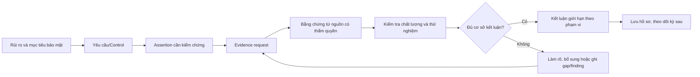
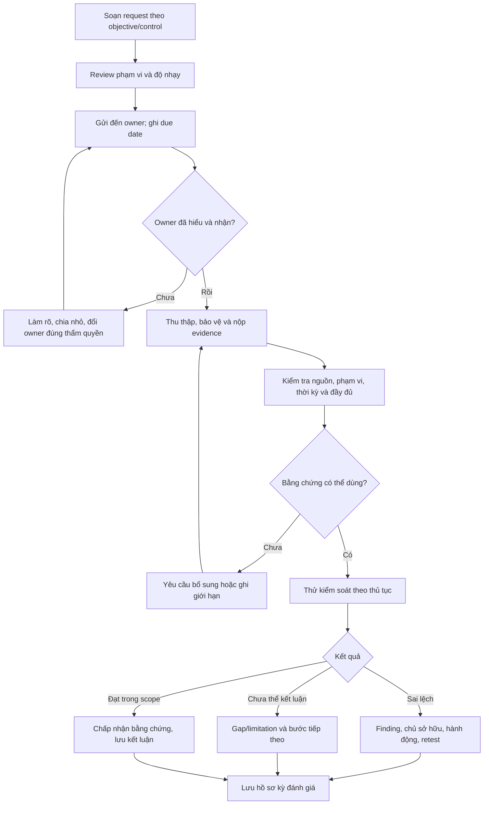

# Evidence request: yêu cầu bằng chứng kiểm toán rõ phạm vi, có thể xác minh

## 1. Evidence request là gì và dùng để làm gì?

**Evidence request** là một yêu cầu có cấu trúc nhằm thu thập tài liệu, bản ghi, cấu hình hoặc kết quả kiểm thử để **xác minh một tuyên bố cụ thể về thiết kế hoặc hoạt động của kiểm soát**. Trong hoạt động audit và security assurance, yêu cầu này phải nêu đủ **mục tiêu kiểm tra, phạm vi, thời kỳ, đối tượng, người cung cấp, định dạng, mức bảo vệ dữ liệu và tiêu chí chấp nhận** để người nhận hiểu chính xác phải chứng minh điều gì.

Trong chương **Audit và evidence** thuộc module **SECURITY_SECURITY_ASSURANCE**, evidence request là cầu nối giữa mục tiêu bảo mật, rủi ro, security controls, kiểm thử, audit và việc khắc phục phát hiện. Mục tiêu của module là xây dựng cách **đánh giá có bằng chứng rằng hệ thống đáp ứng các yêu cầu bảo mật**, rồi duy trì việc đánh giá đó trong phát triển và vận hành. Vì vậy, viết request tốt cũng là một kỹ năng kỹ thuật: nó quyết định liệu bằng chứng nhận được có đủ để đưa ra kết luận đáng tin hay không.

Ví dụ, một yêu cầu mơ hồ như “gửi ảnh chụp cấu hình MFA” có thể chỉ nhận được một màn hình thể hiện **MFA hiện đang bật**, trong khi điều cần xác minh là **mọi tài khoản quản trị production đã chịu chính sách MFA trong toàn bộ ba tháng đánh giá, có theo dõi ngoại lệ và được xử lý khi sai lệch**. Để kiểm tra tuyên bố đó, cần xác định đầy đủ population, cấu hình chính sách, các thay đổi trong kỳ, phạm vi loại trừ và kết quả vận hành liên quan.

Sau bài học, người học có thể:

- Phân biệt **evidence request**, bằng chứng được cung cấp, kết quả kiểm tra và audit finding.
- Viết yêu cầu có thể thực thi cho cả **design effectiveness** và **operating effectiveness** của security control.
- Thu thập đúng **population, thời kỳ, thời điểm, nguồn, provenance và ngoại lệ**.
- Kiểm tra tính phù hợp, đầy đủ, tin cậy và bảo mật của bằng chứng; đưa ra quyết định chấp nhận, làm rõ hoặc yêu cầu bổ sung.
- Quản lý vòng đời yêu cầu, quá hạn, phát hiện, kết quả khắc phục và khả năng tái kiểm toán.

## 2. Một evidence request nằm ở đâu trong chuỗi assurance?

Một chuỗi kiểm chứng điển hình là:



**Assertion** là một phát biểu cần được chứng minh hoặc bác bỏ. Chẳng hạn:

> “Mọi tài khoản quản trị có quyền truy cập production thuộc phạm vi được xác thực bằng MFA theo chính sách đã phê duyệt trong kỳ kiểm tra.”

Bằng chứng có thể gồm export IAM/SSO, danh sách tài khoản privileged, cấu hình enforcement, log thay đổi chính sách, danh sách ngoại lệ được phê duyệt, và kiểm tra mẫu các trường hợp thực tế. Một ảnh chụp màn hình của một tài khoản chưa đủ chứng minh assertion có từ **“mọi”**.

| Thành phần | Câu hỏi phải trả lời |
|---|---|
| **Control objective** | Mục tiêu nào cần đạt? |
| **Control description** | Ai thực hiện kiểm soát gì, với tần suất và phạm vi nào? |
| **Assertion** | Câu tuyên bố có thể kiểm tra, ví dụ “mọi”, “trong 90 ngày”, “trước cấp quyền” |
| **Evidence request** | Cần nhận dữ liệu nào để xác minh? |
| **Evidence item** | Bản ghi/file/đường dẫn thực tế được cung cấp |
| **Testing procedure** | Dùng bằng chứng kiểm tra điều kiện gì và như thế nào? |
| **Test result** | Các điều kiện đạt, không đạt hoặc chưa xác định |
| **Finding / exception** | Khoảng trống, sai lệch hoặc hạn chế cần theo dõi |
| **Remediation / retest** | Biện pháp sửa và kiểm chứng sau sửa |

Không đánh đồng việc **người nhận đã nộp file** với việc **kiểm soát đã đạt**. Việc gửi đủ file chỉ là một bước của quy trình; sau đó phải xem bằng chứng nói gì và có đủ độ tin cậy cho kết luận hay không.

## 3. Phân biệt bằng chứng thiết kế và bằng chứng vận hành

Một kiểm soát có thể được **thiết kế hợp lý** nhưng **không hoạt động đúng trong thực tế**.

| Loại bằng chứng | Mục đích | Ví dụ | Giới hạn cần chú ý |
|---|---|---|---|
| **Design evidence** | Xác nhận quy định, cấu hình hoặc quy trình được định nghĩa phù hợp với yêu cầu | Chính sách MFA; sơ đồ luồng phê duyệt quyền; cấu hình backup | Không chứng minh người vận hành luôn thực hiện đúng |
| **Implementation evidence** | Xác nhận kiểm soát được triển khai ở tài sản và hệ thống cụ thể | Export policy thực tế, tài nguyên SIEM, danh sách hệ thống được áp dụng | Có thể chỉ phản ánh một thời điểm |
| **Operating evidence** | Xác nhận kiểm soát đã hoạt động trong kỳ | Nhật ký phê duyệt, kết quả tác vụ hằng ngày, log cảnh báo, hồ sơ triage, restore tests | Phải kiểm tra tính đầy đủ, ngoại lệ, tần suất và thời kỳ |
| **Monitoring evidence** | Cho thấy có giám sát sai lệch hoặc thất bại | Dashboard nguồn log, cảnh báo drift, ticket khắc phục | Dashboard “xanh” không tự chứng minh mọi trường hợp đều đạt |
| **Remediation evidence** | Xác nhận phát hiện đã được xử lý và kiểm thử lại | Ticket có thay đổi cấu hình, kết quả test, phê duyệt đóng finding | Ticket trạng thái “Done” chưa chứng minh lỗi đã hết |

Ví dụ kiểm soát “quyền của nhân viên nghỉ việc được thu hồi trong thời hạn đã phê duyệt” cần thêm **danh sách người nghỉ việc đầy đủ, timestamp kết thúc quyền, hệ thống thuộc phạm vi và từng kết quả xử lý**. Chính sách HR hoặc SOP thu hồi quyền chỉ nói tổ chức *muốn thực hiện điều gì*.

Một request có thể cần nhiều loại bằng chứng; nên tách thành các mục rõ ràng để người cung cấp không nhầm “một file bất kỳ” là đã hoàn tất yêu cầu.

## 4. Những thông tin tối thiểu phải có trong request

Một request hữu ích thường gồm các trường sau:

| Trường | Ý nghĩa | Ví dụ |
|---|---|---|
| `request_id` | Định danh bền vững, dùng cho trao đổi và audit trail | `EVR-IAM-0042` |
| `audit_id` / `engagement_id` | Kỳ hoặc phạm vi đánh giá | `AUD-2026-Q4` |
| `risk_control_ref` | Liên kết rủi ro, mục tiêu và control | `CTRL-IAM-07` |
| `assertion` | Phát biểu được kiểm tra | “MFA được enforce với tài khoản privileged” |
| `scope` | Hệ thống, tenant, khu vực, account, môi trường | “Production tenant A và B” |
| `period_start`, `period_end` | Thời kỳ vận hành cần bằng chứng | “01/09 đến 30/11/2026, UTC” |
| `as_of` | Mốc chụp trạng thái nếu là kiểm tra tại một thời điểm | “30/11/2026 23:59:59 UTC” |
| `population_definition` | Tập đối tượng phải bao phủ và nguồn xác định | “Toàn bộ privileged identities” |
| `required_items` | Danh sách bằng chứng và các trường bắt buộc | Export policy, user roles, exceptions, change log |
| `collection_method` | Cách xuất dữ liệu, bộ lọc, truy vấn hoặc nguồn hệ thống | “Export trực tiếp từ IdP console/API” |
| `acceptance_criteria` | Cách người kiểm tra đánh giá đủ/chưa đủ | “Đối chiếu được mọi đối tượng và mốc thời gian” |
| `owner` | Ai chịu trách nhiệm trả lời | “IAM operations owner” |
| `requester`, `reviewer` | Ai yêu cầu và ai có quyền nghiệm thu | “Security Assurance reviewer” |
| `due_at` | Thời hạn phản hồi theo thỏa thuận | “03/12/2026 17:00 ICT” |
| `classification` / `delivery_channel` | Cách bảo vệ và chuyển bằng chứng | Kho được phân quyền, không gửi token qua email |
| `exception_process` | Cách trả lời khi không thể cung cấp hoặc chưa đạt | “Nêu lý do, scope, rủi ro, owner và ETA” |

Không phải mọi request đều cần một biểu mẫu dài; một yêu cầu cho kiểm tra nhỏ có thể gọn hơn. Nhưng các thuộc tính **mục tiêu, phạm vi, mốc thời gian, dữ liệu cần có, người chịu trách nhiệm và tiêu chí đủ** luôn phải được diễn đạt rõ.

### 4.1. Các câu chữ dễ gây hiểu nhầm

| Yêu cầu yếu | Yêu cầu rõ hơn |
|---|---|
| “Gửi log tháng này.” | “Xuất log thay đổi quyền administrator từ tenant production A trong khoảng 01/11 00:00 đến 30/11 23:59 UTC, kèm event ID, actor, target, outcome, event time và query/filter đã dùng.” |
| “Chụp màn hình backup.” | “Cung cấp chính sách backup hiện hành, danh mục job cho cơ sở dữ liệu giao dịch, lịch sử job trong kỳ và kết quả restore test gần nhất có timestamp, dữ liệu kiểm tra và RPO/RTO đo được.” |
| “Gửi tài liệu access control.” | “Cung cấp quy trình phê duyệt quyền và tập đầy đủ các lần cấp quyền production thuộc kỳ, gồm người yêu cầu, người duyệt, thời điểm phê duyệt và thời điểm cấp.” |
| “Chứng minh MFA tuân thủ.” | “Xuất population tài khoản đặc quyền, policy/scope MFA và các ngoại lệ có thời hạn; đối chiếu trường hợp không chịu policy hoặc không đủ dữ liệu trong kỳ.” |
| “Cho biết có phát hiện sự cố không.” | “Gửi trạng thái nguồn log bắt buộc, các detection rule được bật, kết quả thử cảnh báo và hồ sơ phản hồi mẫu trong kỳ theo phạm vi hệ thống.” |

Yêu cầu rõ giúp giảm vòng hỏi đáp, nhưng phải cân bằng với **data minimization**. Chỉ xin trường và thời kỳ cần thiết cho kiểm chứng; không yêu cầu trọn cơ sở dữ liệu chứa dữ liệu nhạy cảm khi có thể kiểm tra qua metadata hoặc mẫu phù hợp.

## 5. Chốt scope trước khi thu thập

Mỗi evidence request phải đóng khung ba loại phạm vi:

1. **Organizational scope:** công ty/đơn vị, chủ quy trình, môi trường production hoặc test, region, cloud account, tenant, nhà cung cấp hoặc ứng dụng liên quan.
2. **Control scope:** chính sách, hành động, đối tượng và tần suất cụ thể. Ví dụ, kiểm soát “thu hồi quyền truy cập privileged” khác với “thu hồi mọi tài khoản ứng dụng”.
3. **Temporal scope:** kiểm tra *tại thời điểm* (*point-in-time*) hay *trong một thời kỳ* (*period-of-time*), cách tính mốc và dữ liệu đến muộn.

Nếu kiểm tra yêu cầu diễn ra trong quý III nhưng nhận ảnh chụp hôm nay, ảnh chụp chỉ hỗ trợ trạng thái hiện tại, chưa chứng minh gì về các thay đổi đã xảy ra trong quý III. Khi không thể lấy dữ liệu lịch sử, ghi rõ **giới hạn bằng chứng** và điều chỉnh kết luận tương ứng.

### 5.1. Point-in-time và period-of-time

| Loại kiểm tra | Đề bài | Bằng chứng thường cần |
|---|---|---|
| **Point-in-time** | Tại thời điểm T, tất cả bucket production có bật một policy bảo vệ? | Inventory tại T, export policy tại T, dữ liệu xác nhận đầy đủ phạm vi |
| **Period-of-time** | Trong khoảng T1–T2, mọi lần cấp quyền đã được phê duyệt trước khi cấp? | Population các thay đổi toàn kỳ, log phê duyệt, timestamp, hồ sơ ngoại lệ |
| **Event-driven** | Khi có cảnh báo mức cao, đội trực có triage trong SLA đã định? | Toàn bộ alert thuộc phạm vi, case/ack timestamps, quy tắc SLA |
| **Recurring control** | Tác vụ kiểm tra backup hằng ngày có chạy và xử lý thất bại đúng hạn? | Lịch job và thực thi theo ngày, sự kiện lỗi, ticket xử lý, kết quả kiểm tra |

Cần chọn ranh giới thời gian **rõ múi giờ và bao gồm/exclude**. Thực hành hữu ích khi dùng query là biểu diễn khoảng nửa mở `[start, end)`, chẳng hạn từ `2026-09-01T00:00:00Z` đến trước `2026-12-01T00:00:00Z`. Cách này tránh tranh cãi về dấu giây cuối ngày.

## 6. Vòng đời một evidence request



Trạng thái theo dõi request có thể gồm:

- `draft`: yêu cầu chưa được duyệt để gửi.
- `sent`: đã gửi đến đầu mối chịu trách nhiệm.
- `acknowledged`: người nhận đã xác nhận phạm vi, thời hạn hoặc cần làm rõ.
- `in_progress`: đang thu thập và rà soát nội bộ.
- `submitted`: đã có một hoặc nhiều evidence item, chờ kiểm tra.
- `clarification_required`: thông tin chưa rõ hoặc không đủ.
- `accepted`: bằng chứng đã đáp ứng tiêu chí nghiệm thu của request.
- `closed_with_gap`: request kết thúc với giới hạn/thiếu bằng chứng có ghi nhận.
- `cancelled_or_superseded`: request không còn phù hợp hoặc được thay bằng request khác có liên kết lịch sử.

**`accepted` là trạng thái của bằng chứng đối với yêu cầu thu thập, không phải kết quả “control effective”.** Sau khi chấp nhận bằng chứng, người kiểm tra vẫn có thể phát hiện kiểm soát không đạt. Vì vậy, nên tách trạng thái **evidence fulfillment** và **control test result** trong tracker.

## 7. Ai viết, ai trả lời, ai đánh giá?

Đối với một request liên quan kiểm soát bảo mật, trách nhiệm thường được chia như sau:

| Vai trò | Trách nhiệm |
|---|---|
| **Requester / Auditor / Assurance analyst** | Định nghĩa assertion, scope, evidence items, thủ tục đánh giá và tiêu chí đủ |
| **Control owner** | Giải thích thiết kế kiểm soát, chấp nhận trách nhiệm vận hành và phản hồi finding |
| **Evidence provider / System owner** | Xuất dữ liệu từ nguồn, giải thích phương pháp, nêu giới hạn và xác nhận nguồn |
| **Security/IAM/SRE/Data/HR owner** | Cung cấp dữ liệu chuyên môn và giải thích mapping, timestamp, ngoại lệ |
| **Evidence coordinator / Audit PMO** | Theo dõi hạn, câu hỏi, trạng thái, version, nơi lưu và các request chưa có owner |
| **Legal / Privacy / Compliance** | Hướng dẫn giới hạn chia sẻ, nghĩa vụ bảo mật và xử lý dữ liệu theo phạm vi |
| **Independent reviewer** | Kiểm tra tính nhất quán của kết luận, mức độ đủ của mẫu và ngoại lệ |
| **Risk owner / management** | Quyết định đối với khoảng trống, kế hoạch khắc phục hoặc chấp nhận rủi ro đúng thẩm quyền |

Một kiểm soát có thể do Security vận hành nhưng bằng chứng nằm trong HR, IdP và SIEM. Request cần **chỉ định một owner điều phối** và các bên cung cấp thành phần. Không gửi một yêu cầu lớn tới nhiều nhóm với kỳ vọng họ tự đoán ai chịu trách nhiệm.

Nếu người kiểm tra đồng thời là người cấu hình kiểm soát, cần có **rà soát độc lập phù hợp với mô hình quản trị**; tối thiểu nên giữ dấu vết kiểm tra để người khác có thể tái hiện kết luận.

## 8. Từ câu hỏi kiểm toán đến danh sách bằng chứng cụ thể

Một cách thiết kế theo từng tầng:

1. **Mục tiêu bảo mật:** ví dụ tài khoản có quyền quản trị không được truy cập trái phép.
2. **Control:** chính sách MFA bắt buộc cho privileged identities và giám sát ngoại lệ.
3. **Assertion:** mọi privileged identity trong production thuộc kỳ đều chịu enforcement, ngoại lệ được phê duyệt và xử lý đúng quy tắc.
4. **Population:** toàn bộ danh tính có hoặc đã có quyền privileged trong kỳ; bao gồm tài khoản dịch vụ, tài khoản emergency và quyền theo nhóm nếu nằm trong chính sách.
5. **Evidence items:** export privileged assignments, cấu hình IdP, log thay đổi, ngoại lệ, bằng chứng thử policy.
6. **Testing:** đối chiếu population với scope policy, kiểm tra lỗ hổng, thử một số mẫu và xử lý ngoại lệ.
7. **Kết luận:** đạt trong phạm vi, có sai lệch hoặc chưa đủ bằng chứng; nêu độ bao phủ và giới hạn.

Lợi ích của cách này là **mọi file đều có lý do tồn tại**. Không yêu cầu cả bộ hình chụp dashboard nếu chỉ cần một cấu hình có thể xuất và một tập log để kiểm tra.

### 8.1. Chọn dạng bằng chứng thích hợp

| Mục tiêu kiểm tra | Dạng evidence phù hợp | Khi nào ảnh chụp màn hình không đủ? |
|---|---|---|
| Cấu hình policy hiện hành | Export cấu hình có timestamp, resource ID, nguồn | Khi phải chứng minh phạm vi tất cả resources hoặc lịch sử thay đổi |
| Cấp quyền được phê duyệt | Population ticket + workflow approval + IAM change logs | Khi screenshot chỉ thể hiện một ticket đẹp |
| Quy trình làm hàng ngày | Log job toàn kỳ, lịch chạy, kết quả thất bại và xử lý | Khi ảnh chỉ hiện trạng thái job cuối cùng |
| Backup phục hồi được | Kết quả restore exercise, checkpoint, RPO/RTO và kiểm thử nghiệp vụ | Khi ảnh “Backup completed” không chứng minh restore |
| Cảnh báo được phản hồi | Alert population, case timeline, log ack/escalation | Khi dashboard chỉ cho số cảnh báo đã đóng |
| Xóa dữ liệu đúng hạn | Lifecycle config, population hết hạn, log thực thi, hold và ngoại lệ | Khi màn hình chỉ cho biết rule đã được bật |

Ảnh chụp vẫn có giá trị khi **không thể export**, dùng để ghi lại trạng thái hoặc hỗ trợ giải thích. Nhưng cần có **định danh màn hình, môi trường, thời gian, tài khoản/nguồn, phạm vi và phương pháp** để hạn chế khả năng hiểu nhầm.

## 9. Mẫu evidence request có cấu trúc

Dưới đây là ví dụ **đặc tả yêu cầu dạng YAML để con người đọc và kiểm tra**, không phải API hay schema bắt buộc của công cụ GRC.

```yaml
request_id: EVR-IAM-0042
audit_id: AUD-2026-Q4
control_ref: CTRL-IAM-07
title: "Xac minh MFA cho tai khoan privileged production"
requester: security-assurance
control_owner: identity-security
evidence_provider: idp-operations
reviewer: independent-assurance-reviewer
status: sent

objective: >
  Xac minh cac privileged identities trong production
  duoc ap dung MFA policy theo yeu cau da phe duyet.
assertion: >
  Moi privileged identity thuoc population trong ky
  co policy enforcement va ngoai le duoc theo doi.
scope:
  environments: [production]
  tenants: [tenant-a, tenant-b]
  privileged_roles:
    - "approved privileged role inventory"
  exclusions:
    - "Documented exclusions only"
  timezone: UTC
period:
  start_inclusive: "2026-09-01T00:00:00Z"
  end_exclusive: "2026-12-01T00:00:00Z"

population:
  definition: >
    All identities holding privileged assignments at any
    time within the assessment period.
  authoritative_sources:
    - iam-role-assignment-history
    - identity-directory
  required_fields:
    - principal_id
    - role_or_group
    - start_at
    - end_at
    - tenant_id

evidence_items:
  - id: E1
    kind: population_export
    description: "Full privileged identities and assignment history"
  - id: E2
    kind: configuration_and_change_history
    description: "MFA policy, scope, changes during audit period"
  - id: E3
    kind: exceptions
    description: "Approvals, expiry and mitigation for exceptions"
  - id: E4
    kind: operational_records
    description: "Representative policy evaluation and monitoring records"

submission:
  due_at: "2026-12-03T10:00:00Z"
  channel: approved-restricted-evidence-repository
  classification: confidential
  do_not_include:
    - passwords
    - session_tokens
    - private_keys
  required_metadata:
    - source_system
    - export_time_utc
    - query_or_filter
    - exporter
    - item_id
  no_data_response: "explain_scope_reason_and_next_action"

review:
  criteria:
    - "Population reconcile with IAM role assignments"
    - "Evidence covers specified tenants and full period"
    - "Exceptions identifiable and dated"
    - "Records traceable to source and internally consistent"
  result: pending
```

Các ID và mốc thời gian là **giả định**, dùng để mô tả cách soạn yêu cầu. Tài khoản privileged và chính sách MFA có thể cần loại trừ một số tài khoản kỹ thuật theo kiến trúc; nếu loại trừ, phải xác nhận **căn cứ và kiểm soát bù**, không tự bỏ qua nhóm tài khoản khó đo.

Không tự coi trường `source_system` trong file người cung cấp điền là xác minh độc lập. Khi cần độ bảo đảm cao, người kiểm tra có thể cần đối chiếu export với **nguồn có thẩm quyền** hoặc trực tiếp quan sát quy trình xuất.

## 10. Nguồn bằng chứng, provenance và khả năng tái lập

**Provenance** mô tả bằng chứng xuất phát từ đâu và đã đi qua các bước nào. Một file CSV hoặc PDF chỉ thực sự hữu ích khi biết:

- Hệ thống nguồn, tenant/account, environment và quyền của người xuất.
- Thời điểm dữ liệu được tạo, thời điểm xuất và mốc thời gian được lọc.
- Câu truy vấn, bộ lọc, phương pháp lấy dữ liệu, giới hạn phân trang và khả năng cắt ngắn.
- Kiểu dữ liệu, schema và ý nghĩa trường quan trọng; định nghĩa các mã trạng thái.
- Cách dữ liệu được chuyển đổi, sắp xếp, redaction, gộp và liệu có xóa bớt hàng/cột.
- ID hồ sơ nguồn hoặc cách đối chiếu lại một record đã chọn.
- Nơi lưu, người được truy cập, lịch sử thay đổi và thời gian lưu giữ bằng chứng.

Có sự khác biệt đáng kể giữa:

1. **Export trực tiếp** từ nguồn được quản trị với query/filter cụ thể và kết quả có thể tái tạo.
2. **Báo cáo tổng hợp** do công cụ bên thứ ba tạo ra từ nguồn với logic biến đổi đã được giải thích.
3. **Bảng nhập thủ công** do nhân viên tự tạo hoặc chỉnh sửa mà không có nguồn đối chiếu.

Loại thứ ba không nhất thiết vô giá trị; ví dụ biên bản phỏng vấn hay xác nhận công việc thủ công là bằng chứng phù hợp cho một số khẳng định. Nhưng khi assertion liên quan **mọi lần cấp quyền trong kỳ**, cần kiểm tra thêm tính đầy đủ của population và nguồn hệ thống.

### 10.1. Tính toàn vẹn khác tính xác thực

Có thể tạo hash SHA-256 cho file bằng chứng sau khi thu thập, chẳng hạn dùng PowerShell:

```powershell
Get-FileHash -Algorithm SHA256 -LiteralPath ".\privileged-users.csv"
```

Hash giúp so sánh các lần kiểm tra nhằm phát hiện file có thay đổi **kể từ lúc tính hash**. Nó **không tự chứng minh** file được xuất từ hệ thống thật, query đúng hoặc dữ liệu ban đầu không bị thay đổi. Cần kết hợp hồ sơ nguồn, quyền hạn, cách thu thập và audit trail.

Với yêu cầu có mức bảo đảm cao, có thể dùng chữ ký số, kho bảo vệ chống sửa/xóa hoặc cơ chế niêm phong theo quy trình. Những cơ chế này cũng phải được kiểm tra đúng phạm vi và cấu hình thực tế.

## 11. Population: bằng chứng về “toàn bộ” trước khi chọn mẫu

Một trong những lỗi kiểm toán phổ biến là **chọn mẫu từ tập dữ liệu chưa chắc đầy đủ**. Ví dụ, yêu cầu kiểm tra các lần cấp quyền production trong ba tháng nhưng đội cung cấp chỉ trích xuất ticket đã đóng. Các lần cấp quyền ngoài ticket hoặc ticket đang mở có thể bị loại khỏi tập, làm tỷ lệ tuân thủ trông đẹp hơn thực tế.

Quy trình hợp lý:

1. **Định nghĩa universe/population:** đối tượng nào *đáng lẽ phải có mặt*, dựa trên tiêu chí và kỳ.
2. **Chọn nguồn có thẩm quyền:** change log IAM, HR event, CMDB, cloud audit hoặc danh mục kiểm soát tương ứng.
3. **Đối chiếu nguồn:** so tổng số, ID, ngày và phạm vi với hệ thống độc lập khi hợp lý.
4. **Kiểm tra completeness:** phân trang, filter, time window, dữ liệu đến muộn, các event bị bỏ do API limit và duplicate.
5. **Giữ population snapshot:** lưu query, timestamp, số hàng, định nghĩa và nguồn.
6. **Chọn mẫu có lý do:** random, trọng yếu, theo rủi ro hoặc kết hợp; ghi method và seed nếu áp dụng.
7. **Truy vết mẫu ngược:** từ từng sample tới bản ghi nguồn và dữ liệu giải thích.

**Một population đầy đủ không đồng nghĩa kiểm soát hiệu quả**; nó chỉ giúp người kiểm tra có cơ sở kiểm tra. Ngược lại, một tập 10 mẫu đều đạt cũng không tự chứng minh “100% tài khoản” đều đạt.

### 11.1. Ví dụ kiểm tra độ phủ population

Giả sử nguồn IAM ghi **240 thay đổi quyền privileged** trong quý, nhưng tracker phê duyệt chỉ có **228 bản ghi** đối chiếu được. Khoảng chênh **12 thay đổi** cần được làm rõ: có thể là thao tác tự động hợp lệ, dữ liệu bị lọc, ticket missing hoặc thay đổi chưa phê duyệt.

Không kết luận 228/228 = 100% đạt. Tỷ lệ khớp ban đầu chỉ là:

\[
\frac{228}{240}\times100\% = 95\%
\]

Và **5% chưa đối chiếu** là tập cần xử lý, không phải tự động kết luận vi phạm. Khi đã hiểu 12 trường hợp, mới xác định trường hợp nào thuộc control, có ngoại lệ hợp lệ hay thể hiện sai lệch.

### 11.2. Sampling có giới hạn gì?

Nếu population gồm hàng nghìn dòng, kiểm tra mẫu là cách phù hợp cho một số thủ tục. Tuy nhiên, cần công bố:

- Phạm vi và kích thước population.
- Tiêu chí chọn mẫu và cách khống chế thiên lệch.
- Định nghĩa thế nào là một sai lệch.
- Khả năng phát hiện sai lệch với cách chọn mẫu đã dùng.
- Giới hạn khi suy diễn từ mẫu sang tổng thể.

Một phép thử chọn theo rủi ro có thể ưu tiên **tài khoản privileged, hành động ngoài giờ, emergency change, log failed job**, nhưng kết quả chủ yếu phản ánh các trường hợp được chọn. Nếu muốn suy diễn theo thống kê, cần phương pháp lấy mẫu và diễn giải phù hợp, không tùy ý gọi vài mẫu được chọn bằng tay là “đại diện thống kê”.

## 12. Chất lượng bằng chứng và tiêu chí chấp nhận

Một evidence item tốt thường phải đáp ứng đồng thời nhiều thuộc tính:

| Thuộc tính | Cách xác minh | Dấu hiệu chưa đủ |
|---|---|---|
| **Relevance — phù hợp** | Liên hệ trực tiếp với assertion và control | Chính sách liên quan nhưng không nói đến hành vi cần kiểm tra |
| **Completeness — đầy đủ** | Bao phủ population, period, nguồn, trường và ngoại lệ | Thiếu tenant, chỉ xuất các record thành công |
| **Accuracy — chính xác** | Thông tin khớp nguồn, timestamp và định nghĩa | Mapping ID sai, dữ liệu bị cắt ngắn |
| **Reliability — đáng tin** | Nguồn phù hợp, quy trình thu thập rõ, có thể kiểm chứng | Bảng nhập thủ công không có nguồn đối chiếu |
| **Timeliness — đúng thời điểm** | Bằng chứng phản ánh mốc hoặc toàn kỳ yêu cầu | Ảnh chụp hiện tại để chứng minh quý trước |
| **Integrity — toàn vẹn** | Có kiểm soát thay đổi, xác nhận checksum/manifest nếu cần | File bị chỉnh sau xuất nhưng không có lịch sử |
| **Traceability — truy vết** | Có ID record, query/filter, owner và nguồn | Không thể mở lại record gốc |
| **Confidentiality — bảo mật** | Dữ liệu được tối thiểu hóa và bảo vệ đúng quyền | File chứa token hoặc danh sách khách hàng gửi kênh công khai |
| **Understandability — dễ hiểu** | Có glossary, schema, giải thích ký hiệu và phạm vi | Cột `status=2` không có tài liệu ý nghĩa |

Người kiểm tra có thể dùng một bảng quyết định:

| Tình trạng | Cách phản hồi |
|---|---|
| Đúng nguồn, đủ phạm vi, có metadata, có thể dùng | **Accept for testing**; vẫn phải thực hiện thủ tục kiểm tra |
| Thiếu trường hoặc timestamp nhưng có thể bổ sung | **Clarification / supplementary evidence** với lý do cụ thể |
| Không bao phủ population hoặc kỳ yêu cầu | **Reject as insufficient** hoặc chấp nhận một phần có giới hạn rõ |
| Nguồn không truy vết được hoặc nghi đã bị sửa | **Validate provenance** và yêu cầu xuất lại độc lập |
| Bằng chứng cho thấy kiểm soát có sai lệch | **Evidence accepted, test failed**; ghi finding/exception |
| Hệ thống không thể cung cấp dữ liệu lịch sử | **Evidence gap / scope limitation**, đánh giá ảnh hưởng và bước tiếp theo |
| Thu thập sẽ làm lộ dữ liệu vượt yêu cầu | **Điều chỉnh phương thức**, redaction hoặc kiểm tra tại chỗ có kiểm soát |

Việc yêu cầu bổ sung phải **nêu cụ thể thiếu gì, vì sao cần và cách đáp ứng tối thiểu**, tránh phản hồi mơ hồ “chưa đủ bằng chứng” gây lặp vòng trao đổi.

## 13. Ví dụ 1 — Evidence request cho cấp và thu hồi quyền

**Control objective:** người không còn làm việc hoặc không còn đảm nhiệm vai trò phải mất quyền truy cập theo thời hạn được chủ quy trình phê duyệt.

**Assertion trong kỳ:** với tất cả nhân sự thuộc sự kiện offboarding trong quý IV, quyền ứng dụng production nằm trong phạm vi đã được thu hồi theo quy tắc thời gian; sai lệch có điều tra và xử lý.

Một request có thể yêu cầu:

| Item | Yêu cầu | Mục đích |
|---|---|---|
| **E1 — HR events** | Population người nghỉ việc/đổi vai trò: employee ID, effective time, event type, phạm vi | Định nghĩa universe từ nguồn có thẩm quyền |
| **E2 — Access inventory** | Ánh xạ user → application/role, quyền privileged, account liên quan | Biết phải thu hồi quyền nào |
| **E3 — Deprovisioning events** | Action, target, timestamp, status, event ID, request/ticket ID | Kiểm tra đã thực hiện và thời gian |
| **E4 — Workflow approvals / exceptions** | Quy tắc SLA, phê duyệt ngoại lệ, thời gian và người duyệt | Đối chiếu hợp lệ và xử lý sai lệch |
| **E5 — Monitoring / reconciliation** | Report quyền còn tồn sau offboarding, alert và ticket xử lý | Kiểm tra giám sát hoạt động liên tục |

Thủ tục kiểm tra có thể tính **độ trễ thu hồi** là thời gian từ mốc hiệu lực đã quy định đến khi quyền đã thực sự bị vô hiệu hóa, sau khi xác định các mốc tin cậy. Không được dùng thời gian đóng ticket làm thay thời gian thu hồi quyền nếu ticket có thể được đóng trước/sau sự kiện kỹ thuật.

Nếu có tài khoản chia sẻ hoặc tài khoản dịch vụ không ánh xạ trực tiếp với một nhân viên, request phải bổ sung cách đánh giá quyền và người chịu trách nhiệm. Không tự loại khỏi phạm vi chỉ vì mapping khó.

## 14. Ví dụ 2 — Evidence request cho backup và khả năng restore

**Control objective:** dữ liệu giao dịch trọng yếu có thể khôi phục trong RTO/RPO được phê duyệt.

Chỉ yêu cầu lịch sử backup job là thiếu vì một job “success” không chắc restore được. Bộ evidence nên gồm:

1. **BIA/requirements:** hệ thống, dữ liệu, RTO/RPO và người phê duyệt.
2. **Backup policy/config:** phạm vi job, điểm lưu, chu kỳ, retention, bảo vệ trước xóa và quyền.
3. **Population job trong kỳ:** các lần chạy dự kiến, thực tế, lỗi, thời gian hoàn thành, mốc dữ liệu có thể khôi phục.
4. **Restore exercise:** dữ liệu được phục hồi, môi trường đích, thời điểm bắt đầu/kết thúc, checkpoint, bản kiểm tra tính nhất quán và kết quả nghiệp vụ.
5. **Exception/remediation:** trường hợp job lỗi, restore test không đạt hoặc thiếu log; ticket, owner và kết quả thử lại.

Ví dụ diễn tập bắt đầu lúc **10:00 UTC**, dữ liệu nhất quán mới nhất phục hồi về **09:50 UTC** và nghiệp vụ hoạt động đủ năng lực lúc **12:20 UTC**. Nếu RPO yêu cầu 5 phút, RTO yêu cầu 3 giờ, thì **RPO không đạt (lùi 10 phút)** và **RTO đạt (2 giờ 20 phút)** trong phạm vi diễn tập. Request phải nêu từ đầu những timestamp và phép thử nào cần ghi để người đánh giá không phải suy ra kết quả bằng cảm tính.

## 15. Ví dụ 3 — Evidence request cho detection và incident response

**Control objective:** cảnh báo bảo mật quan trọng được tạo, tiếp nhận và xử lý theo quy trình.

Bộ evidence gợi ý:

| Nhóm | Evidence cụ thể | Điều cần kiểm tra |
|---|---|---|
| **Phạm vi telemetry** | Danh mục nguồn log phải giám sát, trạng thái agent, ingest lag và gap | Có quan sát được các hệ thống mục tiêu không? |
| **Detection rules** | Rule ID/version, trạng thái enabled, lịch thay đổi, test fixture | Rule hoạt động và có khả năng phát hiện hành vi đã xác định không? |
| **Alert population** | Toàn bộ alert thuộc severity/scope trong kỳ, event ID, created_at | Universe đã đầy đủ, không chỉ chọn alert đã đóng |
| **Case / triage** | Acknowledge, priority, analyst, escalation, timeline, closure reason | Triage đúng hạn và có căn cứ không? |
| **Exceptions** | Alert lỗi, suppression, downtime, test fail, phê duyệt thay đổi | Sai lệch được ghi và xử lý thế nào? |
| **Operational validation** | Kết quả thử end-to-end tạo sự kiện → alert → case | Trình tự thật hoạt động trong kịch bản kiểm thử không? |

Nếu không có cảnh báo nào trong kỳ, **“0 alerts” không tự chứng minh hệ thống an toàn hoặc rule hiệu quả**. Có thể cần bằng chứng về độ phủ nguồn, health của rule, kết quả thử có kiểm soát và các biến thể chưa được bao phủ. Request tốt được thiết kế để phân biệt **không có hành vi** với **không quan sát được hành vi**.

## 16. Xử lý bằng chứng nhạy cảm và nguyên tắc tối thiểu hóa

Evidence request có thể liên quan danh tính nhân viên, dữ liệu khách hàng, thông tin nội bộ, sơ đồ mạng, cấu hình bảo mật, lỗ hổng và chứng cứ điều tra. Quy trình chia sẻ cần đáp ứng yêu cầu bảo mật và riêng tư của tổ chức.

Các nguyên tắc:

- **Chỉ thu thập phần cần thiết.** Ưu tiên ID, metadata, trạng thái và timestamp khi có thể kiểm chứng mà không xem nội dung nhạy cảm.
- **Không đưa secrets** như mật khẩu, access token, private key, session cookie, connection string chứa credential hay dữ liệu nhạy cảm không liên quan vào evidence repository.
- **Phân loại trước khi chia sẻ** và dùng kênh được phê duyệt có quyền theo vai trò; hạn chế link công khai và quyền download quá rộng.
- **Redaction có kiểm soát:** ghi trường bị che, phương pháp và lý do. Redaction không được làm mất các trường bắt buộc để đối chiếu hoặc khiến sample không thể kiểm tra.
- **Mã hóa và retention:** bảo vệ khi truyền/lưu, quy định thời hạn giữ và cách xóa evidence theo nghĩa vụ, xử lý hold khi có căn cứ.
- **Tách dữ liệu nguồn và bản làm việc:** giữ provenance và bản sao kiểm tra; tránh sửa trực tiếp record gốc.
- **Bảo đảm người đánh giá được ủy quyền.** Với dữ liệu không thể chuyển giao, cân nhắc kiểm tra tại chỗ, truy cập giới hạn thời gian, session ghi nhận hoặc attestation bổ sung theo mức rủi ro.

**Redaction không phải lúc nào cũng đồng nghĩa ẩn danh.** ID giả danh vẫn có thể được liên kết ngược khi có dữ liệu bổ sung. Bởi vậy, quyền truy cập và mục đích sử dụng vẫn phải được quản lý.

Với bằng chứng liên quan điều tra hoặc khả năng dùng trong thủ tục pháp lý, quy trình bảo quản và **chain of custody** có thể cần nghiêm ngặt hơn so với bằng chứng audit vận hành thông thường. Việc áp dụng cụ thể phụ thuộc nghĩa vụ và rủi ro của trường hợp.

## 17. Đóng gói evidence: manifest và audit trail

Một gói evidence không nên chỉ là một thư mục nhiều file có tên như `final2_latest.csv`. Nên có **manifest** kết nối request, evidence item, nguồn, version và trạng thái kiểm tra.

Ví dụ CSV mô tả (dữ liệu giả định):

```csv
request_id,item_id,file_name,source_system,exported_at_utc,period_start_utc,period_end_utc,sha256_ref
EVR-IAM-0042,E1,privileged-assignments.csv,idp,2026-12-02T08:00:00Z,2026-09-01T00:00:00Z,2026-12-01T00:00:00Z,hash-record-E1
EVR-IAM-0042,E2,mfa-policies.json,idp,2026-12-02T08:10:00Z,2026-09-01T00:00:00Z,2026-12-01T00:00:00Z,hash-record-E2
EVR-IAM-0042,E3,approved-exceptions.csv,grc,2026-12-02T08:20:00Z,2026-09-01T00:00:00Z,2026-12-01T00:00:00Z,hash-record-E3
```

Trong hệ thống thực cần lưu **giá trị hash thực** nếu sử dụng checksum; `hash-record-E1` chỉ là nhãn minh họa, không phải digest SHA-256. Manifest có thể thêm người xuất, người review, query, tổng số hàng, mức phân loại, vị trí lưu, version và lịch sử thay đổi.

Audit trail của request nên ghi:

- Ai tạo và phê duyệt request, nội dung ban đầu và những lần đổi scope.
- Ai xác nhận, cung cấp hoặc từ chối cung cấp bằng chứng; timestamp và giải thích.
- Bằng chứng nào được nộp lúc nào, file/version nào thay thế file nào, nguồn và phương thức thu thập.
- Ai đã kiểm tra, điểm nào chưa đủ, request bổ sung nào và kết quả cuối.
- Khi có finding: mã finding, mức ảnh hưởng, hành động, owner, hạn, phê duyệt và retest.

**Không ghi đè âm thầm bản đã nộp**: khi xuất lại, giữ version, lý do và liên kết, để người đánh giá có thể hiểu vì sao hai bản khác nhau.

## 18. Tổ chức tracker để điều phối nhiều request

Một tracker có thể liên kết nhiều người và nhiều đợt kiểm toán. Các trường tối thiểu:

| Nhóm | Các trường |
|---|---|
| Định danh | Audit ID, request ID, control ID, priority, scope |
| Điều phối | Requester, control owner, evidence provider, reviewer |
| Tiến độ | Status, sent date, acknowledgement, due date, last update |
| Evidence | Item IDs, source, version, received_at, classification, location |
| Chất lượng | Coverage, completeness, clarification count, reviewer decision |
| Kết quả | Test ID, pass/fail/inconclusive, finding ID |
| Khắc phục | Remediation owner, deadline, risk decision, retest status |
| Lịch sử | Ai sửa, lúc nào, field nào thay đổi, lý do |

Ví dụ quy tắc vận hành:

1. Request quá hạn mà chưa nhận ack → gửi thông báo đúng người điều phối.
2. Evidence được nộp → kiểm tra malware và bảo mật qua quy trình phù hợp trước khi mở/nhập hệ thống.
3. Reviewer đánh dấu thiếu population → tạo clarification ghi trường thiếu và hạn.
4. Request được accepted → giao kiểm thử; không tự động đóng finding.
5. Finding được sửa → mở retest liên kết đến **kiểm soát và phiên bản chứng cứ mới**, không sửa kết quả lịch sử.

Có thể tự động hóa những bước này bằng workflow/GRC/ticketing, nhưng **quy tắc nghiệm thu phải được con người kiểm tra và được ghi rõ**. Lỗi cấu hình tự động phân loại evidence accepted có thể gây sai lệch kết quả ở quy mô lớn.

## 19. Khi không có bằng chứng hoặc không thể cung cấp

Không có bằng chứng là một tình huống cần ghi nhận trung thực, nhưng **chưa đủ để kết luận ngay kiểm soát đã không hoạt động**. Phân biệt:

| Tình huống | Ý nghĩa | Hướng xử lý |
|---|---|---|
| Không thực hiện kiểm soát | Không có hoạt động theo yêu cầu | Ghi sai lệch kiểm soát, đánh giá rủi ro và khắc phục |
| Kiểm soát đã hoạt động nhưng không lưu evidence | Hoạt động có thể đã diễn ra nhưng không thể tái kiểm tra đầy đủ | Ghi evidence gap, thiết kế ghi nhận liên tục, giới hạn kết luận kỳ cũ |
| Log đã hết retention | Dữ liệu lịch sử không còn | Xác minh chính sách retention, xem nguồn bù và ảnh hưởng assurance |
| Không truy cập được nguồn do lỗi hệ thống | Thu thập bị chặn tạm thời | Ghi nguyên nhân, owner, lịch khôi phục/thu thập lại |
| Dữ liệu chứa thông tin hạn chế | Không thể chia sẻ nguyên bản | Dùng redaction, remote review hoặc quy trình tiếp cận hạn chế |
| Evidence không thuộc phạm vi | Control không áp dụng cho tài sản/quy trình được xét | Ghi căn cứ `not_applicable`, người phê duyệt, tránh bỏ qua âm thầm |
| Không rõ owner | Thiếu trách nhiệm thu thập | Điều phối xác nhận system/control owner, escalation hợp lý |
| Có phần evidence đã nộp | Chỉ một phần assertion được kiểm chứng | Chấp nhận có điều kiện, nêu thiếu gì và không kết luận quá phạm vi |

Một phản hồi “không thể cung cấp” tốt nên nêu **mục nào thiếu, vì sao, các nguồn thay thế đã kiểm tra, mức ảnh hưởng, người chịu trách nhiệm và thời điểm xem lại**. Không chế tạo dữ liệu, tự tạo biên bản lùi ngày hoặc dùng ảnh chụp hiện tại để làm như có bằng chứng lịch sử.

### 19.1. Khi nào yêu cầu phải tạo finding?

Khi bằng chứng cho thấy một sai lệch so với yêu cầu kiểm soát, người đánh giá ghi **điều kiện thực tế, tiêu chí, phạm vi, nguyên nhân nếu biết, ảnh hưởng, bằng chứng và hành động cần thiết**. Khi bằng chứng thiếu, có thể ghi riêng một **assurance limitation / evidence gap**; mức độ nghiêm trọng phụ thuộc rủi ro, nghĩa vụ và khả năng xác minh qua nguồn khác.

Không mọi request bị quá hạn đều tương đương một lỗi kỹ thuật bảo mật. Nhưng quá hạn nhiều lần, thiếu chủ sở hữu hoặc không còn khả năng xuất log kiểm tra có thể cho thấy **lỗi quy trình assurance** cần xử lý.

## 20. Case study: kiểm chứng MFA của tài khoản quản trị

**Bối cảnh giả định:** hệ thống identity vận hành hai tenant production. Assertion là “mọi tài khoản có quyền privileged đều nằm trong phạm vi enforcement MFA theo yêu cầu được phê duyệt trong quý III/2026”.

Reviewer ban đầu chỉ nhận một screenshot hiện tại thể hiện “Conditional Access: Enabled”. Điều này chưa đủ vì:

- Không biết policy áp dụng tới **tenant nào** và **role/nhóm nào**.
- Không có **population** danh tính privileged trong quý.
- Không biết policy có bị tắt hoặc sửa trong kỳ hay không.
- Không có danh sách ngoại lệ hoặc kết quả xử lý trường hợp không áp dụng.
- Ảnh không có phương pháp kiểm tra nào chứng minh enforcement thực tế.

Reviewer tạo request bổ sung theo bốn item:

| Item | Nội dung cần cung cấp | Kết quả dự kiến kiểm tra |
|---|---|---|
| **E1** | Lịch sử privileged assignments của hai tenant trong quý | Định nghĩa population và mốc mỗi tài khoản có quyền |
| **E2** | Policy MFA, scope, exclusion và thay đổi cấu hình trong kỳ | Xem enforcement có áp dụng cho từng đối tượng và thời gian |
| **E3** | Audit log/monitoring phản ánh thay đổi và trạng thái policy | Phát hiện giai đoạn policy bị tắt hoặc drift |
| **E4** | Ngoại lệ được duyệt, thời hạn và kiểm soát bù | Xác minh ngoại lệ có căn cứ, không bỏ lọt |

Giả sử population được đối chiếu có **26 danh tính** đã có quyền privileged trong kỳ. Kiểm tra phát hiện **24 danh tính** nằm trong policy được enforce; một danh tính emergency có ngoại lệ được phê duyệt với kiểm soát bù, một tài khoản dịch vụ **chưa có bằng chứng** thuộc policy hay được quản lý bằng biện pháp tương đương.

Kết luận đúng phải phân biệt:

- **24 danh tính:** có bằng chứng hỗ trợ việc áp dụng theo scope đã kiểm tra.
- **1 danh tính:** ngoại lệ hợp lệ cần được đánh giá hiệu lực, mức bảo vệ bù và điều kiện phê duyệt.
- **1 danh tính:** evidence gap hoặc sai lệch tiềm năng cần làm rõ, không tự tuyên bố đạt.
- **Toàn kỳ:** còn phải kiểm tra chính sách và sự thay đổi theo thời gian, không chỉ trạng thái hiện tại.

Nếu control cho phép ngoại lệ có phê duyệt và biện pháp bù, reviewer có thể xem trường hợp đó phù hợp theo **tiêu chí đã được duyệt**, nhưng vẫn phải xác định tài khoản dịch vụ không bị che khuất chỉ vì cơ chế MFA người dùng không trực tiếp áp dụng được.

**Ý nghĩa assurance:** request đầy đủ chuyển kết luận từ “đã bật MFA” sang **“đã xác định population, đánh giá scope, theo dõi ngoại lệ và chỉ ra tài khoản chưa có bằng chứng”**. Đây là kết quả có ích dù chưa đạt trạng thái hoàn toàn tuân thủ.

## 21. Đo hiệu quả quy trình evidence request

| Chỉ số | Cách hiểu | Cảnh báo khi diễn giải |
|---|---|---|
| **On-time submission rate** | Tỷ lệ request nộp đúng hạn theo kế hoạch | Đúng hạn không có nghĩa đúng/đủ |
| **First-pass acceptance** | Tỷ lệ evidence đủ tiêu chí ngay lần đầu | Có thể tăng giả tạo nếu tiêu chí bị hạ thấp |
| **Clarification cycles** | Số vòng hỏi bổ sung mỗi request | Cần phân biệt request viết mơ hồ và dữ liệu nguồn thiếu |
| **Population coverage** | Phần population xác định được, theo phạm vi thực tế | Mẫu số phải có nguồn; không suy rộng ngoài phạm vi quan sát |
| **Evidence age / freshness** | Tuổi bằng chứng so với mốc đánh giá | Hạn thời gian khác nhau theo control |
| **Reproducibility rate** | Tỷ lệ mẫu có thể đối chiếu lại nguồn/query | Khó áp dụng giống nhau với phỏng vấn và tài liệu thủ công |
| **Missing-owner backlog** | Số request chưa có chủ chịu trách nhiệm | Chỉ số governance, không tự kết luận control fail |
| **Late critical requests** | Yêu cầu trọng yếu đang quá hạn và mức ảnh hưởng | Cần ưu tiên theo rủi ro, không chỉ số ngày |
| **Evidence gap/finding closure** | Tốc độ xử lý khoảng trống và kiểm thử lại | “Đóng ticket” khác “retest đạt” |
| **Sensitive-data handling exceptions** | Sự kiện cung cấp evidence qua kênh sai hoặc chứa thông tin cấm | Cần khắc phục ngay theo tính nghiêm trọng |

Không tối ưu bằng cách **giảm mọi request xuống một screenshot** để tăng first-pass acceptance. Chất lượng chương trình phải được xem qua **độ tin cậy, mức độ bao phủ và khả năng tái kiểm tra**.

## 22. Lỗi thường gặp và biện pháp khắc phục

| Lỗi | Hệ quả | Cách khắc phục |
|---|---|---|
| “Gửi mọi tài liệu liên quan” | Thu nhiều dữ liệu thừa, không biết đánh giá gì | Bắt đầu từ assertion và tiêu chí nghiệm thu |
| Không xác định kỳ và scope | Evidence hiện tại bị dùng để suy ra lịch sử | Ghi thời kỳ, tenant/account, environment, UTC |
| Chỉ xin mẫu mà không biết population | Chọn mẫu thiên lệch, bỏ sót ngoại lệ | Yêu cầu universe có nguồn và đối chiếu trước |
| Chỉ nhận screenshot dashboard | Không chứng minh completeness hoặc kết quả bên dưới | Thêm export/query, record ID và nguồn |
| Quên log các thay đổi chính sách | Trạng thái cuối kỳ che các giai đoạn không tuân thủ | Xin change history và kiểm tra ranh giới thời gian |
| Không phân biệt evidence accepted và test passed | Kết luận đạt chỉ vì có file nộp | Tách workflow nhận file và thủ tục kiểm thử |
| Redact hết trường định danh | Không thể join population, policy và exception | Thiết kế pseudonym/token map được kiểm soát nếu cần |
| Yêu cầu cả token hoặc dữ liệu khách hàng | Rò rỉ thông tin nhạy cảm, vượt mục đích | Tối thiểu hóa, bảo mật kênh, dùng metadata |
| Không ghi query/filter | Không tái hiện được kết quả hoặc phát hiện lọc sai | Lưu query, timestamp, exporter, source và row count |
| Ghi đè evidence khi cập nhật | Mất lịch sử, khó giải thích thay đổi | Version hóa và manifest |
| Coi thiếu evidence là đã thực hiện đúng | Lỗ hổng assurance bị che | Ghi gap, tìm nguồn khác, điều chỉnh kết luận |
| Coi thiếu evidence luôn là control fail | Có thể kết luận sai bản chất | Phân biệt operational failure và evidence limitation |
| Không gắn owner, deadline và escalation | Request tồn đọng, không ai phản hồi | Tracker và phân công rõ |
| Chỉ đo tỷ lệ nộp đúng hạn | Bằng chứng kém chất lượng vẫn được ghi thành công | Đo cả coverage, quality và retest |

## 23. Bài thực hành: soạn evidence request cho kiểm soát thay đổi production

**Bối cảnh giả định:** tổ chức yêu cầu mọi thay đổi production có tác động bảo mật phải được phê duyệt trước khi triển khai; thay đổi khẩn cấp được xử lý theo cơ chế riêng có hậu kiểm. Kiểm toán muốn đánh giá ba tháng gần nhất trên ứng dụng API và nền tảng IAM.

Hãy xây một evidence request có cấu trúc:

1. Xác định **control objective**, assertion và tiêu chí thành công cụ thể cho thay đổi thường và thay đổi khẩn cấp.
2. Định nghĩa kỳ kiểm tra dưới dạng `[start, end)` theo UTC; liệt kê hệ thống nguồn và owner.
3. Xác định **population** bằng triển khai thực tế (deployment audit/change log), tránh chỉ lấy những ticket có phê duyệt.
4. Viết danh sách evidence items: danh mục thay đổi, deployment timestamp, người triển khai, phê duyệt, phân loại emergency, hậu kiểm và ngoại lệ.
5. Mô tả trường cần để đối chiếu `deployment_id` ↔ `change_request_id` ↔ `approval_id` và cách xử lý lần deploy không có ticket.
6. Chọn cách lấy mẫu, có lý do ưu tiên thay đổi privilege/IAM và thay đổi ngoài giờ; ghi giới hạn khi suy rộng kết quả.
7. Thiết kế metadata/provenance và cách bảo vệ evidence có thể chứa cấu hình nhạy cảm.
8. Đưa ra ít nhất bốn tiêu chí nghiệm thu: tính đầy đủ, kỳ, timestamp, khả năng tái hiện, cùng quy tắc yêu cầu bổ sung.
9. Lập bảng kết quả cho tình huống giả định: 70 deployment từ log, chỉ 66 có ticket, 2 trong số đó là emergency đã hậu kiểm, 4 chưa đối chiếu. Nêu điều gì **chưa thể kết luận** và cần tìm thêm bằng chứng nào.
10. Mô tả kết quả phản hồi khi một trường hợp không được phê duyệt đúng quy tắc, gồm finding, owner, action, hạn và retest.

**Tiêu chí đạt:** request đủ cụ thể để một kỹ sư khác xuất dữ liệu đúng phạm vi mà không phải đoán; người đánh giá có population rõ, evidence có provenance, tiêu chí kiểm tra và cơ chế xử lý ngoại lệ; kết quả phân biệt **đã nộp bằng chứng**, **đã đánh giá** và **kiểm soát đạt hay không**.

## 24. Ghi nhớ

Một evidence request có giá trị khi biến một khẳng định kiểm soát thành **đầu vào kiểm thử cụ thể, an toàn và có thể truy vết**:

**Rủi ro/mục tiêu → control → assertion → scope + population + thời kỳ → yêu cầu bằng chứng có nguồn → kiểm tra chất lượng → thử nghiệm → kết luận có giới hạn → finding/khắc phục.**

Trong **SECURITY_SECURITY_ASSURANCE**, chất lượng evidence request quyết định chất lượng nhiều kết luận audit. Một request chính xác không bảo đảm kiểm soát luôn đạt, nhưng bảo đảm người đánh giá **biết mình đang kiểm tra điều gì, nhận chứng cứ nào, thiếu gì, và vì sao kết luận có hoặc chưa có đủ cơ sở**.
