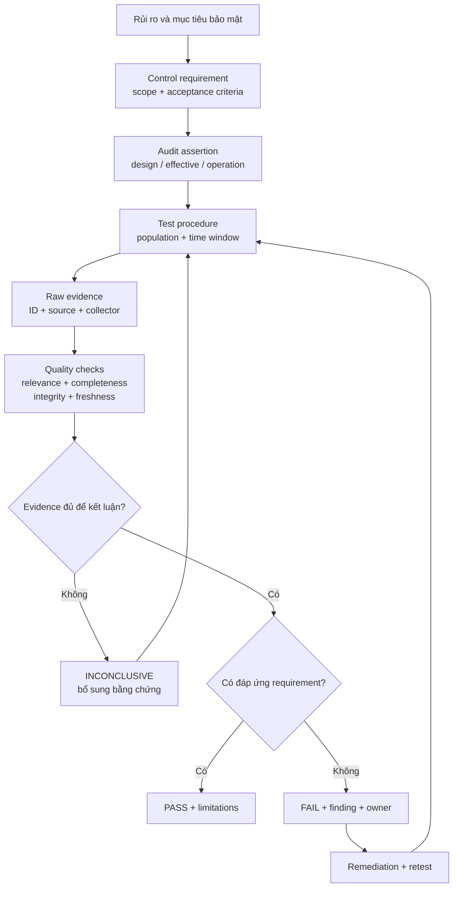
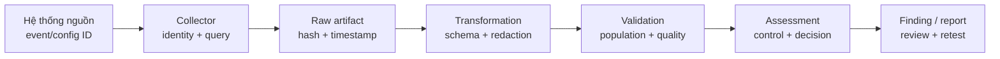

# Evidence quality trong Security Assurance: đánh giá chất lượng bằng chứng kiểm toán

## 1. Evidence quality là gì và vì sao quan trọng?

Một nhóm vận hành có thể khẳng định “mọi tài khoản quản trị đã bật MFA” và gửi ảnh chụp màn hình bảng điều khiển identity provider. Ảnh đó có thể chính xác đối với vài tài khoản được hiển thị, nhưng chưa chứng minh **toàn bộ tài khoản quản trị** đã được bảo vệ. Ảnh có thể thiếu thời điểm, phạm vi tenant, tài khoản dịch vụ, ngoại lệ hoặc thông tin về những phương thức xác thực thực sự được yêu cầu khi đăng nhập.

**Evidence quality (chất lượng bằng chứng)** là mức độ mà một hoặc nhiều tài liệu, bản ghi, kết quả kiểm tra và dữ liệu quan sát **phù hợp, đáng tin, đầy đủ, đủ mới và đủ khả năng truy vết** để hỗ trợ một kết luận cụ thể về việc security control được thiết kế, triển khai và hoạt động như kỳ vọng.

Trong chương **Audit và evidence** thuộc module **SECURITY_SECURITY_ASSURANCE**, mục tiêu là học cách **đánh giá có bằng chứng** rằng hệ thống đáp ứng các mục tiêu bảo mật: từ phân tích rủi ro, chuyển thành yêu cầu, chọn security controls đến thử nghiệm, kiểm toán, xử lý findings và đo lại trong phát triển lẫn vận hành. Bằng chứng có chất lượng thấp dễ tạo **false assurance**: một báo cáo ghi `PASS` nhưng kết luận không được dữ liệu hỗ trợ.

Đánh giá evidence quality không phải tìm tệp trông chuyên nghiệp nhất. Một bản export JSON có ID nguồn, timestamp và quy trình xác minh rõ ràng có thể phù hợp hơn một PDF nhiều trang nếu cần chứng minh trạng thái cụ thể của một rule; ngược lại, để xác minh hiệu lực một chương trình kiểm soát kéo dài sáu tháng, một lần đọc cấu hình hiện tại là không đủ.

### Kết quả học tập

Sau bài học, người học có thể:

1. Phân biệt **claim, control, audit assertion, raw evidence, assessment và finding**.
2. Đánh giá bằng chứng theo các chiều **relevance, sufficiency, completeness, accuracy, freshness, provenance, integrity, reliability, reproducibility và independence**.
3. Xác định **population, phạm vi, kỳ đánh giá, đơn vị mẫu và cơ chế lấy mẫu** để tránh suy rộng quá mức.
4. Phân biệt bằng chứng về **thiết kế**, **cấu hình hiệu lực** và **vận hành thực tế** của control.
5. Bảo vệ bằng chứng bằng quy trình thu thập, chain of custody, phân quyền, checksum, nhật ký truy cập và retention phù hợp.
6. Tạo một **evidence package có thể audit**, áp dụng trạng thái `PASS`, `FAIL`, `INCONCLUSIVE` và theo dõi retest.

## 2. Từ mục tiêu bảo mật đến một kết luận có căn cứ

Trước khi đánh giá “bằng chứng tốt hay xấu”, phải biết **bằng chứng đang hỗ trợ mệnh đề nào**.

| Khái niệm | Định nghĩa thực hành | Ví dụ về MFA |
|---|---|---|
| **Security objective** | Kết quả bảo mật cần bảo vệ | Ngăn truy cập quản trị khi không xác thực đủ mạnh |
| **Control requirement** | Điều kiện cụ thể được phê duyệt | Mọi tài khoản admin tương tác trong tenant production phải đáp ứng chính sách MFA |
| **Control design** | Quy tắc/cơ chế dự kiến thực hiện | Conditional access policy yêu cầu phương thức MFA được duyệt |
| **Audit assertion / claim** | Mệnh đề cụ thể cần chứng minh | Trong kỳ đánh giá, mọi phiên admin thuộc scope bị chặn nếu không đáp ứng MFA |
| **Evidence artifact** | Dữ liệu/tài liệu cụ thể được thu | Policy export, admin inventory, sign-in logs, test result |
| **Evidence evaluation** | Phương pháp xác nhận phạm vi, nguồn, nội dung và độ tin cậy | So policy assignments với population admin và thử negative path |
| **Assessment conclusion** | Kết quả theo tiêu chí áp dụng | `PASS`, `FAIL` hoặc `INCONCLUSIVE` kèm reason |
| **Finding & remediation** | Sai lệch, rủi ro, owner, hạn và phép kiểm chứng sau sửa | Một nhóm admin bị loại trừ; khắc phục selector và retest |

**Claim phải kiểm chứng được.** “Hệ thống có bảo mật tốt” là một nhận định mơ hồ; “tất cả phiên truy cập admin vào ứng dụng X trong kỳ tháng 11 được áp chính sách MFA Y, ngoại trừ các service identities được xử lý bởi control riêng” là mệnh đề có phạm vi và cách kiểm tra.

Một bằng chứng chỉ đủ mạnh **so với claim cụ thể**. Policy ở chế độ enable chứng minh phần cấu hình; nếu claim về hành vi đăng nhập thực tế, cần cả dữ liệu enforcement hoặc bài thử đã được ủy quyền.

## 3. Chuỗi truy vết: từ requirement tới evidence và quyết định



Trong chuỗi này, **quality check** phải được thực hiện *trước* khi tuyên bố control đạt. Một lệnh truy vấn không lỗi không có nghĩa nội dung đúng; một mẫu đúng không có nghĩa toàn population đạt; một tệp có checksum không có nghĩa sự kiện từng xảy ra đúng như mô tả.

Để một auditor khác tái dựng kết luận, evidence package cần trả lời: ai thu, từ đâu, cho tài sản nào, thời gian nào, qua phương pháp gì, với điều kiện truy cập nào, dữ liệu có toàn vẹn không, tiêu chí đánh giá nào được áp dụng và còn điều gì chưa thể xác minh.

## 4. Mười chiều đánh giá chất lượng bằng chứng

Không có một con số “evidence quality score” dùng được cho tất cả control. Thay vào đó, hãy xem nhiều thuộc tính và xác định **điều kiện bắt buộc** cho từng claim.

| Thuộc tính | Câu hỏi đánh giá | Dấu hiệu bằng chứng yếu |
|---|---|---|
| **Relevance – tính liên quan** | Artifact có trả lời đúng control/assertion không? | CPU dashboard dùng để chứng minh MFA |
| **Sufficiency – mức đủ** | Tập bằng chứng có đủ để đi tới kết luận trong scope không? | Một policy export được dùng thay phép thử enforcement |
| **Completeness – tính đầy đủ** | Có đủ population, kỳ, trường bắt buộc và điểm giao dịch không? | Export bỏ tài khoản bị khóa hoặc một region |
| **Accuracy – tính chính xác** | Giá trị, timestamp, parser và cách giải thích có đúng không? | Phân tích field `disabled` như `enabled` |
| **Freshness – độ mới** | Artifact còn đại diện trạng thái/kỳ cần đánh giá không? | Dùng ảnh năm trước sau khi đổi IAM architecture |
| **Provenance – nguồn gốc** | Có biết hệ thống nguồn, collector, identity, phương thức trích xuất? | Tệp CSV không nguồn và không người thu |
| **Integrity – tính toàn vẹn** | Có phát hiện sửa đổi trái phép giữa lúc thu và lúc review không? | Tệp bị chỉnh thủ công, không có bản gốc/manifest |
| **Reliability – độ tin cậy** | Nguồn, phương pháp và phép đo có đáng tin trong hoàn cảnh này? | Collector bỏ sự kiện nhưng báo “không thấy vi phạm” |
| **Reproducibility – khả năng tái kiểm tra** | Người khác có thể làm lại phép đo hoặc xem lại raw artifacts không? | Screenshot dashboard không ghi query/filter |
| **Independence & objectivity** | Có rủi ro tự kiểm tra, chọn mẫu thiên lệch hoặc áp lực làm đẹp số? | Chỉ trình ra các lần test thành công do owner tự chọn |

Tính **bảo mật của bằng chứng** còn là yêu cầu xuyên suốt: raw logs, dữ liệu người dùng, quyền hệ thống và báo cáo kiểm toán có thể nhạy cảm. Evidence quality không tốt nếu bằng chứng đáp ứng đầy đủ nhưng việc thu thập/lưu trữ tạo ra một rủi ro lộ dữ liệu mới.

### Độ mạnh không đồng nghĩa số lượng

Năm ảnh dashboard giống nhau với cùng một filter không nhất thiết mạnh hơn một bản raw export đáng tin có thể kiểm tra lại. Nhiều nguồn hoàn toàn độc lập cùng hỗ trợ một claim thường đáng tin hơn nhiều bản sao của **cùng nguồn sai**. Cần nhận diện phụ thuộc giữa các nguồn trước khi gọi chúng là corroboration.

## 5. Relevance: bằng chứng phải chứng minh đúng điều cần chứng minh

Để kiểm tra relevance, bắt đầu từ ba yếu tố:

1. **Đối tượng:** evidence thuộc tài khoản, cluster, ứng dụng, region, môi trường và pháp nhân/tenant nào?
2. **Thuộc tính:** evidence liên quan tới cấu hình, quyền, sự kiện, hành vi hoặc kết quả bảo mật nào?
3. **Thời gian:** bằng chứng mô tả một thời điểm, cả kỳ hoạt động hay chỉ một bài kiểm thử?

Ví dụ, control: “Tài khoản quản trị production phải sử dụng MFA”.

| Bằng chứng | Hỗ trợ tốt điều gì | Không đủ để kết luận |
|---|---|---|
| Danh sách đăng ký phương thức MFA | Những tài khoản đã đăng ký yếu tố bổ sung | Phiên admin luôn được yêu cầu MFA |
| Cấu hình conditional access | Policy được định nghĩa, điều kiện và exceptions | Policy đúng scope và có hiệu lực trên mọi đường đăng nhập |
| Policy assignment cùng inventory admin | Coverage cấu hình với population tại thời điểm đo | Enforcement trong toàn kỳ nếu có thay đổi |
| Log đăng nhập có kết quả chính sách | Hành vi xác thực quan sát ở các phiên trong kỳ | Không có bypass ở những luồng chưa có log |
| Negative test đăng nhập không MFA | Bị chặn ở luồng thử nghiệm cụ thể | Mọi protocol/client/tenant đều không bypass được |
| Hệ thống ticket review quyền | Có hoạt động xem xét/phê duyệt | Control MFA kỹ thuật đang hoạt động |

**Đối tượng giống tên nhưng khác ID vẫn có thể sai scope.** Ví dụ hai cloud accounts cùng tên hiển thị; phải dùng account ID, resource UID, tenant ID hoặc định danh bất biến phù hợp, không chỉ dùng nhãn thân thiện.

## 6. Sufficiency: khi nào bằng chứng đã đủ?

**Sufficiency** là đánh giá xem tập evidence có hỗ trợ kết luận với mức tin cậy cần thiết theo rủi ro hay chưa. Nó khác với completeness: một tập dữ liệu có thể đủ bản ghi trong phạm vi nhỏ nhưng chưa đủ để đánh giá claim lớn.

Ví dụ:

- Claim A: “Policy `mfa-prod-v4` tồn tại và enable trong tenant X lúc 09:00 UTC.” Cấu hình đọc trực tiếp qua API đúng tenant, có định danh và timestamp có thể đủ.
- Claim B: “Mọi admin production bị enforce MFA trong kỳ 30 ngày.” Cần ít nhất kiểm tra population, policy scope/exclusions, thay đổi trong kỳ, log/kiểm thử phù hợp và các luồng xác thực rủi ro.
- Claim C: “Không tồn tại con đường bypass MFA.” Đây là claim tuyệt đối rất khó chứng minh; nên thay bằng phạm vi và những đường truy cập cụ thể đã kiểm thử, kèm giới hạn chưa biết.

Mức đủ phải tương xứng **mức nghiêm trọng của control**. Một phép thử smoke đơn lẻ có thể hỗ trợ khẳng định tính sẵn sàng cơ bản sau deploy; không nhất thiết đủ cho control bảo vệ payment ledger hoặc khóa mật mã.

### Tam giác sufficiency

| Câu hỏi | Ví dụ trả lời có chất lượng |
|---|---|
| Đã kiểm tra **đúng scope** chưa? | Danh mục 42 admin identities thuộc hai tenant production, đồng bộ theo snapshot UTC |
| Đã dùng **phương pháp phù hợp** chưa? | Cross-check inventory và policy assignment, trích sign-in evidence, negative test được phê duyệt |
| Có **phạm vi chưa được kiểm** không? | Bốn service principals không đăng nhập tương tác được đánh giá theo control workload identity riêng |

Nếu thiếu một cạnh, kết luận có thể phải hạ phạm vi hoặc gắn `INCONCLUSIVE`, không tự kéo dài claim.

## 7. Completeness: population, kỳ, trường dữ liệu và chuỗi sự kiện

“Không thấy vi phạm trong những bản ghi được export” rất khác với “không có vi phạm trong toàn bộ phạm vi cần kiểm”.

Cần đánh giá completeness ở các lớp:

- **Population completeness:** danh sách tài sản, người dùng, quyền, hệ thống hoặc giao dịch đã bao gồm mọi đối tượng cần kiểm tra chưa?
- **Time completeness:** có đủ kỳ audit, kể cả cuối tháng, đợt bảo trì và các đợt thay đổi có rủi ro cao?
- **Field completeness:** mỗi bản ghi có những thuộc tính bắt buộc để đánh giá không?
- **Pipeline completeness:** hệ thống nguồn có tạo sự kiện, pipeline có nhận đủ, parse thành công và giữ đúng loại dữ liệu không?
- **Relationship completeness:** các bản ghi liên quan có thể liên kết bằng asset ID, principal ID, event ID, change ID hoặc transaction ID không?
- **Exception completeness:** danh sách exemption, whitelist, suppressed alerts và tài khoản break-glass có được xét không?

### Ví dụ: completeness của cloud inventory

Một báo cáo liệt kê 60 tài nguyên từ region A, nhưng hệ thống còn region B và một account dùng cho disaster recovery. Trước khi kết luận 60/60 resource tuân thủ, phải chứng minh **mẫu số 60 chính xác**. Nếu thực tế có 100 resource trong scope, báo cáo chỉ có **coverage 60%**, dù cả 60 đều đạt.

Không coi hệ thống “không trả tài nguyên nào” là bằng chứng chắc chắn rằng không có tài sản; lệnh có thể thiếu quyền, sai context, pagination lỗi hoặc filter quá hẹp.

## 8. Lấy mẫu bằng chứng mà không che giấu rủi ro

Kiểm toán thường không thể kiểm tra mọi event hoặc mọi thay đổi trong một kỳ dài. **Sampling** có thể phù hợp, nhưng mọi kết luận phải gắn với phương pháp chọn mẫu và rủi ro sai lệch.

### Quy trình chọn mẫu

1. Xác định **population độc lập** từ nguồn phù hợp: toàn bộ changes, identities, tickets, deployments, backup jobs hay access requests thuộc scope.
2. Xác định **sampling unit**: một change request, một lần cấp quyền, một tài khoản hay một phiên đăng nhập. Không trộn các đơn vị.
3. Chọn phương pháp: toàn bộ population với critical assets, lấy ngẫu nhiên, phân tầng theo môi trường/rủi ro, hoặc chọn có mục đích cho các event hiếm.
4. Ghi **quy tắc chọn mẫu trước khi xem kết quả**, danh sách mẫu, kích thước, cửa sổ và người chọn.
5. Thu bằng chứng cho từng đơn vị, ghi rõ pass/fail/không thể xác minh, không thay mẫu thất bại bằng mẫu dễ hơn.
6. Nếu phát hiện ngoại lệ, cân nhắc mở rộng phạm vi, kiểm tra nguyên nhân hệ thống và điều chỉnh kết luận theo phương pháp kiểm toán đã định.

| Phương pháp | Phù hợp khi | Giới hạn |
|---|---|---|
| **Full population test** | Số lượng vừa phải hoặc control rủi ro rất cao, có dữ liệu tự động | Data quality và logic vẫn phải được xác minh |
| **Random sample** | Muốn giảm chọn mẫu chủ quan trong population xác định | Kích thước mẫu nhỏ có thể bỏ qua sự cố hiếm |
| **Stratified sample** | Rủi ro khác nhau giữa admin/standard, production/staging, region | Phải ghi rõ từng tầng và mẫu số |
| **Risk-based targeted sample** | Muốn thử cases ngoại lệ, quyền đặc biệt, deploy khẩn cấp | Không tự đại diện cho toàn population |
| **Time-based/systematic sample** | Control có hành vi biến đổi theo tuần/tháng/cửa sổ bảo trì | Có thể trùng chu kỳ và bỏ qua peak/exception |
| **Continuous automated check** | Có dữ liệu và quy tắc đủ đáng tin để chạy thường xuyên | Tool failure, blind spot, permission gap vẫn tồn tại |

**Không có quy tắc “chọn 10 mẫu là đủ cho mọi control”.** Mức đủ phụ thuộc kích thước population, tần suất control, tác động, kỳ, tỷ lệ sai lệch dự kiến, phương pháp và yêu cầu kiểm toán. Chỉ sử dụng suy luận thống kê hoặc khoảng tin cậy nếu cách lấy mẫu đáp ứng các giả định cần thiết.

### Phân biệt mẫu rủi ro và mẫu đại diện

Kiểm tra 20 thay đổi production có quyền root vì rủi ro cao là hợp lý; nhưng kết quả 20/20 PASS không thể được giới thiệu là “100% mọi thay đổi production đã qua approval” nếu toàn bộ population có 2.000 changes không cùng xác suất chọn.

## 9. Provenance: chứng minh dữ liệu được lấy từ đâu

**Provenance** là thông tin nguồn gốc và các bước xử lý để người đánh giá hiểu bản ghi được tạo, thu, xuất, chuyển và diễn giải như thế nào.

Một record tốt nên có:

- `source_system`, account/project/tenant/cluster ID, region và service.
- `source_resource_id` hoặc object UID bất biến khi có.
- `collector_identity`, quyền/role sử dụng, công cụ/API/version, câu lệnh hoặc query.
- `collection_started_at_utc`, `collection_completed_at_utc`, timezone/clock assumptions.
- `source_event_time`, `source_version`, sequence/transaction ID nếu có.
- Query/filter, pagination, số bản ghi dự kiến/đã thu và collection errors.
- Các bước transformation, parser version, redaction, enrichment và nơi lưu raw.
- Đường dẫn artifact, checksum/manifest, phân quyền và retention.

Một bảng tính được gửi qua email với cột “Result = PASS” có thể hữu ích như **bản báo cáo kết quả**, nhưng nếu không liên kết tới raw evidence và phương pháp kiểm tra, nó không đủ để tái dựng sự thật.

### Evidence lineage



Tại mỗi bước cần biết **phiên bản đầu vào và đầu ra**; nếu một bản CSV được sửa thủ công để bỏ trường nhạy cảm, hãy giữ cách chuyển đổi có thể giải thích và đánh giá liệu redaction có vô tình xóa trường cần cho control không.

## 10. Integrity: bằng chứng có bị sửa sau khi thu không?

**Tính toàn vẹn** giúp phát hiện thay đổi không được phép trong quá trình lưu giữ hoặc chuyển giao. Những phương pháp thường được dùng:

- Bảo vệ raw artifact trong kho có phân quyền theo vai trò, tách trách nhiệm ghi và xem xét.
- Ghi nhận checksum hoặc content hash và bảo vệ manifest độc lập.
- Dùng versioning/object lock/WORM khi có yêu cầu và cấu hình phù hợp.
- Lưu audit log cho những thao tác đọc, sửa, chuyển, export và delete evidence quan trọng.
- Ký số hoặc cơ chế ghi nhận nguồn được xác thực khi khả thi và phù hợp thiết kế.
- Thực hiện kiểm tra lại hash khi bàn giao cho auditor hoặc chuyển qua các kho.

### Ví dụ tạo checksum (chỉ đọc nội dung artifact)

```bash
# Giả sử file evidence đã tồn tại ở kho thu thập được phép.
# Không bao gồm token, mật khẩu hoặc secret trong tệp bằng chứng.
sha256sum evidence/access-review-2026-11.json

# Kiểm tra với manifest gốc lưu ở nơi tin cậy.
sha256sum -c evidence/sha256-manifest.txt
```

Một checksum trùng nhau giúp kết luận **byte hiện tại trùng bản manifest được đối chiếu**; nó **không chứng minh dữ liệu ban đầu là thật**, không chứng minh timestamp ở nguồn đúng, và không chống được kẻ tấn công sửa cả file lẫn manifest nếu hai thứ có cùng quyền ghi. Tính toàn vẹn trong assurance là kết hợp **nguồn đáng tin, quyền hạn, lịch sử thao tác và kiểm tra nhất quán**.

### Quy tắc không “sửa cho đẹp” raw evidence

Không được xóa dòng lỗi, chỉnh timestamp hoặc loại những mẫu FAIL trong raw data để làm kết quả sạch. Nếu cần chuẩn hóa hoặc ẩn danh, tạo **bản dẫn xuất có version** và lưu dấu vết transformation; khi policy cho phép, raw bản gốc ở kho quyền hạn cao hơn.

## 11. Chain of custody: chuỗi quản lý bằng chứng

**Chain of custody** là hồ sơ theo dõi ai/đơn vị nào sở hữu, tiếp cận hoặc chuyển giao evidence; thực hiện thao tác gì, khi nào, vì sao và dưới quyền hạn nào. Nó đặc biệt quan trọng với điều tra sự cố, bằng chứng có thể dùng trong tố tụng, audit nhạy cảm hoặc dữ liệu dễ bị thay đổi.

| Trường | Ví dụ | Tại sao cần |
|---|---|---|
| Artifact ID | `EV-ACCESS-0042` | Định danh duy nhất |
| Source | `idp-prod-tenant-01` | Truy về hệ thống gốc |
| Collector | `assurance-reader` | Phân biệt quyền và người thực hiện |
| Collection time | `2026-11-28T03:10:00Z` | Xác định mốc thu |
| Acquisition method | Export API read-only với query version | Tái kiểm tra phương pháp |
| Original hash | SHA-256 manifest | Phát hiện thay đổi sau thu |
| Transfer history | ID giao dịch chuyển kho và người nhận | Theo dõi nơi lưu và bàn giao |
| Processing history | Redaction script version, fields removed | Biết bản nào đã biến đổi |
| Access log | Ai tải/xem/sửa và khi nào | Điều tra thao tác không được phép |
| Final disposition | Retention expiry, delete/hold record | Quản lý vòng đời và nghĩa vụ |

Không nhất thiết mọi dashboard KPI đều cần quy trình chain of custody nghiêm ngặt như chứng cứ điều tra. Mức quản trị nên theo rủi ro và mục đích sử dụng, nhưng **artifact ID, nguồn, người thu, thời gian và tính toàn vẹn** vẫn nên được ghi.

## 12. Accuracy và reliability: dữ liệu đúng và phương pháp đo đáng tin

Một bản ghi có thể nguyên vẹn nhưng **sai từ đầu**. Nguồn gửi dữ liệu từ máy có đồng hồ lệch, parser đảo ý nghĩa field, API chỉ trả trang kết quả đầu tiên hoặc rule nhận diện đối tượng bằng tên không duy nhất.

Các phép kiểm cần cân nhắc:

| Kiểm tra | Ví dụ lỗi | Biện pháp |
|---|---|---|
| Schema/field validation | `enabled: "false"` được parse như chuỗi truthy | Kiểm kiểu dữ liệu, giá trị hợp lệ và schema version |
| Identity resolution | Hai người dùng trùng display name | Dùng principal ID và scope tenant |
| Time normalization | Log giờ địa phương bị xem là UTC | Ghi timezone, offset và clock quality |
| Pagination/cursor | Chỉ đọc 100 trong 1.000 kết quả API | Theo cursor, đối chiếu total/coverage |
| Rate limit/retry | Bỏ qua các trang lỗi HTTP 429 | Ghi error và retry phù hợp, không tự báo hoàn tất |
| Missing data | Các event deny không được export | Đánh giá quyền và phạm vi event audit |
| Consistency across sources | Số role binding giữa IAM và app lệch | Điều tra mapping, propagation delay và sync |
| Deduplication | Một event được ingest lại ba lần | Dùng event ID/sequence và ghi semantics |
| Unit interpretation | `900` hiểu là ms thay vì s | Kiểm định đơn vị và ngưỡng |
| Sampling bias | Chỉ lấy những sự kiện đã tạo alert | Bổ sung ground truth độc lập để tìm false negatives |

**Reliability không có nghĩa nguồn không bao giờ lỗi**; nó có nghĩa người đánh giá biết rõ cơ chế tạo dữ liệu, khả năng lỗi và những kiểm tra giúp phát hiện sai lệch. Với control quan trọng, có thể cần **corroboration** bằng nguồn độc lập: thay đổi quyền trong IAM đối chiếu change ticket và audit event, thay vì chỉ dùng bảng tổng hợp của cùng một pipeline.

### Chú ý: absence of evidence

Không tìm thấy log sự cố **không tự chứng minh sự cố không xảy ra**. Phải xác nhận event source được bật, permissions đầy đủ, pipeline có health, retention bao phủ thời điểm, query/filter đúng và hoạt động đó thuộc nhóm được ghi nhận. Khi không chứng minh được các điều kiện này, kết luận cần thể hiện **evidence gap**.

## 13. Freshness và thời gian hiệu lực của evidence

Bằng chứng cần phản ánh **kỳ kiểm toán hoặc thời điểm quyết định**, không chỉ là file mới được tải hôm nay.

Hãy phân biệt:

- `event_occurred_at`: khi sự kiện xảy ra.
- `config_effective_at`: khi cấu hình bắt đầu có hiệu lực theo hệ thống nguồn.
- `source_record_updated_at`: khi bản ghi nguồn thay đổi.
- `collected_at`: khi người/agent trích xuất dữ liệu.
- `report_period_start/end`: kỳ kiểm tra của báo cáo độc lập.
- `reviewed_at`: khi assessor đánh giá.
- `evidence_expires_at`: mốc cần kiểm tra lại theo chính sách nội bộ.
- `change_trigger`: sự kiện có thể khiến bằng chứng cũ không còn đại diện.

Ví dụ, một báo cáo SOC Type II bao phủ kỳ kết thúc tháng 9 có thể vẫn hỗ trợ nhiều kiểm soát vào tháng 11, tùy scope và thay đổi kể từ đó. Nhưng nếu vendor đã đổi nền tảng identity hoặc chuyển dữ liệu sang một region khác vào tháng 10, cần xem lại tính áp dụng. **Ngày tải report không làm mới kỳ thử nghiệm bên trong report.**

### Độ mới phải theo loại control

Một lần kiểm tra vulnerability ở host có thể cần mới hơn một bản phê duyệt security policy thường niên; một DR restore test có thể theo chu kỳ rủi ro và sau thay đổi kiến trúc. Không áp một hạn “30 ngày” cho tất cả evidence nếu chưa có căn cứ. Đối với control biến động nhanh, cần giám sát liên tục hoặc bằng chứng tại nhiều thời điểm trong kỳ.

**Clock skew:** khi so event-to-alert latency, các nguồn phải có đồng bộ thời gian và cách đo sai số. Một timestamp chênh không hợp lý có thể khiến kết luận `INCONCLUSIVE` cho chỉ số thời gian, dù các thuộc tính khác vẫn kiểm tra được.

## 14. Reproducibility: người khác có thể kiểm lại hay không?

Một phép kiểm tốt cần đủ metadata để assessor khác lặp lại việc đọc dữ liệu hoặc tính lại kết quả. Với control theo thời gian, việc gọi lại API hôm nay có thể cho trạng thái khác; vì vậy phải giữ **raw snapshot tại thời điểm kiểm tra** và query/version.

### Một test procedure nên ghi

1. Điều kiện tiên quyết, scope, quyền truy cập, target cluster/tenant ID.
2. Nguồn và API endpoint/service; version của tool hoặc query.
3. Filter, pagination, time window, timezone, identity mapping.
4. Cách đánh giá missing values, duplicate records, exceptions.
5. Công thức hoặc logic quyết định, baseline/control version.
6. Expected result và các trường hợp fail/inconclusive.
7. Raw input/output artifacts, hash và tài liệu transformation.
8. Người review, thời điểm review và cách retest sau remediation.

Ví dụ kiểm tra Kubernetes RBAC bằng lệnh quan sát:

```bash
# Chỉ thực hiện trên cluster được ủy quyền với quyền đọc phù hợp.
kubectl config current-context

# Quan sát RoleBinding trong namespace đích.
kubectl get rolebinding -n payments -o json

# Quan sát ClusterRoleBinding có thể cấp quyền rộng hơn.
kubectl get clusterrolebinding -o json

# Kiểm tra quyền đối với identity cụ thể nếu caller được quyền impersonate.
kubectl auth can-i get secrets \
  --as=system:serviceaccount:payments:diagnostics \
  -n payments
```

Các lệnh trên **không đủ để khẳng định quyền của identity trong toàn cluster** nếu không biết vai trò, effective bindings, API aggregation, impersonation constraints và các đường truy cập bên ngoài Kubernetes. Kết quả permission denied trong lệnh trích xuất cũng phải được ghi là **hạn chế thu thập**, không xem danh sách rỗng như bằng chứng control đạt.

Đối với hệ thống đang thay đổi liên tục, số hiệu `resourceVersion`, object UID, commit/manifest revision hoặc event IDs có thể giúp cố định trạng thái được đánh giá.

## 15. Độc lập, kiểm tra chéo và rủi ro thiên lệch

Assurance không yêu cầu mọi phép đo đều do bên thứ ba thực hiện, nhưng cần hiểu **mức độc lập và nguy cơ thiên lệch** của từng nguồn.

| Cách có bằng chứng | Lợi thế | Điều cần kiểm soát |
|---|---|---|
| Nhóm vận hành tự export | Hiểu hệ thống, truy cập nguồn nhanh | Quyền sửa dữ liệu, lọc kết quả, thiếu peer review |
| Nhóm assurance truy vấn read-only | Tách người vận hành và người đánh giá | Permissions, scope, query và missing assets |
| Continuous scanner tự động | Lặp thường xuyên, đo theo một bộ quy tắc | Logic bug, drift, thiếu coverage, tool outage |
| Audit nội bộ độc lập | Kiểm tra quy trình và bằng chứng theo phương pháp | Năng lực chuyên môn, kỳ kiểm tra và giới hạn mẫu |
| Report từ tổ chức đánh giá bên ngoài | Có thể cung cấp góc nhìn độc lập trên scope được kiểm | Phải đọc opinion, period, exceptions, CUECs và exclusions |
| Đối chiếu nhiều nguồn | Phát hiện lệch giữa policy, runtime và log | Các nguồn có thể cùng phụ thuộc một pipeline bị lỗi |

**Self-attestation là evidence của lời xác nhận**, không đồng nghĩa **observation**. Nếu vendor nói “backup is tested annually”, cần xem test plan, mục tiêu, kết quả, restore artifacts, findings và scope trước khi kết luận chương trình DR hoạt động.

Người thiết kế control có thể hỗ trợ giải thích nhưng nên có người review phù hợp và audit trail của quyết định; khi kiểm tra rủi ro cao, tách người thực hiện thay đổi với người xác nhận đóng finding.

## 16. Đánh giá evidence theo vòng đời control

Có ba kiểu mệnh đề thường bị trộn lẫn:

| Lớp | Mệnh đề | Evidence thường phù hợp | Những gì chưa chứng minh |
|---|---|---|---|
| **Design effectiveness** | Cơ chế thiết kế có khả năng giải quyết yêu cầu rủi ro không? | Architecture/security design, policy, threat model, approval | Cấu hình thực tế và kết quả vận hành |
| **Implementation / effective configuration** | Cơ chế đã được triển khai, áp đúng scope chưa? | Current config, inventory, policy bindings, IAM roles | Control luôn hoạt động trong cả kỳ |
| **Operating effectiveness** | Control có thực thi như yêu cầu khi có sự kiện hay trong suốt kỳ không? | Source logs, test transactions, samples, approvals, incident/alert evidence | Mọi hành vi/tài sản ngoài mẫu đều đạt |

Ví dụ một backup policy hàng ngày là evidence về **design/configuration**; việc backup job success có thể hỗ trợ operation monitoring; chỉ **restore test có dữ liệu nhất quán và recovery point đo được** mới trực tiếp hỗ trợ claim “có thể phục hồi dữ liệu đến mốc được yêu cầu”.

Với control thực thi liên tục, một phép đo hiện tại không thay thế audit toàn kỳ nếu có thay đổi giữa các thời điểm. Với control thực thi theo event, phải lấy mẫu từ đúng population sự kiện, không từ những tài khoản còn hoạt động hiện tại.

## 17. Bảo vệ confidentiality và data minimization khi thu evidence

Bằng chứng bảo mật có thể chứa nhiều thông tin nhạy cảm hơn chính báo cáo tổng hợp: tên tài khoản đặc quyền, địa chỉ nội bộ, API metadata, sơ đồ mạng, audit log, dữ liệu cá nhân, nội dung ticket và trạng thái lỗ hổng.

**Nguyên tắc:**

- Thu ít nhất những trường cần để đánh giá claim, không export toàn bộ secret store hay raw database nếu chỉ cần metadata.
- Không để password, private key, access token, refresh token, session cookie và authorization header xuất hiện trong report.
- Phân loại evidence, giới hạn quyền đọc/ghi, dùng mã hóa trong lưu/chuyển theo thiết kế và audit truy cập.
- Dùng dữ liệu thử cho negative tests và restore/DR exercises khi có thể.
- Với log chứa dữ liệu cá nhân, áp dụng quy trình redaction/pseudonymization có thể truy vết; kiểm tra rằng các trường cần cho correlation không bị xóa.
- Cấu hình retention theo yêu cầu pháp lý/hợp đồng/chính sách và dùng legal hold khi đúng thẩm quyền.
- Có quy trình hủy/thu hồi evidence theo vòng đời được duyệt, tránh sao chép sang ticket/chat không kiểm soát.
- Không chia sẻ SOC report, pen-test report hay tài liệu của bên thứ ba ngoài quyền phân phối/NDA.

**Bảo mật và khả năng audit không đối lập.** Có thể giữ raw artifact trong vault có quyền kiểm soát, còn báo cáo chỉ chứa ID, hash, summary, kết luận và đường dẫn nội bộ; auditor được cấp quyền theo quy trình khi cần kiểm chứng.

## 18. Mô hình kiểm tra chất lượng theo control (không chạy theo điểm số giả)

Một bộ tiêu chí đơn giản có thể kết hợp **hard gates** (điều kiện bắt buộc) với mức độ tin cậy, thay vì cộng điểm rồi coi 80/100 là đạt cho mọi control.

### Hard gates gợi ý

| Gate | Câu hỏi | Nếu không đạt |
|---|---|---|
| **G1 – Scope** | Có xác định đúng control, system ID, population và kỳ không? | Không kết luận trên phạm vi dự kiến |
| **G2 – Provenance** | Nguồn, collector/method và thời điểm có kiểm chứng được không? | `INCONCLUSIVE` hoặc yêu cầu evidence khác |
| **G3 – Integrity** | Raw artifact còn đáng tin, không có thay đổi không giải thích? | Tạm dừng kết luận từ artifact đó |
| **G4 – Completeness** | Dữ liệu có đủ để thực hiện phép đo đã định? | Thu bổ sung hoặc thu hẹp claim được duyệt |
| **G5 – Applicability** | Evidence có chứng minh đúng design/implementation/operation? | Chọn phương pháp/test thích hợp hơn |
| **G6 – Freshness** | Artifact còn áp dụng cho kỳ và trạng thái cần đánh giá? | Retest/recollect theo risk trigger |
| **G7 – Decision rule** | Có tiêu chí đánh giá được phê duyệt trước khi xem kết quả không? | Hoàn thiện method, tránh thay ngưỡng để đạt |

**Đánh giá chất lượng khác đánh giá compliance:** một bộ evidence có chất lượng cao vẫn có thể chứng minh **FAIL** của control. Ngược lại, một control thực tế đang an toàn nhưng evidence thiếu là **INCONCLUSIVE**, không nên tự gán FAIL nếu không có bằng chứng control sai. Nếu có bằng chứng riêng về collector không hoạt động, control monitoring health có thể FAIL, còn mệnh đề khác vẫn INCONCLUSIVE.

### Phân loại mức tin cậy (minh họa nội bộ)

- **High confidence:** scope/population rõ, raw data đáng tin, phương pháp phù hợp, kiểm tra độc lập hoặc corroboration khi cần, sample đủ và test hợp lệ.
- **Medium confidence:** claim có bằng chứng trực tiếp nhưng phạm vi thời gian/mẫu/hành vi còn giới hạn được công bố.
- **Low confidence:** chủ yếu self-report, thiếu thời gian hoặc có nhiều điều kiện chưa xác minh.
- **Insufficient:** không vượt các quality gates bắt buộc cho claim; chưa được kết luận đạt.

Đây là **mức độ diễn giải**, không phải tiêu chuẩn được chứng nhận; nếu tổ chức sử dụng score, phải công bố cách chấm, ngưỡng và những lỗi nào không được bù bằng điểm ở chiều khác.

## 19. Tổ chức evidence package và assessment record

Một **evidence package** nên phân biệt dữ liệu gốc và bản phân tích. Cấu trúc logic:

```text
Control assessment package
  - control-specification (requirement, scope, baseline version)
  - population-record (source, filters, snapshot, counts)
  - test-plan (method, sample logic, approved criteria)
  - raw-artifacts (unmodified exports, event logs, test results)
  - derived-data (redactions, joins, calculations, parser version)
  - integrity-manifest (hashes, access/transfer metadata)
  - quality-review (missing fields, scope, freshness, limitations)
  - assessment-result (PASS/FAIL/INCONCLUSIVE, reason)
  - findings-and-retest (owner, changes, evidence before/after)
```

### Mẫu evidence manifest YAML (dữ liệu giả định)

```yaml
package_id: assurance-evidence-20261128-005
control_id: IAM-ADMIN-MFA-01
baseline_version: security-prod-v4
assertion:
  text: "Production interactive admin access requires approved MFA"
  class: operating_effectiveness
scope:
  tenant_ids: ["tenant-prod-a"]
  population_type: interactive_admin_identity
  period_start_utc: "2026-11-01T00:00:00Z"
  period_end_utc: "2026-11-27T23:59:59Z"
population:
  source: "authoritative-identity-inventory"
  snapshot_collected_at_utc: "2026-11-28T02:00:00Z"
  expected_count: 50
  assessed_count: 40
  valid_evidence_count: 35
  excluded_count: 0
collection:
  collector_id: "assurance-reader"
  method_version: "iam-mfa-export-v2"
  collected_at_utc: "2026-11-28T02:15:00Z"
  errors:
    - "10 identities not returned due to incomplete source permissions"
evidence:
  - id: "EV-001"
    kind: "policy-export"
    source: "identity-provider"
    ref: "secure-evidence/IAM-ADMIN-MFA-01/policy.json"
    hash_algorithm: "SHA-256"
    hash_ref: "secure-evidence/IAM-ADMIN-MFA-01/manifest.sha256"
  - id: "EV-002"
    kind: "sign-in-test-results"
    source: "approved-test-run"
    ref: "secure-evidence/IAM-ADMIN-MFA-01/tests.json"
assessment:
  qualified_coverage_pct: 70.0
  quality_gate_status: insufficient_for_full_population
  control_result: INCONCLUSIVE
  reason: "15 of 50 identities lack validated operating evidence"
  limitations:
    - "Assessment cannot establish full-period operation for all identities"
review:
  reviewer: "security-assurance"
  reviewed_at_utc: "2026-11-28T04:00:00Z"
  findings:
    - "EVGAP-026"
```

Mẫu mô phỏng **không chứa nội dung hash thật**; trong hồ sơ thật, manifest phải lưu giá trị hash và được bảo vệ. `qualified_coverage_pct = 35/50 × 100 = 70%`. Dù 35 tài khoản có bằng chứng hợp lệ, đó chỉ cho phép kết luận **trong tập đã kiểm tra**, không cho phép nâng lên `PASS` cho claim “mọi admin”.

**Cẩn thận khi ghi lỗi thu thập:** 10 tài khoản không được trả về vì thiếu quyền và thêm 5 tài khoản thiếu evidence đủ điều kiện; phải biết từng nhóm có trùng nhau không. Đừng cộng các nhóm lỗi chồng lấn thành số tài sản thiếu lớn hơn population.

## 20. Quy tắc PASS, FAIL, INCONCLUSIVE và NOT_APPLICABLE

| Trạng thái | Dùng khi | Hành động |
|---|---|---|
| **PASS** | Evidence đủ chất lượng, áp đúng scope/kỳ và thực hiện tiêu chí control | Lưu assessment, theo dõi thay đổi và kỳ kiểm tra |
| **FAIL** | Evidence đáng tin cho thấy control vi phạm requirement ở scope đã kiểm tra | Finding, ưu tiên theo rủi ro, remediation và retest |
| **INCONCLUSIVE** | Không đủ evidence để xác nhận đạt/không đạt: thiếu scope, permission, integrity, time hoặc method | Ghi gap, owner, deadline thu bổ sung; không tự ghi PASS |
| **NOT_APPLICABLE** | Đối tượng nằm ngoài scope theo quy tắc đã được duyệt | Lưu điều kiện loại trừ, căn cứ và phê duyệt phù hợp |
| **Accepted exception** | Có quyết định chấp nhận rủi ro trong phạm vi, thời hạn và thẩm quyền phù hợp | Theo dõi riêng exception; không đổi observed `FAIL` thành `PASS` |

Pseudo-logic minh họa:

```text
if object_is_outside_approved_scope:
    return NOT_APPLICABLE with scope_reason

if source_unverified or population_unknown:
    return INCONCLUSIVE with evidence_quality_gap

if evidence_integrity_unverifiable or missing_required_fields:
    return INCONCLUSIVE with quality_gate_failure

if test_method_does_not_support_claim:
    return INCONCLUSIVE with method_limitation

if reliable_evidence_shows_control_violation:
    return FAIL with observation_and_finding

if complete_required_evidence_supports_requirement:
    return PASS with scope_and_limitations

return INCONCLUSIVE
```

Đừng dùng bảng tổng hợp “no findings” thay cho quy trình này nếu nguồn sai, population thiếu hoặc quyền thu không đủ. Ngược lại, khi một event vi phạm được kiểm chứng trực tiếp, **FAIL** có thể có cơ sở vững chắc dù chưa thu hết population: finding đó không phải suy luận từ mẫu trống.

## 21. Case study A: ảnh dashboard “100% MFA” nhưng chưa đủ bằng chứng

**Bối cảnh:** nhóm quản trị khẳng định 100% tài khoản admin production có MFA. Hồ sơ audit chỉ có screenshot dashboard “MFA registered: 100%” với 40 tài khoản được hiển thị. Danh sách identity từ HR/IAM cho thấy **50 principal** có quyền admin, gồm 5 tài khoản quản trị tạm và 5 tài khoản nằm ở tenant thứ hai.

**Các nguồn quan sát:**

| Evidence | Quan sát | Kết luận chất lượng |
|---|---|---|
| Screenshot tenant A | 40/40 tài khoản hiện trong filter có đăng ký MFA | Liên quan tới **registration**, không phải full enforcement |
| Inventory IAM có timestamp | 50 admin principals trong scope được duyệt | Cung cấp mẫu số chính xác hơn |
| Policy export | MFA được enforce cho nhóm `admin-prod` tại tenant A | Chưa chứng minh tài khoản tạm và tenant B thuộc scope |
| Sign-in logs | Một số phiên có MFA challenge | Có evidence vận hành cho những phiên đó |
| Negative test tài khoản tạm | Có một đường đăng nhập không MFA được chấp nhận | Evidence **FAIL** cho control đối với đường đó |
| Audit collector | Thiếu quyền đọc tenant B | Evidence gap cho phần còn lại |

**Đánh giá:** claim toàn bộ admin đạt MFA là **FAIL** nếu negative test được phép và bằng chứng thực tế xác nhận một trường hợp vi phạm. Đồng thời phần tenant B chưa kiểm tra được phải được nêu là **coverage gap/INCONCLUSIVE** ở những đối tượng riêng. Không được làm kết luận chung `PASS` từ screenshot 40/40.

**Khắc phục:** cập nhật inventory, sửa policy assignment, review service/break-glass accounts theo control riêng, cấp quyền read-only thích hợp cho collector, kiểm tra enforcement và thử lại đường bị bypass. Lưu raw sign-in evidence, policy revision, test ID, approval và limitation. Đây là ví dụ cho thấy **bằng chứng chất lượng cao về vi phạm vẫn hữu ích hơn một báo cáo đẹp nhưng thiếu scope**.

## 22. Case study B: backup job “SUCCESS” nhưng restore chưa chứng minh được

**Claim:** dịch vụ đặt hàng có thể phục hồi dữ liệu tới tối đa 15 phút trước sự cố theo RPO đã được phê duyệt.

Hồ sơ nhà vận hành bao gồm ảnh backup dashboard với job cuối cùng successful lúc 10:00, screenshot cấu hình lưu backup 30 ngày và email “bản sao an toàn”. Nhưng audit không có bản restore test, transaction watermark hay dữ liệu KMS/identity cho site dự phòng.

| Câu hỏi chất lượng | Bằng chứng hiện có | Khoảng trống |
|---|---|---|
| Relevance | Backup job có liên quan tới data protection | Không trực tiếp chứng minh RPO thực tế |
| Completeness | Có danh sách các job thành công | Không chứng minh log chain và full dataset |
| Accuracy | Timestamp job 10:00 | Không biết điểm giao dịch nhất quán trong file |
| Provenance/integrity | Screenshot/email | Thiếu raw backup catalog, collector và manifest |
| Operating effectiveness | Backup job chạy | Restore/đối soát chưa được thử |
| Freshness | Job mới | Chưa biết cấu hình và key ở môi trường DR hiện hành |

**Kết luận:** dựa trên tập bằng chứng này, **RPO đo thực tế là INCONCLUSIVE**, không được ghi PASS. Nếu phép thử restore sau đó thất bại do key thiếu, control `DR key readiness` có thể **FAIL**, còn RPO vẫn chưa đo được tới khi có điểm dữ liệu hợp lệ. Nếu khôi phục được dữ liệu 25 phút trước sự cố trong khi RPO 15 phút, có căn cứ **FAIL RPO**.

Cần yêu cầu restore test an toàn ở môi trường cô lập, transaction IDs trước/sau sự cố giả lập, consistency checks, mốc UTC, backup/log manifest, quyền KMS và kết quả so với RPO/RTO. Nêu rõ mức đại diện của môi trường thử so với production.

## 23. Đo lường evidence quality mà không làm méo báo cáo

Một báo cáo nên công bố **khối lượng dữ liệu**, **coverage**, **tỷ lệ đủ điều kiện** và **kết quả control** như những trục riêng.

### Ví dụ định lượng

Giả sử inventory cho biết cần đánh giá **80 tài sản production** trong kỳ:

- 72 tài sản có artifact được thu thành công.
- Trong 72 đó, 65 tài sản có evidence đáp ứng các quality gates.
- Trong 65 tài sản đủ bằng chứng, 60 đạt control; 5 có vi phạm được xác nhận.
- 8 tài sản không thu được; 7 tài sản thu được nhưng evidence không đạt chất lượng.

Tính:

\[
\mathrm{CollectionCoverage}=\frac{72}{80}=90\%
\]

\[
\mathrm{QualifiedEvidenceCoverage}=\frac{65}{80}=81{,}25\%
\]

\[
\mathrm{PassRateAmongQualified}=\frac{60}{65}\approx92{,}31\%
\]

Nhưng **60/80 = 75%** mới là tỷ lệ tài sản trong toàn phạm vi **được chứng minh đạt**, và **15/80** chưa có evidence đạt yêu cầu; trong số 65 tài sản kiểm tra được có 5 `FAIL`. Không thể viết “92,31% toàn bộ production đạt” rồi bỏ qua thiếu coverage.

| Chỉ số | Ý nghĩa | Không nên diễn giải thành |
|---|---|---|
| Collection coverage | Tỷ lệ đối tượng có artifact thu được | Tỷ lệ đã kiểm soát an toàn |
| Qualified evidence coverage | Tỷ lệ đối tượng có bằng chứng đủ điều kiện đánh giá | Tỷ lệ PASS |
| Pass rate among qualified | Tỷ lệ đạt trong tập đủ bằng chứng | Tỷ lệ đạt trên toàn population |
| Known fail count | Số đối tượng có vi phạm đã xác minh | Tổng số vi phạm tồn tại |
| Stale evidence count | Số kết luận cần xem lại vì tuổi/trigger | Khẳng định mọi control đã FAIL |
| Provenance/integrity exceptions | Lỗ hổng về nguồn và chuỗi lưu giữ | Tự chứng minh cấu hình bảo mật sai |
| Retest closure ratio | Findings được kiểm tra lại và đóng / findings theo tiêu chí | Tỷ lệ rủi ro đã bị loại trừ hoàn toàn |

Khi đưa lên dashboard, cần ghi ngày/kỳ, population ID, đơn vị đo, bản quy tắc đánh giá, các loại `INCONCLUSIVE`, ngoại lệ và phương pháp lấy mẫu.

## 24. Bảo đảm chất lượng khi tự động hóa thu thập evidence

Continuous assurance có thể tự động xuất cấu hình, kiểm tra chính sách và lưu kết quả. Nhưng tự động hóa cũng có thể **tự động sai** ở quy mô lớn nếu collector hoặc evaluator có bug.

### Kiểm soát cần có cho pipeline evidence-as-code

- Version-control **control mapping, query, parser, evaluator và acceptance criteria**.
- Dùng danh tính collector **read-only**, cấp đúng scope và kiểm tra mất quyền.
- Ghi rõ tenant/account/region và inventory snapshot để tránh chạy nhầm.
- Hỗ trợ pagination, retry có giới hạn, rate limit, schema change và missing data.
- Lưu raw response khi phù hợp; không chỉ lưu Boolean pass/fail.
- Thiết lập quality gates cho empty results, field missing, timestamp bất thường và tỷ lệ lỗi.
- Chia tách **collection succeeded**, **evidence qualified** và **control passed**.
- Kiểm soát signing/hash/retention, kho bí mật và quyền xem evidence.
- Test evaluator bằng fixtures `PASS`, `FAIL`, `INCONCLUSIVE` và edge cases.
- Có monitoring/alert khi scanner ngừng hoạt động, kết quả giảm bất thường hoặc inventory tăng ngoài phạm vi.
- Truy vết commit/runner/tool version để tìm nguyên nhân nếu phép đo đổi sau cập nhật.

### Mẫu kết quả máy đọc được

```json
{
  "assessment_id": "evq-20261128-001",
  "control_id": "IAM-ADMIN-MFA-01",
  "asset_id": "tenant-prod-a",
  "population_size": 50,
  "collected": 40,
  "qualified": 35,
  "quality_gates": {
    "scope_verified": true,
    "provenance_verified": true,
    "integrity_verified": true,
    "population_complete": false,
    "freshness_accepted": true
  },
  "evidence_quality": "INSUFFICIENT",
  "control_result": "INCONCLUSIVE",
  "reason": "15 scoped principals lack qualified evidence",
  "method_version": "mfa-evidence-check-v2",
  "collected_at_utc": "2026-11-28T02:15:00Z"
}
```

Một kết quả JSON đúng schema chưa đủ; phải kiểm tra **cơ sở gốc của số `population_size=50`**, việc phân loại `qualified` và chất lượng logic evaluator. Trường `evidence_quality` nên tách khỏi `control_result` để tránh ngộ nhận rằng nguồn đáng tin mặc nhiên tạo PASS.

## 25. Sai lầm thường gặp khi đánh giá bằng chứng

| Sai lầm | Hậu quả | Cách khắc phục |
|---|---|---|
| Coi screenshot là bằng chứng đầy đủ | Không biết filter, scope hoặc timestamp | Raw export + query + source ID |
| Coi policy tồn tại là vận hành hiệu quả | Bỏ qua ngoại lệ và enforcement | Runtime/test logs theo control |
| Chỉ chọn những mẫu PASS | Confirmation bias | Sample method có lịch sử, giữ cả FAIL/missing |
| Không đối chiếu inventory | Sai mẫu số và bỏ sót tài sản | Population độc lập, reconciliation |
| Dùng report đã hết scope hoặc trước thay đổi lớn | False assurance vì bằng chứng cũ | Freshness và change-trigger review |
| Hash file rồi gọi là nguồn đáng tin | Manifest có thể bị sửa cùng file | Provenance + access control + custody |
| Sửa CSV gốc để ẩn lỗi | Mất integrity và không audit lại được | Tách raw và derived transformations |
| Lấy dữ liệu chỉ từ pipeline đã mất event | Không phát hiện false negatives | Kiểm tra nguồn độc lập và health |
| Lỗi API được coi như không có resource | Tài sản không được kiểm tra mà vẫn PASS | Ghi permission/collector error là INCONCLUSIVE |
| Không lưu câu lệnh/query và pagination | Không tái lập phép đo | Method/version/filter/count/UTC |
| Đánh `INCONCLUSIVE` thành `PASS` | Che khoảng trống | Quality gates và gap tracking |
| Đánh mọi thiếu evidence là `FAIL` control | Trộn sự thật về hệ thống với chất lượng chứng cứ | Phân loại control claim và gap riêng |
| Đánh số lần audit thay vì mức kiểm tra | Chỉ số đẹp nhưng không phản ánh năng lực assurance | Qualified coverage, known failures, retests |
| Đưa raw secret/PII lên ticket công khai | Bằng chứng tạo lỗ hổng mới | Data minimization, redaction, restricted storage |
| Dùng một sample để khẳng định “toàn bộ kỳ” | Overgeneralization | Population/time window/sampling limitations |
| Đóng finding khi owner báo “fixed” | Không có evidence sau remediation | Retest, before/after raw artifacts |

## 26. Bài tập: review chất lượng evidence cho một chương trình IAM

**Bối cảnh:** một nền tảng học trực tuyến có ba tenant identity, tám cloud accounts và 80 workload quan trọng. Control yêu cầu người quản trị tương tác có MFA, API token có quyền tối thiểu và những thay đổi đặc quyền được audit. Auditor nhận được:

- Một screenshot từ tenant A cho biết **MFA registered = 100%**.
- Một CSV từ đội vận hành ghi **50 admin users**, nhưng không có query, timestamp, source ID hoặc hash.
- Một export policy hiện tại bật `require MFA` cho nhóm `admin-prod`, không có danh sách excluded identities.
- Log đăng nhập của hai ngày cuối tháng tại tenant A, không có dữ liệu ở tenant B/C.
- Kết quả `kubectl auth can-i` của một service account được ghi “no”, nhưng không có context/identity của người kiểm tra.
- Một file tổng hợp ghi `PASS` cho mọi control, không có links tới raw artifacts.
- Một incident ticket cho thấy có tài khoản admin sử dụng đường đăng nhập legacy chưa yêu cầu MFA trong kỳ.

### Yêu cầu thực hành

1. Xác định **population chính xác** cần có cho mỗi control (interactive admins, service accounts, token, privileged changes).
2. Lập bảng **relevance, completeness, provenance, integrity, freshness, reproducibility** cho từng artifact.
3. Xác định claim nào có căn cứ **FAIL**, claim nào chỉ **INCONCLUSIVE**, và control nào cần phương pháp test khác.
4. Đề xuất quyền đọc tối thiểu và cách thu raw inventory, policy assignments, sign-in logs, token scopes và audit events đúng tenant.
5. Thiết kế sample approach bao gồm các tài khoản admin tạm, break-glass, từng tenant và những thay đổi có rủi ro cao.
6. Viết mẫu evidence manifest với control ID, scope, kỳ, source, collector, method version, hash, quality gates và outcome.
7. Đề xuất remediation cho legacy authentication bypass, đồng thời lên kế hoạch retest và kiểm chứng negative path bằng tài khoản thử đã được ủy quyền.
8. Thiết kế dashboard trình bày collection coverage, qualified coverage, verified pass rate, known findings và stale artifacts theo đúng mẫu số.

### Câu hỏi tự đánh giá

- Vì sao một artifact có checksum hợp lệ vẫn có thể sai hoặc không liên quan tới claim?
- Khác biệt giữa sufficiency và completeness là gì?
- Khi nào cần full population test thay vì random sample?
- Một Type II report có thể chứng minh control của sản phẩm nằm ngoài report scope không?
- Tại sao ngày tải PDF không đại diện cho kỳ hoạt động mà kiểm toán viên đã kiểm tra?
- Một API trả danh sách rỗng vì thiếu quyền nên được đánh giá thế nào?
- “Không có alert” có phải bằng chứng chắc chắn “không có hành vi vi phạm” không?
- Khi một negative test xác nhận bypass, còn cần thu đầy đủ population để ghi `FAIL` ở phạm vi liên quan không?
- Tại sao không được sửa raw CSV cho khớp dashboard?
- Làm sao bảo vệ dữ liệu nhạy cảm mà vẫn cho phép auditor truy vết kết luận?

## 27. Checklist bàn giao evidence package đạt chất lượng

Trước khi trình bày kết luận security assurance, hãy xác minh:

- **Control và claim rõ:** có tiêu chí, owner, baseline version, lớp design/implementation/operation và điều kiện áp dụng.
- **Scope chính xác:** tenant/account/cluster, asset IDs, thời điểm/kỳ, tổng population và các exclusions đã được phê duyệt.
- **Phương pháp phù hợp:** nguồn, collector, tool/query/version, sampling strategy, filter, pagination và kiểm tra lỗi.
- **Evidence đáng tin:** raw artifacts, provenance, integrity, accuracy, timestamp và kiểm soát các transformation.
- **Độ đủ phù hợp:** evidence hỗ trợ đúng claim, đúng thời gian và mức rủi ro; có corroboration/negative tests khi cần.
- **Độ phủ được công bố:** collection coverage, qualified coverage, result counts và unknowns với mẫu số chính xác.
- **Bảo vệ dữ liệu:** phân quyền, redaction có truy vết, encryption và retention; không đưa secret vào báo cáo.
- **Kết luận minh bạch:** `PASS`, `FAIL`, `INCONCLUSIVE`, `NOT_APPLICABLE` có reason, limitations, không làm đẹp số.
- **Quản lý sai lệch:** findings, owner, risk decision, hạn, biện pháp bù trừ, retest và evidence sau sửa.
- **Có thể kiểm toán lại:** lưu manifest, artifact ID, reviewer, collection timestamp, checksum và lịch sử chain of custody.

**Evidence quality là cầu nối giữa hoạt động kiểm soát bảo mật và kết luận có thể tin cậy.** Một security control không được chứng minh chỉ vì có chính sách, dashboard hoặc báo cáo đẹp; phải có bằng chứng **đúng nguồn, đúng phạm vi, đúng kỳ, đủ dữ liệu, toàn vẹn và có thể kiểm tra lại**. Khi chưa đủ chứng cứ, báo cáo phải trung thực về điều chưa biết; khi có vi phạm, phải mô tả rõ và khép vòng bằng khắc phục cùng retest. Đó là nền tảng của security assurance liên tục có giá trị đối với vận hành, kiểm toán và quyết định rủi ro.
