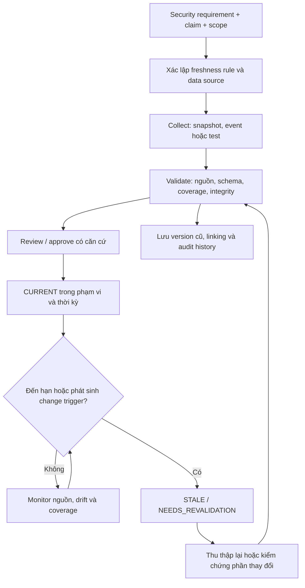
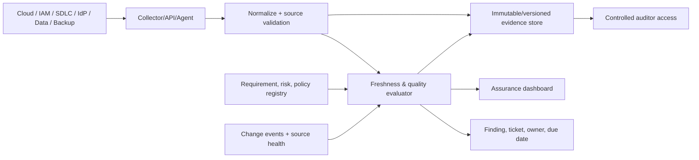

# Evidence freshness: kiểm chứng tính cập nhật của bằng chứng bảo mật

## 1. Evidence freshness là gì?

**Evidence freshness** là mức độ mà một bằng chứng còn **phù hợp về thời điểm** để hỗ trợ một nhận định kiểm soát bảo mật tại thời điểm hoặc trong khoảng thời gian đang được đánh giá. Một tài liệu có thể chính xác khi được tạo nhưng không còn phản ánh hệ thống hiện tại sau thay đổi cấu hình, nhân sự, phiên bản dịch vụ hoặc phạm vi triển khai.

Trong chương **Audit và evidence** của module **SECURITY_SECURITY_ASSURANCE**, evidence freshness giúp trả lời câu hỏi cốt lõi của **security assurance**: “Dựa trên bằng chứng nào, thu thập khi nào và trên phạm vi nào, ta có cơ sở nói security control đang đáp ứng mục tiêu không?” Việc liên kết phân tích rủi ro, security requirements, controls, kiểm thử, audit và remediation chỉ đáng tin khi tổ chức theo dõi được cả **chất lượng lẫn tuổi và hiệu lực của bằng chứng**.

Ví dụ, báo cáo kiểm tra quyền truy cập hôm qua có thể đã lỗi thời nếu sáng nay một service account được cấp quyền quản trị. Ngược lại, báo cáo DR test ba tháng trước chưa chắc mất giá trị chỉ do tuổi tài liệu nếu hệ thống, dữ liệu, điều kiện kiểm thử và yêu cầu đánh giá không thay đổi; tuy nhiên nó vẫn có giới hạn vì chỉ chứng minh kịch bản tại thời điểm thử. Điều cần đánh giá là **khả năng bằng chứng còn đại diện cho claim**, không chỉ số ngày trên tên tệp.

Một tệp audit được tải xuống lúc 10:00 không đương nhiên có dữ liệu cập nhật tới 10:00; nội dung bên trong có thể được trích xuất từ snapshot tuần trước. Đây là một trong những lỗi phổ biến nhất khi đánh giá evidence freshness.

### Mục tiêu học tập

Sau bài này, người học có thể:

1. Phân biệt freshness, validity, relevance, completeness, accuracy, integrity và provenance của bằng chứng.
2. Đọc đúng các mốc thời gian: sự kiện xảy ra, dữ liệu được quan sát, thu thập, xác minh, có hiệu lực và hết hiệu lực.
3. Xác định giới hạn tuổi và chu kỳ làm mới bằng chứng theo rủi ro và đặc điểm control.
4. Thiết kế metadata, trạng thái và quy trình thu thập bằng chứng có thể kiểm toán.
5. Thiết lập các trigger khi thay đổi hệ thống khiến bằng chứng cần được đánh giá lại.
6. Kiểm thử và báo cáo bằng chứng `CURRENT`, `STALE`, `MISSING`, `OUT_OF_SCOPE` hoặc `UNVERIFIED` một cách có căn cứ.
7. Xây dựng chương trình continuous assurance dùng metrics, kiểm tra nguồn và evidence lịch sử.

## 2. Freshness không đồng nghĩa với chất lượng tổng thể

Một bằng chứng hỗ trợ nhận định bảo mật phải vượt qua nhiều câu hỏi độc lập:

| Thuộc tính | Câu hỏi đánh giá | Ví dụ |
| --- | --- | --- |
| **Freshness** | Bằng chứng có đủ mới cho thời điểm và mức độ biến động của control? | IAM snapshot lấy trước đợt cấp quyền hàng loạt |
| **Validity** | Bằng chứng có còn hiệu lực và còn được phép sử dụng làm căn cứ? | Chứng nhận hết hạn hoặc ngoại lệ đã hết thời hạn |
| **Relevance** | Bằng chứng có trực tiếp hỗ trợ đúng security requirement? | Báo cáo backup không chứng minh restore an toàn |
| **Scope** | Có bao phủ đúng service, tenant, region, phiên bản và môi trường? | Pentest web frontend không bao phủ API mới |
| **Completeness** | Có đủ khoảng thời gian, đối tượng, trường và nguồn cần thiết? | Chỉ lấy log từ một trong ba cloud account |
| **Accuracy** | Dữ liệu có phản ánh sự kiện/trạng thái đúng? | Agent gắn sai `actor_id` vào sự kiện |
| **Integrity** | Nội dung có được bảo vệ khỏi thay đổi trái phép? | File có hash nhưng bản gốc không được bảo vệ |
| **Provenance** | Nguồn phát, cách lấy và chuỗi xử lý có truy ngược được? | Event được thu từ API nào, bởi collector nào |
| **Reproducibility** | Reviewer khác có thể lặp lại truy vấn/phép đo hợp lệ? | Có query version, input và quyền truy cập phù hợp |
| **Sufficiency** | Tổng bằng chứng có đủ để kết luận trong phạm vi đã nêu? | Có cấu hình MFA và test thực tế với người dùng đặc quyền |

**Bằng chứng mới chưa chắc đúng; bằng chứng cũ chưa chắc sai.** Freshness là một chiều đánh giá. Một screenshot chụp hôm nay nhưng bị cắt phần tenant/region có thể kém tin cậy hơn một bản export có chữ ký, scope và timestamp chính xác. Một audit report được phát hành tháng này có thể chỉ kiểm tra kỳ trước.

Phân biệt ba phát biểu:

- **“Control có tồn tại”**: ví dụ một policy cấu hình yêu cầu MFA.
- **“Control đã hoạt động tại thời điểm X”**: ví dụ thử đăng nhập đặc quyền không có MFA đã bị chặn vào X.
- **“Control đã vận hành liên tục trong khoảng [X, Y]”**: cần nguồn dữ liệu và phương pháp có khả năng hỗ trợ **cả khoảng**, không chỉ một ảnh chụp cuối kỳ.

Giá trị của bằng chứng phải tương xứng với loại claim, thời kỳ và độ tin cậy của nguồn.

## 3. Hiểu đúng các mốc thời gian của evidence

Những trường thời gian khác nhau thường bị gom nhầm vào `created_at`, dẫn tới kết luận freshness sai.

| Mốc thời gian | Ý nghĩa | Lưu ý |
| --- | --- | --- |
| `event_time` | Khi hành động/trạng thái liên quan thực sự xảy ra | Có thể lệch giờ trên producer |
| `observed_at` | Khi nguồn/agent quan sát trạng thái | Không phải lúc analyst tải file |
| `source_updated_at` | Khi nguồn nội dung được cập nhật lần cuối, nếu có | Có thể không phản ánh mọi thay đổi runtime |
| `collected_at` | Khi hệ thống assurance thu thập bản ghi | Chỉ phản ánh thời điểm thu thập |
| `ingested_at` | Khi pipeline evidence nhận dữ liệu | Dùng đo độ trễ vận chuyển |
| `verified_at` | Khi nội dung/phạm vi được kiểm tra | Không có nghĩa trạng thái vẫn đúng sau đó |
| `effective_from` | Thời điểm policy, ngoại lệ hay chứng chỉ bắt đầu có hiệu lực | Có thể khác ngày tài liệu được tạo |
| `effective_until` | Thời điểm hiệu lực kết thúc theo nguồn/chính sách, nếu có | Không tự đồng nghĩa `freshness_due` |
| `period_start`, `period_end` | Kỳ bằng chứng được thiết kế để bao phủ | Quan trọng với kiểm toán operating effectiveness |
| `freshness_due_at` | Mốc phải làm mới hoặc tái xác minh theo chính sách nội bộ | Cần xem xét thêm change triggers |
| `superseded_at` | Khi bằng chứng đã bị thay thế bởi phiên bản/mốc mới | Lưu bản cũ cho claim lịch sử khi thích hợp |

### 3.1. Ví dụ về ba “ngày mới nhất”

Một SOC export log lúc **2026-11-28 10:00 UTC**. File được tạo lúc 10:00, nhưng truy vấn chỉ bao phủ các event đến 09:40 do collector gián đoạn; analyst review file lúc 10:10.

- `collected_at = 10:00`
- `period_end = 09:40`
- `verified_at = 10:10`
- `ingestion_gap = 20 phút` tại thời điểm export

Nếu requirement cần biết hoạt động đặc quyền tới 10:00 với độ trễ chấp nhận tối đa 5 phút, export này **không đủ fresh về coverage**, dù nó vừa được tải và vừa được review. Khi nguồn phục hồi, cần bù dữ liệu, kiểm tra sự kiện thiếu và phát hành evidence mới.

### 3.2. Ảnh chụp và khoảng thời gian vận hành

- **Point-in-time evidence**: chứng minh trạng thái tại một thời điểm, ví dụ IAM policy snapshot lúc 09:00.
- **Period evidence**: hỗ trợ kết luận trong một khoảng, ví dụ log mọi thay đổi quyền và bản ghi access review trong quý.
- **Design evidence**: mô tả control dự định hoạt động như thế nào, ví dụ security standard.
- **Operating evidence**: minh họa/đo control thực sự vận hành, ví dụ kết quả MFA negative test, ticket đã được phê duyệt hoặc log ghi nhận deny.

Một tài liệu policy được cập nhật hôm nay là *design evidence mới*; nó không tự chứng minh access review đã xảy ra đúng hạn trong quý trước. Audit cần xác định bằng chứng nào trả lời câu hỏi **thiết kế**, **triển khai**, hay **hiệu lực vận hành**.

## 4. Freshness là quan hệ giữa claim, thời điểm và rủi ro

Không có một ngưỡng tuổi bằng chứng áp dụng cho tất cả security controls. Tốc độ thay đổi của hệ thống và hậu quả nếu control mất hiệu lực là hai yếu tố quan trọng.

| Loại control | Nhịp thay đổi điển hình | Rủi ro dùng bằng chứng cũ | Hướng đánh giá |
| --- | --- | --- | --- |
| IAM/privileged access | Quyền có thể thay đổi từng phút | Một quyền mới được cấp sau snapshot | Tự động lấy event/config, giám sát thay đổi, kiểm tra trực tiếp |
| Cloud configuration | Deployment và policy thay đổi thường xuyên | Security group hoặc logging bị tắt sau kiểm tra | Drift detection, event triggers và snapshot theo phiên bản |
| Vulnerability remediation | Findings thay đổi theo release/patch | Scan cũ không bao phủ artifact đang chạy | Gắn bằng chứng với build/version, asset inventory và trạng thái fix |
| Secure code review | Theo commit/change | Review cũ không áp dụng cho commit mới | Evidence theo commit, branch và pipeline run |
| Backup/restore | Backup có thể chạy hằng ngày, restore test theo kế hoạch | Job thành công nhưng restore thất bại khi cần | Theo dõi backup hằng lần và diễn tập restore theo rủi ro |
| Disaster recovery | Kiến trúc thay đổi theo tháng/quý hoặc event lớn | RTO test cũ bỏ qua dependency mới | Review kịch bản và test khi thay đổi kiến trúc quan trọng |
| Security policy | Thường thay đổi chậm hơn runtime | Policy không phản ánh control hiện hành | Periodic owner review + trigger sau thay đổi luật/rủi ro |
| Third-party assurance | Theo kỳ báo cáo, hợp đồng và đổi dịch vụ | Báo cáo độc lập không bao phủ tính năng/subprocessor mới | Kiểm tra kỳ, scope, ngoại lệ và bridge evidence |
| Incident response | Theo con người, tooling và runbook | On-call contact và playbook không còn dùng được | Tabletop, kiểm tra kênh gọi và review khi đổi đội |

Các nhịp trên chỉ để gợi ý cách suy nghĩ. Mỗi tổ chức phải quyết định ngưỡng từ **risk assessment, criticality, cam kết, khả năng quan sát và yêu cầu kiểm toán thực sự**.

### 4.1. Một mô hình chọn freshness policy

Đặt cho từng `requirement_id`:

1. **Claim type:** trạng thái hiện tại, bằng chứng vận hành theo kỳ, kết quả test hoặc chứng nhận.
2. **Impact:** hậu quả nếu control không hoạt động mà chưa được phát hiện.
3. **Change rate:** mức biến động thực tế của tài sản, policy, release và con người.
4. **Detection dependence:** bằng chứng mới bị phụ thuộc vào pipeline/log source nào?
5. **Time sensitivity:** mục tiêu giám sát hoặc quyết định cần dữ liệu gần thời gian thực đến đâu?
6. **Contractual/regulatory cadence:** yêu cầu phải cập nhật theo thời hạn nào nếu áp dụng.
7. **Change triggers:** sự kiện nào làm mất khả năng đại diện của bằng chứng trước hạn định kỳ.
8. **Failure handling:** ai xử lý khi bằng chứng stale, thiếu hoặc không kiểm chứng được.

Ví dụ tổ chức *có thể* đặt chính sách nội bộ yêu cầu snapshot đặc quyền mỗi 24 giờ kết hợp event change liên tục, còn review thiết kế DR theo quý và khi dependency thay đổi. **Đây không phải ngưỡng chuẩn chung**; mục tiêu phải được phê duyệt và đo xem có đủ cho rủi ro đã nhận diện không.

## 5. Công thức freshness và những giới hạn cần tránh

Với evidence về **trạng thái tại một thời điểm**, một cách tính đơn giản là:

\[
\text{Evidence age} = \text{evaluation time} - \text{observation time}
\]

Nếu chính sách đặt `max_age` cho claim, có thể kiểm tra `age <= max_age` **chỉ khi** xác định được observation time đáng tin cậy, đúng phạm vi và không có thay đổi quan trọng xảy ra sau quan sát.

Ví dụ (tất cả là giả định):

- Đánh giá lúc 12:00 UTC; IAM snapshot quan sát lúc 11:50 UTC; `max_age = 30 phút`.
- Tuổi bằng chứng là 10 phút, thỏa điều kiện tuổi.
- Nhưng lúc 11:55 có event thay đổi role admin không được phản ánh trong snapshot. Snapshot **không còn đại diện cho trạng thái hiện tại**, dù tuổi chưa vượt ngưỡng.

Do đó, điều kiện thời gian phải kết hợp **change invalidation**, kiểm tra nguồn và scope; không thể kết luận `CURRENT` chỉ từ phép trừ timestamp.

Với **period evidence**, đừng lấy ngày file được tải làm tham số duy nhất. Ví dụ đánh giá logging từ 01/10 đến 31/10 yêu cầu coverage toàn kỳ đó. Một export tạo ngày 28/11 nhưng chỉ chứa 15–31/10 vẫn thiếu nửa đầu kỳ. Nếu yêu cầu chứng minh “đã theo dõi liên tục tới ngày hôm nay”, cần thêm bằng chứng đủ mới của những ngày sau 31/10.

### 5.1. Freshness lag và freshness age là hai đại lượng khác nhau

- **Age**: đã bao lâu kể từ lúc trạng thái được quan sát/kiểm thử.
- **Ingestion lag**: chênh lệch giữa khi sự kiện xảy ra và khi pipeline nhận được.
- **Coverage gap**: khoảng thời gian hoặc đối tượng chưa có evidence hợp lệ.
- **Verification lag**: thời gian từ khi thu thập tới khi một phép kiểm tra/đánh giá được thực hiện.

Ví dụ collector nhận log chậm 40 phút có thể làm data freshness không đạt, dù asset được scan lại mỗi 5 phút. Ngược lại, collector khỏe nhưng không còn quyền truy cập một cloud account vẫn để lại **coverage gap** cần phát hiện.

## 6. Metadata chuẩn cho evidence catalog

Một hệ thống audit có thể quản lý nhiều nghìn artifacts. Nếu không có metadata, không biết artifact nào còn dùng được cho yêu cầu nào, vào thời kỳ nào và ai sở hữu.

| Nhóm metadata | Các trường tối thiểu cần cân nhắc |
| --- | --- |
| **Identity** | `evidence_id`, `control_id`, `requirement_id`, `claim_id`, `version` |
| **Scope** | `service`, `environment`, `tenant/region/account`, `asset_ids`, `population` |
| **Time** | `period_start/end`, `observed_at`, `collected_at`, `verified_at`, `freshness_due_at` |
| **Source/provenance** | `source_system`, `query_id/version`, `collector`, `source_account`, `tool_version` |
| **Protection** | `classification`, `storage_ref`, `integrity_ref`, `retention_rule`, `access_owner` |
| **Quality** | `sample_method`, `coverage`, `missing_sources`, `exceptions`, `assurance_limitations` |
| **Ownership** | `control_owner`, `evidence_owner`, `reviewer`, `approval` |
| **Lifecycle** | `freshness_state`, `supersedes`, `invalidation_event`, `next_review`, `finding_id` |

**Không được đặt secret, token, thông tin truy cập hoặc dữ liệu cá nhân thô vào metadata dùng chung.** Dùng ID tham chiếu ổn định trỏ tới kho evidence có quyền truy cập phù hợp.

### 6.1. Ví dụ metadata YAML

Đây là **mẫu thiết kế**, chưa phải dữ liệu đã được xác minh của một hệ thống thực:

```yaml
evidence_id: EVD-IAM-2026-1128-01
version: "1"
requirement_id: SEC-IAM-PRIV-01
control_id: CTRL-PRIVILEGED-ACCESS
claim:
  type: point_in_time
  statement: "Privileged roles are restricted in production"
scope:
  service: identity-platform
  environment: production
  account_ids:
    - "cloud-account-prod-a"
  population: "All privileged role bindings in this account"
source:
  system: cloud_iam_audit_api
  query_ref: "iam-role-bindings-query-v4"
  collector_id: "security-evidence-collector"
time:
  observed_at: "2026-11-28T09:00:00Z"
  collected_at: "2026-11-28T09:02:00Z"
  verified_at: "2026-11-28T09:07:00Z"
  freshness_due_at: "2026-11-29T09:00:00Z"
quality:
  scope_verified: true
  completeness: "Evaluated only for listed cloud account"
  change_monitor: "iam-change-stream-v2"
  open_exceptions: []
protection:
  classification: "confidential-security"
  artifact_ref: "evidence-store://iam/evd-1128-01"
  integrity_ref: "sha256:stored-separately-in-verified-record"
lifecycle:
  state: "CURRENT_AS_OF_OBSERVATION"
  next_action: "Re-evaluate on relevant IAM change"
owner:
  collection: "security-platform-team"
  review: "security-assurance-team"
```

Định dạng `evidence-store://...` và hash là giá trị minh họa; hệ thống thật phải sử dụng locator và digest hợp lệ. Trường `scope_verified: true` chỉ có ý nghĩa khi gắn với **kết quả kiểm tra thực tế**, không được tự điền để vượt quy trình.

Một metadata record có thể nói “CURRENT_AS_OF_OBSERVATION” nhưng vẫn chưa đủ chứng minh **hiệu quả hoạt động liên tục**. Claim phải ghi rõ trạng thái tại thời điểm, và nếu muốn nói “hiện tại”, phải đánh giá thêm những thay đổi sau thời điểm snapshot.

## 7. Lifecycle của bằng chứng và khi nào cần làm mới



### 7.1. Trạng thái có nghĩa vụ xử lý rõ

| Trạng thái | Ý nghĩa | Hành động |
| --- | --- | --- |
| `CURRENT` | Đã kiểm tra age, scope, validity, source health và change triggers theo claim | Cho phép sử dụng theo phạm vi/giới hạn |
| `STALE` | Quá hạn hoặc có thay đổi khiến evidence không còn đại diện cho claim hiện tại | Làm mới/kiểm chứng lại, ghi khoảng trống assurance |
| `MISSING` | Chưa có evidence cần thiết cho control/period/scope | Thu thập, khôi phục nguồn, escalation |
| `UNVERIFIED` | Có artifact nhưng nguồn/phạm vi/độ đúng chưa được xác minh | Review, test hoặc lấy evidence thay thế |
| `OUT_OF_SCOPE` | Evidence không bao phủ claim đang hỏi | Không dùng để suy ra PASS, tìm nguồn khác |
| `INVALID` | Có dấu hiệu sai nội dung, tamper hoặc không đáp ứng tiêu chí | Quarantine và điều tra nguyên nhân |
| `EXPIRED` | Hết hiệu lực theo chính sách/chứng nhận/hợp đồng | Yêu cầu bằng chứng hoặc quyền sử dụng mới |
| `SUPERSEDED` | Bị thay bằng version mới cho cùng claim | Giữ bản lịch sử theo retention, dùng version phù hợp thời điểm |

Có thể triển khai trạng thái theo hai chiều: `freshness_status` và `validity_status`, cộng với `quality_status`. Ví dụ một báo cáo chứng nhận **còn hiệu lực** nhưng **không bao phủ sản phẩm mới** phải mang `validity=VALID`, `scope=OUT_OF_SCOPE`; không nên gộp thành một cờ `is_fresh=true`.

### 7.2. Vì sao vẫn lưu bản cũ?

Evidence được dùng để chứng minh **trạng thái lịch sử**. Khi role được thay đổi hôm nay, snapshot hôm qua không còn chứng minh IAM hiện tại; nhưng có thể vẫn rất quan trọng để điều tra “ai có quyền vào 08:00 hôm qua?”. Vì thế, **supersede** khác với **xóa**, và chính sách retention phải xem xét nhu cầu audit, điều tra, privacy và legal hold.

Không sửa file cũ để làm giống trạng thái mới. Tạo version mới, gắn reference và lịch sử thay đổi.

## 8. Change-trigger invalidation: bằng chứng mất giá trị trước ngày hết hạn

Làm mới theo lịch không đủ với control biến động nhanh. Một thay đổi quan trọng có thể làm evidence cũ **không còn đại diện** dù tuổi còn nhỏ.

| Loại thay đổi | Bằng chứng dễ bị ảnh hưởng | Trigger làm lại kiểm tra |
| --- | --- | --- |
| Cấp hoặc thu hồi role đặc quyền | IAM snapshot, access review | `iam.role_binding_changed` trong phạm vi |
| Thêm production account/region | Cloud configuration inventory | `cloud.account_created` / region enabled |
| Deploy phiên bản ứng dụng mới | Pentest, SAST/DAST, artifact signature | Release/commit mới hoặc đổi API surface |
| Thay policy network hoặc logging | Network segmentation, security logging | Config drift/change event |
| Thêm loại dữ liệu nhạy cảm | Data protection, privacy, retention evidence | Data inventory/classification change |
| Chuyển nhà cung cấp hoặc subprocessor | Third-party assurance, DPA, DR | Contract/data-flow/dependency change |
| Rotate hoặc thay KMS key policy | Encryption/key access evidence | Key/secret policy change |
| Đổi backup topology | RPO/restore/DR evidence | Storage/replication architecture change |
| Sự cố mất log hoặc collector bị tắt | Monitoring và operating evidence | Source last-seen vượt giới hạn |
| Mở finding nghiêm trọng hoặc risk exception | Control effectiveness evidence | Finding/state/approval change |

**Không phải mọi thay đổi đều bắt buộc test lại toàn bộ control.** Dùng impact analysis: xác định control/claim nào bị ảnh hưởng, áp dụng kiểm tra tương ứng, và lưu lý do khi thay đổi không làm mất hiệu lực của evidence.

Ví dụ đổi mô tả trên trang marketing không cần tự động làm lại IAM test nếu không thay đổi boundary; nhưng mở thêm một production account có đặc quyền phải cập nhật scope kiểm tra, dù snapshot cũ chưa tới hạn.

### 8.1. Bằng chứng đã “fresh” rồi nhưng control vừa đổi

Một quy tắc đơn giản:

> Evidence point-in-time chỉ hỗ trợ claim hiện tại nếu nguồn đủ mới, đúng scope **và** không tồn tại thay đổi liên quan chưa được bao phủ kể từ mốc quan sát.

“Không thấy change event” là căn cứ yếu nếu chính nguồn event đang offline. Khi health của change stream mất, cần hạ độ tin cậy hoặc chuyển trạng thái `UNVERIFIED` và thực hiện **full resnapshot** theo rủi ro.

## 9. Quy tắc đánh giá freshness như một phép kiểm tra có thể test

Một bộ kiểm tra cần nhận các dữ liệu đầu vào rõ ràng, thay vì đoán bằng tên tệp:

- Requirement và claim cần hỗ trợ, target `as_of`/audit period.
- Evidence type, scope và observation/coverage interval.
- Freshness policy có phiên bản và hạn tuổi được phê duyệt.
- Thông tin nguồn, completeness, integrity, reviewer status.
- Change events liên quan sau observation và sức khỏe nguồn phát change events.
- Validity window và evidence version hiện tại.

**Pseudo-code** (minh họa tư duy, không phải production implementation):

```text
function evaluateEvidence(evidence, claim, policy, evaluationTime):
    if evidence is absent:
        return MISSING

    if not scopeCovers(evidence.scope, claim.scope):
        return OUT_OF_SCOPE

    if not provenanceVerified(evidence) or not integrityVerified(evidence):
        return UNVERIFIED

    if not coversRequiredPeriod(evidence, claim):
        return MISSING_COVERAGE

    if evidence.effectiveUntil exists and evaluationTime > evidence.effectiveUntil:
        return EXPIRED

    if relevantChangeSinceObservation(evidence, claim):
        return STALE

    if not changeStreamHealthyFor(evidence, claim):
        return UNVERIFIED

    if evidence is pointInTime:
        if observationTimeUnknown(evidence):
            return UNVERIFIED
        if evaluationTime - evidence.observedAt > policy.maxAge:
            return STALE

    if evidence has unreviewed exceptions:
        return REVIEW_REQUIRED

    return CURRENT_WITH_RECORDED_LIMITATIONS
```

Bộ kiểm tra thực tế cần xử lý **event đến muộn**, múi giờ, clock skew, snapshot khớp version và thời điểm đánh giá trong quá khứ. `MISSING_COVERAGE` và `REVIEW_REQUIRED` có thể là reason code thay vì trạng thái chính; quan trọng là lý do **hiển thị cho auditor và owner**, không chỉ boolean.

**Quan trọng:** Kết quả `CURRENT` chỉ có nghĩa *bằng chứng đáp ứng quy tắc thời gian và nguồn theo claim*, không tự suy ra `CONTROL_EFFECTIVE`. Muốn kết luận control effectiveness phải có kiểm tra tiêu chí, sample, exceptions và kết quả phù hợp.

### 9.1. Ba ví dụ cùng một policy

Giả sử chính sách minh họa: bằng chứng privileged-access point-in-time được quan sát trong tối đa 24 giờ, change monitor hoạt động liên tục; scope là toàn bộ account production.

| Evidence | Tình huống lúc đánh giá | Freshness decision |
| --- | --- | --- |
| E1 | Snapshot cách 3 giờ, đủ account, nguồn khỏe, không có thay đổi liên quan | Có thể `CURRENT` trong phạm vi policy |
| E2 | Snapshot cách 30 phút nhưng đã thêm một role admin chưa nằm trong snapshot | `STALE` hoặc `NEEDS_REVALIDATION` do change trigger |
| E3 | Snapshot cách 1 giờ, nhưng collector account B không còn quyền và không có log thay đổi | `MISSING_COVERAGE`/`UNVERIFIED`, không được báo CURRENT toàn hệ thống |

Không thay E2/E3 thành `FAILED_CONTROL` nếu chưa có dữ kiện chứng minh control thực sự vi phạm. Đó là **assurance gap cần xử lý**, có thể dẫn tới kiểm tra control kỹ hơn tùy rủi ro.

## 10. Mô hình continuous evidence collection

Một chương trình security assurance liên tục giảm phụ thuộc vào việc “đến mùa audit mới chụp hình”. Nó thu thập sự kiện và trạng thái theo thiết kế có thể tái lập.



### 10.1. Những nguyên tắc kiến trúc

1. **Data source phải có owner và identity riêng.** Collector chỉ đọc dữ liệu cần thiết; không tự cấp quyền quá rộng.
2. **Ghi mốc thời gian ở từng tầng.** `event_time`, `observed_at`, `collected_at`, `ingested_at` không bị ghi đè lên nhau.
3. **Áp dụng schema có phiên bản.** Trường bắt buộc, scope và định nghĩa giá trị phải được kiểm tra.
4. **Giữ raw reference và bản chuẩn hóa.** Có khả năng truy ngược tới nguồn đáng tin và phát hiện việc chuẩn hóa sai.
5. **Lưu evidence version, policy version, query version.** Reviewer lặp lại được kết luận tại một thời điểm trước đây.
6. **Theo dõi health của pipeline.** Queue lag, last-seen, lỗi xác thực nguồn, schema rejection và số event drop đều là tín hiệu quan trọng.
7. **Chủ động xử lý missing/stale.** Khi quá hạn hoặc có change trigger, tạo finding với owner, impact và deadline.
8. **Bảo vệ dữ liệu bằng quyền tối thiểu.** Evidence thường chứa asset inventory, danh tính, lỗ hổng và đường truy cập nhạy cảm.

### 10.2. Chú ý consistency khi thu thập

Một collector gọi API cho 100 account trong 20 phút không có được **snapshot nguyên tử** của toàn bộ tổ chức. Nếu quyền của account đầu thay đổi trong khi đang quét account cuối, báo cáo có thể trộn trạng thái ở nhiều mốc. Cần ghi `collection_window`, version/resource etag nếu có, hoặc kết hợp snapshot với change stream để phát hiện sự kiện trong cửa sổ thu thập.

Trong hệ thống phân tán, dùng `source_version`, `commit_id`, `resource_generation`, transaction ID hoặc watermark mà hệ thống hỗ trợ để giải thích trạng thái. Nếu không có cơ chế snapshot nhất quán, **công bố giới hạn** và tăng phép đối soát.

## 11. Evidence freshness theo loại security control

### 11.1. IAM và access review

**Claim ví dụ:** mọi tài khoản production có quyền admin được phê duyệt, xác thực phù hợp và được review theo kỳ.

Bằng chứng khác nhau cho các lớp claim:

| Bằng chứng | Hỗ trợ điều gì? | Khi nào cần làm mới? |
| --- | --- | --- |
| IAM bindings snapshot | Ai có role tại `observed_at` | Khi role/actor/account thay đổi hoặc vượt age |
| Provisioning/approval ticket | Quyền cụ thể có căn cứ phê duyệt | Khi actor, role, scope, thời hạn hoặc approval thay đổi |
| Access review record | Một đợt review đã thực hiện trên population nào | Khi hết kỳ, population thay đổi đáng kể hoặc phát hiện scope thiếu |
| Authn/MFA audit | MFA có được dùng/đòi hỏi trong các phiên đã chọn | Theo khoảng log và nguồn IdP; không chứng minh mọi tài khoản chỉ bằng vài phiên |
| Negative test | Truy cập đặc quyền trái điều kiện bị chặn ở thời điểm test | Khi policy/auth flow/version đổi hoặc tới lịch kiểm thử |

Ví dụ một file access review được duyệt tuần trước có thể vẫn chứng minh **review đã diễn ra** trong kỳ; nhưng không chứng minh **không có quyền admin mới được cấp sau review**. Cần bổ sung event cấp quyền hoặc snapshot/monitoring.

### 11.2. Vulnerability và secure development

Một báo cáo scan nói ứng dụng phiên bản 1.4 không có lỗ hổng nghiêm trọng theo bộ rule tại thời điểm scan. Sau khi deploy 1.5, bằng chứng cho 1.4 không thể mặc nhiên hỗ trợ claim cho 1.5. Gắn test result với **artifact digest, commit, dependency set, scanner version, environment và scope**.

Nếu scanner cập nhật signature/threat intelligence, một scan cũ vẫn là dữ kiện lịch sử nhưng có thể cần quét lại theo policy. Một vulnerability bị đánh dấu “fixed” phải có bằng chứng phiên bản đã được triển khai tới asset liên quan, không chỉ ticket đã đóng.

### 11.3. Logging, detection và incident response

- Log sample mới có thể chứng minh một loại event được phát và tới kho ở thời điểm thử; chưa chứng minh log **không bị mất** trong toàn kỳ.
- Rule detection từng phát cảnh báo trong diễn tập phải được đánh giá lại khi schema, nguồn, threshold hoặc suppression thay đổi.
- On-call roster được xác nhận tháng trước có thể không còn đúng sau thay ca; cần kiểm tra liên hệ và đường escalation thực tế.
- Báo cáo incident response tabletop còn hữu ích cho scenario đã diễn tập, nhưng cần tái đánh giá khi tool, nhà cung cấp hoặc nhân sự thay đổi.

Theo dõi **freshness của nguồn log** riêng với **freshness của báo cáo kiểm tra rule**. Một rule có kết quả test mới nhưng upstream data đã ngừng vẫn không tạo assurance về coverage hiện tại.

### 11.4. Backup và disaster recovery

Một backup job thành công hôm nay có thể giúp chứng minh lịch tạo backup; **restore test** cách hai tháng giúp biết khả năng khôi phục đã hoạt động lúc thử trong kịch bản cụ thể. Hai bằng chứng không thay thế nhau. Sau đổi KMS, storage region, replication topology hoặc định dạng database, cần xem xét lại khả năng restore và key availability.

Kết quả RTO/RPO phải ghi môi trường, tải, dữ liệu, dependency và các điểm không được thử. Không tái sử dụng DR report cũ để tuyên bố mục tiêu recovery hiện tại đã được chứng minh nếu service scope hoặc mục tiêu nghiệp vụ đã thay đổi.

### 11.5. Third-party assurance

Một báo cáo SOC 2 Type II có thể được phát hành gần đây nhưng mô tả **kỳ kiểm soát đã kết thúc nhiều tháng trước**. Một chứng chỉ ISO/IEC 27001 còn hiệu lực có thể không bao phủ sản phẩm hoặc region mới. Cần kiểm tra: pháp nhân, sản phẩm, phạm vi, thời kỳ, ngoại lệ, nhà cung cấp phụ và những control khách hàng tự chịu trách nhiệm.

`report_issued_at` và `audit_period_end` là hai mốc khác nhau. Khi có incident trọng yếu, thay subprocessor hay thay phạm vi xử lý dữ liệu, cần đánh giá **bridge evidence** hoặc review bổ sung theo thỏa thuận; không gọi mọi tài liệu “mới nhận” là đủ fresh.

## 12. Sampling, coverage và điểm mù của bằng chứng

Thực tế không phải control nào cũng cho phép kiểm tra toàn bộ population. Sampling có thể hợp lý nếu mục tiêu, rủi ro và tiêu chí đánh giá cho phép. Nhưng **một mẫu mới** vẫn có thể **không đại diện**.

Ví dụ trong tháng có 20.000 lần cấp quyền truy cập, đội audit chọn 50 giao dịch để kiểm tra. Cần biết:

- Population được định nghĩa ra sao; có bao gồm mọi environment/tenant và kiểu tài khoản không?
- Cách chọn mẫu: ngẫu nhiên, phân tầng theo rủi ro, hay chủ đích chọn đặc quyền?
- Có loại trừ những giao dịch không có approval ID hoặc hệ thống mới không?
- Khoảng thời gian của mẫu có bao phủ giai đoạn đánh giá không?
- Có dữ liệu bị mất, late arrival hoặc duplicate khiến population thiếu/sai không?
- Với kết quả mẫu, có được phép suy ra điều gì về toàn population theo phương pháp đã duyệt?

**Freshness không sửa được sampling bias.** Chọn 50 record mới nhất có thể bỏ qua toàn bộ rủi ro xảy ra đầu kỳ. Đối với control có rủi ro cao, có thể cần kiểm tra 100% event của nhóm đặc quyền thay vì dùng mẫu chung cho mọi user.

### 12.1. Late-arriving events và backfill

Event xảy ra trong kỳ kiểm toán nhưng tới collector sau khi báo cáo đã được đóng vẫn phải được xử lý theo quy tắc. Có thể dùng watermark và **khoảng trễ cho phép** để quyết định khi nào evidence đủ hoàn tất theo nguồn. Khi backfill bổ sung dữ liệu, cần ghi version mới và xem lại các kết luận đã bị ảnh hưởng; không âm thầm sửa snapshot cũ.

Nếu một giai đoạn mất log không thể phục hồi, phải nêu rõ **coverage gap**; không thể lấy timestamp hiện tại của bản export để che thời gian thiếu.

## 13. Bảo vệ evidence và khả năng tái hiện kết luận

Evidence thường tiết lộ topology cloud, quyền admin, kết quả pentest, tài khoản, incident và cấu hình security. Một kho evidence thiếu quyền và retention có thể trở thành nguồn rò rỉ nghiêm trọng.

| Biện pháp | Vai trò |
| --- | --- |
| **Least-privilege access** | Chỉ người có quyền review hoặc xử lý mới xem dữ liệu phù hợp |
| **Encryption in transit/at rest** | Bảo vệ nội dung khi truyền và lưu |
| **Immutable/versioned storage khi cần** | Hạn chế xóa/sửa bản đã dùng cho kết luận |
| **Integrity check** | Phát hiện thay đổi bất thường trong nội dung artifact |
| **Provenance chain** | Chỉ ra nguồn, collector, transformation và người phê duyệt |
| **Access/export audit** | Biết ai xem, xuất hoặc thay đổi bằng chứng |
| **Retention & legal hold** | Giữ đúng thời hạn, có kiểm soát xóa và ngoại lệ |
| **Sanitization/redaction** | Loại token, secret, PII không cần thiết trước khi chia sẻ |
| **Versioned queries & policies** | Có thể lặp lại kiểm tra hoặc giải thích quyết định lịch sử |

**Hash không tự chứng minh nguồn đáng tin.** Nếu collector đã bị compromise và tạo evidence giả rồi hash, digest chỉ chứng minh artifact không đổi từ lúc đó. Cần xác thực nguồn, quyền và đối chiếu độc lập khi rủi ro cao.

**Freshness không được đánh đổi bằng quyền truy cập quá mức.** Thu thập liên tục không biện minh cho việc sao chép toàn bộ request body chứa dữ liệu nhạy cảm vào kho audit; nên chọn tối thiểu những trường cần thiết và dùng tham chiếu tới evidence bảo vệ tốt hơn.

## 14. Governance: ai sở hữu tuổi thọ của bằng chứng?

Nếu không có người chịu trách nhiệm, evidence có thể bị stale hàng tháng mà dashboard vẫn xanh vì chỉ đo “đã upload”.

| Vai trò | Trách nhiệm |
| --- | --- |
| **Control owner** | Giải thích control, phạm vi, trạng thái và thay đổi ảnh hưởng |
| **Evidence producer/collector owner** | Duy trì nguồn, schema, lịch thu thập, health và phục hồi pipeline |
| **Assurance reviewer** | Đánh giá claim, freshness, scope, chất lượng và exceptions |
| **Risk owner** | Quyết định xử lý rủi ro khi assurance gap kéo dài theo thẩm quyền |
| **Audit/compliance coordinator** | Điều phối yêu cầu bằng chứng, kỳ đánh giá và quyền truy cập |
| **Security/platform operations** | Xử lý lỗi hệ thống, drift, thay đổi IAM/CI/CD hoặc data source |
| **Legal/privacy (khi cần)** | Xác định retention, phạm vi chia sẻ và yêu cầu bảo toàn chứng cứ |

Một freshness policy nên có `owner`, `review_due`, `escalation_target`, `max_age`, `change_triggers`, `scope`, `failure_behavior` và `approval`. Nếu quy định yêu cầu cập nhật hằng ngày nhưng nguồn bị tắt suốt tuần, cần mở finding và cảnh báo chủ sở hữu, không được tự gia hạn `freshness_due_at` để khôi phục tỷ lệ đẹp.

### 14.1. Phân biệt rủi ro control và rủi ro assurance

- **Control failure:** phát hiện RBAC cho phép actor trái quyền; có bằng chứng control thực sự không đạt.
- **Assurance gap:** không thu được log/trạng thái để biết RBAC có đạt hay không.
- **Control at risk:** bằng chứng cho thấy điều kiện xấu có thể xuất hiện, như khả năng tắt audit từ role không được phê duyệt.

Ba trạng thái có thể cùng tồn tại nhưng cần báo cáo riêng. Một risk acceptance chỉ cho phép vận hành trong phạm vi nhất định; nó **không chuyển evidence `MISSING` thành `VERIFIED`**.

## 15. Ví dụ xuyên suốt: đánh giá freshness cho kiểm soát IAM

### 15.1. Bối cảnh

Nền tảng SaaS đa tenant có ba production account: `prod-a`, `prod-b`, `prod-c`. Control yêu cầu **mọi quyền quản trị production đều được cấp có phê duyệt và có thể truy vết**. Chương trình assurance dùng:

1. Snapshot IAM mỗi ngày.
2. Luồng event thay đổi role gần thời gian thực.
3. Bản ghi phê duyệt từ hệ thống change management.
4. Test phân quyền trái phép theo lịch và sau thay đổi policy quan trọng.

Giả định tại thời điểm đánh giá **2026-11-28 12:00 UTC**, freshness policy nội bộ cho snapshot là 24 giờ kèm change monitoring.

### 15.2. Các sự kiện và bằng chứng

| Thời điểm UTC | Dữ kiện | Ý nghĩa |
| --- | --- | --- |
| 27/11 12:30 | Snapshot cả ba account được thu thập và kiểm tra | Tuổi < 24h tại 28/11 12:00, nếu không có vấn đề khác |
| 28/11 08:05 | Role admin mới được cấp trong `prod-b` | Snapshot cũ thiếu một thay đổi cần kiểm tra |
| 28/11 08:10 | Approval system không tìm được ticket tương ứng | Có thể là control exception; phải điều tra |
| 28/11 09:15 | Collector `prod-c` mất quyền truy cập audit | Không còn xác định đủ coverage sau mốc này |
| 28/11 11:30 | Snapshot mới cho `prod-a`/`prod-b`, không có `prod-c` | Bằng chứng mới nhưng thiếu scope |
| 28/11 12:00 | Reviewer mở dashboard | Không thể kết luận ba account đều đạt |

### 15.3. Phân tích đúng

`prod-a` có snapshot mới 11:30 và change monitor còn hoạt động: có thể dùng để hỗ trợ claim trong phạm vi `prod-a`, nếu mọi kiểm tra khác đạt.

`prod-b` có snapshot mới 11:30 chứa role admin vừa cấp. Bằng chứng **fresh về trạng thái**, nhưng control có thể **không đạt** vì thiếu approval: yêu cầu điều tra, đối chiếu nguồn, mở finding nếu xác nhận vi phạm. Không xem “fresh” là “compliant”.

`prod-c` không được kiểm tra đầy đủ kể từ khi collector mất quyền. Bằng chứng còn lại có thể hỗ trợ trạng thái lịch sử, nhưng **không đủ xác nhận hiện tại** cho toàn account. Ghi `MISSING_COVERAGE`/`UNVERIFIED`, khôi phục nguồn và backfill nếu có thể.

**Kết luận assurance phù hợp:**

> Tại 12:00 UTC ngày 28/11, evidence cập nhật hỗ trợ đánh giá quyền quản trị của `prod-a` và `prod-b` trong các điều kiện đã kiểm tra. `prod-b` có một thay đổi role đang chờ xác nhận phê duyệt; `prod-c` thiếu coverage từ 09:15 do lỗi quyền collector. Chưa đủ bằng chứng để kết luận control đạt trên toàn bộ ba account.

Báo cáo phải có evidence IDs, query version, mốc thời gian, người kiểm tra, kết quả điều tra approval và finding xử lý sự cố collector.

### 15.4. Hành động khắc phục

1. Điều tra `prod-b`: xác minh actor, role, approval và lý do thay đổi; nếu trái phép thì xử lý control failure và hậu quả.
2. Khôi phục quyền thu thập tối thiểu cho `prod-c`, lấy snapshot hiện tại và cố gắng backfill audit.
3. Kiểm tra lý do collector mất quyền; audit sự kiện thay đổi quyền collector và thêm alert data health.
4. Cập nhật report bằng version mới khi có bằng chứng; giữ bản đánh giá 12:00 để bảo toàn lịch sử.
5. Đối chiếu mọi production account còn nằm trong inventory; sửa logic coverage để tài khoản không có dữ liệu không bị coi là compliant.

## 16. Các chỉ số giám sát evidence freshness

Dashboard nên phục vụ **quyết định xử lý khoảng trống assurance**, không chỉ đếm bao nhiêu file đã tải.

| Chỉ số | Cách định nghĩa | Lưu ý |
| --- | --- | --- |
| **Freshness compliance rate** | Số evidence cần thiết đạt freshness policy / tổng evidence trong phạm vi đã yêu cầu | Không bỏ mục `MISSING` khỏi mẫu số |
| **Coverage completeness** | Số asset/account/period có evidence hợp lệ / tổng population bắt buộc | Có thể phải phân theo tier và nguồn |
| **Evidence age distribution** | Phân bố tuổi kể từ `observed_at`, theo control/risk | Tuổi chỉ phù hợp với point-in-time |
| **Collection/ingestion lag** | Độ trễ nguồn → collector → store | Dữ liệu mới tải nhưng event cũ vẫn trễ |
| **Stale time to remediation** | Thời gian từ cảnh báo stale đến khi evidence được xác minh lại | Cần phân biệt remediation thực với tự gia hạn |
| **Change-trigger processing lag** | Thời gian từ thay đổi liên quan đến việc đánh giá lại claim | Change stream mất thì metric có thể không phản ánh đúng |
| **Unknown/unverified count** | Bằng chứng hiện không thể xác nhận nguồn/phạm vi | Một chỉ số chất lượng chứ không chỉ khối lượng |
| **Source health/last-seen** | Collector/API còn đủ quyền và nhận được dữ liệu | Không suy luận “không thay đổi” từ event stream im lặng |
| **Version and review traceability** | Tỷ lệ claim có query/policy version và reviewer | Tệp mới không có provenance vẫn kém |
| **High-risk open gaps** | Khoảng trống về controls trọng yếu chưa xử lý | Cần owner, tuổi tồn đọng và deadline |

### 16.1. Công thức tỷ lệ cần minh bạch

Giả sử chương trình có 100 hạng mục evidence bắt buộc cho kỳ đánh giá. Trong đó 75 đạt freshness policy, 10 stale, 8 missing, 4 out of scope và 3 unverified. **Freshness coverage đạt 75/100 = 75%** nếu policy tính toàn bộ evidence bắt buộc vào mẫu số.

Nếu dashboard chỉ tính 85 hạng mục thuộc hai nhóm `CURRENT` và `STALE` rồi báo 75/85 ≈ 88,2%, con số đó đã loại khỏi mẫu số 8 missing, 4 out of scope và 3 unverified. Vì vậy phải công bố **cách chọn mẫu số, các trạng thái bị loại trừ và mục đích metric**.

Không dùng “số evidence tươi” thay cho số **security controls hiệu quả**: một control có thể được hỗ trợ bởi nhiều artifacts, và một artifact có thể hỗ trợ nhiều claims khác nhau.

## 17. Thiết kế test và ma trận assurance

Mỗi freshness rule phải có test cho dữ liệu mới, cũ, thiếu, trễ và thay đổi scope. Phép thử không cần can thiệp destructive vào production; có thể dùng dữ liệu mô phỏng, replay có phiên bản và test read-only ở môi trường phù hợp.

| Test ID | Tình huống | Kết quả mong đợi |
| --- | --- | --- |
| **EF-01** | Snapshot đúng scope và age, source health tốt | `CURRENT` chỉ với claim đã kiểm tra |
| **EF-02** | Snapshot quá `max_age` | `STALE`, tạo yêu cầu refresh |
| **EF-03** | Evidence mới nhưng thiếu một production account | `MISSING_COVERAGE`, không kết luận toàn phạm vi |
| **EF-04** | Thay đổi IAM sau snapshot trong khoảng age cho phép | Bị invalidated/revalidation theo trigger |
| **EF-05** | Change monitor mất quyền, event stream im lặng | `UNVERIFIED`/data health alert |
| **EF-06** | Báo cáo phát hành hôm nay nhưng audit period kết thúc trước kỳ cần đánh giá | `OUT_OF_SCOPE` hoặc period gap |
| **EF-07** | Điều khoản/chứng nhận đã hết hiệu lực | `EXPIRED` dù file được upload lại |
| **EF-08** | Log event đến muộn sau khi audit report tạo | Version mới, cập nhật phạm vi/kết luận khi cần |
| **EF-09** | Artifact sai hash hoặc provenance không xác minh | `INVALID`/quarantine và review |
| **EF-10** | Tài liệu cũ được supersede bởi version mới | Claim hiện tại dùng bản mới; bản cũ lưu lịch sử |
| **EF-11** | Chính sách freshness đổi từ 24 giờ sang 6 giờ sau đánh giá rủi ro | Re-evaluate theo policy version và thời điểm hiệu lực |
| **EF-12** | Collector có data mới nhưng không phát hiện `prod-c` | Scope completeness fail; cảnh báo không bị che bởi age thấp |
| **EF-13** | Control đã đổi nhưng không còn phát event | Periodic resnapshot/drift test phát hiện điểm mù |
| **EF-14** | Evidence được refresh nhưng reviewer chưa xác nhận exception nghiêm trọng | `REVIEW_REQUIRED`, không tự báo control PASS |

### 17.1. Ma trận yêu cầu – control – bằng chứng

| Mã | Yêu cầu assurance | Control/thiết kế | Evidence và kiểm tra |
| --- | --- | --- | --- |
| `AE-FR-01` | Evidence gắn với thời gian và phạm vi rõ | Schema metadata bắt buộc | Validate `observed_at`, period, account và claim ID |
| `AE-FR-02` | Bằng chứng rủi ro cao không stale không phát hiện | TTL + change triggers + source health | Replay EF-02/04/05 và alert ID |
| `AE-FR-03` | Thiếu nguồn không bị coi là PASS | Coverage inventory/heartbeat | EF-03/12, report missing count |
| `AE-FR-04` | Reviewer có thể tái dựng kết luận lịch sử | Query, policy, evidence version, immutability | Rerun audit sample, so timestamp/versions |
| `AE-FR-05` | Evidence được bảo vệ theo phân loại | RBAC, encryption, access audit | Negative read/export test |
| `AE-FR-06` | Findings được xử lý tới khi kiểm chứng lại | Owner, deadline, risk acceptance, retest | Ticket lifecycle và link report mới |
| `AE-FR-07` | Tài liệu hết hiệu lực không dùng để chứng minh hiện tại | Validity check, supersession | EF-07/10 |
| `AE-FR-08` | Continuous monitoring có thể phát hiện mất dữ liệu | Source monitoring, lag/coverage metrics | Fault injection có giới hạn, recover/backfill log |

### 17.2. Đánh giá kết quả thử

Một PASS có chất lượng cần ghi môi trường, dữ liệu đầu vào, policy version, evaluator version, time reference, expected/actual output, event ID, người chạy và giới hạn. Nếu chỉ test với ba ví dụ nhỏ, kết luận là **logic hoạt động trong ba kịch bản đó**, không phải toàn bộ chương trình audit luôn phát hiện mọi evidence stale.

## 18. Sai lầm thường gặp và cách khắc phục

| Sai lầm | Hệ quả | Hướng khắc phục |
| --- | --- | --- |
| Lấy file modified time làm observation time | Tài liệu cũ được gắn nhãn fresh khi upload lại | Lưu timestamp nguồn và coverage period |
| Dùng một ngưỡng 30 ngày cho mọi control | Bỏ sót IAM change, DR change hoặc lại kiểm tra quá mức policy tĩnh | Policy theo loại claim và rủi ro |
| Dùng `is_fresh=true` làm `control_compliant=true` | Đánh đồng cập nhật với hiệu quả | Tách freshness, quality và effectiveness |
| Bỏ tài liệu missing khỏi mẫu số | Dashboard đẹp giả | Dựa trên inventory population bắt buộc |
| Chỉ kiểm tra age mà bỏ change triggers | Snapshot hợp lệ về tuổi nhưng sai trạng thái | Invalidate theo thay đổi liên quan |
| Xem event stream im lặng là “không có thay đổi” | Không phát hiện nguồn ngừng gửi | Last-seen, permission checks, periodic resnapshot |
| Dùng audit report đúng ngày nhưng sai scope | Kết luận vượt phạm vi sản phẩm/region | Entity, coverage, period và exceptions |
| Không ghi query/policy version | Không giải thích được kết luận ở thời điểm cũ | Versioned metadata và approval history |
| Chỉ kiểm tra backup job success | Không biết có restore được không | Restore exercise và security gates |
| Dùng dữ liệu test staging để chứng minh production | Sai phạm vi và giả định vận hành | Ghi môi trường, tải, dependency và giới hạn |
| Xóa bản cũ sau khi refresh | Mất chứng cứ lịch sử | Retention, supersession và versioning |
| Thu thập mọi dữ liệu chỉ để “fresh” | Lộ thông tin nhạy cảm và tăng chi phí | Data minimization, allowlist, access controls |
| Người phụ trách tự gia hạn deadline | Che khuất assurance gap | Approval, audit trail, risk review |
| Gắn `FAILED` cho mọi trường hợp thiếu chứng cứ | Kết luận sai về control | Phân biệt gap, invalid evidence và failure được xác minh |

## 19. Bài tập thực hành

Bạn phụ trách assurance của một nền tảng có dịch vụ IAM, hệ thống checkout, ba cloud account production và vendor xử lý hóa đơn. Chương trình audit quý hiện tại cần bằng chứng về quyền quản trị, logging, secure development, DR và third-party access.

Dữ liệu ban đầu (giả định):

- IAM snapshot được quan sát 23 giờ trước, `max_age` nội bộ 24 giờ. Sau snapshot có một thay đổi role admin ở account B chưa được đánh giá.
- Log collector vừa xuất file mới nhưng không nhận được event từ account C trong 40 phút, trong khi policy freshness cho security logs yêu cầu độ trễ chấp nhận tối đa 5 phút.
- Báo cáo pentest mới được gửi hôm nay, nhưng chỉ kiểm tra ứng dụng 1.4; production vừa triển khai phiên bản 1.5.
- DR test 60 ngày trước đã đạt tiêu chí được phê duyệt tại thời điểm đó, nhưng tuần trước tổ chức thay đổi KMS và replication topology.
- Vendor cung cấp báo cáo kiểm toán phát hành tháng này, kỳ đánh giá kết thúc từ quý trước; vendor vừa thêm subprocessor mới có quyền truy cập dữ liệu.
- Bản policy encryption được ký trong tuần này, nhưng chưa có evidence runtime của key access hoặc negative test.

### Yêu cầu

1. Xác định **claim** cụ thể cho từng control; phân biệt design evidence, point-in-time và period evidence.
2. Chỉ ra `observed_at`, `collected_at`, `period_end`, `effective_until` nào cần thiết để quyết định freshness cho từng nguồn.
3. Phân loại các tình huống `CURRENT`, `STALE`, `MISSING_COVERAGE`, `UNVERIFIED` hoặc `OUT_OF_SCOPE` và giải thích vì sao.
4. Đề xuất freshness policy theo rủi ro cho năm nhóm control; nêu **cả cadence và change triggers**.
5. Thiết kế evidence catalog metadata và ba quy tắc tự động phát hiện thiếu nguồn, quá hạn và thay đổi sau snapshot.
6. Lập danh sách chủ sở hữu, mức ưu tiên khắc phục và bằng chứng cần thu thập lại; nêu trường hợp nào cần escalation ngay.
7. Viết tối thiểu sáu test case với expected state và reason code; bắt buộc có test mất nguồn, stale vì thay role, và report mới nhưng sai kỳ.
8. Viết một assurance statement có phạm vi, thời điểm và giới hạn rõ; phân biệt những control có bằng chứng hoạt động đúng với những control **chưa đủ bằng chứng**.

**Gợi ý:** IAM snapshot chưa quá 24 giờ nhưng role vừa thay đổi nên cần revalidation; export log mới không chứng minh đủ log account C; pentest chưa bao phủ phiên bản 1.5; DR result có giá trị lịch sử nhưng cần đánh giá tác động thay đổi KMS; vendor report không tự bao phủ subprocessor mới. Policy encryption mới chỉ là design evidence.

### Tiêu chí hoàn thành

Reviewer độc lập có thể lần từ **security requirement → thời gian/scope → nguồn → trạng thái freshness → kết quả kiểm chứng → finding/remediation**, nhìn thấy rõ điều gì đã được xác minh và điều gì còn chưa thể kết luận.

## 20. Ghi nhớ

Evidence freshness là **độ cập nhật có ý nghĩa đối với một claim tại một thời điểm và phạm vi xác định**. Hãy dùng thời gian quan sát và kỳ bao phủ thực sự, kết hợp cadence theo rủi ro với change-trigger invalidation, đo nguồn và coverage, quản lý version/retention và tách trạng thái bằng chứng khỏi hiệu quả control. Trong **SECURITY_SECURITY_ASSURANCE**, chỉ khi bằng chứng có provenance, scope, thời điểm, kiểm chứng và giới hạn minh bạch thì đánh giá rủi ro, security controls, audit và remediation mới hình thành một chương trình **security assurance liên tục** có thể tin cậy trong phát triển và vận hành.
