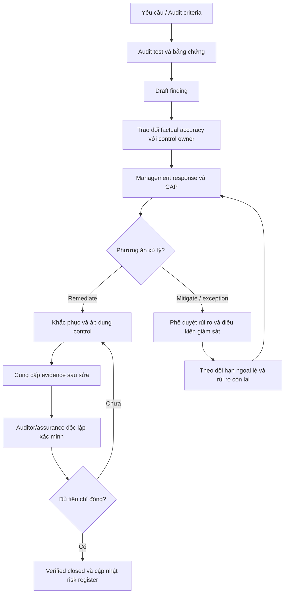

# Management response trong Audit và Evidence: phản hồi phát hiện, cam kết khắc phục và chứng minh hiệu lực

**Management response (phản hồi của ban quản lý/đơn vị chịu trách nhiệm)** là phần trả lời chính thức của bên được kiểm toán đối với các **audit findings** (phát hiện kiểm toán). Phản hồi thể hiện đơn vị có đồng ý với sự kiện và đánh giá được nêu hay không, sẽ xử lý rủi ro như thế nào, ai chịu trách nhiệm, khi nào hoàn tất và bằng chứng nào sẽ chứng minh kết quả.

Trong chương **Audit và evidence** của module **SECURITY_SECURITY_ASSURANCE**, management response là mắt xích nối giữa **bằng chứng kiểm toán → đánh giá thiếu sót → quyết định quản trị → corrective action → kiểm chứng lại**. Một phản hồi có chất lượng cho phép auditor, chủ sở hữu hệ thống, bộ phận quản trị rủi ro và lãnh đạo theo dõi một phát hiện từ lúc được xác nhận cho đến khi hành động khắc phục có bằng chứng hiệu lực, hoặc rủi ro còn lại được quyết định theo đúng thẩm quyền.

Ví dụ, audit phát hiện: “Hai tài khoản quản trị production không bắt buộc MFA trong quý được kiểm toán”. Management response có thể nêu: đơn vị đồng ý với phát hiện, đã hạn chế truy cập tạm thời, xác định nguyên nhân là một luồng cấp tài khoản nằm ngoài policy, sẽ hợp nhất luồng cấp quyền, áp dụng MFA bắt buộc, truy hồi các tài khoản liên quan, thử lại trên toàn bộ population và giao IAM owner hoàn thành vào ngày đã phê duyệt. **Chỉ tuyên bố ‘đã bật MFA’ chưa đủ** nếu không giải quyết nguyên nhân khiến tài khoản mới tiếp tục có thể bỏ qua policy.

## 1. Kết quả học tập

Sau bài học, người học có thể:

1. Giải thích mục đích của management response, phân biệt trách nhiệm của đơn vị quản lý với trách nhiệm đánh giá độc lập của auditor.
2. Phân tích phát hiện theo tiêu chí (*criteria*), hiện trạng (*condition*), bằng chứng (*evidence*), nguyên nhân (*cause*) và rủi ro (*effect*).
3. Soạn phản hồi chính thức, có lập trường rõ ràng: đồng ý, đồng ý một phần, đề nghị điều chỉnh dựa trên bằng chứng hoặc đưa ra quyết định xử lý rủi ro phù hợp.
4. Lập **Corrective Action Plan (CAP)** có chủ sở hữu, mốc thời gian, biện pháp tạm thời, giải pháp bền vững và tiêu chí đóng đo được.
5. Phân biệt **implemented**, **validated**, **verified closed** và **risk accepted**; chỉ ra loại bằng chứng tương ứng với từng trạng thái.
6. Xử lý phản hồi khi có tranh luận về sự kiện, ngoại lệ được phê duyệt, hạn xử lý không khả thi hoặc bằng chứng không đầy đủ.
7. Thiết lập luồng theo dõi và báo cáo để management response trở thành một thành phần của **security assurance liên tục**.

---

## 2. Management response nằm ở đâu trong chu trình audit?

Sau khi auditor thu thập bằng chứng và đưa ra dự thảo finding, đơn vị được kiểm toán cần xác nhận sự kiện, phân tích nguyên nhân, đánh giá tác động và chính thức trả lời. Phần trả lời này được ghi vào báo cáo audit, hồ sơ finding hoặc hệ thống quản trị hành động tùy quy trình của tổ chức.



Có ba lớp trách nhiệm riêng:

| Lớp | Trả lời câu hỏi | Chủ thể chính |
|---|---|---|
| **Audit finding** | Bằng chứng cho thấy mức đáp ứng tiêu chí ra sao? | Auditor đánh giá độc lập |
| **Management response** | Đơn vị quản lý nhìn nhận sự kiện và sẽ quyết định/làm gì? | Management và control owner có thẩm quyền |
| **Follow-up / verification** | Hành động đã khắc phục nguyên nhân, control đã hiệu quả chưa? | Người kiểm tra lại phù hợp mức độc lập yêu cầu |

Người quản lý **có quyền đưa ra bối cảnh, bằng chứng bổ sung và lập trường của mình**, nhưng việc nộp phản hồi không tự làm cho finding biến mất. Auditor phải đánh giá thông tin mới theo phương pháp audit, còn lãnh đạo quản lý rủi ro phải quyết định đối với vấn đề tồn đọng.

### 2.1. Phân biệt với các khái niệm gần nhau

- **Management response:** trả lời từng finding hoặc nhóm finding, kèm kế hoạch và trách nhiệm. Đây là trọng tâm bài học.
- **Management representation letter:** thư xác nhận các thông tin/cam đoan của ban quản lý trong một số loại cuộc kiểm toán; mục đích và quy tắc khác với response cho finding.
- **Management action plan / CAP:** phần công việc cam kết để xử lý vấn đề. Nó thường nằm trong hoặc đi kèm management response.
- **Risk acceptance / exception:** quyết định có thẩm quyền chấp nhận rủi ro còn lại trong phạm vi, thời hạn và điều kiện cụ thể; không đồng nghĩa đã sửa control.
- **Auditor's recommendation:** đề xuất của auditor. Management có thể đề xuất giải pháp khác nếu chứng minh được giải pháp đáp ứng mục tiêu kiểm soát.
- **Closure evidence:** dữ liệu chứng minh hành động đã được triển khai và, khi tiêu chí yêu cầu, control đã vận hành hiệu quả. Cần đánh giá độc lập trước khi kết luận đóng.

Một management response mạnh không nhất thiết phải đồng ý với **mọi lời khuyên** của auditor; điều quan trọng là trả lời chính xác **rủi ro và tiêu chí** dựa trên bằng chứng, với hành động khả thi, có thể kiểm chứng.

## 3. Ai chịu trách nhiệm viết, phê duyệt và kiểm tra?

Trong audit bảo mật, chủ sở hữu kỹ thuật thường hiểu cấu hình, nhưng người đủ thẩm quyền ra quyết định phải chịu trách nhiệm về rủi ro nghiệp vụ.

| Vai trò | Trách nhiệm thường gặp |
|---|---|
| **Business / service owner** | Xác nhận tác động nghiệp vụ, ưu tiên và tính chấp nhận được của rủi ro; bảo đảm nguồn lực |
| **Control owner / system owner** | Giải thích control, dữ liệu vận hành, nguyên nhân, đề xuất hành động và bằng chứng |
| **Security engineering / IAM / SRE / Data** | Thiết kế và thực hiện biện pháp kỹ thuật, cung cấp kiểm thử và log |
| **Risk / Compliance / GRC** | Ánh xạ tiêu chí, quản lý risk register/ngoại lệ, theo dõi hạn và escalation |
| **Internal / external auditor** | Kiểm tra tính xác thực của lập luận, đánh giá evidence và xác minh closure theo phạm vi được giao |
| **Executive / risk acceptance authority** | Phê duyệt phương án có rủi ro cao, ngoại lệ, thay đổi mục tiêu hoặc chấp nhận rủi ro trong thẩm quyền |

Cần chỉ định **một người chịu trách nhiệm cuối cùng (accountable owner)** cho mỗi finding hoặc phương án xử lý, dù nhiều đội cùng thực hiện. Nếu chuyển qua nhà cung cấp bên thứ ba, tổ chức vẫn phải có owner chịu trách nhiệm quản lý phụ thuộc và theo dõi kết quả.

Nguyên tắc phân tách nhiệm vụ: người thực hiện sửa lỗi có thể tự kiểm tra kỹ thuật trước, nhưng việc tuyên bố finding đã **được xác minh và đóng** cần cơ chế kiểm tra phù hợp mức độc lập do chương trình audit quy định. Tránh trường hợp một người vừa điều chỉnh quyền, tự tạo bằng chứng và tự phê duyệt kết quả kiểm toán mà không có giám sát.

## 4. Đọc đúng finding trước khi trả lời

Phản hồi dễ sai khi người viết chỉ đọc tiêu đề “IAM không an toàn” rồi đưa ra biện pháp chung chung. Hãy tách cấu trúc:

| Thành phần finding | Câu hỏi của management | Ví dụ minh họa |
|---|---|---|
| **Criteria** | Yêu cầu nào, phiên bản nào, có hiệu lực khi nào? | Chính sách IAM yêu cầu MFA trên tài khoản quản trị tương tác |
| **Condition** | Auditor thực sự quan sát điều gì? | 2 tài khoản có đường đăng nhập không bị cưỡng chế MFA |
| **Evidence** | Nguồn và thời kỳ kiểm tra? Có missing data? | IAM export ngày X và log đăng nhập trong kỳ |
| **Cause** | Vì sao xảy ra; đã xác minh hay chỉ giả thuyết? | Quy trình cấp tài khoản ngoại lệ không áp dụng policy mặc định |
| **Effect / risk** | Hậu quả nếu bị lợi dụng hoặc lặp lại? | Chiếm dụng tài khoản đặc quyền có thể tăng tác động |
| **Recommendation** | Mục tiêu sửa là gì; có cách nào đạt hiệu quả tương đương? | Bắt buộc MFA, ngăn cấp quyền bỏ policy, rà soát population |
| **Severity** | Tiêu chí đánh giá và ngữ cảnh ảnh hưởng? | Quyền tài khoản, phạm vi production, biện pháp bù trừ |

**Bằng chứng bổ sung phải gắn với cùng thời kỳ và phạm vi.** Nếu hôm nay đã bật MFA thì điều đó chứng minh trạng thái hiện tại; nó không xóa sự kiện thiếu MFA trong quý trước. Tương tự, một tài khoản được đổi tên hoặc xóa sau audit vẫn có thể đã tồn tại và gây rủi ro trong thời kỳ kiểm toán.

Phân biệt các nhận định:

- **Sự kiện đã xác minh:** có log/cấu hình hoặc hồ sơ đáng tin cậy chứng minh.
- **Giả thuyết nguyên nhân:** cơ chế có thể gây lỗi nhưng cần kiểm tra thêm.
- **Đánh giá tác động:** suy luận về khả năng và hậu quả; phải phù hợp tài sản, quyền thực tế và ngữ cảnh.
- **Hạn chế bằng chứng:** không thể kiểm tra được một khoảng thời gian hoặc một population; không nên chuyển thiếu evidence thành khẳng định chắc chắn về hành vi.

### 4.1. Checklist chuẩn bị trước khi viết

1. Chốt phiên bản finding và tiêu chí liên quan; kiểm tra định nghĩa phạm vi, audit period, population và dữ liệu nguồn.
2. Xác nhận owner vận hành, người quản lý quyết định, những đội bị ảnh hưởng và nhà cung cấp liên quan.
3. Kiểm tra bối cảnh: exception đang có hiệu lực, compensating controls, tài sản mới triển khai hoặc hệ thống đã ngừng vận hành.
4. Thu thập dữ liệu để kiểm chứng factual accuracy; ghi rõ điểm nào đồng ý và điểm nào cần auditor đối chiếu lại.
5. Phân tích root cause và tác động; chưa đủ dữ liệu thì ghi mốc hoàn thành điều tra cùng biện pháp bảo vệ tạm.
6. Xác định quyết định quản trị: sửa, giảm thiểu, chuyển giao theo điều khoản phù hợp, hay chấp nhận rủi ro theo thẩm quyền.
7. Lập hành động, tiêu chí thành công, bằng chứng và timeline khả thi trước khi ký phản hồi.

## 5. Những trạng thái phản hồi thường dùng

Management nên có lập trường rõ ràng nhưng **tránh biến lựa chọn câu chữ thành một cơ chế tự miễn trừ finding**.

| Lập trường | Khi nào phù hợp | Cần kèm theo |
|---|---|---|
| **Agree / concur** | Sự kiện và tiêu chí đã xác nhận, đồng ý rằng có khoảng cách | Root cause, action plan, owner, hạn, validation |
| **Partially agree** | Đồng ý với một phần sự kiện hoặc rủi ro nhưng chưa đồng ý một chi tiết/khuyến nghị | Ranh giới phần đồng ý, bằng chứng phần tranh luận, cách xử lý phần đã xác nhận |
| **Disagree / dispute** | Có bằng chứng cho thấy criteria, scope hoặc condition bị áp dụng sai | Bằng chứng phản biện, cách tái kiểm tra, quyết định escalation nếu chưa thống nhất |
| **Agree with risk, alternative remediation** | Đồng ý finding nhưng chọn control khác có hiệu quả tương đương | Phân tích mục tiêu control, đánh giá rủi ro và phép thử tương đương |
| **Risk accepted** | Quyền hạn cho phép giữ rủi ro trong một phạm vi và thời hạn cụ thể | Risk register, người duyệt, lý do, giới hạn, monitoring và trigger xem lại |
| **Unable to conclude yet** | Cần điều tra có giới hạn hoặc chờ dữ liệu trọng yếu | Phần đã xác minh, biện pháp tạm, người điều tra, ngày ra quyết định |

**Disagree** không có nghĩa đơn vị có thể bỏ qua yêu cầu cung cấp bằng chứng. Nếu auditor giữ nguyên kết luận sau khi đánh giá thông tin bổ sung, management response có thể ghi rõ lập trường khác biệt và cơ chế giải quyết, để người đọc biết thực trạng tranh luận.

**Risk accepted** cũng không phải là đồng nghĩa với **compliant**. Một ngoại lệ đã được phê duyệt có thể vẫn còn thiếu sót so với yêu cầu bên ngoài, hợp đồng hoặc pháp luật; cần kiểm tra liệu tổ chức có quyền chấp nhận và liệu còn nghĩa vụ xử lý/báo cáo khác hay không.

## 6. Cấu trúc một management response đầy đủ

Có thể dùng khuôn **Fact → Position → Risk → Action → Accountability → Verification**.

| Trường | Nội dung nên có | Câu hỏi kiểm tra |
|---|---|---|
| **Finding reference** | ID, tên, severity, hệ thống, thời kỳ | Đang phản hồi đúng finding và phiên bản? |
| **Management position** | Agree, partially agree, disagree, risk acceptance theo quy trình | Có nêu rõ mức độ đồng thuận? |
| **Factual context** | Phần sự kiện được xác nhận, thông tin bổ sung và giới hạn | Có evidence dẫn chiếu, tránh phủ nhận cảm tính? |
| **Root cause** | Nguyên nhân đã xác minh và các yếu tố góp phần | Giải pháp có ngăn lỗi tái diễn? |
| **Impact & residual risk** | Tài sản ảnh hưởng, biện pháp giảm thiểu, rủi ro còn lại | Đã xem xét phạm vi lan rộng và control bù trừ? |
| **Immediate containment** | Hành động ngắn hạn ngăn rủi ro tiếp tục | Ai làm, lúc nào, bằng chứng? |
| **Corrective action** | Thay đổi dài hạn, phụ thuộc, kế hoạch từng bước | Hành động đủ cụ thể để triển khai? |
| **Accountable owner** | Người/role có quyền điều phối và phê duyệt nguồn lực | Có một owner cuối cùng? |
| **Milestones & due date** | Mốc trung gian và hạn hoàn tất | Có khả thi, xét các ràng buộc và quy trình change? |
| **Validation criteria** | Tiêu chí đo được, phạm vi retest, evidence dự kiến | Người khác có thể kiểm tra độc lập? |
| **Approval & tracking** | Người duyệt, ngày, ticket/CAP/risk ID | Có hệ thống theo dõi và escalation? |

Phản hồi không cần dài để có chất lượng. Với finding nhỏ, một đoạn rõ ràng kèm bảng hành động có thể đủ. Với finding ảnh hưởng rộng, có thể cần CAP nhiều giai đoạn, phân tích phụ thuộc và hồ sơ chấp nhận rủi ro tạm thời.

### 6.1. Ví dụ ngắn: phản hồi yếu và phản hồi có thể kiểm chứng

**Yếu:**

> Chúng tôi ghi nhận và sẽ cải thiện quản lý tài khoản. Đội IT sẽ khắc phục sớm.

Những khoảng trống: không xác nhận sự kiện, không có nguyên nhân, owner không rõ, không có hạn, không nói sửa ở đâu và làm sao kiểm chứng.

**Tốt hơn (giả định):**

> Chúng tôi đồng ý với finding IAM-AUD-09: hai tài khoản quản trị tương tác tại môi trường production không bị bắt buộc MFA trong khoảng thời gian được đánh giá. Kiểm tra sơ bộ xác định cả hai được tạo qua quy trình khẩn cấp không thừa hưởng policy chuẩn. Ngày 15/11/2026, đội IAM đã hạn chế đường đăng nhập tương ứng và ghi nhận bằng chứng cấu hình. Chủ sở hữu IAM sẽ đưa quy trình khẩn cấp vào cùng cơ chế cưỡng chế MFA, rà soát toàn bộ tài khoản đặc quyền thuộc ba cloud account và kiểm thử tạo tài khoản mới theo cả luồng chuẩn lẫn luồng khẩn cấp trước ngày 15/12/2026. Security Assurance sẽ xác minh kết quả bằng export population, lịch sử thay đổi policy, log kiểm thử đăng nhập và phê duyệt của chủ control. Trong thời gian xử lý, các lần cấp tài khoản đặc quyền mới yêu cầu rà soát thủ công có ghi ticket.

Các ngày, đối tượng, hành động và bằng chứng trên là **ví dụ học tập**. Trong tổ chức thật cần thay bằng dữ liệu đã xác minh, thời hạn được phê duyệt và liên kết đến hồ sơ thực.

## 7. Từ phát hiện đến Corrective Action Plan (CAP)

Một **Corrective Action Plan** hữu ích phải giải quyết **nguyên nhân gây phát hiện**, bao gồm biện pháp ngăn tái diễn. Khắc phục biểu hiện là cần thiết nhưng không đủ khi lỗi có thể lặp lại.

Ví dụ audit phát hiện 10 tài khoản nghỉ việc còn quyền truy cập:

- **Correction (sửa tình trạng hiện tại):** vô hiệu hóa hoặc thu hồi ngay quyền của 10 tài khoản theo kiểm tra đã xác nhận.
- **Containment (biện pháp tạm):** tăng giám sát truy cập và đối chiếu thủ công hằng ngày trong giai đoạn sửa luồng.
- **Root-cause corrective action:** sửa tích hợp HR → IAM, xử lý lỗi queue, retry, cảnh báo và ownership của sự kiện offboarding.
- **Prevention / control improvement:** kiểm tra tự động quyền còn lại sau ngày nghỉ việc; kiểm tra toàn bộ nguồn danh tính liên quan và lập báo cáo exceptions.
- **Effectiveness verification:** mô phỏng sự kiện offboarding và kiểm tra các trường hợp có thật trong khoảng thời gian được duyệt; đối chiếu từ HR đến từng hệ thống.

Không nên mặc định “đào tạo lại nhân viên” là giải pháp gốc khi hệ thống tự động bỏ sót dữ liệu hoặc quy trình không có cơ chế đối chiếu.

### 7.1. Viết action theo tiêu chí SMART

Đối với từng action, mô tả:

- **Specific:** sửa thành phần/luồng nào, phạm vi nào, thay đổi gì.
- **Measurable:** kỳ vọng đo được, ví dụ “100% tài khoản thuộc population có phê duyệt theo chính sách” hoặc “tất cả đường đăng nhập đặc quyền đều cưỡng chế MFA” trong phạm vi được định nghĩa.
- **Achievable:** có nguồn lực, phụ thuộc và kế hoạch triển khai thực tế.
- **Relevant:** trực tiếp giảm rủi ro hoặc xử lý nguyên nhân finding.
- **Time-bound:** hạn được duyệt và các mốc trung gian để theo dõi.

Những từ như *enhance*, *review*, *consider* hoặc *raise awareness* chỉ hợp lệ khi đi cùng **deliverable cụ thể** và điều kiện đánh giá đã hoàn thành.

### 7.2. Ví dụ phân rã CAP

| ID | Hành động | Owner | Mốc kiểm tra | Evidence để đóng |
|---|---|---|---|---|
| A1 | Hạn chế quyền hai tài khoản thiếu MFA và kiểm tra truy cập | IAM operations | Sau khi containment | Policy export, audit log, ticket phê duyệt |
| A2 | Sửa workflow cấp tài khoản khẩn cấp để áp dụng MFA | IAM engineering | Trước triển khai production | PR/change record, policy test, kết quả thử phủ các luồng |
| A3 | Đối chiếu toàn bộ tài khoản production và ngoại lệ | IAM governance | Trước nghiệm thu | Population đủ nguồn, truy vấn, danh sách ngoại lệ và cách xử lý |
| A4 | Kiểm chứng control hoạt động sau thay đổi | Security assurance | Sau triển khai và cửa sổ quan sát phù hợp | Kết quả retest, log xác thực, sign-off |

Hành động A1 có thể làm giảm rủi ro **ngay**, nhưng finding chỉ được đóng theo chính sách khi những điều kiện liên quan đến **nguyên nhân và hiệu quả** cũng đạt.

## 8. Ưu tiên và đặt hạn theo rủi ro

Audit findings không có cùng mức tác động. Management response nên giải thích vì sao chọn thứ tự xử lý, nhất là khi thời gian hoặc nguồn lực hạn chế.

Các chiều đánh giá thường gồm:

1. **Tác động** lên dữ liệu nhạy cảm, hoạt động nghiệp vụ, khả năng phục hồi, tuân thủ và khách hàng.
2. **Khả năng xảy ra/khả năng khai thác**, gồm độ mở trên Internet, quyền cao, public exploit, dấu hiệu tấn công và biện pháp phòng vệ hiện hữu.
3. **Phạm vi:** một máy thử nghiệm hay toàn bộ hệ thống production, một cloud account hay nhiều môi trường.
4. **Mức độ lặp lại:** lỗi cá biệt hay lỗi thiết kế của quy trình khiến mọi tài khoản tương tự đều bị ảnh hưởng.
5. **Khả năng phát hiện/ứng phó:** logging, alert, đội trực và biện pháp bù trừ có hoạt động không.
6. **Hạn từ yêu cầu áp dụng:** thời hạn theo chính sách, hợp đồng, quy định hoặc cam kết kiểm toán; phải kiểm tra nguồn thực tế, không tự bịa “chuẩn 30 ngày”.

Ví dụ tham khảo (cần điều chỉnh theo risk methodology tổ chức):

| Mức ưu tiên | Biện pháp trước mắt | Kế hoạch chính |
|---|---|---|
| **Critical**: đường truy cập quản trị có thể bị khai thác và ảnh hưởng hệ thống trọng yếu | Containment, giám sát và báo cấp quyết định ngay theo quy trình IR/risk | Khắc phục khẩn cấp, theo dõi thường xuyên tới khi xác minh |
| **High**: control trọng yếu thiếu đồng nhất trên nhiều hệ thống | Biện pháp bù trừ có owner và giới hạn | CAP có mốc gần, xác minh độc lập sau sửa |
| **Medium**: lỗ hổng quy trình đã giới hạn tác động | Theo dõi và hướng dẫn thao tác tạm | Sửa trong chu kỳ change, có retest |
| **Low**: sai lệch cục bộ, tác động nhỏ | Ghi nhận và tránh mở rộng rủi ro | Gom cải tiến theo kế hoạch được duyệt |

Các nhãn mức độ chỉ là ví dụ phân loại, không định nghĩa severity cho một framework cụ thể. Việc một finding có nhãn “High” không tự cho phép management thay hạn bắt buộc nếu hợp đồng hoặc chính sách đã quy định.

## 9. Biện pháp tạm thời, compensating controls và risk acceptance

Không phải lúc nào có thể sửa triệt để ngay: cần thay đổi hệ thống lớn, không đủ lịch bảo trì, phụ thuộc nhà cung cấp hoặc rủi ro chuyển đổi cao. Trong thời gian đó, phản hồi phải phân biệt rõ:

**Containment:** ngăn ảnh hưởng lan rộng hoặc đóng đường gây rủi ro tạm thời, ví dụ vô hiệu hóa account đáng ngờ.

**Compensating control:** kiểm soát thay thế nhằm giảm cùng một rủi ro trong khi control chính chưa đạt, ví dụ hạn chế IP nguồn, xác thực bổ sung qua bastion, giám sát phiên quản trị. Cần có chứng cứ về **tính phù hợp và hiệu lực thực tế**, không chỉ mô tả nó tồn tại.

**Mitigation:** giảm xác suất hoặc tác động bằng một hoặc nhiều biện pháp, nhưng có thể chưa loại bỏ được nguyên nhân gốc.

**Risk acceptance:** người có thẩm quyền chủ động chấp nhận rủi ro còn lại trong ranh giới rõ ràng, với lý do, thời hạn, giám sát và điều kiện xem lại.

Một bản ghi chấp nhận rủi ro tối thiểu:

```yaml
risk_exception_id: RISK-EXAMPLE-IAM-09
linked_finding_id: IAM-AUD-09
asset_scope: production-admin-access
remaining_gap: emergency-identity-policy-not-yet-unified
risk_statement: privileged-access-could-bypass-primary-mfa-policy
temporary_controls:
  - restricted-network-entry
  - time-bound-privileged-access
  - privileged-session-monitoring
risk_owner: designated-business-service-owner
approved_by_role: authorized-risk-acceptance-authority
effective_from: "2026-11-15"
expires_on: "2026-12-15"
review_trigger:
  - active-exploitation-indicator
  - new-unprotected-privileged-identity
  - control-or-architecture-change
remediation_action_id: CAP-IAM-09
evidence_index: restricted-evidence-reference
```

**Lưu ý:** Không thể dùng một ngoại lệ nội bộ để tự xóa yêu cầu pháp lý hoặc hợp đồng bắt buộc. Nếu control không đáp ứng tiêu chí bên ngoài, management phải xác định nghĩa vụ liên quan, trách nhiệm thông báo/khắc phục và mức quyền được phép quyết định trước khi ghi “accepted”.

Với rủi ro cao, việc gia hạn nhiều lần không có tiến bộ là dấu hiệu cần escalation; ghi rõ lịch sử ngoại lệ và các điều kiện khiến quyết định trước không còn phù hợp.

## 10. Đối thoại về finding: đồng ý, đồng ý một phần và không đồng ý

Quy trình trao đổi hữu ích diễn ra **trước khi báo cáo được chốt**, có ghi nhận luận cứ và thời điểm.

### 10.1. Khi đồng ý

Phản hồi cần mô tả trạng thái hiện tại, nguyên nhân đã xác minh, containment, action plan, owner, milestone và validation. Tránh lặp lại nguyên văn finding mà không đưa ra quyết định.

### 10.2. Khi đồng ý một phần

Ví dụ auditor ghi “toàn bộ workload không mã hóa dữ liệu ở trạng thái lưu trữ”. Management có bằng chứng một vùng đã dùng mã hóa với khóa được quản lý, còn hai workload cũ thiếu mã hóa.

Cách phản hồi phù hợp:

> Management đồng ý rằng hai workload thuộc hệ thống A không đáp ứng tiêu chí mã hóa tại thời kỳ đánh giá. Với nhóm còn lại, evidence cấu hình và log KMS cho thấy mã hóa đã được bật; đề nghị auditor điều chỉnh phạm vi condition. Kế hoạch khắc phục tập trung vào hai workload bị ảnh hưởng và bổ sung kiểm soát tự động để ngăn triển khai storage chưa mã hóa.

Phần đúng phải có bằng chứng; phần chưa đáp ứng vẫn cần xử lý.

### 10.3. Khi không đồng ý

Management phải chỉ rõ **điểm sai trong criteria, dữ liệu, thời kỳ, cách diễn giải hoặc phép thử**, kèm bằng chứng:

- Tiêu chí đưa vào findings đã bị thay thế trước giai đoạn audit?
- Tài sản thực tế nằm ngoài phạm vi đã thống nhất?
- Công cụ đã đọc sai cấu hình do policy kế thừa hoặc provider API?
- Một ngoại lệ đúng thẩm quyền và còn hiệu lực có thay đổi cách đánh giá?
- Evidence chỉ là screenshot cũ, không phản ánh trạng thái tại thời điểm trong kỳ?

Nếu vẫn khác biệt, nên ghi nhận **position của cả hai bên**, escalation tới cấp giải quyết tranh luận theo charter/quy trình audit, và hạn hoàn thành đánh giá. Không sửa hoặc che giấu bằng chứng gốc để buộc báo cáo đi theo một lập trường.

### 10.4. Khi bằng chứng chưa đủ

Nếu log retention bị thiếu trong 20 ngày, management không nên tự tuyên bố control “đã đạt” chỉ vì không tìm thấy sự cố. Cần xác định:

- Thiếu evidence có phải là **vi phạm control lưu giữ log** theo tiêu chí áp dụng không?
- Có nguồn độc lập khác (cloud audit trail, SIEM, ticket, event store) hỗ trợ kiểm tra phần kỳ bị thiếu không?
- Nếu không thể kiểm chứng, mức giới hạn assurance là gì và CAP sẽ sửa retention/coverage như thế nào?

Management có thể đồng ý với finding về **không chứng minh được hoạt động trong kỳ**, ngay cả khi chưa có căn cứ để kết luận mọi hoạt động trong kỳ đều sai.

## 11. Management response theo từng loại finding

Phương án phản hồi phải bám bản chất kiểm soát:

| Finding | Phản hồi yếu | Phản hồi cần hướng tới |
|---|---|---|
| MFA không bắt buộc cho tài khoản đặc quyền | “Đã bật MFA.” | Rà soát mọi đường đăng nhập/role, sửa policy gây sai lệch, retest và theo dõi tài khoản mới |
| Không có phê duyệt cấp quyền | “Đã nhắc nhân viên.” | Sửa workflow bắt buộc phê duyệt trước cấp, đối chiếu cấp quyền thực tế và log quyết định |
| Log bảo mật thiếu 20 ngày | “Đã tăng dung lượng SIEM.” | Khôi phục nguồn bị thiếu nếu có thể, sửa ingestion/retention, giám sát mất log và thử trên cửa sổ thời gian phù hợp |
| Backup không restore được | “Backup job đã xanh.” | Sửa nguyên nhân restore, thử giải mã/toàn vẹn/ứng dụng, đo RTO/RPO và điều kiện bảo mật |
| Lỗ hổng quá hạn theo SLA nội bộ | “Đã lên lịch vá.” | Xử lý theo mức rủi ro, biện pháp tạm, fix, scan xác minh và kiểm tra cơ chế ưu tiên/báo trễ |
| Token/secret trong repo | “Đã xóa dòng chứa token.” | Thu hồi/rotate, đánh giá phạm vi lộ, làm sạch nơi cần thiết, scan pipeline và verify không còn dùng token cũ |
| Quá nhiều admin role | “Đã thu hồi hai role.” | Xác định toàn bộ population, quyền tối thiểu, approval workflow, rà soát định kỳ và phát hiện drift |
| Failover bỏ qua audit logging | “Dịch vụ đã chạy lại đúng RTO.” | Sửa DR runbook/log pipeline, chạy lại failover và chứng minh chức năng + security controls cùng đạt |

Đôi khi một finding liên quan **nhiều control**: ví dụ tài khoản cũ còn active liên quan HR offboarding, IAM, inventory và monitoring. CAP nên có một owner điều phối, các action phân vai cụ thể và bằng chứng tổng hợp; không phân mảnh đến mức mỗi đội đóng ticket của mình trong khi kết quả nghiệp vụ vẫn chưa đạt.

## 12. Ví dụ hoàn chỉnh: management response cho quyền production

Toàn bộ ví dụ dưới đây là **giả định cho mục đích học tập**.

### 12.1. Finding được auditor ghi nhận

**Mã:** IAM-AUD-009  
**Tiêu chí:** Chính sách bảo mật phê duyệt yêu cầu tài khoản quản trị tương tác production phải bị cưỡng chế MFA; cấp quyền phải theo workflow đã duyệt.  
**Phạm vi:** 3 cloud account production trong quý III của năm audit.  
**Condition:** Trong tập 60 tài khoản đặc quyền tương tác được đối chiếu, 2 tài khoản tạo bằng quy trình khẩn cấp không bị cưỡng chế MFA tại một đường đăng nhập.  
**Bằng chứng:** Export policy và role mapping, log xác thực, danh mục account, timestamp của workflow; auditor kiểm tra lại thuộc tính của đường đăng nhập.  
**Risk:** tài khoản đặc quyền có thể bị chiếm quyền dễ hơn, ảnh hưởng thao tác nhạy cảm trên production.  
**Đề xuất:** loại bỏ đường cấp/đăng nhập không tuân thủ, kiểm tra các tài khoản liên quan, tự động hóa enforcement và bổ sung giám sát.

### 12.2. Phản hồi quản lý và hành động

> **Position:** Agree. Chúng tôi xác nhận hai tài khoản thuộc phạm vi chưa đáp ứng MFA policy tại một đường đăng nhập trong kỳ kiểm toán. Điều tra nguyên nhân ban đầu xác định workflow cấp tài khoản khẩn cấp tạo principal trước khi security policy assignment hoàn tất; vấn đề xảy ra khi tác vụ đồng bộ lỗi và không có bước kiểm tra hậu cấp quyền.
>
> **Immediate action:** IAM Operations đã vô hiệu hóa đường truy cập chưa được bảo vệ, xác minh tình trạng của hai tài khoản và bật giám sát sự kiện đặc quyền. Mọi yêu cầu cấp tài khoản khẩn cấp được rà soát thủ công bởi security owner cho đến khi workflow được sửa.
>
> **Corrective action:** IAM Engineering sẽ thay workflow bằng cơ chế kiểm tra điều kiện policy trước khi kích hoạt tài khoản, có retry và cảnh báo lỗi; Security Engineering rà soát toàn bộ 60 tài khoản đã nêu và kiểm tra các luồng cấp quyền tương đương. CAP gồm thay đổi kỹ thuật, hướng dẫn vận hành và bằng chứng phê duyệt change.
>
> **Ownership and timing:** IAM Manager chịu trách nhiệm cuối cùng; mốc xác minh hoàn thành được phê duyệt là 15/12/2026, có checkpoint thử ở môi trường đại diện và triển khai production trước retest.
>
> **Validation:** Auditor/Security Assurance sẽ đối chiếu population từ nguồn cloud, thử tạo tài khoản qua luồng thường và khẩn cấp, xác minh các đường đăng nhập bắt buộc MFA, xem event log và kiểm tra sự kiện lỗi workflow có cảnh báo. Finding chỉ được đề xuất đóng khi mọi điều kiện trên đạt trong phạm vi được duyệt.

**Vì sao phản hồi này có thể kiểm chứng?** Có xác nhận sự kiện, nguyên nhân cần sửa, containment, chủ sở hữu, hạn, toàn bộ population liên quan, điều kiện tái kiểm tra, vai trò đánh giá độc lập và liên kết trực tiếp tới mục tiêu control.

### 12.3. Kết quả sau triển khai và các khả năng kết luận

Giả sử nhóm IAM đã sửa workflow và gửi bằng chứng.

| Kết quả hậu triển khai | Cách xử lý |
|---|---|
| Có PR, change approval và screenshot cấu hình mới, nhưng chưa thử luồng khẩn cấp | **Implemented**, chưa đủ chứng cứ closure |
| Luồng thường PASS, luồng khẩn cấp vẫn tạo account không có MFA trong 5 phút | **Retest FAIL** theo tiêu chí cưỡng chế trước kích hoạt; sửa tiếp |
| Cả hai luồng PASS, population đầy đủ được rà soát, log cảnh báo đủ và người được ủy quyền ký | Có cơ sở **Verified closed** trong phạm vi đã kiểm chứng |
| Workflow sửa không thể triển khai trước hạn, có biện pháp thay thế được duyệt | Giữ finding mở hoặc trạng thái theo quy trình, ghi **risk exception** và kiểm tra thường xuyên |
| Auditor phát hiện account thứ tư ngoài inventory ban đầu | Xem lại **population completeness**, mở rộng phạm vi và đánh giá lại tính đủ của bằng chứng |

Một finding có thể yêu cầu nhiều bằng chứng khác nhau: chứng minh **trạng thái tại thời điểm sửa**, **hiệu lực của hành động** và **khả năng tránh tái diễn**.

## 13. Mẫu management response cho báo cáo hoặc công cụ GRC

Mẫu dưới đây có thể điều chỉnh theo quy định của tổ chức. Nó ưu tiên các thuộc tính mà người quản lý phải quyết định và auditor có thể kiểm tra.

```yaml
finding_id: IAM-AUD-009
finding_version: 2
audit_period: "2026-Q3"
service: production-cloud-identity
control_id: IAM-PRIV-01
management_response:
  position: AGREE
  factual_summary: "Two interactive privileged identities bypassed MFA."
  root_cause:
    status: VERIFIED
    description: "Emergency provisioning path missed the policy gate."
  risk:
    impact: HIGH
    affected_population: "2 of 60 identified privileged user accounts"
    residual_risk_ref: "RISK-EXAMPLE-009"
  containment:
    description: "Disable unprotected access and add manual approval."
    owner_role: IAM_OPERATIONS
    evidence_ref: "restricted/evidence/containment"
  corrective_actions:
    - id: CAP-009-01
      description: "Enforce MFA policy before account activation."
      owner_role: IAM_ENGINEERING
      due_date: "2026-12-10"
      acceptance: "Normal and emergency provisioning paths cannot bypass MFA."
    - id: CAP-009-02
      description: "Reconcile the full privileged identity population."
      owner_role: SECURITY_ENGINEERING
      due_date: "2026-12-12"
      acceptance: "No unexplained privileged identity lacks MFA enforcement."
  accountable_owner_role: IAM_MANAGER
  target_completion_date: "2026-12-15"
  verification:
    method: "Population reconciliation and independent path tests"
    reviewer_role: SECURITY_ASSURANCE
    evidence_refs:
      - "restricted/evidence/iam-policy-history"
      - "restricted/evidence/workflow-tests"
      - "restricted/evidence/privileged-login-results"
    status: PENDING
  management_approval:
    role: AUTHORIZED_SERVICE_OWNER
    date: "2026-11-15"
  response_status: ACTION_PLAN_APPROVED
```

Các mã, tên vai trò, ngày và đường dẫn là placeholder. Trong sử dụng thật cần **thay bằng thông tin đã phê duyệt** và lưu hiện vật ở kho có phân quyền. Không nhúng token, mật khẩu, private key, dữ liệu khách hàng thô hoặc bí mật vận hành vào file management response.

### 13.1. Mẫu đoạn phản hồi ngắn

Một mẫu có thể tái sử dụng trong văn bản:

> Đối với finding **[ID]** thuộc **[dịch vụ/phạm vi]**, management **[đồng ý/đồng ý một phần/không đồng ý]** với nội dung **[condition]** so với tiêu chí **[criteria]**. Căn cứ từ **[nguồn evidence]**, nguyên nhân **[đã xác minh hoặc cần điều tra]** là **[cause]**. Rủi ro hiện tại **[tác động và phạm vi]** được giảm thiểu tạm bằng **[biện pháp, ngày, owner]**. Hành động khắc phục **[việc cụ thể, milestones]** do **[accountable owner]** chịu trách nhiệm, dự kiến hoàn thành **[due date đã duyệt]**. Hiệu lực sẽ được đánh giá qua **[phương pháp retest, population, điều kiện PASS, evidence]**; rủi ro còn lại và ngoại lệ **[nếu có]** được quản lý tại **[risk reference]**.

Có thể tách thành nhiều đoạn để dễ đọc, nhưng không nên làm mất các liên kết chính giữa **finding, hành động, trách nhiệm và bằng chứng**.

## 14. Quản lý thời hạn và các tình huống kế hoạch bị trễ

Ngay cả CAP hợp lý cũng có thể chậm do thay đổi hạ tầng, kiểm thử, nhân sự hoặc phụ thuộc bên ngoài. Quản trị cần thấy sớm việc trượt tiến độ.

### 14.1. Mốc quản lý nên có

```text
T0  Auditor thông báo draft finding
T1  Management xác nhận factual accuracy / tranh luận có evidence
T2  Management response được ký và CAP được phê duyệt
T3  Biện pháp tạm được triển khai và kiểm tra
T4  Mốc kỹ thuật triển khai hành động chính
T5  Retest và thu thập evidence đủ độ bao phủ
T6  Đánh giá kết luận: closed / rework / accepted exception
```

Những mốc này **không phải thời hạn chuẩn chung**. Thời hạn thực tế dựa vào audit engagement, quy trình tổ chức, mức rủi ro và nghĩa vụ áp dụng.

### 14.2. Khi cần gia hạn

Management nên nêu **lý do cụ thể**, tác động việc chậm, trạng thái thực của các action, biện pháp giảm thiểu, mốc mới, người phê duyệt và xác minh bổ sung. Ví dụ thay vì “chờ nhà cung cấp” hãy nêu “API provider chưa hỗ trợ phân biệt role X; đã có yêu cầu thay đổi #..., trong khi chờ áp dụng restriction Y và monitor Z, owner theo dõi hằng tuần”.

Gia hạn action không tự kéo dài hiệu lực của một risk exception: phải xem riêng **hạn ngoại lệ, cấp phê duyệt, điều kiện giám sát** và yêu cầu escalation khi vượt hạn.

### 14.3. Khi sửa lỗi tạo ra rủi ro khác

Ví dụ siết IAM trên service account để xử lý finding có thể làm gián đoạn backup restore. CAP cần đánh giá tác động thay đổi, thử đường nghiệp vụ/DR liên quan và có rollback. Một hành động phù hợp về bảo mật nhưng phá hỏng kiểm soát availability hoặc disaster recovery chưa chắc đạt mục tiêu assurance tổng thể.

## 15. Bằng chứng nào cần có để management response thực sự được đóng?

Một **lời cam kết** và một **ticket Completed** thường chứng minh tiến độ hành chính, không tự chứng minh control đã hiệu quả. Hãy phân biệt:

| Trạng thái | Bằng chứng thường phù hợp | Giới hạn |
|---|---|---|
| **Response submitted** | Văn bản được người có thẩm quyền duyệt | Chỉ chứng minh management đã trả lời |
| **Plan approved** | CAP, owner, milestone, quyết định rủi ro | Chưa chứng minh đã sửa |
| **Action implemented** | Change record, cấu hình, mã triển khai, log tác vụ | Có thể chỉ xác nhận trạng thái ngay sau thay đổi |
| **Control validated** | Test kỹ thuật có điều kiện PASS và nguồn dữ liệu rõ | Phụ thuộc phạm vi, trường hợp và thời điểm thử |
| **Operating effectiveness verified** | Bằng chứng control hoạt động trên population/giai đoạn phù hợp | Có thể cần nhiều kỳ với control định kỳ |
| **Finding verified closed** | Reviewer đủ độc lập xác nhận đáp ứng closure criteria | Không bảo đảm mọi rủi ro ngoài phạm vi |
| **Risk accepted** | Phê duyệt ngoại lệ, phân tích rủi ro, thời hạn và monitoring | Không đồng nghĩa control compliant hoặc finding đã sửa |

### 15.1. Tiêu chí đóng phải được thống nhất trước retest

Một trường hợp MFA có thể đặt điều kiện:

- **Đủ population:** danh sách tài khoản và role đặc quyền đã được đối chiếu với inventory toàn bộ cloud account trong phạm vi.
- **Đúng behavior:** mọi đường đăng nhập tương tác thuộc tiêu chí đều cưỡng chế MFA trước khi có phiên quản trị.
- **Đúng process:** luồng cấp quyền thường và khẩn cấp đều kiểm tra policy; lỗi đồng bộ không cho phép kích hoạt quyền không an toàn.
- **Có monitoring:** sự kiện đổi policy, lỗi cấp quyền và exception có audit trail.
- **Có bằng chứng:** export, log, kết quả test, ticket và sign-off có timestamp, người thu thập và phiên bản.
- **Có reviewer:** kết luận retest được xác nhận bởi người có thẩm quyền phù hợp.

Nếu chưa thử đường cấp quyền khẩn cấp, báo cáo không nên khẳng định “đã khắc phục hoàn toàn” dù đường thông thường đã PASS.

### 15.2. Vấn đề của finding thuộc control định kỳ

Đối với yêu cầu **access review hàng quý**, chỉ xuất trình quy trình mới viết sau audit chưa chứng minh control đã vận hành. Có thể:

1. Kiểm tra thiết kế mới và quy trình triển khai.
2. Quan sát/mô phỏng luồng để xác minh điều kiện kỹ thuật.
3. Chờ chu kỳ review tiếp theo (hoặc khoảng thời gian phù hợp với tiêu chí) để đánh giá kết quả vận hành thực.
4. Đối chiếu tất cả quyết định thu hồi quyền và sự kiện xử lý sau review.

Trong giai đoạn chờ bằng chứng vận hành, có thể ghi “implementation validated; operating effectiveness pending” để phản ánh đúng mức assurance.

## 16. Đo chất lượng management response và hiệu quả khắc phục

Các chỉ số giúp nhận biết chương trình audit tạo ra cải thiện hay chỉ tăng số ticket. Có thể theo dõi:

| Chỉ số | Ý nghĩa | Rủi ro đọc nhầm |
|---|---|---|
| **Response timeliness** | Tỷ lệ phản hồi được phê duyệt trong thời hạn áp dụng | Đúng hạn chưa có nghĩa kế hoạch đủ tốt |
| **CAP completeness** | Tỷ lệ finding có owner, action, due date, closure criteria | Điền đủ trường chưa chứng minh hành động có tác dụng |
| **High-risk overdue count** | Số finding nguy cơ cao quá hạn theo trạng thái hiện tại | Cần xem tổng số và thời gian quá hạn, không chỉ tỷ lệ |
| **Evidence-backed closure rate** | Tỷ lệ finding đóng sau retest có bằng chứng phù hợp | Cần kiểm tra chất lượng/độc lập của reviewer |
| **Retest failure rate** | Bao nhiêu hành động đã triển khai nhưng retest thất bại | Tỷ lệ cao có thể phản ánh test tốt hoặc remediation yếu; cần phân tích |
| **Repeat finding rate** | Tần suất vấn đề tái xuất hiện sau closure | Phản ánh root cause chưa được xử lý hoặc drift |
| **Risk exception age** | Thời gian ngoại lệ tồn tại và số lần gia hạn | Ngoại lệ lặp lại cho thấy kiểm soát điều phối yếu |
| **Lead time to verified closure** | Thời gian từ finding xác nhận đến khi kiểm chứng đóng | Không nên hy sinh chất lượng test để làm chỉ số đẹp |

Khi báo cáo, nên phân nhóm theo severity, dịch vụ quan trọng, loại control và nguồn audit; một finding nhỏ về tài liệu không nên che việc IAM privileged access còn tồn đọng nhiều kỳ.

**Audit response SLA** có thể được tổ chức đặt riêng với **remediation SLA**. Phản hồi đúng hạn nhưng hành động quá hạn vẫn là hai vấn đề khác nhau, cần hiển thị độc lập.

## 17. Luồng quản trị trong Security Assurance liên tục

Management response phát huy giá trị khi liên kết với artefact khác trong chương trình assurance.

```text
Risk / Security objective
  ↓
Security requirement & approved control
  ↓
Audit criteria and workpapers
  ↓
Audit finding (condition + evidence + scope)
  ↓
Management response
  ├── Position + factual context
  ├── Root cause + risk assessment
  ├── Interim control / risk exception
  └── CAP + owner + milestone + acceptance criteria
  ↓
Change record + configuration + test evidence
  ↓
Independent retest / operating effectiveness
  ↓
Verified closure or residual-risk decision
  ↓
Trend analysis, review of control design, next audit plan
```

Đối với mỗi finding cần giữ khả năng truy xuất:

- **Finding ID → audit test ID → criteria ID → control ID**.
- **Finding ID → risk ID → CAP ID → change/PR/ticket ID**.
- **CAP ID → validation case ID → evidence ID → reviewer decision**.
- **Finding ID → ngoại lệ/risk acceptance ID** (nếu có), người phê duyệt và hạn hiệu lực.
- **Finding ID → lịch sử trạng thái, ngày thay đổi, lý do gia hạn và retest**.

Lưu bằng chứng trong kho có quyền hạn phù hợp; nhật ký và bản xuất nhạy cảm có thể chứa account, cấu hình mạng hoặc dữ liệu khách hàng. Dùng mã tham chiếu trong báo cáo để hạn chế sao chép secret hoặc dữ liệu cá nhân không cần thiết.

### 17.1. Tự động hóa một phần quy trình

Một hệ thống GRC/ticket có thể tự:

- Nhắc owner trước due date và escalation khi quá hạn.
- Kiểm tra response có thiếu owner, acceptance, evidence reference.
- Liên kết pipeline deployment, drift monitor, IAM export và test result tới CAP.
- Cảnh báo risk exception sắp hết hạn hoặc finding tái xuất hiện.
- Tổng hợp số lượng finding theo control, mức rủi ro, tiến độ và trạng thái retest.

Tuy nhiên, **tự động chuyển ticket sang Closed vì CI xanh** có thể sai nếu CI không kiểm tra đúng population hoặc không kiểm chứng hiệu quả vận hành trong kỳ. Tự động hóa phục vụ thu thập và theo dõi, còn **kết luận assurance** phải dựa vào criteria và evidence phù hợp.

## 18. Bối cảnh đặc biệt: nhà cung cấp và kiểm toán bên ngoài

### 18.1. Khi finding liên quan bên thứ ba

Ví dụ dịch vụ lưu trữ dữ liệu thuê ngoài không cung cấp được bằng chứng backup restore theo yêu cầu hợp đồng. Đơn vị quản lý dịch vụ cần:

- Xác nhận **shared responsibility** và yêu cầu kiểm toán trong hợp đồng;
- Yêu cầu bằng chứng restore cụ thể thay vì chỉ giấy xác nhận chung;
- Đánh giá liệu chứng nhận/báo cáo bên thứ ba có bao phủ đúng dịch vụ, thời kỳ và tiêu chí không;
- Xác định biện pháp tạm như kiểm thử khả năng trích xuất dữ liệu, bản sao độc lập hoặc kế hoạch chuyển nhà cung cấp;
- Có **owner nội bộ** theo dõi đến khi vấn đề được xử lý.

“Nhà cung cấp chịu trách nhiệm” không đủ để đóng finding nếu tổ chức vẫn mang rủi ro nghiệp vụ từ phụ thuộc đó.

### 18.2. Khi phản hồi nằm trong audit theo tiêu chuẩn hoặc quy định

Có thể có mẫu phản hồi, quy tắc phân loại finding và hạn nộp CAP riêng theo hợp đồng, chương trình chứng nhận hoặc cơ quan quản lý. Trong trường hợp đó, **mẫu nội bộ phải được điều chỉnh theo yêu cầu áp dụng**, không mặc định quy tắc của chương trình audit này giống chương trình khác.

Các cụm từ như *nonconformity*, *observation*, *management comment*, *response*, *corrective action*, *remediation* và *closure* có thể có ý nghĩa quy trình khác nhau. Người viết cần xác nhận định nghĩa trước khi báo cáo.

### 18.3. Ranh giới phát ngôn của management

Management có thể nêu đã thực hiện hành động, dự kiến ngày hoàn tất và tự đánh giá hiệu quả trên bằng chứng sẵn có. Việc nói “auditor đã xác nhận finding đóng” chỉ hợp lệ **sau khi có kết luận thực tế từ auditor hoặc người được ủy quyền**. Không trình bày kế hoạch trong tương lai như kết quả đã được chứng nhận.

## 19. Những anti-patterns thường gặp

| Phản hồi/cách làm | Vấn đề | Cải thiện |
|---|---|---|
| “We acknowledge the finding” rồi không có action | Không có trách nhiệm hoặc kế hoạch | Position, owner, CAP, hạn, tiêu chí đóng |
| “Đã sửa” ngay sau cấu hình một tài khoản | Chỉ sửa triệu chứng, chưa kiểm tra population | Đối chiếu phạm vi và cơ chế ngăn tái diễn |
| “Không có incident nên không có rủi ro” | Thiếu bằng chứng sự cố không chứng minh control đạt | Đánh giá exposure, khả năng khai thác và monitoring |
| “Audit nhầm” nhưng không cung cấp dữ liệu | Phủ nhận cảm tính | Bằng chứng phản biện theo cùng criteria, period, scope |
| “Risk accepted” không có người duyệt | Ngoại lệ không có thẩm quyền | Risk register, thẩm quyền, thời hạn, điều kiện xem lại |
| Hạn “ASAP” | Không đo hoặc escalation được | Ngày/mốc được phê duyệt và owner |
| 20 action nhưng không ai accountable | Phân mảnh trách nhiệm | Một owner cuối cùng, owner từng action |
| Đóng ticket khi PR được merge | Không chứng minh control vận hành | Deployment evidence + retest + reviewer |
| Gia hạn CAP vô hạn | Tồn đọng rủi ro và làm đẹp thống kê | Kiểm tra mức rủi ro, escalation và quyết định lại |
| Tự đổi severity do thiếu ngân sách | Lẫn lộn phân loại rủi ro và năng lực xử lý | Giữ bằng chứng, ghi kế hoạch và quyết định rủi ro riêng |
| Giảm tiêu chí PASS để đóng finding | Kết luận thiếu trung thực, khó truy vết | Mọi thay đổi criteria cần phê duyệt, lý do và phiên bản |
| Chỉ xem control ngày cuối kỳ | Không chứng minh hiệu quả vận hành cả kỳ | Thêm evidence lịch sử và phép thử theo tần suất |
| Đưa dữ liệu nhạy cảm trực tiếp vào response | Tăng rủi ro lộ và vi phạm quyền riêng tư | Tham chiếu kho bằng chứng phân quyền |
| Chọn bằng chứng thuận lợi, bỏ phần bất lợi | Làm sai sự thật và độ tin cậy audit | Giữ raw evidence, giải thích ngoại lệ, hạn chế |

## 20. Bài tập thực hành

**Tình huống giả định:** Audit phát hiện hệ thống thanh toán production có ba vấn đề:

- **F-01 (IAM):** 4/30 tài khoản đặc quyền trong mẫu không có hồ sơ phê duyệt trước khi cấp quyền. Population thực tế có khoảng 150 tài khoản, nguồn inventory chưa được đối chiếu đầy đủ.
- **F-02 (Logging):** một API quan trọng thiếu audit log trong 12 ngày. Chủ dịch vụ cho rằng có log trong hệ thống khác, nhưng chưa cung cấp được bản trích xuất có timestamp.
- **F-03 (Recovery):** runbook nói RTO 4 giờ; lần diễn tập mới chỉ đo thời gian restore database 90 phút, chưa kiểm tra giao dịch, dữ liệu và IAM sau phục hồi.

Management muốn phản hồi: “Chúng tôi đồng ý các phát hiện và sẽ cải thiện trong tháng tới.”

### Yêu cầu

1. Hãy chỉ ra ít nhất sáu trường thông tin còn thiếu trong câu phản hồi trên.
2. Với F-01, xác định cách đánh giá root cause và **population completeness**. Có thể kết luận “4/150 vi phạm” không? Vì sao?
3. Với F-02, management nên trình bày sự khác nhau giữa **không có log**, **log chưa được cung cấp** và **log nằm ngoài nguồn audit ban đầu** thế nào?
4. Với F-03, viết acceptance criteria đủ để khẳng định RTO 4 giờ được chứng minh trong phạm vi bài diễn tập end-to-end.
5. Lập bảng CAP cho ba finding, mỗi finding có owner, containment, root-cause action, due date giả định và retest evidence.
6. Nếu một action cần ba tháng trong khi finding có nguy cơ cao, cần biện pháp tạm, quyền phê duyệt và escalation nào?
7. Viết một management response **đồng ý một phần** với F-02 có sử dụng bằng chứng giả định, nhưng không tuyên bố PASS khi chưa xác minh.

### Gợi ý đối chiếu

Với F-01, **4/30** là ngoại lệ trong mẫu kiểm tra và chưa đủ để suy ra tỷ lệ của toàn bộ population nếu phương pháp lấy mẫu, tính đầy đủ dữ liệu và khả năng khái quát chưa được xác định. Điều cần sửa có thể là workflow cấp quyền, không chỉ bốn tài khoản.

Với F-02, nếu log đã được sinh ở nơi khác và có thể đối chiếu nguồn, timestamp, độ bao phủ và tính toàn vẹn, finding có thể được điều chỉnh theo bằng chứng. Nếu **không thể chứng minh đủ**, cần ghi hạn chế bằng chứng; nếu chính sách yêu cầu central logging mà API không gửi log đến SIEM, vẫn có thể tồn tại một nonconformity riêng.

Với F-03, database restore thành công trong 90 phút không chứng minh RTO đầu cuối. T1 phải gắn với điều kiện nghiệp vụ tối thiểu, dữ liệu nhất quán, kiểm soát truy cập, mã hóa/logging và nghiệm thu phù hợp; RPO cần được đánh giá riêng.

Một CAP hoàn chỉnh phải **chuyển lời hứa thành hành động kiểm chứng được**, gắn một owner có trách nhiệm cuối cùng cho từng finding và xác định rõ khi nào retest thực sự đạt.

## 21. Câu hỏi tự kiểm tra kiến thức

1. Vì sao management response là một nguồn thông tin về quyết định quản lý, nhưng bản thân nó chưa phải bằng chứng control hoạt động hiệu quả?
2. Phân biệt *correction*, *containment* và *corrective action* qua một trường hợp cấp quyền trái quy trình.
3. Management có thể không đồng ý với khuyến nghị audit nhưng vẫn đồng ý finding không? Cần chứng minh điều gì?
4. Một finding không có bằng chứng đủ để kết luận control đã hoạt động trong cả quý. Có thể đóng chỉ vì ngày hôm nay cấu hình đã được sửa không?
5. Thông tin tối thiểu nào phải có để chấp nhận rủi ro một cách có kiểm soát? Trong trường hợp nào phê duyệt ngoại lệ nội bộ vẫn chưa đủ?
6. Vì sao reviewer độc lập nên xác minh closure, đặc biệt khi đội sửa lỗi cũng cung cấp evidence?
7. Khi hạn xử lý quá lâu và có rủi ro cao, management phải thông tin điều gì với bên quản trị rủi ro và bên kiểm toán?

## 22. Kết luận

**Management response là cam kết quản trị có thể truy vết**: đơn vị chịu trách nhiệm ghi nhận hoặc phản biện chính xác phát hiện, giải thích bối cảnh và nguyên nhân, quyết định xử lý rủi ro, cung cấp kế hoạch có owner/hạn/tiêu chí, rồi chứng minh bằng evidence rằng thay đổi đã có hiệu lực.

Trong **security assurance**, câu trả lời được coi là hữu ích khi người đọc có thể lần ngược **criteria → finding → management position → CAP/risk decision → implementation → retest → closure evidence**. Chỉ khi chuỗi đó rõ ràng và trung thực về giới hạn, audit mới giúp hệ thống đáp ứng mục tiêu bảo mật và cải tiến liên tục trong phát triển lẫn vận hành.
