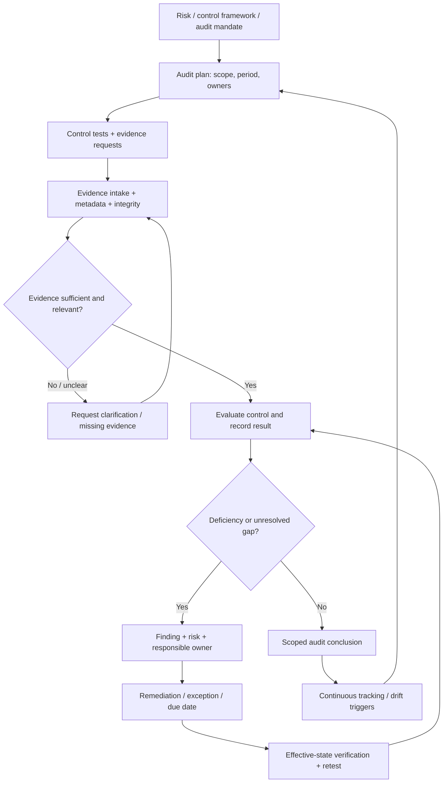
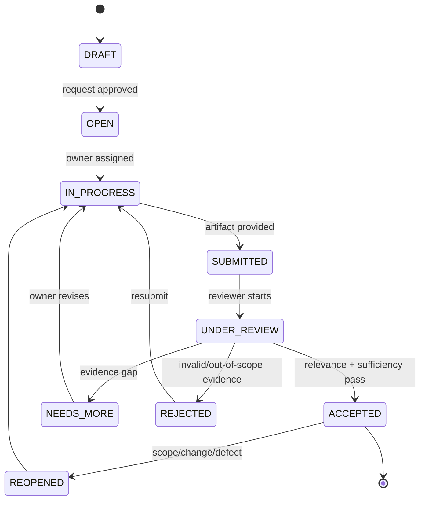
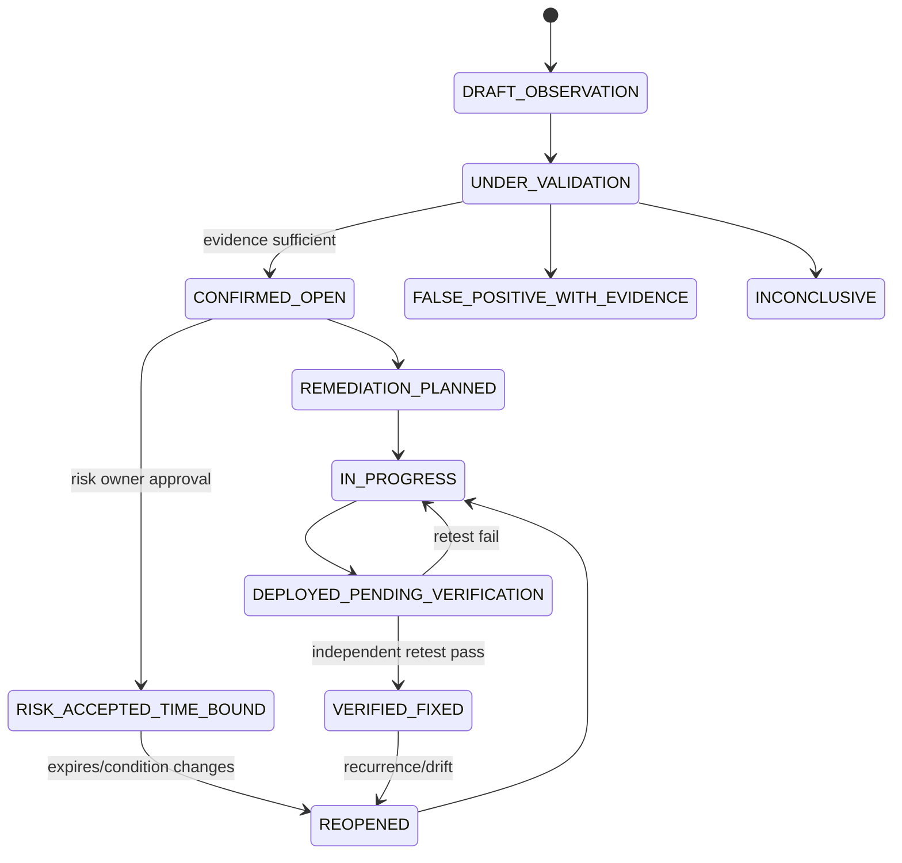
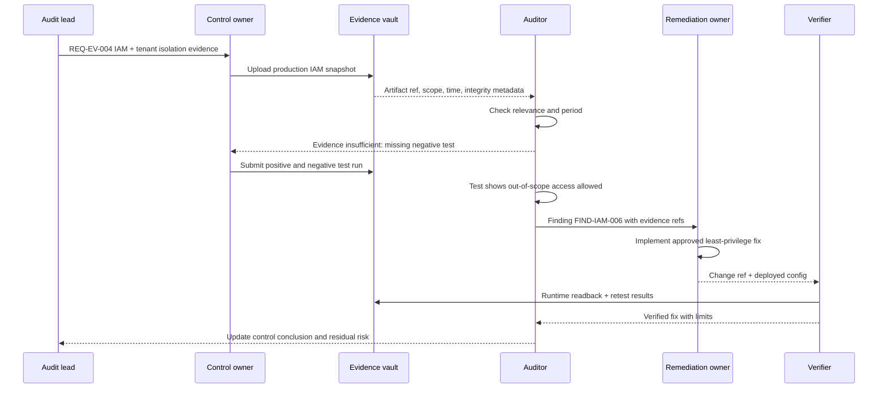

# Theo dõi audit

Một nền tảng SaaS quản lý tài liệu đang chuẩn bị đợt đánh giá bảo mật nội bộ. Nhóm kiểm toán yêu cầu bằng chứng về phân quyền production, nhật ký thay đổi quyền quản trị, việc kiểm thử khôi phục backup và lịch sử khắc phục lỗ hổng. Platform team gửi ảnh chụp cấu hình IAM ở staging; SOC cung cấp dashboard có dữ liệu nhưng không xác nhận đủ các account; SRE gửi báo cáo backup thành công nhưng chưa thử restore; một finding nghiêm trọng từ kỳ audit trước được đánh dấu “Done” vì pull request đã merge, dù policy chưa triển khai vào môi trường chính.

Nếu chỉ đếm số tài liệu đã tải lên, dự án audit có thể trông “đạt 95% tiến độ”. Nhưng không ai chứng minh được rằng **bằng chứng đúng phạm vi, đúng kỳ, đáng tin và hỗ trợ kết luận**. Vấn đề không phải thiếu một bảng tính để đánh dấu việc đã làm: tổ chức đang thiếu quy trình **theo dõi audit** từ yêu cầu đến bằng chứng, phát hiện, hành động khắc phục và xác nhận cuối cùng.

**Theo dõi audit (audit tracking / audit follow-up management)** là quá trình ghi nhận, giám sát và truy vết **kế hoạch kiểm tra, phạm vi, yêu cầu, người chịu trách nhiệm, thu thập và đánh giá bằng chứng, phát hiện, remediation, ngoại lệ, thời hạn và kết quả xác minh** của một cuộc audit hoặc chương trình audit liên tục. Nó giúp trả lời: **đang kiểm gì, dựa trên tiêu chí nào, ai sở hữu, bằng chứng hiện ở đâu và có đáng tin không, finding nào còn mở, hành động nào đã có hiệu lực và kết luận nào có thể được bảo vệ bằng bằng chứng?**

Trong chương **Audit và evidence** của module **SECURITY_SECURITY_ASSURANCE**, theo dõi audit góp phần xây dựng **niềm tin có căn cứ** rằng hệ thống đáp ứng các mục tiêu bảo mật, từ risk/security requirement và controls đến kiểm thử, audit và khắc phục phát hiện. Hành trình cần có truy vết: **risk → objective → requirement/control → audit test → evidence → finding → remediation → retest → scoped assurance decision → continuous monitoring**.

Bài này mô tả cách tổ chức **audit tracker**, không coi một mẫu quản trị hoặc báo cáo kiểm toán là bằng chứng tuân thủ tự thân. Mọi dữ liệu, mã định danh, trạng thái và thời hạn minh họa đều là ví dụ học thuật và phải được điều chỉnh theo chính sách, hợp đồng và quy định áp dụng.

## 1. Theo dõi audit nhằm đạt điều gì?

Một hệ thống theo dõi audit tốt phải tạo ra sáu khả năng:

1. **Visibility:** nhìn thấy cuộc audit, controls, yêu cầu evidence, owners, tiến độ và các điểm nghẽn.
2. **Traceability:** liên kết tiêu chí audit đến bằng chứng, findings, hành động và kết quả test.
3. **Accountability:** phân biệt ai cung cấp evidence, ai thực hiện fix, ai phê duyệt ngoại lệ và ai có quyền xác nhận đã đạt.
4. **Evidence quality:** không coi file được upload là control được chứng minh; đánh giá tính phù hợp, đầy đủ, đáng tin, kịp thời và toàn vẹn.
5. **Risk-based follow-up:** ưu tiên findings theo tác động và exposure; kiểm soát thời hạn và rủi ro còn lại.
6. **Continual assurance:** biết khi nào kết quả audit lỗi thời do cấu hình, assets, threats hoặc chính sách thay đổi.

### 1.1. Những câu hỏi tracker phải trả lời được

- Những cuộc audit nào đang mở, áp dụng môi trường, account và thời kỳ nào?
- Requirement/control nào đã có phép kiểm chứng và requirement nào còn gap?
- Mỗi evidence request có owner, deadline và định nghĩa “đủ” chưa?
- Bằng chứng đến từ hệ thống nào, được thu lúc nào, có đúng kỳ không?
- Khi auditor từ chối evidence, lý do và phiên bản thay thế được ghi ở đâu?
- Finding nghiêm trọng đang ở `OPEN`, `IN_PROGRESS`, `DEPLOYED` hay `VERIFIED_FIXED`?
- Action đã trễ bao lâu, có escalation và risk owner chưa?
- Ngoại lệ đã được phê duyệt bởi ai, áp dụng cho tài sản nào, còn hiệu lực không?
- Ai đã xác nhận hiệu lực control sau thay đổi production?
- Đợt audit trước có finding tương tự nào tái xuất hiện?
- Kết quả được báo cho leadership có phân biệt **đã cung cấp evidence** và **đã chứng minh đạt** không?

### 1.2. Đừng nhầm ba loại “đã xong”

| Việc được đánh dấu hoàn thành | Nó chứng minh gì? | Chưa chứng minh gì? |
| --- | --- | --- |
| Evidence request đã được gửi | Một hiện vật đã được nộp hoặc dẫn chiếu | Hiện vật đúng scope và đủ chứng minh |
| Remediation ticket đã được đóng | Một workflow vận hành ghi hoàn tất | Control đã triển khai và hoạt động |
| Audit finding đã verified closed | Bằng chứng và phép thử đáp ứng closure criteria trong phạm vi xác định | Không còn bất kỳ rủi ro hay biến thể nào |

**Đóng ticket, đóng finding và đóng cuộc audit là ba quyết định khác nhau**. Tracker phải giữ riêng các trạng thái này.

## 2. Phân biệt audit tracking, audit logging và continuous monitoring

Từ “audit” thường dùng cho những hoạt động khác nhau.

| Khái niệm | Đối tượng | Ví dụ |
| --- | --- | --- |
| **Audit tracking** | Vòng đời kiểm toán, yêu cầu, phát hiện, action và follow-up | Finding IAM quá rộng được gắn owner và retest |
| **Audit evidence management** | Thu thập, lưu giữ, phân quyền và kiểm tra hiện vật chứng minh | Lưu IAM snapshot, test run, metadata, hash |
| **Audit logging** | Ghi dấu các hành động hệ thống/người dùng | Cloud audit event đổi IAM role |
| **Continuous control monitoring** | Theo dõi trạng thái control và drift theo thời gian | Báo rule network bị mở lại |
| **Compliance tracking** | Đối chiếu với nghĩa vụ/điều khoản/chuẩn áp dụng | Mapping một control với yêu cầu hợp đồng |
| **Incident tracking** | Quản lý phát hiện, containment, recovery và IR actions | Incident credential leak và lessons learned |

Các quá trình có dữ liệu chung nhưng **không thay thế nhau**. Một hệ thống lưu audit logs rất tốt có thể vẫn không có ai chịu trách nhiệm khắc phục finding. Ngược lại, một bảng audit tracker có đủ cột “Completed” không chứng minh log nguồn được bảo vệ khỏi sửa hoặc mất.

### 2.1. Một audit observation khác security incident

Audit có thể phát hiện một thiết kế không đạt baseline mà chưa quan sát thấy attacker khai thác. Nó là **finding/control deficiency**, không mặc định là incident. Nếu review phát hiện compromise hoặc đường đang bị khai thác, phải **chuyển theo quy trình ứng cứu có thẩm quyền**, không chờ kết thúc kỳ audit mới xử lý.

### 2.2. Audit kết thúc nhưng remediation còn mở

Một báo cáo audit cuối kỳ có thể đã phát hành dù tổ chức vẫn còn findings đang khắc phục. Điều quan trọng là tracker giữ **action register** hoạt động, owner và verifier, thay vì biến mọi finding thành closed để “đóng hồ sơ”.

## 3. Các loại audit và phạm vi sử dụng tracker

- **Internal security audit:** đánh giá controls của tổ chức theo chính sách hoặc framework.
- **External/independent audit:** đánh giá do bên độc lập thực hiện với quyền và phạm vi đã thống nhất.
- **Customer/third-party audit:** khách hàng hoặc vendor yêu cầu chứng minh control được thỏa thuận.
- **Regulatory/contractual audit:** xem xét nghĩa vụ áp dụng; cần legal/compliance xác định tiêu chí.
- **Technical control audit:** tập trung IAM, hardening, logging, change/release, backup, DR.
- **Process audit:** xem change approvals, exception management, IR, review permissions.
- **Continuous assurance review:** các controls được kiểm chứng theo cadence hoặc event triggers.
- **Follow-up audit:** xác minh findings kỳ trước đã được giải quyết hiệu quả.

### 3.1. Scope phải được khóa phiên bản và cập nhật có kiểm soát

Ví dụ audit “production cloud IAM” không tự bao phủ:
- các sandbox dùng production credentials;
- region DR;
- service accounts của Kubernetes;
- database roles;
- account mới tạo giữa kỳ;
- quyền của nhà thầu phụ;
- temporary emergency roles ngoài giờ hành chính.

Nếu scope thay đổi, cần ghi **scope revision, lý do, người phê duyệt và tác động tới evidence/tests**. Không âm thầm mở rộng kết luận cho những tài sản chưa được kiểm.

### 3.2. Kỳ đánh giá và thời điểm thu thập

Một control có thể cần chứng minh:
- **Point-in-time:** cấu hình production tại một thời điểm.
- **Period-of-time:** tất cả thay đổi/hoạt động trong một kỳ.
- **Event-based:** hành vi khi xuất hiện grant, incident, deploy hoặc restore.
- **Periodic:** có thực hiện review/rotation/restore theo chu kỳ đã phê duyệt.
- **Continuous:** phát hiện drift hay vi phạm khi xảy ra.

**Một screenshot hôm nay không tự chứng minh control hoạt động xuyên suốt quý trước.** Tracker phải ghi loại assertion và kỳ đánh giá tương ứng.

## 4. Mô hình tổng thể của audit tracking



**Bằng chứng là đầu vào để kiểm**, không phải bằng chứng đã được kiểm. Khi finding được khắc phục, cần kiểm tra lại đúng control và cập nhật conclusion trong phạm vi; không tự biến mọi câu trả lời “đã sửa” thành PASS.

### 4.1. Các thực thể cần lưu

Một hệ thống đơn giản tối thiểu có:
1. `Audit` — chương trình/đợt đánh giá.
2. `ScopeItem` — asset, environment, team, period, exclusions.
3. `Criterion/Requirement` — tiêu chí có version.
4. `Control` — biện pháp cần xác minh.
5. `AuditTest` — cách thử và expected behavior.
6. `EvidenceRequest` — yêu cầu hiện vật.
7. `EvidenceArtifact` — hiện vật, nguồn, thời điểm, quyền, hash.
8. `EvidenceReview` — quyết định sufficiency/relevance và lý do.
9. `Finding` — sai lệch, risk, severity và evidence.
10. `Action` — khắc phục/phòng ngừa/kiểm chứng.
11. `Exception/RiskDecision` — chấp nhận residual risk có hạn.
12. `VerificationRun` — test sau remediation.
13. `AuditDecision` — kết luận có giới hạn.
14. `AuditTrailEvent` — ai tạo/sửa/duyệt/chuyển trạng thái, khi nào.

Không nhất thiết tạo 14 bảng riêng trong mọi tổ chức; đây là **mô hình trách nhiệm và quan hệ logic**.

## 5. Liên kết audit với mục tiêu, risk và control

Theo dõi audit chỉ có giá trị assurance khi có chuỗi lý do: **vì sao kiểm control này?**

### 5.1. Ví dụ mapping

| Mã | Nội dung |
| --- | --- |
| `OBJ-SEC-01` | Chỉ danh tính được cấp phép mới đọc dữ liệu nhạy cảm |
| `RISK-IAM-04` | Workload credential bị lộ có thể truy cập ngoài phạm vi |
| `REQ-IAM-07` | Production workload identity tuân least privilege |
| `CTRL-IAM-12` | Quyền cloud/Kubernetes được cấp theo service và scope cụ thể |
| `TEST-IAM-09` | Positive/negative access tests cùng effective-permission review |
| `EV-IAM-032` | Cloud IAM snapshot + test results đúng environment |
| `FIND-IAM-006` | Export worker có quyền đọc bucket ngoài nhiệm vụ |
| `ACT-IAM-008` | Thu hẹp quyền và thêm policy-as-code check |
| `VR-IAM-003` | Retest sau deploy, deny ngoài scope và allow nghiệp vụ hợp lệ |
| `DEC-IR-001` | Control verified trong scope, residual risk được nêu |

Nếu không có `REQ-IAM-07` và `TEST-IAM-09`, một snapshot IAM có thể tồn tại nhưng chưa biết **đúng là thế nào** và dựa vào tiêu chí nào để kết luận.

### 5.2. Many-to-many mapping

Một control có thể đáp ứng nhiều requirements; một requirement cũng có thể cần nhiều controls. Ví dụ bảo vệ audit logs có thể cần IAM, encryption, immutable retention, health monitoring và tested restore. Tracker phải hỗ trợ **nhiều quan hệ** mà không nhân đôi artifact tùy tiện hoặc làm mất ownership.

### 5.3. Framework IDs không chứng minh enforcement

Việc đánh dấu “Mapped to ISO 27001/NIST/CIS” cho một control là **chỉ dẫn mapping**, không phải kiểm tra đã đạt. Phải ghi version và applicability; security standards thay đổi theo thời gian. Không khẳng định một framework cụ thể bắt buộc cho mọi tổ chức khi chưa xét phạm vi và nghĩa vụ.

## 6. Lập kế hoạch audit theo rủi ro

Trước khi gửi bằng chứng, audit lead cần xác định:

- Audit objective và tiêu chí đánh giá.
- Risk register/threat scenarios liên quan.
- Systems, applications, data classification, accounts, regions, tenants, suppliers.
- Audit period và cut-off dates.
- Audit team, independent reviewer, owners và escalation.
- Controls/tests cần thực hiện và nguồn dữ liệu dự kiến.
- Evidence delivery mechanism, confidentiality và retention.
- Sampling methodology (nếu có).
- Thời hạn/ưu tiên cho requests và findings.
- Các giới hạn về quyền, hoạt động kiểm thử có thể tác động và ROE.
- Điều kiện kết thúc fieldwork, phát hành report và follow-up.
- Quy trình sửa scope hoặc disputed findings.

### 6.1. Audit plan minh họa

| Hạng mục | Phạm vi | Cách kiểm | Owner | Ghi chú |
| --- | --- | --- | --- | --- |
| Admin access | Cloud production accounts | Effective role inventory, approval và test | IAM | Kể cả break-glass |
| Deployment changes | Production releases trong kỳ | Sample releases, approval, digest, gate results | DevSecOps | Evidence theo period |
| Logging | IAM, KMS, object access audit | End-to-end event canary, retention | SOC/SRE | Coverage theo account/region |
| Backup/DR | Critical database + object storage | Restore test, RPO/RTO và security checks | SRE | Không chỉ backup jobs |
| Security vulnerabilities | Critical assets | Findings, patch SLAs, deployed-state tests | AppSec/Platform | Exceptions tách riêng |
| Vendor assurance | Data-processing vendor | Contract, notice test, report, data handling | Vendor owner | Shared responsibility |

### 6.2. Sample selection không chỉ chọn case đẹp

Nếu audit 50 releases trong một kỳ, không nhất thiết kiểm tất cả; có thể dùng mẫu theo risk, ngẫu nhiên hoặc judgmental selection. Nhưng phải ghi:
- population hoàn chỉnh;
- cách xác định và loại trừ records;
- kỳ và môi trường;
- sample size và logic selection;
- liệu critical/emergency changes được ưu tiên không;
- các giới hạn suy rộng từ sample;
- exceptions và kết quả của từng phần tử được chọn.

**Mẫu năm releases có test PASS không chứng minh mọi release trong năm đều đạt**, nhất là nếu population bị thiếu emergency changes.

## 7. Roles, trách nhiệm và separation of duties

| Vai trò | Trách nhiệm | Không nên mặc định |
| --- | --- | --- |
| **Audit sponsor/risk owner** | Phê duyệt mandate và mức risk | Tự biến finding thành closed không cần evidence |
| **Audit lead** | Kế hoạch, scope, phân công và báo cáo | Trực tiếp sửa mọi control |
| **Auditor/reviewer** | Xác định test, đánh giá evidence, findings | Chỉ nhận lời giải thích không có nguồn |
| **Control owner** | Vận hành control và giải trình trạng thái | Tự xác nhận độc lập mọi kết quả |
| **Evidence custodian** | Thu thập, phân quyền, bảo vệ hiện vật | Có quyền đọc mọi dữ liệu tùy ý |
| **Action owner** | Thực hiện remediation và cập nhật tiến độ | Đóng finding cuối cùng thay reviewer |
| **Verifier** | Retest và xác nhận hiệu lực control | Chỉ xem PR merge |
| **Compliance/legal/privacy** | Tiêu chí nghĩa vụ, dữ liệu và disclosure | Giả định mọi nguồn được chia sẻ tự do |
| **Platform/SRE/SOC** | Cấp technical evidence, runtime health | “Dashboard xanh” thay test |
| **Third-party owner** | Nhận vendor assurance evidence | Chứng nhận thay quyền kiểm chứng customer config |
| **Audit program manager** | Tổng hợp tracker, SLA, escalation, overdue | Thay nội dung đánh giá chuyên môn |

### 7.1. Trách nhiệm phải ở cấp bản ghi

Một finding thường có **một accountable action owner**, dù nhiều teams phải phối hợp. Audit lead không nên phải đoán owner từ email thread. Khi đổi owner, ghi **actor, time, lý do và người tiếp nhận**, giữ lịch sử để đánh giá trễ hạn.

### 7.2. Independence theo risk

Đối với control trọng yếu, reviewer xác nhận closure nên có mức độc lập phù hợp với người triển khai fix. Tổ chức nhỏ có thể kiêm nhiệm nhưng cần peer review/approval và audit trail rõ; không mặc định người đã sửa quyền quá rộng có thể tự bấm `VERIFIED_FIXED` mà không kiểm chứng.

## 8. Quản lý Evidence Request Register

**Evidence request** là yêu cầu cung cấp hiện vật để trả lời một hoặc nhiều audit tests. Nó không phải bản thân bằng chứng.

### 8.1. Trường tối thiểu

| Trường | Mục đích |
| --- | --- |
| `request_id` | Định danh bất biến và liên kết trong tracker |
| `audit_id / control_id` | Audit và tiêu chí cần chứng minh |
| `requested_assertion` | Điều cần được hỗ trợ (design/operation/effectiveness) |
| `scope + period` | Account/region/service và kỳ |
| `requested_evidence_type` | API snapshot, access review, approval log, test result |
| `required_fields` | Tối thiểu event IDs/timestamps/approver/version |
| `owner / reviewer` | Người cung cấp và người kiểm |
| `requested_at / due_at` | Deadline có quy tắc |
| `status` | Open, submitted, under review, insufficient, accepted |
| `artifact_refs` | Tham chiếu hiện vật, không raw sensitive payload |
| `decision_reason` | Vì sao accepted hoặc rejected |
| `history` | Chuyển owner/status và phiên bản evidence |

### 8.2. Lifecycle của Evidence Request



Trạng thái chỉ là **mô hình minh họa**, cần phù hợp workflow cụ thể. `ACCEPTED` nghĩa là hiện vật được chấp nhận cho một assertion/tiêu chí, không tự nghĩa control toàn diện PASS.

### 8.3. Request ví dụ

> **REQ-EV-004:** Cung cấp bằng chứng rằng tất cả privileged human accounts trong production account `acct-prod-01` đã được review ít nhất một lần trong kỳ Q3 giả định: inventory tài khoản, trạng thái quyền tại cut-off, approver records, exceptions, actions thu hồi và runtime readback. Owner: IAM lead. Reviewer: audit lead. Tránh xuất nội dung token, password, private key.

Không thể đáp ứng bằng screenshot “3 tài khoản admin ở staging” vì **sai môi trường, thiếu population và thiếu kỳ**.

### 8.4. Overdue không đồng nghĩa control fail

Một request quá hạn có thể vì owner chưa gửi bằng chứng dù control thực tế đang hoạt động; ngược lại, một request đúng hạn có thể chứa dữ liệu sai. Báo cáo riêng:
- **Evidence delivery status** — tiến độ công việc.
- **Evidence sufficiency status** — chất lượng/chứng minh.
- **Control evaluation** — kết quả đánh giá control.
- **Risk/finding status** — hậu quả và xử lý.

## 9. Evidence inventory và metadata cần lưu

**Evidence Artifact** là hiện vật cụ thể: một snapshot, một report, một test run, một log bundle, một approval record hoặc một xác nhận từ nguồn hợp lệ.

### 9.1. Metadata tối thiểu

- Evidence ID và loại hiện vật.
- Source system, resource IDs, account/region/cluster/tenant scope.
- Thời điểm tạo ở nguồn (*event/source time*), thời điểm thu thập (*collection time*), thời điểm nhận vào tracker.
- Kỳ dữ liệu mà hiện vật đại diện.
- Query/tool phiên bản, tham số và quyền người thu.
- Source path/API ref và bản copy đã được quản trị (nếu cần).
- Hash/signature/integrity metadata phù hợp.
- Classification, owner và access rules.
- Retention/expiry và cách xử lý legal hold khi áp dụng.
- Links tới criteria/tests/requests/findings.
- Reviewer, review result và giới hạn.
- Evidence version hoặc superseded-by để tránh mất lịch sử.

### 9.2. Ví dụ evidence khác loại

| Loại evidence | Điều có thể hỗ trợ | Giới hạn |
| --- | --- | --- |
| Source code/IaC | Control được thiết kế/khai báo | Runtime có thể drift |
| CI test result | Test đã chạy trên build cụ thể | Không tự bao phủ production state |
| Cloud API readback | Cấu hình hiệu lực tại thời điểm | Chưa chứng minh xuyên kỳ |
| Audit log | Hành động được ghi ở nguồn | Phụ thuộc coverage/retention/integrity |
| Approval ticket | Có phê duyệt theo workflow | Người triển khai có thể bypass |
| Access review record | Review đã được ghi nhận | Cần xác minh population/action thực hiện |
| Vulnerability scan | Findings theo scope và tool version | False negatives, scope mismatch |
| Restore test report | Khả năng phục hồi theo scenario | Chưa bao phủ mọi disaster |
| Vendor attestation | Nhận định được bên thứ ba xác nhận | Không thay customer-side control verification |
| Screenshot | Trạng thái UI được nhìn thấy tại một thời điểm | Khó tái dựng nguồn/filters/version |

### 9.3. Không dùng tên file làm provenance duy nhất

Một file có tên `prod-iam-approved-final-v3.pdf` không tự chứng minh nó đến từ production hoặc đã được phê duyệt. Metadata, source reference, time, version và reviewer mới giúp kiểm chứng provenance. Nếu dữ liệu dùng trong tranh chấp/pháp chứng, cần các biện pháp bảo toàn và chain of custody tương xứng.

## 10. Kiểm tra chất lượng evidence trước khi kết luận

Có thể áp dụng năm câu hỏi căn bản:

1. **Relevance:** bằng chứng có nói đúng control/requirement và asset không?
2. **Sufficiency:** số lượng, kỳ, population và phương pháp có đủ hỗ trợ assertion không?
3. **Reliability:** nguồn có đáng tin, người thu có đúng quyền, dữ liệu có thể bị sửa không?
4. **Timeliness/freshness:** evidence phản ánh thời gian cần đánh giá và còn áp dụng?
5. **Integrity/traceability:** artifact có nguyên vẹn và tái kiểm được đường nguồn→kết luận?

### 10.1. Ma trận ví dụ

| Evidence | Relevance | Sufficiency | Reliability | Nhận định |
| --- | --- | --- | --- | --- |
| Screenshot IAM staging để đánh giá production | Thấp | Không đủ | Không rõ | REJECT / request đúng scope |
| Cloud IAM snapshot production lúc cuối quý | Cao cho point-in-time | Có thể đủ cho snapshot | Cần source metadata | ACCEPT có giới hạn |
| 5 releases thuận tiện trong 50 releases | Có liên quan | Không chứng minh full period nếu sample sai | Tùy nguồn | NEEDS_MORE |
| Audit log archive có signed manifest + filters | Cao nếu đúng event types | Phụ thuộc log coverage/period | Tương đối mạnh trong trust model | REVIEW |
| Mẫu restore test trên DR region với RPO/RTO | Cao cho scenario đã thử | Chỉ đủ scenario và kỳ đó | Cần verify test output | ACCEPT có giới hạn |
| Vendor tự nói “SOC 2 compliant” | Có thể liên quan | Không đủ nếu thiếu report scope | Self-attested | REQUEST independent report/controls |

### 10.2. Evidence failure modes

- **Stale:** hiện vật quá cũ so với thay đổi hạ tầng.
- **Wrong environment:** nhầm staging/prod/DR hoặc account khác.
- **Incomplete population:** thiếu assets, vendors hoặc releases.
- **Unverified query:** filter loại records có vấn đề.
- **Source health unknown:** không biết log pipeline có bị mất dữ liệu.
- **Redaction removes critical fields:** không còn actor/target/timestamp để kiểm.
- **Sensitive disclosure:** tài liệu chứa secrets hoặc customer content không cần.
- **Unreproducible:** không biết API endpoint/query/version đã dùng.
- **Contradictory:** hai nguồn dữ liệu mâu thuẫn mà chưa có adjudication.
- **Temporally misaligned:** evidence chỉ point-in-time khi cần chứng minh period.

Không sửa lỗi evidence bằng cách **hạ tiêu chí đánh giá im lặng**. Nếu không thể thu đủ, ghi gap và làm risk decision phù hợp.

## 11. Population, sampling và kiểm tra tính đại diện

### 11.1. Population mới là mẫu số thực

Khi kiểm “mọi production deployment trong quý được approved”, population có thể lấy từ deployment controller/audit logs, không chỉ danh sách release tickets. Những emergency deployments, manual hotfix, rollback/roll-forward và alternate pipelines phải được xem xét nếu thuộc scope.

Nếu có 45 tickets nhưng deployment audit cho thấy 50 releases, cần reconcile 5 records còn thiếu **trước khi tuyên bố sample size hoặc tỷ lệ đạt**.

### 11.2. Các kiểu sample

- **Random:** chọn ngẫu nhiên từ population hoàn chỉnh nhằm giảm bias.
- **Risk-weighted:** cố tình ưu tiên privileged changes, production incidents và emergency releases.
- **Stratified:** chia theo team, region, control type, severity hoặc thời kỳ.
- **Judgmental:** chọn tình huống đặc biệt cần kiểm tra, không đại diện thống kê mặc định.
- **Full population:** kiểm tất cả khi số lượng nhỏ hoặc automated control thích hợp.

Tracker nên ghi **method**, seed/logic nếu cần tái dựng, selection time, excluded records và kết luận chỉ trong phạm vi sample/approach. Không suy xác suất/thống kê nếu cách chọn không hỗ trợ điều đó.

### 11.3. Boundary cases là nguồn học quan trọng

Một audit về offboarding nên có record chuyển vai trò, service account, break-glass và contractor exits trong kỳ nếu phù hợp, thay vì chỉ chọn trường hợp nghỉ việc chuẩn. Một audit về release gate phải xét emergency bypass và khi scanner failed, không chỉ các release xanh.

## 12. Theo dõi finding: từ observation đến verified closure

**Finding** là bản ghi sai lệch hoặc thiếu hụt có căn cứ so với requirement/control. Nó có thể xuất phát từ audit test FAIL, thiếu evidence quan trọng, runtime drift hoặc kiểm tra một kỳ trước.

### 12.1. Các trạng thái cần phân biệt

| Trạng thái | Định nghĩa |
| --- | --- |
| `DRAFT_OBSERVATION` | Phát hiện sơ bộ chưa xác minh |
| `UNDER_VALIDATION` | Đang kiểm evidence, scope và triage |
| `CONFIRMED_OPEN` | Finding có căn cứ, owner, mức risk |
| `REMEDIATION_PLANNED` | Có plan/approval/deadline |
| `IN_PROGRESS` | Đang triển khai fix |
| `DEPLOYED_PENDING_VERIFICATION` | Thay đổi đã deploy, chờ test |
| `VERIFIED_FIXED` | Effective state và test đáp ứng closure criteria |
| `RISK_ACCEPTED_TIME_BOUND` | Có quyết định chấp nhận có hạn; **không** là fixed |
| `FALSE_POSITIVE_WITH_EVIDENCE` | Phát hiện sai được giải thích và duyệt |
| `INCONCLUSIVE` | Thiếu thông tin, chưa kết luận |
| `REOPENED` | Evidence mới cho thấy lỗi chưa sửa hoặc tái xuất hiện |

### 12.2. Lưu lịch sử chuyển trạng thái



Một workflow có thể có nhiều trạng thái hơn, nhưng nên **không hợp nhất “đã triển khai” với “đã kiểm chứng”**. Với những finding thiếu bằng chứng mà không xác định control fail, trạng thái nên phản ánh `ASSURANCE_GAP` thay vì tự gán misconfiguration.

### 12.3. Mẫu finding cụ thể

**Finding ID:** `FIND-IAM-006`

**Asset/scope:** production export worker, cloud account `acct-prod-01`, review period và config snapshot được định nghĩa.

**Requirement:** `REQ-IAM-07` — workload chỉ có quyền cần cho nhiệm vụ.

**Expected:** worker identity không thể đọc bucket ngoài phạm vi export.

**Observed:** effective IAM policy cho phép đọc test bucket ngoài scope; controlled negative access test trả `ALLOW` dù baseline yêu cầu `DENY`.

**Risk:** khi worker credential bị compromise, phạm vi dữ liệu truy cập có thể lớn hơn nhiệm vụ.

**Evidence:** IAM API snapshot, principal/resource refs, policy version, test ID và thời gian.

**Remediation:** tách permissions và resource policy, triển khai theo change control.

**Closure criteria:** worker đọc được test object được phép; bị từ chối ngoài scope; deployment/IAM readback đúng production account; audit events có thể tra.

**Residual risk:** xem các worker khác dùng chung role và các identity paths chưa kiểm.

### 12.4. Finding trùng và finding tái phát

Hai scanners có thể tạo hai observations về cùng underlying control; cần deduplicate có giải thích, không xóa raw records. Một finding được verified rồi tái phát sau thay đổi khác phải có **recurrence link** để báo systemic problem, không tự ghi thành issue hoàn toàn mới không liên quan.

## 13. Phân loại rủi ro và ưu tiên follow-up

Một audit không nên ưu tiên chỉ theo ngày gửi evidence request hoặc số lượng check FAIL.

### 13.1. Severity kỹ thuật khác business risk

Ví dụ một wildcard IAM permission ở account production chứa dữ liệu nhạy cảm có thể tạo rủi ro lớn hơn một tài liệu vận hành thiếu nhãn. Nhưng một account sandbox dùng CI credentials production cũng có thể high risk. Nên xét:
- Confidentiality/integrity/availability impact.
- Asset/data criticality và tenant scope.
- Effective permissions/exposure, exploitability và threat activity.
- Khả năng phát hiện và containment hiện tại.
- Blast radius và dependencies.
- Compensating controls đã được kiểm chứng.
- Độ tin cậy evidence, known unknowns.
- Yêu cầu pháp lý/hợp đồng cụ thể nếu áp dụng.

### 13.2. Risk acceptance không phải fix

Nếu business quyết định trì hoãn một finding, phải ghi:
1. Finding/requirement/scope cụ thể.
2. Risk scenario, impact và evidence hiện có.
3. Risk owner và approver có thẩm quyền.
4. Control bù, phạm vi và kết quả test.
5. Ngày bắt đầu/hết hạn, trigger review.
6. Kế hoạch remediation/exit nếu có.
7. Monitoring và escalation khi điều kiện thay đổi.
8. Assurance claim nào bị hạn chế.

**RISK_ACCEPTED_TIME_BOUND không đồng nghĩa VERIFICATION PASS.** Tracker không được che những exception quá hạn trong biểu đồ hoàn tất.

### 13.3. Nonconformity và observation

Mỗi tổ chức có thể phân loại major/minor nonconformity, observation hoặc opportunity for improvement theo phương pháp kiểm toán. Không tự suy từ điểm CVSS ra nhãn kiểm toán cụ thể; phải nêu policy và criteria áp dụng.

## 14. Remediation Action Register và deadline

Một finding có thể cần nhiều actions; một action có thể xử lý nhiều findings cùng root cause. Vì vậy đừng ép quan hệ một-một.

### 14.1. Action metadata

| Field | Mục đích |
| --- | --- |
| `action_id` | Định danh để trace và theo dõi |
| `linked_findings` | Findings được hỗ trợ, không mất context |
| `action_type` | Containment, corrective, preventive, detective, recovery |
| `owner/accountable` | Người có trách nhiệm kết quả |
| `priority + due_at` | Risk-based deadline |
| `dependencies` | Teams/services/approvals cần hoàn thành trước |
| `planned_change` | Sửa code/IaC/IAM/runbook/scan |
| `acceptance_criteria` | Positive/negative tests, effective readback |
| `deployment_ref` | Artifact/config/version và environment |
| `verification_run_ref` | Kết quả test sau sửa |
| `status + history` | Tiến độ và thời điểm chuyển |
| `residual_risk / exception` | Chỗ chưa đạt |
| `last_update + reviewer` | Ai xác nhận bằng chứng và khi nào |

### 14.2. Hành động “yếu” và hành động có thể kiểm chứng

| Action yếu | Vì sao chưa đủ | Viết lại |
| --- | --- | --- |
| “Sửa IAM” | Không biết asset/quyền/test | Thu hẹp role X, test allow/deny trên resource A/B |
| “Làm tốt logging” | Không có event/coverage | Bật cloud audit cho all in-scope accounts; test canary |
| “Đào tạo developer” | Không sửa root control | Cập nhật async authorization contract + CI negative tests; đào tạo hỗ trợ |
| “Bổ sung backup” | Không biết phục hồi được không | Restore drill theo RPO/RTO, verify IAM và integrity |
| “Cập nhật tài liệu” | Không chứng minh hành vi | Runbook có operator drill, audit test và sign-off |
| “Đã merge PR” | Chưa phản ánh runtime | Deploy đúng digest, runtime readback, retest |
| “Đã trao đổi với vendor” | Không có commitment/evidence | Vendor response ID, action SLA, follow-up và validation |

### 14.3. Deadline, SLA và escalation

Tracker nên tính:
- `due_at` theo policy/risk acceptance;
- ngày bắt đầu, trạng thái và mốc xác minh;
- số ngày overdue so với deadline;
- blocker/dependency có được ghi hay không;
- người nhận escalation (owner manager, risk owner, audit sponsor);
- ngoại lệ gia hạn được phê duyệt và lý do;
- tác động của việc gia hạn tới residual risk.

Không dùng “đang chờ vendor” vô thời hạn như lý do bỏ overdue; thay vào đó cần **owner chịu trách nhiệm phối hợp và escalation**.

## 15. Kiểm chứng remediation trước khi đóng finding

### 15.1. Ba tầng chứng cứ

1. **Change intent:** thiết kế/PR/IaC/policy đổi đúng chỗ.
2. **Effective implementation:** môi trường đang dùng config/artifact đã sửa; không còn đường bypass.
3. **Behavior verification:** positive/negative regression tests xác nhận điều kiện đã khắc phục.

Ví dụ code chặn đọc object ngoài tenant đã merge nhưng production worker đang chạy image cũ. Theo tầng 1, công việc source hoàn thành; theo tầng 2, control **chưa được triển khai**. Audit finding vẫn không được VERIFIED_FIXED.

### 15.2. Test lại đúng failure mode

Với worker IAM quá rộng:
- **Positive:** worker hợp lệ đọc object test được phép.
- **Negative:** worker không đọc được object test ngoài scope.
- **Independent evidence:** effective IAM policy, resource policy và test result.
- **Runtime scope:** đúng account/region/service identity đã có finding.
- **Monitoring:** audit event hoặc drift rule phát hiện quyền rộng trở lại.
- **Limitations:** chưa kiểm mọi role assumption path thì phải ghi.

Negative test thất bại vì bucket không tồn tại hoặc network outage **không chứng minh least privilege**. Positive control xác nhận endpoint và credential hợp lệ.

### 15.3. Closure record

Một closure decision nên có:
- finding ID và acceptance criteria version;
- actual affected asset/config/release;
- time of deployment và effective readback;
- test run IDs và expected/actual outcomes;
- reviewer identity và timestamp;
- known limitations và residual risk;
- link tới evidence store;
- reopen triggers.

**Người đóng finding nên xác nhận bằng chứng có thể tái kiểm, không chỉ tin một trạng thái `DONE` từ hệ thống ticket.**

## 16. Theo dõi rủi ro kéo dài qua nhiều kỳ audit

Một finding chưa khắc phục có thể chuyển từ kỳ audit trước sang kỳ sau. Cần bảo tồn lịch sử, không reset deadline để trông như mới.

### 16.1. Carry-forward findings

- Giữ original finding ID hoặc liên kết lineage.
- Ghi original detection date, due date và mọi approved extensions.
- Đối chiếu evidence mới với expected state ban đầu.
- Cập nhật severity/risk nếu exposure hoặc exploitability thay đổi.
- Phân biệt old risk, mitigated risk và remaining gap.
- Nếu scope tăng (thêm account/tenant), ghi bản revision phù hợp.
- Report separate counts: newly opened, carried forward, verified closed, reopened.

### 16.2. Audit findings cần trend, không chỉ snapshot

Một dashboard 0 critical open hôm nay có thể là do các records bị đổi sang accepted risk hoặc loại khỏi scope. Dashboard nên cho thấy **lịch sử trạng thái, lý do chuyển, maturity của verification và kỳ báo cáo** để risk owner hiểu thực chất.

### 16.3. Quản lý evidence lifecycle

Khi audit period kết thúc, bằng chứng phải được lưu theo retention/record policy và quyền tương ứng. Nếu dữ liệu bị xóa theo lịch hoặc privacy obligation, phải biết **claims nào không thể reverify** sau thời điểm đó. Không tự giữ raw PII vô thời hạn chỉ vì “audit có thể cần”.
## 17. Continuous audit tracking và control monitoring

Không phải mọi audit đều chỉ là một hoạt động theo quý/năm. Hạ tầng cloud, Kubernetes, CI/CD và các vendors thay đổi liên tục; bằng chứng đúng ở một thời điểm có thể không còn đại diện sau thay đổi.

### 17.1. Nguồn trigger đánh giá lại

- Tạo hoặc xóa cloud account, project, cluster, production namespace.
- Thay privileged IAM role, service account, trust policy hoặc break-glass.
- Thay ingress/egress, network policy, security group hoặc data sharing.
- Thay KMS key, secret handling, encryption policy hoặc cert trust.
- Bật/tắt audit logging, thay SIEM destination/retention, parser hoặc alert routing.
- Thay CI/CD policy, build runner, artifact signing, registry.
- Thay database version, backup job, restore capability hoặc DR region.
- Một control exception hết hạn hoặc compensating control bị vô hiệu hóa.
- Vendor/subprocessor đổi phạm vi quyền hoặc xử lý dữ liệu.
- Incident, vulnerability hoặc finding tương tự xuất hiện.
- Audit criterion/framework/security requirement được sửa.
- Evidence bị phát hiện sai scope, thiếu population hoặc có mâu thuẫn.

Một trigger không nhất thiết bắt đầu lại **toàn bộ** audit; cần tính **impact analysis** tới claims, tests và bằng chứng đã dùng.

### 17.2. Continuous control monitoring khác kết luận của auditor

Có thể dùng automated checks để giảm thao tác lặp:

| Automated signal | Điều nó hỗ trợ | Điều chưa thể suy ra |
| --- | --- | --- |
| IaC policy check PASS | Một manifest/plan đáp ứng rule tại lúc kiểm | Production chưa drift |
| IAM diff alert | Quyền thay đổi sau baseline | Thay đổi chắc chắn trái policy |
| Logging canary success | Một luồng event tới archive | Tất cả source/event types đầy đủ |
| Vulnerability scan | Một số findings theo coverage và phiên bản scanner | Mọi risk được phát hiện |
| Control evidence age | Hiện vật đã cũ so với cadence | Control chắc chắn FAIL |
| Backup job success | Backup task báo hoàn tất | Data restore được với integrity |
| Restore drill PASS | Scenario cụ thể phục hồi theo tiêu chí | Mọi disaster đều phục hồi |
| Access review workflow completed | Review record tồn tại | Quyền bất thường đã được thu hồi |

Một continuous monitor có thể đặt `NEEDS_REVIEW` khi có drift; auditor vẫn phải đánh giá thực trạng, impact và bằng chứng. Không tự gán verdict “Control PASS” chỉ vì job scheduler chạy thành công.

### 17.3. Revalidation theo lineage

Mỗi change event nên dẫn tới:
1. Xác định asset/environment và affected control IDs.
2. Tìm evidence/test/assertions dựa trên control đó.
3. Xem kết quả cũ còn áp dụng không.
4. Nếu không, đặt evidence `SUPERSEDED` hoặc `NEEDS_REVALIDATION` thay vì xóa lịch sử.
5. Giao owner và yêu cầu evidence mới.
6. Chạy test ở scope thay đổi.
7. Cập nhật risk, finding và kết luận có giới hạn.
8. Lưu dấu thời gian cùng người/automation tạo quyết định.

### 17.4. Audit review cadence theo rủi ro

Một privileged access control có thể cần kiểm tra sau mỗi IAM change và định kỳ; DR có thể cần drills theo kỳ và mỗi khi dependency thay đổi. Không có chu kỳ duy nhất phù hợp mọi hệ thống. Quan trọng là xác định **cadence, trigger, owner, evidence expiry và escalation** từ risk/control baseline.

## 18. Audit trail của chính hệ thống theo dõi audit

Một tracker dùng để chứng minh accountability **cũng phải có accountability**. Nếu người quản lý dễ dàng thay ngày due, xóa finding hoặc ghi đè verdict không lưu vết, báo cáo audit có thể bị làm sai lệch.

### 18.1. Những hành vi cần audit

- Tạo/sửa scope hoặc audit criteria.
- Tạo/đóng evidence request và đổi owner/deadline.
- Upload/thay thế/xóa hoặc supersede evidence.
- Chấp nhận/từ chối evidence và lý do.
- Ghi nhận/đổi severity hoặc trạng thái finding.
- Cập nhật remediation plan, deadline, extensions.
- Phê duyệt risk acceptance/exception.
- Đổi người được chỉ định verifier.
- Đóng/reopen finding, thay conclusion/report.
- Thay role/permissions của tracker và retention settings.
- Export/download evidence nhạy cảm.
- Đồng bộ tự động từ CI, cloud APIs hoặc ticketing.

### 18.2. Event schema gợi ý

```json
{
  "event_id": "audittrail-00027",
  "event_type": "finding.status_changed",
  "occurred_at": "2026-03-15T10:20:00Z",
  "record_type": "finding",
  "record_id": "FIND-IAM-006",
  "audit_id": "AUD-SEC-2026-EXAMPLE",
  "actor_ref": "reviewer-uid-10",
  "actor_role": "assurance-verifier",
  "action": "transition",
  "old_value": "DEPLOYED_PENDING_VERIFICATION",
  "new_value": "VERIFIED_FIXED",
  "reason_ref": "closure-review-014",
  "evidence_refs": ["EV-IAM-032", "VR-IAM-003"],
  "source_system": "audit-tracker",
  "schema_version": "1.0"
}
```

**Ví dụ giả lập** này không chứa secret hoặc dữ liệu khách hàng. Khi triển khai thực, cần bảo vệ actor IDs, timestamps và record contents theo chính sách bảo mật. Không tự cho rằng log là bất biến chỉ vì trường `event_id` tồn tại.

### 18.3. Audit trail append-only và bảo vệ thay đổi

Đối với dữ liệu critical, có thể dùng:
- role-based access control và separation of duties;
- version history/append-only event ledger;
- retention/immutability khi phù hợp;
- integrity hashes/signatures hoặc trusted timestamps;
- log forwarding tới archive tách quyền khỏi người sửa tracker;
- cảnh báo khi tắt logging, đổi access hoặc xóa evidence;
- backup/restore của tracker và independent verification;
- periodic reconciliation với source tickets/CI/cloud.

**Hash bảo vệ tính nhất quán với bản đã hash, không tự chứng minh nguồn nội dung ban đầu đúng.** Tính tin cậy cần thêm trusted source, control người thu và cơ chế quản trị.

### 18.4. Xóa hoặc sửa dữ liệu do privacy/retention

Một hệ thống append-only không có nghĩa phải giữ mọi PII vô thời hạn. Phải có chính sách retention, redaction, xử lý quyền riêng tư và legal hold nếu áp dụng. Có thể duy trì record metadata về việc xóa theo thẩm quyền mà không tiếp tục lưu nội dung nhạy cảm không còn được phép.

## 19. Bảo mật và quyền riêng tư của kho audit evidence

Kho bằng chứng audit thường là **mục tiêu giá trị cao**: nó chứa cấu hình nội bộ, báo cáo lỗ hổng, sơ đồ network, quyền IAM, incident timelines, dữ liệu nhân viên và có thể cả dữ liệu khách hàng.

### 19.1. Classification và least privilege

- **Public/low sensitivity:** tài liệu chính sách đã công bố.
- **Internal:** control descriptions, process records.
- **Confidential:** IAM snapshot, system diagrams, vulnerability findings.
- **Restricted/highly sensitive:** incident evidence, raw logs có PII, secret-related metadata, privileged configuration.
- **Special handling:** dữ liệu khách hàng hoặc tài liệu phải quản lý theo hợp đồng/quy định cụ thể.

Phân loại là ví dụ; dùng data classification nội bộ. Không gộp mọi evidence vào một thư mục chia sẻ không phân quyền.

### 19.2. Mô hình quyền truy cập

| Vai trò | Quyền cần | Quyền cần hạn chế |
| --- | --- | --- |
| Auditor | Xem evidence đúng scope, annotate và verdict | Sửa raw source evidence |
| Evidence owner | Nộp/thay phiên bản của hiện vật thuộc sở hữu | Tự duyệt độc lập mọi hiện vật |
| Control owner | Xem findings và remediation tasks của mình | Xem bí mật của team/tenant khác |
| Remediation owner | Đăng change/test refs và tiến độ | Xóa lịch sử finding |
| Risk approver | Xem rủi ro, exception/evidence summary | Tự chỉnh findings không audit |
| External auditor | Truy cập time-bound tối thiểu theo hợp đồng | Truy cập trực tiếp production secrets |
| Automation identity | Upload data từ nguồn cụ thể | Admin toàn tracker hoặc đọc mọi dữ liệu |
| Evidence custodian | Retention, access, integrity operations | Tự quyết định control pass |

### 19.3. Data minimization

Không thu một full database dump để chứng minh rằng 10 tài khoản đã được review IAM. Thay vào đó dùng:
- sanitized access review exports;
- redacted event records đủ actor/action/time;
- query results ở dạng counts/IDs theo scope;
- test canaries và synthetic fixtures;
- protected refs tới raw evidence khi cần;
- audit-specific view có giới hạn thay vì export toàn bộ.

**Redaction không được phá các trường cần kiểm chứng**. Nếu xóa actor/resource IDs khiến không thể nối sự kiện, cần thiết kế pseudonymization hoặc cross-reference có kiểm soát.

### 19.4. Vòng đời evidence và secure deletion

Một policy phải nêu:
- collection và classification;
- ai được download/forward;
- encryption at rest/in transit và key ownership;
- thời gian retention theo yêu cầu áp dụng;
- cách xử lý khi audit kết thúc/contract expires;
- legal hold khi hợp lệ;
- secure deletion hoặc expiration theo khả năng hệ thống;
- log của hoạt động export/deletion;
- vendor/subprocessor copies được xử lý ra sao.

## 20. Theo dõi evidence từ nhà cung cấp và inherited controls

Third-party assurance thường phải dựa vào audit reports/attestations do vendor hoặc independent auditor cung cấp, vì khách hàng không được truy cập hạ tầng nội bộ.

### 20.1. Kiểm tra tính áp dụng

| Thuộc tính | Ví dụ câu hỏi |
| --- | --- |
| Tổ chức/dịch vụ | Report có bao gồm đúng SaaS/service tier đang dùng? |
| Thời kỳ | Period của report có phù hợp kỳ audit và những thay đổi sau kỳ? |
| Scope địa lý | Region và data center nào được bao phủ? |
| Control set | Những requirements của khách hàng có mapping? |
| Findings/exclusions | Có ngoại lệ, complementary user-entity controls không? |
| Subprocessors | Nhà thầu phụ có trong scope hay carve-out? |
| Report assurance level | Methodology, auditor independence và type of report? |
| Customer-owned settings | Phần nào khách hàng vẫn phải tự kiểm? |
| Material changes | Có bridge letter/change notice khi phù hợp? |
| Evidence access | Báo cáo có ràng buộc NDA, lưu trữ và quyền? |

### 20.2. Không suy ra “vendor chứng nhận = customer control PASS”

Ví dụ provider có evidence rằng hạ tầng storage được vận hành theo controls đã đánh giá, nhưng khách hàng vẫn có thể cấu hình bucket public, chọn key policy quá rộng hoặc tắt data access logs. Tracker phải **phân biệt inherited vendor control** và **customer-side implementation control**.

### 20.3. Vendor evidence không đủ

Nếu vendor không thể cung cấp logs hoặc report trong scope:
- ghi yêu cầu, thời hạn, lý do/giới hạn;
- kiểm tra bằng chứng thay thế có tính tin cậy;
- đánh giá rủi ro về inability to verify;
- yêu cầu contractual escalation khi phù hợp;
- ghi accepted exception có hạn nếu thẩm quyền cho phép;
- cân nhắc giảm data exposure hoặc đổi vendor nếu rủi ro không chấp nhận được.

Không tự tạo bằng chứng hoặc ghi vendor PASS chỉ dựa trên một câu quảng cáo.

## 21. Audit readiness package: từ tracker tới tập hồ sơ có thể review

Trước cuộc họp auditor hoặc khi cần đánh giá nhanh, có thể dựng **audit readiness package** từ những record đã kiểm chứng.

### 21.1. Thành phần đề xuất

1. Audit purpose, objectives, scope, evaluation period và exclusions.
2. Applicable criteria/framework versions và requirement mapping.
3. Asset inventory, data flow/trust boundary và ownership.
4. Control inventory và testing methodology.
5. Evidence request register, accepted/rejected/overdue statuses.
6. Evidence index gồm source, timestamp, hash, access/retention và references.
7. Coverage matrix theo asset/control/period.
8. Exceptions, false positives và inconclusive items.
9. Findings register và risk priorities.
10. Remediation register, owner, deadlines, retest evidence.
11. Audit trail của thay đổi critical và approval decisions.
12. Assurance claim, limitations và residual risks.
13. Contact/escalation và reporting/attestation signatures phù hợp.
14. Follow-up plan sau khi phát hành report.

### 21.2. “Readiness” khác “đã đạt”

Có đủ các danh mục hồ sơ giúp auditor làm việc hiệu quả; nó không có nghĩa mọi control đạt. Một package tốt phải thể hiện **open findings và thiếu evidence** rõ ràng, không loại chúng để tạo báo cáo đẹp.

### 21.3. Tránh “file dump”

Một kho chứa hàng nghìn ảnh chụp không có index tạo chi phí audit lớn và có nguy cơ lộ thông tin. Nên cung cấp **evidence manifest** và phân quyền theo control/request, chỉ truy cập nội dung nhạy cảm khi cần.
## 22. Mẫu dữ liệu Audit Tracking bằng YAML

Mẫu YAML bên dưới là **schema minh họa cho việc học**, không phải định dạng của một phần mềm audit cụ thể. Nó diễn tả các quan hệ cần có. Những placeholder không phải hiện vật thực.

```yaml
audit_tracking:
  audit_id: "AUD-SEC-2026-EXAMPLE"
  service: "SECURITY_SECURITY_ASSURANCE"
  title: "Production security controls review"
  audit_type: "internal"
  status: "fieldwork"
  review_version: "1.0"

  scope:
    period_from: "<UTC-timestamp>"
    period_to: "<UTC-timestamp>"
    environments: ["production"]
    cloud_accounts: ["<account-ref>"]
    regions: ["<region-ref>"]
    services: ["document-api", "export-worker", "object-storage"]
    excluded_assets:
      - asset: "<excluded-asset>"
        reason: "<justification>"
        approved_by: "<audit-or-risk-owner>"

  governance:
    audit_lead: "<audit-lead>"
    sponsor: "<authorized-sponsor>"
    security_owner: "<security-assurance-owner>"
    report_reviewer: "<independent-reviewer>"
    criteria_ref: "<versioned-audit-criteria>"
    requirements_ref: "<security-requirements-register>"
    risk_register_ref: "<risk-register>"
    evidence_policy_ref: "<classification-retention-rules>"

  controls:
    - control_id: "CTRL-IAM-12"
      requirement_ids: ["REQ-IAM-07"]
      risk_refs: ["RISK-IAM-04"]
      owner: "<iam-owner>"
      assessment_type: "point-in-time-and-operating-effectiveness"
      tests: ["TEST-IAM-09"]

  evidence_requests:
    - request_id: "REQ-EV-004"
      control_id: "CTRL-IAM-12"
      requester: "<auditor-ref>"
      owner: "<iam-owner>"
      scope: "acct-prod-01"
      period_ref: "<approved-period>"
      requested_at: "<UTC-timestamp>"
      due_at: "<UTC-timestamp>"
      status: "under-review"
      artifact_refs: ["EV-IAM-032"]

  evidence_artifacts:
    - evidence_id: "EV-IAM-032"
      type: "cloud-iam-effective-snapshot-and-test"
      source_ref: "<trusted-source>"
      source_time: "<UTC-timestamp>"
      collected_at: "<UTC-timestamp>"
      environment: "production"
      integrity_ref: "<hash-or-manifest-if-applicable>"
      restricted_storage_ref: "<access-controlled-evidence-vault>"
      classification: "confidential"
      review:
        reviewer: "<auditor-ref>"
        relevance: "pass"
        sufficiency: "needs-more"
        limitations: ["<uncovered-account-or-identity-path>"]

  findings:
    - finding_id: "FIND-IAM-006"
      control_id: "CTRL-IAM-12"
      requirement_id: "REQ-IAM-07"
      status: "deployed-pending-verification"
      opened_at: "<UTC-timestamp>"
      original_due_at: "<UTC-timestamp>"
      priority: "high"
      owner: "<iam-action-owner>"
      evidence_refs: ["EV-IAM-032"]
      corrective_actions: ["ACT-IAM-008"]
      risk_exception_ref: null

  actions:
    - action_id: "ACT-IAM-008"
      finding_ids: ["FIND-IAM-006"]
      action_type: "corrective"
      owner: "<platform-owner>"
      due_at: "<UTC-timestamp>"
      status: "deployed"
      change_ref: "<approved-change>"
      acceptance_criteria:
        - "valid workload can access approved test object"
        - "workload cannot access out-of-scope test object"
        - "effective IAM policy in production matches approved rule"
      verification_run_ref: "<pending-or-completed-test-run>"

  assurance:
    claim_id: "CLM-AUD-TRACK-01"
    decision: "<pass|conditional|needs-review|block>"
    supported_control_ids: ["<verified-controls>"]
    limitations: ["<remaining-evidence-gaps>"]
    residual_risks: ["<risk-id>"]
    approved_by: "<authorized-audit-or-risk-reviewer>"
    assessed_at: "<UTC-timestamp>"

  monitoring:
    control_drift_trigger_ref: "<configured-drift-monitor>"
    overdue_escalation_ref: "<approved-workflow>"
    next_review_trigger: "<period-or-material-change>"
    event_history_ref: "<protected-audit-trail>"
```

### 22.1. Tại sao evidence có trạng thái `needs-more`?

Một file có thể hợp lệ nhưng không đủ population hoặc sai kỳ. Tracker cho phép nhận và bảo vệ artifact, đồng thời **không giả vờ rằng control đã được chứng minh**. Nếu một evidence request đã submit và reviewer cần thêm, action bổ sung không được xóa phiên bản cũ; nên giữ lineage.

### 22.2. Không lưu raw secret trong YAML

Các refs trỏ tới evidence vault được phân quyền. Metadata đủ để truy xuất/đối chiếu; raw logs chứa PII, credentials hoặc customer documents phải nằm trong quy trình bảo vệ phù hợp.

## 23. Mô hình quan hệ và truy vấn audit tracker

Một tổ chức dùng database có thể mô hình các thực thể chính bằng bảng có khóa tham chiếu. Dưới đây là **SQL PostgreSQL minh họa**, nhằm giải thích quan hệ và chỉ số; không phải migration script production và không được thực thi trong bài học này.

### 23.1. Bảng cốt lõi giản lược

```sql
-- PostgreSQL example schema (teaching only).
CREATE TABLE audit (
    audit_id          TEXT PRIMARY KEY,
    title             TEXT NOT NULL,
    period_start      TIMESTAMPTZ NOT NULL,
    period_end        TIMESTAMPTZ NOT NULL,
    status            TEXT NOT NULL,
    CHECK (period_start <= period_end)
);

CREATE TABLE control (
    control_id         TEXT PRIMARY KEY,
    requirement_ref    TEXT NOT NULL,
    owner_ref          TEXT NOT NULL,
    baseline_version   TEXT NOT NULL
);

CREATE TABLE evidence_request (
    request_id         TEXT PRIMARY KEY,
    audit_id           TEXT NOT NULL REFERENCES audit(audit_id),
    control_id         TEXT NOT NULL REFERENCES control(control_id),
    owner_ref          TEXT NOT NULL,
    status             TEXT NOT NULL,
    due_at             TIMESTAMPTZ NOT NULL,
    updated_at         TIMESTAMPTZ NOT NULL
);

CREATE TABLE evidence_artifact (
    evidence_id        TEXT PRIMARY KEY,
    request_id         TEXT NOT NULL REFERENCES evidence_request(request_id),
    source_ref         TEXT NOT NULL,
    source_time        TIMESTAMPTZ,
    collected_at       TIMESTAMPTZ NOT NULL,
    classification     TEXT NOT NULL,
    vault_ref          TEXT NOT NULL,
    review_status      TEXT NOT NULL
);

CREATE TABLE audit_finding (
    finding_id         TEXT PRIMARY KEY,
    audit_id           TEXT NOT NULL REFERENCES audit(audit_id),
    control_id         TEXT NOT NULL REFERENCES control(control_id),
    severity           TEXT NOT NULL,
    finding_status     TEXT NOT NULL,
    owner_ref          TEXT NOT NULL,
    opened_at          TIMESTAMPTZ NOT NULL,
    original_due_at    TIMESTAMPTZ NOT NULL,
    current_due_at     TIMESTAMPTZ NOT NULL,
    last_verified_at   TIMESTAMPTZ
);

CREATE TABLE remediation_action (
    action_id          TEXT PRIMARY KEY,
    finding_id         TEXT NOT NULL REFERENCES audit_finding(finding_id),
    owner_ref          TEXT NOT NULL,
    due_at             TIMESTAMPTZ NOT NULL,
    status             TEXT NOT NULL,
    change_ref         TEXT,
    test_run_ref       TEXT
);
```

**Giới hạn thiết kế:** schema rút gọn có quan hệ một action→một finding; mô hình thực thường cần bảng trung gian nhiều-nhiều. Chưa có tables về scope, exceptions, immutable event history, roles, retention, approved extensions, evidence version, foreign-key đến requirements hoặc row-level access; **không dùng nguyên bản cho hệ thống thật**.

### 23.2. Truy vấn requests quá hạn

```sql
-- PostgreSQL example. Keep overdue separate from control result.
SELECT
    er.request_id,
    er.audit_id,
    er.control_id,
    er.owner_ref,
    er.due_at,
    er.status
FROM evidence_request AS er
WHERE er.due_at < CURRENT_TIMESTAMP
  AND er.status NOT IN ('ACCEPTED', 'CANCELLED')
ORDER BY er.due_at ASC;
```

Query này đơn giản và cố ý **không** tính business calendar hoặc approved extension; môi trường thật cần dùng deadline đã có hiệu lực, timezone và trạng thái được chuẩn hóa. Không tự biến `OVERDUE` thành finding control FAIL.

### 23.3. Truy vấn findings chưa được verified fixed

```sql
-- Accepted risk is not the same as verified remediation.
SELECT
    f.finding_id,
    f.audit_id,
    f.severity,
    f.finding_status,
    f.owner_ref,
    f.original_due_at,
    f.current_due_at,
    f.last_verified_at
FROM audit_finding AS f
WHERE f.finding_status NOT IN ('VERIFIED_FIXED', 'FALSE_POSITIVE_WITH_EVIDENCE')
ORDER BY
    CASE f.severity
        WHEN 'critical' THEN 1
        WHEN 'high' THEN 2
        WHEN 'medium' THEN 3
        ELSE 4
    END,
    f.current_due_at ASC;
```

Khi đánh giá overdue findings, cần xử lý risk acceptance, approved extensions, reopens và timezone theo chính sách. Query này **không** chứng minh rằng finding không có trong bảng là không tồn tại.

### 23.4. Truy vấn evidence theo request và review result

```sql
SELECT
    er.audit_id,
    er.request_id,
    er.control_id,
    er.status AS request_status,
    ea.evidence_id,
    ea.source_time,
    ea.collected_at,
    ea.review_status
FROM evidence_request AS er
LEFT JOIN evidence_artifact AS ea
  ON ea.request_id = er.request_id
WHERE er.audit_id = 'AUD-SEC-2026-EXAMPLE'
ORDER BY er.request_id, ea.collected_at;
```

Một request có nhiều evidence versions: trong production cần link `supersedes` và reviewer decision version. Không chọn “bản mới nhất” bằng timestamp khi chưa chắc nó bao phủ đúng kỳ hoặc đúng control.

## 24. Automation và kiểm soát tính đúng của dashboard

Automation có thể giảm thời gian thu thập bằng chứng, nhưng **không được tự hợp thức hóa kết luận**.

### 24.1. Nguồn tích hợp thường gặp

- Ticketing/issue tracker: findings, actions, due dates, approvals.
- Git/CI/CD: commits, reviews, builds, release gates, deployed digests.
- Cloud APIs/IaC: effective resources, IAM, network, logging configuration.
- IAM/IdP: user lifecycle, role changes, access review records.
- SIEM/observability: audit events, parser/source health, canary results.
- Vulnerability scanners: asset/finding inventory và tool coverage.
- Backup/DR systems: backup records, restore drills, RPO/RTO evidence.
- Vendor management platform: contracts, audit reports, obligations.
- Evidence vault: artifacts, access, integrity, retention, upload history.
- Risk register: approved exceptions, residual risk và escalation.

### 24.2. Bảo vệ độ chính xác khi đồng bộ

- Source ID và update version để không tạo duplicate findings.
- Data type/enum mapping được versioned, có schema validation.
- UTC timestamps và precision khi liên kết các nguồn.
- Idempotent imports và retry không phát sinh nhiều bản ghi.
- Reconciliation giữa inventory và records đang theo dõi.
- Không overwrite quyết định thủ công có thẩm quyền bằng trạng thái ticket `Done`.
- Automation identities có least privilege và không đọc raw secrets.
- Failure alerts khi connector không hoạt động hoặc scope giảm.
- Audit trail của những field được automation sửa.
- Phương án replay/backfill có giới hạn và xử lý events đến muộn.
- Conflict resolution khi dữ liệu vendor/customer mâu thuẫn.
- Review thử trên môi trường test trước khi sửa workflow quan trọng.

### 24.3. Missing data phải hiện rõ

Một connector cloud báo lỗi authentication, nhưng dashboard vẫn giữ số evidence PASS từ lần trước. Trạng thái đúng cần thể hiện **stale evidence/source degraded**, không tự coi control tiếp tục đạt. Có thể dùng `SOURCE_UNHEALTHY`, `SYNC_DELAYED`, `INCOMPLETE` và `NEEDS_REVALIDATION`.

### 24.4. Tự động đóng finding là quyết định có rủi ro

Một rule “scanner không còn báo finding thì auto-close” có thể sai khi scanner mất quyền, asset đã bị loại khỏi scope hoặc policy bị disable. Auto-closure chỉ nên dùng khi **nguồn, coverage, expected behavior và reviewer/approval policy** đã được thiết kế, test và audit.

## 25. KPI, metrics và nguyên tắc không làm đẹp báo cáo

### 25.1. Phân biệt tiến độ với assurance

| Chỉ số | Diễn giải hữu ích | Không được suy diễn |
| --- | --- | --- |
| Evidence request completion | Bao nhiêu yêu cầu đã được nộp | Tất cả controls đạt |
| Evidence acceptance rate | Bao nhiêu hiện vật được reviewer chấp nhận | Mọi assertion/period đã được test |
| Control verification coverage | Bao nhiêu in-scope controls có test/evidence hợp lệ | Zero unknowns khi inventory thiếu |
| Open critical findings | Số findings trọng yếu chưa verified fixed | Findings không ghi nhận chắc chắn không tồn tại |
| Median/P95 overdue age | Finding nào trễ và mức trễ | Trễ nhiều luôn đồng nghĩa severity cao |
| Verified remediation rate | Bao nhiêu actions có retest phù hợp | Không có recurrence trong tương lai |
| Repeat finding rate | Lỗi từng đóng có tái xuất hiện? | Không thấy không có nghĩa không xảy ra |
| Evidence freshness | Hiện vật phản ánh thay đổi mới nhất? | Control không thể drift ngoài sources |
| Source/connector health | Có thể thu thập evidence liên tục? | Có events là đủ mọi category |
| Exception expiry debt | Ngoại lệ quá hạn, không có owner | Accepted risk = fixed |
| Scope completeness | Inventory asset/control đã được reconcile? | Shadow assets hoàn toàn không còn |
| Audit lead time | Từ request đến review/decision mất bao lâu | Quyết định nhanh là quyết định đúng |
| Closure verification latency | Từ deploy fix đến retest mất bao lâu | Deploy đồng nghĩa fix |
| Audit response reproducibility | Có thể tái dựng nguồn, query và kết luận? | Tài liệu dài nghĩa là chất lượng cao |

### 25.2. Công thức tỷ lệ nộp bằng chứng

\[
\text{Submission rate} =
\frac{\text{Số evidence requests đã SUBMITTED hoặc được review}}
{\text{Tổng evidence requests thuộc kỳ}}
\times 100\%
\]

Đây là **tiến độ cung cấp evidence**, không phải tỷ lệ controls compliant. Phải định nghĩa rõ request bị hủy, duplicate, re-opened và yêu cầu bổ sung được tính thế nào để không làm biến dạng mẫu số.

### 25.3. Công thức coverage kiểm chứng control

\[
\text{Verified coverage} =
\frac{\text{Số control-scope-period assertions có evidence và test đạt yêu cầu}}
{\text{Tổng control-scope-period assertions bắt buộc}}
\times 100\%
\]

Việc sử dụng **control-scope-period assertion** làm đơn vị giúp tránh một control được kiểm trên staging nhưng được báo đạt cho production, hoặc một test point-in-time được tính thay cho kỳ sáu tháng.

Ngay cả tỷ lệ này cũng **không chứng minh controls không có lỗi chưa biết**, vì phụ thuộc inventory, sampling, nguồn và quy tắc coverage.

### 25.4. Metric overdue không được reset bằng extension

Một finding mở ngày 01/02 có due ban đầu 01/03, được gia hạn tới 01/04. Nên báo riêng:
- age kể từ lúc mở;
- overdue so với due ban đầu;
- overdue so với due đã phê duyệt hiện tại;
- số lần extensions, approvers và lý do;
- thời gian còn exposure và control bù.

Không xóa `original_due_at` để tránh trách nhiệm với tiến độ ban đầu.

### 25.5. Dashboard nên nêu những phần không thể kết luận

Một báo cáo dạng:

| Nhóm | Số lượng minh họa | Ý nghĩa |
| --- | ---: | --- |
| In-scope control assertions | 120 | Mẫu số theo scope đã duyệt |
| Verified pass | 85 | Bằng chứng và test đủ trong scope |
| Verified fail | 12 | Đã xác nhận không đạt |
| Inconclusive/missing | 17 | Cần evidence hoặc xử lý source |
| Approved risk exceptions | 6 | Có hạn/owner, không được tính PASS |
| Critical findings đang mở | 3 | Cần remediation và escalation |
| Overdue evidence requests | 9 | Chậm cung cấp, không tự là FAIL |

Đây là **số liệu ví dụ**, không phải số liệu vận hành thật. Bốn hàng kết quả assertion (verified pass, verified fail, inconclusive/missing, approved risk exceptions) cộng lại thành 120; hàng in-scope assertions chỉ là **tổng số**, còn critical findings và overdue requests là **đơn vị đếm khác**, không được cộng vào 120.

## 26. Lịch họp, review và escalation

### 26.1. Cadence theo vòng đời

- **Preparation:** chốt scope, controls, requests và reviewer.
- **Fieldwork cadence:** theo dõi evidence requests, blockers, missing sources.
- **Finding triage:** xem mức risk, owner và containment khi phát hiện nghiêm trọng.
- **Remediation governance:** xem due dates, dependencies, exceptions, re-test.
- **Report review:** đối chiếu kết luận với evidence và những unknowns.
- **Post-audit follow-up:** theo dõi open findings sau khi phát hành report.
- **Continuous reassessment:** reopen khi drift/thay đổi làm mất validity của claim.

### 26.2. Cách trình bày status update

Một bản cập nhật ngắn nên nêu:
- Audit scope và period.
- Controls chưa có evidence, controls test FAIL.
- Open high/critical findings, age và owners.
- Những quyết định cần sponsor/risk owner.
- Việc nào đang bị blocked bởi vendor/access/tool.
- Retest gần nhất và kết quả.
- Dự kiến release/report milestone và risk còn lại.
- Evidence/điều kiện khiến conclusion cũ cần thay đổi.

### 26.3. Escalation theo tác động

Một request ảnh chụp policy chậm một ngày có thể không cần emergency escalation. Nhưng finding xác nhận privileged access vượt mức trên production có nguy cơ hoạt động, hoặc log archive bị xóa/tắt, có thể cần security incident process. Quyết định escalation cần dựa trên **risk scenario**, không chỉ số ngày quá hạn.

### 26.4. Không dùng báo cáo để gây áp lực che lỗi

Nếu mục tiêu là “100% audit requests đóng đúng hạn”, team có thể gửi bằng chứng vô nghĩa hoặc chuyển mọi yêu cầu khó sang `CANCELLED`. Metrics phải có **quality gates, reopened counts và missing evidence visibility** để chống động cơ báo cáo sai.
## 27. Case study: theo dõi audit cho SaaS đa tenant

Giả sử tổ chức vận hành một nền tảng SaaS cho thuê không gian lưu trữ tài liệu, có tenant A và tenant B. Dịch vụ gồm API gateway, document API, queue, export worker, object storage, IdP bên ngoài và cloud audit logging. Cuộc audit trong kỳ nhằm xác minh các controls liên quan **phân tách dữ liệu tenant, quyền workload, logging và khôi phục**.

### 27.1. Scope và risk hypotheses

| Thành phần | Rủi ro | Yêu cầu audit | Evidence dự kiến |
| --- | --- | --- | --- |
| Document API | B đọc tài liệu của A qua object ID | Deny cross-tenant access | Trusted authz logs + positive/negative tests |
| Export worker | B tạo job để lấy object A | Re-authorize ở execution boundary | Worker authz tests + job trace |
| Cloud IAM | Worker credential đọc mọi bucket | Least privilege cho service | Effective policy + access test |
| Object storage | File public hoặc cross-account readable | Private resources, scoped access | Resource policy snapshot + test |
| IdP | Dormant privileged user còn quyền | Joiner/mover/leaver và admin review | IdP export + review actions |
| Audit pipeline | Thiếu worker/security events | Event delivery/retention | Test canary, source health, archive |
| Backup/DR | Chỉ backup DB, không restore object versions | Recovery/integrity/tenant access | Restore drill + cross-system consistency |
| Third-party processor | Vendor lưu file quá hạn | Data handling/retention obligation | Contract + deletion/retention evidence |

### 27.2. Audit tracking flow



### 27.3. Evidence Request Register mẫu

| ID | Control / request | Owner | Evidence status | Reviewer nhận định |
| --- | --- | --- | --- | --- |
| `REQ-EV-001` | API negative authz test theo tenant | AppSec | Accepted | Đúng release, test A/B hợp lệ |
| `REQ-EV-002` | Worker authorization log trong kỳ | Backend/SOC | Needs more | Chưa chứng minh collector tới archive |
| `REQ-EV-003` | Cloud resource access policy | IAM | Accepted with limits | Chỉ snapshot, chưa chứng minh cả kỳ |
| `REQ-EV-004` | Effective worker least privilege | IAM | Under review | Negative test phát hiện quá quyền |
| `REQ-EV-005` | DR restore và integrity | SRE | Incomplete | Có backup job, thiếu restore evidence |
| `REQ-EV-006` | Third-party deletion evidence | Vendor owner | Overdue | Chờ provider, cần risk escalation |

**Đây chỉ là dữ liệu giả định**. Một item Accepted with limits không đồng nghĩa control hoàn toàn PASS; evaluator phải nêu assertion nó đủ hỗ trợ và những phần chưa được kiểm.

### 27.4. Finding lifecycle trong ví dụ

1. Auditor nhận `EV-IAM-032` và xác minh từ cloud API rằng service identity `svc-export-7` có quyền đọc ngoài bucket của nó.
2. Test với **test buckets và quyền được cấp** cho thấy hành vi ngoài scope được ALLOW.
3. Finding `FIND-IAM-006` chuyển `CONFIRMED_OPEN`, có risk assessment, owner và hạn.
4. IAM team tạo PR thu hẹp quyền. Status chỉ là `IN_PROGRESS`.
5. PR được merge, IAM policy được deploy vào account production. Status thành `DEPLOYED_PENDING_VERIFICATION`.
6. Verifier kiểm tra runtime permission bindings, test object hợp lệ vẫn đọc được, test object ngoài scope bị DENY.
7. Kết quả test và timestamps vào evidence vault; reviewer xác nhận `VERIFIED_FIXED` trong scope.
8. Sau đó continuous IAM monitoring báo role bị mở rộng trở lại. Finding được `REOPENED` với liên kết đến drift event.
9. Nếu còn account phụ chưa test, phải ghi **coverage limitation**, không tuyên bố mọi workload đã đạt.

### 27.5. Ranh giới giữa business authorization và cloud IAM

Ngay cả khi worker IAM được giới hạn theo bucket, tổ chức vẫn phải test **object-level authorization** ở application/workflow layer. Một worker có quyền đọc toàn bộ object hợp lệ trong bucket không chứng minh user B không truy cập được object A. Audit tracking nên giữ hai controls riêng và chỉ kết luận về từng security invariant được thử.

### 27.6. Dashboard trong case study

Một dashboard có thể trình bày theo nhóm:
- Evidence requests: submitted/under review/insufficient/accepted.
- Control assertions: pass/fail/inconclusive/exception.
- Findings: new/open/deployed pending verification/verified/reopened.
- High-risk gaps: IAM exposure, logging blind spot và DR restore.
- Evidence freshness/coverage theo account/tenant/period.
- Follow-up actions: owners, due dates, blockers và risk decisions.

**Không hiển thị phần trăm “audit complete” đơn lẻ** mà che finding critical đang mở.

## 28. Claim – Argument – Evidence cho theo dõi audit

Một assurance case giúp trả lời: **vì sao dữ liệu tracker đủ hỗ trợ kết luận về chất lượng theo dõi audit và khả năng kiểm chứng controls?**

### 28.1. Claim có giới hạn

> **CLM-AUD-TRACK-01:** Đối với những đợt audit, tài sản, controls và kỳ đánh giá đã xác định, tổ chức duy trì sổ theo dõi yêu cầu bằng chứng, kết quả đánh giá control, findings, khắc phục và xác minh; mỗi kết luận trọng yếu có liên kết tới nguồn evidence có thể truy xuất, chủ sở hữu, lịch sử thay đổi, giới hạn và quyết định rủi ro còn lại.

Claim này **không** nói:
- tất cả controls trên toàn tổ chức đều đạt;
- không có lỗ hổng chưa phát hiện;
- mọi dữ liệu được thu thập đều đầy đủ nếu thiếu inventory;
- một screenshot đúng nghĩa là control hoạt động suốt cả kỳ;
- mọi finding đã đóng vĩnh viễn;
- chứng nhận vendor loại bỏ nghĩa vụ khách hàng.

### 28.2. Argument

1. Audit mandates, scope và evaluation periods có phê duyệt và version.
2. Requirements/control inventory có owners và traceability.
3. Audit tests phù hợp risk và có expected/actual results.
4. Evidence requests rõ scope, owner, deadline và required assertions.
5. Evidence artifacts được quản lý nguồn, integrity, freshness, classification.
6. Reviewer đánh giá relevance, sufficiency, reliability và limits trước khi chấp nhận.
7. Findings có evidence, risk, ownership, priority và deadlines.
8. Actions theo dõi intent→deployed→verified, không đóng bằng ticket status.
9. Exceptions được phê duyệt theo thẩm quyền, có hạn và không bị tính là fixed.
10. Có audit trail và separation of duties cho thay đổi dữ liệu critical.
11. Có monitoring phát hiện evidence stale, source unhealthy và control drift.
12. Báo cáo phân biệt PASS, FAIL, INCONCLUSIVE, NOT_RUN và ACCEPTED_RISK.
13. Claims và conclusions giới hạn vào đúng môi trường/kỳ và được cập nhật khi có thay đổi.
14. Audit results/lessons learned chuyển thành remediation/requirements/tests mới.

### 28.3. Evidence matrix

| Evidence ID | Hiện vật | Claim được hỗ trợ | Giới hạn |
| --- | --- | --- | --- |
| `EV-AUD-01` | Audit charter, scope và plan có approval | Kỳ, tiêu chí, quyền rõ | Không chứng minh control hoạt động |
| `EV-AUD-02` | Asset/control inventory có owner | Biết population kiểm | Shadow assets có thể tồn tại |
| `EV-AUD-03` | Control–requirement–risk mapping | Biết vì sao thử | Mapping không thay behavior test |
| `EV-AUD-04` | Evidence request register | Giao việc và theo dõi đúng người | Request submitted chưa chắc đủ |
| `EV-AUD-05` | Vault manifests/hash/source metadata | Hiện vật có lineage/integrity | Hash không chứng minh source đúng |
| `EV-AUD-06` | Review decisions và rejected evidence reasons | Quality gate được áp dụng | Reviewer cũng cần kiểm soát quyền |
| `EV-AUD-07` | Audit test runs, sampling/population | Control assertions được thử | Không suy vượt sample/period |
| `EV-AUD-08` | Finding/action/exception register | Risk và follow-up được quản trị | Open findings chưa được fix |
| `EV-AUD-09` | Deployment evidence + independent retest | Remediation hiệu lực trong scope | Có thể drift sau snapshot |
| `EV-AUD-10` | Audit trail của edit/status/approval | Accountability và lịch sử | Độ tin cậy tùy bảo vệ source |
| `EV-AUD-11` | Monitoring/diff/source-health records | Phát hiện thay đổi/coverage gap | Không bao phủ mọi thay đổi |
| `EV-AUD-12` | Signed review conclusion + limitations | Kết luận có thẩm quyền và scope | Không bảo đảm không có unknown threats |

### 28.4. Sơ đồ traceability

```mermaid
flowchart LR
    R["Risk / audit criterion"] --> REQ["Security requirement"]
    REQ --> CTRL["Control + owner"]
    CTRL --> TEST["Audit test / expected result"]
    TEST --> ER["Evidence request"]
    ER --> EV["Evidence + review quality"]
    EV --> FIND["Pass / finding / inconclusive"]
    FIND --> ACT["Remediation / exception"]
    ACT --> VR["Effective-state retest"]
    VR --> DEC["Scoped assurance decision"]
    DEC --> MON["Monitoring / repeat audit"]
    MON --> CTRL
```



### 28.5. Khi nào không đủ để hỗ trợ claim?

- Khóa scope bị thay nhưng report chưa cập nhật.
- Evidence request overdue được coi compliant.
- Findings critical có owner trống hoặc due dates đã bị xóa lịch sử.
- Audit trail không ghi người thay exception.
- External report thiếu kỳ kiểm tra hoặc phạm vi dịch vụ.
- Retest được thực hiện trên staging khác production.
- Scanner mất quyền nhưng dashboard vẫn “0 issues”.
- Không có source evidence để kiểm lại lời xác nhận “đã sửa”.
- Những exception hết hạn vẫn được báo PASS.

Khi đó có thể kết luận **audit-tracking process gap**, đồng thời đánh giá mức ảnh hưởng tới từng control claim.

## 29. Phê duyệt kết luận và công bố báo cáo

### 29.1. Các trạng thái đánh giá

| Verdict | Diễn giải |
| --- | --- |
| `PASS` | Assertion đủ evidence và test đạt trong scope |
| `FAIL` | Sai lệch so với tiêu chí đã xác minh |
| `INCONCLUSIVE` | Evidence/method/source không đủ kết luận |
| `NOT_RUN` | Phép thử chưa được thực hiện |
| `OUT_OF_SCOPE` | Không thuộc phạm vi đã phê duyệt |
| `PARTIAL` | Một phần phạm vi hoặc điều kiện đạt |
| `ACCEPTED_RISK` | Rủi ro được chấp nhận theo thẩm quyền, không phải PASS |
| `SUPERSEDED` | Evidence/kết luận đã lỗi thời do revision/change |
| `NEEDS_REVALIDATION` | Có trigger yêu cầu kiểm lại |

### 29.2. Report cut-off

Audit lead có thể chốt fieldwork tại một thời điểm, nhưng records đến muộn cần cách xử lý:
- bằng chứng bổ sung có ảnh hưởng conclusions không;
- thay finding status sau report release có cần addendum không;
- material new incident/drift có làm report cần reissue không;
- ai phê duyệt thay đổi phiên bản báo cáo;
- lưu bản trước với history thay vì chỉnh âm thầm.

### 29.3. Audit conclusion không được giả định toàn bộ tổ chức

Một audit scoped production IAM trong một account không hỗ trợ kết luận “doanh nghiệp hoàn toàn đạt mọi yêu cầu bảo mật”. Người ký báo cáo phải nêu **phương pháp, tiêu chí, nguồn, giới hạn, kỳ và residual risk**.

### 29.4. Thông tin dành cho từng audience

- **Engineering:** finding details, failed controls, fix/retest criteria.
- **SOC/IR:** log/detection coverage, escalations và risk đang hoạt động.
- **Risk/Leadership:** priority, owner, overdue, accepted risks, residual risk.
- **Audit/Compliance:** scope, criteria, evidence quality, tests và conclusion.
- **Vendor:** những phần thuộc trách nhiệm và bằng chứng có quyền xem.
- **External stakeholders:** thông tin được phê duyệt theo chính sách/hợp đồng, không tự tiết lộ lỗ hổng nhạy cảm.

## 30. Anti-pattern thường gặp khi theo dõi audit

| Anti-pattern | Rủi ro | Cách cải thiện |
| --- | --- | --- |
| Audit tracker chỉ có cột Done/Not done | Không phân biệt evidence và verification | Trạng thái độc lập cho request, control, finding |
| Evidence upload là PASS | Sai phạm vi hoặc thiếu nguồn | Relevance/sufficiency review |
| Screenshot staging thay production | Kết luận sai môi trường | Scope checks + trusted source |
| Một snapshot dùng cho toàn kỳ | Bỏ mọi thay đổi giữa kỳ | Period testing + audit trails |
| “0 findings” khi scanner lỗi | False assurance | Source-health và INCONCLUSIVE |
| Chọn mẫu chỉ từ records đẹp | Sampling bias | Population reconciliation + selection method |
| PR merged = finding closed | Runtime chưa sửa | Deployed-state verification |
| Negative test không có positive control | Outage bị hiểu thành deny | Check preconditions cả hai đường |
| Accepted risk được tính verified | Che residual risk | Status, owner và expiry riêng |
| Cập nhật deadline xóa lịch sử | Che overdue | Original/current due + approval event |
| Duplicate findings bị xóa không có lineage | Mất bằng chứng tái diễn | Dedup mapping và record history |
| Một auditor tự sửa dữ liệu và tự ký kết luận | Conflict of interest | Separation of duties |
| Kho audit chứa secrets và PII thừa | Lộ dữ liệu thứ cấp | Data minimization + restricted vault |
| Evidence thiếu timestamp hoặc source | Khó tái kiểm | Required metadata |
| Hash được coi là proof of truth | Nguồn vẫn có thể sai | Provenance và reviewer |
| Retention vô thời hạn | Privacy/cost/risks | Retention + legal hold workflow |
| Vendor certificate thay customer configuration | Shared responsibility gap | Mapping + direct tests |
| Dashboard không công khai missing population | Metrics lạc quan | Coverage denominator và unknowns |
| Auto-close vì scanner không thấy nữa | Scanner mất scope cũng đóng | Verification health checks |
| Không theo dõi recurrence sau closure | Lỗi quay lại không ai nhận ra | Drift/reopen triggers |
| Giao mọi việc cho compliance không có owners | Fix thiếu trách nhiệm kỹ thuật | RACI và action owner |
| Quá hạn evidence được gọi control fail | Lẫn tiến độ với effectiveness | Hai trục trạng thái riêng |
| Chỉ tối ưu số ticket đóng | Khuyến khích che lỗi | Risk-weighted metrics + QA |
| Không kiểm DR region và cloud account phụ | Scope omission | Asset inventory reconciliation |
| Gửi report thô cho người ngoài | Lộ kiến trúc/customer data | Need-to-know, redaction và approval |

## 31. Checklist triển khai theo dõi audit

- [ ] Audit objective, scope, criteria version, audit period và exclusions được phê duyệt.
- [ ] Asset inventory, data classification, vendor dependencies và owners đã reconcile.
- [ ] Mỗi risk/security requirement có mapping tới control và audit test phù hợp.
- [ ] Có phân biệt point-in-time, period-of-time và continuous assertions.
- [ ] Population và sampling method được xác định, các exclusions được công bố.
- [ ] Control owners, audit reviewers, evidence custodians và risk approvers được ghi.
- [ ] Evidence requests có ID, scope, period, owner, due, expected fields.
- [ ] Có status riêng cho request vs evidence sufficiency vs control verdict.
- [ ] Evidence artifacts có source, collection time, resource ID, type và phiên bản.
- [ ] Evidence có integrity/provenance metadata và storage classification phù hợp.
- [ ] Vault và tracker có RBAC, least privilege, audit trail, backup và retention.
- [ ] Không đưa raw credentials, customer data không cần thiết vào audit tracker.
- [ ] Reviewer xác minh relevance, sufficiency, reliability, timeliness và integrity.
- [ ] Event logs có coverage và pipeline-health evidence khi cần chứng minh period.
- [ ] Missing logs/fields/scanner errors không bị coi PASS.
- [ ] Findings có expected/observed state, evidence, risk, owner và priority.
- [ ] Findings lưu original/current deadlines, lịch sử gia hạn và lý do.
- [ ] Actions có acceptance criteria, deployment refs và verifier phù hợp.
- [ ] Mọi critical fix được retest trên đúng scope và có positive/negative tests.
- [ ] RISK_ACCEPTED có approver, expiry, control bù và monitoring.
- [ ] False positives được bác bỏ bằng evidence, không chỉ bằng lời nói.
- [ ] Repeat findings/reopened findings được liên kết với lịch sử.
- [ ] Approved scope/criteria changes không xóa kết luận cũ.
- [ ] Third-party/inherited controls ghi rõ shared responsibility và giới hạn report.
- [ ] Dashboard phân biệt progress, verification coverage, findings và evidence gaps.
- [ ] Mọi KPI có mẫu số, định nghĩa đơn vị, kỳ và data completeness.
- [ ] Connector/source health có giám sát, không dùng dữ liệu stale để tạo PASS mới.
- [ ] Thay đổi IAM/CI/network/logging/DR có trigger revalidation.
- [ ] Audit trail bảo vệ status/deadline/approval changes.
- [ ] Các audit findings critical có escalation khi cần ứng cứu ngay.
- [ ] Report nêu limitations, residual risks, scope và phương pháp.
- [ ] Action register tiếp tục hoạt động sau khi report đã phát hành.
- [ ] Có kế hoạch recheck và knowledge transfer tới control owners.
- [ ] Audit conclusion gắn evidence/period/time, không rộng hơn phạm vi test.

## 32. Tình huống vận dụng

### Tình huống A — Snapshot sai môi trường

Auditor yêu cầu effective IAM permissions của production, đội phát triển gửi screenshot staging đúng role name. Có chấp nhận evidence?

**Không tự động.** Role name giống không chứng minh production permissions giống. Yêu cầu source/scope/resource IDs đúng, runtime readback và phép thử theo criterion.

### Tình huống B — Request quá hạn, control có thể vẫn hoạt động

Một evidence request chưa được trả lời sau deadline, nhưng control owner nói policy đang enforce. Có đánh dấu control FAIL ngay?

**Chưa đủ căn cứ.** Đánh dấu evidence request OVERDUE và control `INCONCLUSIVE/NOT_TESTED` nếu thiếu dữ liệu; escalation phù hợp. Nếu có bằng chứng riêng chứng minh policy fail thì mới ghi finding FAIL theo criterion.

### Tình huống C — Đóng finding khi merge PR

PR thu hẹp IAM merged, nhưng policy production chưa deploy. Status verified fixed đúng chưa?

**Chưa.** Phải xác minh effective permissions, scope, allowed/denied tests, artifact/config revision. Trạng thái phù hợp hơn là pending deployment/verification.

### Tình huống D — Một control PASS ở staging

Kiểm thử authorization tenant A/B đạt trên staging, production dùng deployment khác và CDN config mới. Có thể ghi production PASS?

**Không tự động.** Cần đối chiếu release/config và test được phê duyệt trên môi trường tương ứng hoặc ghi limits.

### Tình huống E — Logging bị ngắt giữa kỳ

Cloud audit chỉ có logs từ đầu và cuối quý; pipeline mất một tuần. Auditor muốn đánh giá mọi privileged changes trong cả quý. Kết luận?

**Coverage gap.** Cần evidence thay thế đáng tin, đánh giá impact, ghi INCONCLUSIVE cho khoảng thiếu, không diễn giải query rỗng là không có thay đổi.

### Tình huống F — Sample size nhỏ và lệch

Có 60 production releases, audit chọn 5 releases bình thường, bỏ hết emergency deployments. Có thể tuyên bố mọi release đã tuân thủ gate?

**Không đủ.** Cần population reconciliation và sampling theo risk/cadence, nêu giới hạn suy rộng. Emergency paths thường cần được xét theo threat model.

### Tình huống G — Mất bản gốc evidence

Một evidence report được sửa trong thư mục chia sẻ, không có version history hoặc hash, nhưng tên file vẫn “final”. Có thể coi nguyên vẹn?

**Không có căn cứ đầy đủ.** Cần provenance, versioning và trusted source. Khôi phục bản gốc có thẩm quyền nếu còn; ghi thiếu sót quản trị evidence.

### Tình huống H — Vendor có chứng nhận

Nhà cung cấp object storage gửi chứng nhận bảo mật, khách hàng không kiểm tra bucket public access settings. Điều gì thiếu?

**Shared responsibility.** Báo cáo vendor có thể hỗ trợ inherited controls, nhưng bucket policy là customer control cần runtime evidence.

### Tình huống I — Scanner trả 0 findings khi token hết hạn

Dashboard cho thấy không còn vulnerability, nhưng scanner credential đã hết hạn. Có thể auto-close 8 findings không?

**Không.** Cần đánh dấu source unhealthy và khôi phục kiểm tra; không lấy absence of findings làm proof of remediation.

### Tình huống J — Overdue được reset

Một finding due tháng 3 được gia hạn tháng 5, hệ thống ghi đè original date. Rủi ro?

Mất khả năng đo actual exposure/overdue và accountability. Cần lưu original/current due, lý do, approver và audit trail cho từng extension.

### Tình huống K — Risk acceptance bị gọi pass

Risk owner chấp nhận service account quyền rộng trong 30 ngày, có control bù. Dashboard chuyển finding sang VERIFIED_FIXED. Có đúng?

**Không.** Phải ghi accepted risk có hạn và residual exposure; việc control bù được kiểm chứng không tự xóa finding.

### Tình huống L — External auditor yêu cầu raw customer data

Một external auditor cần xác minh data isolation và đòi full production DB dump. Có phải đưa ngay?

**Không.** Phải xét quyền, privacy và data minimization. Có thể dùng test fixtures, redacted refs, scoped query hoặc controlled access. Bằng chứng phải đủ, nhưng không mở dữ liệu tùy ý.

### Tình huống M — Evidence được thay mới nhưng kỳ cũ mất

Một access-review report cũ được thay bằng file cùng tên với nội dung mới, không giữ version. Làm sao chứng minh compliance trong kỳ trước?

Không thể chỉ dùng file mới; cần lịch sử của source/report hoặc record bảo toàn. Tracker nên dùng immutable IDs, supersession links và retention phù hợp.

### Tình huống N — Control PASS nhưng audit trail thiếu

IAM controls đã được test đạt, nhưng reviewer có thể sửa findings và verdict không lưu log. Chất lượng audit tracking thế nào?

**Có governance/control gap của tracker.** Security control có thể đạt trong scope, nhưng accountability của assurance process chưa được chứng minh; cần tracker access/audit trail controls.

### Tình huống O — Finding tái diễn sau khi đóng

Một network rule được sửa, verified fixed; sau hai tuần controller cũ mở rule lại. Hành động?

Reopen finding/đánh dấu recurrence, điều tra automation drift, sửa root cause, thực hiện retest và cập nhật monitoring. Không coi kết luận cũ luôn còn hiệu lực.

### Tình huống P — Report cut-off và bằng chứng đến muộn

Sau khi báo cáo audit đã duyệt, source log mới cho thấy một control FAIL ở ngày cuối kỳ. Có thể không sửa vì report đã đóng?

**Không nên bỏ qua bằng chứng trọng yếu.** Cần policy xử lý subsequent information, đánh giá ảnh hưởng, addendum/reissue khi cần và giữ lịch sử report.

### Tình huống Q — Một reviewer duyệt chính mình

Control owner nộp screenshot, đánh ACCEPTED và verified đóng finding mà không có reviewer riêng trong case critical. Có rủi ro gì?

Conflict of interest và thiếu independent verification. Cần separation of duties hoặc peer review được phê duyệt phù hợp với rủi ro.

### Tình huống R — Backup thành công nhưng không restore

SRE đưa 30 backup-success events cho control “phục hồi dịch vụ trong RTO/RPO”. Có đủ không?

**Chưa.** Events chỉ hỗ trợ backup creation; cần restore test, consistency, business/security verification và timing theo scenario.

### Tình huống S — Giao việc cho owner đã nghỉ

Finding high-risk có owner thuộc team cũ đã rời tổ chức, dashboard vẫn báo “In progress”. Giải quyết?

Cần ownership reconciliation, reassignment có history, escalation và risk assessment. Không nên chờ SLA trễ mới xác định owner.

### Tình huống T — 95% evidence requests nộp đủ

Mọi team báo tiến độ 95%, nhưng một finding critical IAM đang xác nhận và sáu control assertions chưa có data. Có thể công bố “audit đạt 95%” không?

Chỉ có thể mô tả **tỷ lệ request submission theo định nghĩa**, không suy thành compliance hay security posture. Báo riêng critical findings, gaps, evidence quality và assurance conclusions.

## 33. Kết luận

**Theo dõi audit** là năng lực quản trị toàn bộ vòng đời đánh giá và bằng chứng bảo mật: từ **scope, tiêu chí, kế hoạch, evidence requests, reviewer decisions đến findings, remedial actions, retests và quyết định rủi ro**. Một tracker tốt giúp biết ai đang chịu trách nhiệm, bằng chứng có phù hợp và còn hiệu lực không, thời hạn nào đang trễ, control nào thực sự đã được xác minh và kết luận nào cần xem lại sau thay đổi.

Trong **SECURITY_SECURITY_ASSURANCE**, audit tracking hỗ trợ **evidence-based security assurance**: kiểm tra yêu cầu và controls dựa trên thông tin có thể truy vết, không đánh đồng việc upload file với PASS, việc merge PR với verified remediation, việc chấp nhận ngoại lệ với fix, hay thiếu dữ liệu với không có vi phạm. Bằng chứng cần đi cùng metadata, provenance, classification, version, thời điểm, phạm vi và reviewer. Mọi kết luận cần công khai phần chưa được kiểm chứng và residual risk.

Một chương trình trưởng thành kết hợp kiểm toán theo kỳ với **continuous control monitoring**, phát hiện drift, tự động hóa có kiểm soát, lịch sử không bị ghi đè, phương pháp sampling rõ và xử lý findings đến khi có test/evidence chứng minh. Khi hệ thống, vendor, asset hoặc threat model thay đổi, các claims liên quan phải được đánh giá lại.

**Theo dõi audit chỉ tạo được niềm tin có căn cứ khi mỗi kết luận quan trọng đều nối được tới yêu cầu, bằng chứng phù hợp, người chịu trách nhiệm, phép kiểm chứng hiệu lực và quyết định về rủi ro còn lại — trong đúng phạm vi và thời gian đã đánh giá.**


