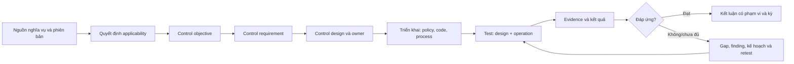
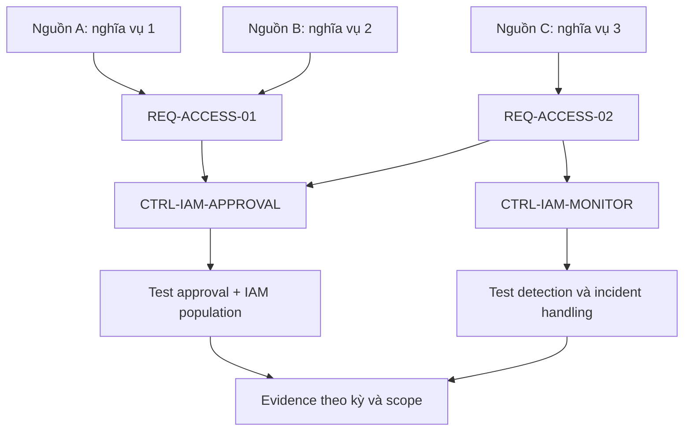
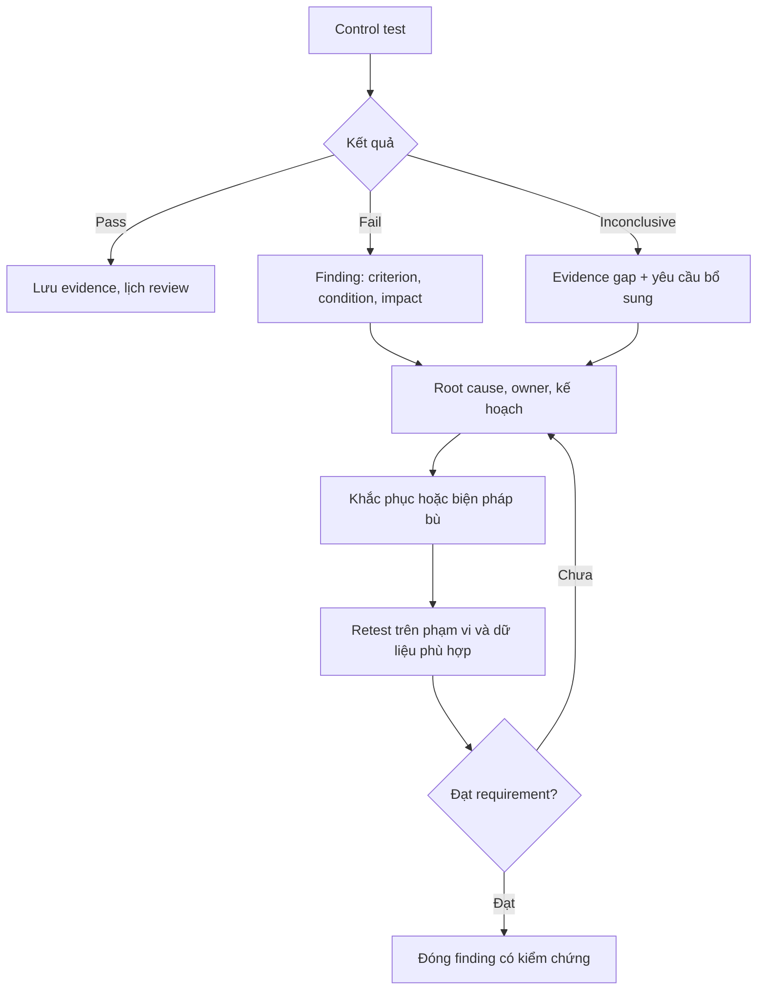
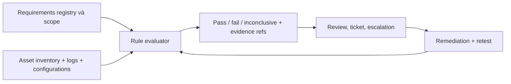

# Control requirement: chuyển nghĩa vụ tuân thủ thành yêu cầu kiểm soát có thể kiểm chứng

## 1. Control requirement là gì?

**Control requirement** (yêu cầu đối với kiểm soát) là một phát biểu xác định **kiểm soát phải đạt điều gì, áp dụng cho đối tượng nào, trong điều kiện và thời hạn nào, với tiêu chí chấp nhận và bằng chứng xác minh ra sao**. Nó là cầu nối giữa nghĩa vụ tuân thủ, mục tiêu quản trị rủi ro và thiết kế/vận hành các biện pháp bảo mật.

Trong chương **Compliance assurance** của module **SECURITY_SECURITY_ASSURANCE**, mục tiêu không chỉ là tích vào bảng kiểm “đã có kiểm soát”. Module hướng tới **đánh giá có bằng chứng rằng hệ thống đáp ứng các mục tiêu bảo mật**, từ phân tích rủi ro, yêu cầu và security controls đến kiểm thử, audit và khắc phục phát hiện; đồng thời tổ chức hoạt động security assurance liên tục trong phát triển và vận hành. Control requirement phải giúp một người độc lập đi từ **nguồn yêu cầu → nội dung áp dụng → kiểm soát triển khai → kiểm thử → bằng chứng → kết luận và hành động**.

Ví dụ, câu “công ty phải bảo vệ tài khoản có quyền cao” chưa đủ để kỹ sư triển khai hay auditor đánh giá. Một yêu cầu cụ thể hơn có thể là:

> “Mọi tài khoản người dùng được cấp quyền quản trị trên các tenant production thuộc phạm vi phải chịu chính sách xác thực nhiều yếu tố theo thiết kế đã phê duyệt; các trường hợp không thể áp dụng phải có cơ chế xác thực thay thế, quyết định phê duyệt, hạn rà soát và bằng chứng hoạt động.”

Yêu cầu trên vẫn cần làm rõ **phạm vi tài khoản**, cách định nghĩa quyền quản trị, quy trình xử lý tài khoản kỹ thuật, kết quả cần kiểm tra và các ngoại lệ hợp lệ. Đó chính là công việc thiết kế control requirement.

Sau bài này, người học có thể:

- Phân biệt nghĩa vụ nguồn, control objective, control requirement, control implementation, control test và evidence.
- Chuyển một điều khoản hoặc chính sách thành yêu cầu **rõ ràng, có thể đo và truy vết**, không tự tạo thêm nghĩa vụ chưa có căn cứ.
- Xây dựng mô hình mapping nhiều-đến-nhiều giữa điều khoản, yêu cầu, kiểm soát, tài sản, người chịu trách nhiệm và kết quả kiểm tra.
- Đánh giá tính đầy đủ của phạm vi, population, thời gian, ngoại lệ, kiểm soát chia sẻ và bằng chứng.
- Quản lý thay đổi, sai lệch, miễn trừ nội bộ, khắc phục và giám sát liên tục.

## 2. Đặt control requirement đúng tầng khái niệm

Các khái niệm gần nhau nhưng không thay thế nhau:

| Thành phần | Trả lời câu hỏi | Ví dụ |
|---|---|---|
| **Source obligation / source requirement** | Văn bản hoặc cam kết gốc yêu cầu điều gì? | Một điều khoản hợp đồng yêu cầu kiểm soát truy cập được quản lý |
| **Applicability decision** | Nghĩa vụ đó áp dụng cho tổ chức, dịch vụ, dữ liệu và kỳ nào? | Áp dụng cho dịch vụ SaaS xử lý dữ liệu khách hàng trong hợp đồng A |
| **Control objective** | Mục tiêu an toàn hoặc tuân thủ cần đạt là gì? | Chỉ danh tính được ủy quyền mới truy cập hệ thống production |
| **Control requirement** | Kết quả/điều kiện kiểm soát cụ thể phải đáp ứng? | Quyền admin được phê duyệt trước cấp, ghi log, rà soát theo chu kỳ |
| **Control design** | Kiểm soát dự định hoạt động theo cơ chế nào? | Workflow phê duyệt và IAM role assignment |
| **Control implementation** | Cấu hình, quy trình hoặc code thực tế nào thực thi? | Policy IdP, ticket workflow, audit events, automation |
| **Control test** | Làm sao xác minh thiết kế và hoạt động đạt yêu cầu? | Đối chiếu log cấp quyền với approval trước thời điểm cấp |
| **Evidence** | Dữ kiện nào hỗ trợ hoặc bác bỏ kết luận? | Change log IAM, ticket, timestamps, export population |
| **Finding / gap** | Điều gì sai, chưa đủ bằng chứng hoặc chưa áp dụng? | 3 quyền admin không có phê duyệt trước khi cấp |

**Nghĩa vụ tuân thủ không tự bằng một cấu hình kỹ thuật.** Một điều khoản có thể cần nhiều kiểm soát; một kiểm soát có thể đáp ứng nhiều điều khoản. Việc ánh xạ phải bảo toàn **nội dung và điều kiện áp dụng**, thay vì chỉ gán nhãn “mapped”.

**Có kiểm soát không đồng nghĩa đáp ứng yêu cầu.** Ví dụ, có hệ thống ticket phê duyệt quyền nhưng người quản trị vẫn có thể cấp quyền trực tiếp, ngoài workflow. Kiểm chứng phải bao phủ cả đường đi “không theo quy trình”.

## 3. Nguồn của control requirement

Yêu cầu có thể xuất phát từ nhiều nguồn với mức thẩm quyền khác nhau:

1. **Pháp luật hoặc quy định** thực sự áp dụng cho tổ chức, hoạt động, loại dữ liệu và địa điểm.
2. **Hợp đồng và cam kết khách hàng**, bao gồm phụ lục bảo mật, SLA và trách nhiệm bên xử lý dữ liệu.
3. **Tiêu chuẩn/chứng nhận** mà tổ chức chọn hoặc phải đáp ứng theo phạm vi đánh giá; ví dụ bộ tiêu chuẩn quản lý an toàn thông tin hay quản lý dịch vụ.
4. **Chính sách nội bộ** được cấp có thẩm quyền phê duyệt và áp dụng cho đơn vị, môi trường, công nghệ.
5. **Kết quả risk assessment, threat modeling, BIA**, mục tiêu kiểm soát rủi ro và các quyết định quản lý.
6. **Kiến trúc và tiêu chuẩn kỹ thuật nội bộ** như cấu hình chuẩn, secure development requirements, mã hóa hoặc logging.

Không nên gộp các loại nguồn thành một danh sách không phân biệt. Chẳng hạn một **control khuyến nghị** trong bộ hướng dẫn không tự động trở thành **nghĩa vụ pháp lý**; một yêu cầu hợp đồng có thể nghiêm ngặt hơn chính sách công ty; một tài liệu hướng dẫn vendor không đương nhiên là tiêu chí chấp nhận tuân thủ.

Mỗi nguồn cần quản lý:

| Thuộc tính | Ý nghĩa |
|---|---|
| `source_id` và `source_type` | Định danh tài liệu, nguồn luật/hợp đồng/chính sách/rủi ro |
| `issuer` / chủ sở hữu | Ai ban hành hoặc chịu trách nhiệm giải thích? |
| `document_title` / `clause_ref` | Điều khoản hoặc mục chính xác, tránh trích dẫn chung cả tài liệu |
| `version`, `effective_at` | Bản và thời điểm có hiệu lực |
| `jurisdiction` / `contract_scope` | Phạm vi địa lý, pháp nhân, dịch vụ hoặc đối tượng |
| `applicability_basis` | Lý do tổ chức thuộc hoặc không thuộc phạm vi |
| `interpretation_owner` | Ai phê duyệt cách diễn giải, nhất là khi liên quan pháp lý? |
| `review_trigger` | Khi nguồn thay đổi hoặc điều kiện áp dụng thay đổi thì phải làm gì? |

**Không tự suy ra mức bắt buộc từ tên framework.** Khi cần quyết định cụ thể về nghĩa vụ pháp lý, hợp đồng hoặc chứng nhận, phải dựa trên phiên bản nguồn có hiệu lực và sự rà soát của bộ phận có thẩm quyền. Các ví dụ về thời hạn và ngưỡng trong bài này chỉ là giả định phục vụ học tập, không phải nghĩa vụ chung.

## 4. Từ nghĩa vụ tới bằng chứng: chuỗi truy vết



Chuỗi phải hỗ trợ **truy vấn hai chiều**:

- Từ một nghĩa vụ nguồn, tìm tất cả yêu cầu, kiểm soát và bằng chứng hỗ trợ.
- Từ một control đang chạy, tìm lý do tồn tại, requirement áp dụng, người chịu trách nhiệm và thời điểm cần test.
- Từ một finding, xác định mục tiêu, tài sản, nghĩa vụ liên quan và ảnh hưởng đến kết luận nào.

Một hàng spreadsheet như `Clause-01 → CTRL-07 → Compliant` chưa đủ nếu không giải thích **CTRL-07 thực sự giải quyết phần nào của Clause-01** và có bằng chứng đủ cho population, period và ngoại lệ hay không.

### 4.1. Quan hệ nhiều-đến-nhiều

Một yêu cầu “truy cập có kiểm soát” có thể cần cấp quyền, xác thực mạnh, logging, rà soát quyền và thu hồi khi thay đổi vai trò. Ngược lại, một dịch vụ IAM thực thi chính sách quản lý đặc quyền có thể hỗ trợ nhiều yêu cầu khác nhau.

Vì thế nên phân biệt:

- **Requirement ID**: yêu cầu đã chuẩn hóa, giữ nội dung của nguồn.
- **Control ID**: biện pháp được tổ chức thiết kế để thực hiện một hay nhiều yêu cầu.
- **Implementation ID**: triển khai cụ thể theo hệ thống/môi trường.
- **Test ID**: phép kiểm tra, phiên bản thủ tục và tập dữ liệu.
- **Evidence ID**: bản ghi, file hoặc artifact cụ thể.
- **Finding ID**: vấn đề cần xử lý.

Không dùng một nhãn `covered=true` để che các nhánh chưa có implementation hoặc thiếu test.

## 5. Cấu trúc của một control requirement rõ ràng

Một yêu cầu đủ tốt thường có những thành phần sau:

| Thành phần | Câu hỏi | Ví dụ minh họa |
|---|---|---|
| **Chủ thể chịu trách nhiệm** | Ai phải bảo đảm việc thực thi? | Identity platform owner |
| **Đối tượng/population** | Những danh tính/tài sản/sự kiện nào thuộc phạm vi? | Tất cả privileged human accounts ở production |
| **Hành động hoặc trạng thái bắt buộc** | Phải làm gì hoặc bảo đảm điều gì? | Áp dụng policy MFA được phê duyệt |
| **Điều kiện kích hoạt** | Khi nào yêu cầu bắt đầu áp dụng? | Trước thời điểm cấp quyền privileged |
| **Tần suất/thời hạn** | Liên tục, theo sự kiện, định kỳ hay tại một thời điểm? | Mỗi lần cấp quyền; rà soát theo lịch phê duyệt |
| **Điều kiện loại trừ/ngoại lệ** | Có trường hợp nào đặc biệt, do ai phê duyệt? | Emergency access có kiểm soát bù |
| **Tiêu chí chấp nhận** | Làm sao xác định đạt? | Không có đối tượng thuộc phạm vi thiếu enforcement trái phép |
| **Evidence và test** | Dữ liệu nào cho thấy kiểm soát hoạt động? | Export role, policy, assignment history, test |
| **Thời điểm/phiên bản áp dụng** | Khi nào và phiên bản nào có hiệu lực? | Kể từ bản chính sách được phê duyệt |
| **Ràng buộc bảo mật/riêng tư** | Bằng chứng có chứa dữ liệu nhạy cảm không? | Chỉ dùng ID và timestamp, không xuất token |

Một mẫu câu thường hữu ích:

> **[Chủ thể] phải [hành động hoặc trạng thái kiểm soát] đối với [population/phạm vi] khi [điều kiện], trong [thời hạn/tần suất], ngoại trừ [trường hợp được phép và phê duyệt]; kết quả phải được xác minh bằng [phép thử/bằng chứng] theo [tiêu chí chấp nhận].**

Không cần nhét mọi metadata vào một câu quá dài. Có thể viết **một câu requirement ngắn** rồi giữ scope, frequency, exception, acceptance và evidence trong các trường có cấu trúc.

### 5.1. Atomicity: một requirement phải kiểm tra được

Câu “mọi hệ thống phải mã hóa, backup, giám sát và kiểm tra an ninh thường xuyên” chứa nhiều kết quả khác nhau. Nếu backup đạt nhưng logging thất bại, trạng thái yêu cầu là gì? Nên tách thành các yêu cầu nguyên tử:

- Bảo vệ dữ liệu ở trạng thái lưu bằng phương thức mã hóa được phê duyệt theo phạm vi.
- Sao lưu dữ liệu theo RPO và retention đã phê duyệt.
- Thu thập sự kiện bảo mật theo data contract và phạm vi đã xác định.
- Kiểm thử khả năng khôi phục theo tiêu chí RTO/RPO và tính toàn vẹn nghiệp vụ.

**Tách yêu cầu không có nghĩa lặp lại nguyên văn cùng một điều khoản nhiều lần**. Mỗi yêu cầu cần mô tả một kết quả có thể đánh giá riêng và giữ liên kết tới những phần của nguồn mà nó hỗ trợ.

## 6. Quy trình chuẩn hóa yêu cầu từ nguồn

Một quy trình phân tích nguồn nên gồm:

1. **Xác thực nguồn**: tài liệu và phiên bản hiện hành, điều khoản, ngày có hiệu lực, chủ thể áp dụng.
2. **Đọc trọn ngữ cảnh**: định nghĩa, ngoại lệ, điều kiện, phạm vi, văn bản liên quan và nghĩa vụ đi kèm; không cắt một câu khỏi ngữ cảnh.
3. **Xác định modality**: yêu cầu bắt buộc, khuyến nghị, điều kiện, quyền lựa chọn hay ví dụ hướng dẫn?
4. **Quyết định applicability**: phạm vi pháp nhân, quốc gia, sản phẩm, dữ liệu, loại tài khoản, hệ thống và thời kỳ.
5. **Diễn giải thành objective**: tổ chức cần ngăn/nghiệm chứng rủi ro hoặc kết quả nào?
6. **Tách thành yêu cầu nguyên tử**: chủ thể, đối tượng, điều kiện, thời điểm và ranh giới.
7. **Định nghĩa tiêu chí nghiệm thu**: cần kiểm tra điều gì để chứng minh đúng?
8. **Chọn control và owner**: dùng kiểm soát hiện có hoặc xác định khoảng trống thiết kế/triển khai.
9. **Review cách diễn giải**: Security, Legal/Compliance, risk owner, system owner theo bản chất nguồn.
10. **Phê duyệt, version hóa và theo dõi**: đóng băng baseline cho kỳ đánh giá, lưu lịch sử mọi thay đổi.

Ví dụ một **chính sách nội bộ giả định** quy định “quyền truy cập quản trị phải được phê duyệt trước khi cấp, trừ trường hợp khẩn cấp theo quy trình”. Có thể chuyển thành:

| ID | Yêu cầu nguyên tử | Điều kiện kiểm tra |
|---|---|---|
| `REQ-IAM-01` | Mọi lần cấp quyền quản trị thông thường phải có phê duyệt hợp lệ trước thời điểm cấp | Đối chiếu sự kiện IAM và approval timestamp |
| `REQ-IAM-02` | Mọi lần cấp quyền khẩn phải được gắn mã sự kiện, có giới hạn thời gian và hậu kiểm theo quy trình đã duyệt | Đối chiếu emergency population, expiry và hậu kiểm |
| `REQ-IAM-03` | Người vận hành phải theo dõi thay đổi quyền nằm ngoài luồng yêu cầu để điều tra | Đối chiếu toàn bộ IAM change population với workflow |
| `REQ-IAM-04` | Bằng chứng cấp quyền và phê duyệt phải được lưu theo lịch đã phê duyệt | Kiểm tra retention và khả năng truy xuất kỳ mẫu |

Bốn yêu cầu là cách **diễn giải/thiết kế minh họa**, không nên tự nhận là nguyên văn một điều khoản bất kỳ. Nếu nguồn gốc không yêu cầu lưu log hoặc giám sát, tổ chức có thể đưa các biện pháp đó thành **yêu cầu hỗ trợ nội bộ** để có thể chứng minh nghĩa vụ; phải ghi rõ xuất xứ và lý do.

## 7. Scope và applicability: “áp dụng cho ai?” quan trọng không kém “làm gì?”

Sai lầm phổ biến là có một control chung nhưng không xác định **những gì nằm trong phạm vi**.

Những chiều cần xét:

- **Pháp nhân/đơn vị**: công ty mẹ, công ty con, đơn vị nghiệp vụ hoặc đối tác.
- **Hệ thống/môi trường**: production, staging, development, cloud accounts, tenants, hệ thống tại chỗ, SaaS.
- **Đối tượng**: human users, service accounts, admins, external identities, devices, servers, applications, data sets.
- **Phân loại dữ liệu**: công khai, nội bộ, mật, nhạy cảm, dữ liệu khách hàng hoặc dữ liệu có nghĩa vụ riêng.
- **Thời gian**: ngày bắt đầu áp dụng, kỳ đánh giá, các khoảng maintenance hoặc chuyển đổi kiến trúc.
- **Các trường hợp đặc biệt**: tài khoản break-glass, hệ thống legacy, trường hợp không thể triển khai kỹ thuật, đơn vị được loại trừ có căn cứ.

Một tuyên bố “100% máy được bật EDR” chỉ có thể kiểm chứng khi biết **tập máy đúng**: inventory gồm máy đang hoạt động, ephemeral workloads, tài sản của nhà thầu, môi trường DR hay máy thử nghiệm? Nếu mẫu số không rõ, phần trăm mất ý nghĩa.

### 7.1. Applicability phải có căn cứ và có thể thay đổi

Quyết định `not_applicable` cũng cần có:

- Điều khoản nguồn, phạm vi thực tế, lý do không áp dụng.
- Người có thẩm quyền xác nhận.
- Bằng chứng hỗ trợ, ví dụ không xử lý loại dữ liệu thuộc điều kiện.
- Trigger rà soát khi sản phẩm, khách hàng, hợp đồng hoặc quy định thay đổi.

Không dùng `N/A` để “xóa” những yêu cầu khó thực hiện. Việc một công nghệ chưa hỗ trợ kiểm soát thường là **gap hoặc exception**, không phải mặc nhiên *không áp dụng*.

## 8. Thiết kế tiêu chí chấp nhận và đo lường

Một control requirement phải cho phép xác định **pass, fail hoặc chưa đủ dữ liệu**, thay vì chỉ gắn nhãn “đã triển khai”.

Ví dụ mục tiêu “mọi thay đổi production được phê duyệt trước triển khai”:

- **Population**: tất cả deployment event production trong thời kỳ.
- **Join keys**: `deployment_id`, `change_id`, actor/system ID và mốc thời gian.
- **Điều kiện đạt cho mỗi trường hợp thông thường**: tồn tại approval hợp lệ có phạm vi bao phủ thay đổi, `approved_at < deployed_at` hoặc `<=` nếu quy tắc thời gian cho phép, và người duyệt đúng thẩm quyền.
- **Emergency path**: có phân loại khẩn, quyền kích hoạt và hậu kiểm theo quy định.
- **Sai lệch**: không có approval, approval không đúng phạm vi, phê duyệt sau triển khai nhưng không thuộc đường khẩn, thời gian không đáng tin.
- **Giới hạn**: không lấy số ticket làm population nếu deploy ngoài workflow vẫn có thể diễn ra.

Có thể đo tỷ lệ các trường hợp đạt trên population **đã được xác minh đầy đủ**:

\[
\mathrm{Rate}_{\mathrm{observed}} =
\frac{\mathrm{Cases\ meeting\ criteria}}{\mathrm{Cases\ in\ verified\ scope}}\times100\%.
\]

Ví dụ **196/200 = 98%** chỉ mô tả 200 thay đổi đã được đối chiếu. Nếu còn 15 event ngoài population do log thất lạc, không thể báo tỷ lệ bao phủ toàn bộ production là 98%.

Cẩn trọng khi dùng threshold. Nếu nguồn yêu cầu **mọi** trường hợp phải đạt, việc tự đặt KPI 95% không thay đổi nghĩa vụ. Ngưỡng nội bộ chỉ có thể thay thế tiêu chí cứng khi **nguồn và thẩm quyền cho phép**, hoặc được xác định rõ như chỉ số vận hành riêng với kết luận tuân thủ.

### 8.1. Kết quả có ba trạng thái

| Kết quả | Nghĩa |
|---|---|
| **Pass / met** | Đã kiểm tra trên phạm vi/kỳ đã định, có bằng chứng đáng tin cho tiêu chí |
| **Fail / not met** | Có bằng chứng xác thực về sai lệch so với yêu cầu |
| **Inconclusive / insufficient evidence** | Không đủ cơ sở kết luận; có thể thiếu population, log, tính xác thực hoặc thời gian |

Trạng thái **inconclusive không được biến thành pass**. Cũng không nên tự động gọi thiếu log là “control fail” nếu đó là **evidence gap** cần phân định, nhưng thiếu khả năng ghi nhận bằng chứng có thể chính nó vi phạm một yêu cầu quản trị hoặc logging độc lập.

## 9. Thời gian: point-in-time, continuous, periodic và event-driven

Yêu cầu phải chỉ rõ **khi nào kiểm soát cần hoạt động**. Bốn loại chính:

| Loại | Ví dụ minh họa | Cách lấy bằng chứng |
|---|---|---|
| **Point-in-time** | Đến mốc T, mọi bucket thuộc phạm vi có mã hóa tại nơi lưu | Inventory và cấu hình tại mốc T; xác nhận completeness |
| **Continuous** | Mọi API production phải dùng cấu hình TLS được phê duyệt | Giám sát thay đổi/scan theo độ phủ và period, bằng chứng phát hiện drift |
| **Periodic** | Quyền admin được rà soát theo chu kỳ quy định | Population người có quyền theo kỳ; review record, decision và follow-up |
| **Event-driven** | Mỗi lần cấp quyền phải được phê duyệt trước khi cấp | Population sự kiện, approval, timestamps và xử lý ngoại lệ |

Một screenshot lúc 17:00 chỉ chứng minh một trạng thái quan sát được lúc đó; không tự chứng minh suốt 90 ngày không có drift. Đối với yêu cầu liên tục, cần **change history**, monitoring records, automated compliance snapshots hoặc bằng chứng bù để đánh giá khoảng thời gian.

Đồng thời phải xác định khoảng thời gian như `[start_inclusive, end_exclusive)` bằng UTC khi dùng truy vấn dữ liệu, giúp tránh bỏ/trùng event tại ranh giới.

### 9.1. “Review hằng quý” có nghĩa gì?

Nếu chính sách nói “mỗi quý”, cần xác định:

- Quý theo lịch hay mỗi 3 tháng tính từ mốc riêng?
- Review phải **hoàn tất** hay chỉ khởi tạo trong quý?
- Khi một tài khoản mới được tạo cuối quý, có thể được review trong kỳ sau không?
- Ai là người phê duyệt, có được tự duyệt quyền của mình không?
- Trường hợp kết quả review yêu cầu thu hồi quyền, deadline khắc phục tính thế nào?

Không làm rõ các điều kiện này thì auditor và đội vận hành có thể đưa ra kết luận khác nhau dù cùng xem một tập log.

## 10. Gắn yêu cầu với control design và implementation

Một requirement không nhất thiết buộc sử dụng một sản phẩm cụ thể. Thiết kế nên phân biệt **what** với **how**:

- **What (requirement):** tài khoản privileged phải được xác thực và kiểm soát đúng mức.
- **How (design):** áp dụng IdP policy và phương thức MFA thích hợp; tài khoản non-human dùng phương thức xác thực riêng, có quản trị secret/key và privilege.
- **Implementation:** IdP policy ID, role scope, application mapping, CI config, log sources, exception workflow.
- **Verification:** truy vấn export để xác nhận đúng population, policy scope, quyền thực tế và ngoại lệ.

Các pattern kiểm soát có thể phối hợp:

| Pattern | Cách hoạt động | Ví dụ |
|---|---|---|
| **Preventive** | Ngăn hành vi vi phạm từ đầu | Chặn deploy nếu chưa có phê duyệt hợp lệ |
| **Detective** | Phát hiện sai lệch đã/đang xảy ra | Alert khi quyền admin được cấp ngoài workflow |
| **Corrective** | Sửa và đưa trạng thái về mức phù hợp | Thu hồi quyền trái phép, điều chỉnh policy |
| **Compensating** | Giảm rủi ro khi kiểm soát chính chưa khả thi | Giới hạn network, ghi log tăng cường, phê duyệt bổ sung theo rủi ro |
| **Directive / governance** | Quy định trách nhiệm và cách thực hiện | Chính sách, quy trình, phân quyền phê duyệt |

Một detective control không mặc nhiên thay thế yêu cầu preventive; phải chứng minh **cơ chế bù thực sự đáp ứng mục tiêu hoặc được phép** bởi nguồn nghĩa vụ, cùng đánh giá rủi ro và quyết định có thẩm quyền.

## 11. Mapping nhiều framework mà không đánh đồng equivalence

Các nhóm compliance thường dùng một bộ kiểm soát nội bộ để đối chiếu nhiều nguồn, ví dụ tiêu chuẩn quản lý bảo mật, yêu cầu khách hàng và chính sách công ty. Cách này giảm trùng lặp nhưng chỉ hiệu quả nếu mapping đủ chính xác.



Một bảng mapping nên có:

| Thuộc tính | Mục đích |
|---|---|
| `source_clause_ref` | Điều khoản cụ thể và phiên bản |
| `requirement_id` | Yêu cầu nội bộ được định nghĩa rõ |
| `mapping_type` | Đáp ứng toàn phần, một phần, hỗ trợ, hoặc không tương đương |
| `mapping_rationale` | Giải thích logic liên hệ |
| `scope_overlap` | Phần giao của hệ thống/dữ liệu/thời kỳ |
| `residual_gap` | Điều kiện nào nguồn đòi hỏi mà control chưa giải quyết |
| `reviewer`, `approved_at` | Người và thời điểm xác nhận mapping |
| `source_version` | Khi tài liệu nguồn đổi cần rà lại |

Không khẳng định hai yêu cầu **tương đương** chỉ vì cùng nói đến “access control”. Một nguồn có thể yêu cầu rà soát hằng quý; nguồn khác yêu cầu rà soát trước khi cấp, hoặc yêu cầu khác về bằng chứng/đối tượng. Một control triển khai có thể hỗ trợ cả hai nhưng **phải kiểm tra thêm điều kiện riêng**.

### 11.1. Phân biệt mapping và kết luận compliance

- `mapped`: có control được liên kết về mặt thiết kế.
- `implemented`: control đã được triển khai trên hệ thống phù hợp.
- `tested`: đã có phép kiểm tra theo kỳ, scope và tiêu chí.
- `met`: bằng chứng đã được đánh giá đủ để kết luận yêu cầu đạt trong phạm vi.
- `not_met` / `inconclusive`: có sai lệch hoặc chưa đủ bằng chứng.

Một bảng chỉ có cột `mapped = true` chưa phải báo cáo compliance assurance.

## 12. Ví dụ chi tiết 1: yêu cầu với tài khoản privileged

**Nguồn giả định:** chính sách nội bộ yêu cầu truy cập quản trị production phải có xác thực thích hợp, có người chịu trách nhiệm và ghi nhận hoạt động.

### 12.1. Tách thành các yêu cầu

| Mã | Control requirement | Phạm vi | Bằng chứng chính |
|---|---|---|---|
| `REQ-PAM-01` | Danh tính con người có quyền admin chịu chính sách xác thực mạnh được duyệt | Human privileged identities trên production | Role inventory, IdP policy, policy evaluation logs |
| `REQ-PAM-02` | Danh tính non-human có quyền cao được quản lý credential, scope và vòng đời riêng | Service accounts / workload identities thuộc phạm vi | Inventory, IAM policy, secret/key rotation/change records |
| `REQ-PAM-03` | Quyền admin được cấp theo approval và giới hạn nhu cầu | Mọi privileged grants | IAM events, ticket approval, role scope |
| `REQ-PAM-04` | Hoạt động/việc thay đổi quyền admin được ghi nhận và có thể điều tra | Privileged access events và policy changes | Audit logs, retention, detection/triage results |
| `REQ-PAM-05` | Các trường hợp truy cập khẩn cấp có điều kiện, người phê duyệt và hậu kiểm | Break-glass / emergency cases | Activation logs, expiry, post-review, approvals |

Không nên buộc tài khoản máy **nhập mã MFA như người dùng** khi cơ chế xác thực nền tảng khác hẳn. Yêu cầu đúng cần giữ mục tiêu bảo vệ nhưng triển khai và kiểm chứng **theo loại danh tính**.

### 12.2. Kiểm thử population

Giả sử trong quý có **64 principal từng giữ quyền privileged**, gồm 57 tài khoản con người, 6 workload identities và 1 tài khoản khẩn. Nếu người đánh giá chỉ kiểm tra 57 tài khoản con người, không thể kết luận toàn bộ 64 đã đạt mục tiêu **quản trị đặc quyền tổng thể**. Các nhánh non-human và emergency phải được đánh giá theo tiêu chí tương ứng.

Một số câu hỏi:

- Tài khoản giữ role trong một khoảng ngắn rồi bị thu hồi có nằm trong population theo kỳ không?
- Nhóm quyền động, role tạm thời và quyền kế thừa có được tính?
- Policy MFA áp dụng đúng tenant, resource và phương thức đăng nhập không?
- Quyền admin được cấp qua console, API hay automation có dùng chung workflow?
- Ngoại lệ có duyệt trước, giới hạn thời gian, compensating control và log hậu kiểm không?

Kết luận phải diễn đạt theo yêu cầu cụ thể: **`REQ-PAM-01` đạt** không suy ra **`REQ-PAM-02` đã đạt** nếu chưa có evidence cho non-human identities.

## 13. Ví dụ chi tiết 2: kiểm soát thay đổi production

**Mục tiêu:** mọi thay đổi production có tác động bảo mật được quản lý và có thể truy vết.

**Control requirement minh họa:**

> “Các thay đổi production thuộc nhóm yêu cầu phê duyệt phải có approval hợp lệ trước khi triển khai; thay đổi khẩn được xử lý theo quy trình khẩn và hoàn tất hậu kiểm trong thời hạn do chính sách nội bộ quy định.”

Thiết kế kiểm chứng:

1. **Nguồn population độc lập:** deployment audit log từ các pipeline và cloud APIs, không chỉ danh sách change ticket.
2. **Metadata:** deployment ID, actor, resource, environment, event_time, change ID và loại thay đổi.
3. **Approval source:** change ID, người phê duyệt, thẩm quyền, approved_at, scope và phiên bản.
4. **Emergency path:** incident ID, lý do, người kích hoạt, thời gian, hậu kiểm, kết quả xử lý.
5. **Join/test:** đối chiếu mọi deployment thuộc phạm vi với approval/hậu kiểm tương ứng.
6. **Evidence quality:** log không thiếu event do pipeline bypass, có timezone, có dấu vết thay đổi sau xuất.

Ví dụ tập kiểm tra có **200 deployment** đã được xác thực thuộc phạm vi. Có 191 deployment thường có approval hợp lệ, 5 emergency được xử lý đúng quy trình, 2 deployment không có approval và 2 thiếu dữ liệu liên kết. Kết luận cần tách:

- 196 trường hợp **có bằng chứng đáp ứng nhánh áp dụng**.
- 2 trường hợp **không đáp ứng** theo dữ liệu hiện có.
- 2 trường hợp **chưa đủ bằng chứng** để kết luận.

Không viết “196/200 đạt nên compliant 98%” nếu nguồn yêu cầu yêu cầu mọi trường hợp. Tỷ lệ là chỉ số kiểm tra; kết luận compliance phải xét **mức trọng yếu của sai lệch**, phạm vi, nghĩa vụ và phê duyệt thích hợp.

## 14. Ví dụ chi tiết 3: logging và retention

Một chính sách nội bộ giả định yêu cầu **log hành động quản trị production được thu thập và giữ đủ để điều tra trong một kỳ đã xác định**.

Những yêu cầu nguyên tử có thể là:

- **Coverage:** mọi hệ thống trong danh mục production cần tạo các loại sự kiện quản trị theo data contract.
- **Collection:** sự kiện được forward vào kho bảo vệ có kiểm soát truy cập.
- **Integrity:** người vận hành production thông thường không được xóa/sửa bằng chứng trong kho tập trung.
- **Retention:** dữ liệu phải truy xuất được theo lịch lưu giữ được phê duyệt, có quản lý hold khi phù hợp.
- **Detection/response:** lỗi nguồn log hoặc mất sự kiện kéo dài phải được phát hiện và xử lý.
- **Retrievability:** đội được ủy quyền có thể truy vấn log lịch sử đáp ứng mục tiêu điều tra.

Ví dụ nếu chính sách nội bộ đặt lịch lưu **180 ngày**, không được suy ra “180 ngày là yêu cầu bắt buộc chung cho mọi công ty”. Kiểm chứng cũng không chỉ là nhìn cấu hình `retention_days: 180`: phải xem kho dữ liệu thực, bản ghi ở ranh giới 180 ngày, ngữ cảnh xóa, phân tầng archive, trạng thái hold và các sự kiện mất nguồn.

**Phép thử phù hợp với assertion**: nếu mục tiêu là “có thể truy xuất log lịch sử”, cần test truy xuất; nếu chỉ kiểm tra “cấu hình retention đã bật”, không thể khẳng định mục tiêu truy xuất đã đạt.

## 15. Kiểm soát chia sẻ và shared responsibility

Trong cloud, SaaS hoặc outsourced operations, một control có thể được thực hiện bởi **nhiều bên**, không chỉ một team nội bộ. Cần phân chia phần nghĩa vụ, phần triển khai và phần bằng chứng.

Ví dụ sử dụng SaaS:

| Phần kiểm soát | Bên thường tham gia | Bằng chứng cần xác định |
|---|---|---|
| Bảo vệ hạ tầng dịch vụ | Nhà cung cấp trong phạm vi họ chịu trách nhiệm | Báo cáo/attestation có scope phù hợp, hợp đồng, monitoring |
| Cấu hình SSO/MFA của tenant khách hàng | Tổ chức sử dụng và đôi khi phối hợp vendor | IdP/tenant policy, danh mục tài khoản, test |
| Phân quyền người dùng trong SaaS | Tổ chức và cơ chế nền tảng vendor | Role export, approval, review records |
| Logging và khả năng xuất audit | Nhà cung cấp cung cấp khả năng; tổ chức cấu hình và khai thác | API/export, log events, retention và kiểm thử |
| Xử lý incident và thông báo | Phụ thuộc điều khoản và trách nhiệm của từng bên | Contact, test thông báo, case history |
| Data deletion / exit | Có thể cần hành động từ cả hai bên | Điều khoản, yêu cầu xóa, xác nhận, kiểm tra access |

**Không coi chứng nhận của nhà cung cấp là bằng chứng đầy đủ cho mọi nghĩa vụ của khách hàng.** Chứng cứ phải được đối chiếu đúng dịch vụ, pháp nhân, thời kỳ và phạm vi triển khai. Nếu một phần control nằm ở khách hàng, phần đó cần có owner và test riêng.

### 15.1. Contractual control không đồng nghĩa technical control

Hợp đồng có thể quy định vendor phải thông báo sự cố trong thời gian nhất định. Đây là **nghĩa vụ quản trị và vận hành**. Không thể chỉ viết một cấu hình SIEM để chứng minh vendor đáp ứng điều khoản. Evidence có thể cần quy trình liên hệ, các thông báo thực tế, diễn tập hoặc chứng cứ xác nhận của vendor; độ sâu phụ thuộc rủi ro và thỏa thuận.

## 16. Bằng chứng và thủ tục kiểm thử phải được thiết kế cùng requirement

Khi viết requirement, hãy hỏi ngay: **“Làm sao biết chắc nó đạt hoặc không đạt?”** Nếu không trả lời được, requirement còn quá mơ hồ hoặc không có data contract tương ứng.

| Lớp kiểm thử | Nội dung | Ví dụ |
|---|---|---|
| **Design effectiveness** | Thiết kế có thể thực hiện mục tiêu về nguyên tắc không? | Workflow cấp quyền buộc phê duyệt trước khi cấp |
| **Implementation validation** | Policy, code hoặc quy trình đã hiện diện ở phạm vi đúng? | Export IAM policy và production roles |
| **Operating effectiveness** | Trong kỳ, kiểm soát có thực sự chạy theo yêu cầu không? | Đối chiếu từng IAM grant với phê duyệt |
| **Coverage validation** | Population tài sản/sự kiện có đầy đủ? | So sánh CMDB, cloud inventory, IAM logs |
| **Exception validation** | Ngoại lệ có lý do, thẩm quyền, hạn và biện pháp? | Exception register + audit record |
| **Recovery/regression test** | Sau thay đổi, yêu cầu còn được đáp ứng? | Test sau khi thay cấu hình IAM hoặc pipeline |
| **Independent assurance** | Người không vận hành có thể xác minh? | Review nguồn, mẫu, logic test, evidence và findings |

**Evidence contract** nên chỉ rõ:

- Hệ thống nguồn, owner, quyền truy xuất và cách kiểm tra provenance.
- Trường dữ liệu bắt buộc, schema, ID, timestamp và trạng thái.
- Cửa sổ `[start, end)`, múi giờ và cách xử lý dữ liệu đến muộn.
- Population và nguồn độc lập để đối chiếu đầy đủ.
- Format, query/filter, export time, version và cách chuyển an toàn.
- Cơ chế đối chiếu giữa event, ticket, approval, policy và exception.
- Tiêu chí pass/fail/inconclusive, cách xử lý null, duplicate và false result.

Hash file sau xuất giúp phát hiện thay đổi sau thời điểm hash; **không tự chứng minh file gốc đúng hoặc truy vấn đầy đủ**. Chất lượng bằng chứng phụ thuộc cả nguồn, phương thức thu thập và khả năng tái hiện.

## 17. Khi nào dùng sampling, khi nào cần kiểm tra toàn bộ?

Với kiểm soát vận hành, có thể dùng mẫu để đánh giá một tập giao dịch lớn; nhưng việc chọn mẫu phải có **population đã xác minh** và phương pháp rõ.

- **Kiểm tra toàn bộ** phù hợp nếu rule tự động có thể áp dụng chính xác trên mọi record và chi phí hợp lý.
- **Sampling theo rủi ro** ưu tiên sự kiện privileged, hành động ngoài giờ, ngoại lệ, trường hợp thất bại và thay đổi nhạy cảm.
- **Sampling ngẫu nhiên/thống kê** có thể dùng cho suy diễn khi phương pháp và giả định thống kê phù hợp.
- **Kết hợp** có thể dùng kiểm tra toàn bộ tự động cho điều kiện đơn giản và đánh giá sâu mẫu các trường hợp phức tạp.

Không được gọi 10 tình huống “đẹp” do control owner chọn là mẫu đại diện. Nếu population chưa đầy đủ do missing log, kiểm tra 100% record còn lại cũng chưa chứng minh control bao phủ tất cả hoạt động.

Ví dụ một population có **10.000 thay đổi IAM** được xuất từ audit log nhưng công cụ chỉ phân tích **9.850 event** vì 150 record thiếu `principal_id`. Kết quả pass trên 9.850 không chứng minh yêu cầu với toàn bộ 10.000. Phải có **metric dữ liệu thiếu và cơ chế xử lý 150 record**, kể cả trường hợp chúng không thuộc phạm vi sau xác minh.

## 18. Phân biệt kết quả compliance, control effectiveness và mức rủi ro

Ba kết luận sau không đồng nghĩa:

1. **Requirement compliance status**: có đủ bằng chứng rằng yêu cầu nguồn được đáp ứng trong scope và kỳ?
2. **Control effectiveness**: biện pháp thiết kế và hoạt động có ngăn/phát hiện/giảm hành vi rủi ro như mong đợi?
3. **Residual risk**: sau các kiểm soát và sai lệch, tổ chức còn chấp nhận mức rủi ro nào?

Ví dụ một control review quyền hằng quý có thể thực hiện đúng lịch, nên **đáp ứng yêu cầu review theo lịch**, nhưng phạm vi review không bao gồm tài khoản service mới. Nếu yêu cầu nguồn nói “mọi danh tính có quyền privileged”, status không thể coi toàn bộ là pass. Đồng thời, rủi ro thực tế có thể cao hơn vì các service identities giữ quyền rộng.

Ngược lại, một kiểm soát bù có thể giảm residual risk nhưng **chưa đủ để kết luận compliant** với nghĩa vụ có câu chữ cụ thể nếu nguồn không cho phép phương án thay thế. Kết luận phải thể hiện rõ cả **điểm đạt**, **điểm chưa đạt**, **giới hạn bằng chứng** và **rủi ro còn lại**.

## 19. Exception, waiver, risk acceptance và non-applicability

Những khái niệm này dễ bị sử dụng sai:

| Khái niệm | Ý nghĩa đúng | Điều cần kiểm tra |
|---|---|---|
| **Approved exception** | Ngoại lệ trong chính sách hoặc yêu cầu khi cơ chế áp dụng cho phép | Người duyệt, căn cứ, phạm vi, thời hạn, kiểm soát bù |
| **Temporary waiver** | Tạm miễn một yêu cầu nội bộ theo thẩm quyền trong thời hạn nhất định | Quyền miễn, điều kiện, ngày hết hạn, lịch retest |
| **Risk acceptance** | Quyết định chấp nhận rủi ro còn lại thay vì xử lý ngay | Rủi ro, thẩm quyền, deadline/review và lý do |
| **Not applicable** | Yêu cầu thực sự không áp dụng theo điều kiện phạm vi của nguồn | Căn cứ, nguồn, người xác nhận, trigger đánh giá lại |
| **Compensating control** | Biện pháp thay thế/giảm tác động của thiếu sót | Mục tiêu, test hiệu quả, giới hạn và phê duyệt |
| **Noncompliance / finding** | Có bằng chứng sai lệch so với nghĩa vụ/requirement áp dụng | Mức độ, phạm vi, nguyên nhân, khắc phục và thông báo nếu cần |

**Phê duyệt nội bộ không thể tự thay đổi hoặc loại bỏ nghĩa vụ pháp luật hay điều khoản hợp đồng.** Nếu kiểm soát chưa đáp ứng một nghĩa vụ ngoài tổ chức, quyết định chấp nhận rủi ro chỉ ghi lại lựa chọn quản trị, **không biến trạng thái đó thành tuân thủ**. Những trường hợp này cần sự tham gia của chủ nghĩa vụ, pháp chế/compliance và người có thẩm quyền theo quy trình.

Một ngoại lệ phải có **thời hạn và điều kiện rà soát**; ngoại lệ “vĩnh viễn vì hệ thống legacy” dễ che giấu vấn đề cấu trúc. Nếu yêu cầu không còn áp dụng do dịch vụ ngừng xử lý dữ liệu, lưu hồ sơ thay đổi applicability thay vì chỉ xóa requirement.

## 20. Thiết kế workflow từ finding tới retest

Khi test cho thấy sai lệch hoặc chưa đủ dữ liệu, không kết thúc ở bảng màu đỏ. Một finding tốt cần:

- **Criterion:** requirement nào, phiên bản nào và vì sao áp dụng.
- **Condition:** dữ kiện thực tế sai lệch hoặc khoảng trống, với evidence IDs.
- **Scope:** hệ thống, tài sản, thời kỳ, số trường hợp và giới hạn kiểm tra.
- **Impact/risk:** hậu quả bảo mật hoặc tuân thủ, độ khẩn và mức ưu tiên.
- **Cause (nếu xác định):** cấu hình thiếu, workflow bypass, lỗi telemetry, owner không rõ, thay đổi chưa được phản ánh...
- **Owner:** người chịu trách nhiệm sửa và người theo dõi quyết định.
- **Action:** thay đổi kiểm soát, dữ liệu, quy trình hoặc kỹ thuật.
- **Due/retest:** thời hạn và tiêu chí chứng minh sửa thành công.
- **Residual status:** ngoại lệ, biện pháp bù hoặc quyết định rủi ro còn tồn tại.



**Đóng ticket không đồng nghĩa đóng finding.** Ví dụ sửa IAM policy có thể giải quyết thiếu sót thiết kế, nhưng vẫn phải kiểm tra các tài khoản hiện hữu đã được đưa vào scope, workflow hoạt động và những quyền sai đã được xử lý.

Một phát hiện về **evidence gap** có thể cần sửa log retention, export, data contract hoặc quyền đọc; đôi khi chưa đủ để khẳng định underlying control fail, nhưng vẫn là vấn đề assurance thực tế.

## 21. Control requirement theo thời gian và quản lý thay đổi

Nguồn yêu cầu, hệ thống và mức rủi ro đều thay đổi. Một bản ghi requirement cần có vòng đời:

- `proposed`: được trích từ nguồn hoặc risk assessment, chưa phê duyệt.
- `under_review`: đang xác nhận applicability, cách diễn giải và tiêu chí.
- `approved`: đã được phê duyệt và có mốc bắt đầu.
- `active`: đang được áp dụng trong phạm vi xác định.
- `superseded`: được thay thế bởi bản mới có liên kết lịch sử.
- `retired`: không còn áp dụng theo quyết định có căn cứ.

Thường nên **tách trạng thái lifecycle của requirement** khỏi **trạng thái đáp ứng của implementation**. Một requirement vẫn active dù implementation đang noncompliant; đổi requirement sang retired để tránh phát hiện là hành vi sai quản trị.

Các sự kiện kích hoạt review:

1. Quy định, tiêu chuẩn, hợp đồng hoặc chính sách ban hành phiên bản mới.
2. Thêm quốc gia hoạt động, sản phẩm, khách hàng hoặc nhóm dữ liệu làm thay đổi applicability.
3. Thay kiến trúc cloud, IAM, CI/CD, logging, nhà cung cấp hoặc mô hình shared responsibility.
4. BIA, threat model hoặc risk assessment thay đổi tác động và phạm vi.
5. Audit phát hiện interpretation sai, control gap hoặc population bị bỏ sót.
6. Một control implementation bị tắt, thay owner hoặc mất khả năng xuất bằng chứng.

### 21.1. Version hóa và đánh giá tác động thay đổi

Mỗi thay đổi cần lưu:

| Trường | Mục đích |
|---|---|
| `requirement_id` và `version` | Giữ mã định danh và phiên bản cụ thể |
| `change_reason` | Nguồn hoặc phát hiện nào dẫn tới thay đổi |
| `effective_at` và `retired_at` | Khoảng thời gian có hiệu lực |
| `changed_fields` | Nội dung, scope, tần suất hay tiêu chí nào đổi |
| `impacted_controls` | Implementation, runbook, policy và test nào cần cập nhật |
| `approvers` | Người phê duyệt cách diễn giải và phạm vi |
| `migration_or_grace` | Thời kỳ chuyển đổi nếu nguồn và thẩm quyền cho phép |
| `retest_plan` | Khi nào đánh giá lại và evidence nào cần thu |

Không được hồi tố một yêu cầu mới để đánh giá kỳ cũ **mà không giải thích căn cứ và mốc hiệu lực**. Cũng không được dùng phiên bản hiện tại như bằng chứng rằng kiểm soát đã hoạt động trong các kỳ trước.

## 22. Mô hình dữ liệu và YAML minh họa

Dưới đây là **mẫu mô tả nội bộ**, không phải cấu hình chạy trực tiếp của GRC, IAM, SIEM hoặc tuyên bố về một tiêu chuẩn cụ thể. Nó cho thấy requirement có thể gắn với nguồn, implementation, test và evidence.

```yaml
requirement:
  id: REQ-IAM-APPROVAL-001
  version: "1.0"
  title: "Privileged access requires prior approval"
  lifecycle_status: active
  effective_at: "2026-11-01T00:00:00Z"
  requirement_type: event_driven
  statement: >
    Normal privileged grants for in-scope production identities
    must have an authorized approval before access is granted.
  business_rationale: >
    Reduce unauthorized privilege escalation and make access
    decisions auditable.

source:
  type: internal_policy
  document_id: POL-ACCESS-001
  clause_ref: "privileged_access.approvals"
  source_version: "3.0"
  applicability_decision_ref: APP-DEC-0051
  interpretation_owner: security-compliance

scope:
  environments: [production]
  identity_types: [human, service, external]
  privileged_roles_ref: privileged-role-catalog-v4
  systems_ref: production-system-inventory
  temporal_semantics: event_time_utc

responsibilities:
  requirement_owner: security-governance
  control_owner: identity-platform
  evidence_provider: iam-operations
  reviewer: independent-assurance

acceptance:
  population_source: iam-role-grant-audit
  normal_change_rule: "authorized_approval_at <= grant_at"
  exceptions:
    - ref: emergency-access-policy
      requires_approval_or_review: true
      requires_expiry: true
  missing_evidence_result: inconclusive

implementation:
  control_ids:
    - CTRL-IAM-APPROVAL
    - CTRL-IAM-DRIFT-DETECTION
  technical_refs:
    - iam-role-grant-workflow
    - iam-audit-event-stream

verification:
  test_id: TEST-IAM-GRANT-01
  period:
    start_inclusive: "2026-11-01T00:00:00Z"
    end_exclusive: "2026-12-01T00:00:00Z"
  required_evidence:
    - iam-grant-population
    - approval-workflow-history
    - emergency-exception-register
  test_result: not_tested
  evidence_refs: []

governance:
  approved_by: security-governance-owner
  next_review: "2027-02-01"
  change_request_ref: CHANGE-SEC-042
```

**Các ID, ngày và cấu trúc đều là ví dụ.** Yêu cầu minh họa dùng `<=` vì cho phép phê duyệt và grant có cùng timestamp theo cách đo của hệ thống; thực tế cần định nghĩa quy tắc thứ tự đáng tin. Nếu thời gian ghi nhận có độ phân giải thấp hoặc giữa nhiều hệ thống sai lệch, phải dùng event ordering hoặc audit sequence phù hợp; không dùng so sánh timestamp đơn giản để kết luận thiếu chính xác.

Mẫu lưu `test_result: not_tested` để cho thấy **requirement đã được định nghĩa và triển khai theo metadata không đồng nghĩa đạt compliance**. Tình trạng phải được cập nhật sau khi test và review evidence thực tế.

## 23. Continuous compliance: tự động hóa có giới hạn

**Continuous compliance monitoring** có thể kiểm tra nhiều yêu cầu thường xuyên hơn kỳ audit thủ công. Ví dụ:

- Kiểm tra cấu hình mã hóa, quyền public, logging, policy hoặc bản backup mới nhất.
- Nhận sự kiện thay đổi IAM/CI/CD để đối chiếu approval theo thời gian.
- Theo dõi yêu cầu đã hết hạn review, finding chưa retest, ngoại lệ sắp hết hạn.
- Gắn hệ thống/asset inventory với requirement scope để phát hiện tài sản mới không chịu control.

Một pipeline có thể gồm:



Tự động hóa không được xem là phép màu. Cần kiểm thử:

- **Coverage:** không bỏ qua account, tenant, ephemeral workload hoặc service mới.
- **Data contract:** schema thay đổi, null, duplicate, log trễ, loại quyền hoặc role mapping sai.
- **Engine/version:** rule parser, comparator, timezone và logic ngoại lệ.
- **Exception governance:** policy mới có làm vô hiệu kết quả hoặc che sai lệch không?
- **Failure mode:** khi API trả lỗi hoặc không có log, trạng thái phải là `unknown/inconclusive`, không mặc định pass.
- **Access and audit:** ai sửa rule evaluator, chặn job hoặc ghi đè kết quả, và có log độc lập không?

Không nên tuyên bố “compliant real-time 100%” nếu collector chỉ quét mỗi 24 giờ hoặc có các hệ thống không được quan sát. Cần nêu **độ trễ, mẫu số và giới hạn**.

## 24. Chỉ số để quản trị chất lượng yêu cầu

| Chỉ số | Cách hiểu | Cần tránh |
|---|---|---|
| **Requirement coverage** | Tỷ lệ nghĩa vụ thuộc scope có requirement và owner được phê duyệt | Đếm các nguồn chưa rà soát là đã đủ |
| **Mapping completeness** | Tỷ lệ requirement có control mapping rõ phạm vi và lý do | Coi mọi mapping là toàn phần |
| **Implementation coverage** | Tỷ lệ tài sản/đối tượng thuộc scope đã có control hiện diện | Không có population có thẩm quyền |
| **Test coverage** | Tỷ lệ requirement active có test phù hợp và kết quả trong kỳ | Chỉ đếm số test được viết, không chạy |
| **Evidence freshness** | Bằng chứng còn đúng thời kỳ, nguồn và phiên bản | Screenshot mới thay thế chứng cứ lịch sử |
| **Inconclusive backlog** | Các yêu cầu chưa đủ evidence cần xử lý | Ép chuyển thành pass/fail thiếu căn cứ |
| **Open gaps and aging** | Sai lệch theo rủi ro, owner và thời hạn | Chạy theo số lượng finding thấp bằng cách không kiểm tra |
| **Exception expiry** | Ngoại lệ quá hạn hoặc thiếu phê duyệt | Mặc định ngoại lệ tồn tại vĩnh viễn |
| **Requirement change latency** | Độ trễ từ nguồn đổi đến khi cập nhật mapping, control và test | Chỉ đổi text nhưng không rà implementation |
| **Retest effectiveness** | Các finding được sửa và có kiểm chứng lại | Chỉ dựa vào ticket “closed” |

Nếu cần tính tỷ lệ bao phủ:

\[
\mathrm{Coverage} =
\frac{\mathrm{Items\ verified\ in\ scope}}{\mathrm{All\ confirmed\ in\text{-}scope\ items}}\times100\%.
\]

**Mẫu số phải có nguồn rõ ràng.** Khi còn unknown assets hoặc dữ liệu chưa đối soát, hãy báo cả phần chưa biết và đừng suy rộng từ dữ liệu có sẵn.

## 25. Case study: yêu cầu kiểm soát chia sẻ dữ liệu với SaaS

**Bối cảnh giả định:** một tổ chức tích hợp nền tảng hỗ trợ khách hàng SaaS. SaaS nhận mã khách hàng và nội dung ticket; một API token cho phép đồng bộ thông tin từ hệ thống production. Hợp đồng có yêu cầu bảo vệ quyền truy cập và thông báo sự cố theo điều kiện đã thỏa thuận. Tổ chức còn có chính sách nội bộ yêu cầu owner phê duyệt tích hợp trước triển khai.

### 25.1. Xác định nguồn và applicability

- **Nguồn A — hợp đồng:** điều khoản áp dụng cho dịch vụ SaaS, phạm vi dữ liệu và nghĩa vụ giữa các bên.
- **Nguồn B — chính sách nội bộ:** approval trước khi kết nối hệ thống production.
- **Nguồn C — risk assessment:** nguy cơ lộ dữ liệu và token có phạm vi quyền quá rộng.
- **Nguồn D — BIA:** tác động nếu dịch vụ SaaS ngừng hoạt động trong giờ hỗ trợ quan trọng.

Cần xác định từng nguồn **có hiệu lực khi nào** và ai có thẩm quyền diễn giải. Không được coi yêu cầu nội bộ và hợp đồng là cùng một nghĩa vụ pháp lý.

### 25.2. Requirement và kiểm soát dự kiến

| ID | Requirement minh họa | Kiểm soát và evidence |
|---|---|---|
| `REQ-SaaS-01` | Mọi tích hợp production phải có owner và phê duyệt trước khi kích hoạt | Change/approval ticket, inventory integration, activation log |
| `REQ-SaaS-02` | API credentials chỉ có quyền đúng phạm vi nhiệm vụ và được quản lý an toàn | OAuth scopes/token policy, secret manager, access review |
| `REQ-SaaS-03` | Dữ liệu chia sẻ với vendor phù hợp mục đích đã phê duyệt | Data flow map, field mapping, DLP/connector config |
| `REQ-SaaS-04` | Sự cố liên quan vendor được chuyển tới đầu mối chịu trách nhiệm theo điều khoản | Contract reference, incident runbook, notification test/case |
| `REQ-SaaS-05` | Khi offboarding, quyền và dữ liệu được xử lý theo nghĩa vụ đã xác nhận | Exit checklist, token revocation, data return/deletion evidence |

### 25.3. Kiểm thử và kết luận

Giả sử kiểm tra phát hiện:

- Có ticket phê duyệt tích hợp trước kích hoạt.
- Token có scope `read:customer` nhưng cũng có `write:customer` không có lý do nghiệp vụ.
- Không có bằng chứng rõ cấu hình nào giới hạn trường dữ liệu được đồng bộ.
- Có đầu mối thông báo sự cố nhưng chưa kiểm chứng đường liên lạc khi khẩn cấp.

Kết luận nên tách:

- `REQ-SaaS-01`: có thể đạt trong phạm vi và thời điểm đã kiểm tra.
- `REQ-SaaS-02`: có sai lệch hoặc cần đánh giá theo tiêu chí least privilege đã duyệt, vì scope vượt nhu cầu.
- `REQ-SaaS-03`: **inconclusive** nếu chưa có data flow hoặc export cấu hình tin cậy.
- `REQ-SaaS-04`: thiết kế có đầu mối nhưng chưa đủ bằng chứng về hoạt động; kết quả phụ thuộc tiêu chí yêu cầu chính xác.
- `REQ-SaaS-05`: chưa tới giai đoạn offboarding; cần xác định yêu cầu thiết kế exit plan hiện hành và yêu cầu thực thi khi chấm dứt, không tự đánh dấu control operation đã test.

Bài học: **một hợp đồng được ký và một assessment hoàn tất không chứng minh tất cả yêu cầu đã được vận hành**. Mỗi yêu cầu có scope, bằng chứng và kết luận riêng; cần tìm ra chính xác khoảng trống để sửa.

## 26. Những lỗi thường gặp và cách khắc phục

| Sai lầm | Hệ quả | Cách cải thiện |
|---|---|---|
| Trích nguyên tên điều khoản làm requirement | Không có tiêu chí kỹ thuật hoặc kết quả kiểm tra | Diễn giải nghĩa vụ, chia nguyên tử và phê duyệt |
| Tự coi khuyến nghị là nghĩa vụ pháp lý | Sai mức thẩm quyền và đánh giá | Lưu loại nguồn và căn cứ applicability |
| Viết `must be secure` | Không thể xác định pass/fail | Định nghĩa đối tượng, hành động, scope và acceptance |
| Một requirement ôm nhiều biện pháp | Khó xác định phần nào fail | Tách kết quả kiểm tra riêng, giữ mapping nguồn |
| Scope không có population | Tỷ lệ tuân thủ giả, bỏ sót hệ thống | Liên kết asset/identity/data inventory đáng tin |
| Dùng `mapped` thay cho `compliant` | Khai báo đạt khi chưa triển khai/kiểm thử | Tách trạng thái mapping, implementation, testing |
| Dùng screenshot hiện tại chứng minh cả kỳ | Không thấy drift hay giai đoạn sai lệch | Thu lịch sử sự kiện và evidence theo thời gian |
| Không kiểm tra nguồn bằng chứng | File tổng hợp sai nhưng kết luận vẫn pass | Lưu provenance, query/filter, source reconciliation |
| Ngoại lệ không có hạn | Sai lệch bị che trong nhiều năm | Thẩm quyền, điều kiện, kỳ rà soát, test bù |
| Cho risk acceptance biến thành compliance | Kết luận sai nghĩa vụ bên ngoài | Tách residual risk khỏi status compliance |
| Chỉ kiểm tra người dùng, bỏ service identities | Lỗ hổng coverage | Tách identity types, kiểm tra từng nhánh |
| Dùng chứng chỉ vendor bao phủ cả tenant | Bỏ trách nhiệm khách hàng cấu hình | Mapping shared responsibility và evidence nội bộ |
| Kết luận pass khi dữ liệu trống | “Không thấy sai lệch” vì không quan sát được | Trạng thái inconclusive, mở data gap |
| Sửa requirement để che failed test | Không còn kiểm soát kỳ đánh giá đúng bản gốc | Version hóa, review độc lập, giữ lịch sử |
| Đóng finding khi ticket hoàn tất | Lỗi có thể vẫn tồn tại | Retest acceptance và xác nhận owner |
| Tăng số lượng control nhưng không xem outcome | Chương trình assurance hình thức | Đo hiệu quả qua test, findings, coverage và risk |

## 27. Bài thực hành: viết control requirement cho nền tảng học trực tuyến

**Bối cảnh giả định:** nền tảng học trực tuyến chạy trên cloud, có tài khoản học viên, giáo viên, quản trị viên, API thanh toán và đối tác email. Nền tảng được quản trị bởi nhiều nhóm. Chính sách nội bộ yêu cầu các thay đổi cấu hình bảo mật production phải được phê duyệt và có dấu vết; BIA yêu cầu hệ thống đăng nhập và ghi nhận thanh toán phục hồi trong các mốc đã phê duyệt.

Hãy xây dựng **bộ control requirement nhỏ** theo yêu cầu:

1. Xác định ít nhất **ba nguồn** (chính sách, BIA/risk assessment, hợp đồng đối tác nếu có), lưu ID, phiên bản, phạm vi áp dụng và người có quyền diễn giải.
2. Viết **control objective** cho ba vấn đề: quyền quản trị, thay đổi production và khả năng khôi phục dữ liệu giao dịch.
3. Tách tối thiểu **sáu requirement nguyên tử**: mỗi requirement có ID, câu phát biểu, scope, frequency/trigger, owner, exception và acceptance.
4. Xây **population** cho một requirement quyền admin và một requirement deployment. Nêu nguồn có thẩm quyền và cách nhận biết trường hợp bị bỏ qua.
5. Vẽ mapping nguồn → requirement → control implementation → test → evidence; chỉ rõ trường hợp một control phục vụ nhiều yêu cầu nhưng **không đầy đủ**.
6. Thiết kế **hai test tích cực, hai test sai lệch và một test thiếu bằng chứng**; ghi kết quả kỳ vọng cho mỗi test.
7. Với một SaaS email, phân chia phần trách nhiệm bảo mật của vendor và khách hàng, nêu bằng chứng của từng phần.
8. Giả sử có **125 deployment production** nhưng tracker chỉ có 121 thay đổi với phê duyệt, trong đó 2 là emergency. Xác định điều gì đã được chứng minh và điều gì còn cần kiểm tra; không tự kết luận bốn trường hợp thiếu là vi phạm nếu chưa đối chiếu.
9. Thiết kế xử lý một ngoại lệ legacy không thể áp dụng phương pháp xác thực chính: owner, kiểm soát bù, mức rủi ro, hạn rà soát và quyết định của người có thẩm quyền.
10. Mô tả cách cập nhật requirement khi một hợp đồng mới đưa vào yêu cầu chặt hơn: impact, review, approval, migration plan và retest.

**Tiêu chí hoàn thành:** người kiểm tra độc lập có thể truy nguồn của mỗi requirement, xác định đúng hệ thống và đối tượng thuộc scope, thực hiện test bằng evidence có provenance, phân biệt **pass / fail / inconclusive**, và thấy được trách nhiệm, mốc thời gian cũng như quy trình khắc phục.

## 28. Ghi nhớ

**Control requirement là lời cam kết kiểm soát được đặc tả để có thể kiểm tra**, không chỉ là một dòng checklist hoặc một tên mục tiêu trong framework. Một requirement tốt có:

**Nguồn có hiệu lực → quyết định áp dụng → mục tiêu → yêu cầu nguyên tử (scope + trigger + tiêu chí) → owner và implementation → phép thử → bằng chứng → kết luận có giới hạn → khắc phục và rà soát phiên bản.**

Trong chương trình **SECURITY_SECURITY_ASSURANCE**, chất lượng compliance assurance phụ thuộc khả năng chứng minh từng mắt xích, đặc biệt là **đúng phạm vi, đúng thời kỳ, đầy đủ population, xử lý ngoại lệ minh bạch và thử nghiệm hoạt động thực tế**. Khi chưa có đủ bằng chứng, phải nêu giới hạn thay vì gắn nhãn tuân thủ; khi phát hiện sai lệch, phải có chủ sở hữu, hành động và kết quả kiểm thử lại.
