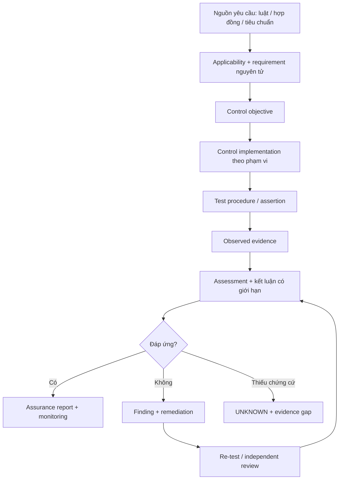
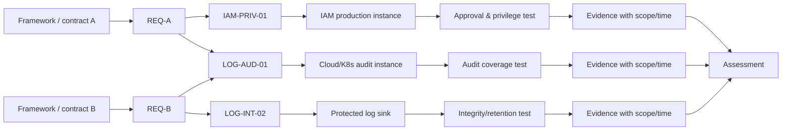

# Mapping compliance: Liên kết yêu cầu tuân thủ, security controls và bằng chứng kiểm chứng

## 1. Mục tiêu học tập

Sau bài học, người học có thể:

- Giải thích **mapping compliance** trong chương trình **compliance assurance**, phân biệt việc lập bản đồ yêu cầu với tuyên bố tuân thủ, chứng nhận, kiểm toán và đánh giá hiệu lực security controls.
- Xác định **nghĩa vụ/tiêu chí áp dụng** theo phạm vi tổ chức, hệ thống, dữ liệu, địa điểm, hợp đồng và phiên bản văn bản; phân biệt yêu cầu pháp lý bắt buộc với tiêu chí của tiêu chuẩn hoặc framework được lựa chọn.
- Chuẩn hóa yêu cầu thành các **điều kiện có thể kiểm chứng**, liên kết qua chuỗi **requirement → control objective → control implementation → test → evidence → assessment → finding**.
- Thiết kế bảng ánh xạ **nhiều–nhiều**, tái sử dụng một security control cho nhiều nguồn yêu cầu nhưng không đánh đồng câu chữ tương tự với nghĩa vụ tương đương hoàn toàn.
- Đánh giá độ bao phủ, chủ sở hữu, trách nhiệm với nhà cung cấp, tính mới của bằng chứng, tính hiệu lực của control và các trường hợp không thể kết luận.
- Quản lý control gaps, exceptions, compensating controls, remediation và thay đổi phiên bản tiêu chuẩn hoặc cấu trúc hạ tầng.
- Xây dựng một quy trình **continuous compliance assurance** với dữ liệu cấu trúc, kiểm thử định kỳ, tự động hóa phù hợp và kết luận có giới hạn rõ ràng.

Bài nằm trong chương **Compliance assurance** thuộc dịch vụ `SECURITY_SECURITY_ASSURANCE`. Mục tiêu của dịch vụ là xây dựng cách đánh giá **có bằng chứng** rằng hệ thống đáp ứng mục tiêu bảo mật, từ phân tích rủi ro, yêu cầu và security controls đến kiểm thử, audit, khắc phục phát hiện; hoạt động assurance được duy trì xuyên suốt phát triển và vận hành. Mapping compliance là cách tổ chức những yêu cầu có thể đến từ nhiều nguồn thành một hệ thống kiểm soát **có thể truy vết và kiểm chứng**, không phải hoạt động tô màu bảng checklist.

## 2. Mapping compliance là gì?

**Mapping compliance** là quá trình xác định và duy trì các quan hệ giữa **nguồn nghĩa vụ hoặc bộ tiêu chí** và **các biện pháp kiểm soát, bằng chứng, phép đánh giá, trách nhiệm thực hiện** nhằm trả lời: yêu cầu nào áp dụng cho tài sản/quy trình nào, được đáp ứng bằng control nào, control đang hoạt động ra sao và có bằng chứng nào hỗ trợ kết luận?

Ví dụ giả định:

> Tổ chức có yêu cầu kiểm soát quyền truy cập đặc quyền vào hệ thống production. Yêu cầu này được liên kết với các controls về định danh, phê duyệt, cấp quyền tối thiểu, rà soát định kỳ và ghi audit. Mỗi control có owner, phạm vi, phương pháp kiểm thử và bằng chứng hiện hành.

Việc gắn một ô “Access control = YES” vào bảng chưa đủ. Cần chứng minh **đúng hệ thống production**, **đúng nhóm danh tính**, **đúng tiêu chí yêu cầu**, **đúng thời gian đánh giá** và **kết quả triển khai thực tế**.

### 2.1. Mapping khác compliance như thế nào?

| Khái niệm | Trả lời câu hỏi | Ví dụ | Giới hạn |
|---|---|---|---|
| **Requirement inventory** | Tổ chức đang xem xét những nghĩa vụ/tiêu chí nào? | Danh mục yêu cầu bảo vệ truy cập | Chưa kết luận phạm vi áp dụng hay hiệu lực |
| **Applicability assessment** | Yêu cầu này áp dụng ở đâu và vì sao? | Dịch vụ xử lý một loại dữ liệu thuộc phạm vi | Cần căn cứ về pháp lý, hợp đồng, hệ thống |
| **Compliance mapping** | Yêu cầu được gắn với controls, tests và evidence nào? | Yêu cầu quyền đặc quyền → IAM-PRIV-01/02 | Mapping chưa chứng minh control đang chạy |
| **Control design assessment** | Control được thiết kế đủ để đáp ứng mục tiêu không? | Workflow phê duyệt và RBAC có lý do hợp lệ | Thiết kế đúng chưa chứng minh vận hành |
| **Operating effectiveness assessment** | Control có hoạt động trong kỳ và phạm vi xét không? | Kiểm các lần cấp quyền thực và audit | Phụ thuộc chất lượng bằng chứng và mẫu kiểm |
| **Compliance conclusion** | Có đủ cơ sở kết luận đối với yêu cầu và phạm vi cụ thể? | Met / Not met / Unknown / Not applicable | Không thể suy rộng ngoài phạm vi được kiểm |
| **Certification / audit report** | Bên đánh giá đưa ra ý kiến theo tiêu chí và kỳ đánh giá nào? | Báo cáo kiểm toán độc lập | Không có nghĩa mọi rủi ro bảo mật bằng không |

Một tổ chức có thể có mapping đầy đủ nhưng vẫn **không đáp ứng** một số yêu cầu. Một tổ chức có controls hiệu quả nhưng **chưa đủ bằng chứng để đưa ra kết luận tuân thủ** cũng cần ghi nhận rõ.

### 2.2. Lợi ích thực tế

Mapping tốt giúp:

- Tránh xây nhiều controls trùng lặp cho các tiêu chí có mục tiêu tương đồng.
- Biết thay đổi hệ thống nào có thể ảnh hưởng các nghĩa vụ nào.
- Xác định chủ sở hữu và phân bổ ngân sách khắc phục.
- Chuẩn bị evidence package nhất quán cho các đợt đánh giá.
- Phát hiện yêu cầu chưa có control hoặc control không có phép kiểm.
- Phân biệt **coverage của bản đồ** với **compliance đã được chứng minh**.
- Thực hiện continuous monitoring thay vì chỉ thu tài liệu trước ngày audit.

## 3. Những lớp trong chuỗi truy vết compliance

Một mô hình thực hành nên tách rõ ít nhất bảy lớp.



### 3.1. Ý nghĩa từng lớp

1. **Source requirement:** điều khoản hoặc tiêu chí nguyên bản cùng phiên bản, ngày hiệu lực và nguồn được quản trị.
2. **Normalized requirement:** nội dung yêu cầu được tách thành các điều kiện cụ thể nhưng không làm mất nghĩa pháp lý/học thuật.
3. **Control objective:** trạng thái an toàn mà tổ chức cần đạt, độc lập với công cụ cụ thể.
4. **Implementation:** cấu hình, quy trình hoặc hành vi thực tế trên từng dịch vụ, account, tài sản, quy trình.
5. **Test/assertion:** cách chứng minh điều kiện đạt, gồm expected, procedure, frequency và population.
6. **Evidence:** kết quả quan sát có timestamp, nguồn, phạm vi, tính toàn vẹn, owner và quyền truy cập.
7. **Assessment:** quyết định có lập luận, giới hạn, kết quả, người đánh giá, finding và việc kiểm lại.

Ví dụ: một chính sách ghi “phải rà soát đặc quyền định kỳ” chưa đủ để chứng minh `iam.role_binding.reviewed` tồn tại. Cần review records, population đầy đủ, owner phê duyệt và bằng chứng xử lý quyền không còn cần thiết.

### 3.2. Tách ba loại statement

- **Designed:** control được mô tả và có cấu hình dự kiến.
- **Deployed:** cấu hình/quy trình đã được đưa vào phạm vi vận hành.
- **Effective:** control đáp ứng tiêu chí trên mẫu/tổng thể và trong kỳ đánh giá có bằng chứng.

Một tài liệu mô tả cơ chế MFA chỉ là **design evidence**. Một cấu hình IdP bắt buộc MFA có thể là **implementation evidence**. Kiểm thử những loại principal và các đường đăng nhập liên quan mới giúp đánh giá hiệu lực trong phạm vi.

## 4. Nguồn yêu cầu: Luật, hợp đồng, tiêu chuẩn và chính sách

Các nguồn mapping có tính chất khác nhau, không nên gộp thành “một checklist bảo mật”.

| Nguồn | Tính chất thường gặp | Cách xác định phạm vi |
|---|---|---|
| **Luật/quy định** | Nghĩa vụ có thể bắt buộc theo thẩm quyền pháp lý và điều kiện áp dụng | Lãnh thổ, vai trò, hoạt động, loại dữ liệu, quy định hiện hành |
| **Hợp đồng/DPA** | Nghĩa vụ giữa các bên theo thỏa thuận | Dịch vụ, loại dữ liệu, điều khoản, SLA, đối tác, thời hạn |
| **Tiêu chuẩn có chứng nhận** | Tiêu chí đánh giá trong phạm vi chứng nhận và phiên bản cụ thể | Scope statement, tài sản, ISMS, phương pháp đánh giá |
| **Framework thực hành** | Bộ cấu trúc kiểm soát/khuyến nghị có thể được tổ chức lựa chọn | Profile, control baseline và risk assessment |
| **Tiêu chí báo cáo assurance** | Bộ tiêu chí cho một cuộc kiểm toán/báo cáo cụ thể | Reporting period, system description và tiêu chí áp dụng |
| **Chính sách nội bộ** | Quy tắc do tổ chức ban hành | Toàn doanh nghiệp hoặc hệ thống/nhóm cụ thể |
| **Yêu cầu khách hàng/ngành** | Cam kết hoặc quy tắc đặc thù của đối tác/ngành nghề | Hợp đồng, sản phẩm, loại giao dịch và jurisdiction |

Ví dụ, một **control về logging** có thể hỗ trợ tiêu chí đánh giá nội bộ và nhiều framework khác nhau, nhưng sự tương tự này **không khiến mọi yêu cầu pháp lý tự động được đáp ứng**. Một số nguồn có điều kiện riêng về thời hạn, nơi lưu, quyền của chủ thể dữ liệu, chứng nhận, kiểm toán hoặc thông báo sự cố.

### 4.1. Những bộ tiêu chí thường được tham khảo

Tùy chương trình, tổ chức có thể xem xét **ISO/IEC 27001 và các controls trong Annex A**, **NIST SP 800-53**, **SOC 2 Trust Services Criteria**, **PCI DSS**, **CIS Controls**, cùng luật và điều khoản hợp đồng có liên quan.

Khi lập bản đồ:

- Ghi **tên chính xác, ấn bản/phiên bản, cơ quan ban hành, thời kỳ/điều kiện hiệu lực**, không gộp các phiên bản dưới một ID tự tạo.
- Phân biệt **ISO/IEC 27001 yêu cầu hệ thống quản lý** với các controls được lựa chọn trong Statement of Applicability và hoạt động đánh giá cụ thể.
- Phân biệt **NIST SP 800-53 control catalog** với quyết định chọn baseline và các yêu cầu pháp lý thực tế của tổ chức.
- Phân biệt **SOC 2 criteria** với chính các controls và mô tả hệ thống cụ thể trong kỳ báo cáo.
- Phân biệt **PCI DSS** với phạm vi môi trường xử lý dữ liệu thẻ và trách nhiệm giữa các bên theo chương trình áp dụng.
- Không khẳng định một nhãn control hoặc “mapped to framework” tương đương **chứng nhận**, **ý kiến kiểm toán** hay **kết luận pháp lý**.

Các ví dụ trong bài là **mô hình giáo dục**, không thay thế việc tra soát phiên bản văn bản và tư vấn của chủ sở hữu pháp lý/compliance.

## 5. Applicability: Xác định yêu cầu nào thực sự áp dụng

Bước đầu tiên không phải gán control vào yêu cầu mà là quyết định **yêu cầu có áp dụng hay không**, áp dụng tại **đâu**, **khi nào** và **với vai trò nào**.

### 5.1. Các chiều phạm vi cần kiểm

- **Legal entity và jurisdiction:** pháp nhân nào, khu vực/địa điểm nào, hoạt động theo vai trò gì.
- **Sản phẩm/dịch vụ và quy trình nghiệp vụ:** dịch vụ thanh toán, IAM, HR, analytics hay nền tảng nội bộ.
- **Loại và luồng dữ liệu:** dữ liệu khách hàng, nhân viên, thanh toán, bí mật, dữ liệu nhạy cảm, bản sao/backup.
- **Asset/technology scope:** account, project, cluster, database, SaaS tenant, endpoints và các dịch vụ bên ngoài.
- **Ownership:** tài sản tự vận hành, managed service, nhà cung cấp hoặc trách nhiệm chia sẻ.
- **Thời gian:** thời điểm bắt đầu hiệu lực, kỳ kiểm toán, thay đổi chính sách hoặc hợp đồng.
- **Điều kiện riêng:** mức doanh thu, loại hoạt động, số lượng đối tượng, ngoại lệ có căn cứ nếu nguồn có quy định.
- **Trust boundary:** dữ liệu đi khỏi vùng quản lý nào, ai có khả năng truy cập và sửa dữ liệu.

Không tự đưa ra quyết định pháp lý chỉ từ tên framework. Với yêu cầu luật/quy định, kết luận applicability cần được chủ sở hữu pháp lý/compliance xác nhận và lưu căn cứ; với tiêu chuẩn, cần xác định **phạm vi đánh giá được chính thức phê duyệt**.

### 5.2. Mẫu applicability register

| Requirement | Phạm vi | Trạng thái | Căn cứ cần có |
|---|---|---|---|
| `REQ-IDM-01` – kiểm soát truy cập đặc quyền | IAM production và cloud accounts quản trị | APPLICABLE | Asset inventory, risk profile, scope quyết định |
| `REQ-LOG-02` – log hành động quản trị | Các dịch vụ có quyền quản trị production | APPLICABLE | Audit scope và control objective |
| `REQ-PRIV-03` – bảo vệ dữ liệu thuộc lớp quy định | Dịch vụ xử lý dataset phù hợp | PENDING_APPLICABILITY | Data inventory, legal/privacy review |
| `REQ-SUP-04` – yêu cầu nhà cung cấp theo hợp đồng | Vendor A có xử lý dữ liệu trong phạm vi | APPLICABLE | Hợp đồng, data flow, vendor registry |
| `REQ-X-05` – tiêu chí của hệ thống ngoài phạm vi | Tài sản B không thuộc scope kỳ đánh giá | NOT_APPLICABLE | Scope statement và lý do có phê duyệt |

**NOT_APPLICABLE không phải là “không muốn triển khai”.** Nó phải có cơ sở có thể kiểm, owner chấp nhận và được rà soát lại khi tài sản, dữ liệu hoặc yêu cầu thay đổi.

### 5.3. Giữ nguyên ngữ nghĩa của nguồn

Khi chuẩn hóa, cần lưu **nguồn và nội dung chính xác có quyền sử dụng**, hạn chế trích dẫn dài trong tài liệu chung nếu có hạn chế bản quyền/hợp đồng. Dùng internal requirement ID và link/reference đến văn bản được quản lý, không phát minh lại câu chữ rồi dùng làm cơ sở pháp lý.

Nếu một điều khoản chứa nhiều nghĩa vụ, tách thành các **atomic assertions** để kiểm chứng riêng, đồng thời giữ liên kết tới điều khoản gốc và ngữ cảnh. Không được tách đến mức làm mất các điều kiện “trừ khi”, “trong phạm vi”, “có xem xét rủi ro” hoặc “theo yêu cầu thỏa thuận”.

## 6. Chuẩn hóa requirements thành điều kiện có thể kiểm chứng

Một mô tả như “quản lý truy cập an toàn” quá rộng cho một phép kiểm duy nhất. Có thể tách thành:

1. Mọi danh tính quản trị thuộc phạm vi được xác định và có owner.
2. Quyền cấp mới phải được phê duyệt theo policy.
3. Quyền được giới hạn theo nhu cầu và có thời hạn khi phù hợp.
4. Các thay đổi quyền có audit event đủ ngữ nghĩa.
5. Quyền tồn tại được rà soát theo kỳ và quyền không hợp lệ được xử lý.
6. Ngoại lệ có approval, expiration và kiểm bù trừ.

Nhưng việc tách trên là **thiết kế kiểm soát nội bộ**, không mặc nhiên là bản diễn giải duy nhất của một điều khoản pháp lý/tiêu chuẩn.

### 6.1. Yêu cầu chuẩn hóa cần những trường gì?

| Trường | Nội dung |
|---|---|
| `requirement_id` | ID nội bộ ổn định |
| `source_ref` | Bộ tiêu chí, phiên bản, điều khoản hoặc hợp đồng |
| `original_intent` | Tóm lược mục tiêu trung thành với nguồn |
| `atomic_assertion` | Điều kiện có thể trả lời bằng test/evidence |
| `applicability_rule` | Điều kiện và phạm vi áp dụng |
| `responsible_owner` | Người chịu trách nhiệm diễn giải/quyết định |
| `effective_from` / `review_due` | Mốc áp dụng và rà soát |
| `risk_context` | Hậu quả nếu không đáp ứng |
| `testability` | Cách có thể kiểm hoặc chứng minh bằng nguồn nào |
| `notes_and_interpretation` | Quyết định/giới hạn được review, không tự bịa |
| `mapping_version` | Phiên bản mối liên kết và người duyệt |

Ví dụ `REQ-IAM-PRIV-01`:

> Trong phạm vi các principal quản trị production được liệt kê theo asset/IAM inventory đã phê duyệt, các lần cấp quyền đặc quyền phải được phê duyệt bởi người có thẩm quyền, có audit record và được đối soát với quyền hiệu lực.

Điều này đủ cụ thể để thử; nhưng nếu một tiêu chuẩn có yêu cầu khác, chủ compliance phải xác nhận sự tương ứng thay vì tự gán “đáp ứng mọi access-control obligations”.

## 7. Control taxonomy: Từ mục tiêu đến triển khai cụ thể

Một **control objective** nên ổn định khi công cụ thay đổi; còn **control implementation** mô tả cách tổ chức đang thực hiện trên từng phạm vi.

| Cấp độ | Ví dụ | Ý nghĩa |
|---|---|---|
| Control objective | “Mọi quyền đặc quyền có thể truy trách nhiệm và kiểm soát” | Điều muốn đạt |
| Canonical control | `IAM-PRIV-01` – phê duyệt cấp quyền; `IAM-PRIV-02` – review quyền | Biện pháp tổ chức áp dụng |
| Implementation | Workflow cấp quyền qua IAM/ITSM trên tài khoản production | Thiết kế cụ thể |
| Asset-bound instance | `IAM-PRIV-01@cloud-account-prod-A` | Một control trên tài sản/phạm vi rõ |
| Test | `TST-IAM-PRIV-01` – đối soát grant và approval | Phép kiểm |
| Evidence | IAM audit, approval record, effective role snapshot | Dữ liệu quan sát |
| Assessment | `ASMT-2026-041`: PASS/FAIL/UNKNOWN trong kỳ | Kết luận có giới hạn |

Một control chung có thể dùng cho nhiều hệ thống nhưng phải cẩn thận với **khác biệt triển khai**. Ví dụ IAM policy cho cloud A không chứng minh SaaS B có quyền tối thiểu, dù cả hai cùng map tới `IAM-PRIV-02`.

### 7.1. Vai trò của control owner

Control owner cần chịu trách nhiệm:

- Thiết kế và phạm vi thực hiện của control.
- Nguồn dữ liệu để chứng minh hoạt động.
- Ngưỡng, lịch kiểm và quy trình xử lý ngoại lệ.
- Phê duyệt thay đổi logic/cấu hình.
- Hợp tác với compliance trong mapping và rủi ro còn lại.
- Khắc phục những kết quả không đạt; cung cấp bằng chứng kiểm lại.

Compliance owner không nhất thiết là người vận hành IAM, backup hay logging. Cần phân biệt **accountability cho yêu cầu** và **responsibility cho control**.

## 8. Ánh xạ nhiều–nhiều và hạn chế của crosswalk

Trong thực tế:

- Một requirement có thể cần **nhiều controls** mới đủ.
- Một control có thể hỗ trợ **nhiều requirements** từ các framework/hợp đồng.
- Một control phải có **nhiều implementations** để bao phủ các hệ thống.
- Một implementation có thể có **nhiều tests**, kết quả khác nhau theo tài sản/kỳ đánh giá.
- Một evidence record có thể hỗ trợ nhiều tests nhưng **chưa chắc đủ** cho từng assertion.

### 8.1. Ví dụ bảng mapping

| Requirement | Canonical control | Implementation / scope | Test | Evidence |
|---|---|---|---|---|
| `REQ-AC-01` – quyền phù hợp chức năng | `IAM-LP-01` – quyền tối thiểu | Cloud IAM production | `TST-IAM-LP-01` | Effective permissions snapshot |
| `REQ-AC-01` | `IAM-REV-02` – review quyền | IdP/SaaS admin groups | `TST-IAM-REV-02` | Review sign-off và remediation |
| `REQ-AUD-03` – truy vết admin actions | `LOG-AUD-01` – audit events | IAM/cloud/Kubernetes API audit | `TST-LOG-AUD-01` | Event samples, source coverage |
| `REQ-AUD-03` | `LOG-INT-02` – bảo vệ log | Central audit sink | `TST-LOG-INT-02` | Retention, ACL, integrity tests |
| `REQ-BCM-04` – khôi phục dữ liệu | `BKP-RST-01` – thử restore | Data platform | `TST-BKP-RST-01` | Restore job, data integrity, RPO |
| `REQ-BCM-04` | `IAM-DR-02` – quyền khẩn cấp | DR account/region | `TST-IAM-DR-02` | Break-glass drill, audit evidence |

Ở ví dụ trên, `REQ-AUD-03` cần cả khả năng **sinh log** lẫn **bảo vệ và truy xuất log**. Có 10.000 audit events nhưng không chứng minh khả năng chống sửa/xóa, thiếu bao phủ một cluster hoặc log retention không đáp ứng policy thì chưa thể kết luận toàn bộ yêu cầu đạt.

### 8.2. Crosswalk không đồng nghĩa tương đương pháp lý

Một bản crosswalk giữa các framework thường chỉ nói rằng hai tiêu chí có **mục tiêu liên quan**. Nó chưa chứng minh:

- Ngôn ngữ nghĩa vụ giống hệt nhau.
- Phạm vi tài sản/dữ liệu giống nhau.
- Tần suất kiểm soát và bằng chứng giống nhau.
- Kỳ đánh giá và người xác nhận giống nhau.
- Tất cả điều kiện ngoại lệ đã được thỏa mãn.

Vì vậy mỗi cạnh `requirement → control` nên có mức liên quan:

- `FULL_COVERAGE_CANDIDATE`: theo phân tích thiết kế, control hoặc bộ controls dự kiến bao phủ toàn bộ assertion.
- `PARTIAL`: chỉ đáp ứng một phần, cần controls khác.
- `SUPPORTING`: cung cấp bằng chứng hoặc biện pháp hỗ trợ, không trực tiếp chứng minh yêu cầu.
- `NOT_EQUIVALENT`: giống thuật ngữ nhưng không thể thay thế cho nhau.
- `REQUIRES_INTERPRETATION`: cần compliance/legal reviewer xác định ngữ nghĩa.

Ngay cả `FULL_COVERAGE_CANDIDATE` vẫn chỉ là **kết luận về mapping thiết kế**. Muốn kết luận đáp ứng thực tế phải có implementation và test đạt trong phạm vi.

## 9. Đồ thị truy vết và quy tắc mapping



Một mapping system nên bảo đảm:

1. **Không có dangling link:** mọi ID nguồn/đích tồn tại hoặc được đánh dấu external reference có quản trị.
2. **Đúng chiều:** control hỗ trợ requirement, không thay thế requirement.
3. **Phạm vi giao nhau:** control instance phải nằm trong phạm vi requirement.
4. **Phiên bản rõ:** thay đổi source version có thể khiến mapping cũ không còn hợp lệ.
5. **Định nghĩa mức bao phủ:** FULL/PARTIAL/SUPPORTING không tự động tạo PASS.
6. **Test hiện hành:** bằng chứng phải phù hợp với thời gian, trường hợp và mẫu kiểm.
7. **Quản lý reviewer:** người thiết kế mapping và người chấp thuận kết luận có vai trò rõ.
8. **Đường truy vết ngược:** từ một security finding biết requirement/control nào bị ảnh hưởng.
9. **Change impact:** khi sửa/thay control biết cần revalidate yêu cầu nào.
10. **Không suy luận từ một control instance:** có 1 account đạt không khiến tất cả accounts đều đạt.

## 10. Mẫu dữ liệu cấu trúc cho mapping compliance

Ví dụ YAML dưới đây là **schema mô phỏng** để học thiết kế dữ liệu, không phải định dạng bắt buộc của công cụ GRC hoặc của một tiêu chuẩn cụ thể.

```yaml
mapping_id: CMP-MAP-2026-003
mapping_version: "1.0.0"
program: "SECURITY_SECURITY_ASSURANCE"
scope:
  environment: production
  assets:
    - cloud-account-prod-a
    - cluster-prod-a
  assessment_period:
    start: "2026-10-01"
    end: "2026-11-30"

sources:
  - source_id: "internal-policy-access-v3"
    source_type: "internal_policy"
    version: "3.0"
    effective_from: "2026-09-01"
    owner: compliance-team

requirements:
  - id: REQ-IAM-PRIV-01
    source_ref: "internal-policy-access-v3/privileged-access"
    assertion: "Cấp quyền đặc quyền có phê duyệt và được kiểm toán"
    applicability: APPLICABLE
    asset_scope: [cloud-account-prod-a, cluster-prod-a]
    interpretation_owner: compliance-team

controls:
  - id: IAM-PRIV-01
    objective: "Cấp quyền đặc quyền phải có phê duyệt"
    owner: iam-platform
  - id: LOG-AUD-01
    objective: "Mọi lần cấp quyền thành công được ghi dấu vết"
    owner: security-logging

mappings:
  - requirement_id: REQ-IAM-PRIV-01
    control_id: IAM-PRIV-01
    relationship: PARTIAL
    rationale: "Bao phủ phê duyệt nhưng chưa chứng minh audit"
    reviewer: compliance-team
  - requirement_id: REQ-IAM-PRIV-01
    control_id: LOG-AUD-01
    relationship: PARTIAL
    rationale: "Bao phủ dấu vết nhưng chưa chứng minh phê duyệt"
    reviewer: compliance-team

control_instances:
  - id: IAM-PRIV-01@cloud-account-prod-a
    control_id: IAM-PRIV-01
    asset_id: cloud-account-prod-a
    implementation_owner: iam-platform
    implementation_status: DEPLOYED
  - id: LOG-AUD-01@cluster-prod-a
    control_id: LOG-AUD-01
    asset_id: cluster-prod-a
    implementation_owner: security-logging
    implementation_status: DEPLOYED

tests:
  - id: TST-IAM-PRIV-01
    control_instance: IAM-PRIV-01@cloud-account-prod-a
    expected: "Mọi privileged grant trong population có approval hợp lệ"
    evidence_ref: "evidence://cmp/iam-grant-review"
    result: PENDING_VALIDATION
  - id: TST-LOG-AUD-01
    control_instance: LOG-AUD-01@cluster-prod-a
    expected: "Grant event có actor, target, outcome và đến sink"
    evidence_ref: "evidence://cmp/cluster-audit-check"
    result: PENDING_VALIDATION

overall_assessment:
  requirement_id: REQ-IAM-PRIV-01
  status: UNKNOWN
  reason: "Chưa kiểm đủ các control instances và các asset trong phạm vi"
  reviewer: compliance-team
```

Các đường `evidence://` chỉ là ký hiệu minh họa. `DEPLOYED` không phải `PASS`; `PENDING_VALIDATION` không chứng minh test đã chạy. Kết luận `UNKNOWN` trong ví dụ phản ánh rằng một số control instances và tài sản chưa được đánh giá.

### 10.1. Thiết kế schema tránh những lỗi nào?

- Không gộp `source_ref` với `control_id`, vì source và control có vòng đời khác nhau.
- Không lưu `compliant: true` cho một requirement nếu thiếu `scope`, `assessment_period` và `evidence_refs`.
- Không lấy version của quy định từ file name tự đặt; cần nguồn xuất bản được xác minh.
- Không lưu toàn bộ log hoặc secrets ngay trong mapping file; dùng reference có quyền.
- Không để `NOT_APPLICABLE` và `EXCEPTION_APPROVED` bị tính là đạt mặc định.
- Không xóa mapping cũ sau đổi phiên bản; giữ change history để tái lập kết luận kỳ trước.

## 11. Worked example: Ánh xạ yêu cầu quản lý đặc quyền

Giả sử chính sách nội bộ yêu cầu:

> “Quyền quản trị production phải được cấp theo thẩm quyền, có dấu vết và được rà soát.”

Bắt đầu với ba assertions:

| Assertion | Control | Phép kiểm | Đầu ra mong đợi |
|---|---|---|---|
| `A1`: quyền mới có approval hợp lệ | `IAM-PRIV-01` | Đối soát grant history với ticket/approval | Không có grant trái approval trong phạm vi |
| `A2`: thay đổi được audit | `LOG-AUD-01` | Tạo grant thử có kiểm soát, xem event và pipeline | Actor/target/time/outcome đúng, event tới sink |
| `A3`: quyền được review theo kỳ | `IAM-REV-02` | Đối chiếu population và review records | Owner sign-off và remediation của quyền không hợp lệ |

### 11.1. Các nguồn bằng chứng

- **IAM API**: effective roles, group membership, access key, trust policy.
- **Change management**: approval, người duyệt, thời gian, target, scope.
- **Audit events**: hành động cấp/thu hồi quyền, actor, outcome, event time.
- **Review records**: xác nhận theo đợt, những ngoại lệ, phát hiện và trạng thái xử lý.
- **Coverage inventory**: tập principal, account, tenant và môi trường bắt buộc.

Không chỉ kiểm ticket mà phải kiểm **quyền hiệu lực**. Một ticket được duyệt cho `read-only` không hợp thức hóa role `admin`. Một event `requested` cũng không chứng minh quyền đã được gán; cần đúng semantics `committed/created` của nguồn.

### 11.2. Chọn population và mẫu kiểm

Ví dụ trong kỳ đánh giá có 120 privileged grants trên 8 cloud accounts và 2 Kubernetes clusters.

- Phải xác nhận **120 grants là population đầy đủ** cho các nguồn bắt buộc; nếu account mới không có logging thì chưa biết mẫu số thật.
- Có thể dùng kiểm tự động tất cả grants khi dữ liệu đáng tin, và bổ sung mẫu thủ công theo rủi ro.
- Nếu chọn mẫu, ghi sampling method, population, kỳ, số lượng, tiêu chí ngoại lệ và giới hạn suy rộng.
- Nếu 3 grants thiếu approval nhưng còn đang điều tra, **không đặt PASS chỉ vì 117 grants còn lại đúng**.
- Nếu 2 clusters không có audit, đánh giá `A2` phải phản ánh vùng mù đó, không chỉ tính những event có mặt.

Đánh giá cuối có thể khác nhau theo assertion: A1 FAIL, A2 UNKNOWN, A3 PASS trong phạm vi được kiểm. Muốn tổng hợp cho requirement phải có quy tắc rõ, không lấy trung bình ba trạng thái như các điểm số.

## 12. Worked example: Logging, dữ liệu và retention

Một yêu cầu về logging thường không chỉ là “bật log”. Có thể gồm **sinh sự kiện**, **đảm bảo trường bắt buộc**, **bảo vệ**, **giới hạn truy cập**, **retention**, **khả năng truy xuất** và **xử lý khi pipeline gián đoạn**.

### 12.1. Ánh xạ theo mục tiêu

| Mục tiêu | Canonical control | Test/evidence |
|---|---|---|
| Hành động nhạy cảm có audit | `LOG-EVT-01` | Event catalog, positive/negative test, data source coverage |
| Event không lộ secrets | `LOG-PRIV-02` | Schema allowlist, kiểm mẫu event và redaction |
| Log hạn chế sửa/xóa | `LOG-INT-03` | IAM sink, append-only/retention control theo nền tảng |
| Log sẵn sàng phục vụ điều tra | `LOG-AVL-04` | Ingestion lag, heartbeat, search/read test |
| Retention phù hợp nghĩa vụ | `LOG-RET-05` | Config thực và retention test cho từng nhóm event |
| Truy vấn audit có phân quyền | `LOG-ACC-06` | Effective read permissions và audit người tra cứu |

Nếu một tiêu chí yêu cầu lưu trong một thời hạn cụ thể, **không tự lấy thời hạn đó từ framework khác hoặc thói quen ngành**. Chủ requirement phải xác định phiên bản, điều kiện áp dụng và lưu nguồn. Control có thể phải hỗ trợ **nhiều nhóm retention**, khác nhau theo loại event và dữ liệu.

### 12.2. Privacy và data minimization

Một mapping về logging phải xét cả bảo mật và quyền riêng tư. Ví dụ việc tăng thu thập log có thể xung đột với mục tiêu **không thu thập bí mật và dữ liệu cá nhân không cần thiết**. Vì vậy, cùng một implementation có thể hỗ trợ yêu cầu audit nhưng tạo **finding mới** về data minimization nếu ghi token, password hoặc toàn bộ request body.

Mapping chính xác phải cho phép một control instance có **đánh giá khác nhau** ở các assertions khác nhau; không che rủi ro mới vì một mục tiêu đã đạt.

## 13. Shared responsibility: Cloud, SaaS và nhà cung cấp

Các tiêu chí compliance có thể liên quan đến hệ thống do nhiều bên vận hành. **Không nên mặc định nhà cung cấp đáp ứng toàn bộ nghĩa vụ chỉ vì sản phẩm của họ có chứng nhận**.

### 13.1. Phân tách responsibility

| Thành phần | Provider thường kiểm soát | Customer thường kiểm soát | Bằng chứng phía customer |
|---|---|---|---|
| IaaS compute | Một số lớp hạ tầng vật lý/hypervisor theo mô hình dịch vụ | VM OS, account, app, network config tùy dịch vụ | Hardening state, patch, IAM, audit |
| Managed database | Một phần vận hành dịch vụ và hạ tầng | Dữ liệu, truy cập, cấu hình backup/retention có thể chọn | Access grants, data protection settings, restore tests |
| SaaS | Nền tảng và một số security controls nội bộ | Tenant config, identities, data, integration scopes | Tenant settings, audit exports, vendor assurance review |
| Cloud KMS | Hạ tầng cung cấp dịch vụ key management | Key policy/permissions, rotation design theo khả năng | Effective IAM, key access and restore test |
| Managed Kubernetes | Phần control plane theo hợp đồng | Namespace, workloads, RBAC, network policies, images | Cluster audit, policy test, running PodSpec |

Bảng chỉ mang tính định hướng; **phân chia trách nhiệm thực phải dựa vào loại dịch vụ, cấu hình, hợp đồng và tài liệu của nhà cung cấp**.

### 13.2. Mapping evidence bên thứ ba

Một báo cáo đánh giá độc lập của provider có thể hỗ trợ kết luận cho **phần control họ thực hiện**, nếu:

- Scope dịch vụ, khu vực và thời kỳ báo cáo phù hợp.
- Tiêu chí được kiểm đúng với assertion cần chứng minh.
- Có ngoại lệ, limitation, subservice organization hoặc user entity controls cần xử lý.
- Các thay đổi sau kỳ báo cáo được xem xét.
- Khách hàng vẫn hoàn thành phần **complementary user entity controls** hoặc trách nhiệm được xác định trong tài liệu áp dụng.

Không nhân rộng một chứng nhận của cloud provider thành PASS cho tenant IAM hoặc application security của mình. Nếu vendor không cung cấp bằng chứng cần thiết, ghi mức độ đảm bảo còn hạn chế, yêu cầu phương án chứng minh thay thế hoặc quản trị rủi ro.

## 14. Control testing: Từ checklist đến phép kiểm có thể tái lập

Một test có giá trị phải ghi rõ:

1. **Assertion:** điều gì được tuyên bố là đúng?
2. **Scope/population:** tài sản, principal, giao dịch, nhóm dữ liệu, kỳ đánh giá.
3. **Procedure:** lệnh/truy vấn hoặc quy trình review được duyệt.
4. **Expected state:** tiêu chí đạt được xác định trước khi quan sát.
5. **Observed state:** kết quả thực và bằng chứng.
6. **Tester/reviewer:** ai thực hiện và ai phê duyệt kết luận.
7. **Limitations:** mẫu kiểm, dữ liệu thiếu, thời gian stale, điều kiện không áp dụng.
8. **Finding/remediation:** nếu không đạt, hành động và ngày kiểm lại.

### 14.1. Ví dụ test trên cloud IAM

Giả sử assertion: “Mọi service principal production có quyền quản trị phải có owner và lý do kinh doanh”.

Kiểm:

- Lấy inventory **tất cả** service principals thuộc các production accounts.
- Tính quyền **hiệu lực**, không chỉ role gắn trực tiếp.
- Join owner registry và approval record từ nguồn có thẩm quyền.
- Đánh dấu quyền chưa có owner, owner đã nghỉ, approval hết hạn hoặc scope vượt nhu cầu.
- Xác minh các trường hợp special-purpose/break-glass theo policy.
- Tạo finding cho vi phạm, ghi nguyên nhân và kiểm quyền lại sau sửa.

Nếu IAM API trả về lỗi phân quyền ở một account, không nên coi account đó “không có admin”; đánh dấu `UNKNOWN` cho account và xử lý việc thu thập bằng chứng.

### 14.2. Test design khác operating effectiveness

Một control có thể thiết kế “mọi cấp quyền được duyệt qua ITSM”. Nhưng nếu administrator có thể gán quyền trực tiếp qua cloud API mà không đi qua ITSM, design có thể không đủ hoặc vận hành không được giám sát. Test cần bao phủ **các đường thực thi ngoài happy path** và các nhóm actor đặc biệt.

Không dùng một screenshot cấu hình ITSM làm bằng chứng duy nhất rằng mọi thay đổi thực đã qua phê duyệt.

## 15. Evidence: Chất lượng dữ liệu quyết định chất lượng kết luận

Một evidence object nên trả lời được: ai thu, từ đâu, khi nào, bao phủ những gì, chứa thông tin gì, độ tin cậy ra sao và có thể tái lập việc kiểm không?

### 15.1. Các chiều chất lượng

| Chiều | Câu hỏi |
|---|---|
| **Relevance** | Evidence có trực tiếp hỗ trợ assertion và control đang đánh giá không? |
| **Scope** | Có đúng account, tenant, app, dữ liệu và timeframe không? |
| **Completeness** | Nguồn đã bao phủ đầy đủ population, event types, regions và đường thay đổi? |
| **Correctness** | Schema, event outcome, query semantics và nguồn có chính xác không? |
| **Timeliness** | Evidence mới đủ theo biến động và lịch kiểm không? |
| **Integrity** | Evidence có được bảo vệ khỏi sửa/xóa trái thẩm quyền, có hash/chain of custody khi cần? |
| **Reproducibility** | Có query, version, input scope và phương thức để kiểm lại? |
| **Independence** | Kết quả có dựa hoàn toàn vào tuyên bố của người vận hành control không? |
| **Privacy** | Chỉ chứa dữ liệu cần thiết và được phân quyền phù hợp? |
| **Lineage** | Có truy ngược được source record, transformation và reviewer không? |

### 15.2. Bằng chứng thiết kế, vận hành và kết quả

- **Policy/documentation:** có cam kết và hướng dẫn; không chứng minh thực thi.
- **Configuration snapshot:** cho biết trạng thái được cấu hình tại một mốc; chưa chứng minh toàn bộ hoạt động.
- **Audit event:** chứng minh một hành động được nguồn ghi nhận theo ngữ nghĩa event; không tự chứng minh mọi hành động đã được ghi.
- **Test output:** chứng minh hành vi trong điều kiện thử; nếu staging thì chưa tự chứng minh production.
- **Review sign-off:** chứng minh đã có quyết định review; cần xem population, findings và follow-up.
- **Independent assessment:** tăng độ tin cậy trong scope và thời kỳ báo cáo; không thay thế xem xét thay đổi sau đó.

Một control `PASS` tuần trước có thể không còn hiệu lực sau khi IAM policy bị đổi. Mapping phải có **freshness rule** và trigger revalidation.

### 15.3. Bảo vệ evidence repository

Lưu bằng chứng trong kho được phân quyền với retention, audit truy cập, kiểm toàn vẹn và khả năng tìm theo ID. Không đặt plaintext secrets, API keys, credentials, dữ liệu cá nhân không cần thiết hoặc raw customer exports trong tài liệu mapping phổ biến. Evidence reference nên trỏ tới nơi bảo vệ phù hợp.

**Không tạo một file “evidence.md” ghi rằng đã kiểm nếu chưa thật sự thu được dữ liệu**; phần thiếu cần ở trạng thái PENDING hoặc UNKNOWN.

## 16. Phép kiểm tự động, policy-as-code và continuous compliance

Tự động hóa giúp phát hiện **configuration drift** và thu bằng chứng có cấu trúc ở quy mô lớn. Tuy nhiên, automation thường kiểm tốt các điều kiện có thể đo bằng API/telemetry; nó không tự đánh giá đầy đủ hiệu lực pháp lý, chất lượng phê duyệt hoặc quyết định nhân sự.

### 16.1. Những loại kiểm có thể tự động hóa

- Tài sản quan trọng có bật logging và chuyển event tới sink được bảo vệ.
- Cloud storage không public ngoài baseline.
- Identity có MFA theo chính sách và principal types phù hợp.
- Key/secret access policies có đúng scope, owner và vòng đời.
- Deployment sử dụng artifact đã duyệt và cấu hình runtime security.
- Backup/replication settings được bật, đồng thời lịch restore test còn hiệu lực.
- Network rules không mở những luồng đã cấm.
- Change workflow có record, approval và audit tương ứng.
- Evidence mới được thu trong cửa sổ cho phép và rule có trạng thái khỏe.

### 16.2. Ví dụ pseudocode về phép kiểm

```text
INPUT:
  requirement, approved_scope, asset_inventory,
  control_instances, evidence_records

assert approved_scope is current
for each in-scope asset:
    required_controls = mapping(requirement, asset)
    for each control in required_controls:
        if implementation is missing:
            record FAIL_OR_GAP with reason
        elif evidence_source is unhealthy or evidence is stale:
            record UNKNOWN with data_quality_issue
        else:
            observed = evaluate_control_test(control, asset)
            record observed PASS/FAIL with evidence reference

aggregate only with approved rules:
  - unresolved required FAIL -> requirement cannot be PASS
  - unresolved required UNKNOWN -> conclusion is limited/UNKNOWN
  - approved exceptions remain separately visible
  - every result records scope, rule version and checked_at
```

Đây là **pseudocode giáo dục**, không thực thi. Trạng thái `FAIL_OR_GAP` trong bước đầu cần được tinh chỉnh theo policy: khi control bắt buộc không tồn tại có thể là FAIL; khi chưa kiểm được tồn tại có thể là UNKNOWN.

### 16.3. Policy-as-code trong CI/CD và runtime

Có thể đặt kiểm tra trước deploy:

1. IaC có network rule và IAM policy phù hợp baseline không?
2. Deployment có admission/security config đã duyệt không?
3. Required audit và observability có được khai báo không?
4. Drift hoặc policy violation phát sinh sau deploy có được phát hiện không?
5. Có exception được chấp thuận đúng scope/thời hạn không?
6. Kết quả kiểm có liên kết commit, image digest, pipeline run và asset inventory không?

Một **CI check PASS** chứng minh cấu hình trong pipeline đạt những rule được cấu hình, chưa chứng minh **runtime environment** không bị thay đổi thủ công. Cần kiểm thực tế sau triển khai và theo dõi drift.

### 16.4. Không tự động hóa kết luận pháp lý

Nếu luật/hợp đồng có điều khoản phụ thuộc bối cảnh, diễn giải và quyền của chủ thể dữ liệu, công cụ có thể **thu và gắn bằng chứng** nhưng quyết định rằng tổ chức đã tuân thủ toàn bộ phải qua quy trình đánh giá có chuyên môn và thẩm quyền phù hợp. Không để rule engine thay thế người chịu trách nhiệm nhận định pháp lý.

## 17. Ví dụ truy vấn liên kết requirements, controls và evidence

Giả sử hệ thống nội bộ có các bảng chuẩn hóa:

- `requirements`: `requirement_id`, `applicability`, `source_version`.
- `requirement_control_links`: `requirement_id`, `control_id`, `relationship`.
- `control_instances`: `control_instance_id`, `control_id`, `asset_id`.
- `control_test_results`: `control_instance_id`, `status`, `checked_at`, `evidence_ref`.

Đoạn SQL PostgreSQL **minh họa** dưới đây chỉ liệt kê các control instances và test mới nhất được ghi, **không tự đưa ra kết luận compliance tổng hợp**:

```sql
WITH latest_tests AS (
    SELECT
        control_instance_id,
        status,
        checked_at,
        evidence_ref,
        ROW_NUMBER() OVER (
            PARTITION BY control_instance_id
            ORDER BY checked_at DESC
        ) AS rn
    FROM control_test_results
)
SELECT
    r.requirement_id,
    r.source_version,
    l.control_id,
    l.relationship,
    ci.asset_id,
    t.status AS latest_test_status,
    t.checked_at,
    t.evidence_ref
FROM requirements AS r
JOIN requirement_control_links AS l
  ON l.requirement_id = r.requirement_id
LEFT JOIN control_instances AS ci
  ON ci.control_id = l.control_id
LEFT JOIN latest_tests AS t
  ON t.control_instance_id = ci.control_instance_id
 AND t.rn = 1
WHERE r.applicability = 'APPLICABLE'
ORDER BY r.requirement_id, l.control_id, ci.asset_id;
```

**Những giới hạn quan trọng:**

- `LEFT JOIN` giúp nhìn thấy control chưa có instance hoặc instance chưa có test, nhưng cần xem **asset scope**; query minh họa chưa join inventory nên không phát hiện đầy đủ những assets bắt buộc còn thiếu.
- `ROW_NUMBER()` chọn test gần nhất nhưng “mới nhất” không bảo đảm “còn hiệu lực” hoặc được reviewer phê duyệt.
- Một control có nhiều types of tests; lấy một kết quả duy nhất có thể không phản ánh đủ assertions.
- `source_version` không tự xác định nguồn còn hiệu lực; cần register và đánh giá applicability.
- Khác biệt về asset scope và mapping relationship đòi hỏi logic tổng hợp riêng có phê duyệt.
- Evidence references phải được kiểm quyền truy cập và tính toàn vẹn; giá trị có mặt trong bảng không tự chứng minh file tồn tại.

## 18. Control gaps, exceptions và compensating controls

Một chương trình mapping có giá trị khi **lộ ra khoảng trống** thay vì chỉ tạo báo cáo màu xanh.

### 18.1. Những loại gap khác nhau

| Gap | Mô tả | Hành động |
|---|---|---|
| **Applicability gap** | Chưa rõ nguồn yêu cầu có áp dụng | Legal/compliance review |
| **Mapping gap** | Requirement áp dụng nhưng chưa gắn đủ controls | Threat/control analysis và bổ sung link |
| **Design gap** | Control thiết kế không bao phủ assertion | Sửa mục tiêu/quy trình/kiến trúc |
| **Implementation gap** | Control không triển khai trong một tài sản bắt buộc | Triển khai và xác minh runtime |
| **Operating failure** | Control có nhưng không hoạt động như mong đợi | Tạo finding, sửa và kiểm lại |
| **Evidence gap** | Không có hoặc thiếu bằng chứng tin cậy | Sửa nguồn dữ liệu và phương pháp kiểm |
| **Scope gap** | Thiếu account/region/tenant/asset trong đánh giá | Cập nhật inventory và re-assessment |
| **Freshness gap** | Evidence đã lỗi thời sau thay đổi | Thu mới, kiểm lại |
| **Ownership gap** | Không có người chịu trách nhiệm | Assign owner và escalation |
| **Third-party gap** | Phần trách nhiệm vendor không có evidence đủ | Yêu cầu assurance, test bù, quản trị rủi ro |

### 18.2. Exception khác NOT_APPLICABLE

- **NOT_APPLICABLE:** yêu cầu không áp dụng theo căn cứ và phạm vi.
- **EXCEPTION_APPROVED:** yêu cầu có áp dụng nhưng có sai lệch được người có thẩm quyền chấp nhận theo chính sách, thường có thời hạn và biện pháp giảm thiểu.
- **COMPENSATING_CONTROL:** biện pháp thay thế hỗ trợ giảm rủi ro khi không thể dùng control thiết kế gốc; tính tương đương cần được đánh giá cho **từng nguồn yêu cầu**.
- **RISK_ACCEPTED:** quyết định quản trị rủi ro trong phạm vi tổ chức; **không mặc nhiên xóa nghĩa vụ pháp lý hay hợp đồng**.

Không tuyên bố một control thay thế hợp lệ đối với tiêu chuẩn/hợp đồng đòi hỏi thủ tục chấp thuận riêng nếu thủ tục đó chưa được kiểm chứng.

### 18.3. Mẫu exception record

```yaml
exception_id: EXC-CMP-2026-012
requirement_id: REQ-LOG-RET-02
control_instance: LOG-RET-05@legacy-app
scope:
  application: legacy-app
  environment: production
reason: "Kho lưu trữ hiện hành không hỗ trợ policy theo thiết kế mục tiêu"
risk:
  confidentiality: medium
  integrity: medium
  availability: low
compensating_measures:
  - "Forward logs to protected central collector"
  - "Weekly independent retention check"
approval:
  status: PENDING
  authority: compliance-risk-owner
expires_at: "2027-01-31"
remediation_owner: logging-platform
target_fix: "2027-01-15"
verification:
  test_id: TST-LOG-RET-05
  status: PENDING_VALIDATION
```

Đây là dữ liệu giả lập. `approval.status: PENDING` nghĩa là **chưa được chấp thuận**, không phải ngoại lệ hợp lệ. Một trường `expires_at` chỉ có ý nghĩa khi thực sự có approval và quy trình theo dõi expiration.

## 19. Đánh giá mức độ bao phủ và các chỉ số

Đo lường phải phân biệt **coverage của mapping**, **control deployment**, **test coverage** và **operating effectiveness**.

### 19.1. Một số tỷ lệ hữu ích

| KPI | Cách tính định nghĩa trước | Lưu ý |
|---|---|---|
| **Applicability review coverage** | Yêu cầu đã được xét applicability / tổng yêu cầu trong nguồn áp dụng | Chưa review không phải NOT_APPLICABLE |
| **Mapping coverage** | Assertions áp dụng có mapping được review / tổng assertions áp dụng | Mapping đầy đủ chưa chứng minh control đạt |
| **Control implementation coverage** | Control instances bắt buộc đã triển khai / tổng instances bắt buộc | Inventory/định nghĩa scope thiếu làm sai mẫu số |
| **Evidence availability** | Assertions/tests có evidence hợp lệ / tổng áp dụng | File có mặt không có nghĩa chứng cứ đủ chất lượng |
| **Test execution coverage** | Tests bắt buộc có kết quả trong kỳ / tổng tests bắt buộc | Phân biệt PASS, FAIL, UNKNOWN |
| **Effective control coverage** | Control instances đạt phép kiểm thích hợp / tổng instances đã xác minh | Không bỏ UNKNOWN khỏi báo cáo chung |
| **Requirement assessment coverage** | Requirements áp dụng đã có kết luận có reviewer / tổng applicable | Kết luận có thể là FAIL, không chỉ PASS |
| **Unknown/exception aging** | Số findings/UNKNOWN/ngoại lệ quá hạn | Không giấu các khoảng chưa đủ bằng chứng |
| **Evidence freshness** | Tỷ lệ bằng chứng còn nằm trong chu kỳ chấp nhận | Chu kỳ khác nhau theo rủi ro |
| **Change-to-revalidation lag** | Thời gian từ thay đổi ảnh hưởng đến test/mapping mới | Không chỉ đo khi có ticket |
| **Remediation verification time** | Từ finding đến lúc re-test đạt | Đóng ticket chưa phải kiểm chứng |

### 19.2. Ví dụ diễn giải

Giả sử trong một phạm vi có 100 atomic assertions:

- 90 được đánh giá là áp dụng, 10 được xác định NOT_APPLICABLE có căn cứ.
- Trong 90 applicable, 80 có mapping đã review.
- Trong 80 đã mapping, 65 có phép kiểm được thực hiện trong kỳ; không phải mọi phép kiểm đều thu được evidence đầy đủ.
- Trong 65, 53 đạt, 7 không đạt, 5 chưa thể kết luận do thiếu dữ liệu.

Kết luận có thể báo:

- **Mapping coverage:** 80/90 = **88,9%**.
- **Test execution coverage trong phạm vi applicable:** 65/90 = **72,2%**, bao gồm cả các phép kiểm có kết quả UNKNOWN; evidence sufficiency phải đo riêng.
- **Đạt trong những assertions có kết quả rõ (PASS/FAIL):** 53/(53+7) = **88,3%**, nhưng đây **không phải tỷ lệ tuân thủ toàn phạm vi**.
- **Còn ít nhất 10 applicable assertions chưa có mapping** và 5 trường hợp test chưa đủ kết luận; cần thể hiện rõ các nhóm này.

Không dùng 53/60 để tuyên bố “88,3% tổ chức compliant” khi vẫn còn 30 assertions áp dụng thiếu bằng chứng/kết luận. Cách tổng hợp cuối cần tuân theo nghĩa vụ và phương pháp đánh giá được phê duyệt; không có một công thức điểm trung bình hợp lệ cho mọi framework.

## 20. Tính mới, thay đổi phiên bản và mapping drift

Compliance mapping phải được **versioned** vì cả nguồn yêu cầu và môi trường kỹ thuật đều thay đổi.

### 20.1. Những thay đổi cần kích hoạt review

- Luật, hướng dẫn hoặc yêu cầu hợp đồng được sửa đổi, bắt đầu/hết hiệu lực.
- Tổ chức thêm pháp nhân, thị trường, loại dữ liệu, dịch vụ hoặc phương thức xử lý.
- Framework được cập nhật phiên bản, control được đổi số, tách/gộp nội dung.
- Cloud account, tenant, Kubernetes cluster hoặc SaaS mới được đưa vào production.
- Thay IAM/SSO, logging, backup, encryption, CI/CD hoặc dependency với vendor.
- Một control implementation chuyển chủ sở hữu, thay design hoặc bị vô hiệu.
- Pipeline evidence ngừng gửi hoặc schema đổi khiến test báo PASS sai.
- Audit finding, incident hoặc DR exercise phát hiện một đường thực thi chưa nằm trong mapping.
- Một ngoại lệ hết hạn hoặc compensating control thay đổi hiệu lực.

### 20.2. Quy trình change impact

```text
Change detected (requirement / architecture / control)
               ↓
Identify affected source versions, assets, data and mappings
               ↓
Review applicability and interpretation
               ↓
Assess control design and implementation delta
               ↓
Update tests and evidence requirements
               ↓
Collect/replay evidence, run scoped validation
               ↓
Approve new mapping version and retain previous lineage
               ↓
Update dashboard, findings, owners and next review
```

Không tự động chuyển tất cả link của một framework cũ sang framework mới chỉ vì **ID hoặc tên tương tự**. Có thể có tiêu chí mới, yêu cầu bị tách, điều kiện thay đổi hoặc phạm vi đánh giá khác. Cần **gap analysis theo phiên bản** và reviewer phê duyệt.

### 20.3. Kiểm mâu thuẫn giữa các nguồn

Một số nguồn có thể đặt yêu cầu khác nhau về lưu log, xóa dữ liệu, phân quyền hoặc cung cấp báo cáo. Cần điều tra phạm vi, mức ưu tiên pháp lý/hợp đồng và phương án kỹ thuật đáp ứng đồng thời nếu có thể, thay vì chọn tùy tiện tiêu chí nhẹ nhất.

Ví dụ retention tối thiểu cho audit và nguyên tắc hạn chế lưu dữ liệu cá nhân có thể cùng áp dụng theo phạm vi khác nhau. Thiết kế cần phân loại dữ liệu, thu thập tối thiểu, giới hạn truy cập, retention theo loại event và quy trình xử lý ngoại lệ. Khi có xung đột pháp lý hoặc chưa rõ cách áp dụng, chuyển **legal/privacy/compliance owner** quyết định; không giải quyết bằng một công thức mapping đơn giản.

## 21. Audit preparation và continuous assurance

### 21.1. Evidence package cho một yêu cầu

Một evidence package nên có:

1. `requirement_id` và source/version, applicability decision.
2. Scope và kỳ đánh giá được phê duyệt.
3. Mapping links và rationale, owner/reviewer.
4. Control objective và implementation IDs/versions.
5. Test plan: assertion, population, sampling, expected, procedure.
6. Evidence references: nguồn, timestamps, integrity, quyền, freshness.
7. Kết quả từng test, data quality và sai lệch.
8. Findings/exceptions, remediation, approval và re-test.
9. Kết luận có chữ ký/reviewer, giới hạn và next review.

Mục tiêu là giảm việc chạy đi thu screenshot cuối kỳ và tăng khả năng **tái lập chính xác kết luận từ record trong hệ thống**.

### 21.2. Control có thể thay đổi sau audit snapshot

Nếu báo cáo kiểm toán kết thúc vào một mốc thời gian, kết quả trong kỳ đó không đồng nghĩa trạng thái hôm nay vẫn đạt. Continuous assurance cần theo dõi:

- **Current state:** cấu hình, quyền, health, audit coverage, test gần nhất.
- **Historical state:** kết quả trong kỳ báo cáo cần bảo toàn.
- **Change event:** ai thay đổi gì, lúc nào, tác động mapping/test nào.
- **Evidence freshness:** đã quá ngưỡng cần revalidate hay chưa.
- **Finding lifecycle:** mới, đang khắc phục, chờ kiểm, đóng sau recheck.

Không xóa kết luận cũ khi một rule mới phát hiện lỗi; giữ timeline và giải thích thời gian nào control bị lệch để hỗ trợ điều tra.

### 21.3. Đánh giá định kỳ theo rủi ro

Control biến động nhanh như IAM grants, logging và public network exposure thường cần telemetry/tần suất kiểm chặt hơn một chính sách thủ công ổn định. Tần suất là kết quả của **rủi ro, nghĩa vụ, nguồn dữ liệu và thay đổi hệ thống**; không có chu kỳ chung phù hợp mọi controls.

## 22. Case study: Ánh xạ compliance cho dịch vụ SaaS trên cloud

**Bối cảnh giả định:** doanh nghiệp cung cấp nền tảng báo cáo, chạy API trên Kubernetes managed cloud và dùng một SaaS identity provider. Dữ liệu khách hàng lưu trong managed database, được mã hóa; hệ thống xuất báo cáo qua object storage. Doanh nghiệp tham gia một đợt đánh giá theo **chính sách nội bộ và bộ tiêu chí hợp đồng** về quyền truy cập, audit, sao lưu và ứng phó sự cố.

### 22.1. Mục tiêu và phạm vi

Các objectives giả định:

- `REQ-01`: tài khoản quản trị production có quyền tối thiểu và phê duyệt.
- `REQ-02`: thay đổi quyền và truy cập nhạy cảm có audit.
- `REQ-03`: dữ liệu phải được bảo vệ khi lưu/chuyển theo policy.
- `REQ-04`: backup và khôi phục đạt mục tiêu của BIA.
- `REQ-05`: vendor security incident có kênh thông báo và quy trình phản ứng.

Phạm vi gồm cloud account production, cluster, managed DB, SaaS IdP, storage, logging sink và vendor integrations. Những hệ thống staging hoặc sản phẩm khác không tự được coi là trong phạm vi nếu không có quyết định rõ.

### 22.2. Bảng mapping ban đầu

| Requirement | Control instances | Evidence mục tiêu |
|---|---|---|
| `REQ-01` | IAM-PRIV-01@cloud, IAM-REV-02@IdP | Effective roles, approvals, review records |
| `REQ-02` | LOG-EVT-01@cluster, LOG-EVT-01@cloud, LOG-INT-03@sink | Audit canary, source coverage, sink protections |
| `REQ-03` | DATA-ENC-01@DB, NET-TLS-02@API, KEY-ACC-03@KMS | Encryption config, TLS tests, key IAM |
| `REQ-04` | BKP-RST-01@DB, DR-IAM-02@recovery-region | Restore drill, data integrity, RTO/RPO |
| `REQ-05` | TPA-INC-01@IdP, IR-COORD-02@organization | Contract contacts, tabletop, response log |

### 22.3. Kết quả kiểm thử giả định

- Cloud account A có 1 service principal đặc quyền không có owner hiện hành: **REQ-01 FAIL trong asset này**.
- Kubernetes audit được bật nhưng một cluster mới không gửi event về sink: **REQ-02 FAIL/UNKNOWN theo phần đã xác minh và phần chưa quan sát**.
- Database mã hóa khi lưu, nhưng key policy cho phép quyền rộng hơn baseline: **REQ-03 chưa thể PASS đầy đủ**.
- Backup job đều báo thành công, nhưng restore drill cuối kỳ không thể giải mã ở recovery region do thiếu KMS permission: **REQ-04 FAIL**.
- IdP vendor có báo cáo assurance của kỳ trước, nhưng security contact dự phòng đã không còn làm việc và tabletop chưa thử: **REQ-05 PENDING/FAIL theo test criteria**.

### 22.4. Vì sao một mapping “100%” vẫn chưa đạt compliance?

Giả sử cả 5 requirements đều có ít nhất một control ID trong bảng, dashboard **mapping completeness = 100%**. Tuy nhiên:

1. Có vi phạm quyền thực ở cloud.
2. Audit thiếu coverage tại cluster mới.
3. Encryption không chỉ là bật tính năng, còn phải xét quyền key.
4. Backup không chứng minh khả năng restore.
5. Vendor assurance artifact cũ không thay thế kiểm tra kênh incident hiện hành.

Kết luận phải là **mapping đã được xây**, nhưng **operating effectiveness và evidence còn gap**; các requirements chưa đạt cần findings, owner và recheck. Đây là cách tránh biến chương trình compliance thành “bài tập nối dòng”.

### 22.5. Kế hoạch khắc phục mẫu

| Finding | Owner | Hành động | Recheck |
|---|---|---|---|
| Privileged principal thiếu owner | IAM team | Xác nhận nhu cầu, giảm/thu hồi quyền, sửa owner registry | Effective IAM, approval và audit |
| Cluster audit chưa đến sink | Platform + logging | Sửa collector/config, kiểm event từ cluster mới | End-to-end canary, coverage |
| KMS policy quá rộng | Security platform | Sửa key policy và review đường sử dụng | IAM effective access, encryption test |
| Restore thất bại | Data/DR team | Cấp quyền phù hợp tại recovery region, thử lại | Restore, integrity, RTO/RPO |
| Vendor contact lỗi thời | Vendor management | Cập nhật đầu mối và thử notification route | Tabletop, acknowledgment record |

Không đóng finding chỉ vì đã merge PR hoặc vendor trả lời “fixed”. Cần **observed state** và phép kiểm tương ứng.

## 23. Quy trình triển khai mapping compliance trong tổ chức

Một chương trình có thể triển khai theo vòng lặp:

### Giai đoạn A — Chuẩn hóa nguồn và phạm vi

1. Tập hợp danh mục nguồn yêu cầu do chủ compliance quản trị.
2. Chốt version, phạm vi áp dụng và owner; yêu cầu legal review khi cần.
3. Lập inventory tài sản, dữ liệu, bên cung cấp và quy trình nghiệp vụ.
4. Chia yêu cầu thành assertions có thể kiểm mà không mất ngữ nghĩa.
5. Gắn risk/criticality và kỳ đánh giá.

### Giai đoạn B — Thiết kế mapping và controls

6. Định nghĩa canonical controls, IDs, mục tiêu và chủ thực thi.
7. Lập link requirement–control theo FULL/PARTIAL/SUPPORTING, có rationale.
8. Gắn control instances vào từng tài sản/tenant/region trong scope.
9. Xác định trách nhiệm shared controls với nhà cung cấp.
10. Phát hiện yêu cầu chưa có control, control không có owner hoặc sai scope.

### Giai đoạn C — Thiết kế và thực hiện phép kiểm

11. Xác định test assertions, expected, population, method, frequency và reviewer.
12. Thu evidence từ nguồn đáng tin, ghi timestamps, version và data quality.
13. Chạy kiểm đúng môi trường, phân biệt design/deployed/effective.
14. Đánh giá FAIL/UNKNOWN/NOT_APPLICABLE/EXCEPTION độc lập theo tiêu chí.
15. Lưu findings, approval và hành động với người chịu trách nhiệm.

### Giai đoạn D — Vận hành liên tục

16. Theo dõi thay đổi source versions, asset scope, configuration drift và pipeline health.
17. Revalidate các links và tests bị tác động.
18. Kiểm các khoản ngoại lệ đến hạn, mở lại finding khi bằng chứng mới mâu thuẫn.
19. Chuẩn bị package cho audit/review có thể tái lập.
20. Phân tích xu hướng, cải thiện coverage và cập nhật chương trình threat/risk management.

**Điểm kiểm soát cuối:** mọi báo cáo cần nói rõ **đã ánh xạ được bao nhiêu**, **đã kiểm được bao nhiêu** và **đã chứng minh đạt bao nhiêu**. Đó là ba con số khác nhau.

## 24. Bài tập thực hành: Mapping compliance cho nền tảng thanh toán

**Tình huống:** tổ chức quản lý một ứng dụng giao dịch chạy trên cloud, Kubernetes và managed database, dùng SaaS IdP và vendor payment gateway. Chính sách nội bộ đưa ra các yêu cầu:

- **R1:** các quyền quản trị production phải được phê duyệt, audit và review.
- **R2:** dữ liệu giao dịch được bảo vệ khi lưu và truyền; quản lý quyền truy cập khóa.
- **R3:** audit logs cho thay đổi nhạy cảm phải đủ, được bảo vệ và có thể truy vấn.
- **R4:** backup có khả năng restore và đáp ứng mục tiêu RTO/RPO do BIA phê duyệt.
- **R5:** sự cố security từ vendor trọng yếu phải có quy trình thông báo và đánh giá tác động.
- **R6:** mọi tài sản mới phải được đưa vào scope các controls liên quan.

Thông tin hiện có:

| Mã | Quan sát |
|---|---|
| A | Cloud IAM có role admin được gán qua một group chưa có owner |
| B | SaaS IdP gửi audit logs nhưng một loại login event thiếu actor ID |
| C | Một Kubernetes cluster mới chưa được onboard vào central logging |
| D | Database bật encryption at rest nhưng DR region không có KMS key access |
| E | Backup job báo success, restore test gần nhất thất bại |
| F | Payment vendor có báo cáo security assurance của kỳ trước nhưng kênh incident contact chưa được thử |
| G | CI pipeline chặn public storage nhưng một bucket production được tạo thủ công |
| H | Một team gắn mọi controls vào một framework requirement rồi đánh dấu “fully mapped = compliant” |

### 24.1. Nhiệm vụ

1. Xác định scope, nguồn yêu cầu và applicability cho R1–R6; giải thích ai có quyền duyệt.
2. Chuẩn hóa R1 thành ít nhất ba assertions và thiết kế canonical controls cho từng assertion.
3. Tạo **crosswalk nhiều–nhiều** liên kết 6 requirements với tối thiểu 8 controls, giải thích FULL/PARTIAL/SUPPORTING.
4. Tạo các control instances theo cloud accounts, Kubernetes clusters, DB, IdP và payment vendor.
5. Lập **test matrix**: assertion, population, expected, source, method, cadence, owner, evidence.
6. Với A–C, giải thích vì sao IAM/audit nên đánh giá theo **quyền hiệu lực và source coverage**, không chỉ theo số event đã nhận.
7. Với D–E, phân biệt encryption configuration, key access và restore effectiveness; nêu kết luận phù hợp.
8. Với F, xác định phạm vi báo cáo vendor có thể hỗ trợ và những phần customer phải tự kiểm.
9. Với G, nêu vì sao CI policy-as-code PASS không chứng minh runtime đã không bị thay đổi.
10. Với H, sửa cách tổng hợp KPI để phân biệt mapping, implementation, testing và compliance assessment.
11. Tạo một **assessment record** có requirement, source_version, assets, expected/observed, evidence, status, reviewer, finding và recheck.
12. Viết một kết luận assurance 150–250 từ, nêu điều đã kiểm, điều chưa đủ bằng chứng, rủi ro tồn dư và owner.

### 24.2. Gợi ý tự đánh giá

- **A:** group membership và effective privilege phải được tính, không chỉ role binding trực tiếp.
- **B:** actor ID thiếu gây data-quality gap; không khẳng định audit đầy đủ.
- **C:** cluster mới là scope/telemetry gap, không thể loại khỏi mẫu số để làm dashboard xanh.
- **D:** mã hóa dữ liệu có thể bật nhưng quyền giải mã/restore ở DR thất bại; security và continuity cần đánh giá đồng thời.
- **E:** backup success khác restore success; kết quả kiểm thử thực không đạt.
- **F:** vendor report chỉ có giá trị trong scope/kỳ; notification route vẫn chưa được kiểm.
- **G:** cần runtime config check, asset discovery và drift monitoring.
- **H:** `FULL_COVERAGE_CANDIDATE` hoặc `MAPPED` chưa đồng nghĩa requirement có trạng thái `MET`.

Một bài giải tốt liên kết **nguồn yêu cầu → applicability → assertion → control → implementation theo asset → test → evidence → assessment → finding/recheck**, đồng thời thể hiện rõ giới hạn pháp lý và kỹ thuật.

## 25. Những sai lầm thường gặp

1. **Đồng nhất mapped với compliant:** mapping là quan hệ thiết kế, không phải bằng chứng operating effectiveness.
2. **Không chốt nguồn/phiên bản:** áp dụng ID cũ cho điều khoản đã sửa.
3. **Không kiểm applicability:** gán mọi yêu cầu cho mọi hệ thống hoặc loại khỏi phạm vi không có căn cứ.
4. **Tách điều khoản làm mất điều kiện:** các ngoại lệ và bối cảnh pháp lý bị bỏ qua.
5. **Ánh xạ một–một máy móc:** nhiều yêu cầu cần tập hợp controls, một control có thể phục vụ nhiều nguồn.
6. **Coi framework crosswalk là tương đương pháp lý:** bỏ khác biệt nghĩa vụ, phạm vi và kỳ đánh giá.
7. **Gắn controls vào tên sản phẩm:** dùng tên dịch vụ thay vì implementation và scope cụ thể.
8. **Không có owner cho control/test:** finding phát hiện nhưng không ai khắc phục.
9. **Không xem effective configuration:** IaC và tài liệu khác với môi trường production.
10. **Không kiểm mẫu số coverage:** những account/cluster mới không được tính vào phạm vi.
11. **Dùng screenshot làm bằng chứng tuyệt đối:** thiếu test, population, timestamp và source verification.
12. **Không phân biệt design/deployed/effective:** thiết kế tốt chưa bảo đảm vận hành tốt.
13. **Evidence stale:** dùng test từ trước thay đổi quyền hoặc bản release lớn.
14. **Coi vendor certification là PASS cho khách hàng:** bỏ complementary controls và tenant configuration.
15. **Không xét data quality:** audit pipeline thiếu event nhưng dashboard vẫn “không có vi phạm”.
16. **Không bảo vệ evidence:** log và tài liệu mapping có thể chứa Secrets, PII, topology.
17. **Tự động khẳng định pháp lý:** rule engine không đủ thẩm quyền diễn giải nghĩa vụ phức tạp.
18. **Chấp nhận ngoại lệ như NOT_APPLICABLE:** yêu cầu còn áp dụng nhưng bị che rủi ro.
19. **Quên thời hạn exception:** compensating control hoặc approval tồn tại vô thời hạn không kiểm lại.
20. **Tính tỷ lệ PASS trên những mục đã thử:** che những mục chưa kiểm hoặc đang UNKNOWN.
21. **Không có recheck sau remediation:** đóng ticket thay cho bằng chứng control đã có hiệu lực.
22. **Xóa mapping cũ khi framework nâng phiên bản:** mất traceability kết luận kỳ trước.
23. **Không gắn mapping với change management:** môi trường đổi nhưng control links không cập nhật.
24. **Dùng một quy tắc aggregation cho mọi framework:** bỏ các tiêu chí bắt buộc độc lập.
25. **Không ghi residual risk và giới hạn kết luận:** người đọc hiểu sai ý nghĩa của assurance report.

## 26. Tổng kết

**Mapping compliance** là nền tảng truy vết từ các **yêu cầu thực sự áp dụng** đến **security controls có chủ sở hữu**, **cách triển khai theo tài sản**, **phép kiểm**, **bằng chứng**, **kết luận** và **hành động khắc phục**. Nó giúp tái sử dụng controls ở nhiều bộ tiêu chí nhưng phải bảo toàn **ngữ nghĩa nguồn, phiên bản, điều kiện áp dụng và sự khác biệt giữa các framework/hợp đồng/luật**.

Trong chương trình `SECURITY_SECURITY_ASSURANCE`, giá trị nằm ở khả năng **giải thích và chứng minh**: một yêu cầu được mapping tới control vì sao, control được triển khai trên những tài sản nào, đã được kiểm trong kỳ nào, evidence có đủ tin cậy không, còn những khoảng trống/ngoại lệ nào và ai chịu trách nhiệm kiểm lại. **Có mapping không đồng nghĩa compliant; có control không đồng nghĩa control có hiệu lực; có evidence không đồng nghĩa evidence đủ để kết luận.** Khi duy trì chuỗi truy vết đó liên tục và minh bạch, compliance assurance trở thành năng lực quản trị rủi ro thực tế thay vì một checklist chỉ dùng trước ngày audit.
