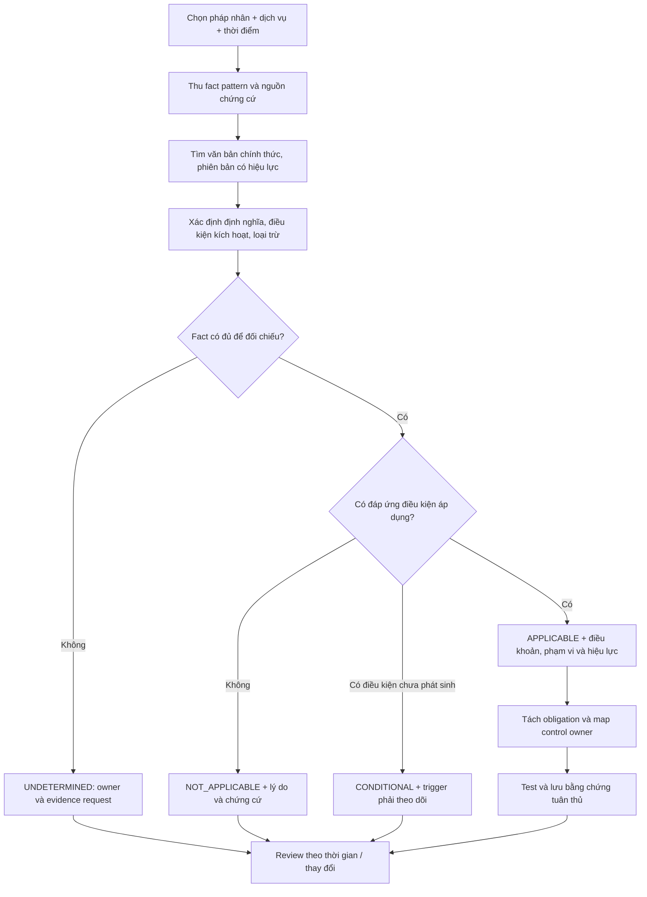

# Applicable regulation: Xác định quy định pháp luật áp dụng và chứng minh tuân thủ

## 1. Applicable regulation là gì?

**Applicable regulation** là tập hợp quy định pháp luật có hiệu lực và **thực sự ràng buộc một pháp nhân, hoạt động, hệ thống, loại dữ liệu hoặc quan hệ kinh doanh trong phạm vi cụ thể**, sau khi đối chiếu các điều kiện áp dụng với sự kiện thực tế. Trong thực hành compliance assurance, câu hỏi đầu tiên không phải “đã tuân thủ quy định X chưa?” mà là **“quy định X có áp dụng không, áp dụng cho ai, điều khoản nào, từ khi nào, theo điều kiện nào và dựa vào căn cứ gì?”**.

Một doanh nghiệp có văn phòng tại Việt Nam, chạy dịch vụ phần mềm trên cloud và phục vụ khách hàng ở nhiều khu vực không thể mặc định rằng *mọi* quy định của tất cả các khu vực đều áp dụng, cũng không thể kết luận chỉ cần kiểm tra luật nơi đặt máy chủ. Phạm vi pháp lý có thể phụ thuộc vào địa điểm hoạt động, nhóm khách hàng, bản chất dịch vụ, loại dữ liệu, vai trò xử lý, ngành nghề, khả năng cung cấp dịch vụ xuyên biên giới và các quy định chuyên ngành.

Trong chương **Compliance assurance** thuộc module **SECURITY_SECURITY_ASSURANCE**, ta học cách xây dựng **lập luận có bằng chứng** từ phân tích rủi ro và yêu cầu pháp lý đến security controls, kiểm thử, audit và xử lý phát hiện. Một kết luận tuân thủ chỉ đáng tin khi xác định đúng **phạm vi quy định áp dụng (applicability)** trước, sau đó mới đánh giá **mức đáp ứng các nghĩa vụ (compliance)**.

Ví dụ:

- Một công ty giữ dữ liệu cá nhân có thể có nghĩa vụ bảo vệ dữ liệu nhất định, nhưng muốn xác định điều khoản cụ thể phải biết vai trò của từng bên, chủ thể dữ liệu, hoạt động xử lý, vị trí và luật hiện hành.
- Một công ty dùng dịch vụ cloud không đương nhiên phải áp dụng tất cả quy định dành riêng cho ngân hàng chỉ vì nhà cung cấp cloud cũng có khách hàng ngân hàng.
- Một chứng nhận ISO/IEC 27001 hoặc báo cáo SOC 2 có thể hỗ trợ **bằng chứng đánh giá**, nhưng bản thân chúng **không luôn là luật bắt buộc**. Chúng có thể trở thành nghĩa vụ theo hợp đồng, điều kiện cấp phép hoặc quy định chuyên ngành nếu được viện dẫn phù hợp.

**Mục tiêu:** biết xác định điều gì thật sự bắt buộc, điều gì là cam kết khác, điều gì vẫn chưa đủ dữ liệu để kết luận; từ đó tổ chức một chương trình kiểm soát có bằng chứng, tránh bỏ sót nghĩa vụ lẫn “tuân thủ hình thức”.

### Kết quả học tập

Sau bài học, người học có thể:

1. Phân biệt luật/quy định áp dụng, tiêu chuẩn tự nguyện, yêu cầu hợp đồng và chính sách nội bộ.
2. Xây dựng **regulatory inventory** gắn pháp nhân, hệ thống, dữ liệu, hoạt động và khu vực pháp lý.
3. Phân tích **applicability test** dựa trên phạm vi và điều kiện trong văn bản có thẩm quyền.
4. Thiết lập **obligation register** liên kết điều khoản với control owner, test và evidence.
5. Xử lý trạng thái **APPLICABLE / NOT_APPLICABLE / CONDITIONAL / UNDETERMINED** và ngoại lệ có thẩm quyền.
6. Kiểm chứng hiệu lực theo thời gian, phát hiện thay đổi và tái đánh giá sau thay đổi đáng kể.
7. Báo cáo kết quả assurance rõ phạm vi, giới hạn, phát hiện, quyết định và kế hoạch retest.

## 2. Đừng nhầm applicability với compliance

Ba câu hỏi phải được phân biệt:

| Câu hỏi | Nội dung | Ví dụ kết luận |
| --- | --- | --- |
| **Có áp dụng? (Applicability)** | Điều khoản có ràng buộc pháp nhân, hoạt động và thời điểm này không? | “Điều khoản A áp dụng cho hoạt động P của pháp nhân E từ ngày D” |
| **Phải làm gì? (Obligation)** | Nghĩa vụ chính xác là hành động, tiêu chí hoặc kết quả nào? | “Duy trì hồ sơ xử lý theo yêu cầu và điều kiện được xác nhận” |
| **Đã đáp ứng chưa? (Assurance/compliance)** | Bằng chứng có chứng minh nghĩa vụ đạt trong phạm vi và kỳ đánh giá không? | “Control C đạt kiểm thử; phần Q vẫn UNKNOWN” |

Khi xác định một nghĩa vụ có áp dụng, **không có nghĩa** control đang PASS. Một dịch vụ có thể hoàn toàn thuộc phạm vi quy định nhưng thiếu log, thiếu tài liệu hoặc không kiểm tra được, khi đó đánh giá nghĩa vụ phải cho ra FAIL hoặc UNKNOWN theo bằng chứng.

Ngược lại, một security control tốt không khiến quy định không áp dụng trở thành áp dụng. Ví dụ tổ chức có triển khai mã hóa rất tốt nhưng vẫn cần lập luận riêng để xác định một quy định chuyên ngành nào đó có ràng buộc tổ chức hay không.

### Bốn sai lầm xuất phát từ nhầm lẫn này

- **“Chúng tôi tuân thủ GDPR vì dùng cloud tại châu Âu.”** Vị trí cloud đơn lẻ không đủ để kết luận phạm vi áp dụng; phải kiểm tra các điều kiện pháp lý và vai trò xử lý thực tế.
- **“Không cần đánh giá vì doanh nghiệp không đặt trụ sở ở nước đó.”** Một số quy định có điều kiện áp dụng ngoài lãnh thổ; cần kiểm tra đầy đủ văn bản.
- **“Đã có chứng nhận nên tất cả nghĩa vụ được đáp ứng.”** Chứng nhận có scope và kỳ hiệu lực, không phủ mọi nghĩa vụ hay customer-side controls.
- **“Không tìm thấy tài liệu thì N/A.”** Thiếu thông tin là **UNDETERMINED/UNKNOWN**, không phải bằng chứng không áp dụng.

## 3. Phân biệt nguồn nghĩa vụ: luật, quy định, tiêu chuẩn và cam kết

Trong thực hành, nhiều yêu cầu bảo mật có ngôn ngữ tương tự nhau nhưng **nguồn thẩm quyền** khác nhau.

| Loại nguồn | Bản chất | Cách đưa vào assurance |
| --- | --- | --- |
| **Luật, nghị định, quy định, văn bản có hiệu lực** | Nghĩa vụ pháp lý khi đáp ứng điều kiện áp dụng | Kiểm tra thẩm quyền ban hành, hiệu lực, đối tượng, phạm vi và nghĩa vụ |
| **Quy định chuyên ngành/cơ quan quản lý** | Áp dụng cho ngành, giấy phép, loại dịch vụ hoặc đối tượng được xác định | Kiểm tra ngành, tư cách pháp lý, giấy phép, hoạt động và văn bản hiện hành |
| **Hướng dẫn của cơ quan quản lý** | Hỗ trợ giải thích/thực thi; hiệu lực pháp lý tùy loại văn bản và hệ thống pháp luật | Phân biệt hướng dẫn không ràng buộc với nghĩa vụ trong văn bản quy phạm |
| **Tiêu chuẩn, khuôn khổ** | Thường là tham chiếu kỹ thuật/quản lý, đôi khi trở thành yêu cầu khi được luật/hợp đồng viện dẫn | Ghi nguồn viện dẫn; không mặc định mọi phần của tiêu chuẩn là luật |
| **Hợp đồng/DPA/SLA** | Cam kết giữa các bên theo điều khoản đã ký và luật điều chỉnh | Liên kết pháp nhân, hợp đồng, phiên bản, dịch vụ và thẩm quyền |
| **Chính sách nội bộ** | Quy tắc quản trị mà tổ chức tự ban hành, có thể nghiêm hơn mức tối thiểu pháp lý | Đánh giá thành control riêng, không gọi nhầm là điều khoản pháp luật |
| **Cam kết công khai** | Tuyên bố với khách hàng/đối tác, có thể tạo hệ quả pháp lý hoặc thương mại tùy hoàn cảnh | Review tính nhất quán, thẩm quyền và điều kiện áp dụng thực tế |

Một hệ thống có thể cùng lúc chịu nhiều lớp nghĩa vụ. Ví dụ, yêu cầu retention xuất phát từ luật, hợp đồng khách hàng và chính sách nội bộ; các thời hạn có thể khác nhau hoặc xung đột. **Không tự chọn thời hạn ngắn nhất hoặc dài nhất** nếu chưa có đánh giá pháp lý, phân loại dữ liệu và quy định về lưu giữ/bảo toàn.

### Ví dụ đúng về chứng nhận và framework

**ISO/IEC 27001** thường dùng để đánh giá hệ thống quản lý an toàn thông tin trong phạm vi chứng nhận; **SOC 2** là báo cáo kiểm toán dịch vụ theo các tiêu chí và phạm vi xác định; **PCI DSS** là chuẩn bảo mật trong hệ sinh thái thẻ thanh toán với các điều kiện áp dụng theo quan hệ/qui tắc chương trình, có thể liên quan hợp đồng và quy định cụ thể. Không nên gán cho bất kỳ tiêu chuẩn nào một tính chất pháp lý phổ quát ở mọi nơi. **NIST CSF** thường là framework tham khảo, trừ khi được viện dẫn bắt buộc trong một quy chế hoặc cam kết xác định.

## 4. Các chiều xác định quy định áp dụng

Một **applicability analysis** tốt phải nhìn theo nhiều chiều, không chỉ căn cứ vào địa chỉ đăng ký doanh nghiệp.

| Chiều | Câu hỏi bắt buộc | Bằng chứng điển hình |
| --- | --- | --- |
| **Legal entity** | Pháp nhân/chi nhánh/đơn vị nào thực hiện hoạt động và chịu trách nhiệm? | Đăng ký pháp nhân, group structure, hợp đồng |
| **Jurisdiction** | Luật của quốc gia/khu vực nào có thể điều chỉnh hành vi? | Hoạt động, hợp đồng, nơi cung cấp dịch vụ, mô hình giao dịch |
| **Establishment/operations** | Có cơ sở hoạt động, nhân sự hoặc hoạt động ổn định tại địa bàn không? | Sơ đồ tổ chức, hoạt động thực tế và tư vấn pháp lý |
| **Product/service** | Dịch vụ thuộc loại nào; có giấy phép hoặc ngành được quản lý không? | Product catalog, giấy phép, điều kiện kinh doanh |
| **Customer/data subject** | Đối tượng khách hàng/chủ thể dữ liệu thuộc nhóm hoặc khu vực nào? | Chính sách cung cấp dịch vụ, customer segmentation, dữ liệu tối thiểu |
| **Data type** | Có dữ liệu cá nhân, thông tin nhạy cảm, hồ sơ ngành hoặc dữ liệu mật không? | Data classification, data flow, schema |
| **Processing role** | Là chủ thể quyết định mục đích/phương tiện, bên xử lý, bên nhận/đồng xử lý hay vai trò khác? | DPA, data mapping, responsibility matrix |
| **Processing operation** | Thu thập, truy cập, lưu, phân tích, chuyển giao, xóa hoặc đào tạo mô hình? | Data processing inventory, application design |
| **Geographical flow** | Dữ liệu được lưu, truy cập từ xa, chuyển hoặc sao lưu qua đâu? | Hosting config, subprocessor locations, transfer map |
| **Threshold/exemption** | Có ngưỡng quy mô, doanh thu, số người, giấy phép hoặc ngoại lệ được văn bản quy định? | Báo cáo hoạt động, chứng cứ thuộc/không thuộc ngưỡng |
| **Effective period** | Nghĩa vụ có hiệu lực vào ngày đánh giá không; có điều khoản chuyển tiếp? | Văn bản chính thức, phiên bản hợp nhất, amendment history |
| **Third parties** | Vendor/subprocessor thực hiện phần nào, trách nhiệm của bên nào? | Hợp đồng, CUECs, provider model, subprocessor register |

Một quy định có thể chỉ áp dụng cho **một pháp nhân và một hoạt động cụ thể** trong tập đoàn, không phải tự động áp dụng mọi công ty con. Ngược lại, chỉ xét pháp nhân đứng tên hợp đồng mà bỏ qua vai trò và hoạt động thực tế của đơn vị khác cũng có thể gây thiếu sót.

### Không lấy một dấu hiệu làm bằng chứng quyết định

- **Máy chủ ở một quốc gia** chưa chứng minh tất cả luật tại đó ràng buộc mọi nghiệp vụ và cũng chưa loại trừ nghĩa vụ nước khác.
- **Khách truy cập website từ nước ngoài** chưa tự chứng minh hành vi chủ động cung cấp dịch vụ vào một thị trường theo mọi khung pháp lý.
- **Tên miền, ngôn ngữ hoặc tiền tệ** có thể là chỉ dấu trong một bài kiểm tra pháp lý nhưng phải đọc cùng các điều kiện khác.
- **Vendor tuyên bố “compliant”** không xác định nghĩa vụ phía khách hàng hoặc hợp đồng đã đáp ứng.

## 5. Tách fact pattern khỏi diễn giải pháp lý

**Fact pattern** là bộ sự kiện thực tế cần xác nhận trước khi áp điều khoản pháp lý. Cần phân loại **FACT**, **ASSUMPTION**, **UNKNOWN** và **LEGAL INTERPRETATION**.

Ví dụ một SaaS:

- **FACT:** công ty E ký hợp đồng cung cấp SaaS P với khách hàng A, có dữ liệu người dùng được lưu tại region R.
- **FACT:** dữ liệu được xử lý bởi cloud subprocessor S; có thể thấy qua hợp đồng và kiến trúc thực tế.
- **UNKNOWN:** có nhân viên hỗ trợ từ quốc gia T truy cập dữ liệu hay không; cần kiểm tra quyền và log.
- **ASSUMPTION:** sản phẩm chỉ dùng cho mục đích nội bộ của khách hàng; phải xác minh với business owner và điều khoản.
- **LEGAL INTERPRETATION:** điều khoản pháp lý X áp dụng hay không sau khi đối chiếu tất cả điều kiện trong phạm vi và luật hiện hành.

Nếu nhầm assumption với fact, một kết luận N/A có thể không còn nền tảng. Nếu không ghi nguồn và thời điểm fact, sau khi sản phẩm thay đổi tổ chức khó biết khi nào applicability cần đánh giá lại.

### Một sự kiện – nhiều căn cứ

Data flow map có thể giúp xác định dữ liệu đi đâu nhưng không chứng minh quyền xử lý đã hợp lệ. DPA xác định cam kết giữa các bên nhưng không tự chứng minh cấu hình production phù hợp. Kết quả thực tế nên dùng **corroboration** từ hợp đồng, sơ đồ, IaC/cloud state, kiểm tra quyền và phỏng vấn chủ nghiệp vụ khi thích hợp.

## 6. Quy trình quyết định applicability

Có thể triển khai quy trình này cho từng **(legal entity, activity/service, jurisdiction, regulatory instrument, assessment date)**.



### Quy trình tám bước

1. **Định danh phạm vi:** pháp nhân, đơn vị kinh doanh, hệ thống, hoạt động, loại dữ liệu, nơi vận hành, ngày đánh giá.
2. **Xác định nguồn quy phạm có thẩm quyền:** tên văn bản, cơ quan ban hành, phiên bản, ngày hiệu lực, điều khoản liên quan, văn bản sửa đổi/hướng dẫn.
3. **Tách điều kiện áp dụng:** khái niệm định nghĩa, ngành, vai trò, ngưỡng, mục đích, đối tượng, khu vực và ngoại lệ.
4. **Thu bằng chứng thực tế:** inventory, data map, contract, license, role, customer/processing context; kiểm tra chất lượng nguồn.
5. **Đối chiếu từng điều kiện:** xác nhận đạt/không đạt/chưa biết kèm căn cứ; không suy từ một điều kiện đơn lẻ nếu luật yêu cầu nhiều điều kiện.
6. **Kết luận applicability:** APPLICABLE, NOT_APPLICABLE, CONDITIONAL hoặc UNDETERMINED; ghi version và người review.
7. **Map obligations nếu áp dụng:** control, owner, security requirements, bằng chứng, tần suất và điều kiện thông báo.
8. **Theo dõi thay đổi và tái đánh giá:** luật sửa, điều kiện kinh doanh đổi, dữ liệu/khách hàng thay đổi hoặc xuất hiện subprocessor mới.

**Điểm dừng quan trọng:** một tài liệu chưa đầy đủ không cho phép chuyển từ UNDETERMINED thành NOT_APPLICABLE. Với nghĩa vụ quan trọng, Legal/Compliance cần quyết định cách xử lý tạm thời trong khi bổ sung dữ liệu.

## 7. Quản trị nguồn pháp lý và tính hiệu lực theo thời gian

Một **regulatory inventory** thiếu bản hiệu lực có thể gây sai kết luận dù nội dung đã đúng ở một thời điểm trước đây.

### Metadata tối thiểu của một nguồn

| Thuộc tính | Tại sao quan trọng? |
| --- | --- |
| Instrument ID / title | Định danh không nhầm với tên gọi không chính thức |
| Issuing authority / jurisdiction | Xác nhận nguồn thẩm quyền |
| Official source URL/reference | Cho reviewer kiểm tra lại văn bản |
| Publication date / effective date | Phân biệt ngày ban hành và ngày áp dụng |
| Amendment / consolidation version | Xác định điều khoản bị sửa, thay thế hoặc bãi bỏ |
| Transition / grandfathering provisions | Kiểm tra cơ chế chuyển tiếp nếu có |
| Language / controlling text | Nhận diện bản dịch tham khảo so với văn bản có giá trị pháp lý |
| Interpretation/guidance | Ghi nguồn giải thích và độ ràng buộc |
| Last legal review / reviewer | Biết kết luận còn được duy trì đến đâu |
| Next review trigger | Đặt hành động khi văn bản hoặc hoạt động thay đổi |

Cần ưu tiên văn bản từ **cơ sở dữ liệu pháp luật chính thức, công báo, cơ quan quản lý hoặc cổng thông tin có thẩm quyền**. Bài blog, tóm tắt của vendor và checklist từ bên thứ ba hữu ích để định hướng nhưng không thay thế nguồn pháp lý chính thức.

### Ngày công bố khác ngày có hiệu lực

Một văn bản có thể được ban hành vào thời điểm X nhưng hiệu lực ở thời điểm Y; một nghĩa vụ trong văn bản có thể được chuyển tiếp đến Z. Khi review kỳ 2026, không thể dùng ngẫu nhiên phiên bản hợp nhất hiện tại để đánh giá hành vi của kỳ trước nếu quy định có thay đổi theo thời gian. Cần lưu **effective interval** và phân biệt kiểm tra hồi tố với tình trạng hiện tại.

**Không tự suy luận thứ bậc áp dụng hoặc quy tắc ưu tiên luật của các quốc gia**. Nếu hai quy định có vẻ mâu thuẫn, cần Legal đánh giá xung đột pháp luật, điều kiện ngoại lệ và đường xử lý hợp lệ; đội kỹ thuật không tự “chọn luật dễ làm hơn”.

## 8. Applicable regulation register: sổ xác định phạm vi

Một danh mục chỉ chứa tên các văn bản như “GDPR, quy định nội địa, tiêu chuẩn ngành” không đủ. Cần một bản ghi theo **pháp nhân–dịch vụ–hoạt động–văn bản/điều khoản** với quyết định có căn cứ.

### Các trường được khuyến nghị

| Nhóm | Trường mẫu | Ý nghĩa |
| --- | --- | --- |
| Định danh | `applicability_id`, `legal_entity_id`, `service_id` | Khóa liên kết chính xác |
| Đối tượng | `activity_id`, `data_categories`, `processing_role` | Điều kiện thực tế |
| Nguồn pháp lý | `instrument_id`, `provision_ref`, `source_version` | Truy vết điều khoản và kỳ hiệu lực |
| Khu vực | `jurisdiction`, `geographical_scope` | Ranh giới có thể áp dụng |
| Điều kiện | `applicability_tests`, `exclusions` | Cấu trúc lập luận |
| Kết luận | `status`, `rationale`, `confidence` | APPLICABLE / N/A / CONDITIONAL / UNDETERMINED |
| Bằng chứng | `fact_evidence_refs`, `legal_source_refs` | Kiểm toán lại quyết định |
| Trách nhiệm | `legal_reviewer`, `business_owner`, `approved_by` | Ai xác minh và phê duyệt |
| Thời gian | `assessed_at`, `effective_from`, `next_review_at` | Độ mới và mốc pháp lý |
| Thay đổi | `trigger_conditions`, `supersedes`, `change_ticket` | Tái đánh giá khi phạm vi thay đổi |

**Khóa theo pháp nhân–dịch vụ–hoạt động** rất quan trọng. Một công ty có thể cung cấp SaaS tư vấn và đồng thời cung cấp dịch vụ thanh toán; nghĩa vụ của hai hoạt động không nhất thiết giống nhau. Tổ chức cũng có thể vừa là bên kiểm soát dữ liệu cho hoạt động nội bộ, vừa là bên xử lý dữ liệu theo yêu cầu khách hàng cho một dịch vụ khác.

## 9. Trạng thái quyết định applicability và cách diễn giải

| Trạng thái | Khi dùng | Ví dụ |
| --- | --- | --- |
| **APPLICABLE** | Điều kiện ràng buộc đã được đối chiếu đầy đủ với fact pattern và nguồn hiện hành | Một nghĩa vụ được xác nhận cho hoạt động P của E |
| **NOT_APPLICABLE** | Có bằng chứng và lập luận rằng điều kiện áp dụng không đạt trong phạm vi đánh giá | Quy định dành cho hoạt động có giấy phép X, còn E không thực hiện hoạt động thuộc phạm vi đó |
| **CONDITIONAL** | Nghĩa vụ sẽ kích hoạt nếu điều kiện xác định xảy ra hoặc thay đổi | Mở sản phẩm sang nhóm khách hàng/khu vực được quy định |
| **UNDETERMINED** | Chưa có đủ fact, nguồn pháp lý hoặc review để xác nhận | Chưa rõ subprocessor thực sự truy cập loại dữ liệu nào |
| **EXEMPTION_CONFIRMED** | Có căn cứ rằng ngoại lệ pháp lý hợp lệ áp dụng cho phạm vi cụ thể | Đã được Legal kiểm tra điều kiện và giới hạn ngoại lệ |

Không được dùng **EXEMPTION_CONFIRMED** như “được miễn hết mọi nghĩa vụ” nếu ngoại lệ chỉ áp dụng một điều khoản hoặc một tập đối tượng. Nên lưu **nguồn và phạm vi ngoại lệ** ở cấp provision.

**CONDITIONAL** không phải tình trạng “có thể tùy thích thực hiện”. Nó phải gắn trigger quan sát được và người chịu trách nhiệm; nếu trigger đã xảy ra, trạng thái cần được đánh giá lại thành APPLICABLE hoặc trạng thái thích hợp khác.

Đối với chương trình audit có thể ánh xạ các trạng thái này sang một workflow có **HOLD_FOR_LEGAL_REVIEW** khi còn UNDETERMINED ở rủi ro cao; không tự phát hành kết luận compliance lúc chưa có cơ sở.

## 10. Từ quy định áp dụng đến nghĩa vụ có thể kiểm tra

Văn bản pháp lý thường mô tả một nghĩa vụ ở mức kết quả hoặc quy trình; đội assurance cần **decompose** thành yêu cầu có thể thu thập bằng chứng, nhưng không thay thế ý nghĩa pháp lý bằng diễn giải kỹ thuật tùy tiện.

### Các bước bóc tách nghĩa vụ

1. **Chỉ rõ provision:** định danh điều khoản, đoạn, mục, phiên bản và ngày hiệu lực.
2. **Nhận diện subject:** bên nào phải thực hiện và trong vai trò nào.
3. **Nhận diện action/constraint:** phải làm, cấm làm, cho phép khi có điều kiện hay phải báo cáo.
4. **Xác định scope:** loại dữ liệu, tài sản, hoạt động và người nhận liên quan.
5. **Xác định trigger/time:** khi nào phát sinh, có deadline hay chu kỳ kiểm tra không.
6. **Kiểm tra exceptions/qualifiers:** các điều kiện và ngoại lệ làm thay đổi nghĩa vụ.
7. **Chọn controls:** policies, procedures và technical mechanisms đáp ứng nghĩa vụ.
8. **Chọn evidence/test:** làm thế nào chứng minh control đã vận hành trong phạm vi và kỳ cần thiết.
9. **Review với Legal/Compliance:** xác nhận mapping kỹ thuật không bóp méo nội dung pháp lý.

Một nghĩa vụ có thể được đáp ứng bởi **nhiều controls**, và một control có thể hỗ trợ **nhiều nghĩa vụ**. Quan hệ many-to-many này nên được mô hình hóa rõ, không nhân bản mọi tài liệu rồi làm khó việc cập nhật.

### Ma trận regulation–obligation–control–evidence

| Provision giả định | Nghĩa vụ được diễn giải | Control | Test/evidence |
| --- | --- | --- | --- |
| REG-A `P-01` | Chỉ người được phép truy cập dữ liệu theo vai trò | IAM least privilege, MFA, review | Effective permission readback, negative access test, approval log |
| REG-A `P-02` | Truy vết thao tác với dữ liệu thuộc phạm vi | Audit logging và retention | Source-to-sink event test, log integrity, retrieval |
| REG-B `Q-03` | Có quy trình phối hợp/thông báo khi điều kiện cụ thể xảy ra | Incident escalation và notification workflow | Trigger record, legal assessment, draft/approval, delivery receipts |
| REG-C `R-04` | Duy trì khả năng phục hồi theo tiêu chí đã xác định | Backup, DR, BIA-driven recovery | Restore evidence, RTO/RPO, business acceptance |
| REG-D `S-05` | Quản trị bên xử lý phụ được phép | Vendor/subprocessor controls | DPA, subprocessor list, change review và monitoring |

**REG-A/B/C/D là mã văn bản giả định**, không phải tên luật thật. Bảng minh họa mô hình hóa chứng cứ; khi dùng trong doanh nghiệp phải thay bằng điều khoản pháp luật thật đã được xác nhận hiệu lực và diễn giải đúng.

## 11. Ví dụ: một yêu cầu pháp lý có nhiều control owners

Giả sử một quy định áp dụng yêu cầu tổ chức bảo đảm các hoạt động truy cập dữ liệu nhạy cảm được kiểm soát và có thể kiểm tra được. Việc đáp ứng có thể đòi hỏi:

- **Data Owner:** phân loại dữ liệu và xác định nhóm principal được phép.
- **IAM Team:** cấu hình quyền tối thiểu, MFA/SSO và lifecycle người dùng.
- **Platform/Cloud:** bảo vệ network paths, workload identities và cấu hình log sources.
- **Security Monitoring:** kiểm tra log delivery, detection, retention theo baseline.
- **GRC/Assurance:** thực hiện sampling, đối chiếu log, kiểm tra quyền và tổng hợp bằng chứng.
- **Legal/Compliance:** xác nhận control set phản ánh nghĩa vụ cụ thể và phạm vi được duyệt.

Nếu một cloud account production không bật audit hoặc một nhóm privileged account chưa được kiểm tra quyền, kết luận có thể là **FAIL** của control vận hành hoặc **UNKNOWN** của một nghĩa vụ nếu chưa đủ bằng chứng điều kiện liên quan. Không được tự suy ra mọi nghĩa vụ pháp lý đều bị vi phạm khi mới có một telemetry gap; ngược lại, không thể kết luận đạt nghĩa vụ nếu những control cần thiết chưa được kiểm tra.

## 12. Những trường hợp hay làm thay đổi applicability

### 12.1. Mở rộng thị trường

Dịch vụ bắt đầu phục vụ thị trường mới, cung cấp tính năng cho người dùng ở khu vực khác hoặc mở pháp nhân địa phương. Cần xem lại **điều kiện cung cấp dịch vụ, mối liên hệ lãnh thổ, luật chuyên ngành, nghĩa vụ dữ liệu, thương mại và khách hàng**.

### 12.2. Thay đổi mục đích xử lý dữ liệu

Một hệ thống chăm sóc khách hàng bắt đầu dùng hội thoại để phân tích hoặc huấn luyện tính năng AI. Đây là thay đổi processing purpose và có thể làm phát sinh nghĩa vụ hoặc đánh giá riêng; không thể dựa vào data map của kỳ trước.

### 12.3. Thêm third party hoặc subprocessor

Subprocessor mới có thể thay vùng xử lý, quyền truy cập, thời hạn lưu hoặc luồng chuyển dữ liệu. Cần cập nhật contract/DPA, responsibility matrix, data flow và điều kiện pháp lý liên quan.

### 12.4. Thay đổi loại hình dịch vụ hoặc giấy phép

Một nền tảng từ cung cấp phần mềm thuần túy chuyển sang cung cấp chức năng tài chính, y tế, viễn thông hoặc dịch vụ được quản lý đặc thù. Không mặc định chỉ cần áp cùng bộ control của SaaS ban đầu.

### 12.5. M&A, tách pháp nhân, chuyển sở hữu

Nghĩa vụ gắn đúng pháp nhân/đối tượng có thể thay đổi; phải đánh giá ảnh hưởng tới hợp đồng, nơi lưu dữ liệu, thẩm quyền và trách nhiệm của bên tham gia.

### 12.6. Văn bản pháp luật sửa đổi hoặc chuyển tiếp

Thay đổi định nghĩa, ngưỡng, thời hạn, nghĩa vụ báo cáo hoặc ngày có hiệu lực có thể khiến hồ sơ cũ lỗi thời ngay cả khi hệ thống kỹ thuật không thay đổi.

## 13. Case study 1: SaaS ở Việt Nam phục vụ khách hàng nhiều khu vực

### Bối cảnh

Công ty giả định **LotusCloud** đăng ký tại Việt Nam, cung cấp nền tảng hỗ trợ khách hàng (SaaS), dùng hạ tầng cloud và một số nhà cung cấp phụ. Sản phẩm hiện có:

- Khách hàng doanh nghiệp ở Việt Nam và một số nước khác.
- Tenant có thể lưu nội dung trao đổi với người dùng cuối, đôi khi có dữ liệu cá nhân.
- Đội hỗ trợ vận hành từ nhiều địa điểm; một vendor phụ cung cấp xử lý email.
- Công ty đang cân nhắc chủ động tiếp thị cho tổ chức tại Liên minh châu Âu (EU) và thêm tính năng phân tích hành vi người dùng.

Tình huống này **không đủ để tự kết luận** một quy định EU cụ thể có áp dụng. Cần kiểm tra văn bản, các yếu tố về **establishment**, việc cung cấp hàng hóa/dịch vụ cho đối tượng được xác định, hoạt động monitoring behavior nếu có, vai trò trong xử lý dữ liệu và các điều kiện khác của khuôn khổ liên quan.

### Những câu hỏi cần xác minh

| Nhóm | Câu hỏi | Bằng chứng |
| --- | --- | --- |
| Pháp nhân | Bên ký hợp đồng và vận hành thực tế là ai? | Corporate registry, contract |
| Đối tượng dịch vụ | SaaS chỉ cung cấp B2B hay trực tiếp phục vụ người dùng cuối? | Product terms, customer journeys |
| Phạm vi địa lý | Dịch vụ có chủ động hướng tới thị trường/đối tượng trong vùng được điều chỉnh không? | Marketing, localization, pricing, sales channel, hợp đồng |
| Hoạt động theo dõi | Có theo dõi hành vi thuộc định nghĩa pháp lý cần xét không? | Product analytics design, data events, consent/config |
| Vai trò dữ liệu | Công ty quyết định mục đích xử lý nào và xử lý thay khách hàng phần nào? | DPA, data flow, processing purposes |
| Dữ liệu | Loại thông tin và nơi lưu, remote support, backup, subprocessor? | Data inventory, provider config |
| Thời gian | Feature và hợp đồng có hiệu lực từ khi nào; thay đổi từ kỳ trước? | Release log, change approvals |
| Nguồn pháp lý | Văn bản, điều khoản, phiên bản và hướng dẫn có thẩm quyền nào liên quan? | Official source references và legal review |

### Kết luận minh họa

- **Quy định dữ liệu áp dụng tại Việt Nam:** cần xem xét theo hoạt động và điều kiện cụ thể trong **hệ thống pháp luật Việt Nam hiện hành**; không tuyên bố “mọi SaaS đều thuộc tất cả điều khoản” mà không phân tích.
- **Khung GDPR của EU:** có thể cần đánh giá điều kiện **phạm vi lãnh thổ và loại hoạt động** theo Điều 3, cùng vai trò xử lý và các nghĩa vụ cụ thể. Chỉ biết có người dùng ở EU hoặc có server EU không đủ để suy ra toàn bộ nghĩa vụ áp dụng; cũng không được loại trừ chỉ vì công ty không đặt trụ sở ở EU.
- **Hợp đồng khách hàng:** DPA, bảo mật, hỗ trợ audit và notification có thể ràng buộc riêng dù một điều khoản pháp luật cụ thể chưa được xác định là áp dụng trực tiếp.
- **Tính năng phân tích hành vi mới:** là **trigger reassessment**, không tự động một câu trả lời đúng/sai cho mọi quy định.

**Điểm học:** applicability là một **lập luận pháp lý dựa trên fact pattern**, và fact pattern phải được kiểm tra bằng evidence do business, product, platform, privacy và Legal cùng cung cấp.

## 14. Case study 2: Nhà cung cấp cloud, trách nhiệm chia sẻ và luật ngành

Một tổ chức tài chính giả định vận hành ứng dụng trên cloud. Nhà cung cấp có chứng nhận security quốc tế và công bố các báo cáo tuân thủ cho một số ngành. Chủ ứng dụng đề xuất đánh dấu toàn bộ quy định chuyên ngành là PASS dựa trên chứng nhận vendor.

Đây là kết luận không có cơ sở vì:

1. **Applicability** phải được xác định đối với tổ chức tài chính, hoạt động, dịch vụ và giấy phép cụ thể, không dựa vào danh mục khách hàng của cloud vendor.
2. Nếu quy định thực sự áp dụng, nhiều nghĩa vụ thuộc **trách nhiệm khách hàng**, chẳng hạn phân quyền trong tenant, data classification, incident response, kiểm soát thay đổi và báo cáo.
3. Vendor evidence có **scope, thời kỳ và exclusions**; một chứng chỉ không nhất thiết bao phủ ứng dụng, dữ liệu hay cấu hình phía khách hàng.
4. **Hợp đồng outsourcing, data processing và audit right** có thể bổ sung nghĩa vụ riêng và cần được đánh giá.
5. Các nghĩa vụ báo cáo/sự cố có thể thuộc bên sử dụng dịch vụ, bên cung cấp hoặc cả hai theo các điều kiện khác nhau.

Ma trận trách nhiệm nên mô tả:

| Nghĩa vụ giả định | Provider | Customer | Shared | Evidence |
| --- | --- | --- | --- | --- |
| Physical data center security | Primary | Review assurance | Có thể có | Báo cáo đúng scope |
| Tenant identity và MFA | Cung cấp capability | Cấu hình và review | Có thể có | Tenant readback + access test |
| Logging source và export | API/cơ chế nền tảng | Bật, route, retention theo yêu cầu | Có | Config + event source-to-sink |
| Incident notification | Thông tin theo thỏa thuận | Đánh giá nghĩa vụ của mình | Có | Contract, notifications, decision records |
| Backup/restore | Capability theo dịch vụ | Thiết kế mục tiêu và kiểm thử | Có | Restore test, RTO/RPO evidence |

Đây là **ví dụ responsibility model**, không phải phân bổ trách nhiệm cố định của mọi sản phẩm cloud. Cần đọc chính xác tài liệu dịch vụ, hợp đồng và quy định được xác định là áp dụng.

## 15. Privacy và dữ liệu xuyên biên giới: vì sao cần phân tích theo hoạt động

Đối với dữ liệu cá nhân, nhiều hệ thống pháp luật phân biệt **vai trò, loại dữ liệu, đối tượng, mục đích và luồng xử lý**. Cách tiếp cận “có mã hóa AES nên đã tuân thủ toàn bộ luật dữ liệu” bỏ qua phần lớn yêu cầu phi kỹ thuật.

### Data processing activity record

Mỗi hoạt động nên có:

- Mục đích và mô tả nghiệp vụ.
- Legal entity và các vai trò theo luật áp dụng.
- Nguồn, loại dữ liệu và nhóm đối tượng liên quan.
- Data flow: thu thập, truy cập từ xa, hosting, backup, subprocessor và nơi nhận.
- Cơ chế quản lý yêu cầu của chủ thể dữ liệu nếu nghĩa vụ tương ứng áp dụng.
- Cơ sở/quyền xử lý, retention, xóa, giới hạn mục đích theo điều khoản liên quan.
- Security controls: encryption, IAM, logging, DLP, key management, incident response.
- Evidence và kết quả review, kể cả trường hợp còn UNDETERMINED.

Không được mặc định một bản DPA có hiệu lực đủ cho mọi luồng dữ liệu mới. Nếu sản phẩm thêm AI analytics, liên kết dữ liệu giữa nhiều mục đích hoặc thuê subprocessor mới, cần review lại điều kiện áp dụng và cơ chế bảo vệ tương ứng.

### Residency khác transfer khác remote access

- **Data residency:** vị trí lưu trữ và xử lý được xác định theo cấu hình/pháp lý.
- **Cross-border transfer:** chuyển hoặc cho phép tiếp cận dữ liệu qua biên giới theo định nghĩa luật liên quan.
- **Remote support/access:** truy cập từ xa của người/đơn vị khác có thể tạo ra câu hỏi về trách nhiệm và chuyển dữ liệu tùy quy định.

Một biến `storage_region=local` không chứng minh không có backup, replication, support access hoặc subprocessor ở nơi khác. Cần đọc data flow và operational access thực tế.

## 16. Incident reporting: xác định điều kiện và mốc thời gian chính xác

Nghĩa vụ thông báo sự cố có thể khác nhau giữa **quy định bảo vệ dữ liệu, quy định ngành, giấy phép, hợp đồng và cơ quan quản lý**. Không được gán một hạn chung cho mọi sự cố.

### Ma trận phân tích trigger

| Thuộc tính | Nội dung cần làm rõ | Bằng chứng |
| --- | --- | --- |
| Incident type | Loại sự kiện nào kích hoạt nghĩa vụ? | Incident classification và legal provision |
| Entity/role | Bên nào phải gửi và theo vai trò nào? | Corporate/processing-role map |
| Threshold | Điều kiện về loại dữ liệu, mức ảnh hưởng hoặc risk threshold? | Impact assessment, data inventory |
| Clock start | Mốc nào bắt đầu thời hạn theo quy định? | Incident timeline, nguồn thời gian và legal review |
| Recipient | Cơ quan, khách hàng hoặc đối tượng nào phải nhận? | Regulation/contract matrix |
| Deadline | Thời hạn thật của nghĩa vụ cụ thể? | Điều khoản đúng phiên bản và ngày hiệu lực |
| Content | Nội dung tối thiểu nào phải cung cấp? | Requirements checklist và approved template |
| Updates | Có bổ sung/cải chính khi có dữ liệu mới không? | Notification log và version |
| Evidence | Làm thế nào chứng minh đã gửi đúng? | Approval, transmission ID, receipt, nội dung bản gửi |

**Ví dụ giả định:** quy định REG-X yêu cầu thông báo trong một khoảng thời gian do pháp luật xác định khi có sự cố thuộc loại Q; hợp đồng H yêu cầu thông báo cho khách hàng theo một trigger khác. Một incident có thể kích hoạt **cả hai**, một hoặc không cái nào. Legal/Compliance phải xác minh điều kiện, không tự động copy thời hạn từ một hệ thống sang hệ thống khác.

### Bằng chứng cần ghi trước khi biết toàn bộ nguyên nhân

Tổ chức có thể chưa biết root cause nhưng đã có căn cứ để mở đánh giá nghĩa vụ. Cần giữ **detectedAt**, **firstKnownImpact**, **declaredAt**, **notifiedAt**, trạng thái known/unknown và nguồn thời gian. Nếu nguồn log bị gián đoạn, ghi khoảng bất định thay vì tạo mốc chính xác giả tạo.

## 17. Biến nghĩa vụ thành kiểm soát kỹ thuật có thể kiểm thử

Một obligation register hữu ích chỉ ra **control thiết kế**, **hoạt động thực tế** và **bằng chứng đã thu thập**, thay vì checklist kiểu “Có chính sách? Có”.

### Ví dụ ánh xạ

| Nghĩa vụ giả định | Control | Cách kiểm thử | Bằng chứng |
| --- | --- | --- | --- |
| Hạn chế truy cập dữ liệu | RBAC/ABAC, MFA, least privilege | Thử principal được phép và không được phép; review effective permissions | Access policies, test IDs, approval records |
| Theo dõi thao tác nhạy cảm | Audit logs + monitoring | Canary event nguồn–đích, truy xuất theo retention | Raw event reference, ingest log, retrieval |
| Bảo vệ dữ liệu lưu/chuyển | Encryption, key governance | Readback cấu hình, TLS verification, key access test | Crypto config, key policy, rotation record |
| Quản lý thay đổi | IaC review, approved release | Chọn mẫu deployment, đối chiếu approval vs actual state | PR, CI checks, change log |
| Phục hồi dịch vụ/dữ liệu | Backup, DR, BIA | Restore và đo business RTO/RPO | Test run, recovered watermark, acceptance |
| Kiểm soát bên xử lý dữ liệu | DPA và third-party assurance | Review phạm vi, subprocessor, incident, exit | Contracts, vendor evidence, reassessment |
| Phản ứng sự cố | Incident plan, escalation | Tabletop và kiểm tra notification trigger | SITREP, decision log, approved messages |

### Cẩn trọng với một control phục vụ nhiều quy định

Tổ chức có thể dùng một dịch vụ logging chung cho nhiều obligations. Nhưng khi đăng ký vào compliance register, phải xác định **data types, asset coverage, retention, integrity, truy cập và test period** cho từng yêu cầu. Không thể mặc định một hệ thống SIEM xanh chứng minh tất cả retention obligations đã đạt.

Tương tự, cùng một bộ chứng cứ của nhà cung cấp cloud có thể hỗ trợ nhiều quy định, nhưng cần kiểm tra **scope của nhà cung cấp và customer-side controls** mỗi lần tham chiếu.

## 18. Evidence quality: nguồn, phạm vi, độ mới và giới hạn

Một kiểm toán có thể thất bại không phải vì chưa có chính sách, mà vì **không chứng minh được chính sách đã được thực hiện đúng đối tượng**.

### Chất lượng bằng chứng cần xét

1. **Provenance:** nguồn gốc văn bản/control log và người thu thập có rõ?
2. **Scope:** bằng chứng bao phủ đúng entity, hoạt động, tài sản, dữ liệu, địa bàn?
3. **Period:** có phù hợp ngày hiệu lực và kỳ đánh giá không?
4. **Completeness:** có bỏ sót asset, branch, account, subprocessor, loại event?
5. **Integrity:** dữ liệu có được bảo vệ khỏi sửa/xóa ngoài thẩm quyền không?
6. **Reproducibility:** reviewer có thể tái hiện query, config readback hay quy trình test?
7. **Freshness:** kết quả có còn hiệu lực sau thay đổi kiến trúc, dữ liệu hoặc luật?
8. **Contradiction:** có nguồn nào cho kết quả khác, và đã điều tra chưa?

### Ví dụ

- Screenshot IAM của một account không chứng minh toàn bộ account production đáp ứng.
- Một chứng chỉ ISO/IEC 27001 hết hạn hoặc scope không bao gồm service đang dùng không đủ cho claim.
- Bản hợp đồng đã ký cho thấy cam kết; không chứng minh mọi điều khoản đã được vận hành.
- Log không có event vi phạm không chứng minh control đạt nếu collector không hoạt động.
- Kết quả scan pass không chứng minh phạm vi asset inventory đầy đủ.

Cần dùng các bằng chứng **độc lập hoặc bổ sung** khi khả thi, đặc biệt với control rủi ro cao.

## 19. Trạng thái assurance: đừng gộp pháp lý và kỹ thuật

Một hồ sơ nên phân biệt ba cấp:

| Cấp | Trạng thái | Câu hỏi |
| --- | --- | --- |
| **Applicability decision** | APPLICABLE, NOT_APPLICABLE, CONDITIONAL, UNDETERMINED | Điều khoản có ràng buộc hoạt động này không? |
| **Obligation implementation** | IMPLEMENTED, PARTIAL, NOT_IMPLEMENTED, NOT_EVALUATED | Có thiết kế/triển khai control nào đáp ứng nghĩa vụ? |
| **Control assessment** | PASS, FAIL, UNKNOWN, EXCEPTION, NOT_APPLICABLE | Bằng chứng chứng minh điều kiện kiểm tra đạt chưa? |

Ví dụ: REG-A `P-02` được Legal kết luận **APPLICABLE**, công cụ audit log được cấu hình (**IMPLEMENTED**), nhưng một cluster production không gửi log; phép kiểm source-to-sink cho cluster đó **FAIL**. Không được biến phần implementation thành kết luận compliance PASS.

### Trường hợp chưa có đủ bằng chứng

Một điều khoản có thể được xác định **APPLICABLE** nhưng các bằng chứng về control còn **UNKNOWN**. Cần ghi finding/owner và phương án kiểm tra. Nếu điều khoản còn **UNDETERMINED**, không nên tạo kết luận “tuân thủ” hay “không tuân thủ” ở cấp điều khoản đó; Legal xác định cách xử lý rủi ro trong thời gian chờ.

### Ngoại lệ

Phải phân biệt:

- **Legal exemption:** ngoại lệ tồn tại trong nguồn luật, có điều kiện và phạm vi.
- **Risk acceptance nội bộ:** quyết định chấp nhận rủi ro của doanh nghiệp; **không tự vô hiệu hóa nghĩa vụ pháp luật**.
- **Approved deviation từ policy/hợp đồng:** chỉ hợp lệ nếu đúng thẩm quyền và không xung đột nghĩa vụ bắt buộc.

**Không có quyền “exception” nội bộ để tự miễn một nghĩa vụ pháp lý.** Nếu control không đạt yêu cầu bắt buộc, tổ chức cần tham vấn Legal/Compliance về biện pháp hợp lệ và nghĩa vụ xử lý; risk acceptance chỉ ghi nhận quyết định quản trị rủi ro, không biến vi phạm thành tuân thủ.

## 20. RACI: ai xác định, ai kiểm thử, ai quyết định?

| Vai trò | Trách nhiệm | Bằng chứng |
| --- | --- | --- |
| **Legal Counsel** | Diễn giải điều kiện pháp lý, ngoại lệ, hiệu lực và xung đột | Legal analysis, nguồn chính thức và phê duyệt |
| **Compliance/GRC** | Duy trì register, mapping, kế hoạch và kết quả kiểm tra | Applicability decisions, obligation IDs, assessment reports |
| **Privacy Officer / DPO nếu áp dụng** | Xác định vai trò xử lý dữ liệu, yêu cầu riêng tư và hoạt động cần đánh giá | Processing records, data map, privacy assessment |
| **Business/Product Owner** | Xác nhận hoạt động, khách hàng, thị trường, sản phẩm và thay đổi | Business facts, product release, owner sign-off |
| **Security Architecture** | Chuyển nghĩa vụ đã xác nhận thành controls có thể thực thi | Security requirements, design, control mapping |
| **Platform/Engineering** | Triển khai IAM, logging, crypto, backup, configuration | IaC, runtime state, tests |
| **Security Assurance / Internal Audit** | Đánh giá chất lượng bằng chứng và kết luận theo scope | Test results, findings, retest, independent review |
| **Third-party Management** | Đánh giá shared controls và vendors | DPA, SOC reports, subprocessor reviews |
| **Executive/Risk Owner** | Quyết định ưu tiên/nguồn lực và rủi ro còn lại trong thẩm quyền | Decision log, remediation plan, escalation |

### RACI minh họa

| Hoạt động | Legal | GRC | Business | Security | Engineering |
| --- | --- | --- | --- | --- | --- |
| Xác định hiệu lực/điều kiện luật | A/R | C | C | I | I |
| Cung cấp fact pattern và data flow | C | C | A/R | C | R |
| Duy trì regulatory inventory | C | A/R | I | I | I |
| Map nghĩa vụ sang controls | C | A | C | R | C |
| Triển khai và vận hành controls | I | C | I | A/C | R |
| Kiểm tra evidence/control | C | A | I | R | R |
| Phê duyệt ngoại lệ nội bộ phù hợp | C | C | A theo thẩm quyền | C | I |
| Phân tích legal exemption hoặc xung đột | A/R | C | C | I | I |

Bảng chỉ là **mô hình tổ chức tham khảo**. Trong thực tế, một đầu việc cần có một người chịu trách nhiệm cuối rõ ràng và không được để quyết định pháp lý cho một automation hoặc bộ phận không có thẩm quyền.

## 21. YAML ví dụ: một applicability register có version

Dưới đây là **schema quản trị giả định**, không phải mẫu chính thức do bất kỳ cơ quan nhà nước nào ban hành. Các mã `REG-EXAMPLE` và `P-01` **không phải điều khoản thật**.

```yaml
regulatoryApplicability:
  id: APP-2026-021
  version: "1.0.0"
  status: UNDETERMINED
  legalEntity: "company-e"
  service: "customer-support-saas"
  activity: "analytics-of-support-content"
  assessmentDate: "2026-11-28"
  jurisdiction: "jurisdiction-example"
  instrument:
    id: "REG-EXAMPLE"
    provision: "P-01"
    officialSourceRef: "legal-source://REG-EXAMPLE/version-v2"
    effectiveFrom: "2026-01-01"
    reviewedVersion: "v2"
  factualScope:
    dataCategories:
      - "customer-support-content"
      - "pseudonymous-user-identifiers"
    processingRole: "requires-legal-confirmation"
    knownProcessingRegions:
      - "region-a"
    newSubprocessor: "analytics-provider"
  applicabilityTests:
    - name: "regulated-activity-condition"
      result: "CONFIRMED"
      evidenceRef: "evidence://app-021/product-description"
    - name: "processing-role-condition"
      result: "UNKNOWN"
      evidenceRef: null
    - name: "territorial-connection"
      result: "NEEDS_LEGAL_REVIEW"
      evidenceRef: "evidence://app-021/market-scope"
  rationale: "Processing role and territorial criteria are not yet verified"
  reviewer:
    function: "Legal & Compliance"
    reviewedAt: "2026-11-28T08:30:00Z"
  nextActions:
    - owner: "Privacy"
      action: "Confirm processing role with DPA and factual data flow"
    - owner: "Legal"
      action: "Evaluate territorial criteria under current official text"
  triggers:
    - "new-processing-purpose"
    - "new-jurisdiction"
    - "subprocessor-change"
    - "regulatory-amendment"
```

Giữ trạng thái `UNDETERMINED` là hành vi đúng khi chưa đủ thông tin. Không điền điều kiện chưa xác minh bằng `false` chỉ để kết thúc workflow. Việc thay đổi trạng thái cần có review, evidence mới, version và audit log của quyết định.

## 22. JSON ví dụ: obligation, control và test evidence

Khi đã xác định một nghĩa vụ **APPLICABLE**, tạo hồ sơ ánh xạ tới control và phép kiểm. Ví dụ sau cũng là **dữ liệu mô phỏng**, không đại diện cho kết quả tuân thủ luật thật.

```json
{
  "obligationId": "OBL-EX-014",
  "applicabilityId": "APP-2026-019",
  "legalEntity": "company-e",
  "service": "customer-support-saas",
  "instrumentId": "REG-EXAMPLE",
  "provisionRef": "P-02",
  "applicability": "APPLICABLE",
  "effectiveAt": "2026-01-01",
  "requirement": "Sensitive operations must be auditable",
  "legalInterpretationRef": "evidence://legal/APP-2026-019",
  "controlIds": ["CTRL-AUDIT-01", "CTRL-LOG-RETENTION-02"],
  "assessment": {
    "assessmentId": "ASSURANCE-2026-11-28-04",
    "assessedAt": "2026-11-28T09:00:00Z",
    "scope": ["prod-account-a", "prod-account-b"],
    "observed": {
      "prod-account-a": "PASS",
      "prod-account-b": "FAIL"
    },
    "result": "FAIL",
    "evidenceRefs": [
      "evidence://assurance/04/asset-inventory",
      "evidence://assurance/04/sink-canary",
      "evidence://assurance/04/config-readback"
    ],
    "finding": {
      "id": "COMP-FIND-031",
      "owner": "Platform Logging",
      "retestRequired": true
    }
  }
}
```

Một control fail theo bộ tiêu chí nội bộ chưa tự kết luận chính xác hậu quả pháp lý; Legal/Compliance phải xem tính trọng yếu, nghĩa vụ và sự kiện. Nhưng kết quả **FAIL không được chuyển thành PASS** chỉ vì chưa có chế tài hoặc vì chưa có sự cố thực tế.

## 23. SQL minh họa: tìm các applicability records cần review

Giả sử tổ chức duy trì các bảng `regulatory_applicability` và `business_scope_changes` với các trường đã chuẩn hóa. Câu SQL này **chỉ là mô hình báo cáo**, không chạy được nguyên dạng trên một GRC cụ thể.

```sql
SELECT
    a.applicability_id,
    a.legal_entity_id,
    a.service_id,
    a.instrument_id,
    a.provision_ref,
    a.applicability_status,
    a.next_review_at,
    COUNT(c.change_id) AS material_change_count
FROM regulatory_applicability AS a
LEFT JOIN business_scope_changes AS c
    ON c.legal_entity_id = a.legal_entity_id
   AND c.service_id = a.service_id
   AND c.is_material = TRUE
   AND c.detected_at > a.last_assessed_at
WHERE a.is_in_assessment_scope = TRUE
GROUP BY
    a.applicability_id,
    a.legal_entity_id,
    a.service_id,
    a.instrument_id,
    a.provision_ref,
    a.applicability_status,
    a.next_review_at
HAVING
    a.next_review_at <= CURRENT_TIMESTAMP
    OR a.applicability_status = 'UNDETERMINED'
    OR COUNT(c.change_id) > 0;
```

Các bảng, tên trường, giá trị thời gian và mức `is_material` do tổ chức tự định nghĩa. Việc có một `change_id` **chỉ là trigger mở đánh giá**, không tự động chứng minh điều khoản bắt đầu áp dụng hoặc không còn áp dụng.

Nên kết hợp với nguồn cập nhật pháp luật, hiệu lực văn bản và thay đổi hợp đồng. Không dùng thông báo tự động từ trang web không xác minh làm quyết định pháp lý.

## 24. Continuous regulatory monitoring: theo dõi điều gì?

Regulatory monitoring khác việc chỉ đăng ký email nhận tin pháp luật. Nó phải nhận diện thay đổi có khả năng làm đổi **applicability decision hoặc obligation/control**.

### Nhóm trigger

| Trigger | Nguồn quan sát | Hành động |
| --- | --- | --- |
| Văn bản mới/sửa/hết hiệu lực | Cơ sở dữ liệu/công báo/cơ quan có thẩm quyền | Review affected provisions, effective date, transition |
| Thay đổi định nghĩa/ngưỡng | Legal monitoring + official guidance | Đánh giá lại fact pattern và trạng thái |
| Mở thị trường hoặc pháp nhân | Product/legal entity change register | Xác định jurisdiction và hoạt động mới |
| Dữ liệu/AI processing purpose mới | Data map, DPIA/privacy review khi áp dụng | Xem điều kiện pháp lý, nghĩa vụ mới |
| Tích hợp vendor/subprocessor | Procurement + IAM + data flow inventory | Review shared responsibilities, transfers |
| Ngành nghề/giấy phép thay đổi | Business/legal records | Cập nhật industry obligations |
| Thay đổi cloud region/support | IaC config + provider notices | Review residency/transfer và security controls |
| Incident/detection finding | Incident records + assurance finding | Đánh giá notification, remediation và nguồn bằng chứng |
| Contract renewal/change | Contract management | Cập nhật cam kết áp dụng dù luật không đổi |
| Tài sản/người dùng mới | Authoritative inventory | Kiểm tra obligation coverage và scope |

### Chuyển trigger thành thay đổi có kiểm soát

1. Ghi **source, thời điểm, văn bản hoặc business change ID**.
2. Xác định entity/service/provision có khả năng bị ảnh hưởng.
3. Chuyển Legal/Compliance review thay vì tự động kết luận.
4. Cập nhật applicability version và obligation mapping nếu cần.
5. Phân công controls thay đổi, thời hạn và evidence.
6. Kiểm thử, mở finding, xử lý và retest.
7. Lưu old/new decision để có thể giải thích vì sao kết luận thay đổi.

## 25. Xử lý xung đột, ngoại lệ và thiếu rõ ràng

Trong thực tế có thể xuất hiện nhiều nguồn nghĩa vụ cần phối hợp:

- Luật ở nhiều quốc gia có các hạn retention hoặc yêu cầu xử lý dữ liệu khác nhau.
- Hợp đồng yêu cầu thông báo sớm hơn một mốc pháp lý, hoặc hai khách hàng có nghĩa vụ khác nhau.
- Một quy định có ngoại lệ cụ thể nhưng chính sách nội bộ vẫn đặt tiêu chuẩn cao hơn.
- Dữ liệu bị yêu cầu xóa theo một mục đích nhưng đồng thời thuộc phạm vi bảo toàn chứng cứ hoặc nghĩa vụ lưu giữ khác.

### Quy trình giải quyết

1. **Phân tách nguồn thẩm quyền:** điều khoản nào là pháp lý, điều khoản nào là hợp đồng, policy nội bộ?
2. **Xác định fact và scope:** dữ liệu và pháp nhân nào chịu mỗi nghĩa vụ?
3. **Kiểm tra legal hierarchy và conflict rules** với counsel theo hệ thống pháp luật áp dụng, không tự giả định quy tắc phổ quát.
4. **Thiết kế giải pháp có phân vùng** khi cần: tách dữ liệu, môi trường, mục đích, quyền, retention hoặc khách hàng.
5. **Ghi quyết định và căn cứ:** trách nhiệm, thời gian, risk/Legal approvals, action và follow-up.
6. **Kiểm thử kỹ thuật sau thay đổi:** config readback, data deletion/retention test, access, notification routes.
7. **Theo dõi residual uncertainty:** nếu chưa có lời giải hợp lệ, trạng thái vẫn cần rõ ràng và được escalation.

**Một quyết định chấp nhận rủi ro của lãnh đạo không hợp pháp hóa việc không thực hiện nghĩa vụ pháp luật bắt buộc.** Ngoại lệ hoặc biện pháp thay thế chỉ được sử dụng khi văn bản và thẩm quyền phù hợp cho phép. Đây là ranh giới quan trọng giữa **risk management** và **legal compliance**.

## 26. Đánh giá thay đổi trong SDLC và vận hành

Applicable regulation cần được kết nối với **vòng đời sản phẩm**, thay vì chỉ xem vào mùa audit.

| Giai đoạn | Kiểm tra applicability | Bằng chứng |
| --- | --- | --- |
| Khởi tạo sản phẩm | Pháp nhân, khách hàng mục tiêu, loại dữ liệu, phạm vi hoạt động | Product proposal, legal triage, initial register |
| Thiết kế | Data flows, processing roles, dependencies, ngành/quy định có thể áp dụng | Architecture, threat model, privacy/legal review |
| Phát triển | Controls từ obligations đã xác nhận | Security requirements, control mapping, test cases |
| Trước release | Material change có làm mở rộng phạm vi pháp lý? | Launch checklist, legal approval, config readback |
| Sau release | Actual operation có khớp giả định? | Event logs, data flow observation, access inventory |
| Vận hành | Luật/nguồn tin, thay đổi business scope và evidence freshness | Monitoring alerts, updated decisions |
| Incident response | Có trigger thông báo theo nghĩa vụ nào? | Incident classification, Legal assessment, notices |
| Vendor change | Shared controls, subprocessor và nghĩa vụ mới | DPA, vendor reassessment |
| Ngừng dịch vụ | Retention, xóa/chuyển dữ liệu, thu hồi quyền, chứng cứ | Exit plan, deletion/transfer evidence |

Trong CI/CD, hệ thống có thể tự chặn triển khai **một cấu hình trái baseline đã được phê duyệt**. Tuy nhiên, không nên biến một biểu thức `if customerCountry == X then GDPR=true` thành quyết định pháp lý toàn bộ; kiểm tra applicability pháp luật đòi hỏi nhiều yếu tố và thẩm quyền giải thích.

## 27. Mô hình kiểm thử chương trình applicability assurance

Không chỉ cần kiểm thử security control; còn phải kiểm tra **quy trình xác định nghĩa vụ áp dụng có bắt được thay đổi và sai lệch không**.

| Test ID | Tình huống | Kết quả kỳ vọng |
| --- | --- | --- |
| AP-T01 | Tạo pháp nhân mới cung cấp dịch vụ thuộc danh mục | Regulatory inventory và owner được tạo, mở legal triage |
| AP-T02 | Product thêm nhóm dữ liệu nhạy cảm | Data map và applicability được review trước khi triển khai |
| AP-T03 | SaaS mở thị trường/khu vực mới | Có đánh giá territorial scope, không auto PASS/N/A |
| AP-T04 | Dịch vụ thêm AI processing purpose | Legal/Privacy review và mapping data flow mới |
| AP-T05 | Vendor đổi subprocessor/region | Kiểm tra shared obligations và nghĩa vụ thông báo |
| AP-T06 | Văn bản đổi ngày hiệu lực hoặc có transition | Phiên bản và effective interval được cập nhật |
| AP-T07 | Hồ sơ thiếu processing role | Ghi UNDETERMINED, không tự chuyển N/A |
| AP-T08 | Nghĩa vụ đã xác nhận nhưng control thiếu telemetry | Control assessment UNKNOWN/FAIL theo test, mở finding |
| AP-T09 | Luật áp dụng chỉ cho một service của cùng pháp nhân | Không áp toàn bộ tập đoàn hoặc bỏ sót service có scope |
| AP-T10 | Tài liệu vendor có ISO certificate scope khác | Không đánh dấu obligation PASS chỉ nhờ chứng chỉ |
| AP-T11 | Contract yêu cầu mới nhưng regulation không đổi | Contractual obligation register được cập nhật riêng |
| AP-T12 | Risk owner “miễn trừ” nghĩa vụ pháp luật bằng email | Escalation tới Legal; không coi valid exemption |
| AP-T13 | Kỳ audit cũ dùng bản quy định mới đã sửa | Tái dựng đúng effective text và evidence tại thời kỳ |
| AP-T14 | Hoạt động ngừng nhưng dữ liệu còn lưu | Kiểm tra nghĩa vụ retention, deletion, legal hold còn tồn tại |

**Tabletop** có thể kiểm tra logic phân luồng và trách nhiệm. **Functional test** của automation kiểm tra trigger, versioning, audit trail và data source. Tuy nhiên, kiểm thử workflow thành công không tự chứng minh rằng mọi kết luận pháp lý đều đúng: reviewer vẫn phải kiểm tra nguồn có thẩm quyền và fact pattern.

### Chấm điểm kết quả

- **PASS:** trigger được phát hiện, chuyển đúng owner, có review/căn cứ và cập nhật register theo tiêu chí.
- **FAIL:** điều kiện bắt buộc không đạt, ví dụ feature xử lý dữ liệu mới được mở mà không qua review theo chính sách.
- **UNKNOWN:** thiếu audit log, thiếu source hoặc không xác minh được việc phê duyệt/đánh giá.
- **EXCEPTION:** chỉ dùng cho quy tắc nội bộ nếu được phê duyệt hợp lệ; không mặc định miễn nghĩa vụ luật.
- **NOT_APPLICABLE:** phép kiểm không thuộc phạm vi được mô tả và có căn cứ.

## 28. Chỉ số và dashboard có ý nghĩa

| Chỉ số | Cách diễn giải | Lưu ý |
| --- | --- | --- |
| **Applicability review coverage** | Số quan hệ entity–activity–jurisdiction có decision hợp lệ / tổng quan hệ cần xem | Mẫu số không được chỉ gồm bản ghi đã biết |
| **UNDETERMINED aging** | Số lượng/thời gian hồ sơ thiếu fact/legal review | Không loại khỏi coverage |
| **Legal source freshness** | Số hồ sơ dùng nguồn hiệu lực và version đã kiểm tra | Một nguồn hết hiệu lực gây ra kết luận sai dù control test PASS |
| **Obligation mapping completeness** | Nghĩa vụ áp dụng được gắn control owner và test/evidence / tổng nghĩa vụ | Mapping không tự chứng minh control đạt |
| **Control evidence coverage** | Cặp obligation–control có bằng chứng hợp lệ / cặp bắt buộc | Phân biệt có bằng chứng và kết quả PASS |
| **Regulatory change response** | Thời gian từ trigger hợp lệ đến review/decision | Phân biệt news alert chưa xác minh với legal change |
| **Assessment overdue rate** | Quyết định/đánh giá quá kỳ theo policy | Có thể khác nhau theo risk tier |
| **Open material findings** | Findings nghiêm trọng chưa retest đạt | Quan trọng hơn tổng số checkbox tick |
| **Contract vs legal gap** | Các nghĩa vụ hợp đồng chưa có kiểm soát riêng | Không trộn mọi nguồn thành “regulation” |
| **Exception expiry** | Ngoại lệ nội bộ hết hạn, kiểm soát bù trừ và owner | Không tự tính ngoại lệ thành PASS |
| **Evidence retrieval success** | Hồ sơ có thể truy xuất trong kỳ kiểm tra | Link đến portal không đồng nghĩa artifact còn truy cập |
| **Reassessment trigger completeness** | Số thay đổi ảnh hưởng được xử lý / số thay đổi được nhận diện độc lập | Nếu inventory thiếu, chỉ số đẹp giả tạo |

### Ví dụ số liệu

Có 50 **quan hệ entity–activity–regulation** cần xác định trong kỳ: 35 được xác nhận APPLICABLE, 8 NOT_APPLICABLE có lý do, 3 CONDITIONAL và 4 UNDETERMINED.

- **Đã có quyết định phân loại với căn cứ:** 46/50 = **92%**, nếu policy coi CONDITIONAL là quyết định có điều kiện đủ căn cứ và có trigger owner.
- **UNDETERMINED:** 4/50 = **8%**; không được bỏ 4 bản ghi khỏi mẫu số.
- **Compliance pass rate:** **không thể suy ra** từ 35 bản ghi APPLICABLE. Cần inventory nghĩa vụ và test/control evidence cụ thể.

Nếu 35 bản ghi APPLICABLE gồm 120 nghĩa vụ, mỗi nghĩa vụ có nhiều control, phải đo riêng **nghĩa vụ nào đã được đánh giá và đạt**. Không thể chia số chứng chỉ đã nhận cho số luật để tính compliance.

## 29. Anti-patterns và sai lầm thường gặp

1. **Dùng mẫu số là danh sách quy định đã biết:** bỏ sót thị trường, pháp nhân và sản phẩm mới.
2. **Copy danh sách luật từ vendor/đối thủ:** chưa đối chiếu điều kiện pháp lý với doanh nghiệp mình.
3. **Đồng nhất vị trí cloud với phạm vi luật:** không xem processing roles, subject scope và hoạt động.
4. **Đồng nhất hợp đồng/ISO/NIST với luật:** sai nguồn thẩm quyền và thẩm quyền miễn trừ.
5. **Không quản lý văn bản sửa đổi:** viện dẫn điều khoản hết hiệu lực hoặc chưa áp dụng.
6. **Bỏ qua ngày có hiệu lực/chuyển tiếp:** đánh giá sai thời gian.
7. **Chỉ ghi “Applicable: Yes/No”:** thiếu căn cứ, nguồn fact, reviewer và điều kiện cập nhật.
8. **Coi thiếu dữ liệu là NOT_APPLICABLE:** biến UNKNOWN thành điểm xanh giả.
9. **Không phân biệt pháp nhân/dịch vụ:** một quyết định áp toàn tập đoàn dù hoạt động khác nhau.
10. **Không phân biệt controller/processor và vai trò tương đương:** mapping sai nghĩa vụ.
11. **Tin 100% questionnaire “Yes”:** không kiểm tra runtime controls và exceptions.
12. **Một chứng chỉ thay mọi evidence:** bỏ qua dịch vụ ngoài scope và customer controls.
13. **Map một policy cho mọi nghĩa vụ:** chưa xác minh test thực thi và phạm vi dữ liệu.
14. **Lưu screenshot thay raw evidence có thể truy xuất:** không tái dựng được trạng thái/period.
15. **Lấy kết quả control FAIL làm kết luận pháp lý cuối:** thiếu phân tích điều kiện/trọng yếu và thẩm quyền.
16. **Risk acceptance coi như legal exemption:** không thể tự miễn nghĩa vụ bắt buộc.
17. **Không có trigger khi thêm subprocessor/feature AI:** chương trình không kịp cập nhật.
18. **Chỉ review hằng năm:** bỏ qua luật mới hoặc biến động business xảy ra giữa kỳ.
19. **Coi “no incident” là compliance PASS:** không có sự kiện không chứng minh detection/control.
20. **Không ghi điều chưa chắc chắn:** kết luận mạnh hơn bằng chứng hỗ trợ.
21. **Không tách luật và hợp đồng notification:** nhầm người nhận, thời hạn và nội dung.
22. **Đóng finding khi PR được merge:** chưa kiểm tra hiệu lực thay đổi.
23. **Không bảo vệ hồ sơ compliance:** dễ lộ data map, kết quả kiểm thử, policy nhạy cảm.
24. **Không kiểm tra retention/exit khi dừng dịch vụ:** giả định mọi nghĩa vụ kết thúc khi tắt ứng dụng.
25. **Dùng automation để “diễn giải luật” không cần reviewer:** rủi ro sai nguồn, điều kiện và hiệu lực.

## 30. Bài tập và câu hỏi tự đánh giá

1. Công ty A có trụ sở tại Việt Nam nhưng sản phẩm SaaS được khách hàng EU sử dụng. Hãy lập danh sách fact cần xác minh trước khi kết luận một quy định EU về dữ liệu có thể áp dụng. Vì sao “server ở EU” chưa đủ?
2. Một startup phát hành tính năng AI phân tích nội dung chat khách hàng. Hãy mô tả trigger mới, fact pattern và các nhóm nghĩa vụ phải được review, không tự gán luật cụ thể.
3. Tập đoàn có hai pháp nhân: một bán phần mềm, một vận hành dịch vụ tài chính được quản lý. Vì sao không thể dùng một danh sách điều khoản y hệt cho cả hai?
4. Một chứng chỉ ISO/IEC 27001 còn hạn nhưng scope chỉ bao gồm một văn phòng. Có đủ bằng chứng cho một claim kiểm soát production SaaS ở vùng khác không?
5. Một regulation được ban hành ngày D1, có hiệu lực D2 và chuyển tiếp một nghĩa vụ tới D3. Hãy thiết kế các trường effective interval và logic đánh giá cho kỳ nằm giữa D1 và D3.
6. Một bảng applicability có 18 APPLICABLE, 7 NOT_APPLICABLE, 3 CONDITIONAL và 2 UNDETERMINED. Hãy tính tỷ lệ quyết định có đủ căn cứ và giải thích vì sao không thể từ đó suy ra compliance pass rate.
7. Một DPA quy định báo sự cố theo ngưỡng khác với quy định ngành. Hãy lập ma trận trigger, người nhận, thời hạn và nguồn văn bản; ai phê duyệt giải pháp?
8. Data map ghi dữ liệu “lưu nội địa” nhưng provider cho phép nhân viên support từ nước ngoài truy cập. Những dữ kiện nào cần bổ sung để đánh giá điều kiện chuyển dữ liệu?
9. Legal xác định điều khoản P áp dụng, nhưng Security chưa thể truy vấn cloud audit logs. Hãy phân biệt trạng thái applicability và control assessment.
10. Một quản lý chấp nhận rủi ro để bỏ yêu cầu pháp luật vì dự án gấp. Vì sao quyết định này không tự miễn nghĩa vụ? Quy trình escalation phù hợp là gì?
11. Xây ma trận obligations cho một ứng dụng có IAM, database, logging, backup và nhà cung cấp cloud. Chọn controls và bằng chứng có thể kiểm thử.
12. Nhà cung cấp có SOC 2 Type 2 nhưng report dùng carve-out với subservice xử lý dữ liệu. Làm sao xác định phạm vi bằng chứng và shared controls?
13. Một luật sửa định nghĩa đối tượng áp dụng, trong khi hệ thống không thay đổi. Hãy thiết kế continuous monitoring và trigger reassessment.
14. Một hồ sơ NOT_APPLICABLE chỉ ghi “không thuộc phạm vi” mà không có căn cứ. Cần bổ sung trường nào để kết luận được kiểm toán?
15. Kết quả đánh giá cho thấy 3/20 account production thiếu audit log. Hãy trình bày kết quả control-level và các bước xác định tác động tới nghĩa vụ áp dụng.
16. Viết ví dụ record theo YAML và JSON ở bài học, mô tả một trường hợp UNDETERMINED rồi chuyển thành APPLICABLE khi có bằng chứng mới.
17. Thiết kế quyền truy cập và retention cho kho hồ sơ pháp lý, evidence kỹ thuật, DPA và bản đánh giá bên thứ ba.
18. Một sản phẩm dừng hoạt động nhưng còn backup chứa dữ liệu và hợp đồng chưa hết hạn. Vì sao không được mặc định mọi nghĩa vụ đã kết thúc?
19. Thiết kế test AP-T01 đến AP-T14 cho một dự án SaaS có nhiều khu vực và subprocessor. Phân biệt kiểm thử quy trình với kết luận pháp lý.
20. Trong case study LotusCloud, xác định 5 giả định dễ bị nhầm thành fact và nguồn nào cần kiểm tra để xác minh.
21. Phân biệt mốc `detectedAt`, `declaredAt` và `notifiedAt`. Khi nào clock start thực sự được xác định?
22. Tại sao một KPI “100% regulations mapped” có thể không đáng tin? Đề xuất mẫu số từ product/entity/inventory độc lập.
23. Tạo một decision log theo bản luật v1/v2 và thay đổi business scope để người đánh giá kỳ sau tái dựng được lý do kết luận.
24. Nếu một chính sách nội bộ nghiêm hơn luật, có thể đánh giá FAIL policy nhưng không nhất thiết FAIL pháp luật không? Nêu cách ghi báo cáo có giới hạn.
25. Đưa ra cách xử lý khi hai nguồn chính thức có vẻ mâu thuẫn, bản dịch khác biệt và bộ phận kỹ thuật cần quyết định deploy khẩn.

**Tiêu chí câu trả lời tốt:** phải nối được **pháp nhân/hoạt động/dữ liệu/địa bàn và thời điểm → nguồn pháp lý có thẩm quyền → điều kiện áp dụng và bằng chứng → quyết định applicability → nghĩa vụ → control và phép kiểm → kết luận assurance có giới hạn → remediation/retest**.

## 31. Tài liệu tham khảo và cách nghiên cứu đúng

- **Văn bản chính thức và hướng dẫn của cơ quan có thẩm quyền** tại từng quốc gia/khu vực mà doanh nghiệp đã xác định có kết nối pháp lý; luôn kiểm tra phiên bản, hiệu lực, sửa đổi và phạm vi áp dụng.
- **Cơ sở dữ liệu pháp luật chính thức của Việt Nam** và các văn bản hiện hành liên quan loại hình kinh doanh, bảo vệ dữ liệu, an ninh mạng, giao dịch và ngành nghề thực tế của doanh nghiệp. Chỉ đưa vào register sau khi kiểm tra điều kiện áp dụng.
- **EUR-Lex và tài liệu chính thức của cơ quan bảo vệ dữ liệu EU** đối với nghiên cứu các nghĩa vụ của EU, bao gồm phạm vi lãnh thổ và vai trò dữ liệu khi liên quan. Bài học không tự khẳng định một dịch vụ cụ thể thuộc GDPR.
- **NIST Cybersecurity Framework (CSF) 2.0:** dùng để quản trị security outcomes và control mapping, không tự coi framework là nghĩa vụ luật của mọi công ty.
- **NIST SP 800-53**, các họ quản trị, đánh giá, audit, access control, incident response, privacy và supply-chain khi phù hợp: tham khảo thiết kế và kiểm tra controls.
- **ISO/IEC 27001 và ISO/IEC 27002:** hệ thống quản lý an toàn thông tin và hướng dẫn controls; kiểm tra khi nào là cam kết tự nguyện, hợp đồng hoặc được nguồn bắt buộc viện dẫn.
- **ISO/IEC 27701, ISO/IEC 27036 và các hướng dẫn quản trị privacy/third-party** khi phù hợp phạm vi, để hỗ trợ thiết kế controls không thay thế diễn giải luật.
- **Hợp đồng, DPA, điều kiện cấp phép, thông báo khách hàng và chính sách nội bộ**: nguồn quan trọng của nghĩa vụ không luôn đồng nhất với regulation, cần lập register riêng và đối chiếu.
- **BIA, threat model, data inventory, product catalog, IAM/cloud inventory, monitoring logs và audit trail thực tế**: là bằng chứng fact pattern và hoạt động control, không phải nguồn quyết định pháp lý tự thân.

### Nguyên tắc sử dụng tài liệu tham khảo

Các ví dụ trong bài sử dụng mã **REG-EXAMPLE**, điều khoản giả định và dữ liệu học tập để giải thích cách làm; chúng **không phải tư vấn pháp lý** và không thay thế việc kiểm tra văn bản đang có hiệu lực. Khi triển khai vào một tổ chức cụ thể, cần Legal/Compliance xác định điều khoản, tư cách pháp lý, vùng liên quan, điều kiện và hạn thực tế trước khi tạo nghĩa vụ bắt buộc.

**Applicable regulation là một quá trình xác định có căn cứ**, không phải danh sách tên luật được đánh dấu bằng cảm tính. Security assurance đáng tin bắt đầu từ **đúng pháp nhân, đúng hoạt động, đúng dữ liệu, đúng thời gian, đúng điều khoản và nguồn chứng cứ**, sau đó mới tiến tới thiết kế kiểm soát, kiểm thử và khắc phục. Biết **điều gì chưa thể kết luận** quan trọng không kém việc chứng minh những điều đã đáp ứng.
